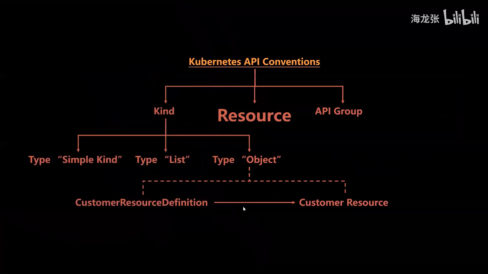
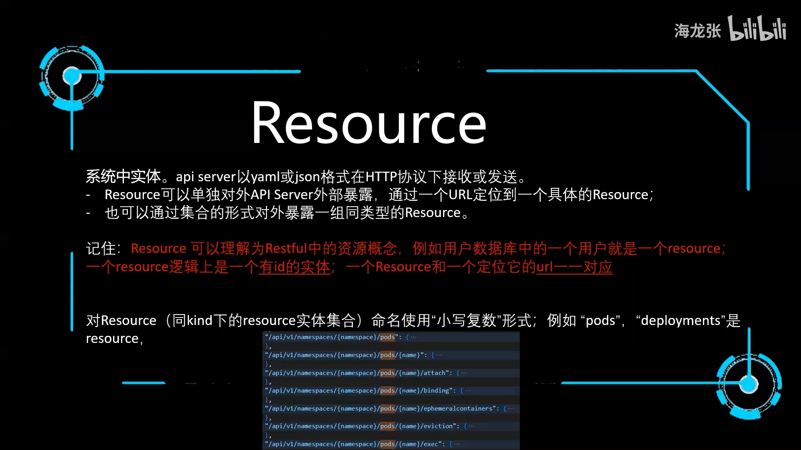
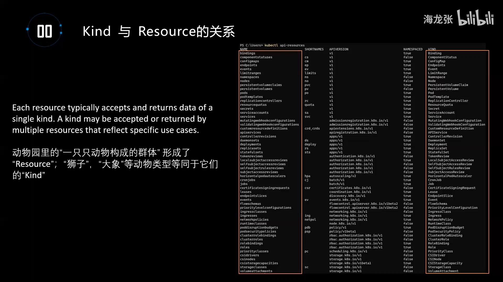
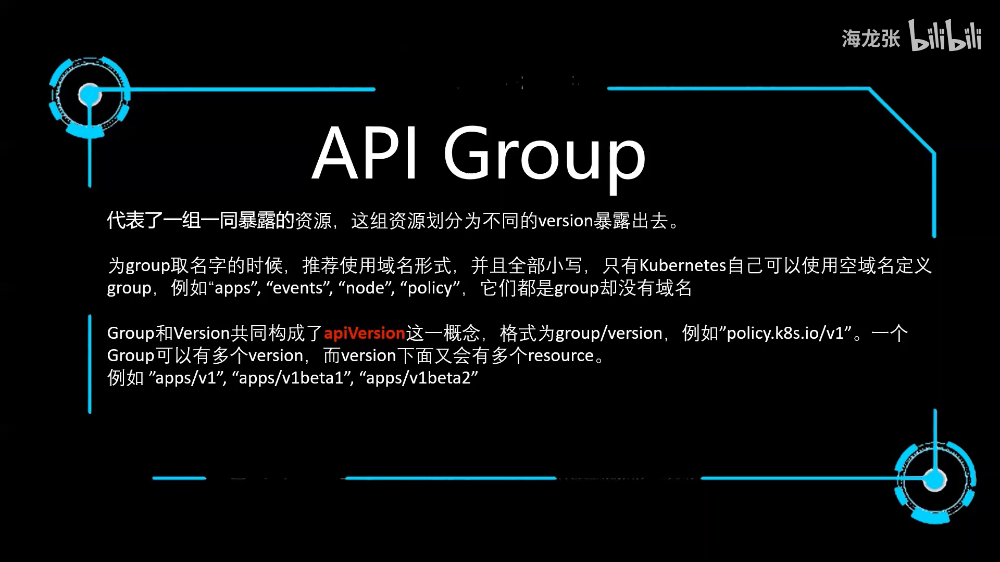
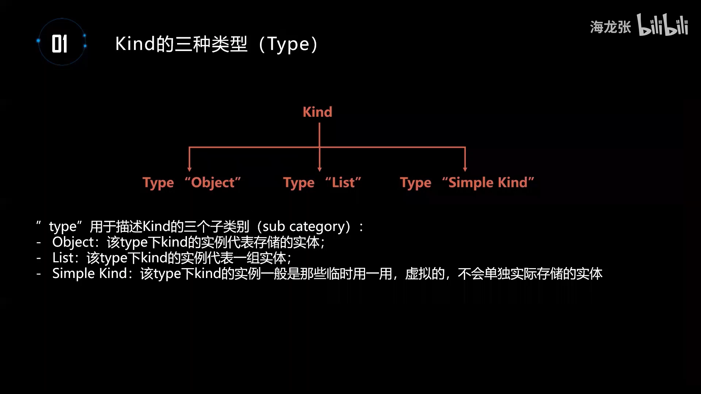
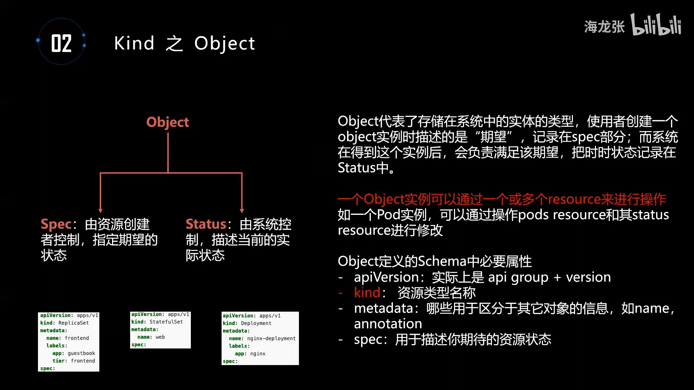
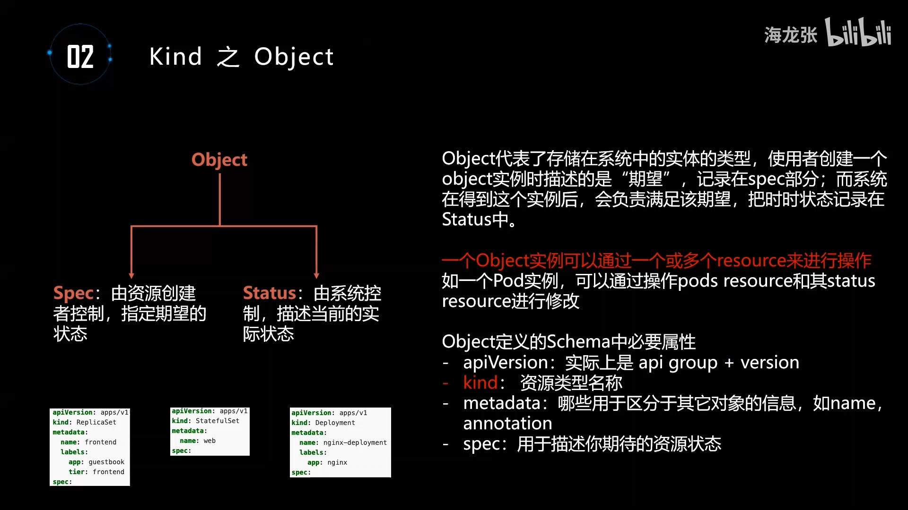
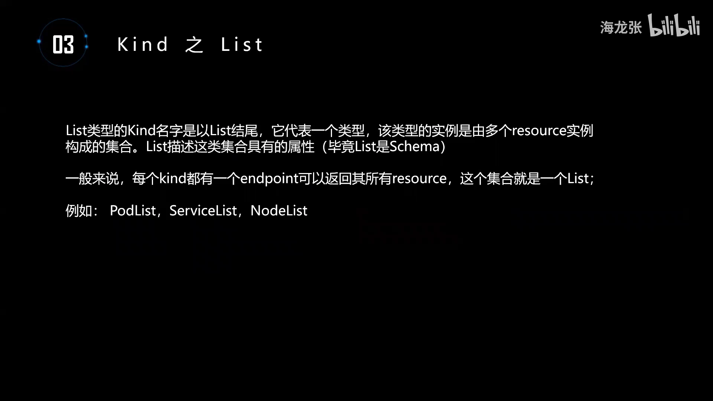
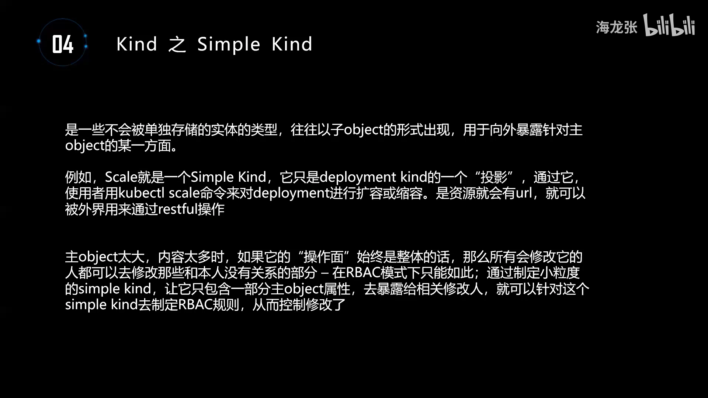
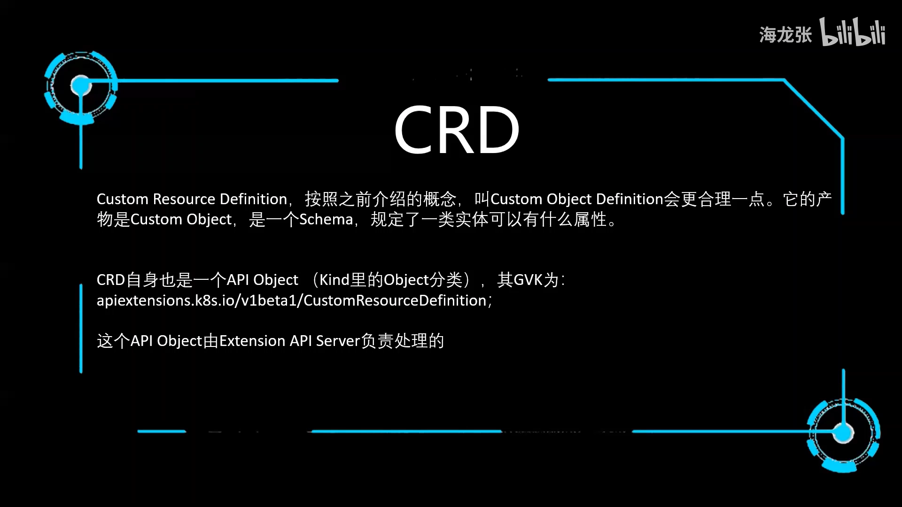

# Kubernetes API 中概念探究：Resource、Kind、Object 与 CRD

> 视频来源：[Kubernetes API 中概念探究 - Resource，Kind，Object，CRD ......](https://www.bilibili.com/video/BV1vY4y1J7Qx/)（Bilibili）
>
> 这一讲不写代码，而是把 Kubernetes API 背后那套**词汇体系**（Resource、Kind、Object、Group、Version、CRD……）一次讲透。它是读懂后续一切源码（控制器、Informer、API Server）的前提。
> 文稿左栏为 AI 中文字幕，本文已逐窗口纠正错拼（如"cbint api"→Kubernetes API、"can"→Kind、"c r d"→CRD）后重写。

## 本讲要解决的核心问题（SCQA）

**背景**：我们平时张口就是"Kubernetes resource""Kubernetes object"。可一旦去读源代码，就会发现除了 `resource`，还有一大串 `Kind`、`Object`、`Group`、`Version`、`Type`、`List`、`CRD` 之类的词，让人一头雾水。

**冲突**：这套概念体系**并不严密**——它用了很多"烂大街"的日常词汇来定义内部概念，导致同一个词在不同人嘴里意思不一样；在很多场合里，`resource` 和 `object` 甚至被混着用。[【跳转到 00:55】](https://www.bilibili.com/video/BV1vY4y1J7Qx/?t=55)

**疑问**：那么，Kubernetes API 到底有哪几个核心概念？它们之间是什么关系？`resource` 和 `Kind` 到底怎么区分？所有对象身上都会写的 `apiVersion`、`kind` 又分别对应谁？CRD 又在这套体系里扮演什么角色？

**回答（中心思想）**：Kubernetes API 的核心概念可以画成一张图——最左边是 **Kind**，中间是最重要的 **Resource**，最右边是一排 **Group**；三者都是通用的基础概念。[【跳转到 01:37】](https://www.bilibili.com/video/BV1vY4y1J7Qx/?t=97) 一句话概括：**Resource 是系统里一个个具体的"实体"（如某个 Pod），Kind 是定义"这一类实体长什么样"的 schema（如 Pod 这个类型），Group/Version 负责给它们分类与版本化，而 `group + version + kind` 三者合起来就是我们常说的 GVK。** 一个 Kind 往往对应多个 Resource；CRD 则是一种"用一个 API object 定义出另一个 API object"的扩展手段。

## 一、Resource：系统里一个个"实体"

**Resource 是最重要的一个概念**（作者在概念图里把它放到最大）。说白了，**它就是系统里边一个个的实体**。[【跳转到 04:04】](https://www.bilibili.com/video/BV1vY4y1J7Qx/?t=244)

它的运作方式很直观：当你向 API Server 请求、或向 API Server 发送时，传的就是以 **YAML 或 JSON 格式表述**的 resource，走的是 **HTTP 协议**。[【跳转到 04:04】](https://www.bilibili.com/video/BV1vY4y1J7Qx/?t=244)

- resource 可以**单独对外暴露**：这时一般有一个唯一的 **URL** 能定位到它；
- resource 也可以**以集合的形式**对外暴露。[【跳转到 04:29】](https://www.bilibili.com/video/BV1vY4y1J7Qx/?t=269)

作者给了一个非常好懂的类比：**把它理解成 RESTful 里的"资源"就好**。继续用数据库来打比方——数据库里的一条条记录，就是一个个 resource；逻辑上它有一个 `id` 来标识这个实体、有一个 URL 来定位它，从而让外部能访问到。[【跳转到 04:54】](https://www.bilibili.com/video/BV1vY4y1J7Qx/?t=294) 不要把它想得太复杂，**就是做 RESTful service 时说的那个 resource**。[【跳转到 05:19】](https://www.bilibili.com/video/BV1vY4y1J7Qx/?t=319)

### 1.1 Resource 的命名规则：小写复数

resource 的命名有明确规则：**用小写、复数的形式**，例如 `pods`、`deployments`。[【跳转到 05:44】](https://www.bilibili.com/video/BV1vY4y1J7Qx/?t=344)

作者举的例子是 OpenAPI 文档里关于 pod 的 path：你会看到这个 resource 一律用全小写的 `pods` 来表示（而不是 `pod` 或 `Pod`）。[【跳转到 06:09】](https://www.bilibili.com/video/BV1vY4y1J7Qx/?t=369)

> ⚠️ 注意区分：这里说的"一个 resource"其实严格讲是"**同一个 Kind 下边的一类实体集合**"，Kind 的概念下一节就说。

## 二、Kind：定义"这一类实体长什么样"的 schema

**每一个 Kind 本质上都是一个 schema。** Kind 翻成中文大概是"类型"。[【跳转到 09:39】](https://www.bilibili.com/video/BV1vY4y1J7Qx/?t=579)

那什么叫 schema？作者用 **XML schema** 来类比：它会定义这个 XML 里可以有什么样的节点、每个节点可以有什么属性、属性名是什么、属性的类型是 string 还是 int 等等。**这个"决定了你有什么属性"的东西，就叫 schema。** [【跳转到 10:04】](https://www.bilibili.com/video/BV1vY4y1J7Qx/?t=604)

所以 **Kind 就是一种 schema**：它定义了"属于这个 Kind 的实例，可以有什么样的属性"。[【跳转到 10:29】](https://www.bilibili.com/video/BV1vY4y1J7Qx/?t=629) 形象的例子：狮子可以是一个 Kind，大象也可以是一个 Kind——"狮子"这个 Kind 就规定：牙必须很长很尖利、脖子上必须长毛……满足这些属性才叫狮子。[【跳转到 10:54】](https://www.bilibili.com/video/BV1vY4y1J7Qx/?t=654)

### 2.1 Kind 的命名规则：驼峰式

和 resource 的"小写复数"不同，**Kind 要求用驼峰式（CamelCase），该大写就大写、该小写就小写**：`ReplicaSet`（R、S 大写）、`StatefulSet`（两个 S 大写）、`Pod` 等等。[【跳转到 11:19】](https://www.bilibili.com/video/BV1vY4y1J7Qx/?t=679)

### 2.2 Resource 与 Kind 的区别：一个 Kind 对应多个 Resource

命名规则一对比，就能看出 Kind 和 resource 的差别。作者让大家先看一条真实命令的输出：跑 `kubectl api-resources`，会把当前系统所有的 API resource 都列出来——**左边一列是 resource 的名字，右边一列是 Kind 的名字**。[【跳转到 11:49】](https://www.bilibili.com/video/BV1vY4y1J7Qx/?t=709)

例如：`binding`（全小写）对应的 Kind 是 `Binding`；resource 名字叫 `pods`，对应的 Kind 是 `Pod`（P 大写）。[【跳转到 12:14】](https://www.bilibili.com/video/BV1vY4y1J7Qx/?t=734)

用"动物园"类比：**一只只动物构成了一个群体，这个群体就是 resource 的集合，动物就是 resource；而"狮子、大象、熊猫"这些具体的动物类型，就是 Kind 的地位**。你拎出任何一只动物都能给它贴个标签"这是大象"——那就是 Kind；你拎出任何一个 resource 也能贴标签"这是 Pod"。[【跳转到 12:39 到 13:04】](https://www.bilibili.com/video/BV1vY4y1J7Qx/?t=759)

理解了这层关系，就能明白为什么在实际中大家经常把 resource 和 Kind 混用——**它们关系很近，但并不一样**。[【跳转到 13:29】](https://www.bilibili.com/video/BV1vY4y1J7Qx/?t=809)

Kubernetes 官方文档的一段英文给出了精确定义，含义是：

- **任何一个 resource，都有唯一的一个 Kind**；
- **但一个 Kind 下边，可能需要多个 resource 去代表它**。

作者以 `Pod` 为例：要操作 Pod 这种类型的 object，**第一个需要 `pods` 这个 resource**（用来描述你期望的 Pod，比如要几个 replicas），**第二个还需要 `status` 这个 resource**（供系统去 update "这个 Pod 现在被调度成什么状态了"）。所以**一个 Pod 这种 Kind，实际需要两个 resource 来对它进行操作**。[【跳转到 14:19】](https://www.bilibili.com/video/BV1vY4y1J7Qx/?t=859)

## 三、API Group 与 API Version：Group + Version 构成 apiVersion

有了 resource 的概念，Group 就简单了：**它就是把资源再分类、再分组的过程**。资源那么多，分成一个个小组管理会更好，于是有了 API group。[【跳转到 06:44】](https://www.bilibili.com/video/BV1vY4y1J7Qx/?t=404)

**随着时间推移，group 会演进，这就是用 version 来体现的**：比如 `v1beta1`、`v1beta2`、`v1` 等等。但在 Kubernetes 里比较"搞"的是——**这些 version 之间不是替代关系**：不是说 `v2` 出来 `v1` 就没了；它们**一直同时存在**，只是内部会有对象之间的转换方式（convert）。[【跳转到 07:09 到 07:34】](https://www.bilibili.com/video/BV1vY4y1J7Qx/?t=429)

### 3.1 Group 的命名约定：域名形式

API group 的命名有个小约定：**Kubernetes 推荐用"域名"的形式去定义 group**，只有 Kubernetes 自己保留了使用**空域名**的权利。[【跳转到 07:34】](https://www.bilibili.com/video/BV1vY4y1J7Qx/?t=454)

- 只用空域名的例子：`apps`、`events`、`NetworkPolicy` 所属的 group 等，它们没有域名形式；
- 别人（第三方）则必须用**域名形式**来命名；
- 并且**以 `.k8s.io` 结尾的域名，都是 Kubernetes 定义的**，别人不能以此结尾。[【跳转到 07:59】](https://www.bilibili.com/video/BV1vY4y1J7Qx/?t=479)

### 3.2 什么是 "API version"：group 加斜线再加 version

"谈 group 的时候并不多，但谈 API version 就非常多"。作者提醒：**"API version"这个叫法其实不准确**——它给人的感觉像只是一个 version，**实际上是 `group` + `version` 共同构成了 API version**。[【跳转到 08:24】](https://www.bilibili.com/video/BV1vY4y1J7Qx/?t=504)

格式就是：`group` 加一个斜线，再加 `version`。例如 `policy.k8s.io/v1`，这就构成了一个 API version。[【跳转到 08:49】](https://www.bilibili.com/video/BV1vY4y1J7Qx/?t=529)

这正好解释了写 YAML 时的现象：**定义任何一个 Kubernetes object，上来就要填一个 `apiVersion`**——填的就是它。一个 group 可以有多个 version，而 version 下边逻辑上就会有很多 resource。例如 `apps/v1` 就是一个 API version。[【跳转到 09:14】](https://www.bilibili.com/video/BV1vY4y1J7Qx/?t=554)

> 📌 **串起来看**：`apiVersion`（= group/version）+ `kind`（Kind）合在一起，就是 **GVK（Group-Version-Kind）**——它唯一地标识了"你要创建的是一个什么类型的对象"。这正是后面讲控制器、Informer、CRD 时反复出现的关键概念。

## 四、Kind 的三类 type：object、list、SimpleKind

Kind 之所以"最复杂"，是因为它下面**又分了三个 type**（准确说是三个 **category / 分类**）：`object`、`list`、`SimpleKind`。[【跳转到 09:09】](https://www.bilibili.com/video/BV1vY4y1J7Qx/?t=909)

作者也顺带提到，`Custom Resource Definition` 和 `Custom Resource` 也可以归到 object 这一类 type 下边。[【跳转到 02:27】](https://www.bilibili.com/video/BV1vY4y1J7Qx/?t=147)

### 4.1 object：真正被存进 etcd 的实体

**object 是最常用的类型**，代表"存储在系统中的实体的那种类型"。使用者创建一个 Pod，事实上描述的是"期望"，系统去满足这种期望，并把满足的状态写进 `status`。[【跳转到 16:04】](https://www.bilibili.com/video/BV1vY4y1J7Qx/?t=964)

所以**一个 object 可以"一劈两半"**：

- 一半是 **`spec`**：由资源的创建者去控制、填写（你的期望）；
- 另一半是 **`status`**：由系统把满足的情况填进去（当前实际状态）。

它本质上也是 schema，同样描述"这种 object 有什么属性"。[【跳转到 16:59】](https://www.bilibili.com/video/BV1vY4y1J7Qx/?t=1019)

因为 object 也是一种 Kind，所以**一个 object 实例可能要通过一个或多个 resource 来操作**（延续前面 Pod 需要 `pods` + `status` 两个 resource 的例子）。[【跳转到 17:24】](https://www.bilibili.com/video/BV1vY4y1J7Qx/?t=1044)

作者展示了三名"object 实例"的截图，它们的必要属性都齐备：`apiVersion`、`kind`、`metadata`、`spec` 等等。三张图分别是 `ReplicaSet`（apiVersion 为 `apps/v1`）、`StatefulSet`、`Deployment`。[【跳转到 17:49 到 18:14】](https://www.bilibili.com/video/BV1vY4y1J7Qx/?t=1069)

> 我们平时说的 **API object**，指的就是这个 `object`。[【跳转到 18:39】](https://www.bilibili.com/video/BV1vY4y1J7Qx/?t=1119)

### 4.2 list：object 实例的列表

**list 就是一个列表**，即 object 实例（resource 实例）的列表。比如 Pod 就有 `PodList`、Service 有 `ServiceList`、Node 有 `NodeList`。[【跳转到 19:06】](https://www.bilibili.com/video/BV1vY4y1J7Qx/?t=1146)

一般来说，每一种 resource 都会有一个 **endpoint / URL**，可以返回这种类型的所有 resource（即该 object 下的所有 resource）；这时返回的实际上就是这个 list。[【跳转到 19:31】](https://www.bilibili.com/video/BV1vY4y1J7Qx/?t=1171)

作者强调：**list 基本只出现在"返回结果"或"程序"这一层**——你不会在定义时把一个 `PodList` 定义成一种 service 或 object；它只是系统返回给你一个 resource list 时用的类型，类型名就叫 `List`。[【跳转到 19:56】](https://www.bilibili.com/video/BV1vY4y1J7Qx/?t=1196)

### 4.3 SimpleKind：逻辑存在、但不单独存储的"投影"

**SimpleKind 是虚的**——不会以它为单位去实际存储。它解决的是**权限粒度**问题。[【跳转到 19:56 到 20:21】](https://www.bilibili.com/video/BV1vY4y1J7Qx/?t=1196)

设想一个 Pod 很大，里面既有 `spec`、`status`，还有 `scale` 等等。作为操作者，你可能**只想改它的 `scale`（扩容 / 缩容）**，其它一概不许改。但 Kubernetes 的 **RBAC（基于角色的访问控制）做不到只授权"同一个 object 的某个字段"**——它都是以"人 + object"为单位来赋权的。[【跳转到 20:46】](https://www.bilibili.com/video/BV1vY4y1J7Qx/?t=1246)

**解决方案**就是定义一个"虚的 Kind"：例如 `scale` 这个虚 Kind，属性里包含 `replicas`。用它就能定义出一个虚的 object，**逻辑上存在，但在系统里不单独存储，而是依附在某个 Pod 上**。赋权时，就把这个 Kind 的权限单独授给"负责扩容的人"。[【跳转到 21:11 到 21:36】](https://www.bilibili.com/video/BV1vY4y1J7Qx/?t=1271)

所以 **SimpleKind 更像是主 object（主 Kind）的投影**——某一个方面属性集合的虚拟 object。`status` 其实也是同理：它只是给系统去操作某个 object 时用的虚拟 object。[【跳转到 22:26】](https://www.bilibili.com/video/BV1vY4y1J7Qx/?t=1346)

## 五、CRD：用一个 API object 定义出另一个 API object

按前面介绍的 resource / object 概念推，**CRD 其实应该叫 "Custom Object Definition" 更合理**——因为它的产物是定义出了一个 schema；而 schema 对应的是 object（一种 Kind），不是 resource。只是"Custom Resource Definition"这个叫法最早定下，就一直沿用至今。[【跳转到 22:42 到 23:07】](https://www.bilibili.com/video/BV1vY4y1J7Qx/?t=1362)

它的作用很直接：**通过 CRD 定义一个 schema，也就是定义一个 Custom Resource（严谨说叫 Custom Object），规定这类 resource 能有什么属性**。[【跳转到 23:32】](https://www.bilibili.com/video/BV1vY4y1J7Qx/?t=1412)

而"更为搞脑子"的一点是：**CRD 它自己就是一个 API object**——也就是说，**用一个 API object 定义出另一个 API object 来**。[【跳转到 23:57】](https://www.bilibili.com/video/BV1vY4y1J7Qx/?t=1437)

这个 CRD 自己的 GVK 是：

- `apiVersion`：`apiextensions.k8s.io/v1beta1`
- `kind`：`CustomResourceDefinition`

最后一点：**CRD 这个 object 实际上是由一个单独的 extension API server 去处理的**（作者后续在源码系列里会专门讲）。[【跳转到 24:22】](https://www.bilibili.com/video/BV1vY4y1J7Qx/?t=1462)

CRD 做好了之后，你就定义出了一个 Custom Object，接着就可以**用它去定义一个个实例**了——就像有了 Pod 这种 object，你就可以去定义"我这个 Pod 跑哪个 container、命名是什么"一样。[【跳转到 24:47 到 25:12】](https://www.bilibili.com/video/BV1vY4y1J7Qx/?t=1487)

## 小结

- **Resource** 是系统里一个个的实体，可理解为 RESTful 里的"资源"；命名用**小写复数**（`pods`、`deployments`）。
- **Kind** 定义"这一类实体长什么样"，本质是一个 **schema**；命名用**驼峰式**（`Pod`、`ReplicaSet`）。
- **一个 Kind 往往对应多个 resource**（Pod 需要 `pods` + `status` 两个 resource）；`resource` 与 `Kind` 常被混用但并不相同。
- **Group** 给资源分门别类，**Version** 体现演进；version 之间**并存 + convert**，不是替代。
- **API version = group + version**（如 `policy.k8s.io/v1`），也就是 YAML 里的 `apiVersion`；与 `kind` 合起来即 **GVK**。
- **Kind 有三类 type**：**object**（真正存进 etcd，分 `spec`/`status`）、**list**（返回结果的列表类型）、**SimpleKind**（逻辑存在但不单独存储的"投影"，用于细粒度授权）。
- **CRD** 用一个 API object 定义出另一个 API object；它自己的 GVK 是 `apiextensions.k8s.io/v1beta1` + `CustomResourceDefinition`，由独立的 extension API server 处理。

## 关键术语速查

| 术语 | 一句话解释 |
| --- | --- |
| Resource | 系统里的一个实体；RESTful 意义上的"资源"，命名小写复数（`pods`） |
| Kind | 定义一类实体属性的 schema，命名驼峰式（`Pod`） |
| Object | Kind 的三类 type 之一，真正被存进 etcd，分为 `spec` 与 `status` |
| List | Kind 的三类 type 之一，一批同类资源的列表类型（`PodList`） |
| SimpleKind | Kind 的三类 type 之一，逻辑存在但不单独存储的虚拟对象（如 `scale`） |
| API Group | 对资源再分类的分组；第三方用域名形式，`.k8s.io` 结尾归 Kubernetes |
| API Version | 实为 `group/version`（如 `apps/v1`），即 YAML 的 `apiVersion` |
| GVK | Group + Version + Kind，唯一标识一个对象类型 |
| CRD | CustomResourceDefinition，用一个 API object 定义出另一个 API object |
