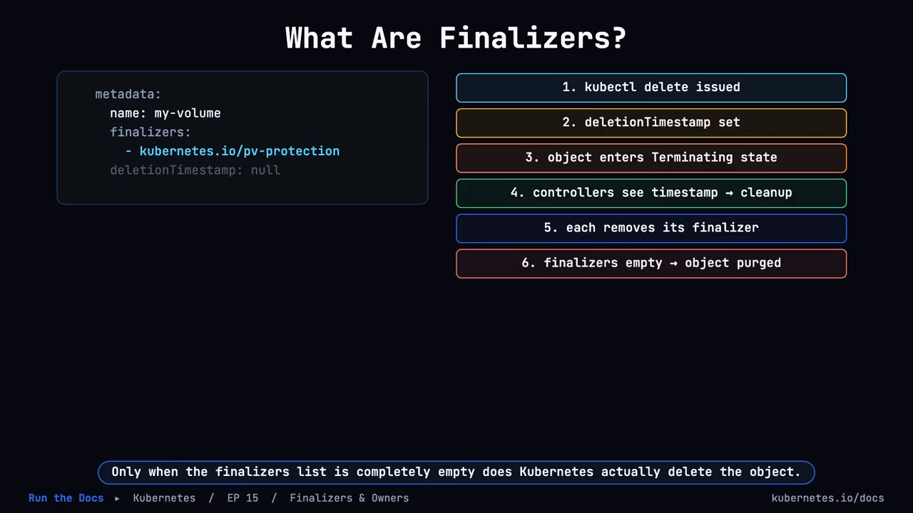
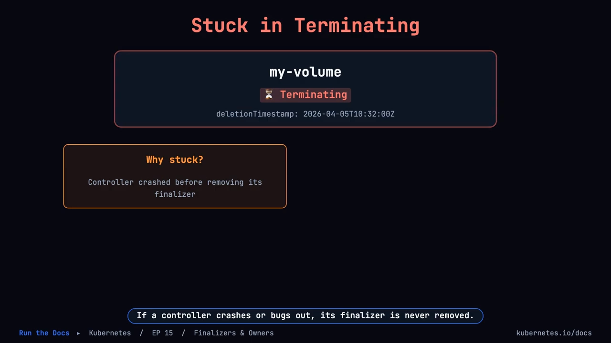
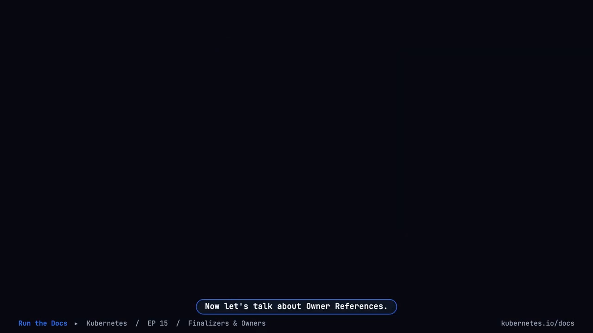
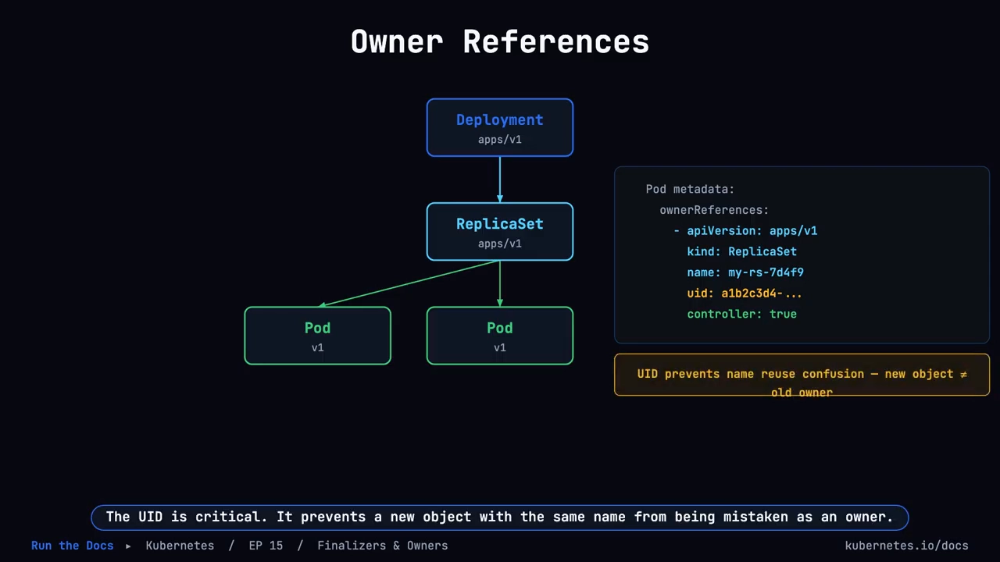
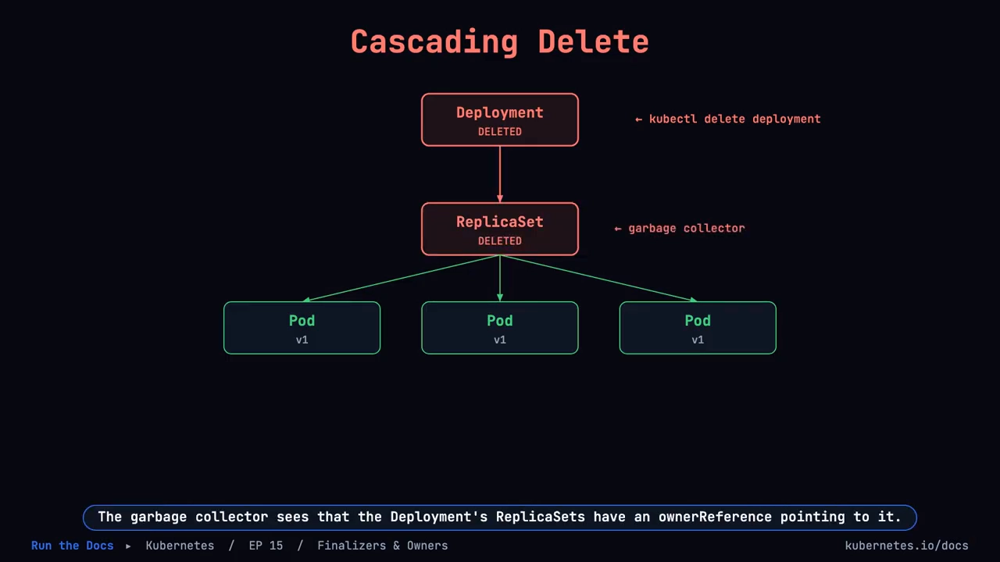
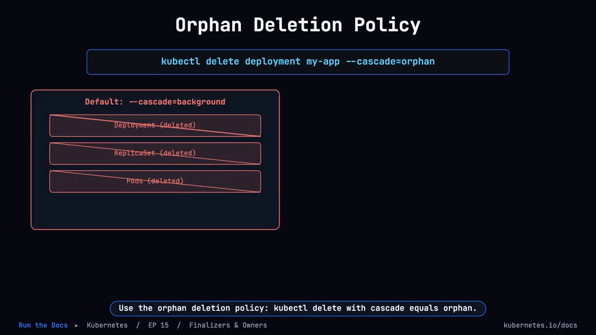
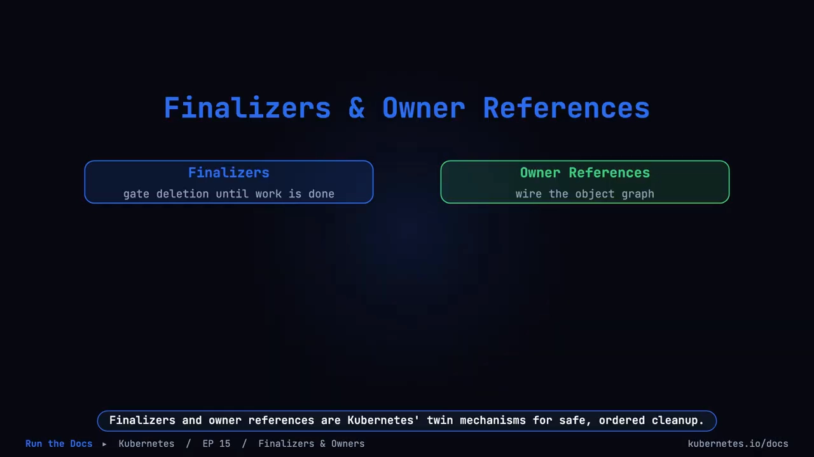

# Finalizer 与 OwnerReference：Kubernetes 的"安全有序删除"机制

> 视频来源：[K8s EP15 — Finalizers & Owner References](https://www.youtube.com/watch?v=4LIoF7U7lZA)（YouTube，频道 Run the Docs）
>
> 删掉一个 Pod，Kubernetes 立刻就把对象删掉了；可你要是删一个 PersistentVolume，它却"等"在那里不动——**同样是删除，为什么行为不一样**？这一讲用 5 分钟讲清 Kubernetes 对象删除背后的两套机制：**Finalizer 给删除装上"闸门"，OwnerReference 把对象连成"对象图"**。
> 文稿左栏为英文自动字幕，本文已翻译并纠正术语拼写后重写为中文。

## 本讲要解决的核心问题（SCQA）

**背景**：我们每天都在 `kubectl delete`。大多数资源（比如 Pod）一删就没，看上去删除就是"从 etcd 里把它抹掉"。

**冲突**：但有些对象不会被立刻删掉——**删除一个 PersistentVolume 时，Kubernetes 会等待**。[【跳转到 00:00】](https://www.youtube.com/watch?v=4LIoF7U7lZA&t=0) 更奇怪的是：删掉一个 Deployment，它下面的 ReplicaSet 和 Pod 会像多米诺骨牌一样**自动依次消失**，没人手工去删它们。

**疑问**：为什么有的对象删不掉、有的对象"跟着一起被删"？"删除"到底是几步？**谁**在删这些子对象？子对象又怎么知道自己的"父对象"是谁？如果想"只删父、留子"又该怎么做？

**回答（中心思想）**：Kubernetes 有**两套互补的机制**来保证删除"安全且有序"：[【跳转到 04:41】](https://www.youtube.com/watch?v=4LIoF7U7lZA&t=281)

- **Finalizer（终结器）**是对象 `metadata.finalizers` 列表里的一个键，它**给删除装上闸门**——收到删除请求后对象先被打上**删除时间戳**进入 `Terminating`，等各个控制器做完自己的清理、把自己的 finalizer 从列表里摘掉，**当列表彻底为空时对象才真正被删除**；[【跳转到 00:25】](https://www.youtube.com/watch?v=4LIoF7U7lZA&t=25)
- **OwnerReference（属主引用）**写在**子对象**上，表明"谁是我的父对象"（含父对象的 apiVersion、kind、name 与 **UID**），从而把对象连成一张**对象图**；**垃圾回收控制器（garbage collector）**据此发现"属主已不存在"的**孤儿对象**并删除它们，这就是**级联删除**。[【跳转到 02:36】](https://www.youtube.com/watch?v=4LIoF7U7lZA&t=156)

两者配合，让控制器能在**没有竞态条件**的前提下清理复杂状态。[【跳转到 04:41】](https://www.youtube.com/watch?v=4LIoF7U7lZA&t=281)

## 一、Finalizer：删除前的"闸门"

**Finalizer 是存在对象 `metadata.finalizers` 列表里的一个键**，它的含义是：**在你删除这个对象之前，必须先发生某件事**。[【跳转到 00:00】](https://www.youtube.com/watch?v=4LIoF7U7lZA&t=0)

### 1.1 两阶段删除

发起删除时，Kubernetes **不会立刻移除对象**，而是先给对象**设置一个删除时间戳（deletion timestamp）**——这是一个"软删除"信号。此时对象**进入 terminating 状态，但它依然存在**，`kubectl get` 仍然能看到它；**正在 watch 它的控制器看到这个时间戳，就去做该做的事**。每个控制器在自己的清理工作完成后，**把自己的那个 finalizer 从列表中移除**；**只有当 finalizers 列表彻底为空时，Kubernetes 才真正删除这个对象**。[【跳转到 00:25】](https://www.youtube.com/watch?v=4LIoF7U7lZA&t=25)

于是删除变成了两个阶段：[【跳转到 00:50】](https://www.youtube.com/watch?v=4LIoF7U7lZA&t=50)

- **阶段一**：删除请求到达，Kubernetes 给对象打上删除时间戳，对象进入 terminating 状态——它还在，`kubectl get` 还能看到；
- **阶段二**：各控制器执行清理——**卸载卷、释放 IP、排空队列**——然后各自 patch 对象、把对应的 finalizer 键从列表里摘掉；**当最后一个 finalizer 被移除，阶段二结束**，Kubernetes 才把对象从 etcd 中清除。[【跳转到 01:15】](https://www.youtube.com/watch?v=4LIoF7U7lZA&t=75)

### 1.2 finalizer 会把删除"卡住"

**finalizer 可以让删除无限期推迟**：如果某个控制器崩溃了、或者有 bug，它的 finalizer 永远不会被移除，对象就会**永远卡在 terminating 状态**。[【跳转到 01:40】](https://www.youtube.com/watch?v=4LIoF7U7lZA&t=100) 想手工解开，可以 `kubectl patch` 对象、把那个 finalizer 从列表里删掉——**但要小心：手工移除 finalizer 会跳过它原本要做的清理**。

### 1.3 内置 finalizer 与自定义 finalizer

最常见的两个内置 finalizer 是：[【跳转到 01:40】](https://www.youtube.com/watch?v=4LIoF7U7lZA&t=100)

- **`kubernetes.io/pv-protection`**：存在于**正被 PVC 绑定的 PersistentVolume** 上，**防止卷在还有 Pod 使用它的时候被删除**；
- **`kubernetes.io/pvc-protection`**：保护正在使用中的 PersistentVolumeClaim。

Operator 和自定义控制器也会定义自己的 finalizer——**任何合法的 label 字符串都可以作为 finalizer 的键**，例如 `finalizers.example.com/cleanup`。[【跳转到 02:05】](https://www.youtube.com/watch?v=4LIoF7U7lZA&t=125)

## 二、OwnerReference：把对象连成"对象图"

接下来是另一半：**属主引用**。[【跳转到 02:30】](https://www.youtube.com/watch?v=4LIoF7U7lZA&t=150)

在 Kubernetes 里，**对象可以有"父对象"**：ReplicaSet 拥有它的 Pod，Deployment 拥有它的 ReplicaSet。这层关系**编码在每个子对象的 `ownerReferences` 字段里**。[【跳转到 02:36】](https://www.youtube.com/watch?v=4LIoF7U7lZA&t=156)

**一个 ownerReference 包含父对象的：API 版本（apiVersion）、类型（kind）、名称（name）和 UID**。其中 **UID 至关重要**——它**防止"一个同名的新对象"被误认成父对象**。[【跳转到 02:36】](https://www.youtube.com/watch?v=4LIoF7U7lZA&t=156)

另外两条约束也值得记住：[【跳转到 03:01】](https://www.youtube.com/watch?v=4LIoF7U7lZA&t=181)

- **一个对象可以有多个属主**（multiple owners）；
- **但它们必须都在同一个命名空间里——跨命名空间的属主关系是不允许的**。

### 2.1 级联删除与"孤儿对象"

**ownerReference 驱动了级联删除。** 当你删除一个 Deployment，Kubernetes 先把它标记为待删除；**垃圾回收器看到它的 ReplicaSet 身上有指向它的 ownerReference，而属主已经不在了，于是删掉这些 ReplicaSet**——这又**接着触发**删除这些 ReplicaSet 所拥有的 Pod。整棵树**自动坍塌，无需任何手工清理**。[【跳转到 03:01】](https://www.youtube.com/watch?v=4LIoF7U7lZA&t=181)

这套自动清理由控制面里的**垃圾回收控制器（garbage collector controller）**负责：它**监视那些"属主已经不存在"的对象**——这些被称为**孤儿对象（orphaned objects）**，它们的 ownerReference 还在、但属主没了，**垃圾回收器就把它们删掉**。[【跳转到 03:51】](https://www.youtube.com/watch?v=4LIoF7U7lZA&t=206) 你可以直接删掉一个 ReplicaSet，几秒后就会看到它的 Pod 一并消失。[【跳转到 04:16】](https://www.youtube.com/watch?v=4LIoF7U7lZA&t=256)

### 2.2 不想级联？用 orphan 删除策略

有时候你**并不想级联删除，而是想保留子对象**。这时可以用**孤儿删除策略**：`kubectl delete --cascade=orphan`。它会**删除父对象、但让子对象继续活着**——代价是这些子对象的 ownerReference **现在指向了一个不存在的对象**（即成为孤儿）。孤儿策略适用于**迁移属主**或**在滚动发布期间保住正在运行的 Pod**。[【跳转到 04:16】](https://www.youtube.com/watch?v=4LIoF7U7lZA&t=256)

## 三、两者如何配合

> **Finalizer 和 OwnerReference 是 Kubernetes 处理"安全、有序清理"的一对孪生机制：Finalizer 给删除装上闸门，直到该做的工作做完；OwnerReference 则把对象连成一张对象图。两者结合，让控制器能在没有竞态条件的情况下清理复杂状态。**[【跳转到 04:41】](https://www.youtube.com/watch?v=4LIoF7U7lZA&t=281)

## 小结

| 机制 | 位置 | 作用 |
| --- | --- | --- |
| **Finalizer** | 对象 `metadata.finalizers` 列表 | 删除前设"闸门"：先打删除时间戳 → 进入 Terminating → 各控制器清理完并摘掉自己的 finalizer → 列表为空才真正删除 [【跳转到 00:25】](https://www.youtube.com/watch?v=4LIoF7U7lZA&t=25) |
| **卡住的删除** | 控制器崩溃/bug | finalizer 永不被移除 → 对象永远 Terminating；可用 `kubectl patch` 手工移除，**但会跳过原本的清理** [【跳转到 01:40】](https://www.youtube.com/watch?v=4LIoF7U7lZA&t=100) |
| **内置 finalizer** | PV / PVC | `kubernetes.io/pv-protection`、`kubernetes.io/pvc-protection`，防止使用中的存储被删 [【跳转到 01:40】](https://www.youtube.com/watch?v=4LIoF7U7lZA&t=100) |
| **自定义 finalizer** | Operator / 自定义控制器 | 任意合法 label 字符串都可作键，如 `finalizers.example.com/cleanup` [【跳转到 02:05】](https://www.youtube.com/watch?v=4LIoF7U7lZA&t=125) |
| **OwnerReference** | 子对象的 `ownerReferences` | 记录父对象的 apiVersion/kind/name/**UID**；多个属主必须同命名空间 [【跳转到 02:36】](https://www.youtube.com/watch?v=4LIoF7U7lZA&t=156) |
| **级联删除** | 垃圾回收控制器 | 属主消失 → 删除其"孤儿对象" → 逐层坍塌（Deployment→ReplicaSet→Pod） [【跳转到 03:51】](https://www.youtube.com/watch?v=4LIoF7U7lZA&t=206) |
| **保留子对象** | `kubectl delete --cascade=orphan` | 只删父对象，子对象存活（ownerReference 指向不存在的对象） [【跳转到 04:16】](https://www.youtube.com/watch?v=4LIoF7U7lZA&t=256) |
