# 深入理解 Kubernetes 标签与标签选择器

> 视频来源：[深入理解K8s的标签](https://www.bilibili.com/video/BV1jP6TYREb1/)（Bilibili，UP 主 莲城的老李）
>
> `kubectl get pods -l app=nginx`、Deployment 里那两个看起来重复的 `labels` 与 `selector`、调度时的节点亲和性——它们背后是同一套机制：**标签（label）负责"组织"资源，标签选择器（label selector）负责"筛选"资源**。这一讲把这对概念的语义、命令行与 YAML 两种用法、以及它在资源对象之间"牵线"的方式讲清楚。
> 文稿左栏为 B 站 AI 字幕，本文已逐窗口纠正错拼（如 `cooper control`→`kubectl`、`pd`→Pod、`YM`→YAML、`of ride`→`--override`）后重写。

## 本讲要解决的核心问题（SCQA）

**背景**：我们在 YAML 里写 `metadata.labels`，在命令里敲 `-l app=nginx`，都见过"标签"这个词；也知道 Deployment、Service 靠它找到自己的 Pod。

**冲突**：但标签本身只是一串**键值对**，它既不携带逻辑，也不产生行为——**真正让标签"生效"的是选择器**；而在 YAML 里，Deployment 的 `spec.selector` 与 `template.metadata.labels` 看起来几乎一样，写错一个字段就会被 apiserver 直接拒绝，报 `invalid value` / `does not match`。[【跳转到 12:21】](https://www.bilibili.com/video/BV1jP6TYREb1/?t=741)

**疑问**：标签到底是什么、为什么需要它？它有哪些增删改查的操作方式？选择器有哪些写法、多个条件之间是什么关系？`in` / `notin` / `exists` / `doesnotexist` 这些运算符什么时候用？YAML 里的 `matchLabels` 和 `matchExpressions` 有什么区别，为什么 `template` 的标签必须被 `selector` 选中？[【跳转到 00:00】](https://www.bilibili.com/video/BV1jP6TYREb1/?t=0)

**回答（中心思想）**：标签（label）是**附加在资源对象上的键值对**，一个对象可以带任意多个标签、一个标签也可以贴在任意多个对象上（**多对多**），它承担**"组织"资源**的职责；标签选择器承担**"筛选"资源**的职责，用在命令行的 `-l` / `--selector` 与 YAML 的 `spec.selector` 两处。[【跳转到 03:22】](https://www.bilibili.com/video/BV1jP6TYREb1/?t=322) 命令行的选择器支持**精确匹配与集合型运算符（`in`/`notin`/`exists`/`doesnotexist`，且必须小写）**；YAML 里则由 `matchLabels`（精确匹配）与 `matchExpressions`（匹配表达式）两种方式实现，**`template` 里的标签必须能被 `selector` 选中，否则 Deployment 创建失败**。[【跳转到 13:07】](https://www.bilibili.com/video/BV1jP6TYREb1/?t=787)

## 一、标签是什么：贴在对象上的"键值对便签"

**label 在中文里叫标签，它是一种键值对的信息，用于组织和筛选资源**——"组织"和"筛选"正是它的两个方面作用。[【跳转到 00:00】](https://www.bilibili.com/video/BV1jP6TYREb1/?t=0)

可以用微信联系人打比方：为了记住每一位好友的特征，我们给他贴上"吃货""臭美"这样的标签；同样具有这两个特征的联系人就被"组织"在了一起，之后想找这类人，不必翻遍整个通讯录，直接进入某个标签分组、在分组里缩小范围即可。[【跳转到 00:25】](https://www.bilibili.com/video/BV1jP6TYREb1/?t=25)

Kubernetes 里的 label 与微信标签非常相似：它可以被附加到资源对象上，两者之间是**多对多的关系**——**一个资源对象可以定义任意数量的 label，同一个 label 也可以被添加到任意资源对象上**。[【跳转到 00:50】](https://www.bilibili.com/video/BV1jP6TYREb1/?t=50)

## 二、标签的四个基本操作

视频把标签的操作分成四类：**创建、查看、修改、删除**。[【跳转到 01:15】](https://www.bilibili.com/video/BV1jP6TYREb1/?t=75)

### 2.1 创建（两种方式）

第一种是在 **YAML 文件**里创建：以 Pod 为例，就是在 `metadata` 下面的 `labels` 字段里，用键值对的方式定义任意多个标签。示例中定义了**应用标签、版本标签、环境标签、架构标签**四个。[【跳转到 01:15】](https://www.bilibili.com/video/BV1jP6TYREb1/?t=75) 文件准备好后执行 `kubectl apply -f nginx-pod.yaml` 即可创建。[【跳转到 01:56】](https://www.bilibili.com/video/BV1jP6TYREb1/?t=116)

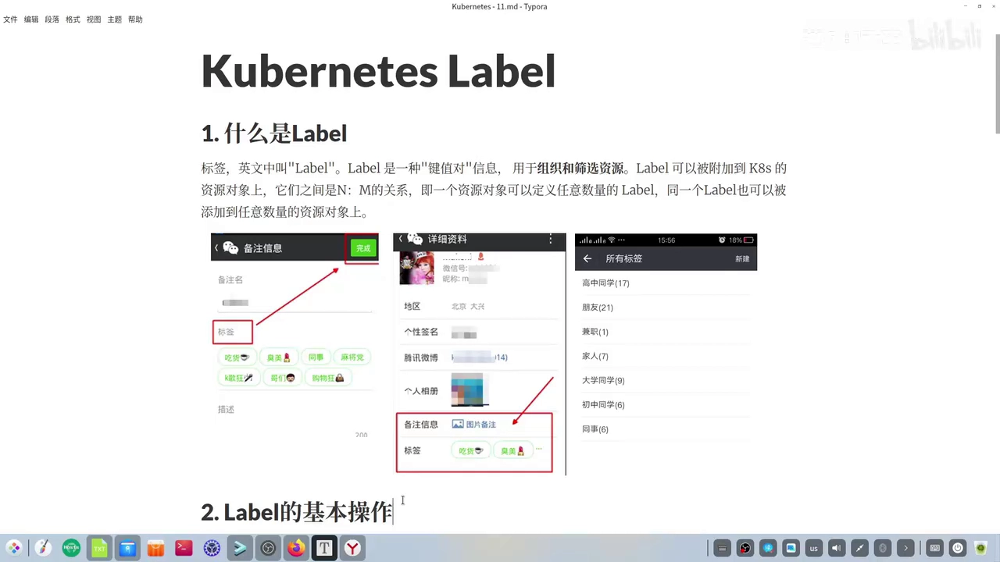

第二种是**为已存在的对象随时增加标签**，基本语法是 `kubectl label` 后面跟"资源类型 资源名"再加上 label 的 key 与 value；**一条命令可以添加多个 label，多个 label 之间用逗号分隔**。[【跳转到 02:13】](https://www.bilibili.com/video/BV1jP6TYREb1/?t=133) 示例是给已创建的 nginx Pod 增加一个分区（partition）标签。[【跳转到 02:38】](https://www.bilibili.com/video/BV1jP6TYREb1/?t=158)

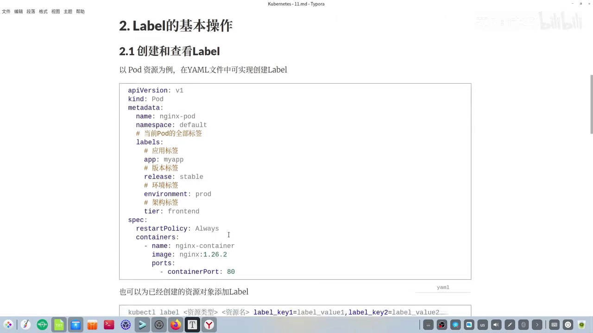

### 2.2 查看：`--show-labels`

查看某个资源对象的全部标签，语法是 `kubectl get` + "资源类型 资源名"，再加参数 `--show-labels`。[【跳转到 02:51】](https://www.bilibili.com/video/BV1jP6TYREb1/?t=171) 执行后，在资源的 `labels` 字段里就能看到它所有的标签。[【跳转到 03:04】](https://www.bilibili.com/video/BV1jP6TYREb1/?t=184)

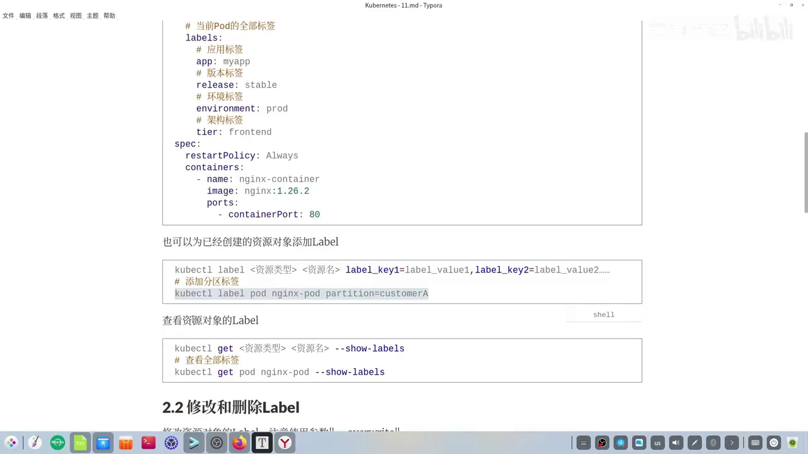

### 2.3 修改：`--override`

修改的语法是 `kubectl label` + "资源类型 资源名" + "label 的 key 与 value"，最后**补充一个 `--override` 参数**。[【跳转到 03:25】](https://www.bilibili.com/video/BV1jP6TYREb1/?t=205) 示例把 nginx Pod 的分区标签由 `customerA` 改成 `customerB`，改完再看，只有这个标签变了、其他标签不受影响。[【跳转到 03:56】](https://www.bilibili.com/video/BV1jP6TYREb1/?t=236)

> 📌 **一个容易踩的坑**：用 `--override` 操作某个资源时，**如果这个标签的 key 事先并不存在，这次操作就会变成"创建"操作**——原本以为只是"改一个已存在的标签"，结果是给对象新增了一个标签。[【跳转到 04:13】](https://www.bilibili.com/video/BV1jP6TYREb1/?t=253)

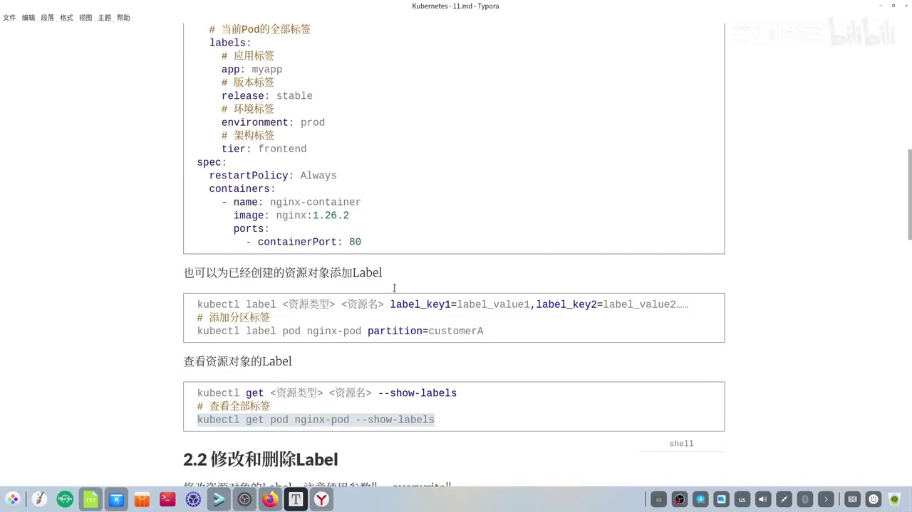

### 2.4 删除：key 后面加短横线

删除标签用 `kubectl label` + "资源类型 资源名" + "label 的 key"，**在后方加一个短横线符号（`-`）**。[【跳转到 04:47】](https://www.bilibili.com/video/BV1jP6TYREb1/?t=287) 删完再 `--show-labels`，对应标签就不再显示了。

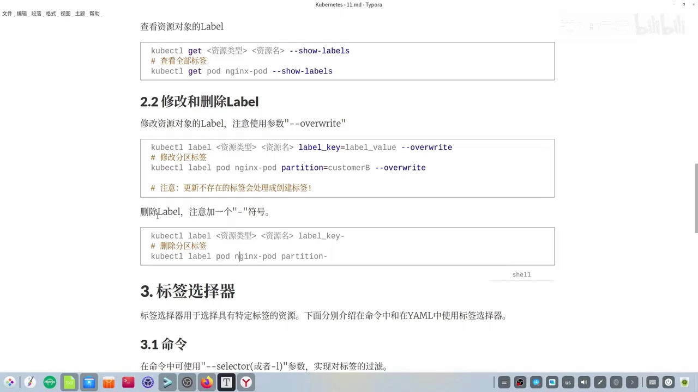

## 三、标签选择器：在命令行里"筛选"资源

前面讲的创建标签是标签**"组织"**资源的作用；**标签选择器则是"筛选"资源**——它用于选择具有特定标签的资源。它同样有两种使用场合：**命令行**与**YAML 文件**。[【跳转到 05:22】](https://www.bilibili.com/video/BV1jP6TYREb1/?t=322)

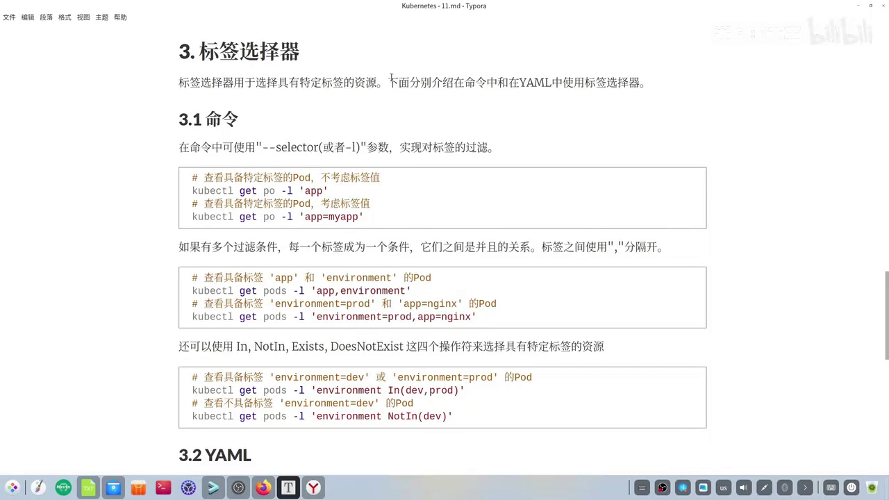

### 3.1 只写 key：检查"是否有这个标签"

在命令中可以用 `--selector` 或 `-l` 参数过滤。只给 key 时，是查"这个对象有没有具备某个标签"：在查看 Pod 的命令后面加 `-l` 再跟上标签的 key 即可。[【跳转到 05:47】](https://www.bilibili.com/video/BV1jP6TYREb1/?t=347)

### 3.2 写 key=value：必须同时满足

除了指定 key，还可以指定标签具体的值——这样对应的 Pod 必须 **key 和值同时满足**才会被选中。[【跳转到 06:10】](https://www.bilibili.com/video/BV1jP6TYREb1/?t=370)

### 3.3 多个条件：逗号分隔，彼此是"并且"

如果有多个过滤条件，**每一个标签成为一个条件，条件之间是"并且（AND）"的关系**；多个标签之间用逗号分隔。[【跳转到 06:36】](https://www.bilibili.com/video/BV1jP6TYREb1/?t=396)

视频给了一个"预期与结果不符"的对照实验，很能说明 AND 的语义：[【跳转到 07:35】](https://www.bilibili.com/video/BV1jP6TYREb1/?t=435)

- 目标 Pod 同时有 `app` 和 `environment` 标签，所以查得出来；
- 另一条命令同时指定了两个键值，其中 `environment=prod` **满足**，但 `app` 的 key 要求值等于 `nginx`，而目标 Pod 的值是 `myapp`——**只要有一个条件不满足，就查不出对应的资源**。[【跳转到 07:28】](https://www.bilibili.com/video/BV1jP6TYREb1/?t=448)

### 3.4 集合型运算符：`in` / `notin` / `exists` / `doesnotexist`

除了等值匹配，还可以用 **`in`、`notin`、`exists`、`doesnotexist`** 这四个操作符来选择具有特定标签的资源。[【跳转到 07:53】](https://www.bilibili.com/video/BV1jP6TYREb1/?t=473)

- **`in`**：值落在给定集合内即可。例如要求 Pod 具备 `environment` 标签，且它的值**要么是 `dev` 要么是 `prod`**，两者满足其一就行。[【跳转到 07:58】](https://www.bilibili.com/video/BV1jP6TYREb1/?t=478)
- **`notin`**：值与给定集合都不相等。例如要求具备 `environment` 标签，但值**不是 `dev`**。[【跳转到 09:16】](https://www.bilibili.com/video/BV1jP6TYREb1/?t=556)

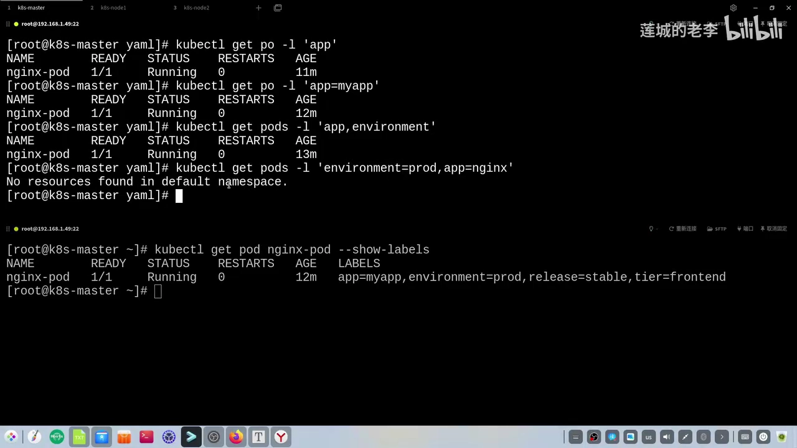

> 📌 **运算符必须小写**：视频里用大写写法执行时报了错，改成小写后才查得出结果——这一点在对照速查表时尤其容易看错。[【跳转到 08:23】](https://www.bilibili.com/video/BV1jP6TYREb1/?t=503) 本讲的速查表把等值/集合运算符逐一列出：`in`、`notin` 表示相等/不等，`>`、`<` 表示大于、小于，`exists`、`doesnotexist` 则针对"键是否存在"。[【跳转到 08:46】](https://www.bilibili.com/video/BV1jP6TYREb1/?t=526)

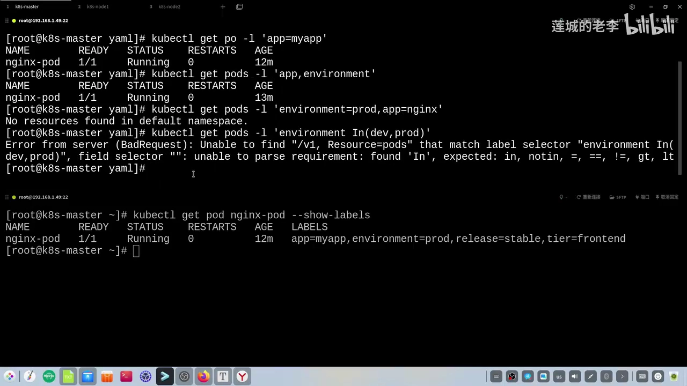

## 四、YAML 里的选择器：控制器如何"认领"自己的 Pod

命令行之外，标签选择器更重要的舞台在 **YAML**：它决定了"控制器与 Pod 之间的关联"。[【跳转到 09:27】](https://www.bilibili.com/video/BV1jP6TYREb1/?t=567)

这里先引入一个新概念——**Pod 控制器**。Pod 控制器有很多种，本讲只介绍其中一种 **Deployment**：它的主要作用是**负责创建 Pod，并维护 Pod 的状态**；所以这类控制器里通常会有一个配置项 `template`，用来描述"我们将会创建什么样的 Pod"，即 **Pod 模板**。[【跳转到 09:32】](https://www.bilibili.com/video/BV1jP6TYREb1/?t=592)

控制器必须与 Pod **建立关联**，而实现关联的手段就是**标签选择器**：`spec` 下面的 `selector`，会去选择对应的 Pod；**如果经过筛选后对应的 Pod 不存在，Kubernetes 会认为这样的 Deployment 创建出来没有意义，因而阻止它的创建（即创建失败）**。[【跳转到 10:17】](https://www.bilibili.com/video/BV1jP6TYREb1/?t=617)

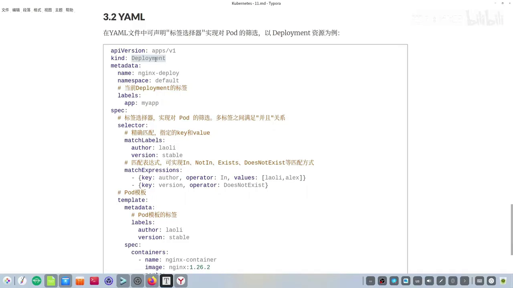

### 4.1 `matchLabels`：精确匹配

Deployment 寻找 Pod 有两种方式，第一种叫 **`matchLabels`**，可以简述为**精确匹配**：需要指定对应标签的 key 和 value，**其中有一个不满足就是"未找到"**；如果有多个标签，多个标签之间同样是**"并且"**的关系。[【跳转到 10:42】](https://www.bilibili.com/video/BV1jP6TYREb1/?t=642)

按示例数据，Deployment 要求意向的 Pod **同时具有 `author` 和 `version` 标签**，且 `author` 的值必须是"老李"、`version` 的值必须是 `stable`；而 **Pod 模板（`template`）的 `metadata` 里也定义了标签**，这些标签必须与上面的选择器匹配——示例中模板标签的 `author`、`version` 值与选择器一一对应，所以这个 Deployment 能创建成功。[【跳转到 11:07】](https://www.bilibili.com/video/BV1jP6TYREb1/?t=667)

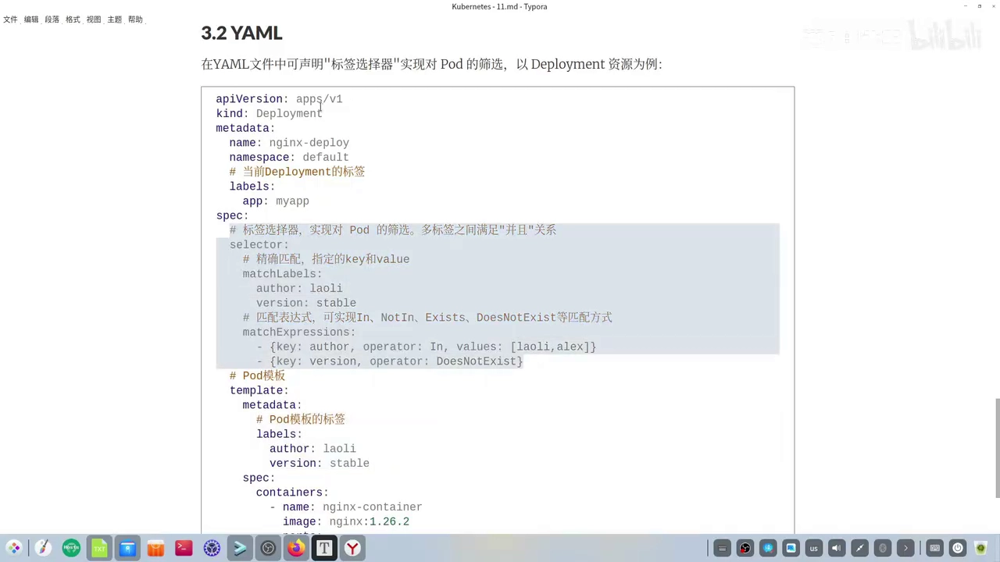

### 4.2 一次失败实验：模板标签"少写了一个"

视频特意演示了"不匹配"时会怎样：apply 之后报出 **`invalid value`（无效值）** 和 **`does not match`（不匹配）**，这就在提示**标签选择器与 Pod 模板的标签出现了匹配问题**。[【跳转到 12:21】](https://www.bilibili.com/video/BV1jP6TYREb1/?t=741)

排查后发现原因很朴素：**`selector` 要求 `author` 和 `version` 两个条件同时满足，而 Pod 模板里只写了 `author` 标签、漏了 `version`**——缺少一个条件，Deployment 就无法创建成功，补上 `version` 标签后（顺带修掉一个手误的单词）才创建成功。[【跳转到 12:46】](https://www.bilibili.com/video/BV1jP6TYREb1/?t=766)

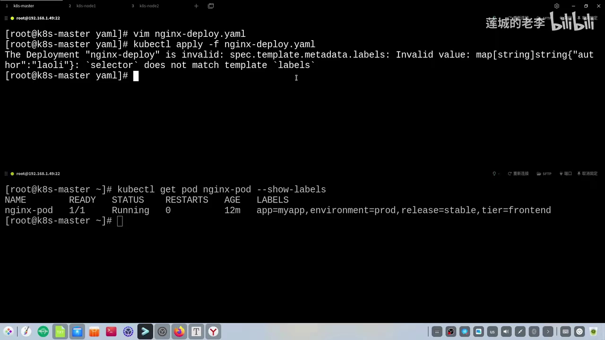

### 4.3 `matchExpressions`：匹配表达式

第二种方式是**匹配表达式**，即用 **`in`、`notin`、`exists`、`doesnotexist`** 这些匹配操作符来写。**如果有多条表达式，它们之间也是"并且"的关系**——需要同时满足第一条、第二条以及后面的若干条；**每一条指令又需要写上 `key`、`operator` 以及 `values`**，其中 **key 和 operator 是必选项，values 是可选项**（要不要写取决于所用的运算符）。[【跳转到 13:36】](https://www.bilibili.com/video/BV1jP6TYREb1/?t=816)

示例里有两条表达式：第一条要求 `author` 标签的运算符是 `in`，即它的值介于"老李"和 `Alex` 之间；第二条要求 `version` 标签的运算符是 **`doesnotexist`**——意味着**目标 Pod 不能带有 `version` 这个标签**。[【跳转到 14:01】](https://www.bilibili.com/video/BV1jP6TYREb1/?t=841) 而这次准备好的文件里，Pod 模板同时写了 `author` 和 `version`，与"`version` 必须不存在"相矛盾，**所以这个 Deployment 按理无法创建成功**——实测确实如此。[【跳转到 14:32】](https://www.bilibili.com/video/BV1jP6TYREb1/?t=872) 把匹配表达式里那条删掉（或者删掉模板里的 `version` 标签）之后，再 apply 就创建成功了。[【跳转到 15:07】](https://www.bilibili.com/video/BV1jP6TYREb1/?t=927)

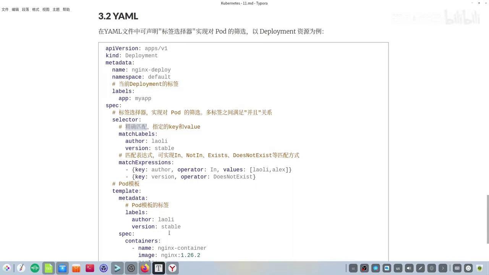

## 五、标签的使用场景

标签的使用场景非常多，本节结尾点了两个方向：[【跳转到 15:43】](https://www.bilibili.com/video/BV1jP6TYREb1/?t=943)

- **Pod 调度**：例如**节点亲和性（nodeAffinity）**，都是基于标签实现的；
- **服务发现与负载均衡**：**Service 如何派发流量**，也是基于 Pod 的标签实现的。

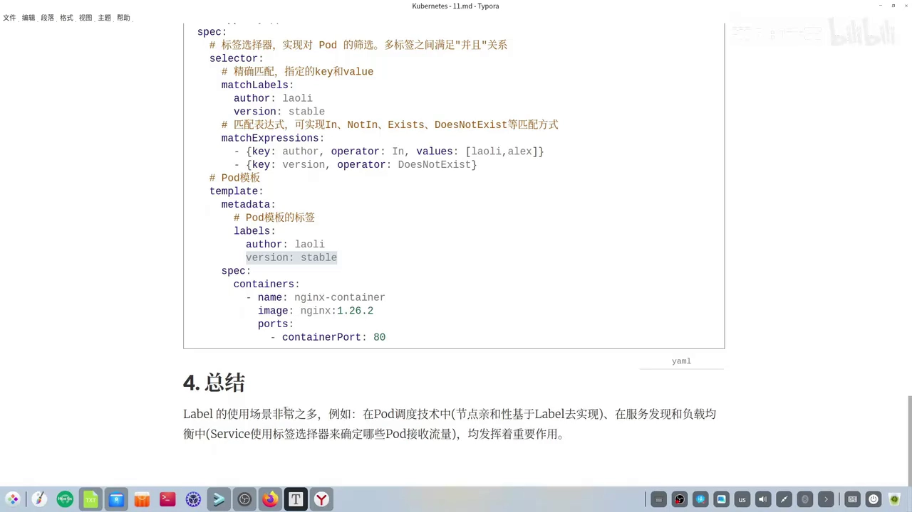

## 小结

| 主题 | 关键结论 |
| --- | --- |
| 标签的本质 | 附加在资源对象上的**键值对**，对象与标签之间是**多对多**关系 [【跳转到 00:00】](https://www.bilibili.com/video/BV1jP6TYREb1/?t=0) |
| 四大操作 | YAML `metadata.labels` 创建；`--show-labels` 查看；`--override` 修改（**key 不存在时等同于新增**）；`<key>-` 删除 [【跳转到 04:13】](https://www.bilibili.com/video/BV1jP6TYREb1/?t=253) |
| 命令行选择器 | `-l`/`--selector`：只写 key = 存在性；`key=value` = 精确；多条件逗号分隔且为 **AND** [【跳转到 06:36】](https://www.bilibili.com/video/BV1jP6TYREb1/?t=396) |
| 集合型运算符 | `in` / `notin` / `exists` / `doesnotexist`，**必须小写** [【跳转到 08:23】](https://www.bilibili.com/video/BV1jP6TYREb1/?t=503) |
| YAML 选择器 | `matchLabels`（精确匹配）与 `matchExpressions`（表达式，key+operator 必填、values 可选），多条之间为 **AND** [【跳转到 13:36】](https://www.bilibili.com/video/BV1jP6TYREb1/?t=816) |
| 创建失败的常见原因 | `spec.selector` 与 `template.metadata.labels` 不匹配 → `invalid value` / `does not match` [【跳转到 12:21】](https://www.bilibili.com/video/BV1jP6TYREb1/?t=741) |
| 典型用途 | Pod 调度（节点亲和性）、服务发现与负载均衡（Service）[【跳转到 15:43】](https://www.bilibili.com/video/BV1jP6TYREb1/?t=943) |
