# Deep Dive：etcd 的 Raft 内部机制——从共识算法到 etcd 源码

> 视频来源：[Deep Dive: etcd - Jingyi Hu, Google](https://www.youtube.com/watch?v=DrtdrdwDpZE)（KubeCon + CloudNativeCon China 2019，约 40 分钟）
>
> 讲者是 etcd 项目的维护者 Jingyi Hu。这场分享的目标很明确：**带你读懂 etcd 里 Raft 的源码**——先快速复盘 Raft 共识算法，再看 etcd 如何"使用"Raft，最后深入到 Raft 包的实现细节（靠一堆伪代码把源码结构讲清楚）。文稿左栏为英文自动字幕，本文已翻译并重写为中文。

## 本讲要解决的核心问题（SCQA）

**背景**：Kubernetes 集群的**所有状态都存在 etcd 里**；而 etcd 之所以能在多台机器之间保持一致、坏了还能自愈，靠的是 **Raft 共识算法**。

**冲突**：几乎人人都听说过"etcd 用 Raft"，但真要打开 etcd 源码去读时却无从下手——Raft 包里的 `Step`、`Ready`、`Message` 这些结构，和教科书/Raft 论文里的描述对不上，不知道从哪儿读起；也不清楚"共识"到底在哪一层、解决什么问题。

**疑问**：Raft 究竟解决什么问题？它的三大核心机制（法定人数 quorum、领导者选举、日志复制）是怎么运作的？etcd 又是如何把这个 Raft 包"嵌进"自己那套 KV 存储里的？

**回答（中心思想）**：**Raft 是一台"复制状态机"的引擎。它把共识本身抽象成一台极简的状态机——输入是消息（Message），输出是 `Ready`；只负责把日志复制到多数派、达成一致，而把网络传输和持久化存储统统留给使用者自己实现。** 于是读懂 etcd 使用 Raft 的方式，读源码就有了一条清晰的主线：**客户端请求 → `Propose` 生成消息 → 状态机 `Step` 处理 → 复制给多数派 → 标记 committed → 应用到 MVCC 键值存储。**

---

## 一、Raft 要解决的问题：让一群服务器"看起来像一台"

**Raft 想解决的核心问题是"复制状态机"（replicated state machine）。** 想象你有一组服务器，每一台都是一个状态机——比如在 etcd 里，它就是一个键值存储（KV store），你可以写 key、读 key，给定当前状态和输入，下一状态和输出是确定的。当客户端和**这一组**服务器打交道时，怎么保证在客户端眼里，**这一堆服务器表现得像一台单一、可靠的服务器**？[【跳转到 03:25】](https://www.youtube.com/watch?v=DrtdrdwDpZE&t=205)

举一个最直观的例子：客户端此刻发起一个写命令，把一对键值写进状态机，由服务器 A 处理了；**下一个瞬间客户端想读这个 key，可服务器 A 恰好不可用了，于是由服务器 B 来响应**。怎么保证服务器 B 本地状态机里的数据和 A 一模一样，从而返回正确结果？这就是问题所在。[【跳转到 04:15】](https://www.youtube.com/watch?v=DrtdrdwDpZE&t=255)

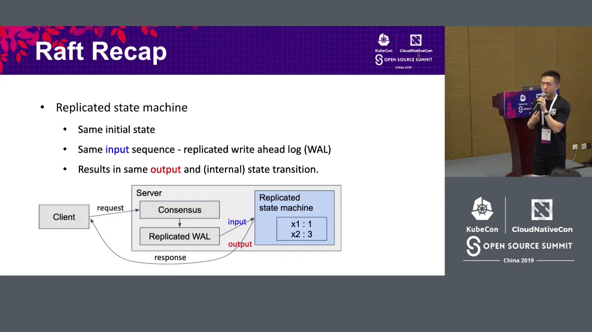

答案藏在"状态机"的性质里：**状态机在给定当前状态和当前输入时，下一状态和输出是确定的。** 所以只要能保证两件事——

1. 所有服务器**初始状态相同**（这要靠你选的启动/引导流程来保证）；
2. 所有服务器收到的**输入序列相同**；

那么它们的状态和输出就必然永远相同。于是问题被转化成一个更聚焦的问题：**如何把一个"输入序列"在所有服务器上排成同样的顺序？** [【跳转到 05:05】](https://www.youtube.com/watch?v=DrtdrdwDpZE&t=305)

**Raft 的答案是把输入先写进一个"日志"（log）。** 客户端想在状态机上执行的任何请求，都先写进一份由共识协议管理的日志；共识协议的职责，就是保证这份日志在不同服务器上**内容一致、顺序一致**。因为这份日志正是状态机的输入序列，只要它一致，复制状态机问题就解决了。

Raft 大致分成两部分：**第一步是领导者选举（leader election），第二步是领导者如何把日志复制（replicate）给集群里其余的服务器。** 下面先看 Raft 复盘的几块拼图。[【跳转到 06:45】](https://www.youtube.com/watch?v=DrtdrdwDpZE&t=405)

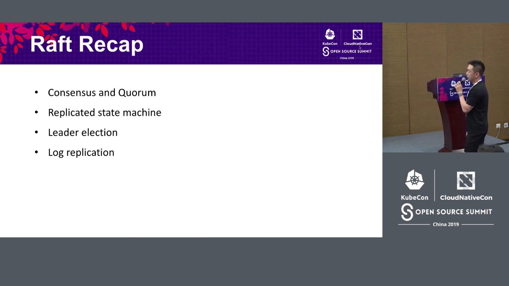

## 二、Raft 三大机制速览：法定人数、领导者选举、日志复制

### 2.1 法定人数（Quorum）：过半即可推进

**"法定人数"（quorum）本质上就是"多数派"（majority）。** 它的关键性质是：**任意两个法定人数的交集一定非空**（if Q1 and Q2 are quorum, their intersection is not empty）。这正是共识能"不打架"的根基。[【跳转到 01:45】](https://www.youtube.com/watch?v=DrtdrdwDpZE&t=105)

具体到不同规模的集群：

- 1 台服务器 → 法定人数是 1；
- 2 台服务器 → 法定人数是 2；
- 3 台服务器 → 法定人数是 **2**（不是 3）——因为从 3 台里任取 2 台，两组之间总能找到交集节点；
- 5 台服务器 → 法定人数是 **3**——比如"这 3 台"和"那 3 台"总能共享至少一个节点。

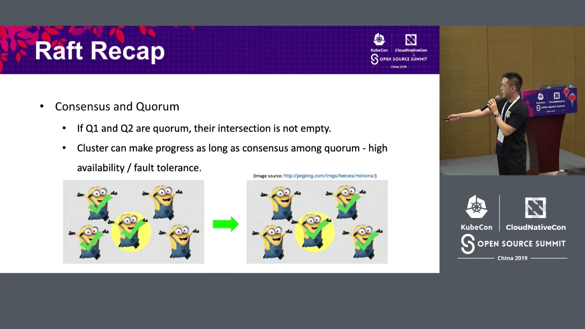

于是 Raft 有一个很实用的性质：**只要多数派达成一致，整个集群就能继续推进。** 5 台服务器里最多允许 2 台同时不可用，只要剩下 3 台（多数派）达成一致，集群照样对外服务客户——这就是高可用与容错的来源。[【跳转到 02:35】](https://www.youtube.com/watch?v=DrtdrdwDpZE&t=155)

> 一句话记住：**仲裁靠"过半"，而不是"全票"**。这正是 3 节点、5 节点这种奇数规模集群的意义所在。

### 2.2 领导者选举：一个任期只能有一个 Leader

**Raft 节点有三种角色：候选者（Candidate）、跟随者（Follower）、领导者（Leader）。** 选举围绕"任期"（term）展开。[【跳转到 06:45】](https://www.youtube.com/watch?v=DrtdrdwDpZE&t=405)

- **term 是一个逻辑时钟**：每个 term 开始时发起一次选举；每个节点在一个 term 内只能给一个节点投票；
- **拿到多数派选票的节点当选 Leader**——所以**一个 term 里最多只有一个 Leader**；
- **Leader 当选后管理这个 term 的其余时间**，并周期性地发送**心跳（heartbeat）**，让大家知道 Leader 还在位。

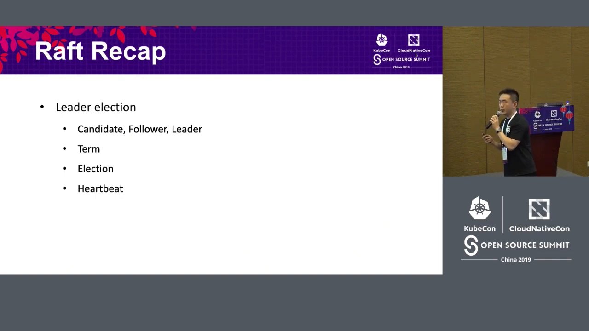

### 2.3 日志复制：只有 Leader 写日志，多数派确认即"已提交"

**只有 Leader 管理这份复制日志。** 客户端请求到达 Leader 时，就变成一条新的 Raft 日志条目（log entry）：**Leader 先把它追加到自己本地的日志，再不断尝试把日志复制给集群里其他 Raft 节点。** [【跳转到 08:25】](https://www.youtube.com/watch?v=DrtdrdwDpZE&t=505)

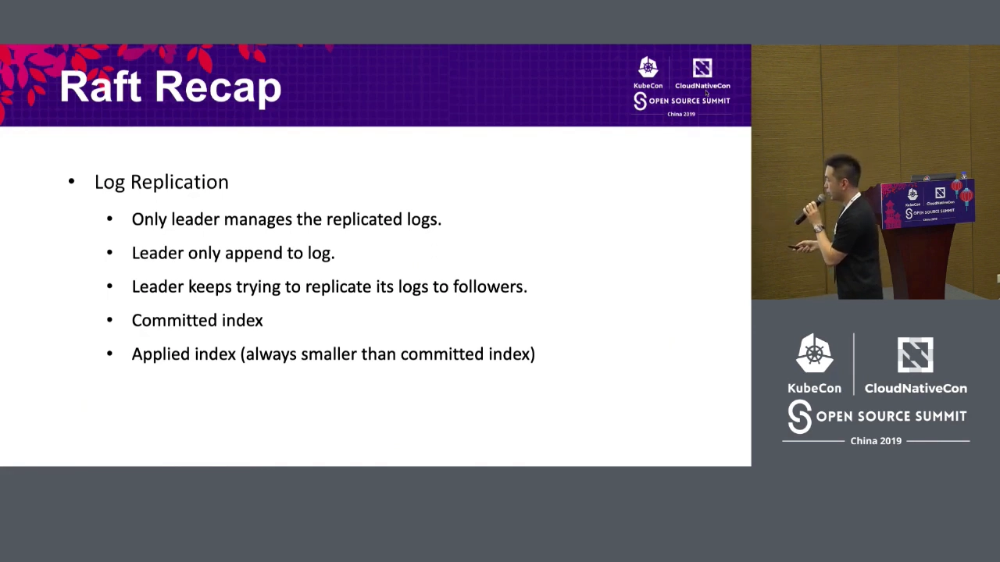

- 日志是**按索引编号**的：log 0、1、2、3、4……
- **Leader 会监控每个节点的进度**：比如节点 A 的日志到索引 3，节点 B 到索引 6；
- **当某条日志被"多数派"节点拥有时，它就被标记为"已提交"（committed）**；一旦 committed，全体节点就可以安全地把它**应用（apply）**到状态机。

举例：Leader 有 0~9 条日志，正在向另外两个节点复制；节点 A 有 0、1、2、3，节点 B 有 0、1、2、3、4。因为 **Leader 和节点 B 都有第 4 条**，所以 **0~4 都算已提交**（多数派已经拥有）。之后每个本地节点都从 Leader 那里得知"哪些日志已提交"，并据此 apply。[【跳转到 09:25】](https://www.youtube.com/watch?v=DrtdrdwDpZE&t=565)

> 逻辑闭环：**"多数派拥有" = "已提交" = "可以安全 apply"**。这就是 Raft 把"输入序列在所有节点上保持一致"落地的具体办法。

## 三、etcd 如何用 Raft：把共识模块装进 KV 存储

理解了 Raft 之后，就能看懂 etcd 的整体数据流了。它和上面那张"复制状态机"的图几乎一样，只是把各个角色落到实处。[【跳转到 11:25】](https://www.youtube.com/watch?v=DrtdrdwDpZE&t=685)

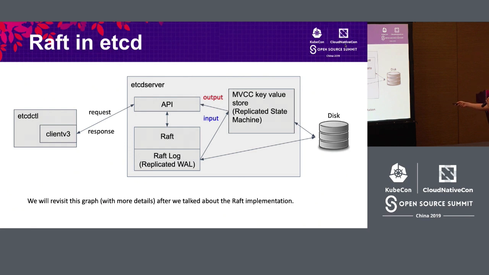

从外到内拆开看：

- **客户端**：例如命令行工具 `etcdctl`（它内嵌了 etcd 的客户端库），或者 Kubernetes 的 **API Server**——它内嵌了 client v3 库，用来和 etcd 集群通信；
- **etcd server**：对外提供 API，收到请求后把请求交给**Raft 共识模块**；
- **Raft 模块**：负责让这份日志在多数派上达成一致；
- **MVCC 键值存储**：Raft 把"已提交"的日志条目按顺序 apply 到这里，这就是 etcd 内部真正的"状态机"（多版本并发控制 KV 存储）；
- **磁盘**：输入（日志）和状态机的状态都要落盘。

一次请求的流转是这样的：客户端把请求发给某个 server，请求被转交到 Raft 模块；**如果这个 server 不是 Leader 而是 Follower，请求会被转发给 Leader**；Leader 把它追加进自己的 Raft 日志，再复制给其他节点；当**多数派都拥有了这条条目**，就被标记为 committed，各 server 便把它 apply 到 MVCC 存储。请求可能是"读一个 key"或"写一个 key-value"——写成功就回 "write successful"，读就返回值，最后结果再**原路返回给客户端**。[【跳转到 13:00】](https://www.youtube.com/watch?v=DrtdrdwDpZE&t=780)

> 为什么反复强调"持久化"？因为 **server 会崩溃、会重启**。只有把状态机的输入和状态机本身都持久化到磁盘，崩溃重启后才能通过回放恢复到正确的状态。[【跳转到 12:55】](https://www.youtube.com/watch?v=DrtdrdwDpZE&t=775)

## 四、源码级剖析：Raft 包本身就是一台状态机

接下来是本场分享的"深水区"——讲者用一堆伪代码，把 etcd 的 Raft 包（`go.etcd.io/etcd/raft`）的结构串了起来。

### 4.1 极简设计：只管共识，不管存储与网络

etcd 里 Raft 包的设计哲学是**极简（minimalistic）**：为了灵活、确定性和性能，**Raft 包本身不实现持久化存储，也不实现 Raft 节点之间的网络传输**。[【跳转到 13:25】](https://www.youtube.com/watch?v=DrtdrdwDpZE&t=805)

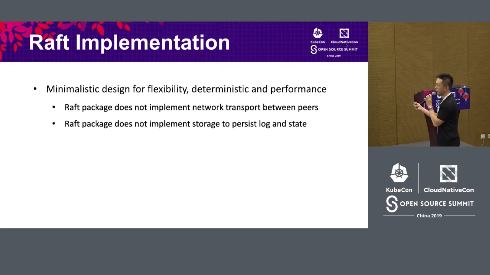

- 节点之间当然有消息往来（比如 Leader 给 Follower 复制日志），但"怎么把字节发过去"由**使用者自己实现网络传输**；
- 日志与状态要落盘，但"怎么写磁盘"也由**使用者自己实现存储层**。

这样"少做一点"带来两个好处：

1. **更灵活**：你可以自由选择自己的网络与存储实现；
2. **行为确定（deterministic）**：确定性非常宝贵——它意味着这个包**更容易实现、更容易测试、也更容易论证其正确性**。

**而且 Raft 本身被建模成了一台状态机。** 既然是状态机，那就要回答三个问题：**它的状态（state）是什么？输入（input）是什么？输出（output）是什么？状态之间又如何迁移？** [【跳转到 15:05】](https://www.youtube.com/watch?v=DrtdrdwDpZE&t=905)

### 4.2 状态、输入与输出：`raft` / `Message` / `Ready`

讲者先给了一句"免责声明"：展示的代码大多是**伪代码**（为了塞进屏幕），但它和真实源码非常像，所以之后读真源码会很眼熟。

**① 状态（State）——`raft` 结构体**：[【跳转到 15:30】](https://www.youtube.com/watch?v=DrtdrdwDpZE&t=930)

```go
// 伪代码，示意 raft 包的状态
type raft struct {
    id    uint64        // 节点 ID
    Term  uint64        // 任期（逻辑时钟）
    Vote  uint64        // 本任期把票投给了谁
    raftLog ...         // 复制日志：保证各节点日志一致
    state ...           // 本节点角色：Leader / Candidate / Follower
}
```

它包含：**节点 ID**、**Term（任期，像一台逻辑时钟；每个成员在一个 term 内只能投一票，这里记录投给了谁）**、**raftLog（我们一直在说的日志）**，以及**状态（Raft 节点可以是 Leader、Candidate 或 Follower）**。此外还有一个很有意思的 **`step` 函数**，它有多种实现，按角色分派：Leader 走 `stepLeader`，Follower 走 `stepFollower`……[【跳转到 15:55】](https://www.youtube.com/watch?v=DrtdrdwDpZE&t=955)

**② 输入（Input）——`Message` 结构体**：[【跳转到 16:20】](https://www.youtube.com/watch?v=DrtdrdwDpZE&t=980)

```go
// 伪代码
type Message struct {
    Type    MessageType  // 消息类型，如 MsgVote（请求投票）、MsgApp（复制日志）
    To      uint64       // 目的节点
    From    uint64       // 来源节点
    Entries []Entry      // 可携带一批日志条目（如 Leader 向 Follower 复制日志时）
}
```

Raft 状态机的**输入是一条"消息"**。消息有不同的类型，例如 **`MsgVote`**（请求投票）、**`MsgApp`**（Leader 复制日志给其他节点时使用）；还带有**目的节点、来源节点**，以及**一批日志条目**。

**③ 输出（Output）——`Ready` 结构体**：[【跳转到 17:10】](https://www.youtube.com/watch?v=DrtdrdwDpZE&t=1030)

Raft 状态机的**输出被包在 `Ready` 结构体里**，意思是"这些东西已经准备好被使用者取走、处理了"。它包含：

- **raft 状态**：需要被保存到存储（因为 Raft 包本身不含持久化存储实现）；
- **需要落盘的日志条目**；
- **已提交条目（committed entries）**：可以安全地 apply 到 KV 存储；
- **要发送的消息**：因为 Raft 包不含网络传输，所以谁用这个包，谁就得把这些消息真正投递到目的节点。

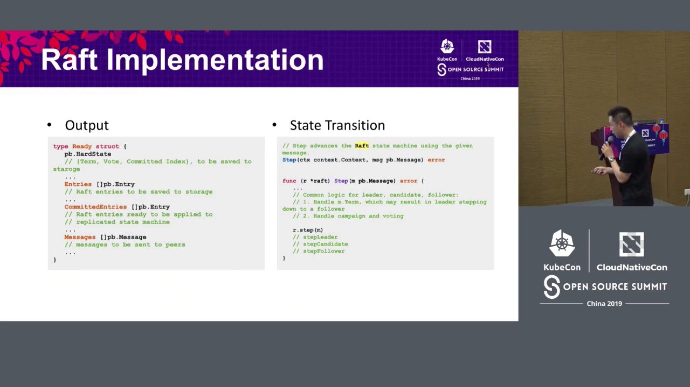

状态如何迁移？核心函数就是 **`Step`（首字母大写）**：它**用给定的输入（消息）推进 Raft 状态机到下一个状态，并产出输出**。函数内部先有一段 Leader/Candidate/Follower 共用的公共逻辑，随后调用按角色分派的**小写 `step` 函数**（`stepLeader` / `stepFollower` 等）。[【跳转到 18:25】](https://www.youtube.com/watch?v=DrtdrdwDpZE&t=1105)

### 4.3 亲手走一遍：一次写请求的完整生命周期

这是全场最"解渴"的部分——讲者把"客户端写一个键值"从入口一路追踪到落盘。

**第 1 步：`Propose` 生成消息。** 客户端请求（比如写一个 key-value）在 Raft 层被序列化成一个字节切片，然后由 `Propose` 函数生成一条消息，喂给本节点的 Raft 状态机。这个例子里，假设处理请求的是一个 Follower。[【跳转到 19:15】](https://www.youtube.com/watch?v=DrtdrdwDpZE&t=1155)

```go
// 伪代码/源码示意
func (n *node) Propose(ctx context.Context, data []byte) {
    // data 即序列化后的客户端命令
    // 生成一条 MsgProp 消息（Type = MsgProp），携带 Entries = data
}
```

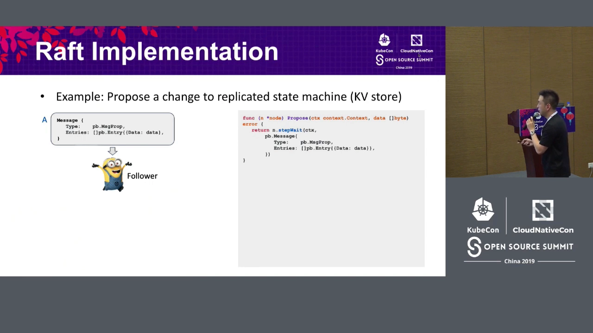

消息（叫它 **message A**）类型是 **`MsgProp`**，携带的 entries 就是客户端命令的数据。它进入这个 Follower 的 Raft 状态机，最终走到 **`stepFollower`**。

**第 2 步：Follower 把请求转发给 Leader。** `stepFollower` 按消息类型选择分支——本例中，它把**目的节点标记为集群的 Leader，并"发送"这条消息**。**注意这里的"发送"是假的**：因为 Raft 包不实现网络传输，所谓 `send` 只是把消息标记为"来自自己"，然后追加进本地的**消息队列**。[【跳转到 21:50】](https://www.youtube.com/watch?v=DrtdrdwDpZE&t=1310)

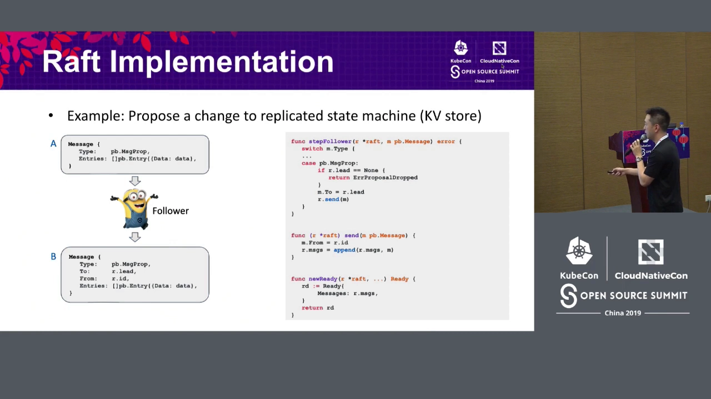

这条消息（叫它 **message B**）随后会出现在这个 Follower 状态机的 `Ready` 输出里（更准确地说，是出现在 `Ready.Messages` 字段）。**真正把它送到 Leader 的，是使用者实现的网络传输层**——它负责把 message B 从 Follower 的输出送到 Leader 的输入。[【跳转到 23:00】](https://www.youtube.com/watch?v=DrtdrdwDpZE&t=1380)

**第 3 步：Leader 处理 `MsgProp`，产生 `MsgApp`。** Leader 收到 `MsgProp` 后：**先把消息里的 entries 追加到自己的 Raft 日志**，然后**为集群里的其他每个节点生成一条 `MsgApp` 消息**（类型变了，因为现在是"复制日志"）：目的节点是该 peer，entries 里包含 Leader 自己的条目，以及 commit index（已提交位置）。这些消息同样走 `send`、进入 Leader 的 `Ready.Messages`。[【跳转到 24:10】](https://www.youtube.com/watch?v=DrtdrdwDpZE&t=1450)

**第 4 步：多数派拥有 → 标记 committed。** Leader 一直在监控每个节点的进度，当多数派已经拥有了某条日志，就标记它为 **committed**，并发出带**最新 commit index** 的消息，告诉所有人"整个集群的进度到哪儿了"。[【跳转到 24:45】](https://www.youtube.com/watch?v=DrtdrdwDpZE&t=1485)

**第 5 步：Follower 得知已提交，条目进入 `Ready.CommittedEntries`。** 最初那个 Follower 收到更新后的 commit index，就知道新条目已经提交、可以安全 apply 了。于是这条日志会作为**已提交条目**，出现在它 Raft 状态机输出的 `Ready.CommittedEntries` 里，**随时可以被 apply 到 KV 存储**。[【跳转到 26:30】](https://www.youtube.com/watch?v=DrtdrdwDpZE&t=1590)

> 讲者在这里点出了"读源码的方法论"：**给定一个输入，结合当前状态（你是 Leader 还是 Follower），就会走上不同的状态迁移路径，进而生成更多消息与条目，最终体现在 `Ready` 输出里。** 抓住"输入 → 状态迁移 → 输出"这条线，就能把散落的代码串起来。[【跳转到 25:30】](https://www.youtube.com/watch?v=DrtdrdwDpZE&t=1530)

## 五、把 Raft 包用起来：一个 handling loop

回到那张"Raft in etcd"的图，现在有了更多细节。既然 Raft 包不实现存储接口、不实现网络传输，那**使用它的人就必须自己补齐这两块**，并写一个**处理循环（handling loop）**来消费本地 Raft 状态机输出的 `Ready`。[【跳转到 27:35】](https://www.youtube.com/watch?v=DrtdrdwDpZE&t=1655)

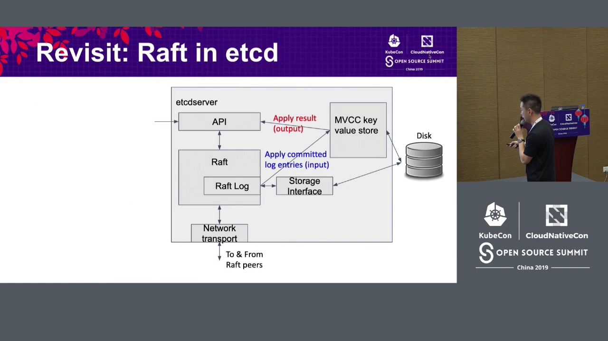

拿到一个 `Ready` 之后，标准的处理顺序是：

1. **持久化**：用你自己的存储实现，保存 `Ready` 里的状态（HardState）和日志条目；
2. **发送消息**：用你自己的网络传输实现，把 `Ready.Messages` 里的消息真正投递出去（你有责任把它们送达）；
3. **应用已提交条目**：对 `Ready.CommittedEntries` 里的条目执行 apply。

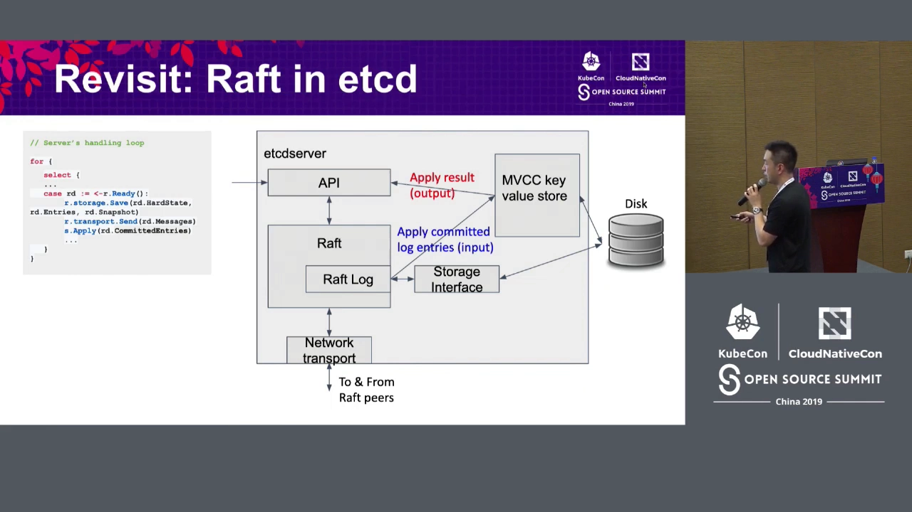

站在一个**客户端请求的生命周期**看，整条链路是：请求 → 交给 Raft 并调用 `Propose` → 本地状态机生成一批新的 Raft 消息发往其他节点 → 其他节点可能再生成更多消息，来回往复 → 一旦该日志条目被多数派拥有（committed），就出现在输出的 "committed entries" 字段里 → **server 把已提交日志条目 apply 到 KV 存储，并把结果返回给客户端**。[【跳转到 29:15】](https://www.youtube.com/watch?v=DrtdrdwDpZE&t=1755)

## 六、路线图：Learner 成员与 Joint Consensus

最后讲者提了两个他了解的、正在推进的 Raft 特性：[【跳转到 30:55】](https://www.youtube.com/watch?v=DrtdrdwDpZE&t=1855)

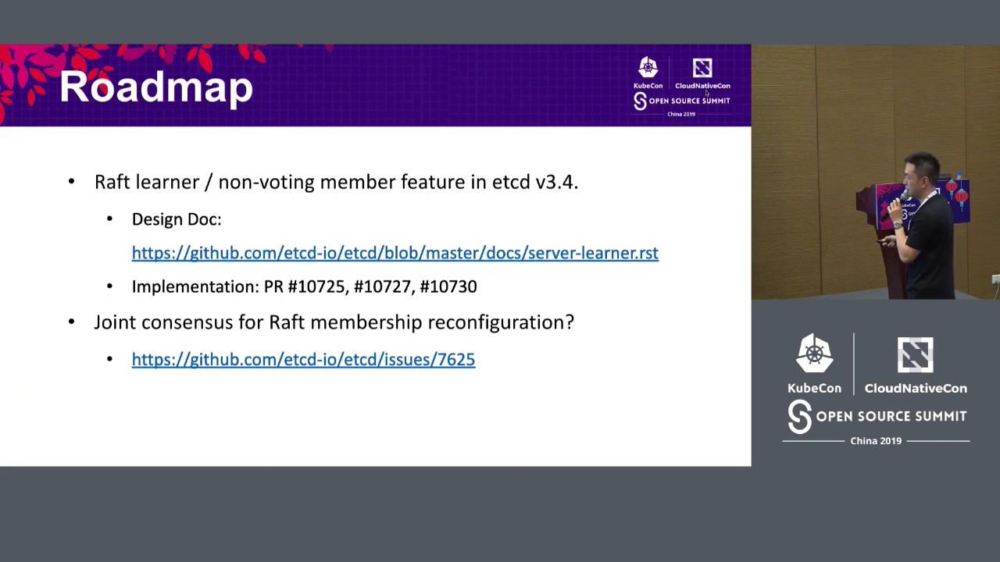

1. **Learner / 非投票成员（non-voting member）**：已经完成——Raft 包支持 learner 与普通成员，etcd server 也加入了对 learner 成员的支持（etcd v3.4），并附了设计与实现链接；
2. **成员重配置的 Joint Consensus**：一个仍在推进的方向，它的做法与 Raft 当前已有的成员重配置实现不同。对于需要"在运行时安全增删节点"的场景，这是一个值得关注的机制。

## 小结

- **Raft 解决的是"复制状态机"问题**：只要所有节点的**初始状态相同**、**输入序列（复制的预写日志 WAL）相同**，它们的状态与输出就必然相同——于是问题变成"如何把输入序列排成一致的顺序"。
- **法定人数 = 多数派**，任意两个法定人数必有交集；只要多数派达成一致，集群就能继续推进（5 节点可容忍 2 节点失效）。
- **领导者选举**以 term 为单位：候选者拿到多数票当选，一个 term 最多一个 Leader，Leader 用心跳维持权威。
- **日志复制**只有 Leader 在做：写入 Leader 本地日志 → 复制给 Followers → **多数派拥有即 committed** → 安全 apply。
- **etcd 的数据流**：客户端（etcdctl / clientv3 / K8S API Server）→ etcd server → Raft 模块 → MVCC 键值存储 → 磁盘；输入与状态都要持久化，以便崩溃重启后回放。
- **Raft 包的极简设计哲学**：不实现持久化存储、不实现网络传输；换来**灵活性**与**确定性**（易实现、易测试、易论证正确性）。
- **Raft 是一台状态机**：**输入 = 消息（`Message`）**，**输出 = `Ready`（含状态、条目、已提交条目、待发消息）**，**状态迁移的核心函数 = `Step`**（按角色分派到 `stepLeader` / `stepFollower` 等）。
- **一次写请求的路径**：`Propose` 生成消息 → `stepFollower` 因不实现网络传输，只把消息入队并体现在 `Ready` → 网络传输层送到 Leader → Leader 追加日志并发 `MsgApp` → 多数派拥有即 committed → Follower 的 `Ready.CommittedEntries` 收到该条目 → apply 到 KV 存储并返回结果。
- **使用 Raft 包的三步 handling loop**：先持久化状态与条目，再投递消息，最后 apply 已提交条目。

## 关键术语速查

| 术语 | 一句话解释 |
| :--- | :--- |
| 复制状态机（Replicated State Machine） | 一组服务器各自维护相同状态、执行相同输入序列，对外表现得像一台可靠服务器 |
| 共识（Consensus） | 让多个节点对"同一份日志、同样的顺序"达成一致的过程 |
| 法定人数 / 多数派（Quorum / Majority） | 过半数节点；任意两个法定人数必有交集，是共识不会分裂的根基 |
| WAL（Write-Ahead Log） | 预写日志：先记录输入再执行，是复制状态机的"输入序列" |
| 任期（Term） | Raft 的逻辑时钟；每个 term 至多一个 Leader |
| 领导者选举 | 候选者获得多数派选票即当选 Leader，并用心跳维持地位 |
| 日志复制（Log Replication） | 只有 Leader 写日志，并把日志复制给 Followers |
| 已提交（Committed） | 某条日志被多数派节点拥有，因而可以安全 apply |
| apply | 把已提交的日志条目按顺序执行到状态机（etcd 里即 MVCC 键值存储） |
| `raft` / `Message` / `Ready` | Raft 包的核心三件套：状态、输入（消息）、输出（待处理结果） |
| `Step` / `stepFollower` / `stepLeader` | 状态迁移的核心函数，按节点角色分派 |
| `MsgProp` / `MsgApp` / `MsgVote` | 消息类型：提议、追加（复制日志）、请求投票 |
| 确定性（Deterministic） | Raft 包行为可预测，因而易于实现、测试与论证正确性 |
| Learner / 非投票成员 | 只接收日志、不参与投票的成员，用于安全扩容 |
| Joint Consensus | 成员重配置时的一种共识方案，保证变更过程中的安全 |
