# 从 Raft 论文到生产实现：共识算法完整解读

> 视频来源：[解读共识算法Raft（合集）](https://www.bilibili.com/video/BV1pr4y1b7H5/)（Bilibili，UP 主"须弥的论文笔记"，共 7 期，约 109 分钟）
>
> 这是一套**逐句精读 Raft 论文**的系统课程：从复制状态机讲起，依次拆解 Raft 的三个子问题——**领导者选举、日志复制、安全性**，再讲**集群成员变更**，最后延伸到工程实践（no-op、日志压缩、只读操作、性能优化）与前沿改造（ParallelRaft）。文稿左栏为 B 站 AI 字幕，本文已逐窗口纠正错拼并重写为通顺的中文。

## 本讲要解决的核心问题（SCQA）

**背景**：etcd、Consul、TiDB、Kafka（KRaft）…… 今天越来越多的分布式系统用 **Raft** 来做共识（consensus）。因为 Kubernetes 的所有状态都存在 etcd 里，而 etcd 的"一致性"正是 Raft 给的——想真正理解 K8S 的控制面，就绕不开 Raft。

**冲突**：但 Raft 的论文虽然出了名的"易理解"，真要读起来仍然有一堵墙：**复制状态机、任期、法定人数、日志空洞、安全性规则**这些概念层层叠叠，而且论文里很多"为什么这样设计"的动机不会展开讲；网上的入门材料又大多只讲到"选主 + 日志复制"，一到**边界情况**（脑裂、老日志覆盖、成员变更的两次切换）就语焉不详。

**疑问**：Raft 到底是怎么把"一群服务器"变成"一台可靠的服务器"的？它的领导者选举、日志复制、安全性三条主线各自解决了什么问题？集群要扩容缩容时，怎么保证不出现两个 Leader？生产系统又对 Raft 做了哪些优化？

**回答（中心思想）**：**共识算法的本质是实现"复制状态机"——让一组服务器从相同初始状态、执行相同命令序列，从而得到相同状态。** Raft 的高明之处在于把这个问题分解成三个可独立实现的子问题（**领导者选举、日志复制、安全性**），并通过**强 Leader + 顺序日志**把它大幅简化。代价是 Raft **不允许日志空洞**、理论性能有上限；但正因逻辑简单，它才成为工业界共识算法的事实标准。本文按论文的章节顺序，把这套逻辑完整讲清，并补上工程实践中的常见优化。

---

## 一、复制状态机：共识算法的本质

### 1.1 为什么要有共识算法：一台服务器不够用

构建分布式存储系统的初衷很简单——**为了更大的存储容量**：把数据拆分（分片）到多台服务器上存储。但机器一多，**出错的频率也就更高**，于是要为每个分片建立副本（replica）来容错；副本一多，又进一步加剧了出错频率；而为了维持副本之间的一致性，就**必须引入共识算法**，可共识算法本身又要消耗额外资源与性能，反过来又影响系统的容量和分片设计。[【跳转到 06:38】](https://www.bilibili.com/video/BV1pr4y1b7H5/?t=398)

这一串"设计—代价"的权衡，正是共识算法要处理的现实。也就是说，**我们构建复制状态机最初的目的就是容错**；但有了它之后，能做的事情远不止容错。

### 1.2 复制状态机的核心思想：相同初始状态 + 相同输入 = 相同结束状态

**复制状态机（Replicated State Machine）的核心思想就是：相同的初始状态加相同的输入，等于相同的结束状态。** 简单理解就是——在多个节点上，从相同的初始状态开始执行相同的一串命令，一定会产生相同的最终状态。[【跳转到 03:11】](https://www.bilibili.com/video/BV1pr4y1b7H5/?t=191)

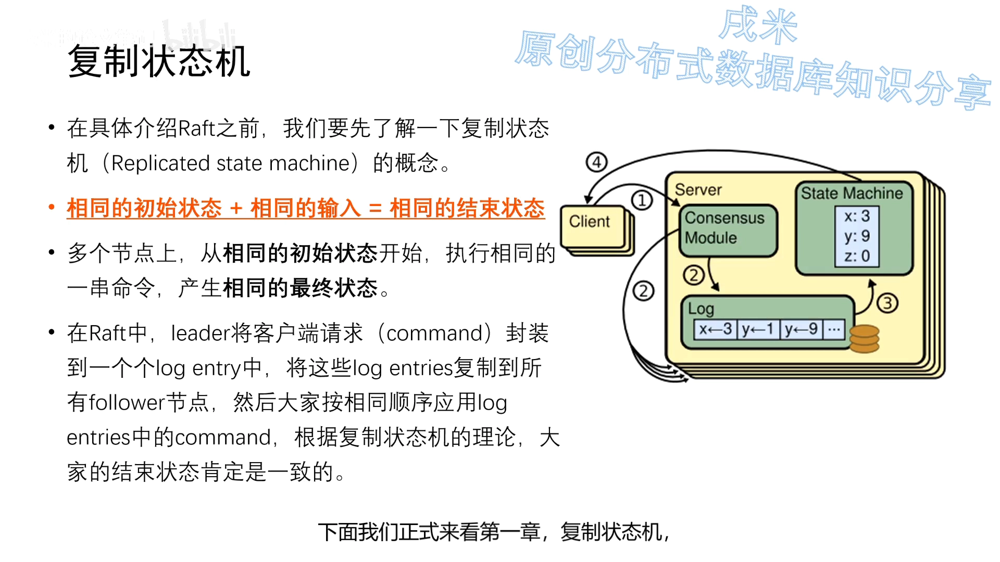

在 Raft 中，这套思想被具体化为：**Leader 把客户端的请求封装成一条条日志实体，复制到所有 Follower 节点，然后大家按照相同的顺序把日志中的命令应用到自己的状态机**。根据复制状态机理论，大家的结束状态必然一致——这样客户端无论查询哪个节点的状态机，只要该节点正常应用了日志，查到的结果就一样。[【跳转到 03:56】](https://www.bilibili.com/video/BV1pr4y1b7H5/?t=236)

> 可以这么说：**我们使用共识算法，就是为了实现复制状态机。** 各节点通过共识算法保证"命令序列一致"，从而"状态一致"，进而"高可用"。（顺带一提，**"投票选主"本身也是一种特殊的命令**。）[【跳转到 04:13】](https://www.bilibili.com/video/BV1pr4y1b7H5/?t=253)

复制状态机作为一种抽象思想，能力还可以更强。例如：**数据库的两个副本，一个用行存储、一个用列存储**——只要初始数据相同、并持续给它们发送相同的命令，那么同一时刻从两个副本读到的结果也是一致的。行存更适合 OLTP（交易），列存更适合 OLAP（分析），把"行存 + 列存"组合起来，就是一种 **HTAP** 的实现，**TiDB** 正是用这种方式巧妙地实现了自身的 HTAP 特性。[【跳转到 04:38】](https://www.bilibili.com/video/BV1pr4y1b7H5/?t=278)

### 1.3 按数据量给共识算法分类：Raft 属于哪一类

从"需要同步的数据量大小"出发，可以把共识算法的适用场景分成三类：[【跳转到 06:14】](https://www.bilibili.com/video/BV1pr4y1b7H5/?t=374)

1. **数据量非常小、命令稀疏**：如集群成员配置、分布式锁的存储管理，或小容量分布式任务队列。这类场景不需要靠日志来传递信息（命令粒度比日志更小），**也无需设计一个 Leader** 来支持快速写入与同步。最早的 **Basic Paxos** 就是这个思路，后续的 **Chubby、ZooKeeper** 等都属于此类。
2. **数据量较大、但可拆成互不相干的各部分、写入较连续**：如 **GFS、HDFS** 等大规模存储系统。这类场景**需要选出一个稳定、长生命周期的 Leader** 来统一对外服务、简化客户端并发写处理，并通过 Leader 迅速在集群内同步。这时从 Leader 复制到 Follower 的就是**日志**，每个日志可包含一串相同顺序的命令——**我们讲的 Raft 正适用于这类场景**。
3. **数据量大且数据之间存在关联**：单个共识算法集群容纳不下所有数据，于是把数据**分片到多个状态机**中，状态机之间再用**两阶段提交**保证一致性。这类场景主要是 **Spanner、OceanBase、TiDB** 等支持分布式事务的数据库，它们通常会对 Paxos / Raft 做一定改造以满足事务级要求。

## 二、状态简化：三种角色、任期与两类 RPC

Raft 之所以"易理解"，最关键的一步是**状态简化**。

### 2.1 三种角色、状态机式的切换

**在任何时刻，每个服务器节点都处于 Leader、Follower、Candidate（候选者）三种状态中的一种。** 相比 Paxos，这一点极大简化了实现：**Raft 只需要考虑状态之间的切换，而不用像 Paxos 那样考虑状态之间的共存与互相影响。**[【跳转到 05:06】](https://www.bilibili.com/video/BV1pr4y1b7H5/?t=306)

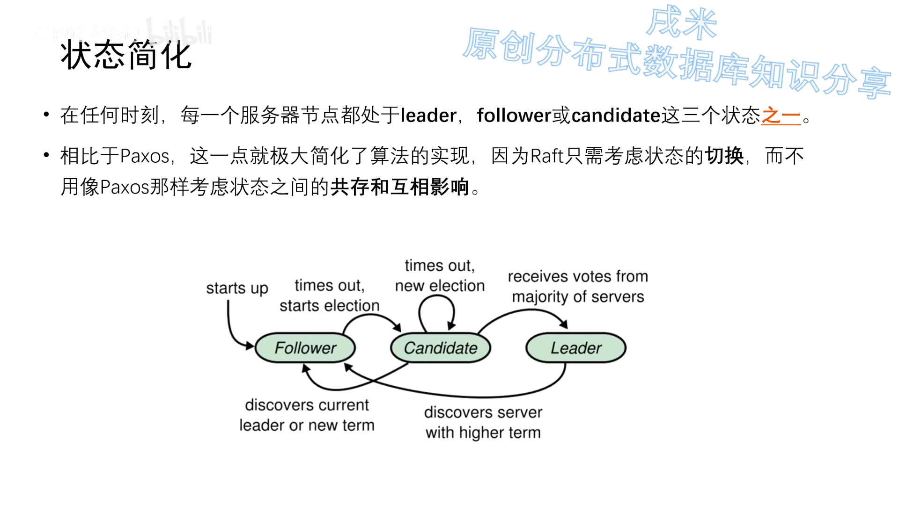

状态切换的规则很直观：

- **节点启动时都是 Follower**；
- 如果它察觉集群中没有 Leader，就把自己切换为 **Candidate**，进入选举；
- 在 Candidate 中经历一次或多次选举，最终根据结果**要么成为 Leader**（选举成功，开始为客户端提供服务），**要么退回 Follower**；
- 如果它 Leader 状态的**任期结束**，或自身宕机/出问题，就切换回 Follower，进入下一个循环。[【跳转到 05:23】](https://www.bilibili.com/video/BV1pr4y1b7H5/?t=323)

### 2.2 任期（Term）：Raft 的逻辑时钟

**Raft 把时间分割成任意长度的"任期"（term），任期用连续的整数标记**（通常就是整型）。每一段任期从一次选举开始；在某些情况下一次选举无法选出 Leader（比如两个节点拿到相同的票数，或没有任何节点得票超过一半），**这一任期就以"没有 Leader"结束**，随后一个新的任期（包含一次新选举）会很快重新开始。**Raft 保证任意一个任期内最多只有一个 Leader。**[【跳转到 06:42】](https://www.bilibili.com/video/BV1pr4y1b7H5/?t=402)

任期机制有两个作用：**① 明确标识集群的状态**；**② 通过比较任期号，帮助确认一台服务器过去的状态**。比如，我们可以通过"某服务器是否有 T2 任期内的日志"来判断它在 T2 这段时间是否发生过宕机。[【跳转到 07:25】](https://www.bilibili.com/video/BV1pr4y1b7H5/?t=445)

### 2.3 只有两类 RPC：RequestVote 与 AppendEntries

Raft 节点之间用 **RPC** 通信，而 Raft 中**只有两种主要的 RPC**：[【跳转到 07:28】](https://www.bilibili.com/video/BV1pr4y1b7H5/?t=448)

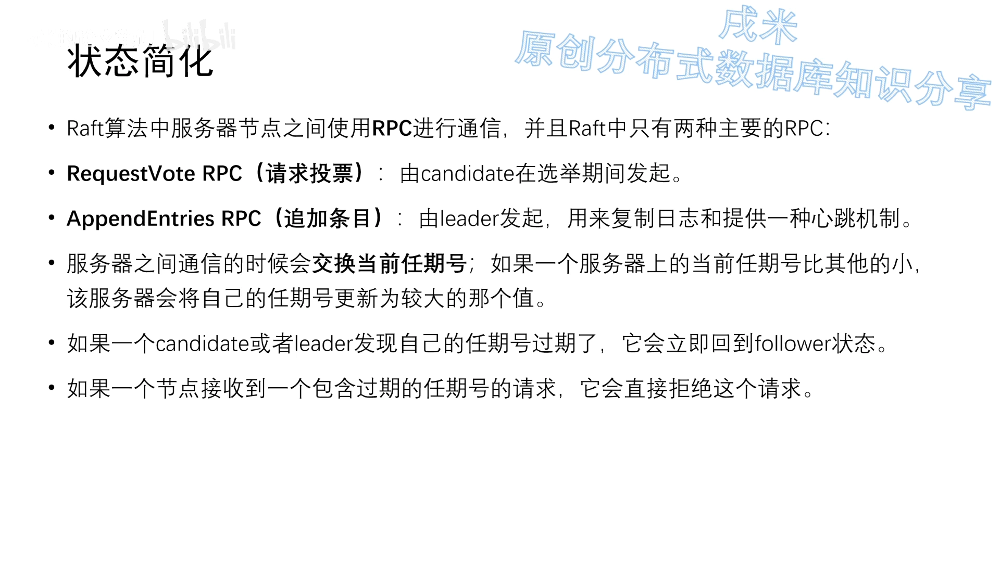

- **RequestVote RPC（请求投票）**：由 **Candidate** 在选举期间发起；
- **AppendEntries RPC（追加条目）**：由 **Leader** 发起，用来**复制日志**，并顺带提供一种**心跳机制**。

在 RPC 之上，Raft 复用了很多功能：服务器通过 RPC 交换**当前任期号**，并据此判断自己的状态——如果 Candidate 或 Leader 发现收到的 RPC 任期号比自己当前的任期更大（说明自己"过期了"），就立刻退回 Follower；反过来，**节点收到携带过期任期号的请求，会直接拒绝**。正是这种"RPC + 任期号"的组合，把通信机制与选举投票机制缝合在了一起。相比其他共识算法动辄十几种通信类型，Raft 的这种精简设计极大减少了理解与实现成本。[【跳转到 08:35】](https://www.bilibili.com/video/BV1pr4y1b7H5/?t=515)

## 三、领导者选举：心跳、随机超时与投票规则

### 3.1 心跳维持地位，超时触发选举

**Raft 内部有一种心跳机制：如果存在 Leader，它就周期性地向所有 Follower 发送心跳消息，来维持自己的地位。** 如果某个 server 在一段"进度条"（选举超时）读完之前**还没收到 Leader 的心跳**，它就认为系统中没有可用的 Leader，随即开始一次选举。[【跳转到 12:31】](https://www.bilibili.com/video/BV1pr4y1b7H5/?t=751)

### 3.2 一次选举的四个步骤（顺序很重要）

发起选举后，Follower 依次做这几件事：[【跳转到 13:13】](https://www.bilibili.com/video/BV1pr4y1b7H5/?t=793)

1. **增加自己的当前任期号**；
2. **把自己的状态从 Follower 切换为 Candidate**；
3. **投票给自己**，让自己的票数加一；
4. **并行地**向集群中所有其他节点发送 **RequestVote RPC**。

### 3.3 选举的三种结局

对一个 Candidate 来说，选举阶段最终有三种可能的结果：[【跳转到 14:13】](https://www.bilibili.com/video/BV1pr4y1b7H5/?t=853)

- **① 赢得选举**：获得超过半数选票，第一时间把自己切换为 **Leader**，并开始向所有 Follower 发送心跳，告知"集群里已经有新 Leader 了"，结束本轮选举；
- **② 别人赢得选举**：Candidate 收到新 Leader 的心跳，并确认其**任期号 ≥ 自己当前的任期号**，于是从 Candidate 退回 **Follower**。（一般情况下两者的任期号是相等的——因为 Candidate 之前已把任期号加一——只是新 Leader 收集到了过半选票，所以它胜出。）；
- **③ 一段时间后无人获胜**：比如多个 Follower 同时成为 Candidate，**票数被分散**，没有任何人得票过半，于是这一轮选举"没有产生 Leader"就结束了，并快速进入下一轮。

这里最精妙的一点是：**"本轮无 Leader"这个结论不需要任何共识**——每个 Candidate 各自等待一个**随机选举超时时间**（论文给出 150~300ms）后，**默认进入下一轮**。随机化正是为了打破"多人同时竞选导致反复平票"的僵局。不过讲者也指出，这个 150~300ms 对如今的一些 OLTP 系统而言偏长（论文发表于 2014 年），实际应用时要根据自身网络与服务器性能调整。[【跳转到 14:58】](https://www.bilibili.com/video/BV1pr4y1b7H5/?t=898)

### 3.4 RequestVote RPC 的内容与投票条件

RequestVote RPC 分为 **request**（由 Candidate 发起）与 **response**（由 Follower 回复）。**所有 RPC 都带有当前任期号**，因为节点要据此判断自身状态、决定收不收这个 RPC。[【跳转到 15:34】](https://www.bilibili.com/video/BV1pr4y1b7H5/?t=934)

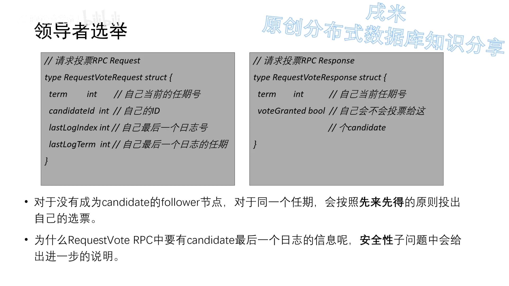

- **request** 中除了 term，还带有 **candidate id**（Follower 总要知道把票投给谁），以及后面两个关键字段——**last log index** 和 **last log term**（自己最后一条日志的索引与任期号）。这两项在**安全性**章节会派上大用场；
- **response** 则很简单：除了 term，只需要返回一个**布尔值"是否投票"**。

**Follower 的投票逻辑**：收到 RequestVote request 后，先校验 Candidate 是否符合条件（一是 **term 是否比自己大**，二是那两个日志字段"是否更新"——具体留到安全性章节），确认无误后就可以投票，**并且每个 Follower 只有一张选票，按"先来先得"的原则投出**。[【跳转到 17:09】](https://www.bilibili.com/video/BV1pr4y1b7H5/?t=1029)

**整体流程串起来**：Raft 集群启动时所有节点都是 Follower，第一个发现"集群没有 Leader"的节点把自己变成 Candidate、任期号加一、发 RequestVote 给其他 Follower——通常这个"先发优势"让它大概率当选 Leader，随后继续进入任期的循环。[【跳转到 17:59】](https://www.bilibili.com/video/BV1pr4y1b7H5/?t=1079)

## 四、日志复制：Raft 最核心的功能

### 4.1 客户端怎么找到最新的 Leader

Leader 选出后开始为客户端服务，随之而来一个直观问题：**Client 怎么知道哪个节点是最新的 Leader？** 解法很多，最简单的就是"随机选一个节点发请求"，会遇到三种情况：[【跳转到 15:38】](https://www.bilibili.com/video/BV1pr4y1b7H5/?t=938)

- 恰好是 **Leader** → 直接执行；
- 是 **Follower** → 它可以从心跳得知 Leader 的 id，告诉 Client 该找谁；
- 该节点**宕机** → 没有响应，Client 换个节点重试。

因为**只要超过半数的节点可用，集群就能正常服务**，所以 Client 重试几次总能找到可用节点。（也有"设置第三方节点"等做法，此处不展开。）[【跳转到 16:28】](https://www.bilibili.com/video/BV1pr4y1b7H5/?t=988)

### 4.2 一条日志由三部分组成

Leader 收到客户端指令后，会把它作为**新条目追加到日志**中。那么一条日志包含哪些信息呢？主要有三部分：[【跳转到 16:53】](https://www.bilibili.com/video/BV1pr4y1b7H5/?t=1013)

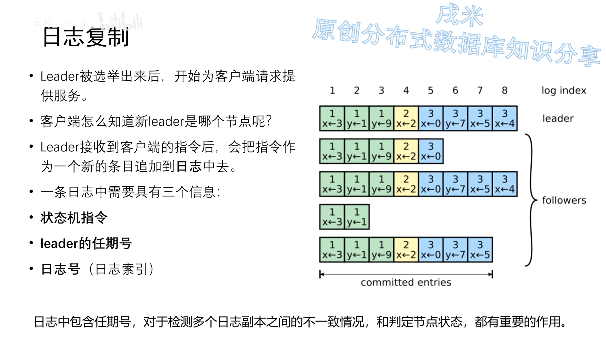

1. **状态机的指令**：通常是对某个值的操作，例如右图第一条日志就是"把 X 赋为 3"（`X←3`）；
2. **任期号（term）**：用于检测多个副本之间的不一致、以及判定节点状态；
3. **唯一的日志索引（log index / 日志号）**：用来区分日志的先后顺序。

注意一个关键细节：**日志号是单调递增的，但单靠日志号并不足以唯一确定一条日志**——有些情况（如 Leader 宕机）会造成"**日志号相同、内容却不同**"。因此**必须"日志号 + 任期号"两个因素一起才能唯一确定一条日志**。[【跳转到 17:43】](https://www.bilibili.com/video/BV1pr4y1b7H5/?t=1063)

### 4.3 复制与提交：核心机制

生成日志后，**Leader 把日志放进 AppendEntries RPC 中，并行地发送给 Follower 让它们复制**；**当该条目被超过半数的 Follower 复制后，Leader 就可以在本地执行该指令，并把结果返回给客户端**。[【跳转到 19:23】](https://www.bilibili.com/video/BV1pr4y1b7H5/?t=1163)

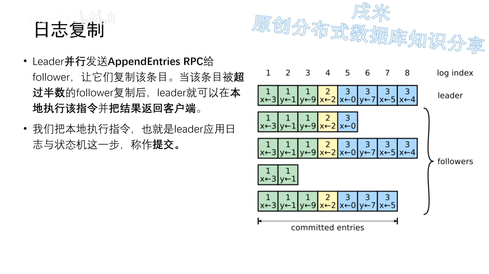

这段就是 Raft 日志复制的核心，也是复制状态机最直观的实现。**在所有服务器都不出错、网络正常的情况下，这套机制可以保证所有节点具备完整且正确的日志。** 我们把"Leader 把日志应用到本地状态机"这一步称为**提交（commit）**——这个概念极其重要。

> **一个重要澄清**：日志复制到了超过半数的节点，是不是就**百分百**会提交？**当然不是。** 因为"Follower 复制完成 → Follower 通知 Leader → Leader 完成提交"中间需要时间，**如果 Leader 在这个时间窗口内宕机，这条日志虽然已被多数派复制，却没能提交**。这个伏笔在后面的**安全性**章节至关重要。[【跳转到 20:38】](https://www.bilibili.com/video/BV1pr4y1b7H5/?t=1238)

### 4.4 让落后的 Follower 追上：三种情况

在多副本系统中，各 Follower 的进度往往不一致：有的缺了几条日志，**有的甚至遗漏了一整个任期**。但只要有"包括 Leader 在内的多数节点"复制到了日志，Leader 就能提交。[【跳转到 21:28】](https://www.bilibili.com/video/BV1pr4y1b7H5/?t=1288)

**怎么让落后者追上、并保证所有节点日志完整且顺序一致？** Raft 分三种情况讨论：[【跳转到 21:39】](https://www.bilibili.com/video/BV1pr4y1b7H5/?t=1299)

**① Follower 缓慢**：Leader 会**不断重发 AppendEntries RPC**——**哪怕 Leader 已经回复了客户端**（意味着日志已复制给多数派、已提交），也**不能抛弃这个 Follower**，仍要重发直到它追上。[【跳转到 22:32】](https://www.bilibili.com/video/BV1pr4y1b7H5/?t=1352)

**② Follower 崩溃后恢复**：这时 Follower 的处境是未知的——**宕机期间可能发生了多次选举、Leader 已经换了好几任，恢复后的状态未知，当前 Leader 根本不知道它停在哪**。Raft 用**一致性检查**解决：**Leader 在每个 AppendEntries RPC 里放入"前一个日志条目的索引位置和任期号"**；如果 Follower 在自己日志里找不到这个"前一个日志"，就拒绝该请求；Leader 收到拒绝后**往前退一格重发**，如此逐步向前，最终定位到 Follower 第一个缺失的日志。这像一种**数学归纳法**，从第一个缺失处开始按顺序补齐。[【跳转到 22:38】](https://www.bilibili.com/video/BV1pr4y1b7H5/?t=1358)

> **为什么不用更聪明的办法？** 有人会问：Follower 直接把自己的最后日志号发给 Leader 不就行了？或者往回退的时候多隔几个、用二分查找定位？**Raft 作者考虑过这些优化，但认为没必要**——因为失败并不经常发生，也不太会出现大量不一致的条目。当然这是"仁者见仁、智者见智"，实际实现可按需调整这些不影响功能正确性的点。[【跳转到 24:05】](https://www.bilibili.com/video/BV1pr4y1b7H5/?t=1445)

**③ Leader 崩溃**：这是最棘手的一种。**旧 Leader 上可能有"已复制到多数节点但尚未提交"的日志**，而"投票选举"是不考虑未提交日志的，所以**新选出的 Leader 可能并不具备这些日志**（这对客户端无害——客户端会认为那些未提交的日志失败了）。真正的麻烦在于**旧 Leader 恢复后**：它会作为 Follower 收到**新 Leader 的 AppendEntries RPC**，在一致性检查逐步向前回溯的过程中，**发现自己最后几条日志与新 Leader 冲突**；一些复制过未提交日志的 Follower 也会如此。[【跳转到 23:09】](https://www.bilibili.com/video/BV1pr4y1b7H5/?t=1389)

Raft 的处理方式是**强制 Follower 复制 Leader 的日志**：Leader 通过一致性检查找到 Follower 中最后一个与自己一致的日志后，**把它之后所有冲突的日志全部覆盖掉**。为什么可以这么做？**因为那些日志都没有提交**——抛弃未提交的日志不违反一致性。[【跳转到 25:14】](https://www.bilibili.com/video/BV1pr4y1b7H5/?t=1514)

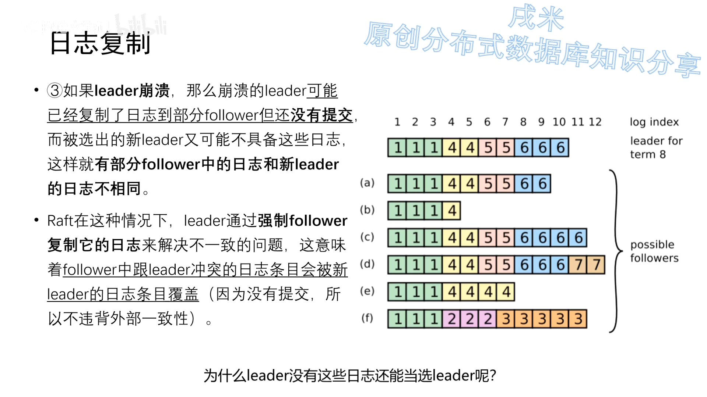

### 4.5 日志复制的三条一致性特性

通过这套机制，Raft 之后就不需要任何特殊操作来"恢复一致"：**Leader 只需按规则一直发 AppendEntries RPC，Follower 在回复时做一致性检查，就能自动趋于一致**；而 **Leader 永远不会覆盖或删除自己的日志条目**。由此得到三条特性：[【跳转到 25:59】](https://www.bilibili.com/video/BV1pr4y1b7H5/?t=1559)

1. **只要过半服务器正常运行**，Raft 就能正常接受、复制并应用新日志（因为能选出 Leader、能提交日志）；
2. **正常情况下，一条新日志在一个 RPC 来回内**就能复制给集群过半机器；
3. **单个慢 Follower 不影响整体性能**——它慢慢追就行，其他节点没必要等它。

### 4.6 AppendEntries RPC 的内容

AppendEntries RPC 的 request 中有：[【跳转到 26:49】](https://www.bilibili.com/video/BV1pr4y1b7H5/?t=1609)

- **term**：必备的当前任期号；
- **leader id**：告诉 Follower 自己是谁；
- **previous log index / previous log term**：用于**一致性检查**，只有这两项都与 Follower 中的相同，Follower 才认为日志一致（若只有任期号相同但 term 不同，则可能像前面 F 的情况，需要继续向前回溯）；
- **日志体**：即命令内容；
- **leader commit**：Leader 已提交到的位置。

关于 **leader commit** 要特别说明：**Follower 收到的日志并不能立即提交**，因为此刻还不确定它是否已被复制到多数派；**只有 Leader 确认某日志已复制到多数节点后才会提交它**（应用到自己的状态机），再通过 AppendEntries RPC 里的 **leader commit** 告知 Follower，Follower 便把自己"复制但未提交"的日志**设为已提交**并应用到状态机。对于还在苦苦追赶的 Follower，如果 **leader commit 大于自己最后一条日志，那它所有日志都可提交**。[【跳转到 27:47】](https://www.bilibili.com/video/BV1pr4y1b7H5/?t=1667)

**response** 里的 **success** 标志，只有在 **request 的 term ≥ 自己的 term、且 request 通过了一致性检查**时才返回 true，否则返回 false。[【跳转到 28:37】](https://www.bilibili.com/video/BV1pr4y1b7H5/?t=1717)

## 五、安全性：四条边界规则

**领导者选举与日志复制两个子问题已覆盖共识算法的全程，但还不足以保证"每个状态机按相同顺序执行相同命令"**——尤其要注意**顺序不能颠倒**。许多共识算法为提高效率允许日志**乱序复制**，从而在日志中留下**空洞**，带来大量边界情况；Raft 为了易理解性，**在日志复制阶段就保证了日志有序且无空洞**。但这套保证**只在 Leader 正常时生效**；一旦 Leader 宕机，就会出现各种不正常的日志状态。[【跳转到 29:35】](https://www.bilibili.com/video/BV1pr4y1b7H5/?t=1775)

**安全性子问题主要就是定义几条规则，给 Raft 补齐这些边界情况，使它在各种异常下都不出错。** 讨论分四种情况：① 选举性质；② 新 Leader 是否提交"上一任期的日志"；③ Follower 与 Candidate 的宕机处理；④ 时间与可用性限制。[【跳转到 30:30】](https://www.bilibili.com/video/BV1pr4y1b7H5/?t=1830)

### 5.1 选举性质：Leader 必须拥有所有已提交日志

**问题**：如果只靠选举规则，会出现这种情况——一个 Follower 落后 Leader 若干日志条目，但**并未遗漏一整个任期**，在下次选举中它把任期号加一，仍**有可能当选** Leader；而当选后，它**永远无法补上之前缺失的那部分日志**，造成前后 Leader 状态不一致。[【跳转到 31:00】](https://www.bilibili.com/video/BV1pr4y1b7H5/?t=1860)

**规则**：因此要对选举加一个限制——**保证被选出的 Leader 一定包含之前各任期的所有"已提交"日志条目**。

**实现**：靠 **RequestVote RPC 的两个日志字段**。请求中携带 Candidate 的日志信息；**如果投票者自己的日志比 Candidate 的还新，就拒绝投票**。那么"新"如何定义？——**先比最后一条日志的任期号：任期号大的更新；若任期号相同，则日志更长（log index 更大）的更新。**[【跳转到 31:44】](https://www.bilibili.com/video/BV1pr4y1b7H5/?t=1904)

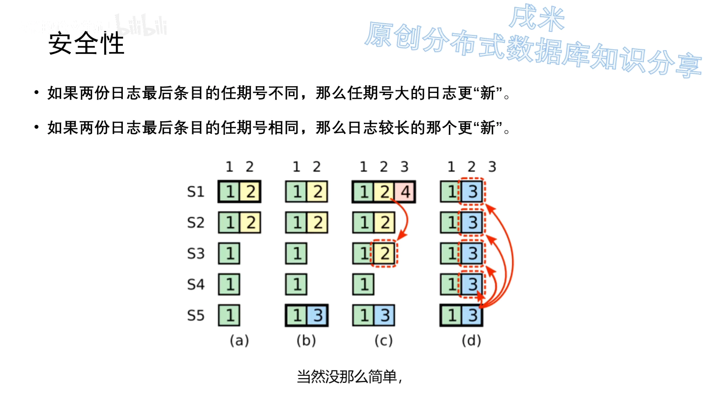

### 5.2 新 Leader 是否提交上一任期的日志：永不"数副本数"提交老日志

这里要先澄清一个常被忽略的点：**"提交"在 Raft 中并不是集群级状态，而首先是 Leader 的单点状态。** Leader 收到过半节点复制成功的反馈后，就把日志应用到自己的状态机（= Leader 提交）；但此时 Follower 虽然复制了日志，**却还没有应用**（= 未提交），所以**对整个集群而言，"提交"尚未构成大多数**。Follower 靠 AppendEntries RPC（或心跳）里的 **leader commit** 得知可以提交。[【跳转到 33:29】](https://www.bilibili.com/video/BV1pr4y1b7H5/?t=2009)

> 既然 Leader 提交与 Follower 提交之间必然有间隔，如果 **Leader 提交后立刻返回客户端、但在通知 Follower 之前（一个心跳之内）宕机**，是否会出现"客户端以为成功、提交状态却没在集群中保留"？讲者的看法是：Raft 是**底层共识算法**，与客户端交互属于应用层的事，理论上不该由 Raft 操心（这也是论文不讨论它的原因）。要规避，实践中常引入"**集群提交**"概念——**只有过半节点都完成提交，才算集群提交完成**；而 Leader 可以通过 AppendEntries RPC 返回的 success 判断 Follower 是否完成提交。这与**两阶段提交**的思路类似。[【跳转到 35:09】](https://www.bilibili.com/video/BV1pr4y1b7H5/?t=2109)

**核心规则**：如果某个 Leader 在提交某条日志前崩溃，**后续 Leader 会试图"完成它的复制"[【注意是复制，不是提交】]**。新 Leader 会把老日志复制给其他 Follower，**但不会提交它**。为什么不能提交？看反例：假设新 Leader S1 把"日志 2"复制到了多数节点后就把它提交了，并被多数节点提交（此时可返回客户端成功）；但随后 S1 down，S5 凭借最高任期号 3 仍能拿到多数选票当选，**就会把日志 2 覆盖掉**——**已提交的日志被覆盖，就危险了**。[【跳转到 36:36】](https://www.bilibili.com/video/BV1pr4y1b7H5/?t=2196)

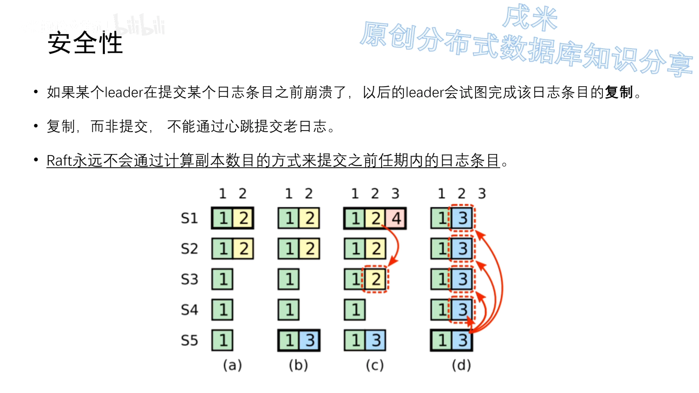

**结论**：**Raft 永远不会通过"计算副本数目"来提交之前任期内的日志条目，只有自己任期内的日志才能靠计算副本数提交**（因为能确认自己当前任期号最大）。新 Leader 的"提交"是危险的，但"复制"是安全的。那老日志怎么才能提交？**办法是：等新 Leader 在自己的任期内先产生一条新日志，当这条新日志提交时，老任期内被"保护"的日志也随之提交。** 注意一定是新任期日志"提交"（而非只是复制）——因为只有提交时，新 Leader 才能把自己的 **leader commit** 设为新任期日志的位置。这相当于用一条新日志把老日志保护起来。（顺带一提，若新 Leader 能确认所有节点都已复制老日志，理论上可以安心用心跳提交，但 Raft 为了简化采用了更保守的做法。）[【跳转到 38:34】](https://www.bilibili.com/video/BV1pr4y1b7H5/?t=2314)

### 5.3 Follower 与 Candidate 宕机：靠"无限重试 + 幂等"

Follower 和 Candidate 的崩溃处理**比 Leader 简单得多，且二者方式相同**：它们崩溃后，发给它们的 RequestVote / AppendEntries RPC 都会失败，**Raft 通过无限重试来处理**；崩溃的机器重启后，这些 RPC 就会成功完成。如果一个服务器完成了 RPC 但还没响应就崩溃，重启后会**再次收到同样的请求**——**Raft 的 RPC 都是幂等的**。[【跳转到 44:38】](https://www.bilibili.com/video/BV1pr4y1b7H5/?t=2678)

### 5.4 时间与可用性限制：三个时间要满足的不等式

Raft **整体不依赖客观时间**——哪怕网络导致后发的 RPC 先到，也不影响正确性（这点与 Google Spanner 的设计思路不同）。但系统的一些**时间指标**仍需满足：[【跳转到 45:28】](https://www.bilibili.com/video/BV1pr4y1b7H5/?t=2728)

- **选举超时时间 > 广播时间**：否则一次网络来回就超过选举超时，Candidate 等不到选票就进入下一任期，永远选不出 Leader。为保性能，**二者要差一个数量级以上**；
- **平均故障时间（MTBF）≫ 选举超时时间**：否则机器频繁宕机，选举永远完不成。

其中**广播时间与平均故障时间由硬件决定**：Raft 的 RPC 要接收信息并落盘，所以广播时间约 **0.5ms~20ms**（取决于存储技术），论文据此给出**选举超时 10ms~500ms**；而大多数服务器的 MTBF 都在**几个月甚至更长**，无需过分担忧。[【跳转到 46:43】](https://www.bilibili.com/video/BV1pr4y1b7H5/?t=2803)

## 六、集群成员变更：从联合共识到单节点变更

### 6.1 为什么难：变更期间可能出现两个 Leader（脑裂）

集群需要调整配置时（扩容、下线故障机器、改变复制程度等），Raft 支持**配置变更自动化**。难点在于：**分布式系统不可能在所有机器上同一时刻应用变更**，变更必然持续一段时间，于是**要防止变更过程中出现"同一任期的两个 Leader"——这就是经典的脑裂问题**。[【跳转到 48:14】](https://www.bilibili.com/video/BV1pr4y1b7H5/?t=2894)

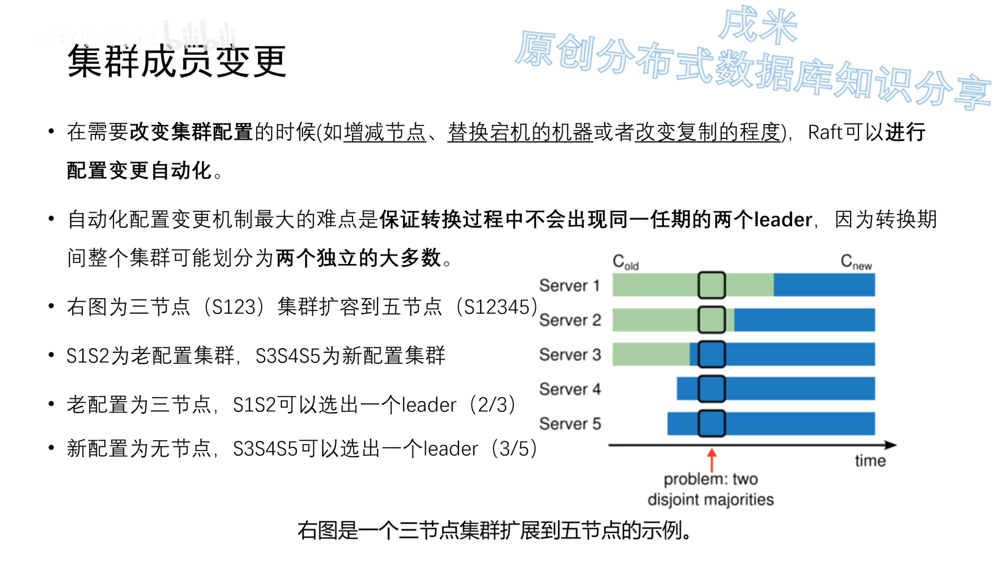

看一个例子：三节点集群扩到五节点，其中 **S1、S2、S3 是老节点，S4、S5 是新增**。在某个时间点，**S1、S2 仍用老配置（三节点，两票即可当选），S3、S4、S5 已切到新配置（三票即可当选）**——于是两拨人各选各的 Leader，集群里同时出现两个 Leader。[【跳转到 49:14】](https://www.bilibili.com/video/BV1pr4y1b7H5/?t=2954)

### 6.2 两阶段方案：联合共识（Joint Consensus）

**Raft 的解法是"两阶段"**：集群先从**老配置**切换到一个**过渡配置**——**联合共识（joint consensus）**——再切换到**新配置**。这样一来，只需保证"联合共识状态不发生脑裂"即可。**配置信息作为一个日志体，被包装成普通的 AppendEntries RPC 发给所有 Follower。**[【跳转到 49:39】](https://www.bilibili.com/video/BV1pr4y1b7H5/?t=2979)

- **第一阶段**：Leader 发起 **C_old,new**，集群进入**联合共识状态**——**所有 RPC 都要在新、旧两个配置中都达到大多数才算成功**。这正是联合共识能避免脑裂的核心性质。
- **第二阶段**：Leader 发起 **C_new**，集群进入新配置状态——此时**所有 RPC 只要在新配置下达到大多数**就算成功。

**一个重要特性**：对于配置变更日志，**只要服务器把该配置日志条目加入自己的日志，它就会用该配置来做未来所有决策**——也就是说，**无论新配置日志是否提交，服务器总是使用它日志中最新的配置**；而 Leader 只要发起了 C_old,new 或 C_new，就直接按对应配置执行。[【跳转到 50:34】](https://www.bilibili.com/video/BV1pr4y1b7H5/?t=3034)

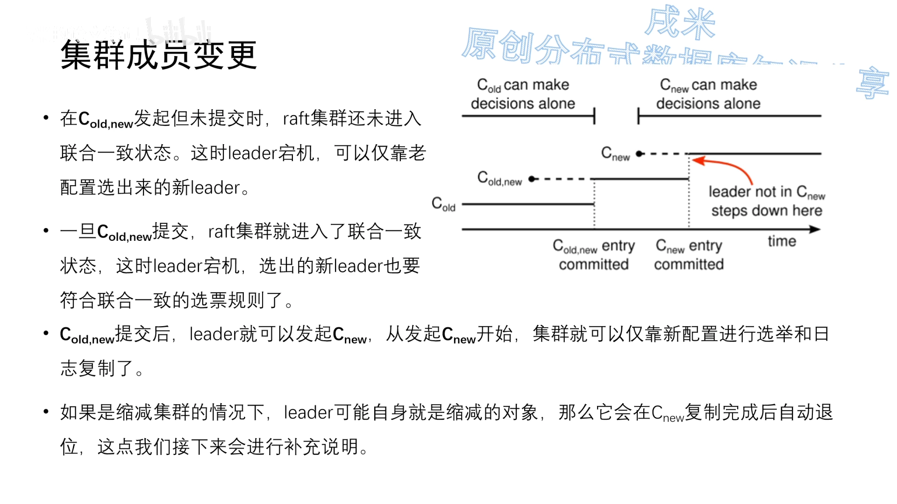

### 6.3 Leader 在三个时刻宕机，分别会怎样

假设 Leader 可能在**任何时刻**宕机，分三个时间点观察：[【跳转到 51:31】](https://www.bilibili.com/video/BV1pr4y1b7H5/?t=3091)

- **① Leader 在 C_old,new 未提交时宕机**：S1、S2 是老配置，可以用两票选出"老配置 Leader"；但**处于联合共识状态的 S3、S4、S5 必须在新旧两个配置中都拿到过半选票才能当选**——因为 S1、S2 已把票投给老配置的那位，新配置这边拿不到老配置的过半，于是**变更失败，但避免了脑裂**，Raft 的正确性得以保留。（还有一种可能：新选出的 Leader 已持有 C_old,new，但它无法提交，可以继续发 C_new 推进变更。）[【跳转到 52:17】](https://www.bilibili.com/video/BV1pr4y1b7H5/?t=3137)
- **② Leader 在 C_old,new 已提交但 C_new 未发起时宕机**：安全性规则保证了新选出的 Leader **必然持有 C_old,new**（即满足在两个配置中均过半），**此时已不可能脑裂**。[【跳转到 53:57】](https://www.bilibili.com/video/BV1pr4y1b7H5/?t=3237)
- **③ Leader 在 C_new 已发起时宕机**：**已复制 C_new 的节点只按新配置选举，未复制 C_new 的节点按新老配置选举**；两种节点都可能当选，未复制 C_new 者当选后也会补发 C_new，一般无问题。**但"缩容"情况需专门讨论**：五节点缩为三节点时，C_new 只要复制到 3 个中的 2 个即可提交；若 Leader S3 随后宕机，**已提交的 C_new 会不会被覆盖？不会**——因为处于联合共识状态（只复制了 C_old,new、未复制 C_new）的节点需要在两个配置中都过半才能当选，而 S2、S3 不会投票给 S1/S4/S5，所以只有 S2 能当选，C_new 不会被覆盖。[【跳转到 54:47】](https://www.bilibili.com/video/BV1pr4y1b7H5/?t=3287)

> 还有一类"**未提交 C_old,new 就宕机**"的细节情况：新 Leader（如 S1）**不能直接提交 C_old,new**，只能继续复制 C_new；但当它把 C_new 复制到新配置的多数节点时，**仍不能直接提交**（因为没有前任 Leader 的反馈，提交 C_new 会连带把 C_old,new 也提交，这不安全）。论文未给出所有情况的处理法，某些实现会**强制让 C_new 按联合共识规则提交**，或让 Leader 在一段期限内满足不了提交条件就**自动退位**。[【跳转到 56:17】](https://www.bilibili.com/video/BV1pr4y1b7H5/?t=3377)

### 6.4 三条补充规则

集群成员变更还有三条补充规则：[【跳转到 58:13】](https://www.bilibili.com/video/BV1pr4y1b7H5/?t=3493)

1. **新增节点要等它完成日志同步再开始变更**：否则集群在新增节点还没同步日志时就进入联合共识/新配置状态，正常命令的日志要同步到更多副本，导致新日志难以提交。做法很简单——**让新节点在同步完成前处于只读状态（不参与选举/投票）**；
2. **缩容时 Leader 可能本身就是被缩对象**：它会在完成 C_new 提交后**自动退位**；发起 C_new 后，Leader 可发送 C_new 日志，但**"计算日志副本数"时不计自身**；
3. **避免下线节点超时选举干扰集群**：C_new 的 Leader 不再给要退出的节点发心跳，若这些节点未及时下线，会超时增加任期号并发送 RequestVote RPC，导致集群反复进入投票选举。为此 Raft 给 RequestVote RPC 加了一条规则——**一个节点如果在"最小超时时间"内收到过 RequestVote RPC，就拒绝此 RPC**；这样只要 Follower 连续收到 Leader 心跳，退出节点的请求就不会干扰集群。[【跳转到 59:43】](https://www.bilibili.com/video/BV1pr4y1b7H5/?t=3583)

### 6.5 单节点变更：更简单、但仍有坑

上述方法一般被称为 **joint consensus（多节点变更）方法**，它**边界情况很多、实现复杂，有点违背 Raft 的设计初衷**，所以如今大多数 Raft 实现采用另一种**单节点变更方法**——**一次只增减一个节点**。[【跳转到 60:18】](https://www.bilibili.com/video/BV1pr4y1b7H5/?t=3618)

**为什么单节点变更就简单？关键在"新旧配置的大多数必然重合"**：多节点变更时（如 3→5）老配置的多数与新配置的多数**可能没有交集**；而一次只增一个节点时，**必然存在重合节点**，它的这一票只能投给一边，**于是选不出两个 Leader，脑裂自然消除**——因此**可以不经联合共识，直接从老配置切到新配置**。需要一次增减多个节点时，**多次执行单节点变更即可**。[【跳转到 71:20】](https://www.bilibili.com/video/BV1pr4y1b7H5/?t=4280)

单节点变更的步骤：先**完成新增节点的日志同步**（"如何判断同步完成"？可通过**分多轮同步**——每轮 Leader 记录当前日志号并同步到该位置，重复若干轮，论文参考值是 10 轮，即认为新增节点日志已足够新）；随后 **Leader 产生并发送 C_new**，C_new 复制到多数节点后提交，变更完成。[【跳转到 72:08】](https://www.bilibili.com/video/BV1pr4y1b7H5/?t=4328)

**但单节点变更也有缺陷，甚至有严重 bug**：[【跳转到 73:09】](https://www.bilibili.com/video/BV1pr4y1b7H5/?t=4389)

- **缺陷一：不支持一步替换机器**。联合共识能把 (A,B,C) 一次替换为 (D,B,C)；单节点变更只能 (A,B,C) → (A,B,C,D) → (D,B,C)，多一步；
- **缺陷二：必然经过偶数节点**，而偶数节点降低了高可用性价比——3→5 时，联合共识可 3~5 直达，单节点变更要 3→4→5，**4 个节点时必须 3 个响应才算多数**；
- **缺陷三（最严重）：连续两次变更时，第一次变更过程中若发生"切主"，第二次变更可能出错**——例如 4→6 分两次做：图一中 S3 把 C_new1 复制给 S5；图二 S3 宕机、S1 当选（认为 C_new1 失败）；图三 S1 开始 C_new2（增加 S6，但它**并不知道 S5 存在**，于是仍按 4→5 处理），C_new2 复制到 S1、S2、S6 后提交；图四 S1 宕机，S3 依 S3、S4、S5 重新当选（对它而言仍是 C_new1 的配置，只需三票），于是 **S3 把 C_new1 复制到所有节点，覆盖掉了已提交的 C_new2**（S6 上的 C_new2 因 S3 不知道 S6 而幸免）。**已提交的配置被覆盖，问题严重**。
- **修复办法很简单：新 Leader 必须先提交一条自己任期内的 no-op 日志，才能开始单节点成员变更**——这样图三中 S1 先用 no-op 覆盖掉未提交的 C_new1，再开始 C_new2，就不会出错。

> **小结**：集群成员变更从"联合共识"到"单节点变更"看似简化了实现，实则仍要处理大量边界情况，而且**变更速度并没有提升**。TiDB 等实现还针对"偶数节点网络分区"做了优化（**只需新老配置有交集**：如 AB、AC、BC 也可视为四节点集群的多数，让 C_new 提交）。近些年也重新出现了对联合共识方法的探索。[【跳转到 76:45】](https://www.bilibili.com/video/BV1pr4y1b7H5/?t=4605)

## 七、总结与拓展：从论文到生产实践

第六、七期视频跳出论文原文，主要参照 Raft 作者 **Diego Ongaro 的博士论文《Consensus: Bridging Theory and Practice》**，把 Raft 的知识点做总结，并延伸到生产优化与前沿改造。[【跳转到 61:17】](https://www.bilibili.com/video/BV1pr4y1b7H5/?t=3677)

### 7.1 复制状态机再认识

回看第 1.2 节那张"构建分布式存储系统"的链条图（讲者参考了 **MIT 6.814** 课程的一段内容）：**更大的容量 → 分片到多机 → 出错频率升高 → 为分片建副本 → 副本间要一致 → 引入共识算法 → 共识算法消耗额外资源 → 反过来影响容量与分片设计**。也就是说，**复制状态机的初衷是容错**，但有了它之后能做的事更多——比如前面提到的"行存副本 + 列存副本"共同支撑 **HTAP**。[【跳转到 62:08】](https://www.bilibili.com/video/BV1pr4y1b7H5/?t=3728)

按数据量给共识算法分类的三类场景（小数据量 → Basic Paxos/ZooKeeper；大数据量可分片 → Raft/GFS；大数据量有关联 → Spanner/TiDB 等）已在第一章详细展开，这里不再重复。

### 7.2 共识算法的三个特性 & Raft 的三个特点

**共识算法的三个重要特性**：[【跳转到 65:35】](https://www.bilibili.com/video/BV1pr4y1b7H5/?t=3935)

1. **非拜占庭情况下的正确性**：能解决网络延迟、网络分区、丢包、重复发送、乱序等问题；但**解决不了拜占庭问题**（如节点存储不可靠、发送错误消息——节点不仅会错，还可能"使坏"）；
2. **大多数机器正常即可高可用**：少数慢机器不影响整体性能。**注意一个易被忽视的点——4 个节点时只能容忍 1 个宕机**（因为 3 个才构成多数）；
3. **不依赖外部时间来保证一致性**：这是优势（不受硬件影响），也是限制（**受网络影响大，异地容灾场景支持性差**，需要专门设计）。

**Raft 区别于其他共识算法的三个特点**：[【跳转到 67:40】](https://www.bilibili.com/video/BV1pr4y1b7H5/?t=4060)

- **Strong Leader**：日志只能从 Leader 流向其他服务器，简化了复制日志的管理；
- **Leader Election**：用**随机计时器**做选举，只在与任何共识算法都有的心跳上增加少量机制，就能简单快速地解决冲突；
- **Membership Changes**：用**联合共识**处理成员变更，变更期间两种配置的多数机器会重叠，允许集群在变更期间持续运行。

**强 Leader 是 Raft 最重要的特点，也是它性能隐患的根源**：因为日志流的单向性，Leader 必须持有完整日志；为"随时都有完整日志的节点可成为 Leader"，Raft 又必须用**顺序日志复制**来避免日志空洞。这一套正是"领导者选举—日志复制—安全性"三个子问题的闭环逻辑。Raft 的主要创新点是强 Leader，为此单独分解出领导者选举、并用安全性来保证新 Leader 完整且有正确的宕机处理——代价是**不允许日志空洞**。[【跳转到 68:30】](https://www.bilibili.com/video/BV1pr4y1b7H5/?t=4110)

### 7.3 no-op 补丁：当选后先提交一条空日志

**Raft 实践中一个常用补丁叫 no-op（No Operation）**。它解决的是安全性里那个场景：日志已被复制到多数节点却未提交，因而可能被新 Leader 覆盖——虽然不影响正确性，但既然已经复制到多数，**顺势提交显然最高效**。[【跳转到 69:37】](https://www.bilibili.com/video/BV1pr4y1b7H5/?t=4177)

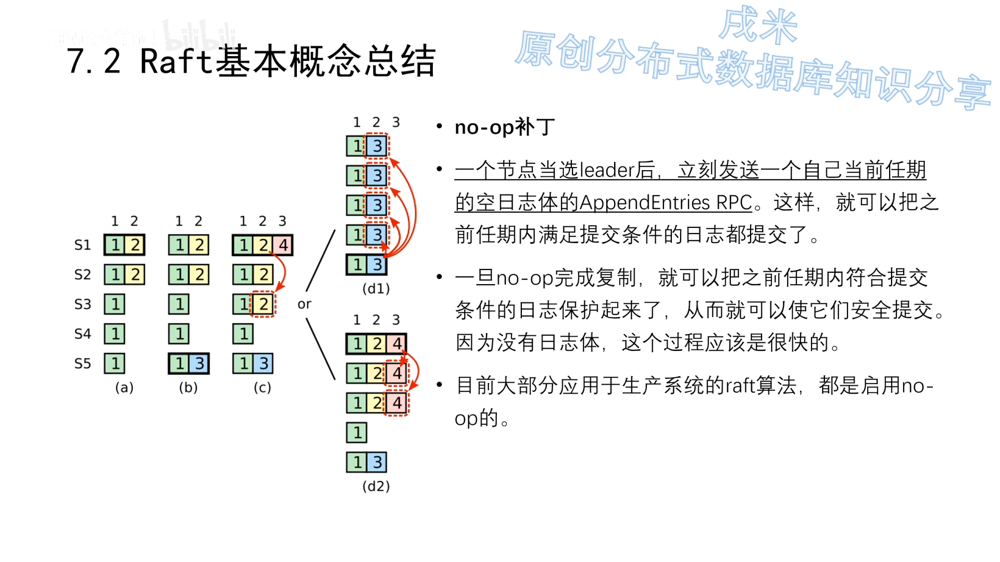

**做法**：一个节点当选 Leader 后，**立刻发送一条"自己当前任期、空日志体"的 AppendEntries RPC**——这样就能把之前任期内"满足提交条件"的日志都提交掉。它起到的作用和一条正常日志一样，但新任期的第一条正常日志"可能早来可能晚来"，而 **no-op 能稳定地在第一时间保证这一点**；因为不带日志体，这个过程很快。所以**大部分生产系统的 Raft 实现都默认启用 no-op**。[【跳转到 70:25】](https://www.bilibili.com/video/BV1pr4y1b7H5/?t=4225)

### 7.4 日志压缩：用快照替代无限增长的日志

**为什么要日志压缩？** 随着集群不断运行，各状态机上的 log 不断累积，**总有一个时刻会把状态机的内存打爆**，所以需要一个机制安全地清理日志。[【跳转到 79:20】](https://www.bilibili.com/video/BV1pr4y1b7H5/?t=4760)

**Raft 采用的是一种快照（snapshot）技术**，很像关系数据库：**每个节点达到一定条件后，就把当前日志中的命令写入自己的快照**。触发条件很灵活——可以按日志数、内存使用率，也可以定时触发。**快照中一个 key 只保留最新的一份 value**，占用空间比日志小得多：比如把日志 5 及之前的全部并入快照，快照里只保留 X、Y 的最新值即可，从而避免数据无限膨胀。[【跳转到 79:45】](https://www.bilibili.com/video/BV1pr4y1b7H5/?t=4785)

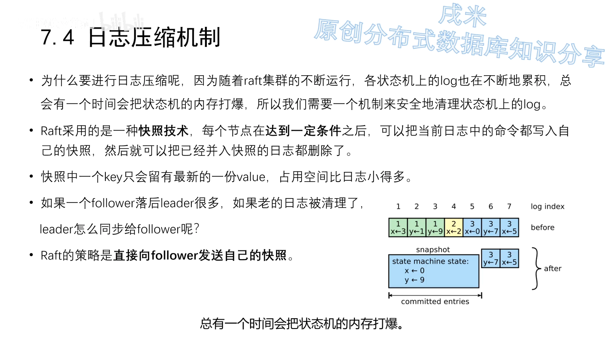

理论上"已并入快照的日志"就可以清理了，但**有些场景还需要老日志**：比如一个落后很多的 Follower 需要同步老日志，若日志已被清理就麻烦了。**Raft 的策略是直接给这个 Follower 发送自己的快照**，一步到位改为最新值。这里也有取舍：大型存储系统的快照通常很大，**节点落后不多时"同步日志"比"同步快照"更划算**，但留更多日志又占用 Leader 空间——**"何时快照、何时清理"是使用 Raft 的系统一个重要的调参方向**。[【跳转到 80:35】](https://www.bilibili.com/video/BV1pr4y1b7H5/?t=4835)

### 7.5 只读操作：怎样做到线性一致性读

此前的讨论都围绕**写入**（生成日志、改变状态机），但 Raft 也要能提供高效的**读服务**。**直观上"直接读 Leader 上的结果"并不满足线性一致性读**（线性一致性读也叫强一致性读）。[【跳转到 81:25】](https://www.bilibili.com/video/BV1pr4y1b7H5/?t=4885)

**定义**：读到的结果必须是**读请求发起时已经完成提交的结果**——不能比这个时间点"新"，也不能比它"老"。[【跳转到 82:10】](https://www.bilibili.com/video/BV1pr4y1b7H5/?t=4910)

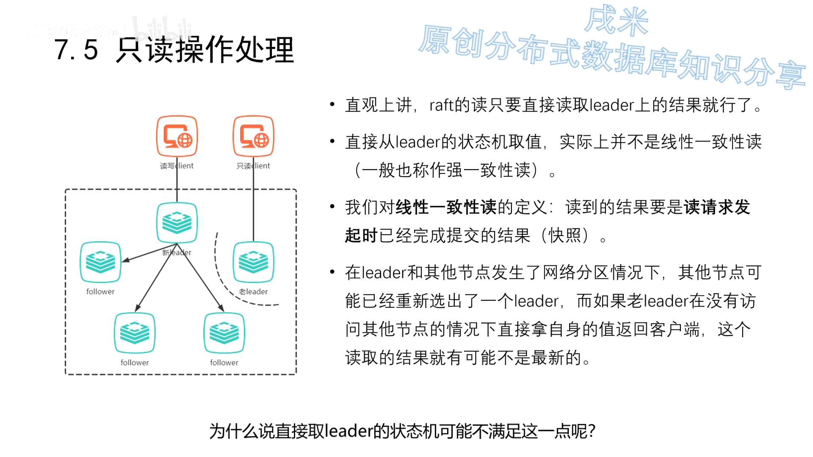

**为什么直接读 Leader 可能出错？** 当 Leader 与其他节点发生**网络分区**、其他节点已选出新 Leader 时，老 Leader 若**不经访问其他节点就直接返回自身的值**，这个结果就可能不是最新的（新 Leader 可能已有新提交的日志），于是不满足线性一致性。[【跳转到 83:15】](https://www.bilibili.com/video/BV1pr4y1b7H5/?t=4935)

**要有代价小的线性一致性读，需满足几条规则**：[【跳转到 84:45】](https://www.bilibili.com/video/BV1pr4y1b7H5/?t=4985)

1. **线性一致性读一定要发往 Leader**；若 Client 发给了 Follower，Follower 要转发给 Leader；
2. **若 Leader 在自己任期内还没提交过一条日志，就要先提交一条日志再回复读请求**——这里再次体现 **no-op 补丁的必要性**（可加快这一步）。原因是：只有在自己任期内提交过一条日志，Leader 才能确认之前任期内哪些日志已提交，才不会出现"已提交的数据读不到"；
3. **读操作前，Leader 要向所有节点发心跳并得到大多数节点的反馈**——确保自己仍是 Leader，避免上述网络分区问题；
4. **Leader 把自己目前已提交的日志号记为一个值——read index**；只要 Leader 已应用到 read index 位置的日志，就能查询状态机并返回给 Client。

**优化**：强一致性读**至少需要一轮 RPC**（那轮额外心跳），并不比写操作（最少一轮 AppendEntries RPC）快多少。还可以更进一步——**那轮 RPC 只是为确认"没有新 Leader 产生"，所以若 Leader 上次心跳时间还没超过"选举超时下界"，这段时间可直接返回读结果**。但这种方法**不安全**：分布式系统因**时钟偏移、GC** 等情况通常认为时钟不可靠，追求线性一致性读时**尽量不要省这轮 RPC**。[【跳转到 85:37】](https://www.bilibili.com/video/BV1pr4y1b7H5/?t=5137)

**弱一致性读**：多数业务对一致性要求没那么高（类似 RC 隔离级别，只要避免脏读）。与数据库思路类似，可以**读备库（读 Follower）**以获得更高读性能；但 Follower 可能落后 Leader 若干日志，**所以是弱一致性读**。理论上也可以让 Follower 提供满足线性一致性的读，条件（且 Leader 正常）是：① Follower 接到读请求后向 Leader 请求 read index；② Follower 等待自身状态机应用日志到 read index；③ Follower 查询状态机结果并返回客户端。[【跳转到 86:27】](https://www.bilibili.com/video/BV1pr4y1b7H5/?t=5187)

### 7.6 性能分析与与 Paxos 的比较

**最根本的指标**：完成一条日志（命令）的复制与提交所需的**网络（RPC）来回次数**——因为机器内部非 IO 操作远快于网络，RPC 来回次数决定了共识算法最根本的性能。**Raft 在理想情况下（多数节点正常且网络良好）只需要一次 AppendEntries RPC 来回即可提交日志，这就是理论极限**。[【跳转到 86:42】](https://www.bilibili.com/video/BV1pr4y1b7H5/?t=5202)

**影响 Raft 性能的因素与优化方法**：[【跳转到 87:32】](https://www.bilibili.com/video/BV1pr4y1b7H5/?t=5252)

- **选举与维持 Leader 的代价**：有 Leader 就有维持代价，选举期间无法响应请求。**选举超时时间要适中**——过长则选举期变长，过短则多节点同时竞选、平分选票、反复重选，代价更大；
- **batch（批量）**：命令多时，"一命令一 RPC"极耗网络，Leader 可**一次接收多个客户端命令、放进一个日志批量发送**（日志大小可限制，论文参考值 1MB）；
- **pipeline（流水线）**：正常要等 Follower 回复 success 才发下一条，pipeline 让 Leader **跳过等待、直接发下一条**，更好利用网络、加快复制；
- **落盘并行**：原始 Raft 中 Leader 先写自己的磁盘、再同步给 Follower、等 Follower 写完再回复，这两步落盘**可以并行**；
- **Multi-Raft**：大数据量时同步速度与日志顺序成为瓶颈，可**把数据划分成多个组（Region），每组独立组成 Raft 集群独立复制**，提高并发（但分组、负载均衡、共用心跳/连接等都很复杂）。

> 这两个优化（batch/pipeline）其实跟**数据库主备复制**机制很像。

**Raft vs Paxos**：常听到"Raft 不允许日志空洞，所以性能不如 Paxos"。这是因为"**与 Raft 比较的 Paxos**"实际上是指那些**能完美处理所有日志空洞边界情况、且处理代价小于空洞收益**的算法——**这个理想情况绝大部分系统都达不到、也无需达到**。所以一句话总结：**Raft 确实有"不允许日志空洞"的性能上限，但大部分系统实现连 Raft 的上限都远远没达到，无需担心 Raft 本身的瓶颈**。讲者个人认为：**Raft 本质上是 Paxos 的一种易理解的实现**，Raft 与 Multi-Paxos、Fast Paxos 等只是 Paxos 在不同方向的变种，拿 Raft 与抽象的 Paxos 概念比较并不对等。[【跳转到 90:02】](https://www.bilibili.com/video/BV1pr4y1b7H5/?t=5402)

### 7.7 ParallelRaft：为打破"日志空洞"限制而生的改造

最后一期介绍一种**允许日志空洞**的实现——**ParallelRaft**，它是**阿里云原生数据库 PolarDB 的底层文件系统 PolarFS** 对 Raft 的优化，基于 2018 年 VLDB 论文《**PolarFS: An Ultra-low Latency and Failure Resilient Distributed File System for Shared Storage Cloud Database**》。[【跳转到 92:32】](https://www.bilibili.com/video/BV1pr4y1b7H5/?t=5552)

**Raft 的限制**可总结为两条：**① log 复制的顺序性**（Follower 接收一个日志，意味着它已拥有该日志之前的全部日志且与 Leader 一致）；**② log 提交的顺序性**（任何节点提交一个日志，意味着它已提交之前所有日志）。（在这期讨论中，"提交"与"应用"基本等同。）**ParallelRaft 就是要打破这两条**，允许 **乱序确认（out-of-order acknowledge）** 与 **乱序提交（out-of-order commit）**。[【跳转到 95:02】](https://www.bilibili.com/video/BV1pr4y1b7H5/?t=5702)

**为什么需要它？** 现实中多是**并发场景、多连接**：多个连接并行给 Follower 发日志，**只要有一个连接慢了，整个日志顺序就乱了**，Follower 会拒绝"没有前序日志"的日志，造成大量失败与回退，也给 Leader 额外压力。虽然有 **Multi-Raft**（把数据拆成 Region、各 Region 独立组 Raft）这类缓解，但它**只是绕开、并未真正解决**串行提交问题。[【跳转到 93:47】](https://www.bilibili.com/video/BV1pr4y1b7H5/?t=5627)

**乱序提交怎么保证安全？关键在 look-behind buffer**：因为有的日志会修改相同数据，跳过空洞先应用后续日志可能造成状态机不一致。所以 ParallelRaft 引入 **look-behind buffer**——论文把它比作"**架在日志空洞之上的桥**"。[【跳转到 96:20】](https://www.bilibili.com/video/BV1pr4y1b7H5/?t=5780)

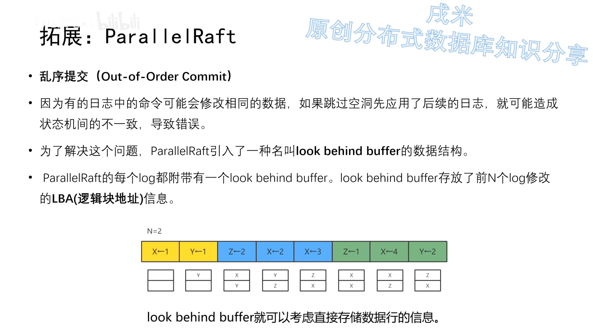

- 每个 log 附带一个 **look-behind buffer，存放前 N 个 log 修改的 LBA（逻辑块地址）**（对 PolarFS 是数据块信息；若用于数据库可存数据行信息）；
- 通过它，**Follower 能判断一个 log 是否与日志空洞里的 log 冲突**（即当前 log 的 LBA 与其 look-behind buffer 中对应空洞的 LBA 是否重合）：**无冲突的 log entry 可安全执行；有冲突的先放入 pending list**，等空洞补齐后再执行；
- **PolarFS 把 N 设为 2**（日志空洞最大为 2），是相对保守的方案。例：蓝日志把 X 改为 2，其 look-behind buffer 显示前面空缺的日志改的是 Z，不冲突 → 可提交；绿日志前缺了 3 条（> N）→ 不能提交；绿日志改成 X=4 但它之前的空洞也改了 X → 不能提交；等前面改 X 的日志提交后，它就能无视空洞直接乱序提交。

**乱序确认怎么保证安全？（关键在选举）** 乱序确认会让日志存在空洞，而 Raft 要求 Leader 必须持有完整日志。ParallelRaft 的办法是：**把选出的 Leader 定义为 Leader Candidate，它必须经过一个 merge 阶段补齐所有日志空洞后，才能开始接收并复制日志**。选举时**优先选"具有最新 checkpoint 的节点"**为 Leader Candidate；其余未宕机节点称为 Follower Candidate。[【跳转到 99:45】](https://www.bilibili.com/video/BV1pr4y1b7H5/?t=5985)

**merge 阶段**：① Follower Candidate 把自己的日志（checkpoint 之后的）发给 Leader Candidate，**Leader Candidate 通过 merge 操作补齐自己的日志空洞**；② Leader Candidate 向 Follower 同步状态信息（确保正式对外服务前，所有未宕机节点对老任期日志达成一致）；③ Leader Candidate 提交并通知 Follower Candidate 提交；④ 升级为 Leader，开始新任期的服务。merge 时把所有 log 分为三类——**已提交的日志**（必须补上并提交；index 相同 term 不同时选 term 最大者）、**未提交的日志**（可用空日志替代）、**不确定是否提交的日志**（保守起见必须提交）。判断"是否复制到多数"时，ParallelRaft **把宕机机器也算作拥有该日志**（保守算法）。[【跳转到 101:34】](https://www.bilibili.com/video/BV1pr4y1b7H5/?t=6094)

**checkpoint 与 catch up**：ParallelRaft 的 **checkpoint 就是状态机快照**。选"最新 checkpoint 节点"当 Leader Candidate 有两个原因——checkpoint 之前的日志都已确认提交，merge 阶段无需处理；**checkpoint 越新，merge 与 catch up 代价越小**。ParallelRaft 把"落后 Follower 追上 Leader"称为 **catch up**，分两种：**fast-catch-up**（差距小于上一个 checkpoint，仅同步日志）与 **streaming-catch-up**（差距大于上一个 checkpoint，需同步 checkpoint + 日志）。[【跳转到 105:15】](https://www.bilibili.com/video/BV1pr4y1b7H5/?t=6315)

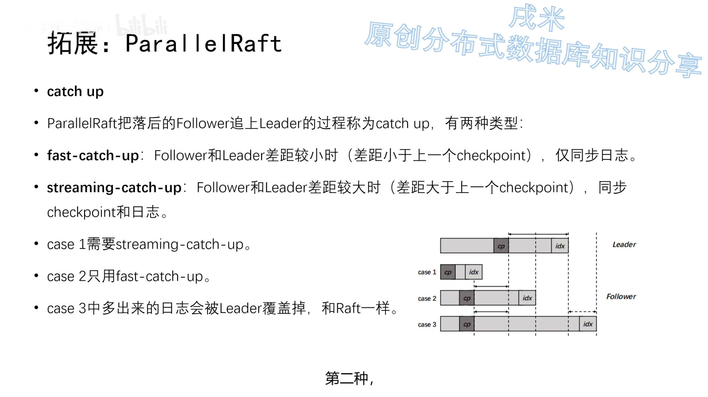

**性能提升**：从论文的指标看，**随着 IO 队列增大，ParallelRaft 的延迟比 Raft 低、吞吐量显著大于 Raft**。[【跳转到 107:20】](https://www.bilibili.com/video/BV1pr4y1b7H5/?t=6440)

**总结**：Raft 论文原文有一段话——**在所有基于 Leader 的共识算法中，Leader 最终都需要存储所有已提交的日志；有些算法允许 Leader 当选时不持有全部已提交日志，再靠额外机制识别并补齐。** ParallelRaft 正是这样的改造，但**额外机制带来更高复杂度与理解成本**；Raft 则选择更简单的方法，**让 Leader 被选出时天然就具有所有已提交日志**，从而让日志只从 Leader 流向 Follower、Leader 永不覆盖自己的日志。**为了更高性能而绕开规则，自然也带来更高复杂度——鱼与熊掌不可兼得。**

## 小结

- **共识算法的本质是实现复制状态机**：相同初始状态 + 相同输入序列 = 相同结束状态；Raft 用"复制日志"来保证所有节点的输入序列一致。
- **Raft 靠状态简化变得易理解**：节点只有 **Leader / Follower / Candidate** 三种状态、只有 **RequestVote / AppendEntries** 两类 RPC，并用**任期（term）**作为逻辑时钟。
- **领导者选举**：心跳维持 Leader；超时未收到心跳则加任期、变 Candidate、投票给自己并发起 RequestVote；拿到**多数票**即当选。随机选举超时（150~300ms）用于打破平票僵局。
- **日志复制**：Leader 追加并**并行**复制日志，**超过半数 Follower 复制后即提交**并返回客户端；落后 Follower 分"缓慢 / 宕机恢复 / Leader 宕机"三种情况处理，靠**一致性检查**补齐、靠**强制复制 Leader 日志**消除冲突。注意：**复制到多数 ≠ 一定提交**。
- **安全性四条规则**：① 选举性质——**Leader 必含所有已提交日志**（比较最后日志的任期号与索引）；② **永不靠"数副本"提交老任期日志**，只有自己任期的日志才能这样提交（新日志提交会"保护"老日志一并提交）；③ Follower/Candidate 宕机靠**无限重试 + RPC 幂等**；④ 时间约束——**选举超时 > 广播时间**（差一个数量级）、**MTBF ≫ 选举超时**。
- **集群成员变更**：难点是防止变更期间**脑裂**。**联合共识**用"两阶段（C_old,new → C_new）、RPC 需在新旧多数都通过"来保证安全；**单节点变更**因"新旧多数必然重合"而更简单，但有"不支持一步替换""必经偶数节点""连续变更切主可能导致已提交配置被覆盖（需 no-op 修复）"等缺陷。
- **工程实践**：**no-op**（当选先提交空日志）、**日志压缩（快照）**、**线性一致性读（发往 Leader + 任期提交 + 心跳确认 + read index）**、**性能优化（batch/pipeline/并行落盘/Multi-Raft）**。
- **ParallelRaft** 用 **look-behind buffer + Leader Candidate/merge 阶段**打破 Raft 的顺序复制/提交限制，换来更低延迟与更高吞吐，代价是更高复杂度——**取舍之道，仁者见仁**。

## 关键术语速查

| 术语 | 一句话解释 |
| :--- | :--- |
| 共识（Consensus） | 让多个节点对"同一份日志、同样的顺序"达成一致 |
| 复制状态机（Replicated State Machine） | 相同初始状态 + 相同输入 → 相同结束状态；共识算法的本质目标 |
| 任期（Term） | Raft 的逻辑时钟，连续整数标记；一个任期至多一个 Leader |
| Leader / Follower / Candidate | Raft 的三种节点状态，任意时刻处于其一 |
| RequestVote RPC | Candidate 在选举期间发起、请求投票的 RPC |
| AppendEntries RPC | Leader 发起，用于复制日志并提供心跳 |
| 心跳（Heartbeat） | Leader 周期性发送、用于维持地位的空日志体 AppendEntries RPC |
| 选举超时（Election Timeout） | 未收到心跳即触发选举的随机时长（150~300ms） |
| 日志条目（Log Entry） | 由"状态机指令 + 任期号 + 日志索引"组成 |
| 提交（Commit） | Leader 把日志应用到本地状态机；多数派拥有是提交的前提 |
| leader commit | AppendEntries RPC 中携带的"已提交位置"，告知 Follower 可提交到哪 |
| 一致性检查 | Leader 在 RPC 中带前一条日志的索引/任期，用于定位并补齐 Follower 缺失日志 |
| 日志空洞（Log Hole） | 乱序复制造成的日志不连续；Raft 不允许，ParallelRaft 允许 |
| 选举性质 | 被选出的 Leader 必包含所有已提交日志（比任期号，再比日志长度） |
| 脑裂（Split Brain） | 同一任期出现两个 Leader；成员变更必须避免 |
| 联合共识（Joint Consensus） | 成员变更的两阶段过渡配置 C_old,new：RPC 需在新旧配置都过半 |
| 单节点变更 | 一次只增减一个节点的简化变更方法；新旧多数必然重合 |
| no-op 补丁 | 当选 Leader 后立刻提交一条空日志，帮助提交老任期日志 |
| 日志压缩 / 快照（Snapshot） | 把日志命令压缩为状态快照，避免日志无限增长 |
| 线性一致性读 | 读到"读请求发起时已提交"的结果（强一致性读） |
| read index | Leader 记录的已提交日志号，用于线性一致性读的判断 |
| batch / pipeline | 批量发送日志 / 跳过等待连续发送日志的性能优化 |
| Multi-Raft | 把数据分为多个 Region、各自独立组 Raft 集群以提高并发 |
| ParallelRaft | PolarFS 对 Raft 的改造，允许乱序确认/提交，用 look-behind buffer 保证安全 |
