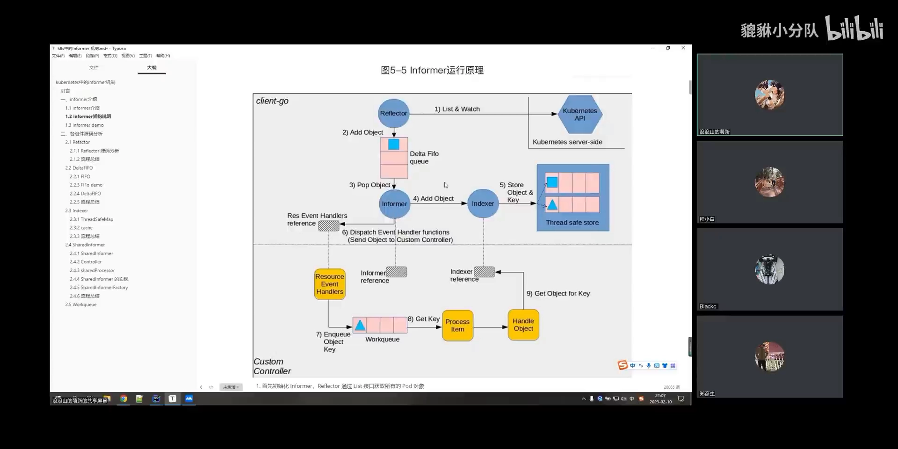
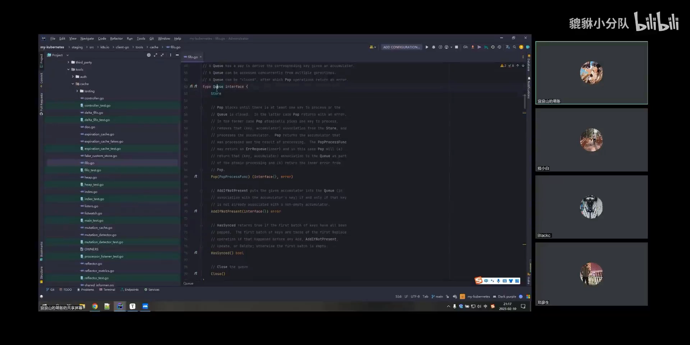
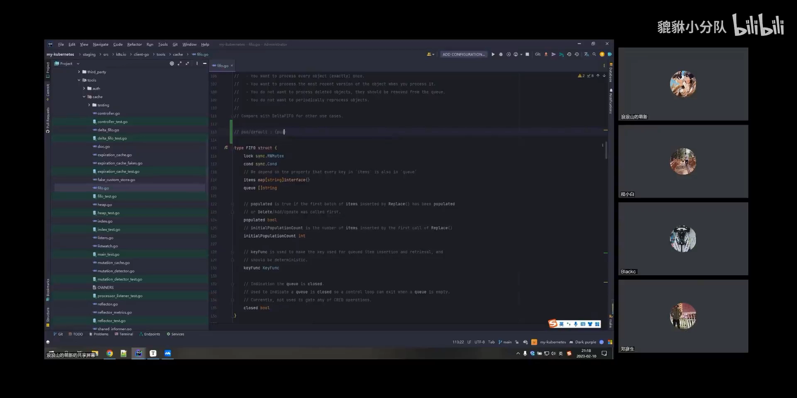
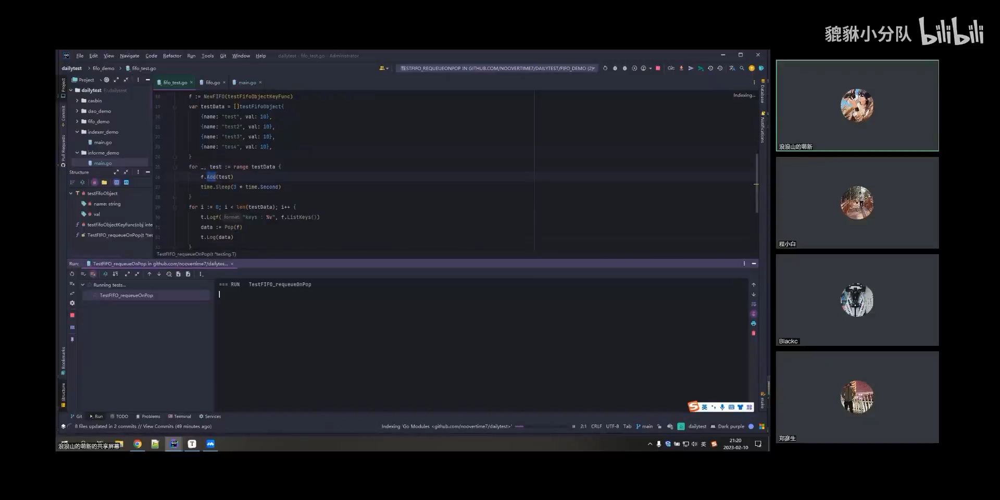
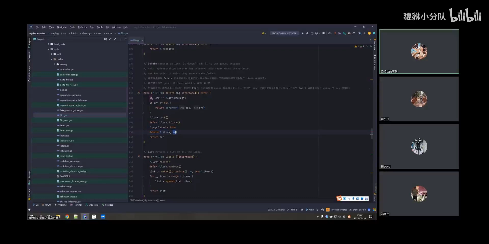
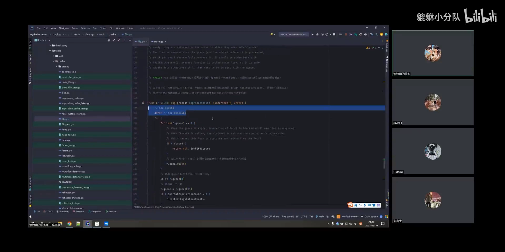

# client-go Informer 源码剖析：FIFO 队列

> 视频来源：[kubernetes源码系列--informer 源码分析之 FIFO 篇](https://www.bilibili.com/video/BV1os4y1h7uN/)（Pixiu 云原生）｜时长：约 32 分钟
>
> 这是一支**边看代码边跑例子**的源码剖析视频。它讲的是 informer 机制里最容易被跳过的一环：reflector 把对象从 k8s 拿到手之后，**并不直接写本地缓存**，而是先塞进一个本地内存队列——FIFO（DeltaFIFO 的基座）。本文对自动字幕里的明显错拼做了订正：`refleer`/`refer`/`flatter`→**reflector**、`一方面`→**informer**、`德尔塔f fo`/`data fo`→**DeltaFIFO**、`考出来`→**controller**、`卧室`→**watch**、`china`→**channel**、`有老师参照`→**ResultChan**、`k funk`→**keyFunc**、`tiful set`→**StatefulSet**、`share index informer`→**SharedIndexInformer**、`new data f f o with options`→**NewDeltaFIFOWithOptions**、`by name is space`→**MetaNamespaceKeyFunc**。
>
> 本篇与同系列《client-go Informer 源码剖析：Reflector 篇》配套：那篇讲**数据怎么从 apiserver 拿下来**，这篇讲**拿下来之后怎么排队、去重、被消费**。

## 本讲要解决的核心问题（SCQA）

**背景**：上一篇我们已经知道，informer 是一个「本地缓存 + 事件回调」的机制，其中 reflector 负责调用 k8s 提供的两个接口——**list**（一次性拿到全量资源对象）和 **watch**（长连接，资源一变就推送过来）。reflector 的作用，就是把资源对象从 k8s「搬」到自己本地的内存里。

**冲突**：可是 reflector 拿到数据的那一刻，**并不能直接把数据写进本地缓存**。原因很实际：同一个对象可能在很短时间里被改好几次（watch 会推来一串事件）；消费者（我们自己的业务代码 / 回调）处理速度未必跟得上生产速度；而且缓存会被多方并发读写。

**疑问**：那么 reflector 和本地缓存之间，到底隔了什么？这条「缓冲带」的内部是怎么实现的——它怎么保证顺序、怎么处理重复、又是怎么被消费掉的？

**回答（中心思想）**：**它隔着一个本地内存队列，也就是 FIFO / DeltaFIFO。** 队列把「生产」和「消费」解耦：reflector 只管把对象按事件类型（Added / Modified / Deleted）统一用 `Add` / `Update` / `Delete` 塞进队列；消费者通过 `Pop(回调)` 按**先进先出**的顺序取出，再由回调去写缓存、或交给 event handler。FIFO 的实现是一个**「queue 存 key 顺序 + items 存 key→对象」的双结构**，并天然带上了**同一 key 去重**、**阻塞/唤醒**、**入队失败重入队**这些工程细节。

---

## 一、为什么 reflector 和缓存之间要加一个队列

### 1.1 先回顾 informer 的大体流程

informer 的流程图里，蓝色部分是它的几个核心组件，第一个就是**上节课讲过的 reflector**。[【跳转到 01:20】](https://www.bilibili.com/video/BV1os4y1h7uN/?t=80)

- **reflector**：调用 **list and watch** 这两个 k8s 接口。list 会历史性地获取 k8s 中**所有**的资源对象；watch 会启动一条**长连接**，k8s 里的资源对象一旦更新，就通过这条长连接发送给 reflector。
- **reflector 的作用**：把资源对象从 k8s 拿到自己的**本地内存**里。它本质上是一层**内存缓存**机制。

### 1.2 ListAndWatch 只做两件事

reflector 的构造是「传一个最重要的 ListWatch 进来」，实例化之后才调用它的 `Run` 方法（`Run` 里有个类似 `wait.Until` 的封装：只有内层函数退出才会解锁，所以它会一直卡在这里循环）。真正要看的是 **`ListAndWatch`**，它看起来很长，但只做两件事：[【跳转到 03:05】](https://www.bilibili.com/video/BV1os4y1h7uN/?t=185)[【跳转到 03:30】](https://www.bilibili.com/video/BV1os4y1h7uN/?t=210)

1. **list**：reflector 刚启动时，通过 list 接口把对象**全量**拿一遍，然后把每个 item 放到自己的 store 里；
2. **watch**：启动一条长连接（一个死循环），不断从 watch 里拿数据。

watch 拿到数据后的处理很值得注意：它从 **`ResultChan`** 里不断读事件，事件对象内部有一个 `type` 字段，对应资源的增删改——**Added 走 `Add`、Modified 走 `Update`、Deleted 也走 `Update`（Delete）**，全都是调用 reflector 自己那个 store 的方法，把 object **一股脑塞过去**。[【跳转到 05:36】](https://www.bilibili.com/video/BV1os4y1h7uN/?t=336)[【跳转到 06:26】](https://www.bilibili.com/video/BV1os4y1h7uN/?t=386)[【跳转到 07:11】](https://www.bilibili.com/video/BV1os4y1h7uN/?t=411)

> 一句话：**无论是全量 list 来的数据，还是 watch 后来的增量数据，reflector 都统一塞进同一个 store。** 所以接下来真正要看的，就是这个 store 里到底是什么。

### 1.3 这个 store 是谁：从 Config.Queue 一路追到 NewDeltaFIFOWithOptions

`Reflector` 结构体里的 `store` 字段是一个**接口**——只要实现了这个接口，就可以被实例化。要找到它是谁，得从 reflector 的构造函数往回追：[【跳转到 07:29】](https://www.bilibili.com/video/BV1os4y1h7uN/?t=449)[【跳转到 08:00】](https://www.bilibili.com/video/BV1os4y1h7uN/?t=480)

1. reflector 内部有一个 **controller**。注意，这个 controller 和 k8s 里 Deployment / StatefulSet 那种 controller **不是一回事**，它只是一个**逻辑意义上的 controller**；
2. 它的实现是把内部的 **`Config` 里的 `Queue`** 传进去；
3. 这个 Queue 通过一个 `New` 方法创建（`cfg` 就是一个 `Config`，里面包含后面要用的 DeltaFIFO）；
4. 再往下跳，会看到 **`SharedIndexInformer`** 里调用了 **`NewDeltaFIFOWithOptions`**。

所以结论是：**reflector 里的那个 store，就是 DeltaFIFO。** [【跳转到 08:30】](https://www.bilibili.com/video/BV1os4y1h7uN/?t=510)[【跳转到 09:20】](https://www.bilibili.com/video/BV1os4y1h7uN/?t=560)

> 📌 顺带一提：`NewDeltaFIFOWithOptions` 必须传两个东西——`keyFunc` 和 `knownObjects`（objects）。`knownObjects` 涉及下一篇要讲的 indexer，这里先不管。

---

## 二、FIFO 的本质：queue 存顺序，items 存数据

### 2.1 fifo.go 与 Queue 接口

看 DeltaFIFO 之前要先看它的基座。在 indexer / DeltaFIFO 的**同一级目录**下有一个 `fifo.go`，里面定义了 **`Queue` 这个 interface**；只要实现了这个 interface，就算是一个 Queue。[【跳转到 10:31】](https://www.bilibili.com/video/BV1os4y1h7uN/?t=631)

DeltaFIFO 与 FIFO 的关系可以用一句话概括：**DeltaFIFO 无非就是用了 FIFO 这个组件，只不过它存的是 Delta（增量）数据。** [【跳转到 10:06】](https://www.bilibili.com/video/BV1os4y1h7uN/?t=606)

### 2.2 两个必须关注的结构：queue 与 items

FIFO 的实现里，一个锁（`lock`）先不用管，`cond` 是做**事件通知**的东西（`sync.Cond`）。真正需要特别关注的是 **`items` 和 `queue` 这两个字段**。它们构成的其实是一个 **key-value** 结构：[【跳转到 10:56】](https://www.bilibili.com/video/BV1os4y1h7uN/?t=656)[【跳转到 11:21】](https://www.bilibili.com/video/BV1os4y1h7uN/?t=681)

- **`queue`**：存放**所有的 key**，管的只是**顺序**；
- **`items`**：一个 **map**，`key → 对象的真实数据`。

用视频里的例子说：假设有这样一条数据，它的 key 是用 **keyFunc** 生成出来的——在 k8s 里默认就是「`namespace` + `name`」，比如 `default/xxx`。**这个 key 被放进 `queue` 里，而这条 Pod 的真正的数据则放进 `items` 里。** [【跳转到 12:11】](https://www.bilibili.com/video/BV1os4y1h7uN/?t=731)[【跳转到 12:36】](https://www.bilibili.com/video/BV1os4y1h7uN/?t=756)

### 2.3 keyFunc：默认就是 MetaNamespaceKeyFunc

`keyFunc` 是一个接口、也是一个函数：你给我一个 object，我必须给你返回一个 key。在 k8s 中默认用的是 **`MetaNamespaceKeyFunc`**：对象传进来后先转成 metadata/object，如果它有 namespace，就返回 **`namespace/name`**（没 namespace 就直接用 name）。[【跳转到 16:48】](https://www.bilibili.com/video/BV1os4y1h7uN/?t=1008)[【跳转到 17:13】](https://www.bilibili.com/video/BV1os4y1h7uN/?t=1033)[【跳转到 17:38】](https://www.bilibili.com/video/BV1os4y1h7uN/?t=1058)

### 2.4 跑一个例子：Add → ListKeys → Pop

视频里从 k8s 源码中找了一个例子：声明一个模拟 Pod / Deployment 的 `testObject`，实例化一个 FIFO，然后把几个对象 **Add** 进队列，**休眠 3 秒**，再从队列里 **Pop** 取数据。[【跳转到 13:03】](https://www.bilibili.com/video/BV1os4y1h7uN/?t=783)[【跳转到 13:28】](https://www.bilibili.com/video/BV1os4y1h7uN/?t=808)

运行结果能看到这个规律：

- `ListKeys` 打印出队列里**所有的 key**——它就是「用 name 生成出来的 key」；
- **每 `Pop` 弹出一个，key 就减少一个**（同时队列会删掉这个 key）；
- 取不到数据时循环结束。[【跳转到 14:43】](https://www.bilibili.com/video/BV1os4y1h7uN/?t=883)[【跳转到 15:08】](https://www.bilibili.com/video/BV1os4y1h7uN/?t=908)[【跳转到 15:33】](https://www.bilibili.com/video/BV1os4y1h7uN/?t=933)

这个例子的完整语义就是：**Add 塞进去 → Pop 弹出来 → 打印 → 从 keys 里删掉。**

---

## 三、FIFO 的增删改查到底怎么实现的

### 3.1 Add：先算 key，再查重，最后入队

`Add` 的注释说得很清楚：**把插入的对象放入队列中，只有元素不在集合里时才会插入**。流程是：[【跳转到 18:58】](https://www.bilibili.com/video/BV1os4y1h7uN/?t=1138)[【跳转到 19:23】](https://www.bilibili.com/video/BV1os4y1h7uN/?t=1163)[【跳转到 19:48】](https://www.bilibili.com/video/BV1os4y1h7uN/?t=1188)

1. 先调用 **keyFunc** 把 object 生成一个 key；
2. **加锁**；
3. 拿 key 去 map（`items`）里取值，判断这个 key **是否已经在队列中**：
   - **取不到（key 不在 `queue` 里）** → 把 key **塞进 `queue`**，再把数据以该 key 写进 `items`，然后**通知**监听者；
   - 取得到 → 说明已经在队列里了，**不重复入队**。

这就是**同一 key 去重**的来源：队列里同一个对象只会排一次队。

### 3.2 Update：直接复用 Add

`Update` 实现非常简单，直接去调用 `Add`——因为 `Add` 内部有那个「已存在就不插入」的判断，所以它天然适用于 Update；而写 `items` 那步是直接**替换**，所以 Update 直接用 `Add` 就够了。[【跳转到 20:38】](https://www.bilibili.com/video/BV1os4y1h7uN/?t=1238)

### 3.3 Delete：只删 items，不动 queue 的 key

`Delete` 同样先算 key、加锁，然后**直接把 `items` 里这一项删掉**。这里会引出一个疑问：[【跳转到 21:03】](https://www.bilibili.com/video/BV1os4y1h7uN/?t=1263)[【跳转到 21:28】](https://www.bilibili.com/video/BV1os4y1h7uN/?t=1288)

> 我们说过**所有的 key 都会放在 `queue` 里**，但删除只删了 `items` 里的数据项。那 `queue` 里是不是还留着这个 key？

**答案：是，还留着。** 视频明确说这里先留一个疑问，等讲 `Pop` 时会有一个判断来处理它——**否则就会造成 `queue` 和 `items` 不一致**。这个「不一致」正是后面 Pop 逻辑的一部分，也是理解 DeltaFIFO 的关键伏笔。

### 3.4 其余几个方法

剩下的方法都比较好懂：[【跳转到 21:53】](https://www.bilibili.com/video/BV1os4y1h7uN/?t=1313)[【跳转到 22:18】](https://www.bilibili.com/video/BV1os4y1h7uN/?t=1338)

| 方法 | 作用 |
| --- | --- |
| `Add(obj)` | 生成 key → 加锁 → 不在队列才入队 → 写 `items` → 通知 |
| `Update(obj)` | 直接调用 `Add`（复用去重 + 覆盖写） |
| `Delete(obj)` | 生成 key → 加锁 → 只删 `items` 中该项（`queue` 保留 key） |
| `List()` | for 循环把 `items` 里的数据全部列出来 |
| `ListKeys()` | for 循环把 `queue` 里的 key 全部列出来 |
| `Get(obj)` | 生成 key → 从 `items` 里查真实对象 |
| `IsClosed()` | 判断 `closed` 标志位 |
| `Close()` | 把标志位置为 true，并通知所有等待者 |

> 因为这些方法是 `Queue` 这个 interface 的一部分，**FIFO 必须实现全部**它们，才能被当作 Queue 使用。

---

## 四、Pop：队列是怎么被消费的

### 4.1 生产者-消费者模型

k8s 里有很多地方是**生产者-消费者**模型。数据被放进 FIFO 队列后，必须有一个消费者把数据取走——这个动作就是 **`Pop`**：真正地把队列里的数据**一个一个弹出来**，并且遵守**先进先出**的顺序。[【跳转到 23:32】](https://www.bilibili.com/video/BV1os4y1h7uN/?t=1412)[【跳转到 23:57】](https://www.bilibili.com/video/BV1os4y1h7uN/?t=1417)

### 4.2 Pop(process)：加锁 + 循环 + 等待

`Pop` 的签名是**要求传一个回调函数**的，这个回调叫 **`PopProcessFunc`**（一个 function），主要用来**消费 object**。流程是：[【跳转到 24:02】](https://www.bilibili.com/video/BV1os4y1h7uN/?t=1442)[【跳转到 24:27】](https://www.bilibili.com/video/BV1os4y1h7uN/?t=1467)[【跳转到 24:52】](https://www.bilibili.com/video/BV1os4y1h7uN/?t=1492)

1. **加锁 / 解锁**：因为是多线程操作，必须加锁保护；
2. 起一个 **for 循环**，先判断 `queue` 里有没有数据；
3. **如果队列为空（长度等于 0）→ 阻塞等待**：这里用的是 `sync` 包的东西（`cond.Wait`）。

### 4.3 谁来唤醒：Add 之后的 cond.Broadcast

等待者怎么被叫醒？**在 `Add` 的时候会调用 `cond.Broadcast`**（broadcast 翻译过来就是「广播」）。也就是说：[【跳转到 25:17】](https://www.bilibili.com/video/BV1os4y1h7uN/?t=1517)[【跳转到 25:42】](https://www.bilibili.com/video/BV1os4y1h7uN/?t=1542)

- 如果**没人**调用广播，`Pop` 就**一直阻塞**；
- 一旦有人 `Add`（并广播），`Pop` 就**解除阻塞**、发现「队列里有数据了」，于是继续往下处理。

这就是「队列空了消费者怎么不空转」的答案：**靠条件变量等待 + 入队时广播唤醒**。

### 4.4 先进先出：取第零个元素，删 queue 的 key，从 items 取对象

有数据之后，Pop 的处理顺序正好体现了「先进先出」和前面那个「不一致」的答案：[【跳转到 26:07】](https://www.bilibili.com/video/BV1os4y1h7uN/?t=1567)[【跳转到 26:32】](https://www.bilibili.com/video/BV1os4y1h7uN/?t=1592)[【跳转到 26:57】](https://www.bilibili.com/video/BV1os4y1h7uN/?t=1617)

1. 拿到 **`queue` 的第零个元素**——因为先进先出，第零个就是**最先开始**的那个；
2. 做一次**删除操作**：把 `queue` 里的这个 key 删掉；
3. 再从 **`items`** 里把对应的真实数据取出来（取不到就继续循环）；
4. 调用**传进来的回调函数**，把 item 交出去（回调里通常会去写本地缓存 / 交给 handler）。

> 这就解释了 3.3 的伏笔：**`Delete` 只删了 `items`，`queue` 里的 key 是在 `Pop` 消费时才真正被删掉的。** 这样一来，「入队（Add/Update 去重）」与「出队（Pop）」各自负责一半，队列的 key 与 items 的数据才能最终对上。

### 4.5 入队失败要重入队

回调返回 `error`（断言入队失败）时，Pop 不会把数据丢掉，而是**重新入队**：把这个 key 和 item 重新塞回队列，**等待下一次入队/处理**。这一点很重要——它保证了「消费者处理失败」不会导致事件被静默吞掉。[【跳转到 27:22】](https://www.bilibili.com/video/BV1os4y1h7uN/?t=1642)

---

## 五、这个队列到底解决什么

主讲人在结尾的答疑里把「为什么要有它」讲得很直白：**reflector 拿到数据之后，肯定不会直接往本地缓存里写**——我们需要一个队列来**承担这些数据**，并且在队列中对数据**还能进行操作**。[【跳转到 29:02】](https://www.bilibili.com/video/BV1os4y1h7uN/?t=1770)[【跳转到 29:42】](https://www.bilibili.com/video/BV1os4y1h7uN/?t=1783)

所以：

- informer 里那个组件叫 **DeltaFIFO**，但 **DeltaFIFO 实际上是基于 FIFO 做的**；
- 区别在存的内容：**FIFO 的 `items` 存的是 `interface`（对象本身），而 DeltaFIFO 里存的 `interface` 是一个 `Delta`（增量）**；
- 作用一句话：**在本地缓存之前，把 object 有顺序地处理一遍**（先进先出）。

> 本篇只讲了 FIFO 基座；DeltaFIFO 自己的逻辑（Replace、Delta 合并、`knownObjects` 等）是它的续集。理解顺序建议是：**Reflector（取数）→ FIFO（排队）→ DeltaFIFO（增量语义）→ Indexer（缓存）→ SharedInformer（分发到 handler）**。

---

## 小结

- reflector 用 **list + watch** 拿到数据后，**统一塞进自己的 store**，而这个 store 就是 **DeltaFIFO**。
- 追代码的链子是：`Reflector.store`（接口）→ 内部 `controller` 的 `Config.Queue` → **`NewDeltaFIFOWithOptions`**。
- FIFO 是**双结构**：`queue` 存 key 的顺序、`items` 存 `key → 对象`；默认 key 由 **`MetaNamespaceKeyFunc`** 按 `namespace/name` 生成。
- **Add 自带去重**（key 已在队列就不再入队），**Update 直接复用 Add**；**Delete 只删 `items`**，`queue` 里的 key 留到 Pop 才删。
- 消费靠 **`Pop(PopProcessFunc)`**：加锁 → 队列空就 `cond.Wait` 阻塞 → `Add` 里的 **`cond.Broadcast`** 唤醒 → 取 `queue` 第零个元素（先进先出）→ 删 key → 从 `items` 取对象 → 调回调。
- 回调报错会**重新入队**，事件不会被静默丢弃。
- 队列的意义：**在写本地缓存之前，给数据一个有序、可操作、能解耦生产与消费的缓冲带**。

## 关键术语速查

| 术语 | 一句话解释 |
| --- | --- |
| reflector | 用 list + watch 从 k8s 取资源对象，并塞进 store 的组件 |
| ListAndWatch | reflector 的主函数：先 list 全量，再 watch 长连接增量推送 |
| `ResultChan` | watch 返回的事件通道，事件带 `type`（Added/Modified/Deleted） |
| store | `Reflector` 结构体里的接口字段，实际实现是 DeltaFIFO |
| FIFO | 先进先出的本地内存队列（`fifo.go`），DeltaFIFO 的基座 |
| `Queue` interface | `fifo.go` 定义的接口：Add/Update/Delete/List/Get/Pop 等 |
| `queue` | 存放所有 key，只表达顺序 |
| `items` | `key → 对象` 的 map，存真正的数据 |
| keyFunc | 由对象生成 key 的函数；默认 `MetaNamespaceKeyFunc`（namespace/name） |
| `Add` | 生成 key → 查重 → 不存在才入队 → 写 items → 通知 |
| `Update` | 直接调用 `Add`（复用去重与覆盖写） |
| `Delete` | 只删 `items`，`queue` 的 key 留到 Pop 时删 |
| `Pop(process)` | 消费队列：先进先出取出并交给回调；空则阻塞等待 |
| `PopProcessFunc` | Pop 的回调类型，负责真正消费 object |
| `cond.Broadcast` | 入队时广播，唤醒正在等待数据的 Pop |
| 重新入队 | 回调返回 error 时把 key/item 重新塞回队列，避免事件丢失 |
| DeltaFIFO | 基于 FIFO，`items` 里存的是 Delta（增量）而非对象本身 |
