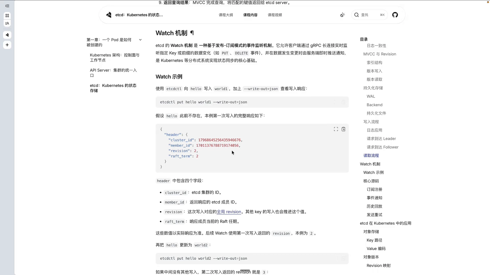
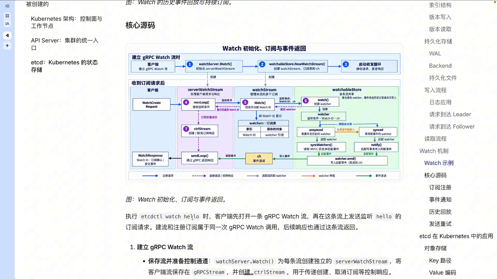
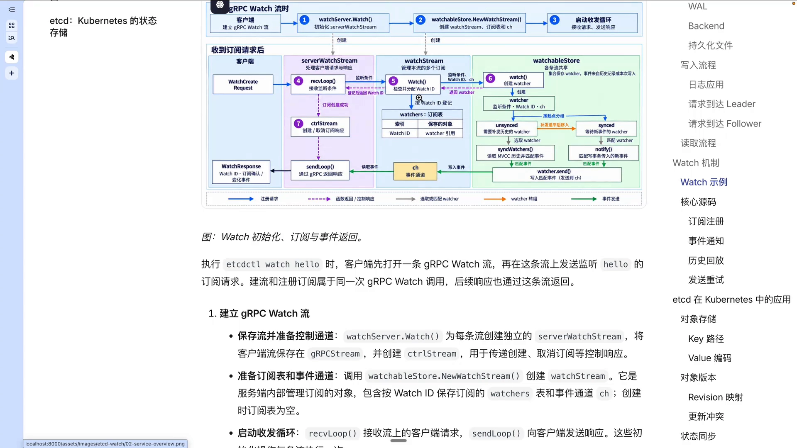
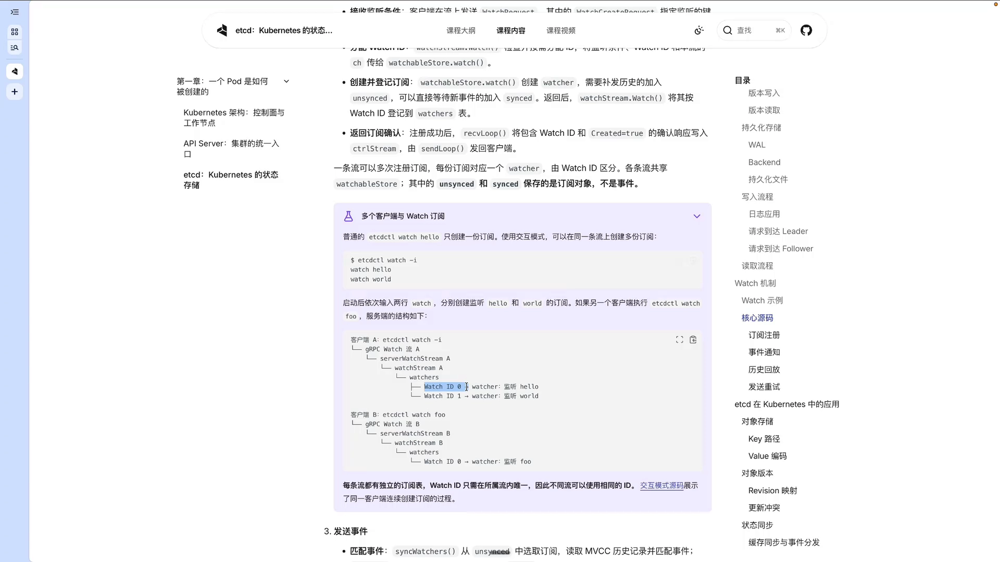
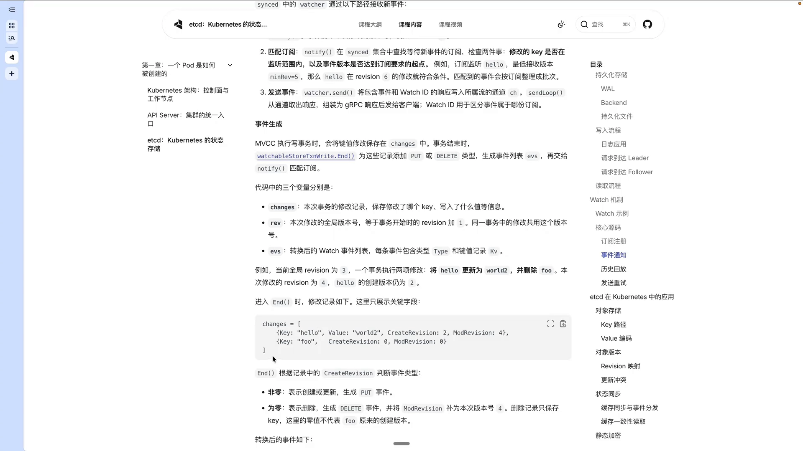
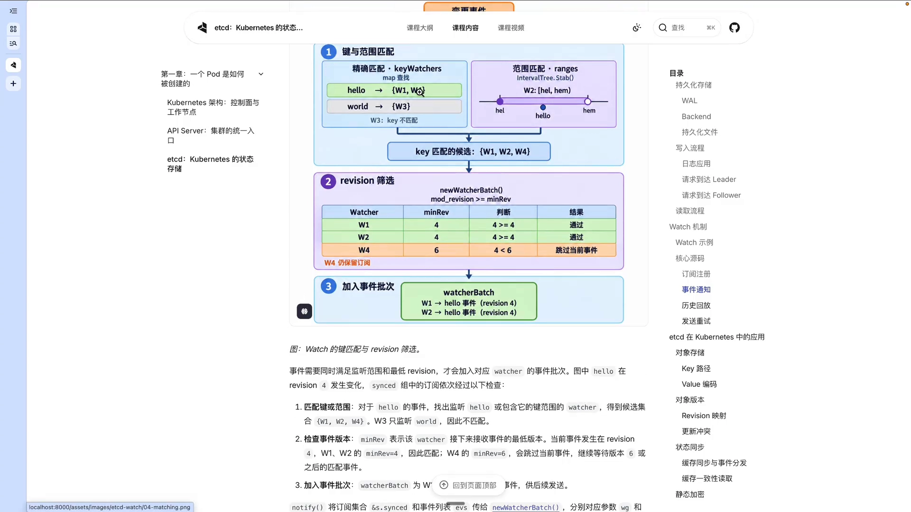
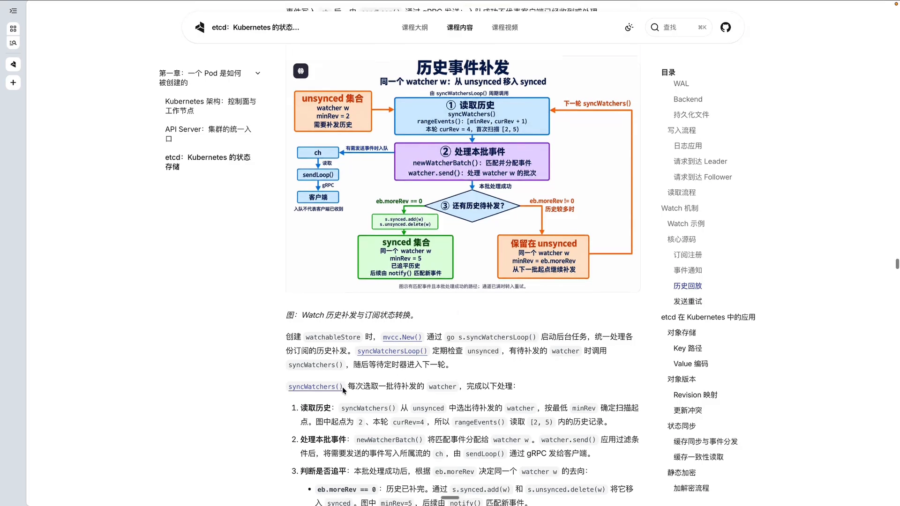
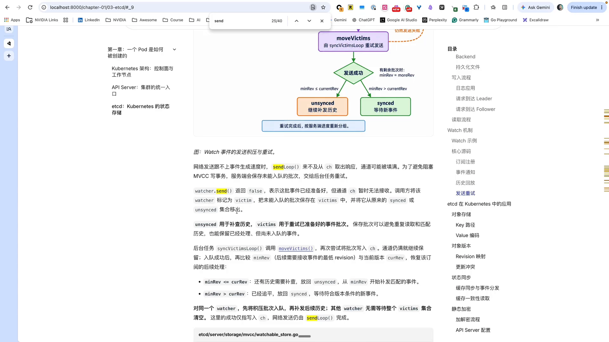

# etcd Watch 机制源码剖析：发布/订阅、历史回放与事件分发

> 视频来源：[K8S AI Infra 课程 - etcd Watch 源码](https://www.bilibili.com/video/BV1g3H56mETL/)（Se7en 的架构笔记）｜时长：约 23 分钟
>
> 这是一支**逐行读 etcd 源码**、把一条 `etcd watch` 命令从建立连接到事件推送的完整链路讲清楚的课程切片。为避免读者被自动字幕的错拼误导，本文对字幕中的明显识别错误做了订正：`etc d`/`EDCD`→**etcd**、`GRPC string`→**grpcStream**、`c t r RL string`/`cdr string`→**ctrlStream**、`watch string`→**watchStream**、`what water`/`water`/`worship`→**watcher**、`UNTHINK`/`UNSINK`→**unsynced**、`think`（集合语境下）→**synced**、`MECC`→**MVCC**、`reaction`/`relation`→**revision**、`mean/main revision`→**minRevision**、`new watch BER`→**newWatcherBatch**、`think victim loop`→**syncVictimsLoop**、`CUBATIS`→**Kubernetes**、`减 I`→**`-i`**。
>
> 本文与同系列 1.3.1《Deep Dive：etcd》《解读共识算法 Raft》互补：那两篇讲 etcd 的**数据一致性与共识**，这一篇讲 etcd 的**变更如何被实时地「推」出去**。

## 本讲要解决的核心问题（SCQA）

**背景**：Kubernetes 有一个铁律——所有组件都只通过 kube-apiserver 通信，而 apiserver 的资源数据最终都落在 etcd 里，etcd 存的就是一堆键值对（key-value）。我们前面已经知道，客户端拿到数据靠的是 list（全量拉一次）+ watch（增量订阅）。

**冲突**：list 是一次性的快照，很快会过期；真正让组件「实时知道集群变了」的，是 watch 这一半。可是如果让客户端自己去**轮询** etcd「这个 key 变了没有」，既慢又浪费，写放大还严重；而 etcd 本身是分布式存储，数据在服务端被改掉的那一刻，怎么才能第一时间通知到所有关心这个 key 的订阅者？

**疑问**：于是问题变成——一条 `etcd watch hello` 命令背后，etcd 服务端到底做了哪些事？变更事件是怎么从「一次写事务」变成「客户端收到的一条消息」的？

**回答（中心思想）**：etcd 的 watch 是一套 **基于发布/订阅模型、跑在 gRPC 长连接上的事件监听机制**。它把一次订阅拆成两段：**历史回放**（把订阅起点之前已经发生的事件补发给你）与**持续订阅**（之后发生的新事件实时推给你）。服务端为**每一条 gRPC 流**创建一个 `serverWatchStream`，为**每一个订阅**创建一个 `watcher`，再用 `synced` / `unsynced` / `victim` 三个集合管理这些订阅；当有写事务发生时，MVCC 先把修改整理成事件，再由 `notify` 按「key 范围 + 最低 revision」匹配出该收这条事件的 watcher，最后经事件通道交给 `sendLoop`，通过 gRPC 长连接推给客户端。

---

## 一、etcd watch 是什么：发布/订阅，且分成「历史回放 + 持续订阅」两段

etcd 的 watch 机制，本质上是一种**基于发布/订阅模式的事件监听机制**：客户端通过一条 gRPC 长连接，去实时监听**指定的 key，或者某个 key 范围**上的数据变化，比如 put 和 delete 事件；当数据发生变化时，由**服务端主动**把通知推送给客户端。etcd 的 watch 机制，也正是 Kubernetes 这类分布式系统实现状态同步的核心基础。[【跳转到 00:00】](https://www.bilibili.com/video/BV1g3H56mETL/?t=0)

把它们拆开看，`etcd watch` 一次订阅的时间线其实由两部分组成，这一点非常重要，因为它决定后面源码里为什么会有两个不同的集合：[【跳转到 00:25】](https://www.bilibili.com/video/BV1g3H56mETL/?t=25)

- **历史回放**：订阅请求会带一个起始 revision。从那个版本开始、在订阅建立之前已经发生过的事件，服务端要先「补发」给你；
- **持续订阅**：补发完之后，再有新的变更，服务端就实时推送。

用一个具体例子来看这个语义。假设在 watch 之前我们已经往 etcd 里写了两条数据：一条是把 `hello` 写成 `world1`，接着又更新为 `world2`，它们对应的 revision 分别是 2 和 3。此时我们执行 `etcd watch hello` 并**指定从 revision 2 开始监听**，那么「历史回放」会先把这两条历史数据响应给客户端；如果之后又有新的事件进来……[【跳转到 00:50】](https://www.bilibili.com/video/BV1g3H56mETL/?t=50)

……比如我再把 `hello` 改成 `world3`，那么在「持续订阅」模式下，客户端仍然能收到这个最新的变更事件。[【跳转到 01:15】](https://www.bilibili.com/video/BV1g3H56mETL/?t=75)

这里有个容易忽略但很关键的点：**revision 不只是版本号，它同时是「断点续传的位置」**。客户端只要记住自己已经处理到哪个 revision，重连时就能精确地只补发「我漏掉的那一段」，而不是重新拉全量。

---

## 二、一条 `etcd watch` 命令的内部链路：建立流 → 发订阅 → 建 watcher

接下来看核心源码。假设我们执行 `etcd watch hello`，客户端会做两件事：**第一，打开一条 gRPC 的 watch 流；第二，在这条流上发送监听 hello 的订阅请求**。整条链路大致分成「建立 gRPC watch 流」和「注册订阅」两步。[【跳转到 01:15】](https://www.bilibili.com/video/BV1g3H56mETL/?t=75)

### 2.1 建立流：watchServer.Watch 为每条流创建 serverWatchStream

第一步，会进入 etcd 的 `watchServer.Watch` 方法。这个方法会为**每一条流**创建一个独立的 `serverWatchStream` 对象，这个对象会把客户端的流保存在 `grpcStream` 字段里——它主要用于后续**接收客户端请求、以及给客户端做响应**（分别由 `recvLoop` 和 `sendLoop` 驱动）。另外它还会创建一个 `ctrlStream` 字段，用于控制层面的一些操作，比如**订阅创建成功或取消订阅**这类响应的传递。[【跳转到 01:40】](https://www.bilibili.com/video/BV1g3H56mETL/?t=100)[【跳转到 02:05】](https://www.bilibili.com/video/BV1g3H56mETL/?t=125)

接着会调用 `watchableStore.newWatchStream` 创建一个 `watchStream` 对象，它用于 etcd **内部管理订阅**，其中包含一张 `watchers` 订阅表以及一个事件通道（chan）。etcd 会为每条流都创建这么一个 `watchStream`。创建完成后，etcd 就会为这条流启动两个循环：**接收请求的 `recvLoop` 和发送响应的 `sendLoop`**。[【跳转到 02:30】](https://www.bilibili.com/video/BV1g3H56mETL/?t=150)

### 2.2 发订阅：WatchCreateRequest 的条件与 watch id 的分配

建立完流之后，客户端会发送 `WatchCreateRequest` 请求。这个请求会带上要监听的键信息：

- `key`：监听的**单个键**（比如 `hello`）；
- `range_end`：可选。**不指定就是单个键**；指定了就以这个 key 作为起点、`range_end` 作为终点，即监听一个**键范围**；
- 还需要监听的起始 revision（即前面历史回放的起点）。[【跳转到 03:20】](https://www.bilibili.com/video/BV1g3H56mETL/?t=200)[【跳转到 09:48】](https://www.bilibili.com/video/BV1g3H56mETL/?t=588)

`recvLoop` 收到这些条件后，会把它交给 `watchStream.Watch` 方法。在这个方法里首先会**检查并按需分配一个 watch id**——注意，这个 watch id 是**每条 gRPC 流各自独立的**：不同客户端建立的 watch，它们的 watch id 可以是相同的、可以重复。[【跳转到 03:33】](https://www.bilibili.com/video/BV1g3H56mETL/?t=213)

然后 `watchStream.Watch` 会把监听条件、分配好的 watch id、以及这条流的 **chan 事件通道**，一起传给下层 `watchableStore.watch`；在那里，就会针对这次监听创建对应的 `watcher` 对象。[【跳转到 03:58】](https://www.bilibili.com/video/BV1g3H56mETL/?t=238)

### 2.3 watcher 该进哪个集合：unsynced 还是 synced

创建出 `watcher` 之后，紧接着就是前面「两段式」语义在代码里的体现：

- 如果这次订阅**需要先回放历史**，就把这个 `watcher` 暂时放进 **`unsynced` 集合**；
- 如果**不需要回放历史**（直接监听新事件），就把它放进 **`synced` 集合**。

完成之后，etcd 会把订阅确认的响应写入 `ctrlStream`，通过 `sendLoop` 以 gRPC 方式告诉客户端「订阅创建成功」，接下来就可以接收事件了。[【跳转到 04:23】](https://www.bilibili.com/video/BV1g3H56mETL/?t=263)

### 2.4 一条流可以有多个订阅，watch id 只在流内唯一

默认的 `etcd watch` 命令只会带**一份订阅**；但用 `-i` 进入交互模式，就可以在**同一条流上创建多份订阅**。以客户端 A 为例，它每条流都会有独立的 `serverWatchStream`，可以看到订阅表里分配了**两个 watch id** 以及它们各自的 `watcher` 对象；而客户端 B 用普通方式，就只包含一份订阅——你可以看到**它的 watch id 可以和 A 重复**，因为每条流有自己独立的 `watchers` 订阅表，所以只要保证**在自己的流内唯一**就可以了。[【跳转到 06:03】](https://www.bilibili.com/video/BV1g3H56mETL/?t=363)[【跳转到 07:18】](https://www.bilibili.com/video/BV1g3H56mETL/?t=438)

顺便总结一下 `serverWatchStream` 的三个主要字段：[【跳转到 07:43】](https://www.bilibili.com/video/BV1g3H56mETL/?t=463)[【跳转到 08:33】](https://www.bilibili.com/video/BV1g3H56mETL/?t=513)

| 字段 | 作用 | 承载内容 |
| --- | --- | --- |
| `grpcStream` | 与客户端收/发消息 | 由 `recvLoop` / `sendLoop` 读写 |
| `watchStream` | 管理订阅 | `watchers` 订阅表 + 事件通道 `chan` |
| `ctrlStream` | 控制层面 | 订阅创建/取消等**控制响应** |

其中 `chan` 主要传递 **KV 键值的变化**，`ctrlStream` 主要传递**订阅控制的响应**，两者最终都是通过 `sendLoop` 响应给客户端。而在 `watchableStore.newWatchStream` 创建流对象时，一开始的 `watchers` 其实是一个**空的 map**，要等客户端后续发送创建订阅的请求，才会创建 watcher 并登记进去。[【跳转到 08:58】](https://www.bilibili.com/video/BV1g3H56mETL/?t=538)[【跳转到 09:23】](https://www.bilibili.com/video/BV1g3H56mETL/?t=563)

---

## 三、一次写事务如何变成推给客户端的事件

现在客户端订阅好了，我们往 etcd 里写点东西，看事件是怎么产生的。

### 3.1 MVCC 把写事务变成 changes，再把 changes 变成事件

假设我们对 etcd 的键值对做了修改，**MVCC 首先会记录本次键值的修改**，然后把它记到 `changes` 列表里。`changes` 记录的是本次事务的修改记录——改了哪些 key、写入了什么值等等。[【跳转到 11:53】](https://www.bilibili.com/video/BV1g3H56mETL/?t=713)

假设当前全局 revision 是 3，这个事务里我们做了两件事：先把 `hello` 的值改成 `world2`，再对 `foo` 做一次删除。这里关键的一步是**判断事件类型**：用 `createRevision` 的值来判断——[【跳转到 12:18】](https://www.bilibili.com/video/BV1g3H56mETL/?t=738)

- **`createRevision` 非零** → 这是一个 **put 事件**，用 `changes` 列表生成对应的 watch 事件列表，事件类型是 `put`，内容是 key、value、`createRevision`、`modRevision`；
- **`createRevision` 为零** → 这是一个 **delete 事件**，同时 MVCC 会把它的 `modRevision` 补为本次的版本号（这里是 4）。[【跳转到 12:43】](https://www.bilibili.com/video/BV1g3H56mETL/?t=763)[【跳转到 13:08】](https://www.bilibili.com/video/BV1g3H56mETL/?t=788)

### 3.2 notify 的两道过滤：先匹配 key 范围，再看 minRevision

事件列表准备好后，etcd 会调用 `notify` 函数，把这次事件的 **revision** 和**事件列表**传进去发送。但在真正发出去之前，`notify` 必须对事件做一次**匹配**：**事件需要同时满足「监听的范围」和「最低 revision 的要求」，才会被加入到对应 watcher 的事件批次里**。[【跳转到 13:33】](https://www.bilibili.com/video/BV1g3H56mETL/?t=813)[【跳转到 13:58】](https://www.bilibili.com/video/BV1g3H56mETL/?t=838)

用视频里的例子说明这两道过滤。假如图中 `hello` 在 revision 4 发生了一次变化，`notify` 会依次检查 `synced` 分组里的每个订阅：

1. **按 key 或范围匹配**。对 `hello` 这个事件，通过 key watcher 的 map 查找，可以找到 **W1 和 W4** 满足精确匹配；而范围匹配的 **W2**（它的监听范围覆盖了 `hello`）同样能匹配上。所以 key 匹配的候选是 **W1、W2、W4**；**W3 只监听了 `world`，因此不匹配**。[【跳转到 14:23】](https://www.bilibili.com/video/BV1g3H56mETL/?t=863)[【跳转到 14:48】](https://www.bilibili.com/video/BV1g3H56mETL/?t=888)
2. **再看版本是否满足 `minRevision`**。`minRevision` 表示这个 watcher「接下来希望收到的事件的最低版本」。当前事件发生在 revision 4，而 **W1、W2 的 `minRevision` 是 4，符合要求**；**W4 希望监听 revision 6 以后的事件，所以被过滤掉**。最终进入这批事件的就是 **W1 和 W2**。[【跳转到 15:13】](https://www.bilibili.com/video/BV1g3H56mETL/?t=913)[【跳转到 15:38】](https://www.bilibili.com/video/BV1g3H56mETL/?t=938)

上面这两道过滤逻辑，在代码里由 `notify` 调用 **`newWatcherBatch`** 完成：先按事件的 key 查找单键订阅或范围订阅，再判断事件是否达到这份订阅的最低 revision，最后返回一个 **watcher 批次**。`notify` 拿到批次后，再调用 `send` 发送。[【跳转到 16:03】](https://www.bilibili.com/video/BV1g3H56mETL/?t=963)[【跳转到 16:28】](https://www.bilibili.com/video/BV1g3H56mETL/?t=988)

> ⚠️ 别把这里的两套「过滤」搞混了：watcher 侧的过滤是**服务端按事件去找该收的订阅**（key/范围 + `minRevision`）；而 `watch.send` 里还有一层是**用户端自己**的过滤，比如只想收 `delete`、或排除 `put`（`non-put` / `non-delete`）。两者是两回事。[【跳转到 16:53】](https://www.bilibili.com/video/BV1g3H56mETL/?t=1013)[【跳转到 17:18】](https://www.bilibili.com/video/BV1g3H56mETL/?t=1038)

### 3.3 写进事件通道，由 sendLoop 用 gRPC 推出去

发送时，会通过写 `watcher` 的 `chan`，把响应事件写入对应的**事件通道**；`sendLoop` 里一直有一个 `for` 循环在监听，通过 `watchStream` 的 `chan` 方法（其实就是返回这条流的事件通道）拿到 `response` 后，**构造 `WatchResponse` 这个 protobuf 对象**，再通过 gRPC stream 的 `Send` 交还给客户端。至此，「一次写事务」就变成了「客户端收到的一条 watch 消息」。[【跳转到 17:43】](https://www.bilibili.com/video/BV1g3H56mETL/?t=1063)[【跳转到 18:08】](https://www.bilibili.com/video/BV1g3H56mETL/?t=1088)

---

## 四、历史回放为什么单独一套：unsynced 集合与 syncWatchersLoop

历史事件的补发是「量大且可能续不上」的活儿，所以 etcd 把它从实时推送的主路径里**拆出来单独做**：需要补发历史的 watcher 会先待在 **`unsynced` 集合**里，etcd 有一个 **`syncWatchersLoop`** 循环定期检查这个集合，发现有等待补发的 watcher 就调用 `syncWatcher` 方法处理。[【跳转到 18:33】](https://www.bilibili.com/video/BV1g3H56mETL/?t=1113)

`syncWatcher` 每轮会挑一批待补发的 watcher，做三件事：[【跳转到 18:58】](https://www.bilibili.com/video/BV1g3H56mETL/?t=1138)[【跳转到 19:23】](https://www.bilibili.com/video/BV1g3H56mETL/?t=1163)

1. **历史读取**：按照最低的 `minRevision` 确定扫描起点。比如图里起点是 2，而本轮 `currentRevision` 是 4，就扫描 2~5 这个范围内的历史记录；
2. **匹配并发送**：通过 `newWatcherBatch` 把匹配到的事件发给对应 watcher，再调用 `watcher.send`、应用过滤条件后写入对应的 channel，由 `sendLoop` 经 gRPC 发出；
3. **判断是否追平**：看 `ev.moreRevision` 是否等于 0——
   - **等于 0**：历史补完了。因为它原先在 `unsynced` 里，先移除，再用 `syncWatcher` 的 `add` 把它**加入 `synced` 集合**，之后交给 `notify` 匹配新事件；
   - **不等于 0**：说明还有历史要补（数量可能还很多），于是**继续留在 `unsynced`**，并把 `minRevision` 更新为这个 `ev.moreRevision`，下一轮从这个位置接着补。[【跳转到 19:48】](https://www.bilibili.com/video/BV1g3H56mETL/?t=1188)[【跳转到 20:13】](https://www.bilibili.com/video/BV1g3H56mETL/?t=1213)

**为什么要有 `moreRevision` 这道「分批」开关？** 因为历史事件可能非常多，一轮全推会长时间占住循环、还容易把通道撑爆；分批补发 + 「没补完就留在 `unsynced`」，让补历史这件事既可控、又不会饿死新事件的处理。

---

## 五、发送跟不上怎么办：victim 集合与 syncVictimsLoop

还有一类麻烦：**网络发送速度跟不上事件产生速度**。比如事件生成得很多，`sendLoop` 还来不及从 channel 里取出响应，**通道就可能被填满**。如果这时还硬要往里塞，就会阻塞 MVCC 的写事务——写事务被 watch 推送拖慢，这在 etcd 里是绝对不能接受的。[【跳转到 20:38】](https://www.bilibili.com/video/BV1g3H56mETL/?t=1238)

所以 etcd 的做法是：**发送失败就暂存，交给后台重试**。

- `watch.send` 是有返回值的。前面 `notify` 调用 `send` 时，**如果返回 `false`**，就会进入 `else` 分支，把这部分 watcher 加入 **`victim` 集合**；加入后，这个 watcher 会**暂时从 `synced` 或 `unsynced` 里移除**。[【跳转到 21:03】](https://www.bilibili.com/video/BV1g3H56mETL/?t=1263)[【跳转到 21:28】](https://www.bilibili.com/video/BV1g3H56mETL/?t=1288)
- 后台有另一个任务 **`syncVictimsLoop`**，不断尝试把 `victim` 集合里的数据写入 channel：**如果仍是满的**，就继续留在 `victim` 里；**如果写成功了**，就比较 `minRevision` 和当前的 revision——[【跳转到 21:53】](https://www.bilibili.com/video/BV1g3H56mETL/?t=1313)
  - `minRevision` **小于**当前 revision：说明还有历史要补偿，**从 `victim` 放回 `unsynced`**，继续补发；
  - `minRevision` **大于**当前 revision：放进 **`synced`**，交给 `notify` 处理。

至于同一个 watcher 的优先级：肯定**优先处理积压的内容**，也就是优先处理 `victim` 里的内容；处理完再看后续需不需要补发、或放进 `synced` 继续处理。[【跳转到 22:18】](https://www.bilibili.com/video/BV1g3H56mETL/?t=1338)[【跳转到 22:43】](https://www.bilibili.com/video/BV1g3H56mETL/?t=1363)

---

## 小结

- **etcd watch = 发布/订阅 + gRPC 长连接**：客户端订阅「某个 key 或某个范围」，服务端主动推送 put / delete 事件。
- **一次订阅分两段**：先**历史回放**（按起始 revision 把旧事件补上），再**持续订阅**（新事件实时推）。revision 既是版本号，也是断点续传的位置。
- **两级对象**：每条 gRPC 流一个 `serverWatchStream`（`grpcStream` / `watchStream` / `ctrlStream` 三字段，由 `recvLoop`+`sendLoop` 驱动）；每个订阅一个 `watcher`。watch id 只在**流内**唯一。
- **三集合管理订阅**：`synced`（只等新事件）、`unsynced`（历史没补完）、`victim`（发送拥堵暂存）。
- **事件的产生与分发**：写事务 → MVCC 记 `changes` → 按 `createRevision` 是否为零转成 put/delete 事件 → `notify` 用「key 范围 + `minRevision`」匹配出 watcher 批次（`newWatcherBatch`）→ 写 `chan` → `sendLoop` 用 gRPC 推出。
- **历史回放是独立路径**：`syncWatchersLoop` 按 `minRevision` 分批扫描，用 `ev.moreRevision` 判断是否追平，追平才转入 `synced`。
- **永不拖慢写事务**：发送跟不上时，失败的 watcher 进 `victim`，由 `syncVictimsLoop` 后台重试——这是「读写不互相拖死」的关键设计。

## 关键术语速查

| 术语 | 一句话解释 |
| --- | --- |
| watch | 基于发布/订阅的事件监听：订阅 key（或范围），服务端主动推变更 |
| revision | etcd 的全局单调递增版本号，既是版本也是订阅起点/断点续传位置 |
| 历史回放 / 持续订阅 | 一次订阅的两段：先补发起点之前的旧事件，再实时收新事件 |
| `serverWatchStream` | 每条 gRPC watch 流一个，持有 `grpcStream`、`watchStream`、`ctrlStream` |
| `recvLoop` / `sendLoop` | 该流的接收请求循环 / 发送响应循环 |
| `grpcStream` | 与客户端通信的 gRPC 流字段（收、发都靠它） |
| `watchStream` | 管理订阅的内部对象，含 `watchers` 订阅表与事件通道 `chan` |
| `ctrlStream` | 控制通道：承载订阅创建/取消等控制响应 |
| watch id | 订阅编号，**只在同一条流内唯一**，不同流可重复 |
| `WatchCreateRequest` | 订阅请求：`key`、可选 `range_end`（范围）、起始 revision |
| `watcher` | 一个订阅对应的对象，是事件匹配与发送的最小单位 |
| `synced` / `unsynced` / `victim` | 只等新事件 / 历史未补完 / 发送拥堵暂存的三个 watcher 集合 |
| `minRevision` | 该 watcher 希望收到的事件的最低版本，匹配时用来过滤 |
| `newWatcherBatch` | 按 key/范围 + `minRevision` 匹配出「该收这条事件的 watcher 批次」 |
| `notify` | 写事务后触发的事件分发入口，负责匹配并把事件交给 watcher |
| `createRevision` | 判断事件类型的依据：非零为 put，为零为 delete |
| `modRevision` | 最后一次修改的 revision；delete 事件会补为本次版本号 |
| `syncWatchersLoop` / `syncWatcher` | 补历史的循环 / 单轮补发逻辑，用 `moreRevision` 决定是否追平 |
| `syncVictimsLoop` | 后台重试 `victim` 里发送失败的 watcher，成功后再归属到 synced/unsynced |
