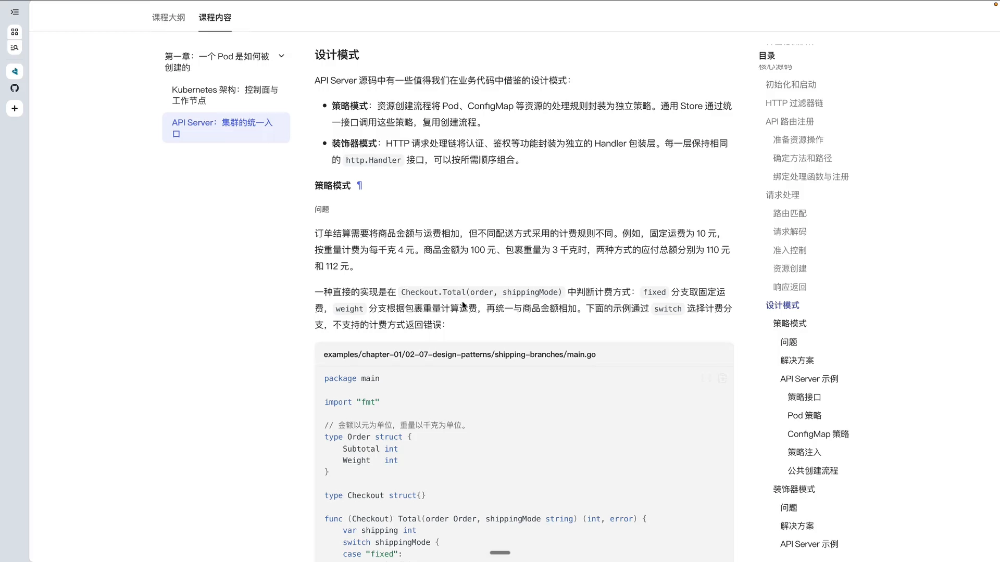
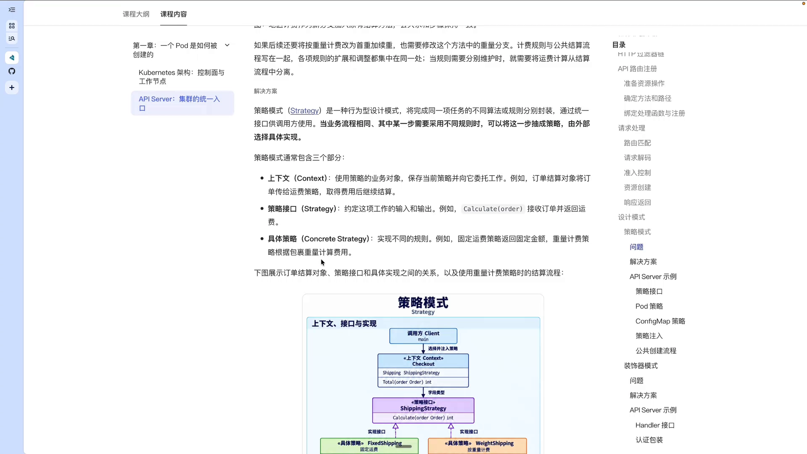
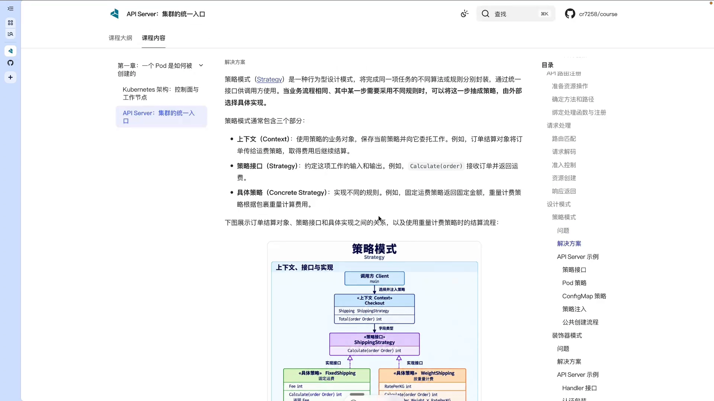
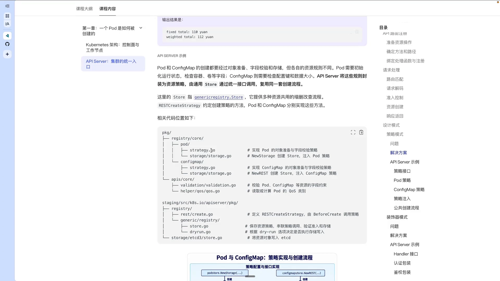
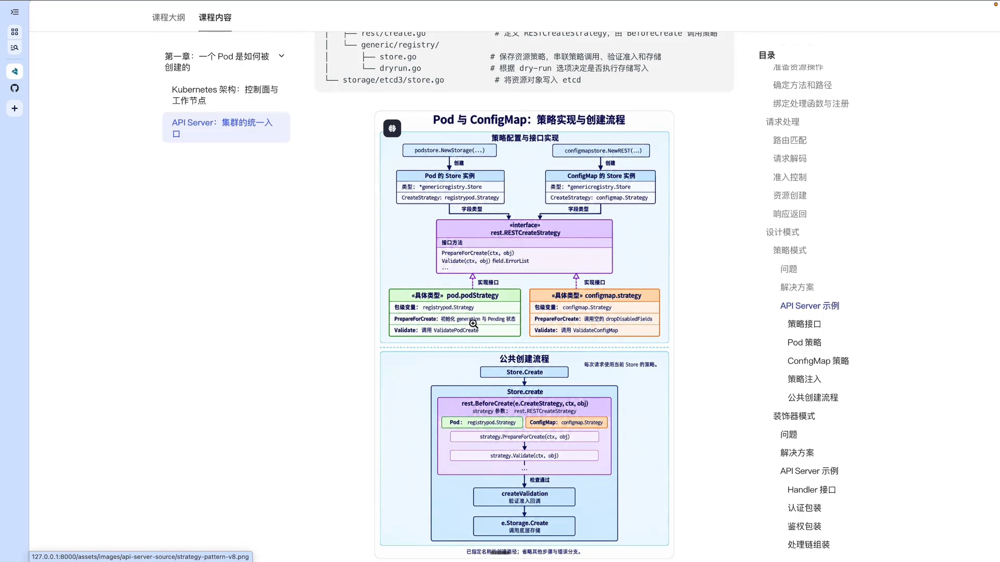
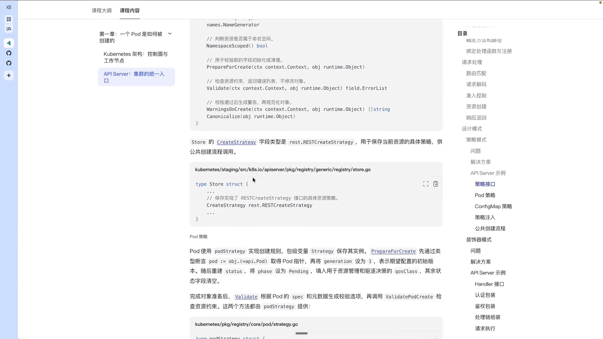
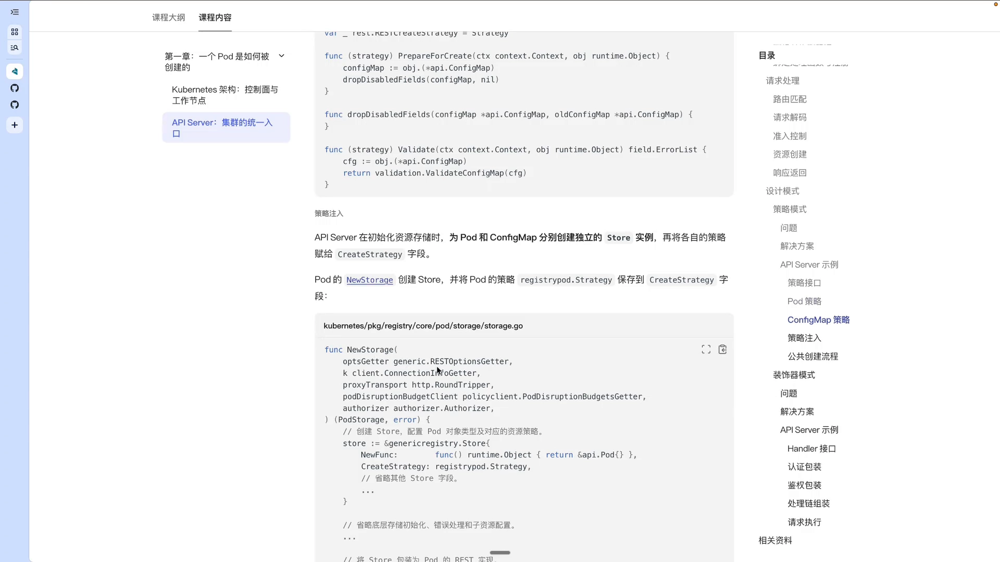
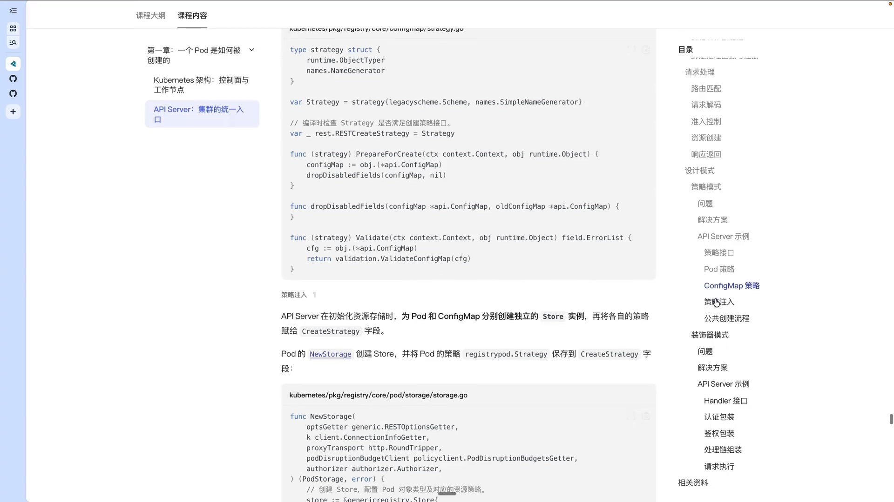

# kube-apiserver 中的策略模式与装饰器模式

> 本博客整理自 Bilibili 视频《K8S AI Infra 课程 - API Server 策略模式源码》（BV1BRHV6bEB5），严格基于其视频演说图文稿撰写，欢迎对照原视频核查。

## 本讲要解决的核心问题（SCQA）

**背景**：kube-apiserver 要给几十种资源（Pod、Deployment、ConfigMap……）提供创建、更新等接口；同时每个请求都要经过认证、鉴权、准入等一道道关卡。

**冲突**：如果把这些资源的差异全部塞进一个函数（一堆 `if/switch`），代码会越来越臃肿、难以维护；如果给每个请求都写死一条处理链，又无法按需组合、灵活扩展。写 operator、写自己的代码时，我们也会遇到同样的困境。

**疑问**：kube-apiserver 用什么设计模式，把"公共流程"和"资源差异"分开、又把请求链上的层层处理组合起来？

**回答（中心思想）**：它用了两种主要的设计模式——用**策略模式**把每种资源的准备 / 校验规则抽成可替换的"策略"（应对差异），用**装饰器模式**把请求链上的各个 HTTP handler 层层包装（应对组合）。理解了这两点，既能读懂 apiserver 源码，也能写出质量更高的代码。

## 一、两种模式各自解决什么问题



- **策略模式**：把比如 Pod、ConfigMap 等资源的处理规则，封装成一个独立的策略。创建资源时有一段**公共逻辑**（解析、编码等）是不需要动、也不该动的；把跟具体资源相关的请求交给对应的策略去处理，就能保证公共函数的代码保持干净。
- **装饰器模式**：请求链路上会经过认证、授权等不同组件；把它们各自封装成独立的 HTTP handler，就可以依次链式调用，而且能**按需组合**。

## 二、策略模式：先用「订单算运费」把它讲明白

策略模式其实是通用的设计模式，用一个贴近生活的例子最容易理解。

### 2.1 一个反例：switch 会越写越长

假设要做一个"订单结算"服务：把商品金额和运费相加。商品金额固定，但运费有两种算法：

- **固定运费**：固定 10 元；
- **按重量计费**：每千克 4 元。

比如商品金额 100 元、包裹重 3kg：按固定运费是 110 元；按重量计费是 3×4 + 100 = 112 元。

一种最直接的做法，是在 `total()` 里用一个 `switch` 判断计费模式再计算。但它有个明显问题：**每新增一种计费方式（比如按地区计费），就要往这个公共方法里加一个分支**；随着方式越来越多，这个函数会越来越冗余，改动公共方法还有可能影响到别人。[【跳转到 02:55】](https://www.bilibili.com/video/BV1BRHV6bEB5/?t=175)

### 2.2 策略模式的三要素



策略模式是一种**行为型**设计模式，核心思路是：把完成一项任务的**不同算法或规则分别封装**。它由三部分组成：

1. **上下文（Context）**：使用策略的业务对象，保存当前策略并向它委派工作。比如订单结算对象把订单交给运费策略，取回运费后再计算总价；
2. **策略接口（Strategy）**：定义统一的方法（这里是 `Calculate`），接收订单、返回费用；
3. **具体策略（Concrete Strategy）**：每个算法各实现一遍这个接口，从而支持不同的计算方式。

关键在于：**流程是固定的（商品金额 + 运费），变化的只是"运费怎么算"**。把变化的部分抽成策略后，公共流程就不用再改了。

### 2.3 代码骨架



用 Go 写出来大致是这样（示意）：

```go
type ShippingStrategy interface {
    Calculate(order Order) int
}

type fixShipping struct{}                                  // 固定运费
func (fixShipping) Calculate(order Order) int { return order.Goods + 10 }

type weightShipping struct{}                               // 按重量计费
func (weightShipping) Calculate(order Order) int {
    return order.Goods + order.Weight*4
}
```

结算对象只保存这个 `ShippingStrategy` 接口，公共方法永远不变——**通过商品费用加上策略算出的运费，得到总费用**。换成固定运费就传入 `fixShipping`，换成按重量就传入 `weightShipping`，各自调用自己的 `Calculate`，互不影响。[【跳转到 05:25】](https://www.bilibili.com/video/BV1BRHV6bEB5/?t=325)

## 三、策略模式在 apiserver 里的落地

### 3.1 公共流程相同，资源规则不同



在 apiserver 中，比如 **Pod** 和 **ConfigMap**，创建时的公共流程其实一模一样：

> 对象准备 → 自动校验 → 通过后调用 validating admission 做准入校验 → 写入对象存储 etcd

但**具体资源的检查规则不一样**：

- **Pod**：需要初始化状态（置为 `Pending`），可能还要检查容器等内容；
- **ConfigMap**：需要检查配置的键、以及整体数据大小。

apiserver 的做法是：把这些具体规则**封装成一个策略**，由统一的接口（store 接口）调用，整个创建流程则复用同一套公共代码。这样公共方法始终简洁一致，只是在处理不同对象时调用不同的策略。[【跳转到 07:55】](https://www.bilibili.com/video/BV1BRHV6bEB5/?t=475)

### 3.2 REST create storage 的两个主力接口



策略接口里，有两个最主要的接口方法：

- **`prepareForCreate`**：在创建资源前做准备工作。比如对象需要初始化、或者清理某些字段；
- **`validate`**：检查创建的对象是否符合当前资源的字段约束。

此外还有类型识别、命名空间判断等方法（这里省略）。而 store 的 `createStorage` 字段，就是用来保存"当前资源的具体策略"的——好让公共流程能够调用到它。

### 3.3 Pod 策略与 ConfigMap 策略



- **Pod 的 `prepareForCreate`**：先通过类型断言拿到 Pod 指针，把 `generation` 设为 1（新建对象，初始版本就是 1），并把 `status` 初始化为 `Pending`（因为还没开始调度）；之后 `validate` 会调用 `validatePodCreate` 去检查资源约束。
- **ConfigMap 的两个方法**：`prepareForCreate` 是**空实现**（它目前不需要做任何准备）；`validate` 则会检查配置项是否合法、数据大小是否超过 1MB 等。[【跳转到 10:25】](https://www.bilibili.com/video/BV1BRHV6bEB5/?t=625)

### 3.4 策略是怎么被「装」进 store 的



分别实现好这两个接口之后，apiserver 在初始化 REST storage 时：

1. 为 Pod 和 ConfigMap **分别创建各自的 storage 实例**；
2. 把各自的策略（strategy）**赋值给 `createStrategy` 字段**。

这样，store 的公共 `Create` 方法就能通过 `e.createStrategy` 拿到对应资源的策略实现，从而在公共方法里完成对它的调用。[【跳转到 12:05】](https://www.bilibili.com/video/BV1BRHV6bEB5/?t=725)



完整的公共创建流程是：

- `store.Create` → `store.create`（小写方法）；
- 其中把 `e.createStrategy` 交给 `rest.BeforeCreate` 来完成对象的准入 / 校验——Pod 和 ConfigMap 的校验方式不同，这里就分别交给对应策略的具体实现去做；
- 如果这一步也通过，再通过 `e.store.Create` 把结果写入底层存储（如 etcd）。

## 四、装饰器模式：把请求链「串」起来

apiserver 里另一种主要的设计模式是**装饰器模式**，它对应的是前面说到的 **HTTP 请求链**。

请求链上会经过认证、授权等不同的组件。如果把它们各自封装成独立的 HTTP handler，就可以：

- **依次链式调用**：请求从外到内依次经过各层处理；
- **按需组合**：不同的 handler 可以灵活拼接成不同的链，而不必把逻辑写死在一个大函数里。

这正是 kube-apiserver 用一条"过滤链"处理每个请求的实现方式（详见姊妹篇《kube-apiserver 请求处理流水线》）。[【跳转到 00:50】](https://www.bilibili.com/video/BV1BRHV6bEB5/?t=50)

## 小结

- apiserver 源码主要用到两种设计模式：**策略模式**应对"资源差异"，**装饰器模式**应对"请求链组合"。
- **策略模式三要素**：上下文、策略接口、具体策略；它把"不同算法 / 规则"分别封装，公共流程保持不变。
- apiserver 用策略模式把每种资源的 **`prepareForCreate`（准备）** 与 **`validate`（校验）** 抽成策略，用统一的 store 接口调用。
- 策略通过 `createStrategy` 字段被"装"进 store，公共 `Create` 流程据此调用对应资源的具体实现——比如 **Pod 置 Pending**、**ConfigMap 查键与大小**。
- **装饰器模式**把请求链上的各个 HTTP handler 层层包装，实现链式调用与按需组合。

## 关键术语速查

| 术语 | 一句话解释 |
| --- | --- |
| 策略模式 | 行为型设计模式，把完成同一任务的不同算法 / 规则分别封装、可互相替换 |
| 上下文（Context） | 使用策略的业务对象，保存当前策略并向它委派工作 |
| `prepareForCreate` | 策略接口方法，负责创建前的准备 / 初始化（如 Pod 置 Pending） |
| `validate` | 策略接口方法，检查对象是否符合当前资源的字段约束 |
| `createStrategy` | store 中保存"当前资源具体策略"的字段，供公共创建流程调用 |
| `store.Create` / `store.create` | 内嵌的通用存储创建逻辑，配合策略完成准备、校验与写库 |
| 装饰器模式 | 把请求链上的各个 handler 层层包装，支持链式调用与按需组合 |
