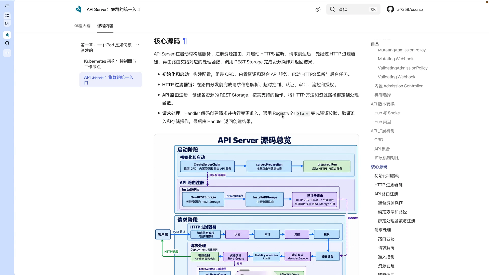
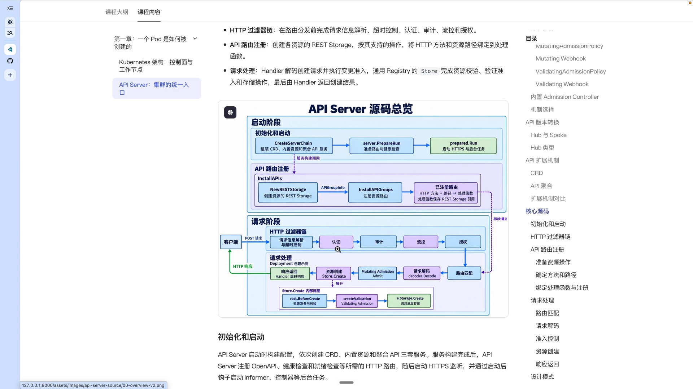
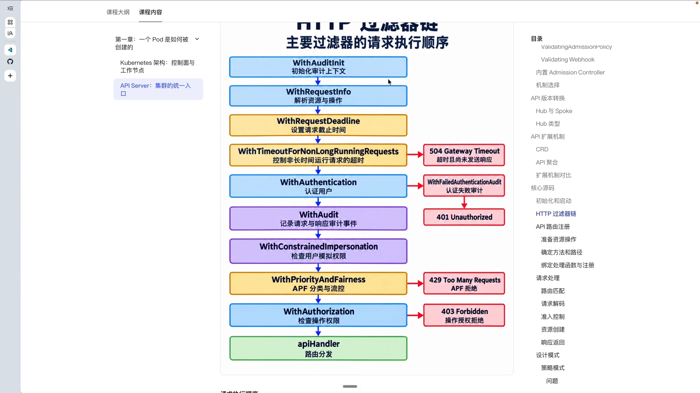
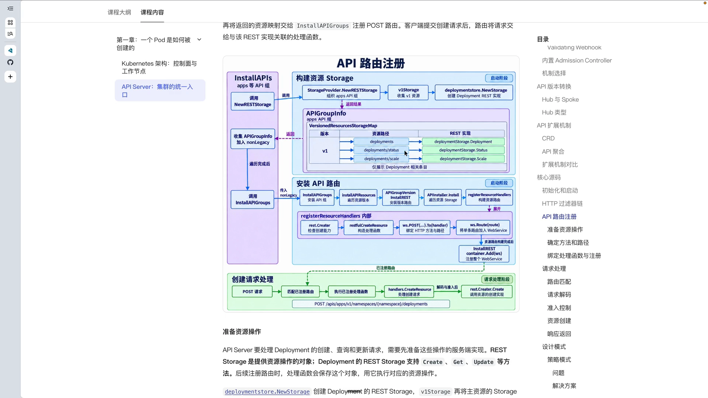
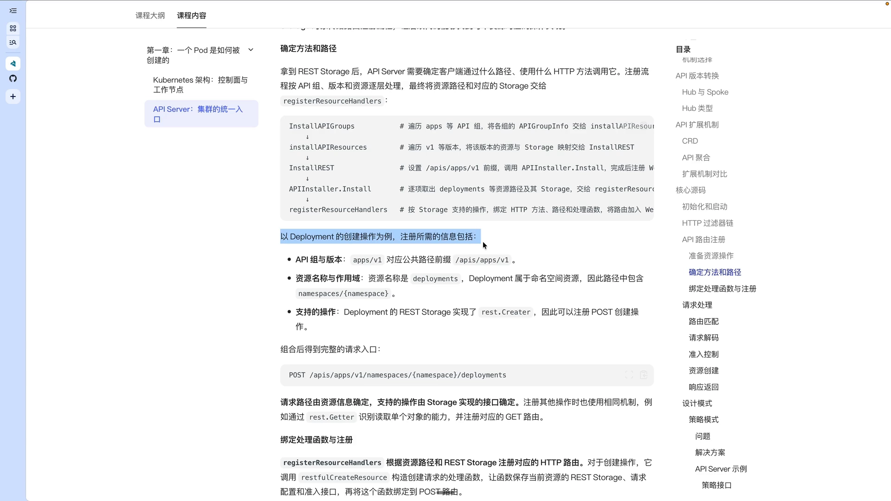
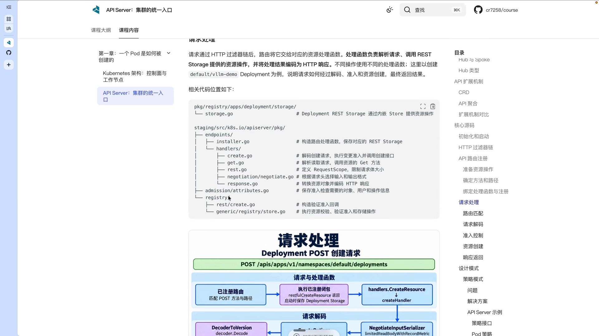
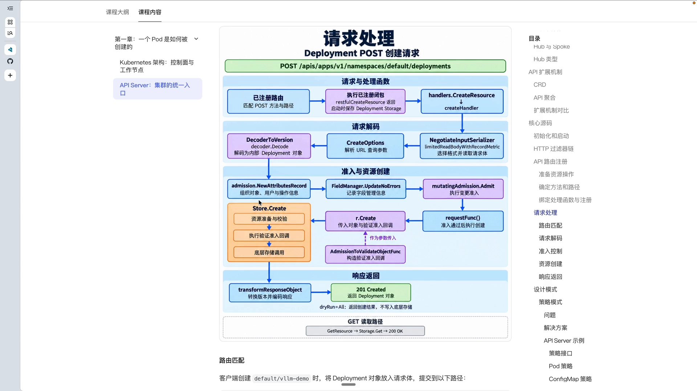
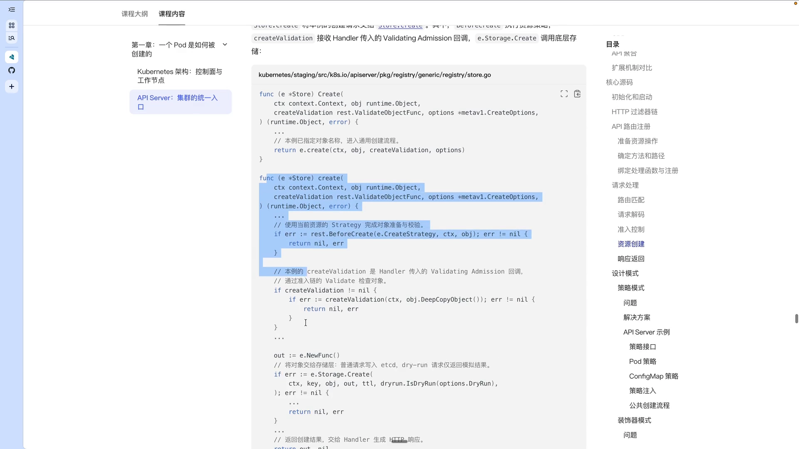

# kube-apiserver 请求处理流水线：从 HTTP 请求到 etcd 写入（源码讲解）

> 本博客整理自 Bilibili 视频《K8S AI Infra 课程 - API Server 源码讲解》（BV1ERHV6bEvw），严格基于其视频演说图文稿撰写，欢迎对照原视频核查。

## 本讲要解决的核心问题（SCQA）

**背景**：我们平时敲一个 `kubectl apply -f xxx.yaml`，API Server 返回"创建成功"，工作负载就按期望跑起来了。对使用者来说，这不过是一次"提交配置"。

**冲突**：但 kube-apiserver 收到的其实只是一个普通的 HTTP 请求，比如 `POST /apis/apps/v1/namespaces/default/deployments`。它必须先弄清"你是谁""你能不能做这件事""这个对象本身合不合法"，才敢把它写进数据库；而 K8S 里几十种资源、几十种子资源都要走同样的流程，任何一环不过关，请求就会失败。

**疑问**：这条请求在 kube-apiserver 内部究竟经过了哪些阶段？每个阶段各做什么？源码又是把它们怎么组织起来的？

**回答（中心思想）**：kube-apiserver 把请求处理拆成两件互相配合的事——**启动时**把每种资源的处理能力"接"到 HTTP 路由上，**运行时**让请求穿过一条层层叠加的 HTTP 过滤链，最后交给"资源处理函数"，再写入 etcd。理解了这条流水线，就抓住了 kube-apiserver 的主干。

## 一、先看全局：请求处理分成「启动阶段」和「请求阶段」

### 1.1 启动阶段：把三类服务组装起来（CreateServerChain）

apiserver 启动时，先创建一个 config，调用 `Complete` 方法补全默认配置；配置就绪后，调用核心方法 `CreateServerChain`，把三类服务组装起来：

1. **API extension server**：安装 CRD 的 API，用来处理用户通过 CustomResourceDefinition 定义的自定义资源（视频里举的例子是 model server 这类资源，定义好后交给 operator 组装处理）。
2. **内置 API（kube-apiserver）**：处理 Pod、Deployment 这类 K8S 原生资源。
3. **聚合 API（aggregated API server）**：比如前面提过的 metrics server，把请求转发给外部的聚合 API。

这里有一个容易忽略、但很关键的细节：**创建顺序和委派顺序是相反的**。

- 创建顺序：API extension server（CRD）→ 内置 API → 聚合 API；
- 委派顺序：先委派给聚合 API，再委派给内置 API，最后才是 CRD。

所以如果连 CRD 这一层都匹配不上，就说明这个资源根本没有注册到 apiserver 上，最终会返回 404。[【跳转到 05:00】](https://www.bilibili.com/video/BV1ERHV6bEvw/?t=300)

组装完成后，会调用 `Run`，它分两步：先用 `PrepareRun` 准备路由、做健康检查等准备工作；再用 `Run` 真正启动 HTTPS 监听和后台服务，可能还会启动 informer、注册一些 hook 钩子。

### 1.2 请求阶段：请求穿过 HTTP 过滤链，再交给资源处理函数

启动阶段解决了"资源怎么接上路由"，请求阶段才是每次请求真正走的那条路。用户请求进来后，会经过一条 **HTTP 过滤链**，大致顺序是：

解析请求信息 → 超时控制 → 认证 → 审计 → 流控 → 授权 → 路由匹配 → 解码 → mutating admission → 资源创建 / 准备 / 校验 → validating admission → 写入 etcd → 返回响应

## 二、HTTP 过滤链：每个请求都要过的「关卡」

### 2.1 解析请求信息与超时控制

链路上的第一步是解析请求信息（对应源码里的 `WithRequestInfo`）：从 HTTP 方法和 URL 里解析出"要操作哪个资源、属于哪个组、哪个版本、在哪个命名空间"。

比如 `POST /apis/apps/v1/namespaces/default/deployments` 会被解析成"在 default 命名空间下、apps/v1 这个组里创建 Deployment"。解析结果保存下来，供后面的流控、授权等环节使用。

同时这里会设置一个**请求截止时间**，避免单个请求处理过久——后面的认证、排队、资源处理都会复用这个时限。[【跳转到 07:05】](https://www.bilibili.com/video/BV1ERHV6bEvw/?t=425)

### 2.2 认证与授权

- **认证（authentication）**：检查客户端凭据，把证书、Token 或代理头转换成"用户身份"。
- **授权（authorization）**：判断这个用户，对"这个操作、这个资源、这个命名空间"有没有权限。

### 2.3 流控：API Priority and Fairness

链路上还会有 APF（API Priority and Fairness，优先级与公平性）的流控策略，用来在请求量过大时按优先级排队，保护 apiserver 不被压垮。

### 2.4 装起来的方式：装饰器模式（DefaultBuildHandlerChain）

值得强调的是：**链路的"执行顺序"和"包装顺序"是相反的**。

- 用户请求从外到内，依次经过各层；
- 而在 `DefaultBuildHandlerChain` 里，代码是从内向外逐层包装的：最里面是 API handler，外面套 authorization，再外面套 authentication……

这正是后面要单独展开讲的设计模式——**装饰器模式**。[【跳转到 08:45】](https://www.bilibili.com/video/BV1ERHV6bEvw/?t=525)

## 三、路由注册：把 URL 和资源处理函数「绑」在一起

请求最终要有地方处理，这就需要在启动时把"某个 URL"和"某个处理函数"绑定起来。路由注册要做两件事：

1. 准备资源的 **REST Storage**——它其实就是像 Deployment 这类资源的增删改查方法集合；
2. 让 apiserver 能根据请求的方法和路径，找到对应的处理函数。

### 3.1 从 InstallAPIs 到 REST Storage

`InstallAPIs` 负责 API 的安装，并调用各个 API 组的资源提供者。比如处理 apps 这个组时，会调用对应的 new storage 方法，它又间接调用 v storage，去收集该版本下的各个资源。

以 Deployment 为例：为它调用 new storage 时，会创建 Deployment 的**主资源**（增删改查）以及**子资源**（如查看 status、扩容 scale）的 REST Storage 实现。这些信息最终保存在该 API 组的 `APIGroupInfo` 里——本质上是一个 map：组 → 版本 → 资源 / 子资源 → REST Storage。[【跳转到 11:15】](https://www.bilibili.com/video/BV1ERHV6bEvw/?t=675)

### 3.2 InstallAPIGroups 与 registerResourceHandler

接着 `InstallAPIGroups` 会遍历传入的 API 组列表：处理到 apps 组时，展开它的 v1 版本，再处理该版本下的每个资源路径，把"资源路径 + 对应的 REST Storage"交给注册函数 `registerResourceHandler`。

`registerResourceHandler` 会先检查这个资源实现了哪些接口。比如 Deployment 的 REST Storage 实现了 `RESTCreater` 接口，就说明它支持 POST 创建操作；据此构造对应的处理函数，绑定到具体的 HTTP 方法和路由上，再通过 `ws.Route` 加进 web service 这个**路由容器**里。

于是请求到来时：如果匹配到路由，就会实际调用对应的 HTTP 处理函数，底层再调用到比如 Deployment 的 storage，真正处理这个资源。

### 3.3 一个具体例子：POST 创建 Deployment

以 Deployment 为例，注册一个资源需要三类信息：

1. **路由前缀**：由 group/version 转换而来；
2. **资源与作用域**：Deployment 是命名空间级资源，于是路径形如 `/apis/apps/v1/namespaces/{namespace}/deployments`（v1 后面先是 `namespaces`，再是命名空间的具体占位符，然后是 `deployments` 这个资源）；
3. **支持的操作**：由 REST Storage 实现了哪些接口决定——实现 `RESTCreater` 就支持 POST 创建，还实现 Get 之类的接口就支持查询。

这些信息会被绑定在一起，加入 web service。[【跳转到 15:00】](https://www.bilibili.com/video/BV1ERHV6bEvw/?t=900)

## 四、请求处理：从 HTTP 请求到写入 etcd

### 4.1 匹配到 Handler：一个「延迟执行」的闭包

请求先经过 HTTP 链，再由路由把它交给对应的资源处理函数。处理函数负责：解析请求 → 调用 REST Storage 完成资源操作 → 把结果持久化到 etcd → 把结果作为 HTTP 响应返回客户端。

比如 `POST /apis/apps/v1/namespaces/default/deployments` 会匹配到前面注册的 POST 处理函数。这个方法由 `restfulCreateResource` 创建，**返回的是一个闭包**。

这里有个精妙之处：构造闭包时，函数体**并不会马上执行**；只有请求路径真正匹配上、调用这个闭包时，才执行处理逻辑。闭包里保存了对应的 `REST Storage` 引用，并把它传进嵌套调用的 `createResource`。

### 4.2 Create handler 的公共逻辑

`handlers.CreateResource` 底层会调用 Create handler，它包含所有资源都能复用的公共逻辑：

- **请求解码**：把 JSON / YAML 请求体解码成 apiserver 内部对象（比如 Deployment 的 Go 对象），也包括请求路径、请求体、查询参数的解码；
- **组织准入信息**（admission attributes record）：把对象、用户、资源、命名空间、操作、调用者等打包起来；
- **更新字段管理信息**：比如 metadata 里那个比较长的 `managedFields` 字段，就是由 field manager 更新的。

这些公共逻辑只写一次，不同资源则依赖各自对应的 REST Storage 方法去处理。

### 4.3 mutating admission → 创建 → validating admission

接着 Create handler 会调用 mutating admission 的 `Admit` 方法，执行**变更准入**：可能给对象补一些标签，也可能直接拒绝请求。

然后调用 create 的 func，底层才真正调用 `REST Storage` 发起资源创建；创建过程中会通过一个回调执行 **validating admission**（校验准入）。只有两级准入都通过，才会把数据真正写入 etcd。[【跳转到 20:58】](https://www.bilibili.com/video/BV1ERHV6bEvw/?t=1258)

### 4.4 内嵌通用 store 与策略模式

Deployment 的 REST Storage 其实**内嵌了通用的 `storage.Store` 结构**，所以调用 `Create` 本质上是在调用 `store.Create`，只是这个结构体被内嵌进了 Deployment REST 的结构体里（因为它是 common 的）。

进到 `store.Create` 后，会按照"当前资源的策略"完成准备与校验。不同资源的规则并不相同——比如 Deployment 会检查副本数、Pod 约束等，ConfigMap 的准备逻辑又不一样。这就引出了**策略模式**，下一篇博客会专门展开。[【跳转到 22:13】](https://www.bilibili.com/video/BV1ERHV6bEvw/?t=1333)

### 4.5 返回响应

资源写库成功后，`result` 拿到创建请求返回的对象；因为用户没法直接处理这个内部对象，还要通过 `transformResourceObject` 把它转换成目标格式（比如 JSON 的 Deployment 对象）返回给用户。[【跳转到 28:53】](https://www.bilibili.com/video/BV1ERHV6bEvw/?t=1733)

## 小结

- kube-apiserver 的请求处理分两段：**启动阶段**用 `CreateServerChain` 组装三类服务（CRD / 内置 / 聚合），**请求阶段**让请求穿过滤链、再交给资源处理函数。
- 三类服务的**创建顺序与委派顺序相反**，这决定了资源匹配不到时为何返回 404。
- 每个请求都要过一条 HTTP 过滤链：解析请求信息 → 超时控制 → 认证 → 审计 → 流控 → 授权 → 路由 → 解码 → mutating admission → 创建 / 校验 → validating admission → 写 etcd。
- 路由注册把"资源路径 + 支持的 HTTP 方法"绑定到处理函数：`InstallAPIs` → `InstallAPIGroups` → `registerResourceHandler`。
- 处理函数由 `restfulCreateResource` 以**闭包**形式返回，匹配到路径时才执行；公共逻辑（解码、准入信息、字段管理）收敛在 Create handler 里。
- 写库前要过两级准入（mutating / validating），实际存储复用内嵌的通用 `store`，并按**策略模式**处理资源差异。

## 关键术语速查

| 术语 | 一句话解释 |
| --- | --- |
| CreateServerChain | 启动时把 CRD、内置、聚合三类 API 服务组装成一条链的方法 |
| API extension server | 处理 CRD（自定义资源）请求的那层服务，最先创建、最后被委派到 |
| 聚合 API（aggregated） | 把请求转发给外部 API server（如 metrics server）的那层服务 |
| REST Storage | 某种资源的增删改查等操作集合，如 Deployment REST Storage |
| InstallAPIGroups | 遍历 API 组，把资源路径与 REST Storage 交给注册函数 |
| registerResourceHandler | 根据资源实现了哪些接口，构造并绑定 HTTP handler 到路由 |
| HTTP 过滤链 | 请求要依次穿过的认证、审计、流控、授权等处理层 |
| mutating admission | 变更准入，可修改对象或拒绝请求 |
| validating admission | 校验准入，检查对象是否合法，通过后才持久化 |
| field manager | 记录哪个客户端管理了对象的哪些字段（managedFields） |
| store.Create | 内嵌的通用存储创建逻辑，配合策略模式完成准备与校验 |

