# Kubernetes 控制器深潜：控制循环与事件协调

> 视频来源：[Kubernetes Controllers Deep Dive: How They Really Work](https://www.youtube.com/watch?v=kss081c8EqY)（YouTube，DevOps & AI Toolkit）｜时长 27:30
>
> 一支把「控制器」这块 Kubernetes 心脏拆到机制层的长视频：先立起**控制循环**这个最朴素的心智模型，再分别拆开控制器的「输入」（消费事件）与「输出」（发射事件），然后把一次 **reconcile（调谐）** 从触发到收尾拆成七个步骤，最后延伸到 watch / informer / 工作队列、CRD，以及控制器之间如何协作。文稿左栏为英文自动字幕，本文已翻译并重写为中文，并纠正了自动字幕里的错拼（`cube control`→**kubectl**、`Potency`→**idempotency**、`Cublet`→**kubelet**、`reync period`→**resync period**、`posgusql`→**PostgreSQL**）。

## 本讲要解决的核心问题（SCQA）

**背景**：大多数人用 Kubernetes，是写好 YAML、`kubectl apply`，然后看着 Pod 自己出现、自己扩容、自己恢复。控制器让 Pod 挂掉后自动重启、让应用自动扩缩容、让自定义资源看起来像原生资源一样。[【跳转到 00:26】](https://www.youtube.com/watch?v=kss081c8EqY&t=26)

**冲突**：但这些"魔法"具体是怎么发生的，很多人说不清。于是系统一旦出问题，就完全不知道从哪查起——**根本原因是不理解"控制器"**。不理解控制器，等于把 YAML 往墙上扔、祈祷它能粘住。[【跳转到 00:20】](https://www.youtube.com/watch?v=kss081c8EqY&t=20)

**疑问**：控制器究竟是什么？它凭什么能一直维持系统状态？它是不是在不停地轮询 API？一次调谐（reconcile）到底做了哪些事？几十个控制器同时盯着同一批资源，为什么不会把 API Server 压垮？

**回答（中心思想）**：**控制器的全部秘密，就是一个"永不停歇的控制循环"——观察（observe）→ 比较（compare）→ 决定（decide）→（必要时）行动（act）。** 它由两个概念拼成：**声明式配置**（你只描述想要的样子，不描述怎么做到）+ **反应式调谐（reactive reconciliation）**（控制器自动响应变化与漂移），两者结合就是**自愈系统**。要让它可靠，有一条硬性要求：**幂等（idempotency）**。而它之所以不必轮询、也不会压垮 API Server，靠的是 **watch API + informer 本地缓存 + 共享 informer + 每控制器一个工作队列** 这套事件基础设施。[【跳转到 00:47】](https://www.youtube.com/watch?v=kss081c8EqY&t=47)

---

## 一、控制器是什么：一个永不停歇的控制循环

**控制器（controller）的本质，就是一段实现了"持续控制循环"的软件**：它不停地观察集群里正在发生什么，把这份现实与你声明的期望做比较，然后采取必要的动作去弥合差距。[【跳转到 01:18】](https://www.youtube.com/watch?v=kss081c8EqY&t=78)

最贴切的类比是家里的**恒温器**：它读当前温度，和你设定的温度比较，然后开或关暖气/空调，把温度维持在你想要的值。

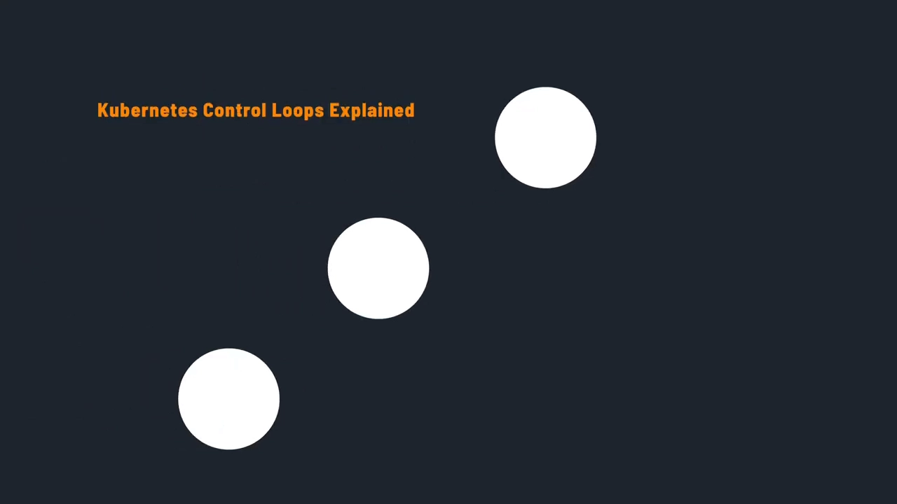

### 1.1 声明式 + 反应式 = 自愈

Kubernetes 强大的根本，是把两个东西组合到一起：

- **声明式配置（declarative configuration）**：你描述"系统应该长什么样"，而不是"怎么一步步做到"；
- **反应式调谐（reactive reconciliation）**：控制器自动响应集群里的变化与漂移。

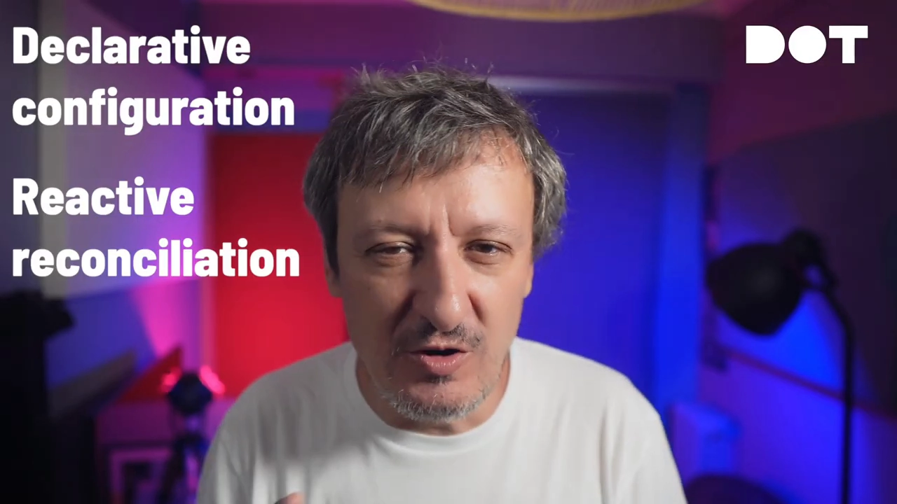

两者相加，就得到了**自愈系统**：应用不只是"在运行"，而是**主动把自己维持在你声明的状态里**——即使出了问题也一样。[【跳转到 02:13】](https://www.youtube.com/watch?v=kss081c8EqY&t=133)

### 1.2 控制循环的四步

所谓"魔法"，就发生在这个控制循环里，而它简单得出奇：

1. **观察**：控制器读取它负责的资源的**当前状态（current state）**；
2. **比较**：把当前状态与你声明的**期望状态（desired state）**做比较；
3. **提问**：这两者匹配吗？
4. **行动**：如果不匹配，就采取纠正动作去缩小差距；如果已经匹配，就**等到下一个事件或变化**再动。

无论走哪条分支，**流程都会回到起点重新开始**——它是"观察、比较、决定、（必要时）行动"的无尽循环。[【跳转到 02:35】](https://www.youtube.com/watch?v=kss081c8EqY&t=155)

### 1.3 一条硬性要求：幂等

写自己的控制器时，最容易踩的坑是一个关键要求：**幂等（idempotency）**。

**幂等的操作，就是同一件事跑多次也不会把事情搞坏。** 想想看：如果控制器崩溃重启了，或者同一个事件被处理了两次，它**不应该**创建出重复的资源，也不应该把系统带进不一致的状态。**跑一遍和跑一百遍，结果必须一样。**[【跳转到 03:21】](https://www.youtube.com/watch?v=kss081c8EqY&t=201)

> 记忆锚点：**控制循环只保证"最终一致"，幂等是它不出错的前提。**

### 1.4 它不是轮询

有人会想：控制循环"一直在跑"，那控制器是不是每隔几秒/几分钟去轮询一次 API Server？**那样会极其低效。**

真正的答案要优雅得多——控制器靠**事件**被唤醒。下面就分别看它的"输入"和"输出"。[【跳转到 03:48】](https://www.youtube.com/watch?v=kss081c8EqY&t=228)

---

## 二、控制器的"输入"：事件消费流水线

控制器不只会发射事件，它还会**把 Kubernetes 事件当作一等资源来消费**，以此对集群变化做出反应。这是一条"双向道"：控制器既监听正在发生什么，也宣告自己在做什么。[【跳转到 04:13】](https://www.youtube.com/watch?v=kss081c8EqY&t=253)

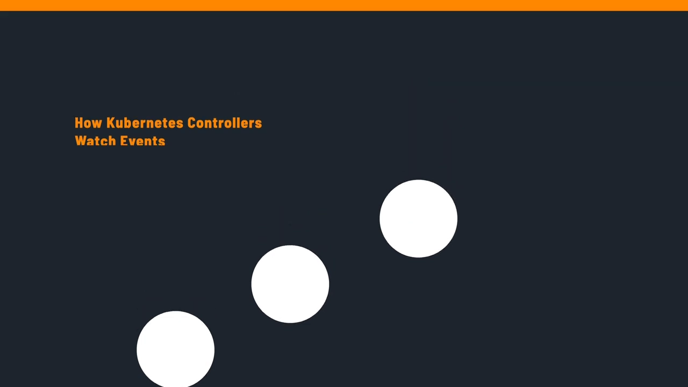

### 2.1 事件从哪来

流程的起点，是集群里发生了某件事、于是 **API 创建了一个 Event 对象**。事件的来源遍布整个集群：

- **kubelet** 在拉取镜像、启动容器时产生事件；
- **scheduler** 在调度不下 Pod 时产生事件；
- 其它控制器也会就自己的操作发出事件。

**几乎每个主要组件，都在通过事件持续"广播"自己做了什么。**[【跳转到 05:45】](https://www.youtube.com/watch?v=kss081c8EqY&t=345)

### 2.2 两类事件：Normal 与 Warning

Kubernetes 只有两种事件类型：

- **Normal**：信息性消息，比如 `Pulled`、`Started`；
- **Warning**：表示潜在问题，比如调度失败、退避（back-off）。

例如，一个**集群自动扩缩容控制器**可能专门监听"调度失败"的 Warning 事件，并据此增加节点。[【跳转到 05:21】](https://www.youtube.com/watch?v=kss081c8EqY&t=321)

### 2.3 控制器不会"照单全收"：过滤

控制器会设置**事件监听（event watching）**来盯住特定的事件资源，它**不会盲目消费集群里的每一个事件**——那会变成一团乱麻。它会用**字段选择器（field selector）和标签选择器（label selector）**，只看自己真正关心的事件。

过滤的维度包括：

- 按**事件类型**（Warning / Normal）；
- 按**具体原因（reason）**，例如 `FailedScheduling`、`Pulled`；
- 按**涉及的对象的 Kind**，例如 Pod、Deployment；
- 按**命名空间范围**。

没有这些过滤，任何控制器都会被无关噪音淹没。[【跳转到 06:10】](https://www.youtube.com/watch?v=kss081c8EqY&t=370)

### 2.4 光过滤还不够：去重与限流

在过滤之后，控制器还要处理两件事：

- **去重（deduplication）**：控制器用**唯一键（unique key）**记录哪些事件已经处理过。这一点很关键，因为同一个事件可能因网络问题或控制器重启而**重复到达**，你不希望同一动作被反复执行。
- **限流（rate limiting）**：实现**退避（back-off）策略**，避免压垮外部系统。如果事件如潮水般涌来，你不希望控制器猛砸 API 或外部服务。聪明的限流让控制器成为集群生态里的"好公民"。

走过这些检查和过滤之后，控制器才真正**处理事件**，并据事件类型与内容采取相应动作：扩容节点、发告警、更新指标，或触发修复流程。[【跳转到 07:00】](https://www.youtube.com/watch?v=kss081c8EqY&t=420)

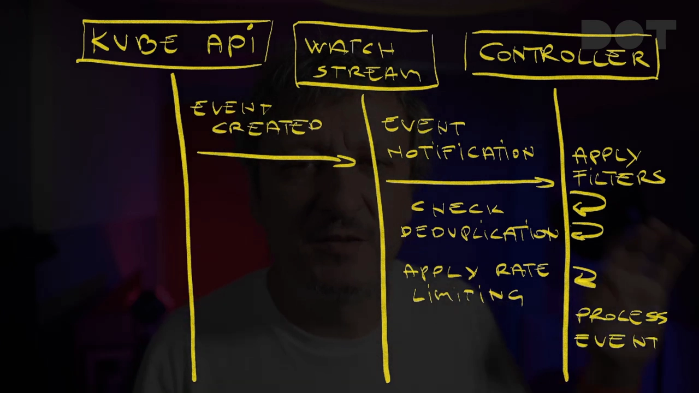

---

## 三、控制器的"输出"：事件发射与可观测性

反过来看另一半：**事件发射（event emission）**。控制器不只是消费事件，它还会**发射自己的事件**，用于提供可观测性、留下审计线索，以及**与其它控制器通信**。[【跳转到 08:14】](https://www.youtube.com/watch?v=kss081c8EqY&t=494)

### 3.1 通过 EventRecorder 写"共享日志本"

发射的起点是控制器执行了一个操作——创建 Deployment、扩缩 ReplicaSet、更新 Service，或它负责管理的任何动作。作为操作的一部分，控制器通过 **EventRecorder 接口**创建事件。

> 可以把它理解为：**控制器往一本"共享日志本"里写字，集群里所有人（不一定都会去读，但都能读）。**[【跳转到 08:39】](https://www.youtube.com/watch?v=kss081c8EqY&t=519)

### 3.2 三类事件

控制器通常按"发生了什么"发射不同类别的事件：

- **操作型事件（operational）**：正常的控制器操作，例如 `Deployment created`（控制器创建了一个新 Deployment）、`Pod scheduled`（调度器把 Pod 分配到了节点）；
- **成功型事件（success）**：事情顺利时的报喜，例如 `ImagePullSucceeded`（容器镜像下载成功）；
- **错误型事件（error）**：失败与警告，例如 `Failed to create pod`（Pod 创建不出来）、`Insufficient resources`（集群资源不足）。

### 3.3 事件如何触发连锁反应

事件一旦发出，就会在集群生态里激起反应：

- 一个**监控控制器**看到 `Failed to create pod`，可能会往你的 Slack 频道发告警；
- 一个**集群自动扩缩容控制器**捕获到 `Insufficient resources`，可能会增加节点；
- 一个**审计控制器**可能把所有 `Deployment created` 事件记录下来做合规追踪。

**这就是控制器之间协作、并产生前面说的"自愈"行为的方式。**[【跳转到 09:08】](https://www.youtube.com/watch?v=kss081c8EqY&t=548)

### 3.4 一个事件由四部分组成

决定发射事件后，还要把它**结构化**。每个事件都有四个关键组成部分：

| 组成部分 | 含义 |
| --- | --- |
| **object** | 这个事件与哪个资源相关 |
| **type** | `Normal` 或 `Warning` |
| **reason** | 机器可读的原因，如 `FailedScheduling`、`ImagePullSucceeded` |
| **message** | 人可读的描述，说明到底发生了什么 |

例如，一个 Pod 调度失败，你收到的可能是：object 指向那个具体 Pod，type 为 `Warning`，reason 为 `FailedScheduling`，message 形如 `0 out of 3 nodes are available: insufficient memory`。[【跳转到 09:53】](https://www.youtube.com/watch?v=kss081c8EqY&t=593)

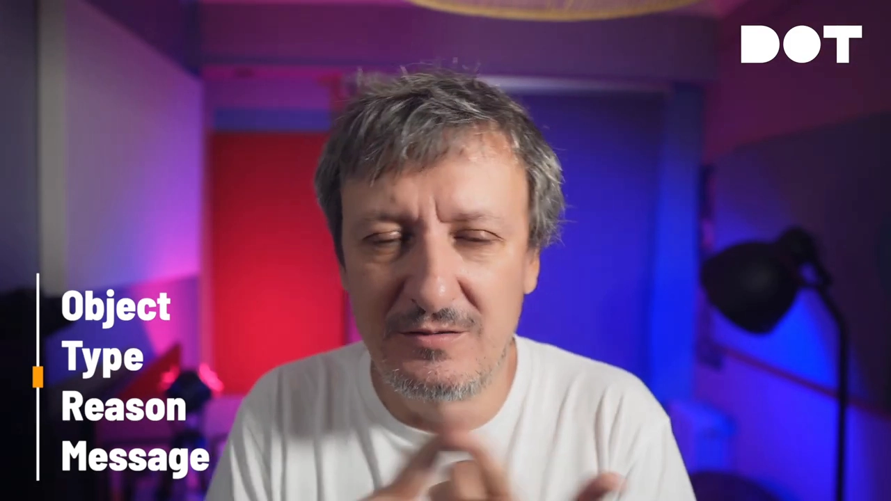

### 3.5 事件的生命周期：1 小时、聚合与消费

关于事件生命周期，有几件事要记住：

- **事件不会永久保存**：Kubernetes 默认在**一小时后**自动清理它们，避免集群被旧事件数据塞满。所以如果你需要长期的事件历史（合规、排障），就要把它们**外送**到 Elasticsearch、Prometheus、InfluxDB 之类的数据存储里。
- **事件会被聚合以减少噪音**：如果同一个事件反复发生，Kubernetes 会把它们**分组**，而不是用一模一样的事件刷屏。比如一个 Pod 反复拉取镜像失败，它不会产生 50 条独立的报错事件，而是**创建一条事件并递增计数**——更准确地说，显示它"发生了 50 次"。
- **事件最终存进 API Server**，从而在整个集群生态里可用：监控工具、其它控制器、以及 `kubectl get events` 这样的管理命令都能消费它。**任何东西都可以监听它们。**[【跳转到 10:26】](https://www.youtube.com/watch?v=kss081c8EqY&t=626)

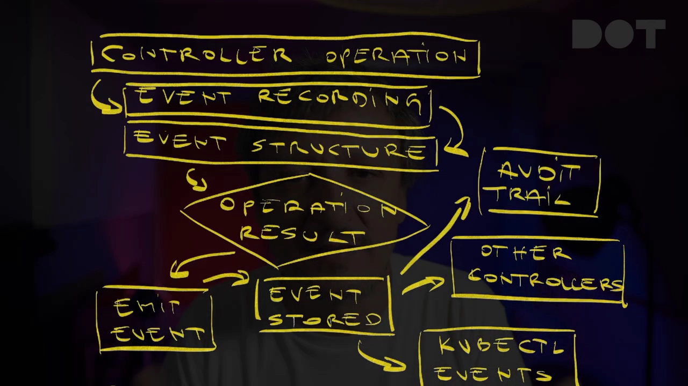

---

## 四、Reconcile 循环的解剖：一次调谐的七个步骤

现在进入控制器真正的心脏：**reconciliation loop（调谐循环）**。控制器在这里持续保证"现实"与"期望状态"一致。[【跳转到 11:57】](https://www.youtube.com/watch?v=kss081c8EqY&t=717)

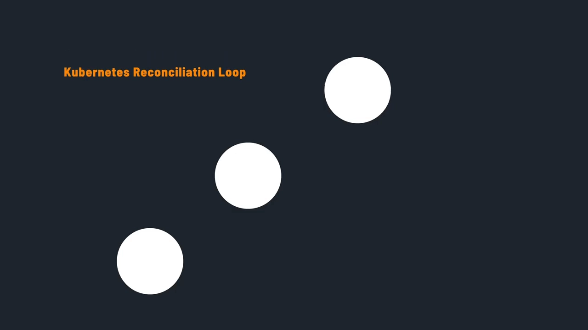

### 4.1 什么会唤醒一场调谐

有好几种**触发源（trigger sources）**能唤醒控制器：

- **来自集群的事件**：比如某个 Pod 挂了；
- **周期性重入队（periodic requeue）**：控制器按计划定期检查；
- **直接的资源变更**：比如有人更新了 Deployment；
- **外部 webhook**：比如某个监控系统发现了问题。

**本质上，任何可能影响你资源期望状态的东西，都能触发调谐。任何东西。**[【跳转到 12:12】](https://www.youtube.com/watch?v=kss081c8EqY&t=732)

### 4.2 所有触发都汇入同一个 reconcile 函数

当这些触发点火，它们**全部汇入同一个 `reconcile` 函数**——可以把它看作处理所有资源状态变化的**唯一入口**。

不管是什么触发的调谐——事件、定时器还是用户动作——**都走这一个函数**。这个设计让逻辑保持整洁，并保证**无论是什么把控制器唤醒，行为都一致**。[【跳转到 12:52】](https://www.youtube.com/watch?v=kss081c8EqY&t=772)

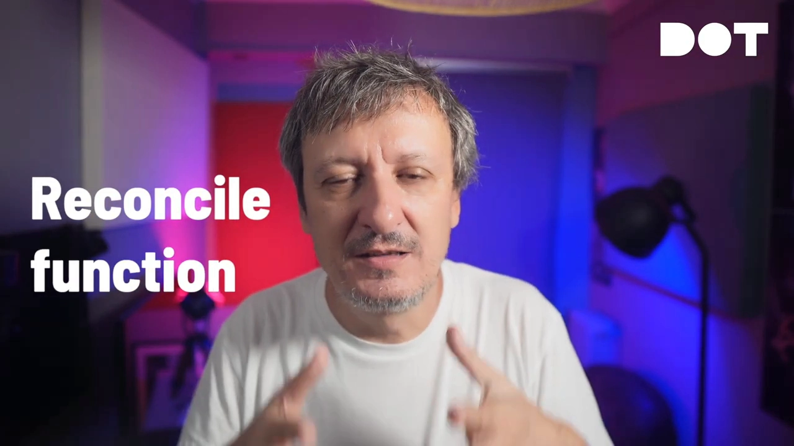

### 4.3 七步走

调谐过程逐步展开如下：[【跳转到 13:15】](https://www.youtube.com/watch?v=kss081c8EqY&t=795)

1. **被触发**：由前面说的某一种触发源唤醒。也许用户扩了 Deployment，也许 Pod 崩了，也许控制器的周期定时器响了。
2. **取对象**：控制器要从 API Server 取回资源的最新状态。它用 **namespace + name**（也就是资源名与命名空间）精确定位到底是哪个资源触发了本次调谐。例如，有人改了 production 命名空间里的 `my-app` Deployment，取的就是它。[【跳转到 13:45】](https://www.youtube.com/watch?v=kss081c8EqY&t=825)
3. **判断对象是否还存在**：这是个关键问题。如果有人把资源删了，控制器要做**清理（cleanup）**——资源已经不存在，就执行必要的清理动作并收尾。
4. **比较当前状态与期望状态**：只有对象还在，真正的工作才开始。控制器看资源 **spec** 说的"应该长什么样"（期望状态），和它**现在实际的样子**（来自 API Server 的当前状态）做对比。例如，spec 说该有 5 个副本，而当前只跑着 3 个 Pod，那就是需要修复的不一致。[【跳转到 14:10】](https://www.youtube.com/watch?v=kss081c8EqY&t=850)
5. **状态有差异吗**：如果一切完美匹配——副本数对得上、标签都在位、容器镜像正确——那就没什么可做的，顶多**更新一下 status**。但如果有差异，控制器就立即行动。
6. **制定计划并执行**：控制器进入"行动规划"模式，算出弥合差距到底需要哪些动作——可能是创建新 Pod、更新已有 Pod、删除旧资源、修改配置——然后**逐条执行**，按需调用 API 修改资源。[【跳转到 15:00】](https://www.youtube.com/watch?v=kss081c8EqY&t=900)
7. **更新 status，处理结果**：不论动作成功还是失败，控制器都要**更新资源的 status** 来反映现状：顺利就写明成功，出错就把错误记进 status，方便你之后查看资源时看到发生了什么。

最后，控制器**处理结果**，决定下一步：这次调谐算成功还是失败？要不要稍后重试？一切正常的话，**在下次变化前它就歇着**；如果出错，它会**在延迟后安排一次重试，并用指数退避（exponential backoff）**，避免把系统砸坏。[【跳转到 16:15】](https://www.youtube.com/watch?v=kss081c8EqY&t=975)

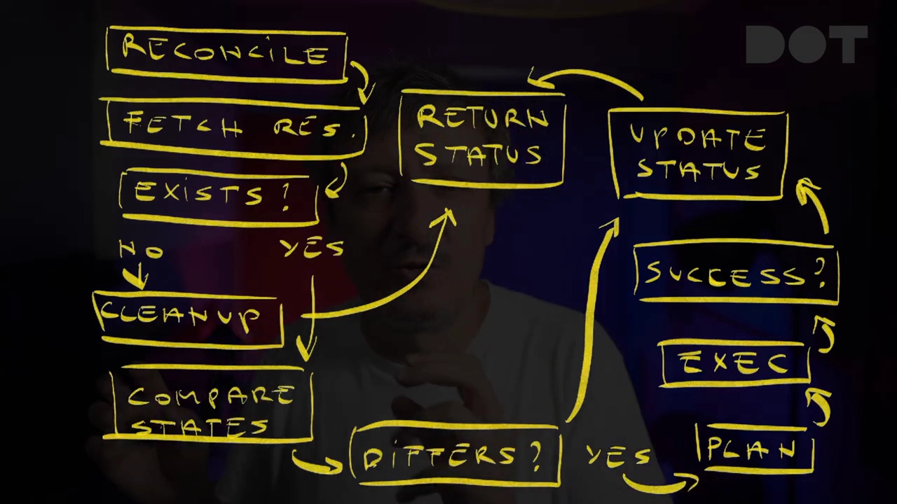

> 这一步的 `retry + exponential backoff`，正是把"事件可能丢失/重复"这件分布式现实兜住的地方——**它让调谐天然可以重来，所以每一步都必须幂等。**

---

## 五、控制器如何"看见"变化：watch、informer 与工作队列

回到那个问题：几十个控制器同时盯着一批资源，怎么不把 API Server 压垮？答案是**一套颇为精巧的工程**。[【跳转到 16:15】](https://www.youtube.com/watch?v=kss081c8EqY&t=975)

### 5.1 底座：watch API

Kubernetes API Server 通过一些特殊端点提供 **watch API**，**实时流式推送**资源变化。你的控制器不用不停去问"有变化吗？"——一旦有人创建 Pod、扩缩 Deployment 或更新 Service，API Server 就会**推送通知**，控制器立刻通过 watch 流收到。[【跳转到 17:11】](https://www.youtube.com/watch?v=kss081c8EqY&t=1031)

### 5.2 中间层：informer

但**原始的 watch 流**对控制器来说太过汹涌。于是有了 **informer**：可以把它看作**坐在控制器与 watch 流之间的、带缓存的聪明客户端层**。informer 维护你所关心资源的**本地副本**，并在变化时给出整洁的事件通知，而不是把原始 API 事件直接丢给控制器。[【跳转到 17:52】](https://www.youtube.com/watch?v=kss081c8EqY&t=1072)

### 5.3 更聪明的一步：共享 informer

真正巧妙的地方在这里：如果**每个控制器各自建一个 informer**，同一批资源就会开多条 watch 流。Kubernetes 用的是**共享 informer（shared informer）**：**一个 informer 可以被多个控制器共享。**

- 三个控制器都要 watch Deployment，那就**共用同一个底层 informer**，效率高得多，也减轻了 API Server 的负担；
- 共享 informer 维护着它在看的那批资源的**本地缓存**，控制器不必每次都去敲 API Server 就能拿到当前状态；
- 变化进来时，informer 会**通知多个事件处理器**（每个感兴趣的控制器一个）；这些处理器把相关变化放进**各自独立的工作队列**，于是**每个控制器拿到自己的事件流**；
- 最后，每个控制器**按自己的节奏**消费自己队列里的事件，在需要时触发调谐。[【跳转到 18:42】](https://www.youtube.com/watch?v=kss081c8EqY&t=1122)

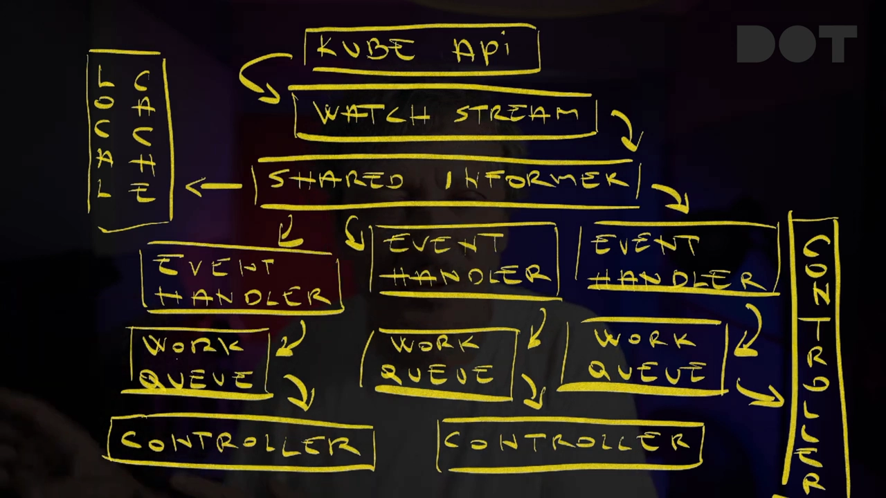

### 5.4 兜底：resync 周期

还有一个安全机制叫 **resync 周期（resync period）**：默认每 **10 小时**，informer 会对它 watch 的所有资源**触发一次全量调谐**，即使什么都没变。这样做是为了**接住那些因网络问题、bug 或其它原因被漏掉的事件**——相当于定期做一次"体检"，确保控制器眼中的世界与现实一致。[【跳转到 19:33】](https://www.youtube.com/watch?v=kss081c8EqY&t=1173)

### 5.5 五种事件类型与 resourceVersion

控制器在这套体系里会收到**五种主要事件类型**：

- **Added**：新资源被创建，比如你部署了一个新 Pod；
- **Modified**：已有资源发生变化，比如把 Deployment 从 3 个副本扩到 5 个；
- **Deleted**：资源被移除；
- **Bookmark**：周期性检查点，帮助重新同步；
- **Error**：watch 流本身出错了。

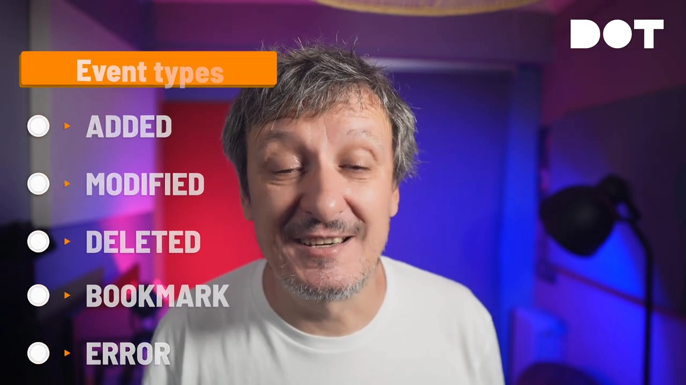

为了保持一致、正确处理冲突，Kubernetes 还会跟踪 **resourceVersion**——可以把它想成**每次资源变化就自增的版本号**。如果控制器想基于版本 42 去更新一个 Deployment，而别人已经把它更新到了版本 43，**API Server 会拒绝你的修改**，你就得基于更新的版本重新调谐。**这防止了不同控制器互相覆盖对方的变化。**[【跳转到 20:07】](https://www.youtube.com/watch?v=kss081c8EqY&t=1207)

---

## 六、用 CRD 扩展：让自定义资源"像原生一样"

控制器真正强大的地方在于：它可以通过 **CRD（Custom Resource Definition，自定义资源定义）** 为 Kubernetes 增加**全新的资源类型**。

当你用 `kubectl apply` 提交一个 Ingress、创建一个 TLS Certificate，或者部署一个 Git 仓库资源时，你其实是在和**控制器所理解并管理的自定义资源**打交道。**CRD 就是控制器让自己"看起来像 Kubernetes 原生的一部分"的方式。**[【跳转到 20:58】](https://www.youtube.com/watch?v=kss081c8EqY&t=1258)

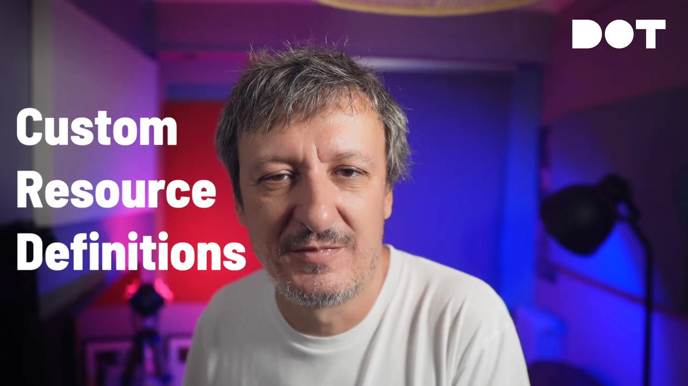

### 6.1 CRD 的根基是 schema

任何 CRD 的基础都是它的 **schema 定义**。这份 **OpenAPI v3 schema** 精确定义了：

- 你的自定义资源**可以有什么结构**；
- 哪些取值是**合法的**。

例如，如果你在写一个数据库集群控制器，schema 会规定用户必须指定 replicas、storage size、version 等字段，同时**挡住那些会弄坏数据库的非法组合**。[【跳转到 21:37】](https://www.youtube.com/watch?v=kss081c8EqY&t=1297)

### 6.2 全流程：CRD → CR → 真实资源 → status

实践中的关系是这样的：

1. 你先定义一个 **CRD**，描述一种新资源类型——比如 `DatabaseCluster`，并定义用户可以写哪些字段（数据库类型、副本数、存储大小）；
2. 用户创建**自定义资源（CR）**，也就是这个类型的**实例**，比如"我要一个 3 副本、100 GB 存储的 PostgreSQL 集群"；
3. 你的控制器 watch 这些 CR，看到"有人想要一个 PostgreSQL 集群"；
4. 控制器随即创建**真实资源**：跑数据库的 PostgreSQL Pod、供网络访问的 Service、存数据的 PersistentVolume，等等；
5. 控制器更新**自定义资源的 status** 来展示进度，比如"数据库正在配置"或"数据库集群就绪"；
6. 最后，用户看到 **ready** 状态，就知道自己的数据库集群可用了。[【跳转到 22:05】](https://www.youtube.com/watch?v=kss081c8EqY&t=1325)

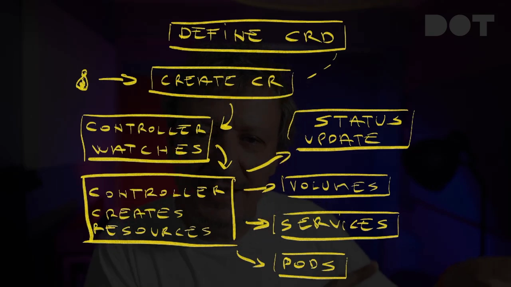

---

## 七、控制器之间如何协作：事件驱动 + 标签注解

到目前为止看的是单个控制器。但真正有意思的是：**控制器很少单打独斗**——它们持续互相协调，像一支各司其职、围绕同一个项目协作的专家团队。[【跳转到 23:12】](https://www.youtube.com/watch?v=kss081c8EqY&t=1392)

### 7.1 事件驱动的链式反应

以"用 Ingress 部署一个应用"为例，你其实触发了一连串**需要协作、却又彼此并不知情**的控制器：

- 你创建 Ingress 资源，它触发了多个控制器都在监听的事件；
- **ingress controller** 看到它，创建所需的负载均衡配置；
- **cert-manager** 注意到 TLS 注解，去签发一张证书；
- **DNS 控制器**更新记录，指向新的入口……
- 每个控制器都只做自己那摊专门的事，被其它控制器发出的事件触发。[【跳转到 23:44】](https://www.youtube.com/watch?v=kss081c8EqY&t=1424)

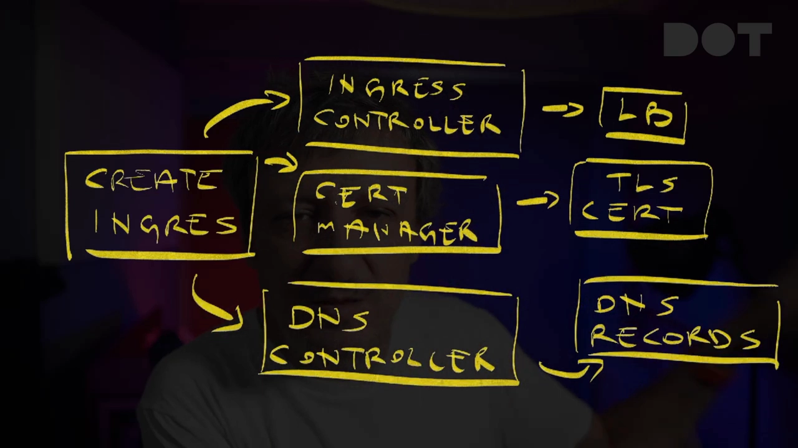

### 7.2 三种协作方式

**通过共享的自定义资源分担所有权**：多个控制器可以 watch**同一个 CR**，各自负责不同方面。例如一个数据库控制器的 CR，可能被一个控制器负责供给数据库 Pod、另一个负责备份、第三个负责监控。它们**不直接通信**，而是**各自更新 status 的不同部分**——靠精心的 API 设计来避免冲突。[【跳转到 24:13】](https://www.youtube.com/watch?v=kss081c8EqY&t=1453)

**通过标签与注解传递意图**：这是最优雅的协作方式。

- **标签（labels）** 用来发出意图信号，比如"照这个办""我在管这个""这需要备份""可以接流量了"；
- **注解（annotations）** 在控制器之间携带元数据：配置细节、状态信息，或给其它控制器读取、执行的指令。

其它控制器读到这些信号后采取相应动作。**就像在共享资源上给队友留便签（post-it）。**[【跳转到 24:50】](https://www.youtube.com/watch?v=kss081c8EqY&t=1490)

---

## 小结

- **控制器的全部秘密是一个控制循环**：观察 → 比较 → 决定 →（必要时）行动，然后无限重复。[【跳转到 25:21】](https://www.youtube.com/watch?v=kss081c8EqY&t=1521)
- **声明式配置 + 反应式调谐 = 自愈系统**：你只声明想要的状态，控制器负责把它变成现实并持续维持。
- **幂等是硬性要求**：同一操作跑一遍和跑一百遍结果必须相同，否则崩溃重启或重复事件就会把系统搞乱。
- **控制器不是轮询**：它靠 watch 流 + informer 缓存被事件唤醒；共享 informer 让多个控制器复用同一条 watch，避免压垮 API Server。
- **事件是双向的**：控制器既消费事件（过滤、去重、限流），也发射事件（EventRecorder、四要素结构、1 小时后清理、自动聚合），用于可观测性与控制器间通信。
- **一次 reconcile 有七个步骤**：取对象 → 判断存在性 → 比较状态 → 判断差异 → 制定并执行计划 → 更新 status → 处理结果（成功即止、出错则指数退避重试）。
- **CRD 让控制器扩展出"原生般"的新类型**：schema 定义结构，控制器据 CR 创建真实资源并回报 status。
- **控制器通过共享 CR、标签与注解协作**，用事件驱动的方式拼出复杂应用。

## 关键术语速查

| 术语 | 一句话解释 |
| --- | --- |
| **控制器（Controller）** | 实现"持续控制循环"的软件，负责把期望状态变成现实 |
| **控制循环（Control Loop）** | 观察→比较→决定→行动的无限循环 |
| **声明式配置** | 只描述"想要什么样子"，不描述"怎么做到" |
| **反应式调谐（Reconciliation）** | 控制器自动响应变化与漂移，把现实拉回期望 |
| **幂等（Idempotency）** | 同一操作执行多次也不会产生重复或副作用 |
| **期望状态 / 当前状态** | spec 里写的目标样子 / 集群现在真实的样子 |
| **reconcile 函数** | 所有触发源最终汇入的唯一处理入口 |
| **Event** | 一等资源，四要素为 object / type / reason / message |
| **Normal / Warning** | 事件的两种类型：信息性 / 潜在问题 |
| **EventRecorder** | 控制器用来发射事件的接口 |
| **watch API** | API Server 提供的实时资源变化推送流 |
| **informer / 共享 informer** | 带本地缓存的客户端层；可被多个控制器共享同一条 watch |
| **工作队列（work queue）** | 每个控制器独立的事件队列，按自己节奏消费 |
| **resync 周期** | 默认每 10 小时全量重放一次，兜住漏掉的事件 |
| **resourceVersion** | 资源每次变化自增的版本号，用于乐观并发与冲突检测 |
| **CRD / CR** | 自定义资源定义 / 它的实例 |
| **指数退避（exponential backoff）** | 失败后按指数增长的延迟重试，避免压垮系统 |
