# Reconcile 循环解剖：edge-driven 与 level-driven

> 视频来源：[It's all about reconciliation - anatomy of a kubernetes controller, Federico Paolinelli | SPACE](https://www.youtube.com/watch?v=Ohsp0woCiiM)（YouTube，GoWayFest 4.0，讲者 Federico Paolinelli @ Red Hat CNCF Networking）｜时长 30:50
>
> 一支从"工程上怎么写对"出发的控制循环解剖课。它没有停在"控制器 = 控制循环"这类口号上，而是先问：**分布式系统里事件会丢、写入会冲突，那控制器到底该按"边沿"写逻辑，还是按"状态"写逻辑？** 讲者给出的答案是那句被反复强调的 **"edge-triggered but level-driven"**，然后用 Kubernetes 类型、client-go、CRD 代码生成、Operator 一路把模式落到代码。文稿左栏为英文自动字幕，本文已翻译并重写为中文，并纠正了自动字幕里的错拼（`reddot`→**Red Hat**、`cnf`→**CNCF**、`winston events`→**missed events**、`work use`→**workqueue**、`clango`→**client-go**）。

## 本讲要解决的核心问题（SCQA）

**背景**：Kubernetes 是声明式的：你不需要向集群发命令，而是**声明你希望集群到达的状态**。最经典的例子是 ReplicaSet——你写 `replicas: 3`，集群就长出三个 Pod；你把副本数改成 2，集群就自己减掉一个。[【跳转到 02:34】](https://www.youtube.com/watch?v=Ohsp0woCiiM&t=154)

**冲突**：这套东西听起来很酷，但一旦真动手写控制器，麻烦就来了。集群可以看作一个**动态系统**：它不断在"均衡"与"被打破的均衡"之间摆动。而作为分布式系统，它有两个绕不开的麻烦——**数据是共享存储、写入会冲突**，以及**事件会丢失**（网络不可靠、Pod 会因 panic 死掉、节点可能消失）。[【跳转到 04:31】](https://www.youtube.com/watch?v=Ohsp0woCiiM&t=271)

**疑问**：既然事件可能丢，那么**控制器的逻辑应该基于"事件边沿"来写，还是基于"系统当前状态"来写？** 集群里"一个类型"到底是什么、信息存在哪？从零搭一个控制器要经过哪些构件？这些模式又怎么用到自定义类型上？

**回答（中心思想）**：**控制器应该是"edge-triggered but level-driven"——用事件（边沿）作为"醒来"的时机，但必须用系统状态（level）来实现逻辑。** 讲者说，这大概是整场演讲最重要的那句话。[【跳转到 08:10】](https://www.youtube.com/watch?v=Ohsp0woCiiM&t=490) 配套的还有一整套"久经战阵的模式"：用小步重试消化乐观并发冲突、用 informer + 工作队列解耦事件、让 reconcile 保持幂等。而收尾的建议只有一句：**stick with the patterns（别自创轮子，按模式来）**。[【跳转到 29:17】](https://www.youtube.com/watch?v=Ohsp0woCiiM&t=1757)

---

## 一、先换个视角：集群是一个动态系统

### 1.1 声明式：你给的是"目标状态"，不是"命令"

Kubernetes 是**声明式**的：你不发送命令，而是**请集群到达某个状态**——你声明想要的状态，集群据此反应、努力到达那个状态。[【跳转到 02:34】](https://www.youtube.com/watch?v=Ohsp0woCiiM&t=154)

用 ReplicaSet 的经典例子：这里要求 3 个副本，Pod 是最小运行单元，里面放你的容器。集群随之反应，**长出三个 Pod**。

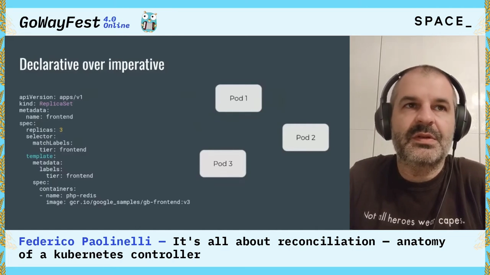

然后某个时刻你把副本数改成 2。注意——**你并不是发了一条"删掉一个 Pod"的命令**，你发送的是**一个"要两个 Pod"的新状态**，系统自己反应、减掉一个 Pod。[【跳转到 03:24】](https://www.youtube.com/watch?v=Ohsp0woCiiM&t=204)

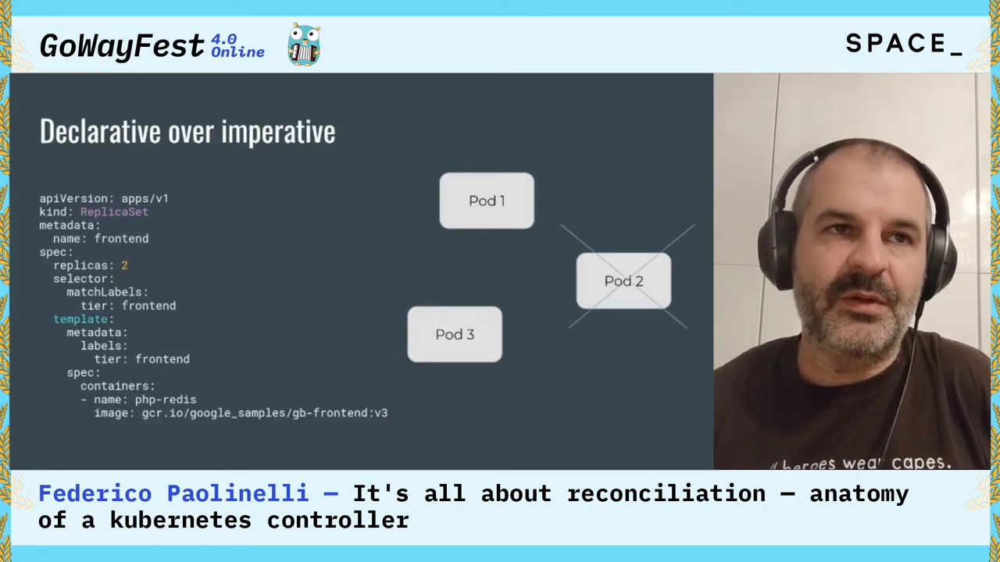

### 1.2 均衡 → 事件 → 反应 → 新的均衡

于是可以把集群理解成一个**动态系统**：

- 它在某个时刻到达一个**均衡（equilibrium）**；
- 然后发生了某件事——一个外部事件，或一个内部事件；
- 集群内部随即产生一连串事件，某个控制器以某种方式反应、又生成新的事件……
- 直到**再次到达均衡**。

比如：一个控制器往集群存储里写了点东西，这点东西被另一个控制器收到，它又做了别的事，再接下一件事……**所以用"另一个动态系统"来描述它才对。**[【跳转到 03:41】](https://www.youtube.com/watch?v=Ohsp0woCiiM&t=221)

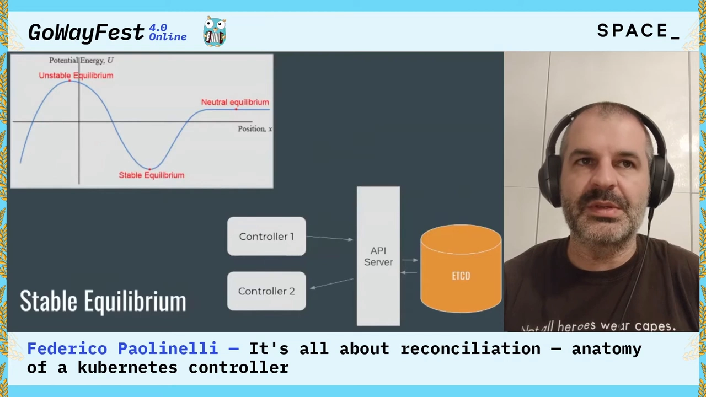

---

## 二、分布式系统给控制器的两个难题

讲者说：一个**从不经历失败的系统，永远成不了可靠的系统**。所以先正视两处复杂之处。[【跳转到 04:36】](https://www.youtube.com/watch?v=Ohsp0woCiiM&t=276)

### 2.1 共享存储与写入冲突 → 乐观并发

**第一处：存储是所有组件共享的、都要往里写数据，所以会发生冲突。** 集群处理冲突的方式，是实现一种**乐观并发（optimistic concurrency）**。

它这样做，是因为**读的次数预期远多于写的次数**。当发生冲突时，**第二个控制器会收到一个错误，并被要求重试写入。** 这对性能有好处——你不需要互斥锁（mutex）；但副作用是：**所有重试逻辑都必须由客户端实现。**

> 也就是说，复杂度从集群被"挪"到了我们的控制器身上。[【跳转到 04:49】](https://www.youtube.com/watch?v=Ohsp0woCiiM&t=289)

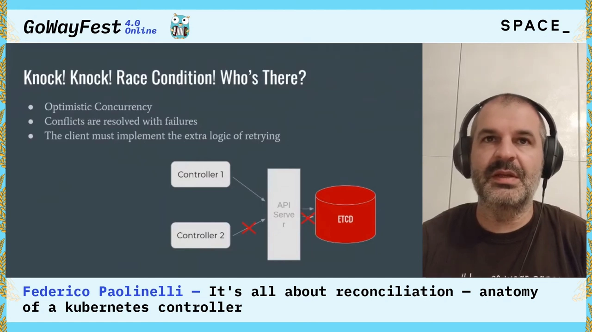

### 2.2 事件会丢失

**第二处：事件会丢。** 这是分布式系统：网络不可靠、集群和节点散布在不同地域；Pod 可能因为代码 panic 而死，也可能因为资源不够而死；甚至**节点也会死**——它们只是机器，随时可能消失。[【跳转到 05:54】](https://www.youtube.com/watch?v=Ohsp0woCiiM&t=354)

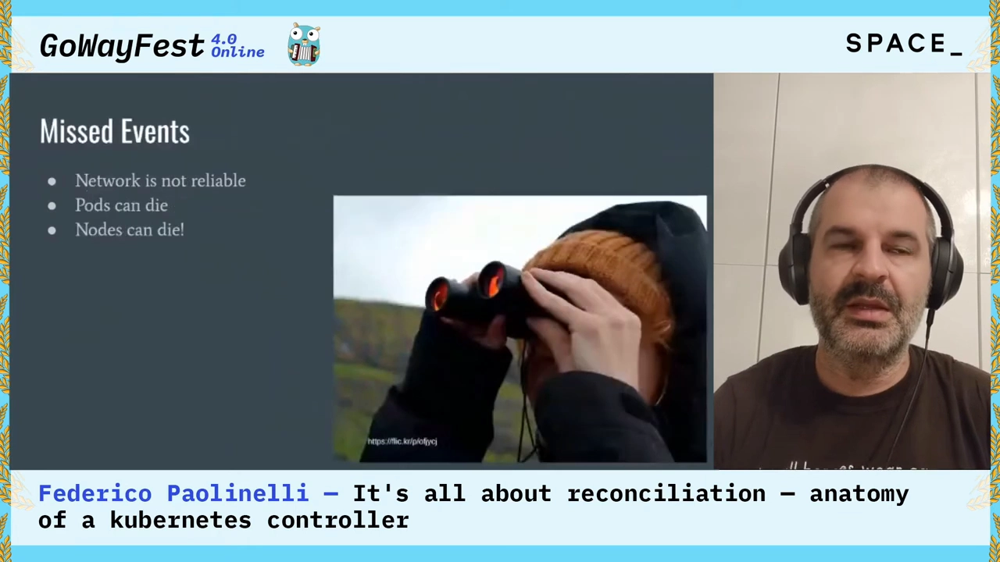

**问题就来了**：既然事件会丢，控制器该怎么写才不会漏事？

---

## 三、核心答案：edge-driven 还是 level-driven

讲者用一个具体场景把选择题摆出来：假设副本数**在 0 → 1 → 0 → 2 之间变化**，我们该怎么处理这种变化？有两种写法。[【跳转到 06:30】](https://www.youtube.com/watch?v=Ohsp0woCiiM&t=390)

### 3.1 edge-driven（边沿驱动）

**做法**：只关注**边沿处**的变化——从 0 到 1、从 1 到 0、从 0 到 2。这种实现里，**行为取决于你在边沿处观察到的数据变化**。

**问题**：我们前面才说过——**事件是会丢的**。所以这不是最理想的写法。[【跳转到 06:55】](https://www.youtube.com/watch?v=Ohsp0woCiiM&t=415)

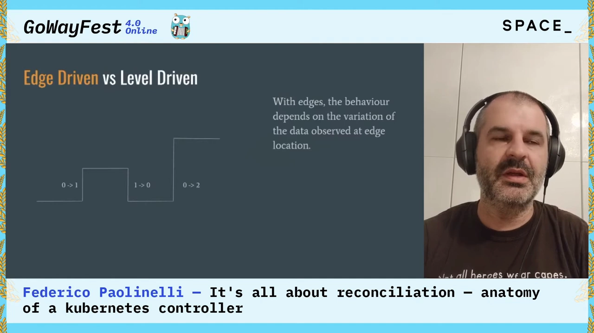

### 3.2 level-driven（状态驱动）

**做法**：我们**持续地被告知"某个时刻的值是多少"（level）**，而控制器**只应该关心这个 level**。这就像**持续地对期望状态做轮询**，并据此实现逻辑。

**评价**：这大概率更好，因为**没有"事件"这回事了**（不依赖事件不丢）；但它**也不是完全高效**的。[【跳转到 07:45】](https://www.youtube.com/watch?v=Ohsp0woCiiM&t=465)

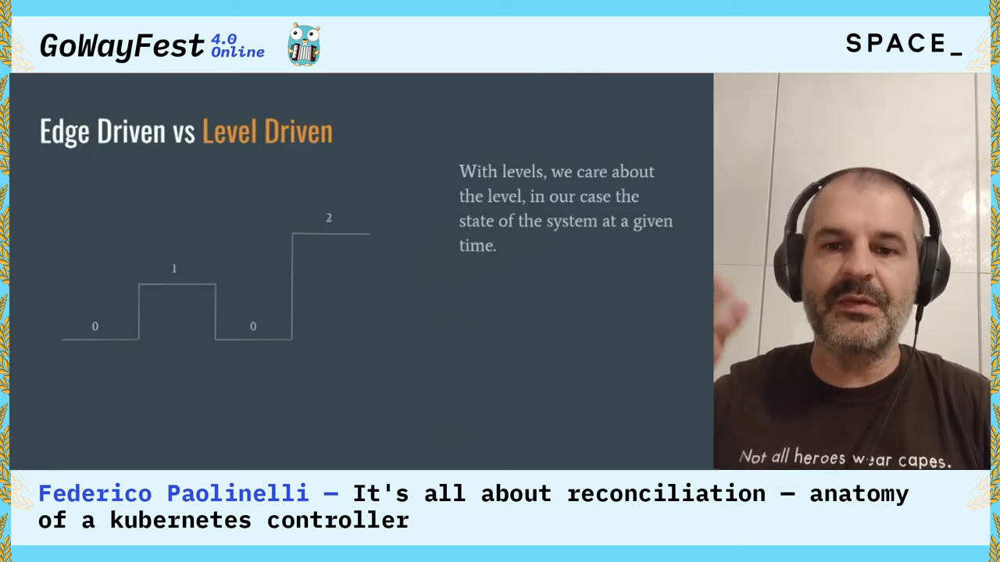

### 3.3 最终答案：edge-triggered but level-driven

于是最终答案是那句被讲者称为"今天最重要的一句话"：

> **以边沿触发，但以状态驱动（edge-triggered but level-driven）：用事件（边沿）作为醒来的时机，但实现逻辑时必须基于系统的状态（level）。** [【跳转到 08:10】](https://www.youtube.com/watch?v=Ohsp0woCiiM&t=490)

换成大白话就是：**你的逻辑要基于"全局集群状态"来实现；但你检查状态的时机，放在边沿上**——因为边沿才是发生变化的地方。你**可以**在收到事件时去做这些检查。

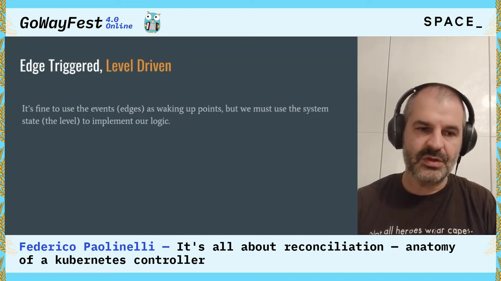

> 这条原则直接决定了两件事：**reconcile 必须幂等**（因为它可能被重复触发、也可能因为丢事件而重来），以及**收到事件后要重新去读最新状态**，而不是直接相信事件里带来的内容。

---

## 四、认识一个 Kubernetes 类型

要写控制器，得先知道"类型"是什么。讲者说：**Kubernetes 里没有黑魔法**——它不过是一个**键值存储**，数据存在里面，再通过 API 暴露出来。[【跳转到 09:00】](https://www.youtube.com/watch?v=Ohsp0woCiiM&t=540)

### 4.1 类型由三部分识别

一个 Kubernetes 类型由几部分标识：

- **API group**（API 组）；
- **version**（版本）；
- **resource**（资源）。

类型由它的 **REST URL** 来定位；而 REST URL 返回的"类型"叫 **Kind**。例如 `/apis/batch/v1/namespaces/Foo/jobs` 里就能读出 group/version/namespace/resource。[【跳转到 09:25】](https://www.youtube.com/watch?v=Ohsp0woCiiM&t=565)

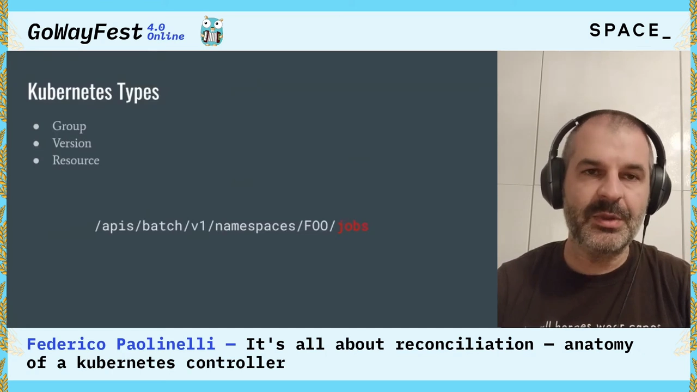

### 4.2 所有 Kind 共享一些共同点

很多 Kubernetes Kind 共享一些共同特征。以 Pod 的 Go 结构体为例，Kubernetes（以及 Go 生态）里**大量使用结构体内嵌（struct embedding）**：

```go
type Pod struct {
    metav1.TypeMeta
    metav1.ObjectMeta
    Spec   PodSpec
    Status PodStatus
}
```

- **TypeMeta**：所有类型共有，装着 Kind 与 APIVersion 这类信息；
- **ObjectMeta**：所有对象共有，装着 name、namespace 等信息；

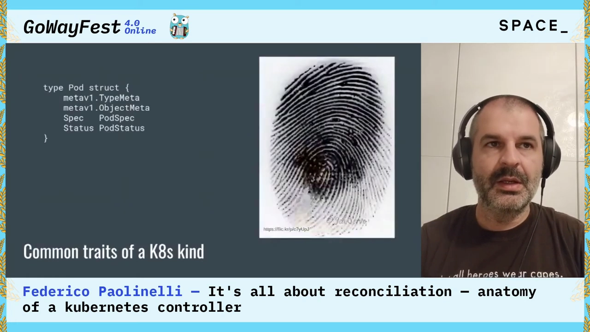

### 4.3 spec 与 status：一条约定

然后是 **spec** 和 **status**。这是一条**约定**，而且就讲者见过的每一个 Kubernetes 对象都遵循它：

- **spec**：用户在这里**提出期望状态**；
- **status**：控制器**回报"另一边"正在发生什么**。

当变化发生，控制器收到它，与"外部世界"交互，然后**回报 status**。而所谓"外部世界"，可以指集群里的其它资源（比如 ReplicaSet 面对的是 Pod），也**完全可以指集群之外**——某个 IoT 设备，甚至你的冰箱。[【跳转到 10:24】](https://www.youtube.com/watch?v=Ohsp0woCiiM&t=624)

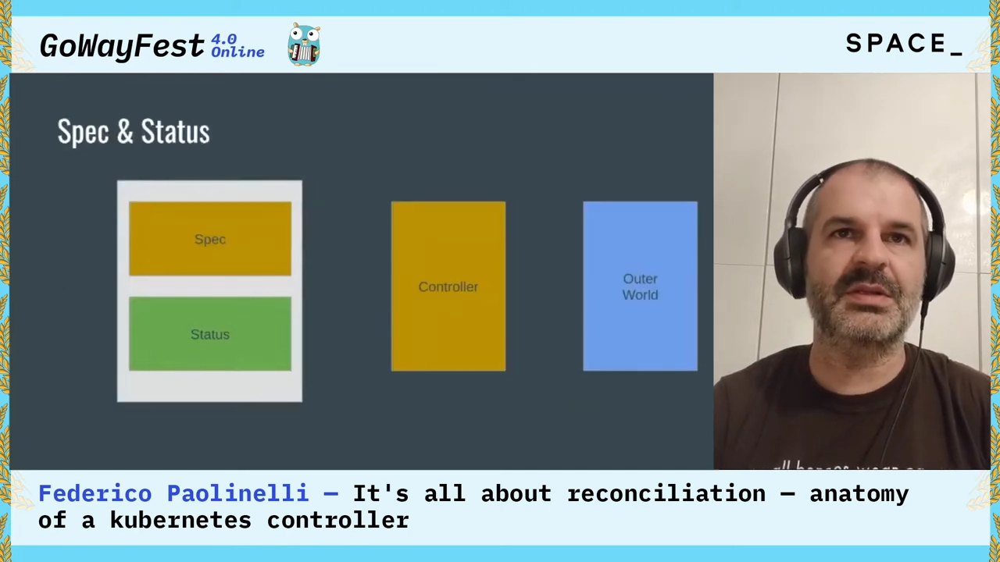

---

## 五、用 client-go 搭一个控制器：ClientSet → Informer → 工作队列

接下来讲者把模式落到代码。他先纠正了一个自己最初的误解：**client-go 并不是"每种类型一个客户端"**——它更像一个**框架**。[【跳转到 11:21】](https://www.youtube.com/watch?v=Ohsp0woCiiM&t=681)

### 5.1 类型按组归属，ClientSet 是总入口

每个类型都属于某个 **group**：Pod 属于 core，DaemonSet 属于 apps，NetworkPolicy 属于 networking。**每个 API group 都有自己的 client，它们被汇总在一起，构成一个 ClientSet。** ClientSet 就是让你与集群交互的对象。

**所以"我该怎么在 Go 里拿一个 Pod？"** 答案是：先拿到 ClientSet——把集群的"坐标"（可以用 kubeconfig 文件，控制器跑在 Pod 里时也有别的办法）传进去即可。拿到 ClientSet 后，通过它进入 API group，再取你想要的资源：可以用 `List` 方法操作集合，也可以按名字用各种动词操作单个资源——**动作和你预期的 REST 客户端一致**。[【跳转到 12:09】](https://www.youtube.com/watch?v=Ohsp0woCiiM&t=729)

### 5.2 从 watch 到 informer 再到共享 informer

ClientSet 上有一个特别有意思的方法：**`Watch`**——它让我们能收到事件通知。`Watch` 返回一个 `watch.Interface`，很简单：有一个方法能拿到**接收事件的 channel**，事件里带着某个对象。

但讲者说：**这是相当低的层级**——它不替你处理错误，只负责"事件驱动"那一部分。所以真正该用的是更高层的构件：**informer**。

- **informer** 在客户端侧用 watch 拿到事件，把它们存进**本地缓存**（供我们的 client 查询），并允许我们挂上**事件处理器（event handler）**去接收这些事件；**在此之上，informer 还替我们处理重连与失败。**
- 但真正该用的还不是普通的 informer，而是**共享 informer（shared informer）**：它又是一个更高层的构件。区别在于——**同一进程里的多个共享 informer 会共用同一条到 API Server 的连接**（针对同一类对象）。于是你只 watch 一次，**减轻 API Server 的负担**，而想挂多少 handler 都行。
- 有一点要注意：**handler 传给你的对象你并不拥有，所以不允许修改它们。**[【跳转到 14:14】](https://www.youtube.com/watch?v=Ohsp0woCiiM&t=854)

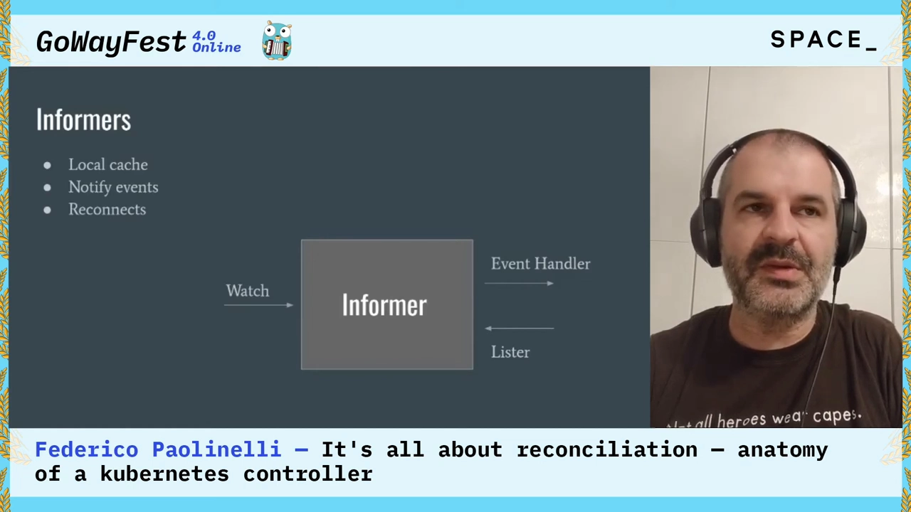

### 5.3 拼图的最后一块：工作队列（workqueue）

client-go 提供了一个**优先队列**，和 Kubernetes 的模式非常契合。用它有几个理由：

- **把回调与消费解耦**——尤其在使用共享 informer 时，**不希望阻塞回调**；
- **把同一对象的多次变化"压扁"（squash）**成一次处理。

接口和普通优先队列差不多，唯一的区别是有个 **`Done`** 方法，用来通知队列"这个元素我处理完了"。工作方式是这样的：[【跳转到 15:29】](https://www.youtube.com/watch?v=Ohsp0woCiiM&t=929)

- **在 handler 里，我们只把事件的 key 放进队列**（不是对象本身）；
- 消费侧可以开**很多 goroutine** 并发消费，因此并发度更高；
- **同一个 key 可以加入任意多次**：如果元素已经在队列里，就不会被重复入队；
- 如果某元素**正在被一个 goroutine 处理**，此时同一个元素又被放入队列，那么当那个 goroutine 调用 `Done` 时，该元素会被标记为 **dirty（脏）**，从而**再次入队**。

**这保证同一事件的不同出现不会落到不同的 goroutine 上**——这一点很重要，因为**你不希望一个事件"越过"另一个事件**。[【跳转到 17:09】](https://www.youtube.com/watch?v=Ohsp0woCiiM&t=1029)

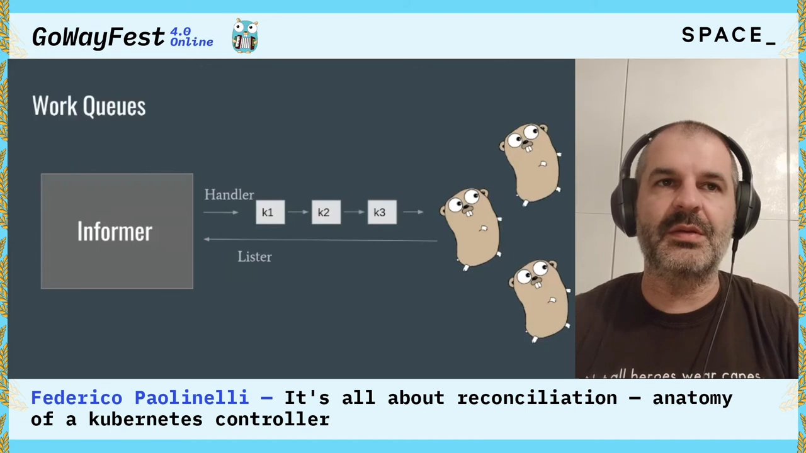

### 5.4 限流队列：为"错误重试"而生

队列还有一个变体：**限流工作队列（rate limiting queue）**。它多出 `AddRateLimited` 这样的方法，可以把一个元素**放回队列**——此时队列会按某种**限流策略**重新投递该元素，**默认策略是指数退避（exponential back-off）**。

**这尤其适用于错误重试**：如果某元素在消费时处理失败，你把它放回队列，过一段时间它会被再次处理。讲者说，这对**失败**、对 **CRD 里的 config** 都很有用。[【跳转到 17:34】](https://www.youtube.com/watch?v=Ohsp0woCiiM&t=1054)

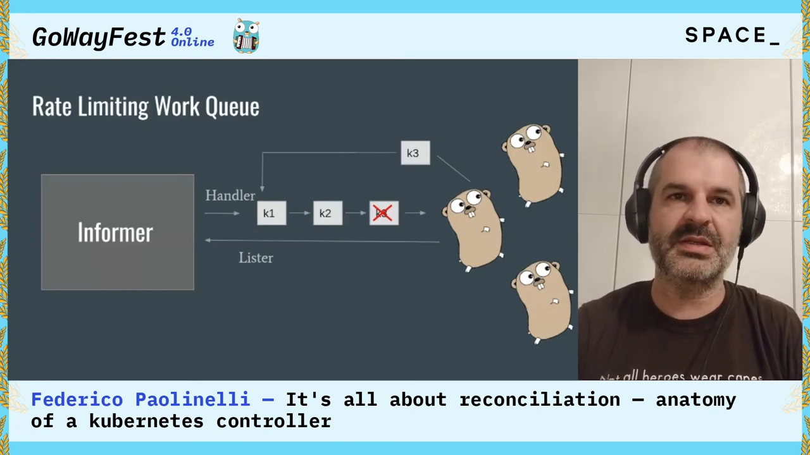

### 5.5 组装起来：四个动作

把所有东西拼到一起，顺序是：[【跳转到 18:49】](https://www.youtube.com/watch?v=Ohsp0woCiiM&t=1129)

1. **设置 informer 与 workqueue**：拿到你那种类型的 informer；
2. **添加 handler**：handler 里你只关心一件事——**拿到 key，把 key 放进队列**；
3. **启动消费者之前，确保缓存已经同步（cache synced）**：因为你消费 key 时，需要能从**本地缓存**里取出与之相关的内容；
4. **从队列读取**：取出元素 → 处理完调用 `Done` → 把 key 转成字符串（讲者调侃说这里那句 "should never fail" 的注释他并不总是有把握写下）→ 出错就把 key 放回队列并 `Done`，**让队列替我们处理重试**。

**key 怎么用？把它拆成 namespace 与 name**，然后取回真正的对象；一切顺利时，让队列"忘掉"这个对象——因为我们处理成功了。[【跳转到 20:04】](https://www.youtube.com/watch?v=Ohsp0woCiiM&t=1204)

> 注意这套设计的两个要点：**队列里流动的是 key（namespace/name），不是对象**（所以每次处理都要重新从缓存取最新状态，天然满足 level-driven）；**失败只是"放回队列重试"**，因此 reconcile 必须幂等。

---

## 六、把模式用到自定义类型：CRD 与代码生成

前面讲的是原生资源，但**同样这套东西也能用在自定义类型上**。自定义类型的加入，使得**扩展 Kubernetes 的行为**、写出"贴合这个环境"的应用成为可能——用 Kubernetes 的 API 来跑应用。讲者的比喻很形象：**没有自定义类型，就像一台没有任何 App 的 iPhone，是个没什么扩展性的封闭系统。**[【跳转到 20:23】](https://www.youtube.com/watch?v=Ohsp0woCiiM&t=1223)

### 6.1 CRD：一种"描述类型的类型"

首先需要 **CRD（Custom Resource Definition，自定义资源定义）**。它算是一种 **meta-type**：**一个描述其它类型的 Kubernetes 类型**，让你能往集群里加更多东西。

它看起来就是**又一份 manifest**：有名字之类的字段，还有描述"这个类型长什么样"的字段——有哪些字段、类型是什么、这个类型该如何呈现等等。此外，如果前面讲过的那些便利（用 informer、用类型安全的 client）**也能用于这些特殊类型**，那就更好了——而对 **client-go** 来说，这是成立的：它自带**代码生成器（code generator）**。[【跳转到 21:03】](https://www.youtube.com/watch?v=Ohsp0woCiiM&t=1263)

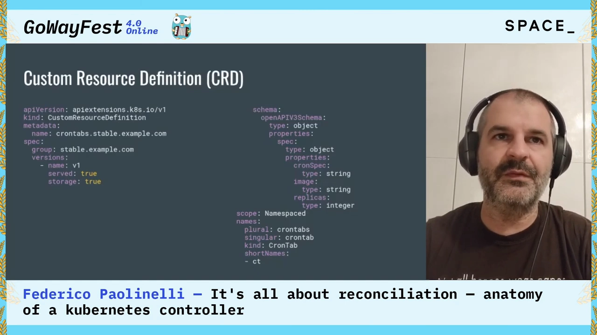

### 6.2 代码生成：deepcopy / ClientSet / informer / lister

代码生成器能替我们生成不少东西：

- **DeepCopy** 方法；
- **ClientSet**；
- **informer** 与 **lister**。

（讲者提醒：如果用 Go modules，配置起来会有点麻烦，但它确实替我们生成了大量代码。）

主要要关心两个文件：

- **`doc.go`**：放**包级别的设置**，这是你"指示"代码生成器的方式。比如声明在包级别生成 deepcopy、声明 group 是什么；
- 类型上的**类型级参数**：比如 `genclient` 要求生成 informer、client、lister，还可以加别的选项。

### 6.3 想抄作业？看 sample-controller

如果你想写自己的控制器、又想找参照物，**sample-controller 是合适的起点**。

### 6.4 不想生成代码？还有 dynamic client

如果你**不想要代码生成那一整套仪式**，client-go 还提供 **dynamic client**。用它等于**放弃了类型安全提供的安全网**，但有些好处：**不会引入新的依赖**。

代价是：**对象全是 `map[string]interface{}`，数组全是 `[]interface{}`**——讲者吐槽说"像在写 JavaScript，没人想写 JavaScript，但它就是这样"。真正难的不是取对象，而是**遍历**它：每一层都要从 map 里取元素、判断是否存在、判断类型对不对，再逐层往下走。dynamic client 附带一个 **structure package**，能让遍历稍微好受一点，但它依然"相当棘手、风险更高"。

不过，如果你确实**没有生成的代码**，或者**不想引入额外依赖**，它也是一种选择。[【跳转到 23:32】](https://www.youtube.com/watch?v=Ohsp0woCiiM&t=1412)

---

## 七、Operator：比"控制循环"更多

再往上还有 **Operator**。它也是一种更高层的构件：**Operator SDK** 是一个带 CLI 的框架，替我们做大量代码生成——生成整个工程骨架、添加新类型，甚至为这些类型生成控制器代码，一切"代码生成式"地完成。[【跳转到 25:12】](https://www.youtube.com/watch?v=Ohsp0woCiiM&t=1512)

### 7.1 Operator 的工作方式与普通控制器略有不同

Operator 依赖一个概念：**primary CR（主自定义资源）**，由用户编写。

- 事件到达后，**Operator 创建 secondary CR（次自定义资源）**，并在 primary CR 与 secondary CR 之间**建立所有权（ownership）关系**；
- 这使集群能在 **primary CR 被删除时，自动垃圾回收（GC）掉 secondary CR**。

**它与前面讲的控制器有个区别**：对 Operator 而言，**当 secondary CR 发生变化时，Operator 收到的是"primary CR 上的事件"**，然后**由 Operator 负责去取回 secondary CR**。也就是说——**入口永远是 primary CR。** 你用**裸控制器（bare controller）**也能实现这个模式，只是 Operator 的生成方式就是这么做的。[【跳转到 26:27】](https://www.youtube.com/watch?v=Ohsp0woCiiM&t=1587)

### 7.2 落到代码：两个 watcher + 一个 reconcile

实现方式：在 primary CR 上放一个 watcher，再在 secondary 上放一个 watcher，声明"我对 owner 类型上的事件感兴趣"。**这就是控制循环、就是 reconciliation loop。**

于是：事件发生在 Sample 类型上 → 先取回它 → 想生成 secondary → 在它上面放上 controller reference。

**关键点**：因为入口永远是 primary CR，**你的代码必须是幂等的**——完全可能发生"别的事件打到了 primary CR，而 Pod 早就已经在那儿了"的情况。**这正是我们要检查它是否存在的原因**：

- 不存在 → 创建它；
- 出错 → 抛出错误，于是会被**重试**；
- 还有别的方式可以强制或尝试 **requeue**——你要找的是 **`Result` 参数**。[【跳转到 27:42】](https://www.youtube.com/watch?v=Ohsp0woCiiM&t=1662)

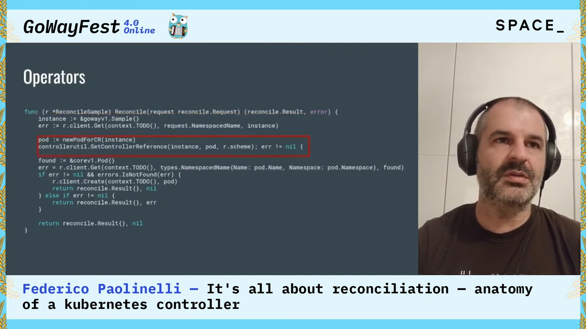

### 7.3 Operator 不只是"控制循环"

Operator 还带来一些额外的能力：

- **Operator Lifecycle Manager（OLM）**：管理并声明控制器之间的依赖、以及如何做升级；
- **Operator Marketplace**：也就是 operatorhub.io；
- 还支持**多 CR 管理（multitenancy）**。

**所以 Operator 其实"比单纯的控制循环多一点点"。**[【跳转到 28:57】](https://www.youtube.com/watch?v=Ohsp0woCiiM&t=1737)

---

## 八、结论：stick with the patterns

讲者用一句话收尾：**分布式系统真的很难**——失败是常态、错误是常态、竞态（race）就在拐角处等着。[【跳转到 29:17】](https://www.youtube.com/watch?v=Ohsp0woCiiM&t=1757)

Kubernetes 社区沉淀出了一整套**久经战阵、被反复验证的模式**。如果你觉得"自己实现一套""用轮询""处理一些特例"是个好主意——**先想想当你的控制器复杂度增长时会发生什么**：事件数量会增长，要处理的类型会增长，而**边界情况（corner case）永远在拐角处等着我们**。

**所以总的建议是：stick with the patterns（按模式来）。因为它们有效**；哪怕你需要在里面多实现一点逻辑，它们也是**安全而稳定**的。[【跳转到 30:07】](https://www.youtube.com/watch?v=Ohsp0woCiiM&t=1807)

---

## 小结

- **集群是一个动态系统**：声明式地描述状态 → 系统在"均衡—被打破—再收敛"之间摆动。[【跳转到 03:41】](https://www.youtube.com/watch?v=Ohsp0woCiiM&t=221)
- **两个绕不开的难题**：共享存储的写入冲突（用**乐观并发**消化：冲突即报错重试，重试逻辑落在客户端），以及**事件会丢失**（网络、Pod、节点都可能失效）。
- **核心原则：edge-triggered but level-driven**——用事件当"醒来的时机"，但**逻辑必须基于系统当前状态**（level）来实现。[【跳转到 08:10】](https://www.youtube.com/watch?v=Ohsp0woCiiM&t=490)
- **类型 = API group + version + resource**，由 REST URL 定位，返回的"类型"叫 Kind；所有 Kind 共享 TypeMeta / ObjectMeta 内嵌结构，并按约定区分 **spec（用户写期望）** 与 **status（控制器回报）**。
- **client-go 的三个台阶**：`Watch`（低层、不管错误）→ **informer**（本地缓存 + 自动重连 + handler）→ **共享 informer**（多控制器共用一条连接，但**不能修改传给你的对象**）。
- **工作队列把回调与消费解耦**：队列里流动的是 **key**，同 key 去重、处理中再来标记为 dirty 再入队、失败放回队列；**限流队列默认用指数退避**做错误重试。
- **组装四步**：设置 informer 与队列 → handler 只放 key → 等**缓存同步** → 消费时取对象、出错 requeue；key 拆成 namespace/name。
- **CRD 是一种 meta-type**；用**代码生成**得到 DeepCopy/ClientSet/informer/lister（`doc.go` + `genclient`），或退回 **dynamic client**（无类型安全、对象是 `map[string]interface{}`）。
- **Operator = 控制循环 + primary/secondary CR 所有权 + OLM**；入口永远是 primary CR，因此代码必须**幂等**，靠 `Result` 控制 **requeue**。
- **最终建议：stick with the patterns**——分布式系统的失败/错误/竞态是常态，模式之所以是模式，是因为它们安全、稳定。[【跳转到 30:07】](https://www.youtube.com/watch?v=Ohsp0woCiiM&t=1807)

## 关键术语速查

| 术语 | 一句话解释 |
| --- | --- |
| **声明式（declarative）** | 声明想要的目标状态，而不是发送一步步命令 |
| **均衡（equilibrium）** | 动态系统收敛到的稳定状态；事件会打破它、控制器再把它拉回 |
| **乐观并发（optimistic concurrency）** | 读多写少下的冲突处理：冲突即报错重试，重试逻辑在客户端 |
| **edge-driven** | 只根据边沿处的数据变化决定行为——丢事件就漏事，故不理想 |
| **level-driven** | 根据"某时刻的状态（level）"实现逻辑，更健壮但需检查时机 |
| **edge-triggered but level-driven** | 用事件唤醒，用系统状态实现逻辑——Kubernetes 的标准答案 |
| **Kind / Group / Version / Resource** | 类型的标识；REST URL 定位资源，返回的"类型"即 Kind |
| **TypeMeta / ObjectMeta** | 所有 Kind / 所有对象共享的内嵌元数据（Kind、name、namespace…） |
| **spec / status** | 用户写期望状态 / 控制器回报实际进展 |
| **ClientSet** | 汇总各 API group 客户端的总入口 |
| **Watch** | 低层的实时事件接口（`watch.Interface`），不处理错误 |
| **informer** | 用 watch 建立本地缓存，支持 handler，并自动处理重连 |
| **shared informer** | 多控制器共用一条 watch 连接；传入对象只读、不可修改 |
| **workqueue** | 存放事件 **key** 的队列；去重、dirty 再入队、支持并发消费 |
| **rate limiting queue** | 支持把元素放回队列（默认指数退避），用于错误重试 |
| **cache sync** | 启动消费者前必须等缓存同步，否则取不到对象 |
| **CRD** | 描述其它类型的 meta-type，用于扩展集群 |
| **genclient / doc.go** | 代码生成的类型级参数与包级设置 |
| **dynamic client** | 无类型安全的客户端，对象为 `map[string]interface{}` |
| **Operator** | primary/secondary CR + 所有权 + OLM 的更高层封装 |
| **requeue / Result** | 通过返回 `Result` 控制"稍后重试"的方式 |
