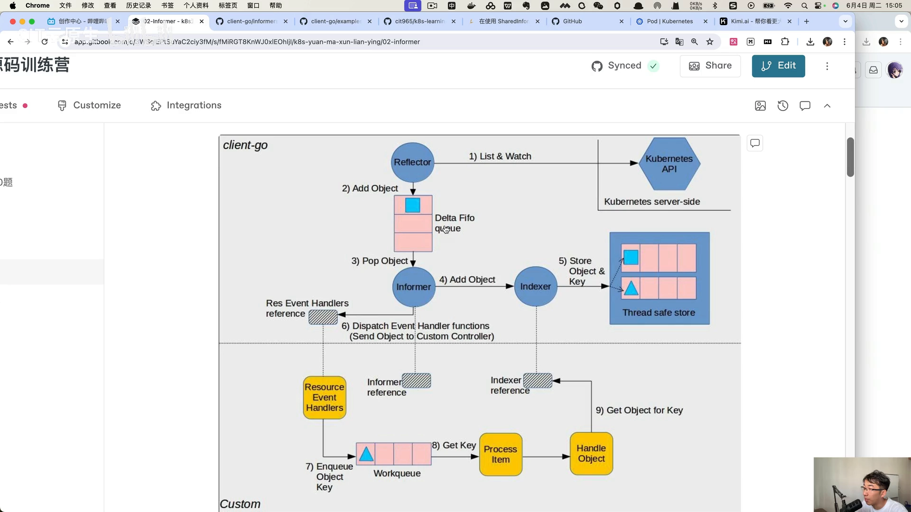
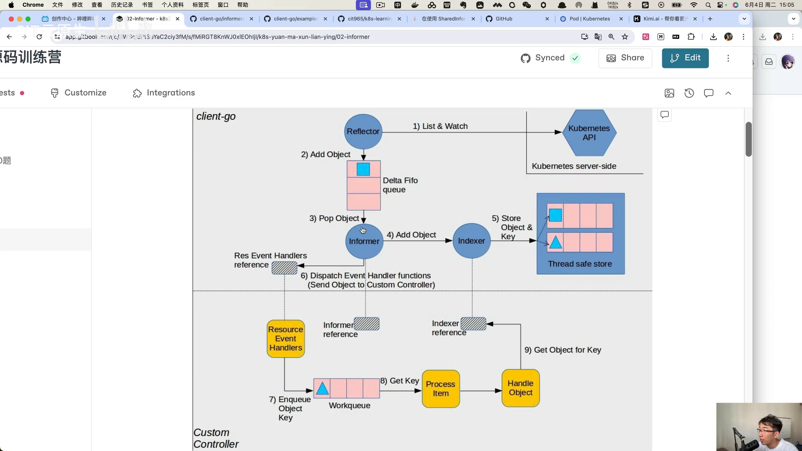
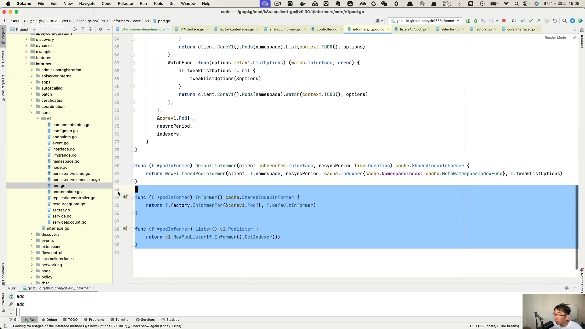
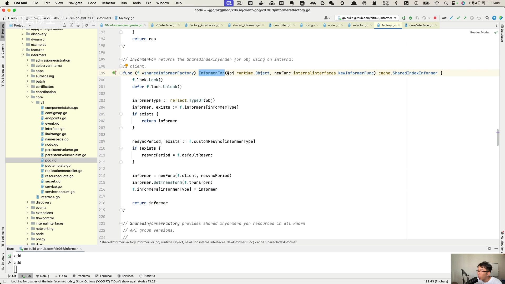
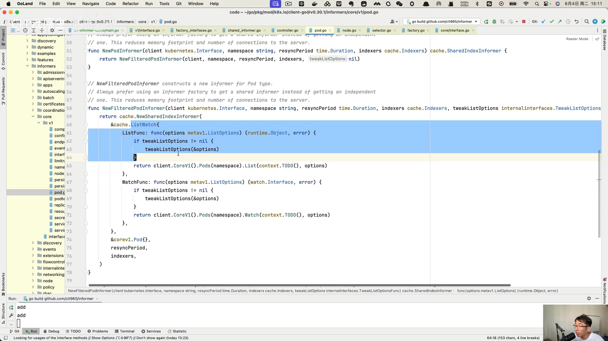
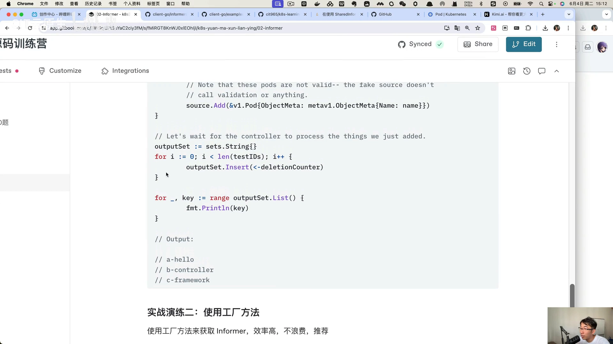
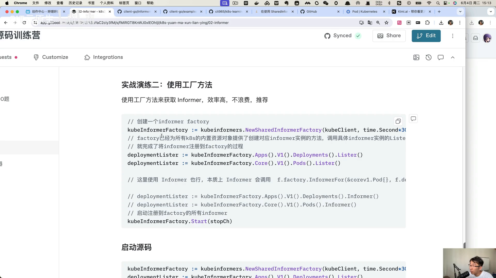
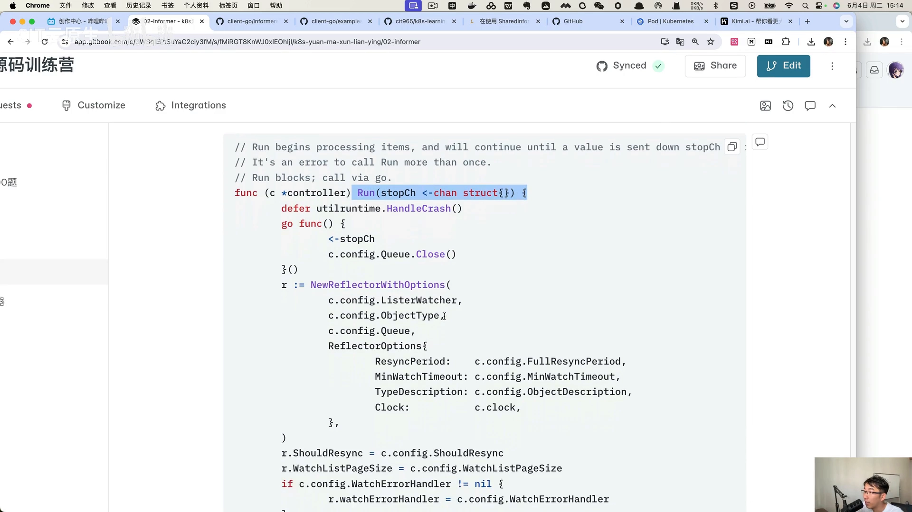
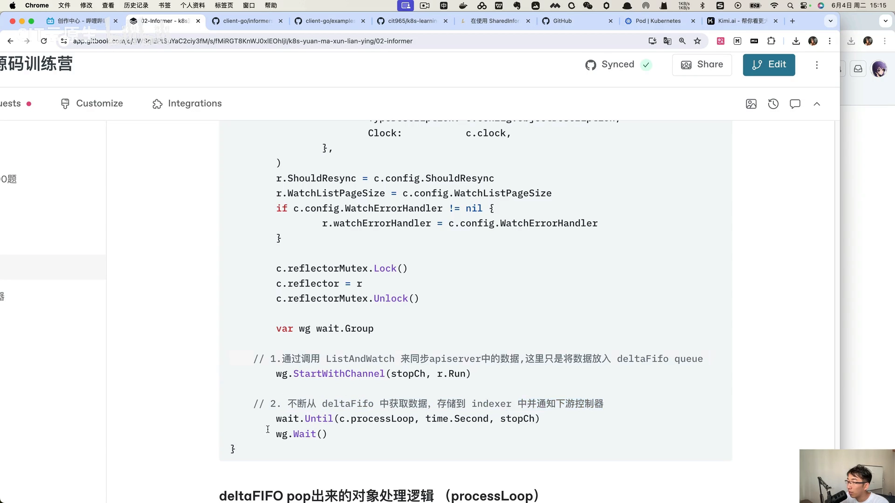

# Informer 原理与使用：Indexer 与 SharedInformerFactory

> 视频来源：[03-informer 原理与使用](https://www.bilibili.com/video/BV1dw4m1i7rW/)（Bilibili，CIT 云原生）｜时长 10:25
>
> 这是一节“**对着官方架构图和源码讲怎么用**”的课。它先拿官方那张 informer 架构图说清 client-go 与自定义控制器的分层，再顺着 `PodInformer` 的源码一路看到 `SharedInformerFactory`，最后落到“单个 informer 是玩具、工厂方法才是生产推荐”这条实操结论。文稿已订正自动字幕的明显错拼：`clientgo`→**client-go**、`informal`→**informer**、`shell/shelter index inform`→**SharedIndexInformer**、`informfactory`→**SharedInformerFactory**、`indexor`→**indexer**、`deltafifq`→**DeltaFIFO**、`FFOQ`→**FIFO 队列**、`copclient`→**clientset**、`newport/pdinform`→**newPodInformer**、`p d`→**Pod**、`callv1`→**core/v1**。

## 本讲要解决的核心问题（SCQA）

**背景**：我们已经知道 informer 是 client-go 里用来“高效同步和监控集群资源（Pod、Service、Deployment 等）”的核心组件。官方给了一张整体架构图，几乎每篇讲 informer 的博客都会引用它。

**冲突**：架构图上看 informer 只有两个部件，看起来很简单；但真去用的时候，会发现 client-go 里有一大堆 `informers/` 目录、一堆接口，还有 `InformerFor`、`SharedInformerFactory`、`Start`、`Run` 这些名字。**它们之间是什么关系？我到底该用哪一个？为什么生产环境不推荐“单个 informer”？**

**疑问**：informer 的架构到底分几层？从调用一个 `PodInformer` 到真正跑起来监听 Pod，中间经历了什么？`SharedInformerFactory` 又在替我们解决什么问题？

**回答（中心思想）**：**informer 的架构要分两层理解——上层 `SharedInformerFactory` 负责“按资源类型注册并复用 informer”，下层单个 `SharedIndexInformer` 负责“reflector 取数 → DeltaFIFO → indexer 缓存 → 事件分发”。** 所有资源类型的 informer 本质上都是同一个 `SharedIndexInformer`，只是 `list-watch` 不同、而 **index 是共享的**。生产环境应该用工厂方法，因为它能保证**同一种资源只会有一个 reflector、只注册一次**。[【跳转到 10:04】](https://www.bilibili.com/video/BV1dw4m1i7rW/?t=604)

---

## 一、官方架构图：informer 在哪一层

### 1.1 上下分层：client-go 与自定义控制器

官方这张架构图把整体分为**上、下两部分**：[【跳转到 00:25】](https://www.bilibili.com/video/BV1dw4m1i7rW/?t=25)

- **上部分：client-go 里的代码**，主体就是 informer，是今天讨论的重点；
- **下部分：custom controller（自定义控制器）**，也就是我们借助 informer 写出来的控制器。

也就是说，用 informer 就能实现一个自定义控制器——这是我们看这张图首先要建立的直觉。

### 1.2 informer 的两个部件：reflector 与 indexer

informer 主要由两个部件组成：[【跳转到 00:50】](https://www.bilibili.com/video/BV1dw4m1i7rW/?t=50)

- **reflector**：从远端的 API Server 获取数据，放进 **DeltaFIFO** 这个队列；
- **informer（本体）**：不断从 DeltaFIFO 里取出数据，存到本地的缓存存储上——这是一个**带索引的存储**，所以叫 **indexer**，本质上是一个**线程安全的存储**。

此外它还会把资源变化的事件**分发给 controller**，这样 controller 就能对资源的变化做出相应的处理。[【跳转到 01:15】](https://www.bilibili.com/video/BV1dw4m1i7rW/?t=75)

> 这样，informer 就把“取数（reflector）”“排队（DeltaFIFO）”“缓存（indexer）”“分发事件（event）”这几件事串成了一条流水线。这正是一个控制器“读本地缓存、由事件驱动”的基础。

---

## 二、从 PodInformer 看 informer 的接口定义

理解了架构，就要看“怎么写代码去监听 Pod”。讲者打开了 client-go 源码：[【跳转到 02:05】](https://www.bilibili.com/video/BV1dw4m1i7rW/?t=125)

### 2.1 informers 目录：按“组”来分文件夹

在 client-go 里有一个 `informers` 目录，里面有很多文件夹，**每个文件夹就是一个“组名”**。比如我们最熟悉的 `core/v1`——核心组，里面有 Pod。[【跳转到 02:17】](https://www.bilibili.com/video/BV1dw4m1i7rW/?t=137)

> 回忆一下：Kubernetes 的资源是**按组（Group）、版本（Version）、资源（Resource）**组织的，`core/v1` 是最核心的一组。informer 的目录组织正好对应这套分组。

### 2.2 PodInformer 接口：Informer() 与 Lister()

Pod 对应一个 **`PodInformer` 接口**，它定义了“专属于 Pod 的 informer”。拿到这个 `PodInformer`，就可以监听集群中 Pod 的变化。[【跳转到 02:42】](https://www.bilibili.com/video/BV1dw4m1i7rW/?t=162)

这个接口有两个函数：[【跳转到 03:07】](https://www.bilibili.com/video/BV1dw4m1i7rW/?t=187)[【跳转到 03:12】](https://www.bilibili.com/video/BV1dw4m1i7rW/?t=192)

- `Informer()`：返回一个 **`SharedIndexInformer`**；
- `Lister()`：返回一个 **`PodLister`**。

而实现它的 struct 里有两个关键字段：

- 一个 **`namespace`**，说明这个 informer 是**针对某一个 namespace** 下的资源；
- 一个 **`factory`**——factory 是“工厂”的意思，说明它是一个工厂方法，底层会引用一个工厂。[【跳转到 03:30】](https://www.bilibili.com/video/BV1dw4m1i7rW/?t=210)

### 2.3 为什么每种资源都返回 SharedIndexInformer

看 `Informer()` 的实现，它其实就是调用 `factory` 下面的 **`InformerFor`**——从名字也能看出，是“为某种资源构建对应的 informer”，并返回一个 `SharedInformer`。[【跳转到 03:52】](https://www.bilibili.com/video/BV1dw4m1i7rW/?t=232)

这里有一个很重要的规律：**不管你监听的是 Pod 还是 Node，`Informer()` 返回的都是 `SharedIndexInformer`，只是里面的“类别（资源类型）”不同而已。** [【跳转到 04:17】](https://www.bilibili.com/video/BV1dw4m1i7rW/?t=257)

---

## 三、sharedInformerFactory：用工厂避免重复注册

### 3.1 InformerFor：注册到 map，防重复

顺着 `InformerFor` 点进去，会发现它属于 **`sharedInformerFactory`**，主要作用是把 Pod 这种类别的 informer **注册到一个 map 里**：[【跳转到 04:41】](https://www.bilibili.com/video/BV1dw4m1i7rW/?t=281)[【跳转到 04:48】](https://www.bilibili.com/video/BV1dw4m1i7rW/?t=288)

- 它先去判断——底层其实有一个 **map 数组**（key 是反射的 `reflect.Type`）；
- 如果这个资源的 informer **已经存在，就直接返回**，不再创建；
- **不存在才去注册**。

它本质上就是一个**工厂方法**。[【跳转到 04:53】](https://www.bilibili.com/video/BV1dw4m1i7rW/?t=293)[【跳转到 05:18】](https://www.bilibili.com/video/BV1dw4m1i7rW/?t=318)

**“存在即返回”就是防重复：** 这样同一种资源不会被注册两遍，也就不会重复创建 reflector 去重复取数。

---

## 四、newPodInformer：真正的构造过程

### 4.1 构造方法 newPodInformer → newFilteredPodInformer

在上一步不远处，能看到 `Informer()` 与 `Lister()` 两个方法的实现。先看 `newPodInformer` 这个构造方法：它会调用 **`newFilteredPodInformer`**——也就是说，**真正的构造方法在那里**。[【跳转到 03:27】](https://www.bilibili.com/video/BV1dw4m1i7rW/?t=327)[【跳转到 05:27】](https://www.bilibili.com/video/BV1dw4m1i7rW/?t=327)[【跳转到 05:37】](https://www.bilibili.com/video/BV1dw4m1i7rW/?t=337)

`newFilteredPodInformer` 需要传入几个东西：

- 一个 **client**（客户端）；
- 一个 **namespace**；
- 一个 **indexer**；
- 一个 **option**（参数选项）。

而这里我们默认的 `newInformer` **没有传 option**。[【跳转到 06:02】](https://www.bilibili.com/video/BV1dw4m1i7rW/?t=362)

### 4.2 list-watch 两个回调 + indexer

在构造过程中，它会**初始化一个 `SharedIndexInformer`**，主要就是准备 **`list-watch`**：[【跳转到 06:08】](https://www.bilibili.com/video/BV1dw4m1i7rW/?t=368)[【跳转到 06:13】](https://www.bilibili.com/video/BV1dw4m1i7rW/?t=373)

- **list**：这是一个回调方法，作用是去 API Server 里查询数据；
- **watch**：也是不断去监听。

它会初始化这两个方法，并把 Pod（这类资源）也传进去。而 **indexer 就是用来存储数据的**。[【跳转到 06:38】](https://www.bilibili.com/video/BV1dw4m1i7rW/?t=398)

最后讲者做了个总结：**不管是什么类型的 informer，本质上都是一个 `SharedInformer` / `SharedIndexInformer`；它的 index 是共享的，只不过不同资源有不同的 `list-watch`，底层是一样的。** [【跳转到 06:46】](https://www.bilibili.com/video/BV1dw4m1i7rW/?t=406)

---

## 五、怎么用：单个 informer 与工厂方法

### 5.1 单个 informer：一段“玩具”写法

先用单个 informer 举例。怎么用呢？[【跳转到 07:09】](https://www.bilibili.com/video/BV1dw4m1i7rW/?t=429)

1. 初始化一个 informer，它会返回两个东西（一个是 controller）；
2. 把 `AddFunc` 这些回调都写好；
3. 把它 `run` 起来（起一个协程即可）。

**但讲者明确说：这个一般是用作玩具（demo），一般生产环境不推荐。** [【跳转到 07:34】](https://www.bilibili.com/video/BV1dw4m1i7rW/?t=454)

### 5.2 工厂方法：生产推荐

既然 client-go 提供了 **`SharedInformerFactory`** 这个工厂方法，那最好就用它。用法是：[【跳转到 07:59】](https://www.bilibili.com/video/BV1dw4m1i7rW/?t=479)

1. 初始化一个 `SharedInformerFactory`，**传入我们的 client**；
2. 调用它底下的 `Apps().V1().Deployments().Lister()` 或 `.Informer()`——**它会自动帮我们到那个 map 里去注册**；
3. 调用 `factory.Start()`。

### 5.3 Start 与 Run：为什么同一种资源只有一个 reflector

`factory.Start()` 会去 map 里**遍历所有的 `SharedIndexInformer`**，然后调用它们的 `go run`。[【跳转到 08:24】](https://www.bilibili.com/video/BV1dw4m1i7rW/?t=504)

**这能保证：同一种资源只会有一个 reflector、只会注册一次**，从而防止你项目里同一种资源被注册多次、白白浪费资源。[【跳转到 08:49】](https://www.bilibili.com/video/BV1dw4m1i7rW/?t=529)

讲者提醒：普通开发者学会“就是这三行”的用法就够了，但要**深入源码理解它为什么要这么使用**。知道了 `Start` 的原理，你就**不要再单个地创建 informer 再调用 Run**。[【跳转到 09:14】](https://www.bilibili.com/video/BV1dw4m1i7rW/?t=554)

### 5.4 单个 Run 内部在干什么

那单个 informer 的 `Run` 内部其实在做什么呢？[【跳转到 09:39】](https://www.bilibili.com/video/BV1dw4m1i7rW/?t=579)

- 初始化 **reflector**，调用 reflector 的方法，把数据从 API Server 同步过来；
- 然后不断从这个 **FIFO 队列**里获取数据，**存储到 indexer** 里。

---

## 六、整体分两部分

讲者最后给了这张课的结构总结：[【跳转到 10:04】](https://www.bilibili.com/video/BV1dw4m1i7rW/?t=604)

1. **理解 `sharedInformerFactory` 是干什么的**——负责按资源类型注册、复用 informer；
2. **理解单个 `shared informer` 内部是怎么实现的**——reflector → DeltaFIFO → indexer → 事件分发。

我们之前画的那张图，讲的其实就是**单个 informer** 干的事情。

---

## 小结

- informer 架构分两层：**上层 `SharedInformerFactory`（注册与复用）+ 下层单个 `SharedIndexInformer`（取数与本地方案）**。
- **reflector** 从 API Server 取数放进 **DeltaFIFO**；informer 再把它存进带索引的 **indexer**，并**分发事件**给 controller。
- 所有资源类型的 informer **本质都是 `SharedIndexInformer`**，index 共享，只是 `list-watch` 不同。
- `PodInformer` 接口提供 `Informer()`（返回 `SharedIndexInformer`）与 `Lister()`（返回 `PodLister`）。
- `InformerFor` 会把 informer **注册到以 `reflect.Type` 为 key 的 map**，**存在即返回**，防重复。
- `newPodInformer` → `newFilteredPodInformer(client, namespace, indexer, option)`，初始化 `SharedIndexInformer` 与 `list-watch` 回调。
- **生产用工厂方法**：`NewSharedInformerFactory(client)` → 按资源取 informer → `Start()` 遍历 map `go run`，保证同一种资源只有一个 reflector。
- 单个 informer 的 `Run`：初始化 reflector 同步数据，再从 FIFO 取数写入 indexer。

## 关键术语速查

| 术语 | 一句话解释 |
| --- | --- |
| client-go | Kubernetes 官方 Go 客户端库，informer 就在其中 |
| reflector | informer 中负责从 API Server 取数、放入 DeltaFIFO 的部件 |
| DeltaFIFO | reflector 与 informer 之间的一个队列，缓存对象变化 |
| indexer | informer 维护的带索引、线程安全的本地缓存 |
| SharedInformer / SharedIndexInformer | 单个 informer 的实现类型，index 可在多个消费者间共享 |
| SharedInformerFactory | 按资源类型创建/复用 informer 的工厂，避免重复注册 |
| InformerFor | 工厂方法：按 `reflect.Type` 在 map 里查/注册 informer，存在即返回 |
| Lister | 从本地缓存（indexer）读取对象的只读访问接口 |
| list-watch | reflector 的两个动作：先全量 list、再长连接 watch 增量 |
| Start / Run | 工厂的 `Start` 遍历 map 触发各 informer 的 `Run`；`Run` 内部启动 reflector 与消费循环 |
