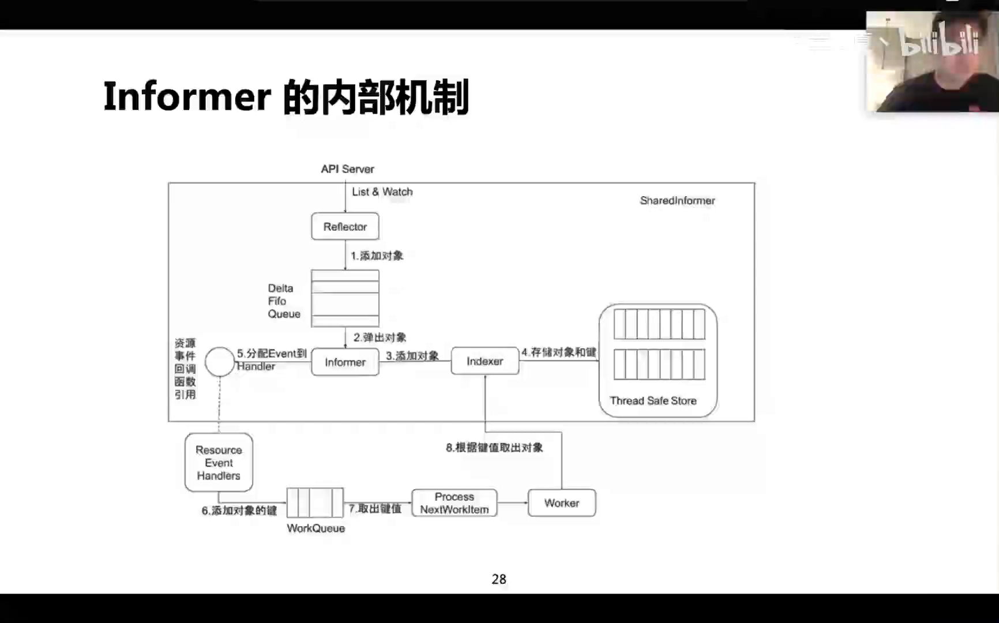
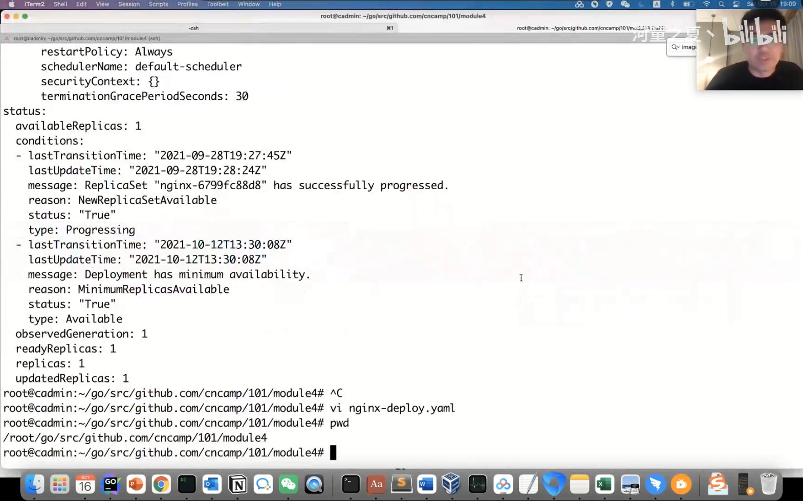

# Informer 机制：为什么控制器不直接访问 API Server

> 视频来源：[8.2 K8S架构原则和对象设计--Informer机制](https://www.bilibili.com/video/BV1Wu4m1w7jN/)（Bilibili，张磊《深入剖析 Kubernetes》相关内容）｜时长 8:38
>
> 这是一节偏“讲原理”的课：它不从代码细节入手，而是先把 informer 在 Kubernetes 里到底解决什么问题讲清楚——**informer 是“list-watch + 本地缓存 + 事件分发”三件事的组合，它的核心价值是让控制器读自己的本地缓存，而不是每次都去敲 API Server 的门。** 文稿已对自动字幕的明显错拼做订正：`cooperators`→**Kubernetes**、`codegenerator`→**code-generator**、`informers`/`informal`→**informer**、`deltafe`/`datafearful`→**DeltaFIFO**、`rainbuffer`→**ring buffer**、`threadsave`→**thread-safe**、`shareinformer`→**shared informer**、`demonset`→**DaemonSet**。

## 本讲要解决的核心问题（SCQA）

**背景**：Kubernetes 是声明式的，你想创建任何对象，都要经过一个统一的入口——**API Server**。而底层存储 etcd 本身支持 **watch 机制**：客户端可以用长连接告诉 Server 端“我要盯着这个对象（或这一类对象）未来的变化”，之后任何变化都会被推送给客户端。

**冲突**：既然 etcd/API Server 能直接看、直接查，那每个组件、每个控制器都“有需要就去问一次 API Server”，不就行了吗？答案是不行——**这样会把 API Server 压死**。一个集群里跑着成百上千个控制器、每个控制器都在高频地看同一批对象，全量的轮询和查询会成为灾难。

**疑问**：那么 informer 在客户端和 API Server 之间到底做了什么？它凭什么既能拿到最新的对象，又能不把 API Server 打爆？

**回答（中心思想）**：**informer 提供了 list-watch 机制，并在客户端维护一份本地缓存（thread-safe 的 store / indexer），再把变化通过 event 分发给你的 event handler。** 于是控制器要读对象时，直接读本地缓存即可，只有**要更新对象**时才去调用 API Server。这也是为什么 Kubernetes 要求**任何控制器都应该使用 shared informer framework**——由它来保证本地缓存和 API Server 之间的版本一致性。[【跳转到 06:15】](https://www.bilibili.com/video/BV1Wu4m1w7jN/?t=375)

---

## 一、Kubernetes 里所有对象访问都从 API Server 走

### 1.1 用 code-generator 定义对象

课程先回顾了上一节的内容：Kubernetes 提供了一系列项目，其中有一个叫 **code-generator**。它的作用是——你想定义任何 K8s 对象（包括自定义对象），其实只需要定义它的**数据结构**就够了；数据结构一旦创建好、在 API Server 这边发布出去，你就可以通过 API Server 去访问这份数据。[【跳转到 00:50】](https://www.bilibili.com/video/BV1Wu4m1w7jN/?t=50)

这一点很关键：**对象最终都汇聚到 API Server**，而 API Server 是“所有对象访问的核心组件”。因而“谁去问、怎么问、问得频不频繁”，直接决定了 API Server 的负载。

### 1.2 etcd 的 watch：用长连接接收变化

上一节还讲过：**etcd 本身支持 watch 机制**。所谓 watch，就是我去 get 某个数据的时候，用一个**长连接**去 get，这时候其实是告诉 Server 端：“我要监控这个对象、或者这一类对象未来一段时间的变化”，之后任何变化都应该被推送给客户端。[【跳转到 01:00】](https://www.bilibili.com/video/BV1Wu4m1w7jN/?t=100)

有了这条“会主动推送变化”的长连接，客户端就不必反复轮询了——这正是 informer 能做到“既实时又省请求”的底层前提。

---

## 二、informer 的两件事：list-watch 与本地缓存

### 2.1 list-watch：先全量拿一遍，再增量收变化

**informer 提供了一个 list-watch 机制。** informer 启动以后，会发起一个长连接到 API Server；通常它会在第一时间 **list** 一下——比如你是一个 Pod 的 list-watcher，就会把当前**所有的 Pod** list 下来；接下来转入 **watch**，API Server 这边有任何对象变化，就推送给这个 informer。[【跳转到 02:30】](https://www.bilibili.com/video/BV1Wu4m1w7jN/?t=150)

- **list**：一次性拿到“我关心的这类对象”的全量快照。
- **watch**：之后只接收增量变化（新增、修改、删除）。

> 一句话：**list 负责把历史补齐，watch 负责把变化跟上。** 两者合起来，informer 就能始终保持有一份“准最新”的数据。



### 2.2 reflector 与反序列化：json tag 的反射

API Server 那边是一组标准的 REST API，你查询时它给你返回的是一个**字符串**——JSON 或 protobuf 格式的**序列化数据**。那程序要消费它，第一步就得**反序列化**：把这一串数据转换成一个个具体的对象。[【跳转到 03:20】](https://www.bilibili.com/video/BV1Wu4m1w7jN/?t=200)

这一步由 informer 里的 **reflector** 来做，靠的是**反射机制**。它会去解析对象的那些 key：每个 API 对象的定义里都带有 **json tag**（讲 Go 语言时介绍过的 tag），通过这个 tag 就能知道“JSON 里的这个 key 对应 Go 里的哪一个属性”。于是，序列化的一串数据就被还原成了 Go 的 **struct**，被放进内存。[【跳转到 03:45】](https://www.bilibili.com/video/BV1Wu4m1w7jN/?t=225)[【跳转到 04:10】](https://www.bilibili.com/video/BV1Wu4m1w7jN/?t=250)

### 2.3 DeltaFIFO：一个 ring buffer

反序列化之后，对象进入一个叫 **DeltaFIFO** 的结构。这里讲者给了它一个很好懂的描述：**DeltaFIFO 其实是一个 ring buffer（环状的内存结构）**。[【跳转到 04:35】](https://www.bilibili.com/video/BV1Wu4m1w7jN/?t=275)

环状结构的好处是：任何时刻读数据都只要一直往后写就行；一旦这个 buffer 满了，它就会**覆盖最老的数据**。这样它就把收到的所有对象变化，组织在这段环形的内存里。[【跳转到 05:00】](https://www.bilibili.com/video/BV1Wu4m1w7jN/?t=300)

> 关于 DeltaFIFO 更细的“排队、去重、被消费”的实现，本仓库另有源码级剖析：[client-go Informer 源码剖析：FIFO 队列](../../1.3_etcd 与 API Server/1.3.2_watch机制与事件分发/client-go Informer 源码剖析：FIFO 队列.md)。本篇只讲它在整套机制里的位置。

### 2.4 thread-safe store 与 indexer：这就是本地缓存

DeltaFIFO 里放了数据以后，会做一些通知，让 informer 来处理。informer 做两件事：

1. **把反序列化好的对象放进一个 thread-safe 的 store**。它会按对象来组织——比如把 Pod、把 Namespace（这些基本对象），以及它监控的任何对象，都放到 store 里。
2. 这个 store 里还有一个 **index（索引）**，所以它也叫 **indexer**。

**有了这个带索引的本地缓存，我们以后访问这些对象就不必再问 API Server，直接在自己的 local store 里查就行，从而大幅减少对 API Server 的访问。**[【跳转到 05:25】](https://www.bilibili.com/video/BV1Wu4m1w7jN/?t=325)

---

## 三、从缓存到业务：event handler + work queue

除了维护缓存，informer 还会把**对象的变化**通过 event 分发给 **event handler**：如果你注册了 event handler，就能收到这种事件；收到之后，再把它放进 **work queue（工作队列）**，另一边有 **worker** 从队列里取东西出来处理。[【跳转到 05:50】](https://www.bilibili.com/video/BV1Wu4m1w7jN/?t=350)[【跳转到 06:15】](https://www.bilibili.com/video/BV1Wu4m1w7jN/?t=375)

这条链路把“**感知变化**（informer 缓存 + 事件）”和“**处理变化**（业务代码）”解耦开了：

```
API Server ──list/watch──> reflector ──> DeltaFIFO ──> informer ──> thread-safe store(indexer)   ← 本地缓存
                                                              └──event──> event handler ──> work queue ──> worker
```

- 读对象：走本地缓存（store/indexer），不打 API Server；
- 收变化：走 event handler；
- 慢慢做业务：把 key 丢进 work queue，交给 worker。

> work queue 内部为什么被实现得很“重”（限流重试、去重、两阶段出队），见同条目另一篇：[WorkQueue 的实现：限流重试、去重与两阶段出队](WorkQueue%20的实现：限流重试、去重与两阶段出队.md)。

---

## 四、一条铁律：控制器只用本地缓存，不要直接打 API Server

### 4.1 shared informer framework 保证版本一致

讲者在这里强调了一句很重的话：**任何控制器都应该使用 shared informer framework。** 因为一旦你用了它，那么在客户端（也就是你的控制器这一侧），**所有 API Server 上的对象都已经有一份本地缓存了**，并且由 shared informer 去保证“本地缓存”和“API Server”之间的**版本一致性**。[【跳转到 06:15】](https://www.bilibili.com/video/BV1Wu4m1w7jN/?t=375)

由此推出两条使用纪律：

- **读对象时，去 local store 里读**（而不是去 API Server 读）——因为事件会通知你、对象信息也存在本地缓存里；
- **只有更新对象时，才去调用 API Server**。[【跳转到 07:05】](https://www.bilibili.com/video/BV1Wu4m1w7jN/?t=425)

### 4.2 写不好会把 API Server 压死

如果每一个组件都遵循上面的模式，**API Server 本身的压力就不大**。反之，如果某个控制器（甚至 DaemonSet）写得不好、频繁地去读取 API Server，**很可能就把 API Server 压死了**。[【跳转到 07:30】](https://www.bilibili.com/video/BV1Wu4m1w7jN/?t=450)

> 这就是 informer 存在的真正理由：它不是为了“方便”，而是为了**在分布式控制面里把对中心 API Server 的访问量压下来**。

### 4.3 别把 local store 和 kubeconfig 的 cache 目录搞混

讲者特意澄清了一个容易混淆的点：这里的 **local store 指代码里、内存里的一个 store**，它和本地 `kubectl` 的 kubeconfig 目录里那个 **cache 目录不是一回事**。那个 cache 目录只是去拉取“当前集群支持哪些 API”，**它不会存对象**；真实的对象是存在**每个控制器自己的 local store** 里的。[【跳转到 07:55】](https://www.bilibili.com/video/BV1Wu4m1w7jN/?t=475)[【跳转到 08:20】](https://www.bilibili.com/video/BV1Wu4m1w7jN/?t=500)



---

## 小结

- **informer = list-watch + 本地缓存 + 事件分发。** 它对外是一个“能持续反映集群最新状态的本地数据源”。
- **list 补齐全量，watch 跟上增量**，两者合起来保证数据“准最新”。
- 拿到的序列化数据由 **reflector 通过反射（json tag）反序列化**成 Go struct。
- 反序列化后的变化先进入 **DeltaFIFO（一个 ring buffer）**，再被 informer 取出。
- informer 把对象写进 **thread-safe 的 store（带 index，即 indexer）**，这就是本地缓存。
- 变化通过 **event handler** 分发，再进入 **work queue**、由 **worker** 处理，实现“感知”与“处理”的解耦。
- 铁律：**控制器读本地缓存，只有写才打 API Server；所有控制器都应使用 shared informer framework。**
- local store 是**内存里的对象缓存**，跟 kubeconfig 的 cache 目录完全不同。

## 关键术语速查

| 术语 | 一句话解释 |
| --- | --- |
| informer | client-go 提供的机制：对一个（类）资源做 list-watch，并维护本地缓存、分发变化事件 |
| list-watch | 先 list 拿全量快照，再 watch 长连接接收增量变化 |
| reflector | informer 里负责从 API Server 取数、并把序列化数据反序列化的组件 |
| DeltaFIFO | 存放对象变化的队列，本讲用 ring buffer 来帮助理解它的环形覆盖特性 |
| ring buffer | 环状内存结构，写满后覆盖最老的数据 |
| thread-safe store / indexer | informer 维护的、带索引的线程安全本地缓存 |
| event handler | 你注册的回调，用来接收资源变化事件 |
| work queue | 把“变化事件”与“业务处理”解耦的队列，worker 从中取任务 |
| shared informer framework | 供控制器共用的 informer 框架，保证本地缓存与 API Server 的版本一致，避免重复取数 |
| code-generator | Kubernetes 的代码生成工具，按对象的数据结构生成客户端等代码 |
