# WorkQueue 的实现：限流重试、去重与两阶段出队

> 视频来源：[K8S-WorkQueue的实现](https://www.bilibili.com/video/BV1jm4y1376c/)（Bilibili，laddermoon）｜时长 24:49
>
> 这是一支**逐层读 client-go 源码**的视频：从 work queue 在控制器里的位置讲起，一路拆开 `RateLimitingInterface → DelayingInterface → Interface` 三层接口，再钻进 `queue / dirty / processing` 三个容器、延迟队列的优先队列、以及“指数退避 + 令牌桶”两个限流器。文稿已订正自动字幕的明显错拼：`clientgo`→**client-go**、`workq/我和Q/VOCQ/workill`→**work queue（WorkQueue）**、`infer`→**informer**、`ratelimitinginterface`→**RateLimitingInterface**、`delayin/deling`→**DelayingInterface**、`从事`→**重试**、`backoff/backup`→**backoff（退避）**、`I relimited/INQ和EQ Read return limited`→**AddRateLimited**、`down/刹车档`→**Done / ShutDown**、`覆盖`→**Forget**、`numberuse/NumRequeues`→**NumRequeues**、` устанавливает`→（忽略）、`deploymentcontrol`→**deployment controller**、`DOTA/DK/DOHAFEEO`→**dirty**、`processing/procession`→**processing**、`tap/type`→**Type**、`bucketlimit`→**bucketRateLimiter**、`reservedelete`→**reserve（令牌桶取令牌）**、`过年`→**Go**。

## 本讲要解决的核心问题（SCQA）

**背景**：在基于 client-go 写的控制器里，**event handler 收到事件后并不直接干活**，而是把“需要被同步的资源的 key”丢进一个 **work queue（工作队列）**，另一边有 **worker** 从队列里取出 key 去做同步或其他处理。

**冲突**：一开始会以为 work queue“就是个队列”，一个 Go 的 `channel` 就能实现生产者—消费者。可真正翻开源码却发现**它被实现得相当“重”**：`Get` 之后必须 `Done`、有 `dirty` 和 `processing` 两个集合、还有指数退避和令牌桶限流……[【跳转到 02:16】](https://www.bilibili.com/video/BV1jm4y1376c/?t=136)

**疑问**：一个队列而已，为什么要写这么复杂？它到底额外实现了哪些功能？这些接口、结构体是怎么一层层套起来的？

**回答（中心思想）**：**client-go 的 work queue 之所以“重”，是因为它额外实现了两件 Go channel 做不到的事——（1）带限流的重试（对单个任务做指数退避、对总体用令牌桶限流）；（2）同一个任务不允许并行执行（靠 `dirty` / `processing` 两个集合 + `Get`/`Done` 两阶段出队来实现）。** 它由三层接口自下而上搭成：`Interface`（基础队列）→ `DelayingInterface`（加延迟插入）→ `RateLimitingInterface`（加限流重试）。[【跳转到 02:41】](https://www.bilibili.com/video/BV1jm4y1376c/?t=161)

---

## 一、work queue 在控制器里的位置与作用

### 1.1 事件 handler → work queue → worker

整张控制器的逻辑图里，work queue 处在一个**承上启下**的位置：它**接收 event handler 的处理结果**。如果在 handler 中认为这个资源需要被同步，就会把**资源的 id（key）**添加到 work queue 里；后续的处理流程从这个队列里拿到 key，再进行同步或其他处理。[【跳转到 00:12】](https://www.bilibili.com/video/BV1jm4y1376c/?t=12)[【跳转到 00:37】](https://www.bilibili.com/video/BV1jm4y1376c/?t=37)

### 1.2 为什么不用一个 Go channel 就够

这个设计的目的，是要把**事件处理函数做“轻”**：

- 事件处理函数是被嵌进 informer 里的，事件发生时由 informer 回调它，**它不能做得很重**，否则会带来严重问题；
- 于是 handler 里只做**简单判断**——这个资源对象要不要做进一步的处理；
- 要处理的话，**就把 key 放进 work queue**，把“比较重的操作”放到后面去做，保证 handler 这一端做的事很轻量；
- 而真正做重活的那一端，可以**开更多线程/协程来加大并发**。[【跳转到 01:02】](https://www.bilibili.com/video/BV1jm4y1376c/?t=62)[【跳转到 01:27】](https://www.bilibili.com/video/BV1jm4y1376c/?t=87)

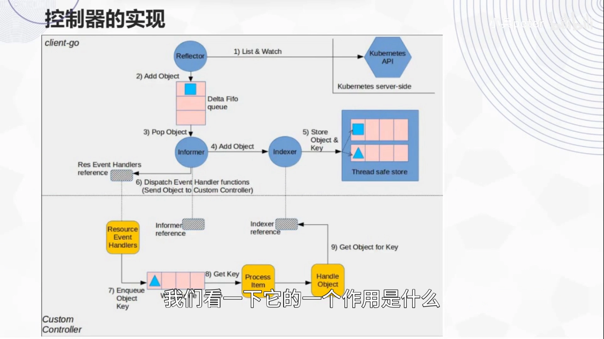

> 如果只为了“生产—消费解耦”，那确实一个 Go channel 加一个参数就够了。但讲者强调：**因为它的作用不止于此，所以它实现了一个相对比较重的 work queue**。多出来的那部分，就是下面两个核心功能点。[【跳转到 01:52】](https://www.bilibili.com/video/BV1jm4y1376c/?t=112)

### 1.3 两个核心功能点

**功能点一：带限流的重试。** 队列中的每一项都代表一个任务，任务执行可能会失败，失败是允许重试的——但要**带限流**：[【跳转到 03:06】](https://www.bilibili.com/video/BV1jm4y1376c/?t=186)

- **对单个任务做指数退避（exponential backoff）**：第一次重试可能等 5ms，第二次 10ms，第三次 20ms，每次都翻倍；
- **对总体采用令牌桶限流**：在 backoff 的基础上，对所有要重试的任务再套一个总体的令牌桶。[【跳转到 03:31】](https://www.bilibili.com/video/BV1jm4y1376c/?t=211)

**功能点二：同样的任务不能并行执行。** 这里的“同样的任务”，指的是 work queue 里的 **item 相等**。相同的任务，不允许并行处理。[【跳转到 03:56】](https://www.bilibili.com/video/BV1jm4y1376c/?t=236)

---

## 二、从 deployment controller 看 workqueue 的类型与封装

### 2.1 controller struct 里的 workqueue 成员

`deployment controller` 的结构体定义里，有一个 **work queue 对象作为结构体的一个成员**，注释写着：这里记录的是**需要去同步的 Deployment**。[【跳转到 04:21】](https://www.bilibili.com/video/BV1jm4y1376c/?t=261)

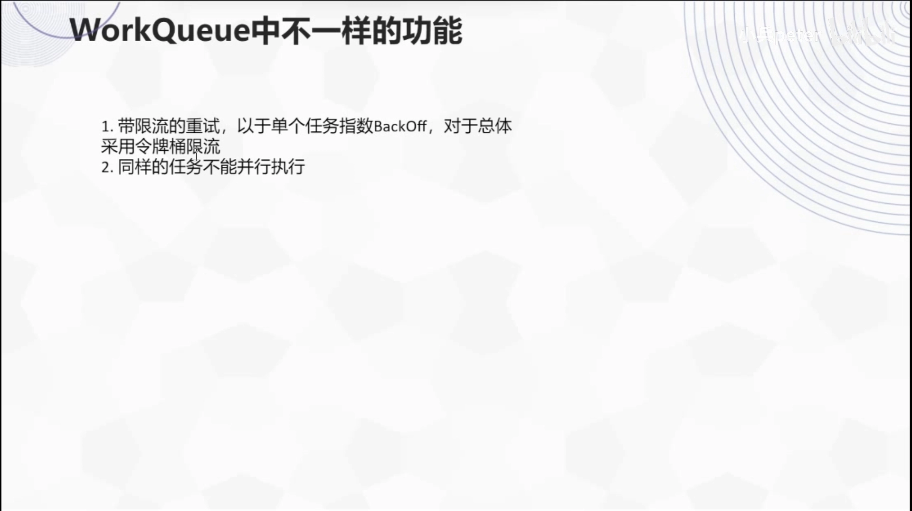

### 2.2 三层接口：RateLimitingInterface → DelayingInterface → Interface

在 deployment controller 里，这个 work queue 是**以接口形式**定义的，类型是 **`RateLimitingInterface`**（一个带限流的队列）。它的接口定义内嵌了 `DelayingInterface`，另外有几个函数：[【跳转到 04:46】](https://www.bilibili.com/video/BV1jm4y1376c/?t=286)

| 方法 | 含义 |
| --- | --- |
| `AddRateLimited` | 带限流地添加（重试时用） |
| `Forget` | 代表这个条目“不再完成了、不再重试了”，在限流器层面不再追踪它 |
| `NumRequeues` | 这个条目已经被 requeue（重新入队）了多少次 |
| `Done` | 标记处理完成（见下） |

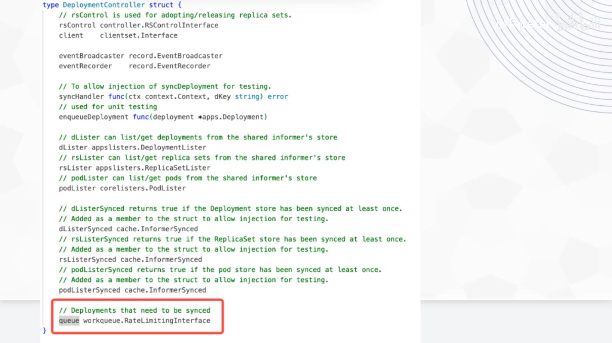

再往下，`DelayingInterface` **内嵌了一个 `Interface`**，并**额外实现了一个 `AddAfter` 方法**：在指定的时间过了之后，把这个条目添加到队列里。[【跳转到 06:01】](https://www.bilibili.com/video/BV1jm4y1376c/?t=361)

> 命名小注：`Interface` 这个接口（`I` 大写）定义在 `queue.go` 文件里。因为文件名叫 `queue`，看到代码的人就知道**这个 `Interface` 代表的是一个队列**——这是 K8s 代码里比较常见的一种做法。[【跳转到 06:26】](https://www.bilibili.com/video/BV1jm4y1376c/?t=386)

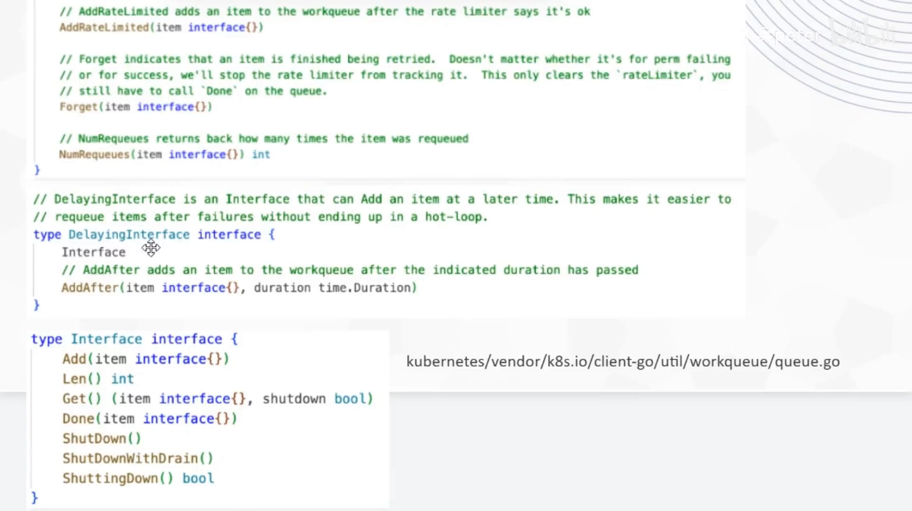

最底层的 `Interface` 就是一个队列，相关的 `Add / Len / Get` 都在。除了常规方法，它还有两个容易被忽略的方法：**`Done` 和 `Forget`**。[【跳转到 06:51】](https://www.bilibili.com/video/BV1jm4y1376c/?t=411)[【跳转到 07:16】](https://www.bilibili.com/video/BV1jm4y1376c/?t=436)

很多人会疑惑：**一个队列，`Add` 之后 `Get` 就能出队列了，为什么还要有一个 `Done` 方法？** 讲者说，答案后面会揭晓——**`Done` 是为了实现“同样的任务不能并行执行”**。

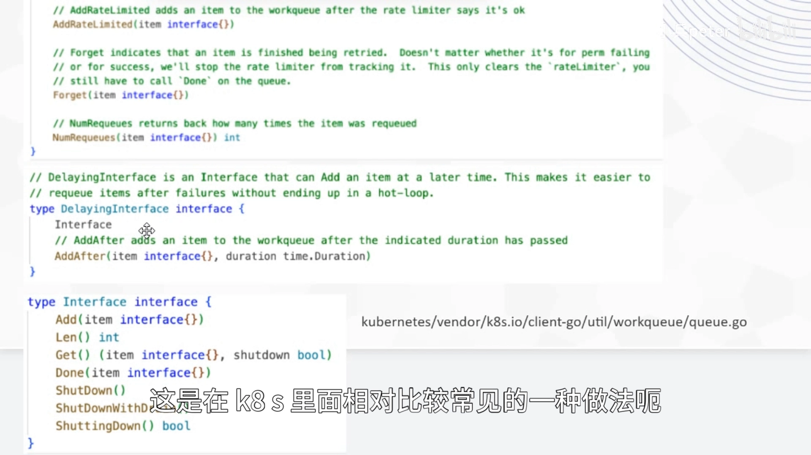

### 2.3 controller 对队列的封装：enqueue* 与 handleErr

deployment controller 在使用 work queue 时，做了两层封装。

**启动与关闭**：在启动方法里通过 `defer` 调用了 work queue 的 `ShutDown` 方法。[【跳转到 07:55】](https://www.bilibili.com/video/BV1jm4y1376c/?t=475)

**入队的封装**：controller 自己封装了几个 `enqueue` 方法，最终都落到 work queue 的方法上：[【跳转到 08:20】](https://www.bilibili.com/video/BV1jm4y1376c/?t=500)[【跳转到 08:45】](https://www.bilibili.com/video/BV1jm4y1376c/?t=525)

| controller 的方法 | 实际调用 work queue 的 |
| --- | --- |
| `enqueueDeployment`（间接走 `enqueue`） | `Add`（直接添加） |
| `enqueueRateLimited` | `AddRateLimited`（带限流添加） |
| `enqueueAfter` | `AddAfter`（延迟添加） |

**出队的封装（关键）**：worker 出队列时，**先通过 `Get` 得到一个任务**，然后**通过 `defer` 调用 `Done`**。[【跳转到 09:10】](https://www.bilibili.com/video/BV1jm4y1376c/?t=550)

这就在代码层面**保证了 `Get` 和 `Done` 一定是成对调用的**：调用了 `Get`，就一定会在整个处理逻辑完成之后调用 `Done`。

**错误处理 `handleErr`**：这是在 deployment controller 里处理错误的函数：[【跳转到 09:35】](https://www.bilibili.com/video/BV1jm4y1376c/?t=575)[【跳转到 10:00】](https://www.bilibili.com/video/BV1jm4y1376c/?t=600)

- 如果错误是关于 **namespace 被删除**了这种情况：调用 **`Forget`**，不再追踪这个任务；
- 如果是其他错误，就**重试**：先用 `NumRequeues` 拿到它已经重试的次数；
  - 若**小于**最大重试次数 → 用 **`AddRateLimited`** 重新加入队列；
  - 若**大于等于**最大重试次数 → 直接 **`Forget`**，不再重试。

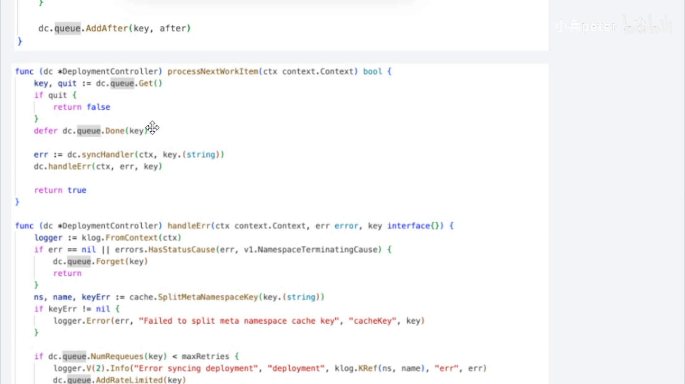

**一个结论**：controller 对 work queue 的操作又封装了一层，真正使用时要顺着那几个 `enqueue` 方法去看。讲者直接给了结论：**所有事件处理的 handler 里调用的都是 `enqueueDeployment`，它其实是 struct 里的一个函数指针变量，初始化时被指向 `enqueue` 方法**——也就是说，**所有 handler 调用的都是 `Add`（直接添加）；只有在需要重试时，才会用到 `AddRateLimited`**。[【跳转到 10:50】](https://www.bilibili.com/video/BV1jm4y1376c/?t=650)[【跳转到 11:15】](https://www.bilibili.com/video/BV1jm4y1376c/?t=675)

### 2.4 实际类型：rateLimitingType

前面看到 controller 里的 work queue 成员是接口类型，**实际构造时用的是 `rateLimitingType` 这个 struct**。它的成员分成两部分：[【跳转到 11:40】](https://www.bilibili.com/video/BV1jm4y1376c/?t=700)[【跳转到 12:05】](https://www.bilibili.com/video/BV1jm4y1376c/?t=725)

- 一个内嵌的 **`DelayingInterface`**；
- 一个 **`rateLimiter`** 类型的变量。

因此它**只实现了三个函数**，没有去实现 `AddAfter`、`Add`、`Done` 这些——**因为它们都属于内嵌的 `DelayingInterface` 接口**，内嵌接口类型的变量后就不需要单独实现了。比如 `AddRateLimited` 的实现就依赖 `DelayingInterface` 的 `Add` 方法。[【跳转到 12:30】](https://www.bilibili.com/video/BV1jm4y1376c/?t=750)

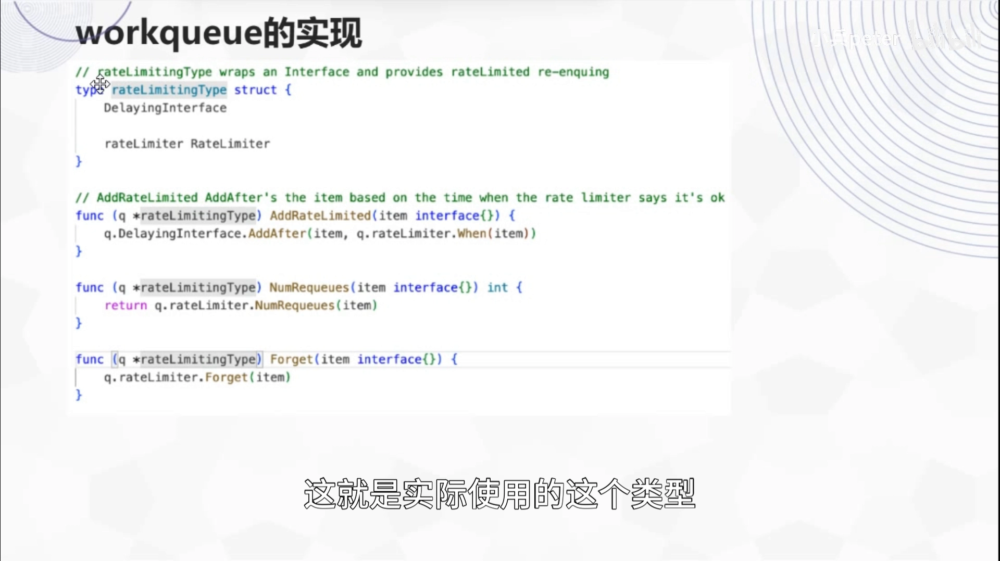

---

## 三、队列本体：queue / dirty / processing 三个容器

### 3.1 三个容器各代表什么

延迟队列 `DelayingInterface` 由 `NewDelayingQueue` 构造，内部实际构造的是 **`delayingType`**；它内嵌了一个 `Interface`（也就是基础队列）。基础队列由 `NewQueue` 构造，返回的是 **`Type`** 类型（`queue.go` 里定义 `Interface`，下面用 `Type` 作为其实现，这也是 K8s 的一种惯例）。[【跳转到 13:20】](https://www.bilibili.com/video/BV1jm4y1376c/?t=800)[【跳转到 13:45】](https://www.bilibili.com/video/BV1jm4y1376c/?t=825)[【跳转到 14:10】](https://www.bilibili.com/video/BV1jm4y1376c/?t=850)

`Type` 的数据容器**其实有三部分**：[【跳转到 14:35】](https://www.bilibili.com/video/BV1jm4y1376c/?t=875)[【跳转到 15:00】](https://www.bilibili.com/video/BV1jm4y1376c/?t=900)

| 容器 | 类型 | 含义 |
| --- | --- | --- |
| `queue` | slice | **任务的顺序**（只有它是有顺序的） |
| `dirty` | set | **未处理**的任务 |
| `processing` | set | **正在处理**的任务 |

> 两个 set 都是没有顺序的；`interface{}`（空接口）代表任意类型。

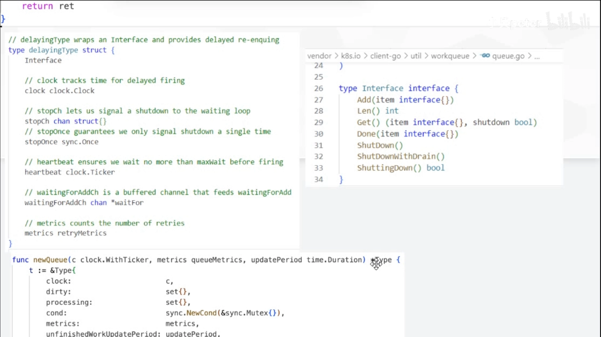

### 3.2 一条铁律与 Add 的去重逻辑

源码注释里有一条明确的约束：**每个元素都应该在 `dirty` 这个 set 里，但不应在 `processing` 里。** 翻译一下：

- `queue` 里的元素**必须在 `dirty` 里**（它确实是需要被处理的）；
- 但**不能同时出现在 `processing` 里**——因为 `Get` 会从 `queue` 里拿一个任务出列，如果这个任务**也在 `processing` 里**，那就出现了**被并行处理**的情况。

这条约束，正是“**同一个任务不允许并行执行**”的落地方式。[【跳转到 15:25】](https://www.bilibili.com/video/BV1jm4y1376c/?t=925)[【跳转到 15:50】](https://www.bilibili.com/video/BV1jm4y1376c/?t=950)

**`Add` 的逻辑**（简化）：[【跳转到 17:55】](https://www.bilibili.com/video/BV1jm4y1376c/?t=1075)[【跳转到 18:20】](https://www.bilibili.com/video/BV1jm4y1376c/?t=1100)[【跳转到 18:45】](https://www.bilibili.com/video/BV1jm4y1376c/?t=1125)

1. 先加锁，判断是否 `shutdown`；
2. **如果已经在 `dirty` 里 → 直接 return**（**去重**：一个任务不会被添加两次，已经在等待队列里就不再添加）；
3. 否则把它加入 `dirty`；再看它是否在 `processing` 里：
   - **在 `processing` → 直接 return**（只加进 `dirty`，等处理完成后再入队）；
   - **不在 `processing` → 同时加入 `dirty` 和 `queue`**。

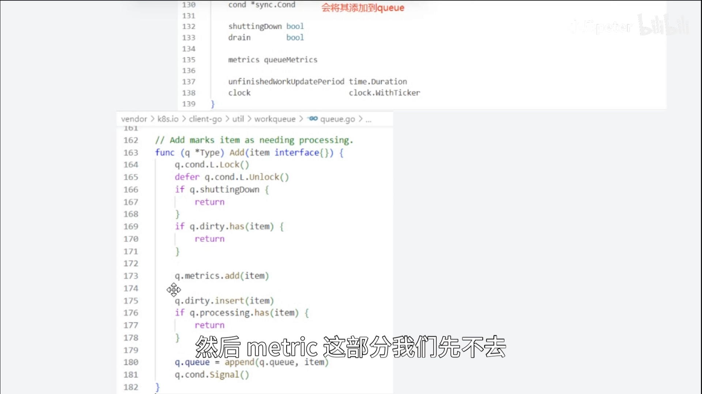

### 3.3 Get 与 Done：为什么必须成对

- **`Get`**：从 `queue` 里取一个任务出列，同时把它放进 `processing`；
- **`Done`**：把元素从 `processing` 里移除；这时**如果该元素还在 `dirty` 里，就把它重新加入 `queue`**。

所以一个元素**可能同时出现在 `processing` 和 `dirty` 里面**：意思是**它正在被处理，同时又有一个相同的（新）任务在等待被处理**。[【跳转到 16:15】](https://www.bilibili.com/video/BV1jm4y1376c/?t=975)[【跳转到 16:40】](https://www.bilibili.com/video/BV1jm4y1376c/?t=1000)

用一句话概括这条设计：**出队列其实分两阶段**——先放到 `processing`，再通过 `Done` 从 `processing` 移除。**先 `Get` 再 `Done`，两个方法一定成对调用**；否则元素就会**一直卡在 `processing` 里**（这也正是前面那个“为什么需要 `Done`”的答案）。如果没有这样“记录哪些任务正在执行”的机制，就无法做到“相同的任务不能并行处理”。[【跳转到 17:05】](https://www.bilibili.com/video/BV1jm4y1376c/?t=1025)[【跳转到 17:30】](https://www.bilibili.com/video/BV1jm4y1376c/?t=1050)

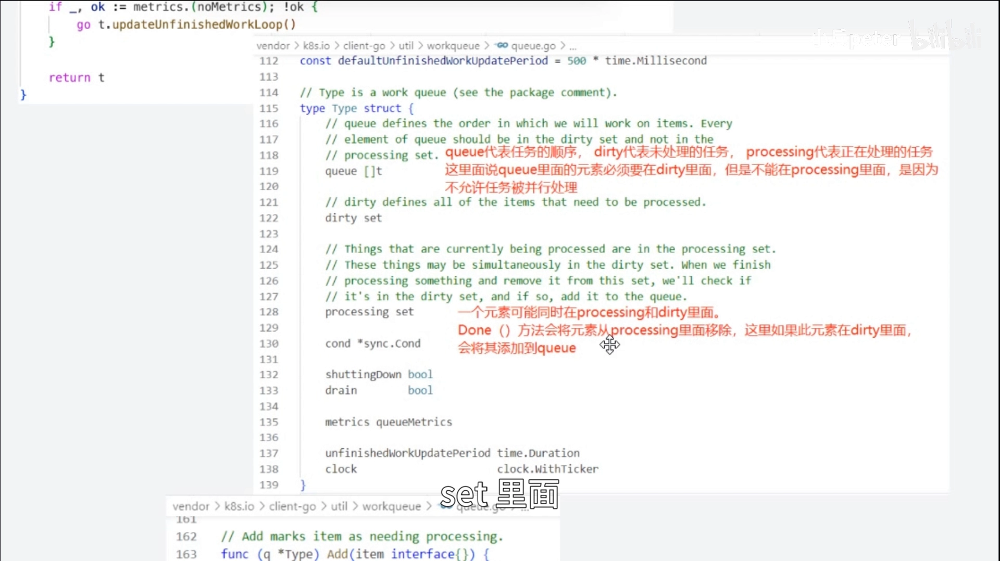

---

## 四、延迟队列：AddAfter 与优先队列

`DelayingInterface` 的内容非常多，这里只做简单介绍。以 `AddAfter` 为例：[【跳转到 19:10】](https://www.bilibili.com/video/BV1jm4y1376c/?t=1150)[【跳转到 19:35】](https://www.bilibili.com/video/BV1jm4y1376c/?t=1175)

- 它**并不是真的“等这么长时间之后才把 item 加到队列”**——函数其实**立即返回**；
- 真正的延迟由**后台处理线程**负责，在到合适时机时把条目加入队列；
- 由于 `AddAfter` 会被用**不同的延迟**来调用，这些“待添加条目”的管理就成了一个新问题——**后台用的是一个按时间排序的优先队列**。有兴趣可以深入研究。[【跳转到 20:00】](https://www.bilibili.com/video/BV1jm4y1376c/?t=1200)

---

## 五、限流器：指数退避 + 令牌桶

### 5.1 rateLimiter 接口三个方法

`rateLimiter` 本身也是一个接口，只有三个方法：[【跳转到 20:50】](https://www.bilibili.com/video/BV1jm4y1376c/?t=1250)[【跳转到 21:15】](https://www.bilibili.com/video/BV1jm4y1376c/?t=1275)

| 方法 | 含义 |
| --- | --- |
| `When` | 返回这个条目**要等多久**（一个 duration） |
| `Forget` | 让限流器**不再追踪**这个条目 |
| `NumRequeues` | 这个条目**已经被重复添加了多少次** |

### 5.2 MaxOfRateLimiters：多个限流器取最严

在控制器里，`rateLimiter` 由 `defaultControllerRateLimiter` 构造，它有两个参数——**两个不同类型的 rateLimiter**。大体可以猜到：这个整合体就是 **`MaxOfRateLimiters`**——对不同的 rateLimiter 取“最严”的那个。[【跳转到 21:40】](https://www.bilibili.com/video/BV1jm4y1376c/?t=1300)[【跳转到 22:05】](https://www.bilibili.com/video/BV1jm4y1376c/?t=1325)

它的定义是**由一组 rateLimiter 构成**，实现逻辑也很直观：[【跳转到 22:30】](https://www.bilibili.com/video/BV1jm4y1376c/?t=1350)

- `When`：调用所有 limiter 的 `When`，**返回最大的那个**（等最久的约束生效）；
- `NumRequeues`：同样取所有 limiter 的结果；
- `Forget`：让**所有** limiter 都 `Forget`。

### 5.3 指数退避限流器（ItemExponentialFailureRateLimiter）

构造时传入的两个 limiter 之一，就是 **指数 backoff 的 rateLimiter**：[【跳转到 22:55】](https://www.bilibili.com/video/BV1jm4y1376c/?t=1375)[【跳转到 23:20】](https://www.bilibili.com/video/BV1jm4y1376c/?t=1400)

- 它**对每个条目的失败次数有记录**，并设置了 `baseDelay` 和 `maxDelay`；
- **`When`**：从失败次数记录里取出失败次数 `n`，算出 `baseDelay × 2^n`，再和 `maxDelay` 比较，**做一个上限限制**；
- **`NumRequeues`**：从失败次数记录里取出来返回；
- **`Forget`**：把该条目的失败次数记录删掉。

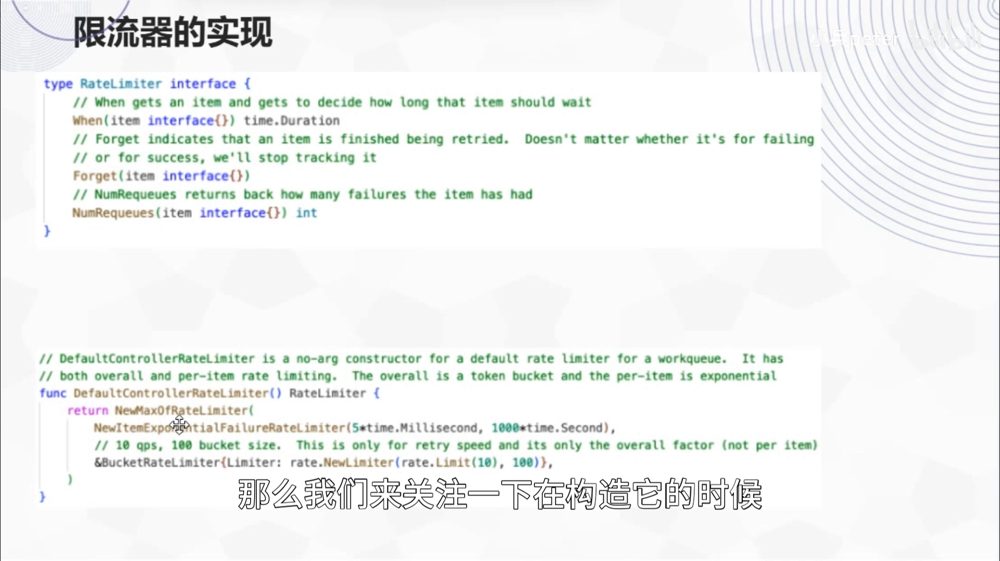

### 5.4 令牌桶限流器（BucketRateLimiter）

另一个是 **令牌桶限流**，Go 里本来就有标准实现，`bucketRateLimiter` 只是把标准实现**封装成它们想要的 API**：[【跳转到 23:45】](https://www.bilibili.com/video/BV1jm4y1376c/?t=1425)[【跳转到 24:10】](https://www.bilibili.com/video/BV1jm4y1376c/?t=1450)

- **`When`**：调用令牌桶的 reserve 相关方法来取令牌；
- 因为它是**总体的限流**，对每个条目不存在“重试次数”的概念，所以 **`NumRequeues` 都返回零**；
- **`Forget` 其实没做任何事情**，只是为了实现这个接口。[【跳转到 24:35】](https://www.bilibili.com/video/BV1jm4y1376c/?t=1475)

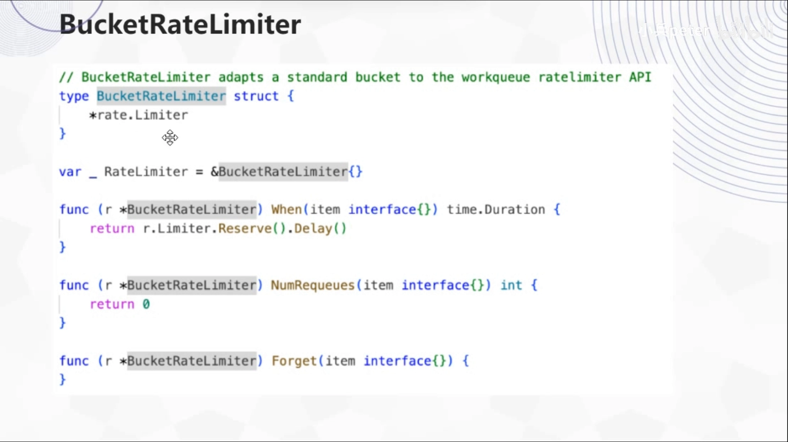

> 把两个限流器合起来看，正好对应前面说的“带限流的重试”：**单个任务用指数退避拉开重试间隔，整体再用令牌桶限制重试的总速率。**

---

## 小结

- work queue 处在控制器里**承上启下**：event handler 把待同步资源的 key 放进去，worker 取出来做处理——**保证 handler 轻、重活可并发**。
- 它比 Go channel “重”，是因为多实现了两点：**（1）带限流的重试**（单任务指数退避 + 总体令牌桶）；**（2）同一任务不并行**。
- 接口自下而上三层：**`Interface`（基础队列）→ `DelayingInterface`（+`AddAfter`）→ `RateLimitingInterface`（+`AddRateLimited`/`Forget`/`NumRequeues`）**。
- 实际类型 `rateLimitingType` = **内嵌 `DelayingInterface` + 一个 `rateLimiter`**，因此只需实现少数方法。
- 基础队列 `Type` 有三个容器：**`queue`（有顺序）、`dirty`（未处理）、`processing`（正在处理）**。
- `Add` **去重**（已在 `dirty` 即返回），并按是否在 `processing` 决定要不要进 `queue`。
- **`Get` 与 `Done` 必须成对**：`Get` 入 `processing`，`Done` 从 `processing` 移除并在 `dirty` 时重新入队——这就是“同一任务不并行”的实现。
- `AddAfter` **立即返回**，延迟由后台线程按**优先队列**在合适时机入队。
- 限流器 `MaxOfRateLimiters` 由 **指数退避限流器**（单条目：`baseDelay × 2^n`，封顶 `maxDelay`）+ **令牌桶限流器**（总体）组合而成，`When` 取两者中最长的等待。

## 关键术语速查

| 术语 | 一句话解释 |
| --- | --- |
| work queue | client-go 里把“事件”与“处理”解耦的队列，worker 从中取 key 处理 |
| RateLimitingInterface | 带限流的队列接口，内嵌 DelayingInterface，增加 AddRateLimited / Forget / NumRequeues |
| DelayingInterface | 增加 `AddAfter`（延迟插入）的队列接口 |
| Interface（queue.go） | 基础队列接口：Add / Len / Get / Done / Forget / ShutDown |
| queue / dirty / processing | 队列的三个容器：有顺序的任务列表、未处理集合、正在处理集合 |
| Get / Done | 两阶段出队：Get 入 processing，Done 出 processing（dirty 中则重新入队），必须成对 |
| AddRateLimited | 带限流地重新入队，用于失败重试 |
| Forget | 不再追踪该条目（清除其失败/重试记录） |
| NumRequeues | 条目已被重新入队的次数 |
| AddAfter | 指定延迟后入队；函数立即返回，后台用优先队列在到期时入队 |
| rateLimiter | 限流器接口：When（等多久）/ Forget / NumRequeues |
| MaxOfRateLimiters | 组合多个限流器，When 取最长等待 |
| 指数退避（backoff） | 重试间隔按 `baseDelay × 2^n` 增长，并受 `maxDelay` 封顶 |
| 令牌桶（bucketRateLimiter） | Go 标准限流实现的封装，用于对整体重试速率限流 |
