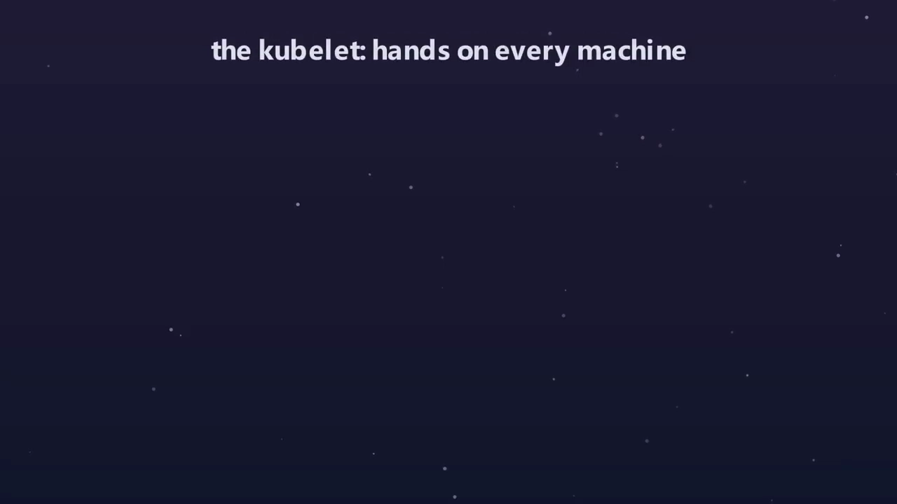

# Kubernetes 究竟如何工作：从「写下一个愿望」到「集群自己收敛」

> 视频来源：[How Kubernetes Actually Works (Desired State, Reconciled)](https://www.youtube.com/watch?v=8Gjv1c2KLT8)（YouTube，Code Tech）｜时长 25:12
>
> 一支**动画讲解**视频：它不罗列名词，而是围绕一个中心思想——「命令 vs 声明」——把集群讲成一个由无数「调谐循环」组成的系统。视频按「一次 apply 的完整旅程」和「一个 Pod 死掉后的自愈」两条线索，走通了 API Server、etcd、控制器、调度器、kubelet 各自的职责，最后点破：**自愈、扩容、滚动更新，其实是同一个循环换了不同的帽子。** 文稿左栏为英文自动字幕，本文已翻译重写。

## 本讲要解决的核心问题（SCQA）

**背景**：你写一份文件，说「我要三份我的应用在跑」，一 `apply` 就走人。从那一刻起，真的有三份在跑；崩一个，冒出一个；整台机器烧掉，副本自己悄悄在别的地方重现。没人盯着，没人点过任何东西。

**冲突**：可大多数 Kubernetes 讲解会把你淹没在名词里——Pod、Node、Controller、etcd、Scheduler 加另外四十来个。你最后会背这些词了，却**完全不知道这套东西为什么能活着**。

**疑问**：到底是什么在背后做这一切？一个集群凭什么能一直维持在你声明的状态上？

**回答（中心思想）**：**Kubernetes 只有一个中心思想——「命令」和「声明」的区别；而它全部的能力，来自一群不停「比较愿望与现实」的调谐循环（reconciliation loop）。** 学会这个循环的四步，你就学会了它底下那台发动机，剩下的一切都只是这台发动机的不同用法。

---

## 一、命令 vs 声明：Kubernetes 的唯一中心思想

### 1.1 大多数系统给命令，Kubernetes 给描述

在你用过的绝大多数系统里，你都是**下命令**：创建这个、删掉那个、重启另一个。你是一次下一个命令的「大脑」。

Kubernetes 反过来。**你不给它命令，你给它一段对「你想要的世界的描述」，这叫期望状态（desired state）。** 然后，在后台安静运行的是一群小循环，它们的全部工作就是比较两件事：**你要求的** 和 **此刻实际为真的**。[【跳转到 04:16】](https://www.youtube.com/watch?v=8Gjv1c2KLT8&t=256)

### 1.2 调谐循环：四步，就是全部秘密

这个循环有个名字，叫**调谐（reconciliation）**，也叫控制循环（control loop）。整个 Kubernetes 的秘密，就藏在这四步里——学会这四步，你就学会了底下那台发动机：[【跳转到 04:41】](https://www.youtube.com/watch?v=8Gjv1c2KLT8&t=281)

1. **看期望状态**：你想要三份；
2. **看实际状态**：现在只有两份在跑；
3. **注意到差距**：我们少了一份；
4. **采取一个动作缩小差距**：再创建一份。

然后——这是最关键的地方——它**立刻回到第 1 步，再来一遍，永远如此。**

### 1.3 自愈是「免费」得到的

想想一个副本突然死掉时会发生什么。你没有改变你的愿望，你仍然要三份。于是**在循环的下一圈**，实际状态是 2，期望状态是 3，差距重新出现，循环平静地再造一个。

**你从来没写过「如果 Pod 死了就重启它」这样的代码——你只是说过「我要三份」。自愈不是谁额外加的功能，它是「不停比较愿望与现实」的免费副产品。** 这就是人们说 Kubernetes 是「声明式」的原因：**你声明目的地，你从不写下驾驶路线。**[【跳转到 05:31】](https://www.youtube.com/watch?v=8Gjv1c2KLT8&t=331)

而且这样做出来的系统有一个「命令式」系统没有的特性：**就算它被崩溃、重启、网络抖动撞离了航线，它也不会犯迷糊**——下一圈它又看见那个差距，再把自己拨回来。它**永远在朝你的愿望行驶。**

---

## 二、控制平面：一切都要经过的「前台」

### 2.1 API Server 是前台，etcd 是金库

集群的「大脑」叫**控制平面（control plane）**，通常跑在和应用分开的独立机器上。它的中心是一个发光的枢纽——**API Server**，把它想成整个集群的**前台**：每一个请求、每一个问题、每一次变更都要经过它。[【跳转到 06:45】](https://www.youtube.com/watch?v=8Gjv1c2KLT8&t=405)

前台背后、金库里的，是集群的记忆——一个叫 **etcd** 的数据库，它保存着**唯一一份真实记录**：你想要什么、当前存在什么，每个 Pod、每个节点、每个设置都在里面。

有一条让整个系统保持理智的规则：**只有前台（API Server）才被允许打开那个金库，别的任何东西都不能直接碰数据库，一切都通过前台读写。**

### 2.2 一圈控制器环绕着前台

围绕枢纽运转的一圈圈光环，每一个都是一个**控制器**——也就是我们刚讲的调谐循环，一圈又一圈地跑，盯着差距。[【跳转到 07:25】](https://www.youtube.com/watch?v=8Gjv1c2KLT8&t=445)

注意它们**并不自己伸进金库**，而是全都盯着前台问：「有我在意的东西变了吗？」前台会告诉它们。一旦有变化，你能看到脉冲沿着光束向机器扩散——**这就是控制平面在把你的世界往你的愿望推。**

### 2.3 控制平面不是单点

这个大脑不是坐在一台脆弱机器上的单点：**金库可以复制到多台机器上，通过共识协议保持一致，所以丢一台机器不会丢掉集群的记忆。**

请把这个形状记在脑子里：**一个所有人都要经过的前台；一个只有前台能打开、且被复制得能扛住故障的金库；以及一圈耐心的小循环，盯着、把现实推回正轨。**

---

## 三、一次 apply 的完整旅程（五次交接）

### 3.1 API Server 的三道关：认证、鉴权、准入

一切都要挤过前台，这不是偶然。当你敲下 `kubectl apply` 交上文件，它**不会直接进数据库**——它先到 API Server，而 API Server 在保存任何东西之前要做三件仔细的事：[【跳转到 08:35】](https://www.youtube.com/watch?v=8Gjv1c2KLT8&t=515)

1. **认证（authentication）**：你是谁？你到底被允许跟这个集群说话吗？
2. **鉴权（authorization）**：就算你能进门，你被允许在这个特定的地方做这件特定的事吗？
3. **准入（admission）**：这个请求讲得通吗？字段合法吗？有些集群会在这里加自己的规则，悄悄填默认值、或拒绝违反策略的东西。

**三道关全过了**，API Server 才把你的期望状态写进 etcd。

### 3.2 写进 etcd：apply 返回 ≠ 应用在跑

**而一旦它被安全存下，这个请求就算完成**——请注意此刻**什么都还没发生**：没有容器被启动，没有节点被选中。发生的只是「你的愿望被校验、并被写进了所有人都信任的那唯一一处」。[【跳转到 09:25】](https://www.youtube.com/watch?v=8Gjv1c2KLT8&t=565)

这就是最让人惊讶的地方：**当 `apply` 返回说「一切都创建好了」，它其实常常在骗你的直觉**——它不代表你的应用在跑，它只代表**你的愿望被记录下来了。**

> 为什么要把一切都逼过一个前台？因为它给了你：**单一真相之源**、**单一鉴权点**、以及**所有人都能 watch 的单一变更流。**

### 3.3 watch：让变化被「推送」而不是被「轮询」

而那个词——**watch**——就是下一块拼图的关键。控制器和调度器**不会**坐在那里反复问「变了吗？变了吗？」，那样会把系统问死。[【跳转到 09:50】](https://www.youtube.com/watch?v=8Gjv1c2KLT8&t=590)

**它们在前台上开一个长期存在的 watch，API Server 一有变化就立刻推给它们。** 就像「每秒刷新一次邮箱」和「让邮箱主动通知你」的区别。

### 3.4 一次 apply 走完全程：五棒传递

让我们看着一次 apply 像一束脉冲一样穿过整个系统：[【跳转到 10:15】](https://www.youtube.com/watch?v=8Gjv1c2KLT8&t=615)

1. **前台**：你的文件一到达，脉冲进入金库，**期望状态（三份副本）被写下、成为永久记录**；此刻什么都还没跑，只是记录了一个新愿望；
2. **控制器**：watch 触发，某个循环发现「有一个新应用被请求，但还没有任何 Pod 存在」——**这就是差距**，于是它创建三个 Pod 对象，写回前台；
3. **看仔细**：这些新 Pod 虽然发光，却**仍浮着、未分配**——它们被定义、被记录了，但**还没有一台机器去跑它们，它们还没有家**；
4. **调度器**：轮到调度器了，它的光束扫过地板、掂量各节点，然后**给每个等待的 Pod 逐个绑定一台机器**（注意它是**摊开**而不是堆在一台上）；
5. **节点**：直到链条最末端，机器才真正动起来、启动容器。

**五次交接：前台 → 金库 → 控制器 → 调度器 → 节点。没有一次是你直接下的命令。** 你看到的每一支箭头，都是某个组件「在前台注意到变化，然后做它那份小事」。**没有总指挥，只有按顺序反应的循环。**

### 3.5 调度器的唯一工作：过滤 + 打分

调度器的工作窄得很漂亮：**它盯着那些「被创建了、但还没分配给节点」的 Pod，对每一个回答一个问题——它该在哪跑？** 听起来简单（哪有空位放哪），但一个好的放置决策其实很难，它分两个阶段：[【跳转到 12:58】](https://www.youtube.com/watch?v=8Gjv1c2KLT8&t=778)

- **过滤（filtering）**：逐个走遍节点，把**根本不可能**的扔掉——内存不够、CPU 不够、Pod 要的硬件这节点没有、节点被标记为不可用、或者 Pod 非要靠近/远离某些 Pod。过滤完，剩下一个「能装下它的短名单」；
- **打分（scoring）**：在幸存者里给每个打分、挑最好的，它倾向于**选那个让集群最均衡的节点**，把负载摊开而不是堆到一台可怜机器上。

一旦有了赢家，调度器做一件此刻你该很熟悉的事：**它不去启动容器**（它不能、也不想），**它只是把决定写回前台**——在 Pod 上设置一个字段：所选节点的名字，保存。**调度器对整个宇宙的全部贡献，就是填一个空：这个 Pod 放这儿。**

---

## 四、自愈实战：一个 Pod 死掉之后

看着某个健康 Pod 稳稳发光，然后——**它失败了**：也许应用崩了，也许内存爆了。它闪烁、变红、死去。在一台普通服务器上，这就是半夜告警响、某个人的夜晚被毁掉的时刻。[【跳转到 14:38】](https://www.youtube.com/watch?v=8Gjv1c2KLT8&t=878)

**但在 Kubernetes 这里，什么戏剧性的事都没发生**，因为记住那些循环：某个控制器正在把你的愿望（三份健康副本）和现实（刚掉到两份）做比较。**在它的下一圈**，它看到差距。它不慌、不调查、也不在乎那个 Pod 为什么死。**它只是注意到你少了一份，然后做它一贯做的事：要一个替补。**[【跳转到 15:26】](https://www.youtube.com/watch?v=8Gjv1c2KLT8&t=926)

接下来：一个全新的 Pod 出现在队列里、未分配 → 调度器醒来，过滤、打分，把它绑到某台机器上（也许是另一台，哪有空位放哪）→ 那台机器上的 agent 拉取容器并启动它 → **它又稳稳发光了，三份健康副本，正如你所要求的。**

**集群修好了自己，而你根本没被告知**——因为在它看来，没什么需要你操心。

> 注意它**没有**做的事：它没有去复活那个死掉的 Pod。**Pod 被当作牲畜而不是宠物**——它不会去给病号疗养，而是用一个全新的、一模一样的替换掉它，然后继续走。[【跳转到 16:06】](https://www.youtube.com/watch?v=8Gjv1c2KLT8&t=966)

这就是「承诺」被具体化的样子：**你不再关心某一台机器、某一个进程；你开始关心一个愿望，然后把「每一秒都捍卫这个愿望」这件累人的事，交给一个永不睡觉、永不恐慌的系统。**

---

## 五、节点上的那双手：kubelet

### 5.1 kubelet 是一个本地循环

地板上的每一台节点上，都跑着一个不知疲倦的小 agent，叫 **kubelet**。如果控制平面是大脑，**kubelet 就是每台机器上的一双手**。[【跳转到 17:09】](https://www.youtube.com/watch?v=8Gjv1c2KLT8&t=1029)

**kubelet 跑着它自己的调谐循环（一个本地的循环）。** 它盯着前台，问一个非常「以自我为中心」的问题：**「哪些 Pod 分给了我？我的机器上该跑什么？」** 当它看到一个 Pod 绑到了自己这台节点，就立刻行动起来。

### 5.2 通过 CRI 等标准接口把活派出去

但 kubelet **其实自己并不知道怎么跑一个容器**。它把活**通过一个标准接口派出去，叫 CRI（Container Runtime Interface，容器运行时接口）**。这是刻意的设计：**Kubernetes 不在乎你用哪个引擎跑容器，只要运行时「会说 CRI」，kubelet 就能驱动它**——可换的零件、干净的接缝。

运行时拉取镜像、解包、启动容器。同时，网络通过另一个标准接口接好，存储通过第三个接上。**计算、网络、存储，各自躲在自己的干净插头后面。**

### 5.3 回报状态与健康检查

接着 kubelet 做那件**闭合整个系统**的事：**它不停地回报。** 它告诉前台：「这个 Pod 在跑、很健康、用了这么多资源」——**现实一路流回大脑**。[【跳转到 18:13】](https://www.youtube.com/watch?v=8Gjv1c2KLT8&t=1093)

而**这份回报，正是控制平面里那些控制器在盯着的东西**：当 kubelet 说某个 Pod 死了，那就是「打开差距」的信号，自愈循环冲上去把它合上。

它还会跑你定义的健康检查：**如果你的应用卡住了但没崩，一个失败的检查会告诉 kubelet 把它杀掉，让循环来替换。系统不只是盯着死亡，它还盯着「生病」。**

于是整个闭环成形：**你的愿望往下走——前台 → 金库 → 控制器 → 调度器 → kubelet → 一个真正运行的容器；而真相一路往上流回。这个循环永不停转。**

---

## 六、同一个循环的几种「变身」

### 6.1 滚动更新：一次进一个

用我们学到的一切，来看最聪明的一招——**滚动更新**：把应用从旧版本换到新版本，**一秒钟都不能宕机**。[【跳转到 19:28】](https://www.youtube.com/watch?v=8Gjv1c2KLT8&t=1168)

在命令式系统里，你可能把所有旧的停掉、再启动新的，祈祷这期间没人访问。**Kubernetes 拒绝这么做。** 你只改你的愿望：把版本那一行改成新版本，`apply`。

现在**期望状态说新版本、现实说旧版本，一个刺眼的巨大差距**。循环开工，但很小心：**先起一个新版本的 Pod**，等它变得健康、真的能服务了，**才**让一个旧 Pod 退休——一进一出，一场受控的小舞步。**它永远不会掉到你要求的最低健康副本数以下，所以永远有足够的应用在服务真实流量。** 新颜色的波浪，一步一步、安全地滚过整片地板。[【跳转到 20:26】](https://www.youtube.com/watch?v=8Gjv1c2KLT8&t=1226)

### 6.2 回滚与扩容：同一个循环

- **回滚**：如果新版本坏了，因为**你的期望状态只是一条记录**，你可以改回去。把愿望改回旧版本，**同一套机器就平静地把地板滚回原处**——不停机、不逞英雄、没人屏住呼吸，只是同样耐心的循环、一次一个 Pod 地合上同一种差距；[【跳转到 20:51】](https://www.youtube.com/watch?v=8Gjv1c2KLT8&t=1251)
- **扩容**：流量暴涨时同理，把「三份」改成「十份」，差距一下变成七个 Pod 宽，调度器把七个铺满地板；你甚至可以把「要几份」这个决定交给集群，让它看应用的繁忙程度自己调整。

但**底层没有新东西发生**：它仍然是一个**愿望、一个差距、一个合上差距的循环**。**Kubernetes 做的每一件令人印象深刻的事——自愈、扩容、更新、回滚——都是这一个循环戴了不同的帽子。**[【跳转到 21:31】](https://www.youtube.com/watch?v=8Gjv1c2KLT8&t=1291)

### 6.3 把整幅图合起来

按你该记住的样子，把整件事放在一屏上：[【跳转到 21:52】](https://www.youtube.com/watch?v=8Gjv1c2KLT8&t=1312)

- 你**从不命令** Kubernetes，你**声明一个期望状态**，通过前台（API Server）写进金库（etcd）——那份唯一真实记录；
- 控制器 watch 这份记录、跑调谐循环：**比较愿望与现实、找出差距、采取一步去合上它、重复，永远；**
- **调度器**是一个专门的循环，通过「过滤再打分」回答唯一一个问题：**哪台节点**；
- 每台机器上的 **kubelet** 是一个本地循环，跑容器、把真相报回上方。

**自愈、扩容、滚动更新，它们不是被外挂上去的独立功能，而是同一个循环一遍又一遍地合上同一种差距。**

> 最后换个脑子里的画面：**别再想象 Kubernetes 是一个「你叫它做它才做」的东西。** 把它想象成一间屋子，里面全是**不知疲倦的小循环**，每一个都一只手攥着你的愿望、另一只手攥着现实，无休无止、耐心地**缩小两者之间的距离**。它不像一件你要操作的工具，**更像一整个系统的恒温器**——你设一次温度，它就用一辈子把现实往那个温度拨。

---

## 小结

- **中心思想只有一条**：命令 vs 声明。你不下命令，你声明期望状态，系统自己逼近。
- **调谐循环四步**：看期望 → 看实际 → 注意到差距 → 缩小差距，然后回到第一步，永远。**自愈是这个循环的免费副产品。**
- **控制平面 = 前台 + 金库 + 一圈循环**：API Server 是唯一入口，etcd 是唯一真相、可复制保命，控制器通过 watch 在门外观望。
- **一次 apply 的五次交接**：前台 → 金库 → 控制器 → 调度器 → 节点；`apply` 返回只代表愿望被记录，不代表应用在跑。
- **调度器只做一件事**：过滤 + 打分，然后**回写「选了哪台节点」这一个字段**，从不亲手启动容器。
- **kubelet 是每台机器上的手**：跑自己的本地循环，通过 CRI 等标准接口干活，并把现实回报给控制平面。
- **同一个循环的多种变身**：自愈、扩容、滚动更新、回滚，都只是「愿望—差距—循环」的不同用法；它是一个永不停止核对的**恒温器**。

## 关键术语速查

| 术语 | 一句话解释 |
| :--- | :--- |
| 期望状态（desired state） | 你写下的「想要的样子」，是声明而非命令 |
| 调谐 / 控制循环 | 比较期望与现实、合上差距、再重复的循环 |
| 控制平面 | 集群的大脑，含 API Server、etcd、各控制器等 |
| API Server | 整个集群的「前台」，唯一的读写入口 |
| etcd | 保存唯一真实记录的金库，只有 API Server 能直接访问 |
| watch | 长连接订阅，API Server 一有变化就推送，避免轮询 |
| 调度器 | 通过过滤 + 打分决定 Pod 落在哪台节点，只回写选择结果 |
| CRI | 容器运行时接口，让 kubelet 可换任意容器引擎 |
| kubelet | 每台节点上的 agent，跑容器、做健康检查、回报状态 |
| 滚动更新 | 借用同一个循环，一次进一个、永不掉到最低健康副本数以下 |
