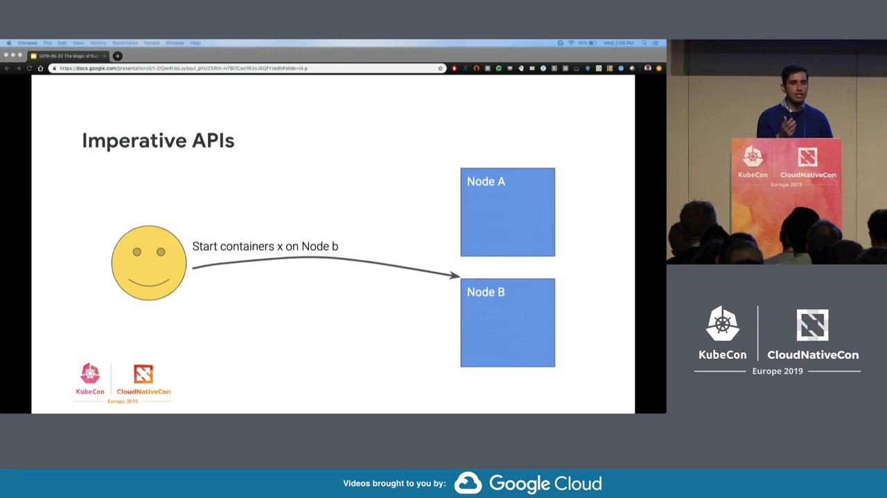
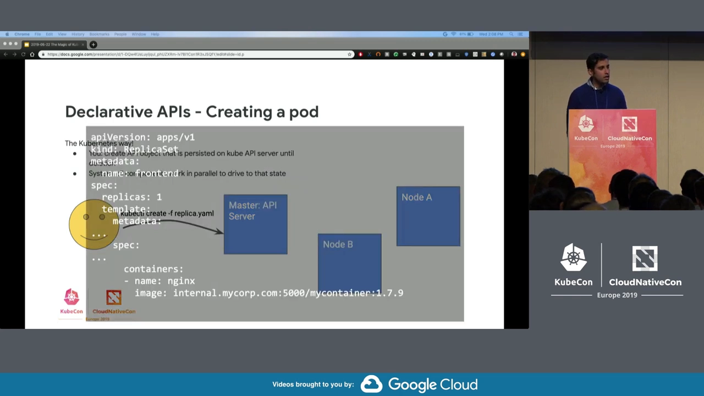
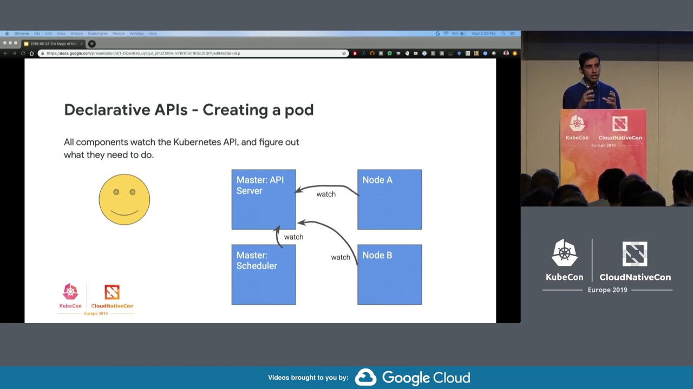
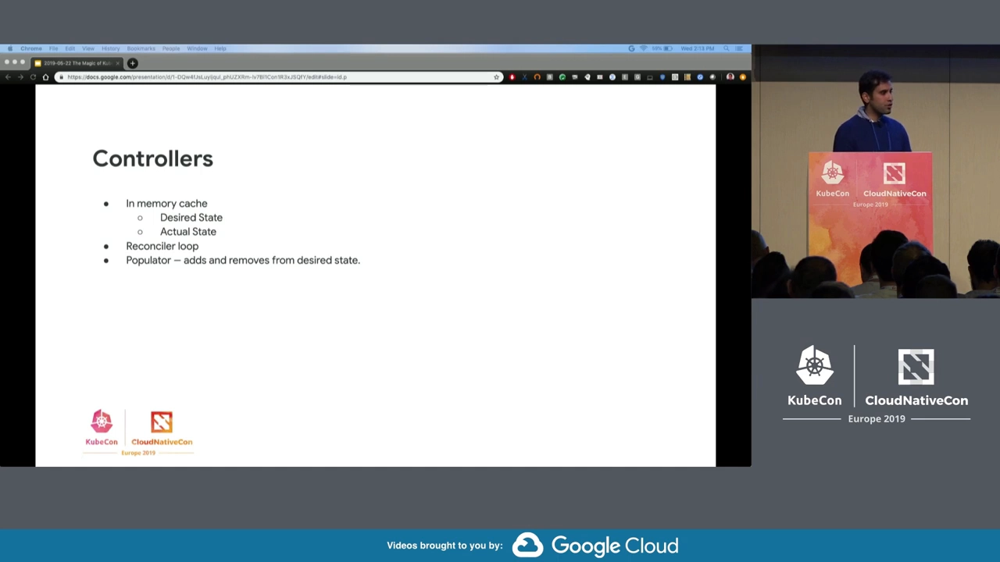
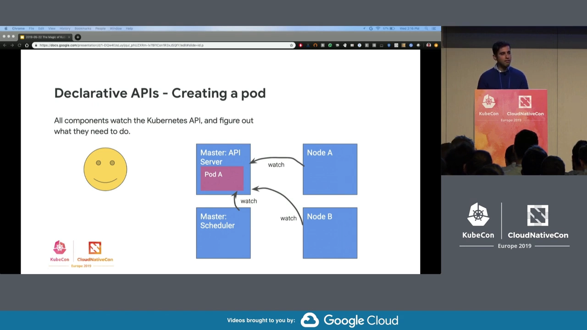
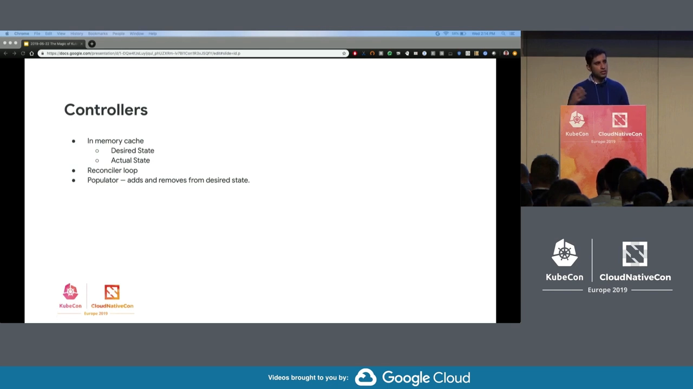
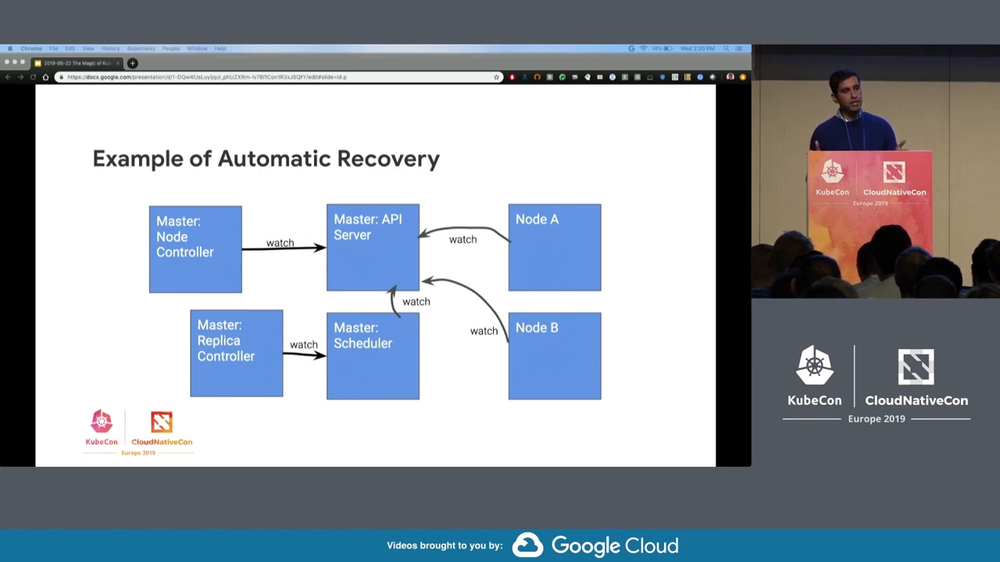
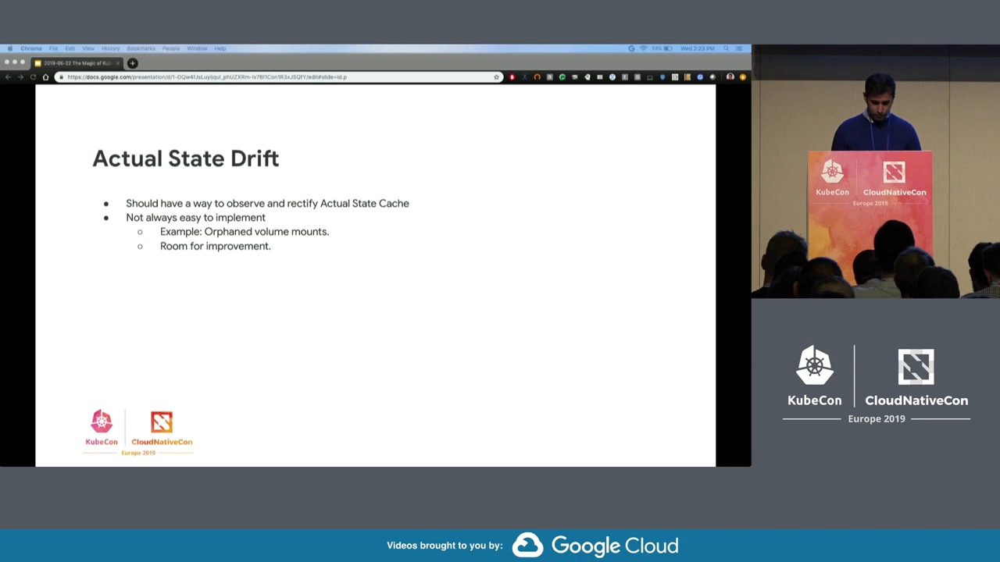
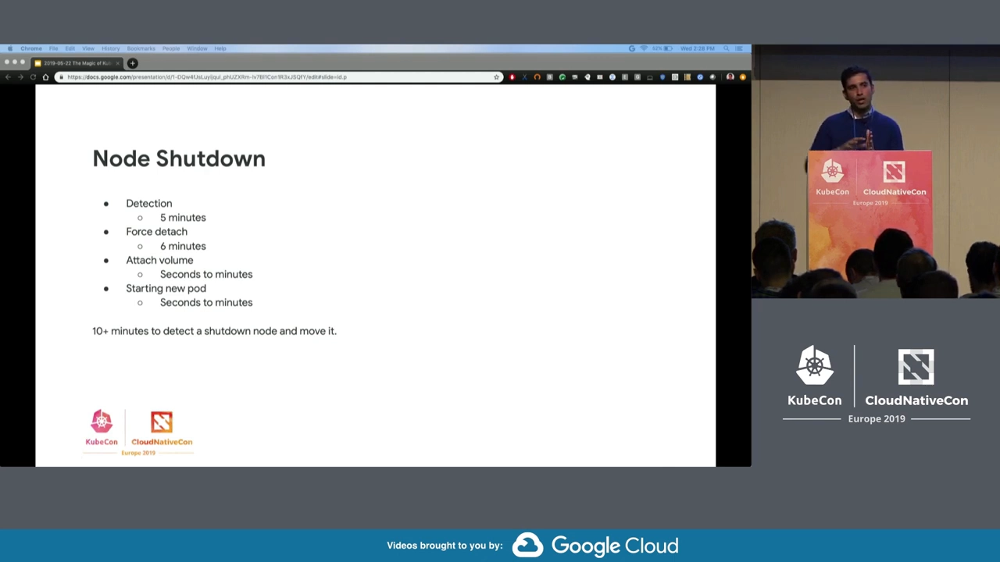
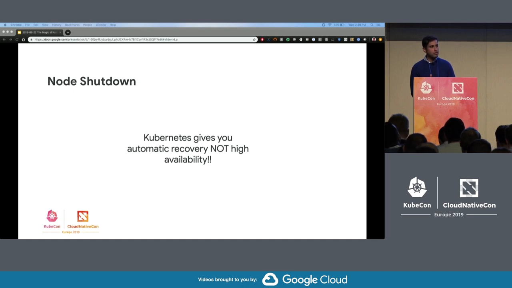

# Kubernetes 自愈能力的设计原理：声明式 API 加控制器，如何让集群自己修复自己

> 视频来源：[The Magic of Kubernetes Self-Healing Capabilities - Saad Ali, Google](https://www.youtube.com/watch?v=91dgNqma7-Q)（KubeCon / CNCF，Google 工程师 Saad Ali 演讲）｜时长 28:00
>
> 一支从**设计原理**层面解释「Kubernetes 为什么能自愈」的 KubeCon 演讲：先讲清声明式 API 相对命令式 API 的根本区别，再用「创建一个 Pod」和「节点宕机」两个完整示例，把调度器、节点控制器、ReplicaSet 控制器、kubelet 的协作演示一遍，最后坦诚地讲清自愈能力的三个短板。文稿左栏为英文自动字幕，本文已翻译重写并纠正错拼（`cube con`→**KubeCon**、`Sode Sode`→**Saad Ali**、`cig storage`→**SIG Storage**、`engine X`→**nginx**、`cubelet`→**kubelet**、`populate ur`→**populator**、`dipping`/`differing`→**diffing**）。

## 本讲要解决的核心问题（SCQA）

**背景**：Kubernetes 现在能管理从单节点到上千节点的集群。你只要写一份 YAML 声明「我要什么」，`kubectl apply` 之后，Pod 自己出现、崩溃自己回来、节点挂了 Pod 自己搬家——没有人盯着。

**冲突**：但这套「魔法」的底层到底是什么？把它当黑盒用，配置一多、一裁员，你根本不知道它会不会按你想的收敛。规模一大，故障是必然的（磁盘会坏、节点会挂），**靠人工检测和修复既不可行、也不可持续**。

**疑问**：Kubernetes 凭什么能自己发现问题、自己修复问题？

**回答（中心思想）**：**自愈由两块基石组成——第一，Kubernetes 的 API 是声明式的（你只声明「期望状态」，不指挥「怎么做」）；第二，它用一群控制器不断去观察、比较并纠正现实。** 前者让「修复」这件事有据可依，后者让「修复」这件事持续发生。合起来，就得到一个能自动收敛到期望状态的系统。

---

## 一、第一块基石：声明式 API

### 1.1 如果 API 是命令式的，失败时怎么办？

**命令式 API** 就是你告诉服务器「具体做什么」：比如想让某个节点起一个容器，你直接打电话给它上面的 agent，「起个容器」；agent 回你一句「成功了/失败了」。这种 API 很常见，看起来也很合理。[【跳转到 03:09】](https://www.youtube.com/watch?v=91dgNqma7-Q&t=189)

但你一旦用它搭分布式系统，问题就来了——**出事的时候谁负责？**

- 你让节点起容器，可容器自己崩了；
- 或者节点崩了；
- 或者网络分区，你根本连不上那个 Pod。

**这些情况怎么检测？怎么修复？难道都要你自己写工具？** 这正是 Kubernetes 不采用纯命令式 API、而把整个 API 建立在声明式之上的核心原因。[【跳转到 04:04】](https://www.youtube.com/watch?v=91dgNqma7-Q&t=244)

### 1.2 声明式 API：只描述目标，系统自己逼近

**声明式 API 的一切都是自动的：你声明期望状态（desired state，你想要的样子），系统自己想办法往那个状态逼近。** 命令式与声明式的差别，就像：[【跳转到 04:54】](https://www.youtube.com/watch?v=91dgNqma7-Q&t=294)

| | 命令式 API | 声明式 API |
| :--- | :--- | :--- |
| 你提供的 | 一步一步的指令 | 目标状态 |
| 执行之后 | 你盯着系统，偏了就再发纠正指令 | 系统自动逼近目标 |
| 失败时 | 你得自己发现、自己修 | 系统自己发现、自己修 |

### 1.3 声明式带来的四项收益

用声明式重建整个 API，换来四样东西：[【跳转到 09:59】](https://www.youtube.com/watch?v=91dgNqma7-Q&t=599)

1. **自动恢复**：出问题能被自动纠正；
2. **没有单点故障**：任何组件挂了，系统都能恢复；
3. **控制面更简单**：如果中间夹一层命令式 API，那么「检测容器是否失败、失败怎么办」这类逻辑就会被迫塞进控制面，让控制面越来越复杂；声明式则把复杂逻辑**分散到每个组件自己身上**；
4. **组件可独立演进**：每个组件自负其责，升级互不牵连。

一句话：**声明式让「每个组件对自己负责」，最终系统更简单、更健壮、能从任意组件故障中恢复。**

---

## 二、一次声明在集群里怎么流动

### 2.1 你只写一份 YAML

要创建一个 Pod，你**不再去点名某个节点**，而是构造一个 API 资源来描述你的意图。比如一个 ReplicaSet 对象：**「启动这个容器（这里是 nginx），并且始终保证集群里有 1 个实例在跑。」** 你把这份 YAML 提交给 API Server，对象就被持久化在控制面上，你的活儿干完了。[【跳转到 05:49】](https://www.youtube.com/watch?v=91dgNqma7-Q&t=349)

### 2.2 所有组件都在 watch API Server

「Kubernetes 里的一切都在盯着 API Server」——是真的**一切**：[【跳转到 06:14】](https://www.youtube.com/watch?v=91dgNqma7-Q&t=374)

- API Server 是中心，记录期望状态；
- 控制面上的调度器（scheduler）、节点控制器（node controller）以及其它控制器都在 watch API Server；
- 每个节点上还有一个叫 **kubelet** 的 agent，也在 watch API Server 并做出反应。

你一声明，对象被写进 API Server；**所有正在 watch 它的组件都会收到「有新对象了，你在意吗？」的通知。**

### 2.3 调度器不直接命令节点，而是回写 API Server

调度器发现有新 Pod 还没被调度，立刻跑算法决定它该落在哪台节点。你可能以为下一步是调度器打电话给那台节点说「起 Pod」——**并不是**。[【跳转到 07:29】](https://www.youtube.com/watch?v=91dgNqma7-Q&t=449)

在声明式模型里，**一切都经过中心 API**：调度器做完决定后，只是**更新 API Server 上那个 Pod 对象的字段**，写上「这个 Pod 应该被调度到节点 B」。然后节点 B 上的 agent 通过 watch 发现「有个 Pod 分给我了，可我这儿没在跑它」，于是负责把它启动起来、并保持它运行。

### 2.4 最终一致，直到你改变意图

如果 Pod 崩了，节点 agent 从 API Server 观察到「我该跑这个 Pod，但它是终止的」，就把它重启。**这套系统会一直把你的 Pod 维持着，直到你删除你的意图**——也就是去删除那个 Pod 对象。它一从 API Server 消失，所有 watch 它的组件就收到删除事件，kubelet 据此把本地实例终止掉。[【跳转到 08:44】](https://www.youtube.com/watch?v=91dgNqma7-Q&t=524)

> 关键句：**系统会一直朝你的期望状态逼近，直到你改变意图。** 这就是「最终一致（eventual consistency）」。把这套模式一遍又一遍地重复，整个系统合起来就变得能自愈。[【跳转到 09:34】](https://www.youtube.com/watch?v=91dgNqma7-Q&t=574)

---

## 三、第二块基石：控制器 = 一个「比较期望与实际的 for 循环」

**控制器就是一段一直在跑、监听 API Server 并做出反应的进程。** Kubernetes 自带一堆，比如调度器本身、节点控制器、ReplicaSet 控制器、Volume 控制器、PersistentVolume 控制器、Volume Attachment 控制器等等；你也可以自己写。[【跳转到 11:39】](https://www.youtube.com/watch?v=91dgNqma7-Q&t=699)

它们做的事高度一致：

1. 维护一份**期望状态**的内存缓存（watcher 从 API Server 同步来的）；
2. 维护一份**实际状态**的内存缓存（它观察到的现实）；
3. 跑一个**极简的控制循环**（字面意义上就是个 for 循环），把两者做 diff；
4. **一旦不一致，就发起一个操作去纠正，让两者对齐。**

### 3.1 实例：Volume Attachment 控制器

以挂载卷为例：[【跳转到 12:54】](https://www.youtube.com/watch?v=91dgNqma7-Q&t=774)

- 有个组件 watch API Server，看到「有个带卷的新 Pod 被调度到某节点、而该节点还没出现在这个卷的期望状态里」，于是**更新期望状态**（populator 的角色）：「这个卷应该挂到这台节点」；
- **reconciler**（就是个笨循环）发现「期望挂、实际没挂」，触发一次 attach；
- attach 完成后，attach/detach 控制器更新**实际状态**：「现在挂上了」——两者一致，什么都不用做；
- 若 Pod 搬到别的节点：期望状态再次更新，循环发现差异，**先 detach 旧节点、再 attach 新节点**。

### 3.2 大家用的都是同一招

调度器如此，ReplicaSet 控制器也是如此：你声明「我要两个 Pod」，它就一直数当前实际跑了几个，不够就补。**所有这些控制器，本质上都是「小的控制循环」，把期望和实际做 diff，再触发动作朝期望推进。** [【跳转到 15:25】](https://www.youtube.com/watch?v=91dgNqma7-Q&t=925)

---

## 四、自愈实战：节点宕机后，集群如何自己恢复

### 4.1 节点控制器靠心跳判定死亡

每个节点的 kubelet 约每 10 秒向 API Server 上的 Node 对象「报到」一次（心跳，keepalive）。**节点控制器（node controller）** watch 所有 Node 对象，看它们最后一次心跳是什么时候：**如果超过 5 分钟没心跳，就判定该节点死亡，并驱逐它上面的 Pod。** [【跳转到 17:30】](https://www.youtube.com/watch?v=91dgNqma7-Q&t=1050)

注意一个反直觉的点：**节点控制器不联系那台节点，也不联系别的节点**；它只跟 API Server 说话——把那些 Pod 对象删掉而已。

### 4.2 一条链式反应把 Pod 补回来

Pod 对象一被删除，**ReplicaSet 控制器**发现「用户要 1 个、现在是 0 个」，就自动替用户**新建一个 Pod 对象**。这个新 Pod 还没调度，于是**调度器**接手，跑算法决定放哪，更新 API Server 完成绑定，最后**新节点上的 kubelet**看到「分给我了」，把它跑起来。[【跳转到 19:10】](https://www.youtube.com/watch?v=91dgNqma7-Q&t=1150)

整条链路里，**没有任何组件直接给另一台机器下命令**，每个组件只是看 API Server、再把自己的结果写回 API Server。

### 4.3 老节点会有两种命运

老节点去哪了，取决于故障类型：[【跳转到 20:00】](https://www.youtube.com/watch?v=91dgNqma7-Q&t=1200)

- **网络分区**：老节点连不上 API Server，不知道自己的 Pod 已被删，于是**继续跑着**；等连接恢复，它才发现「这个 Pod 被删了，我不该再跑」，然后终止它；
- **节点彻底不可用**：那就没什么可担心的了——节点没了，Pod 也结束了。

---

## 五、自愈并不完美：三个真实挑战

### 5.1 实际状态的缓存可能「漂移」

**最大的问题之一：控制器缓存里的「实际状态」可能与真实世界脱节。** 在存储领域尤其明显。比如 Volume Attachment 控制器的实际状态说「卷已挂上」，但如果**有人绕过 Kubernetes 把卷摘了**，它并不知道，于是「高高兴兴」什么都不做。[【跳转到 20:50】](https://www.youtube.com/watch?v=91dgNqma7-Q&t=1250)

应对办法：**给控制器加上「定期核对真实世界」的逻辑。** 例如 attach/detach 控制器会周期性轮询「到底哪些卷是真挂着的」，一旦发现某个卷意外被摘下，就从实际状态里移除它、重新发起 attach。**大多数控制器都应该这么做**，否则它以为的现实就会越来越偏。

### 5.2 控制器的内存状态会丢

以 kubelet 上的 **volume manager** 为例，它负责把卷挂到正确位置供容器使用。**它把所有状态放在内存里**——一旦控制器崩溃，状态全没了；重启后它必须从某个「真相之源（source of truth）」重建。[【跳转到 22:30】](https://www.youtube.com/watch?v=91dgNqma7-Q&t=1350)

对大多数简单控制器，真相之源就是 API Server，够用。但 volume manager 需要额外信息：**它还得知道机器上实际存在哪些挂载点**，再判断这些挂载是不是还被需要。历史上这里有坑：

- 网络分区 + kubelet 崩溃后，Pod 在 API Server 上已被删、但节点上的挂载还留着（孤儿挂载），你无法再从 API Server 重建；
- 大约从 **Kubernetes 1.5** 起才有清理孤儿挂载的逻辑，但能用的线索只有挂载路径里的信息，信息量常常不够干净卸载——**这段「重建 + 清理」的代码是很多 bug 的来源**；
- 于是新的 **CSI（Container Storage Interface）** 实现改变了做法：**除了挂载点，还持久化一个文件**，从而能做更正确的对账、把孤儿挂载收拾干净。

### 5.3 最终一致可能「很慢」——自动恢复 ≠ 高可用

**最终一致可能需要很长时间。** 以节点意外关机为例：[【跳转到 25:23】](https://www.youtube.com/watch?v=91dgNqma7-Q&t=1523)

- 节点意外关机后，**节点控制器要等 5 分钟**才判定它死亡；
- 判死后删除 Pod，**Volume Attachment 控制器**试图摘下那些卷；
- 但它为了安全，会先等节点回一句「我已经安全卸载了」；可它也不想被不健康的节点卡住，**最终会单方面摘盘——这个超时又是 6 分钟**；
- 卷摘下来、腾出来了，新 Pod 才能起来。

**算总账：从故障到恢复要 10 分钟以上。** [【跳转到 26:13】](https://www.youtube.com/watch?v=91dgNqma7-Q&t=1573)

> **这是整场演讲最重要的一句话：Kubernetes 给你的是「自动恢复」，不是「高可用」。** 它的承诺是「系统最终会恢复」，**但对「多久恢复」没有任何保证**。如果你有高可用需求，必须自己在应用层做——**别把单个 Pod 当成唯一入口**，要多副本部署，因为那个 Pod 挂掉后，没人能保证它多快回来。[【跳转到 27:03】](https://www.youtube.com/watch?v=91dgNqma7-Q&t=1623)

---

## 小结

- **自愈 = 声明式 API + 观察并纠正的控制器**：前者让你只描述目标，后者持续把现实朝目标推。
- **命令式 API 的死穴是「失败时无人负责」**；声明式把复杂逻辑下放到每个组件，系统因此更简单、更健壮、无单点。
- **控制器 = 一个 for 循环**：维护期望/实际两份缓存，diff 出差异就触发动作；调度器、ReplicaSet、Volume Attachment 控制器都是这套模式。
- **一次声明的流动**：写进 API Server → 所有组件 watch 到 → 调度器只回写「选了哪台节点」→ kubelet 启动容器 → 状态一路回报。
- **节点宕机恢复链**：心跳超时（5 分钟）→ 节点控制器删 Pod → ReplicaSet 补 Pod → 调度器绑定 → 新节点 kubelet 启动。
- **三个短板**：实际状态缓存会漂移（需定期核对）、控制器内存状态会丢（需从真相之源重建，如 CSI 用持久化文件）、最终一致可能很慢。
- **记住边界**：Kubernetes 保证「自动恢复」，不保证「高可用」与恢复时间；高可用要自己搭在应用层。

## 关键术语速查

| 术语 | 一句话解释 |
| :--- | :--- |
| 声明式 API | 你只声明「想要的状态」，系统自己逼近它 |
| 命令式 API | 你逐步下发「具体怎么做」的指令，失败要自己管 |
| 期望状态 / 实际状态 | 你想要的样子 / 系统观察到的现实 |
| 控制器（controller） | 一个持续把期望与实际做 diff、并纠正差异的循环 |
| kubelet | 每个节点上的 agent，watch API Server 并负责跑容器 |
| 节点控制器 | 靠心跳判定节点是否死亡，并驱逐其上的 Pod |
| 最终一致（eventual consistency） | 系统会朝期望状态逼近，但不由你来控制何时到达 |
| 真相之源（source of truth） | 控制器崩溃后重建内存状态所依据的数据源 |
