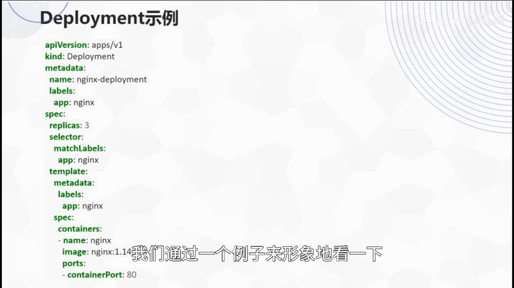
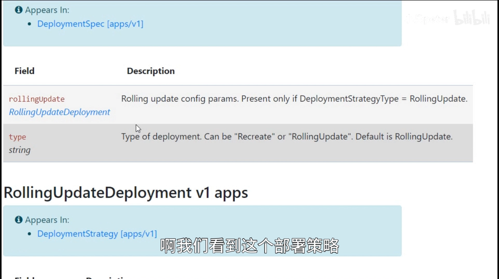
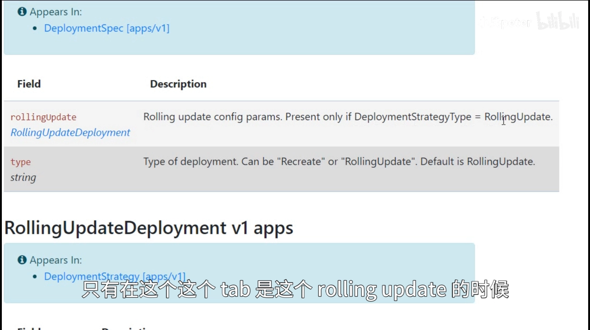
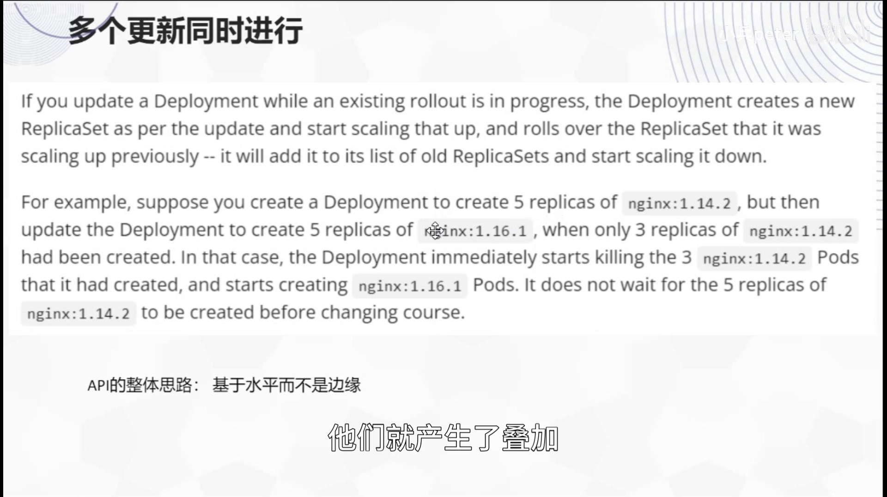
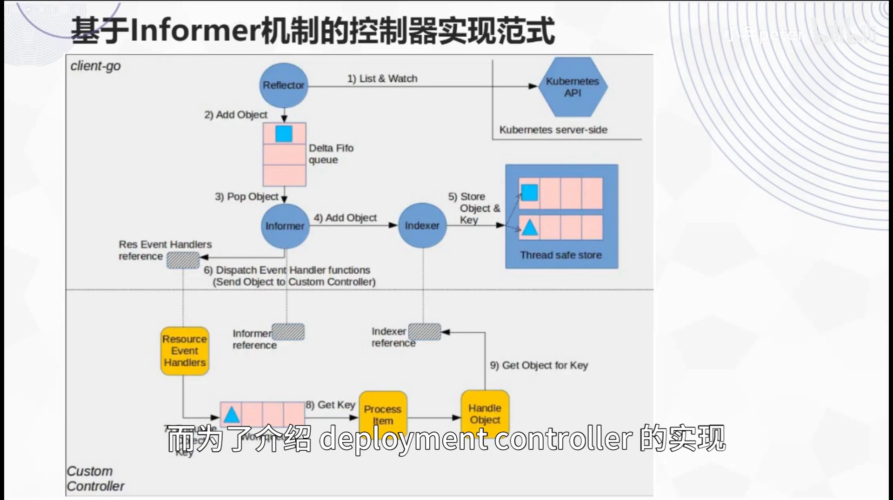
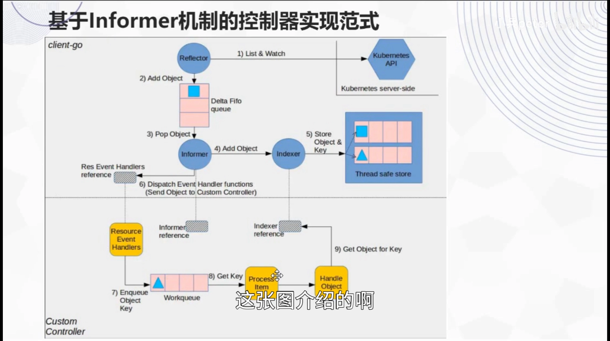
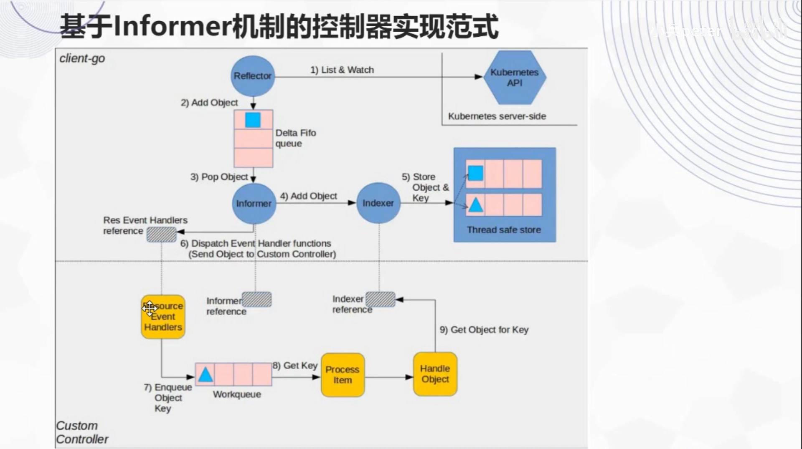
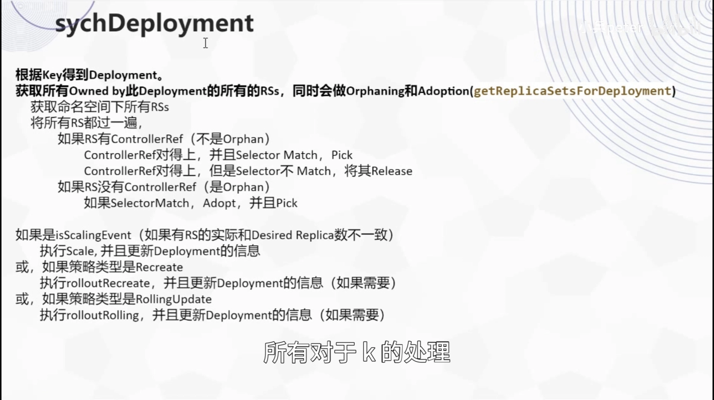
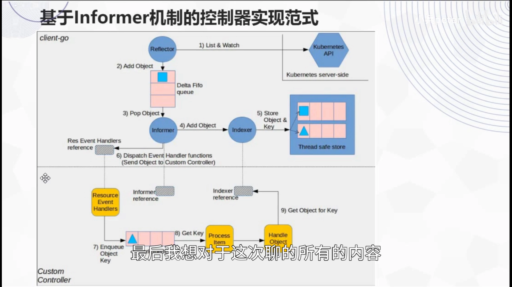

# K8S-Deployment 的设计与实现：从声明式 API 到控制器源码

> 视频来源：[K8S-Deployment的设计与实现](https://www.bilibili.com/video/BV1fh4y1e7sg/)（Bilibili，up：laddermoon／小兵 peter）｜时长 42:55
>
> 一支把 Deployment 从"你会用的 API"讲到"它内部怎么工作"的源码剖析课。它先沿 **Pod → ReplicaSet → Deployment** 的抽象层次讲清 Deployment 为什么会存在，再逐字段拆解它的 `spec`（尤其是滚动更新策略），最后潜入 **client-go informer 框架**与 **Deployment Controller 的 `syncDeployment`**，把"事件怎么进队列、控制器拿到 key 后做了什么"讲到底。文稿左栏为 B 站 AI 字幕，本文已重写为中文并逐窗口纠正错拼（`pad/part`→**Pod**、`REPLISITE/RECORSET`→**ReplicaSet**、`DIPLOMENT/DELIMENT`→**Deployment**、`fly是/KBS`→**K8s**、`NINX`→**Nginx**、`MATSURGE`→**maxSurge**、`maxandavailable`→**maxUnavailable**、`ROYARDATE`→**RollingUpdate**、`clientgo`→**client-go**）。

## 本讲要解决的核心问题（SCQA）

**背景**：在 Kubernetes 里，Deployment 是最常用的后端服务部署方式。你写一份 YAML，声明"我要 3 个副本、用这个镜像"，集群就长出对应的 Pod；改一下镜像，它就滚动升级。对使用者来说，这几乎就是 K8s 的全部日常。

**冲突**：但如果你只会"抄一份 Deployment YAML"，很多问题就解释不清：为什么官方一直说"用 Deployment，别直接写 ReplicaSet"？`spec` 里那一堆字段——`strategy`、`maxSurge`、`maxUnavailable`、`revisionHistoryLimit`——到底是什么？滚动更新时为什么集群里会同时冒出两个 ReplicaSet？如果你在升级还没结束时又改了一次镜像，它会怎么办？更根本的是：**这个"自动把实际状态拉向期望状态"的家伙，内部到底长什么样？** [【跳转到 00:10】](https://www.bilibili.com/video/BV1fh4y1e7sg/?t=10)

**疑问**：Deployment 和 Pod、ReplicaSet 是什么关系？它的每个字段在管什么？滚动更新的过程是怎样的、多轮更新叠加时如何处理？它在代码层面是**基于什么框架**实现的，控制器从"收到一个事件"到"动手创建/删除 Pod"之间走了哪些路？

**回答（中心思想）**：**Deployment 是"面向用户的部署场景"所做的抽象——它把"多副本 + 水平扩展 + 滚动升级"打包成一份声明，而它自己并不直接管 Pod，而是通过管理 ReplicaSet、ReplicaSet 再管 Pod（Deployment 管 ReplicaSet，ReplicaSet 管 Pod）。** 它的实现则是 K8s 控制器的一个典型案例：**基于 client-go 的 informer 框架**——用 informer 监听 Deployment/ReplicaSet/Pod 的事件、把涉及的对象的 key 丢进工作队列，再由多协程 worker 取出 key、执行 `syncDeployment`，在**新旧 ReplicaSet 之间"此消彼长"**地完成一次收敛。整套思路与 K8s API 的一贯风格一致：**它盯的是"水平值（level）"而不是"边沿（edge）"**——目标值一变，就忽略中间状态，直接朝最新的目标去收敛。[【跳转到 05:54】](https://www.bilibili.com/video/BV1fh4y1e7sg/?t=354)

---

## 一、从 Pod 到 Deployment：三层抽象，各管一段

要理解 Deployment，得先看清它和它下面两层的关系。

### 1.1 Pod：对"应用实例"的抽象，而不是对"用户需求"的抽象

**Pod 是 K8s 对应用实例最底层的抽象**，是调度和部署的最小单元；它是一个或多个**共享存储与网络资源**的容器的集合。K8s 认为一个应用实例典型情况下包含多个容器，所以 Pod 天然被设计成多容器的。[【跳转到 00:21】](https://www.bilibili.com/video/BV1fh4y1e7sg/?t=21)

关键的一点是：**用户一般不会直接手动创建 Pod**。因为 Pod 本身不是面向"用户需求"做的抽象，而是对"应用实例"的抽象——从设计目标上讲，它并不是给用户直接用的。[【跳转到 00:46】](https://www.bilibili.com/video/BV1fh4y1e7sg/?t=46)

### 1.2 ReplicaSet：对"一组相同 Pod"的抽象

**ReplicaSet 代表的是一组相同的 Pod**。这在真实场景里极其常见：集群上会运行大量相同的应用副本，而应用往往要做**水平扩展**。所以 ReplicaSet 的设计目标是**尽力保证指定副本数的 Pod 在集群中运行**。[【跳转到 01:11】](https://www.bilibili.com/video/BV1fh4y1e7sg/?t=71)

它比 Pod 更贴近用户一步——很多时候我们就是需要一组相同的 Pod 在跑。但它的设计目标**仍然不是面向用户的**：它是对"应用情况"的抽象，而不是对"用户场景"的抽象。换句话说，它只管"数量对不对"，不管"你怎么升级"。[【跳转到 01:21】](https://www.bilibili.com/video/BV1fh4y1e7sg/?t=81)

### 1.3 Deployment：面向"部署场景"的抽象，多了一份滚动升级

Deployment 才是**面向用户需求**出现的抽象，它针对的是一种最常见的部署场景：**把一个应用以多副本的形式部署到集群上**。[【跳转到 01:46】](https://www.bilibili.com/video/BV1fh4y1e7sg/?t=106)

它会让人产生一个疑问："这不就跟 ReplicaSet 一样吗？"不同之处在于：**Deployment 考虑到了滚动升级**，把一个完整的部署场景考虑得更全面；而 ReplicaSet 只保证指定副本数的 Pod 在运行。[【跳转到 01:51】](https://www.bilibili.com/video/BV1fh4y1e7sg/?t=111)

于是三者形成了清晰的关系：

- **用户一般直接使用 Deployment**；
- **Deployment 为了管理多个副本，下面用的是 ReplicaSet**；
- **一个 Deployment 下面可能同时有多个 ReplicaSet**（后面会解释为什么）；
- ReplicaSet 下面才是多个相同的 Pod 在运行。[【跳转到 01:71】](https://www.bilibili.com/video/BV1fh4y1e7sg/?t=111)

一句话记住：**Deployment 管 ReplicaSet，ReplicaSet 管 Pod。**

## 二、Deployment 的 API：`spec` 里的字段与两套升级策略

官方文档给了两个入口：一个偏概念，一个相对详细。用 Deployment 之前，详细了解字段很有必要。这里挑出 **Deployment 独有的部分**来看——大部分字段对所有 API 都一样，真正不同的是 `spec` 里的几项。[【跳转到 04:32】](https://www.bilibili.com/video/BV1fh4y1e7sg/?t=272)

- `replicas`：**期望的副本数**（desired number）；
- `revisionHistoryLimit`：**保留的历史修订版本数量**，用于回滚；
- `selector`：**选择器**，负责挑出"归我管"的 Pod；
- `strategy`：**部署策略**。[【跳转到 05:09】](https://www.bilibili.com/video/BV1fh4y1e7sg/?t=309)

策略类型有两种，这是 Deployment 与 ReplicaSet 最大的分野：

- **Recreate（重建）**：先把旧的 Pod 全部删掉，再创建新的；
- **RollingUpdate（滚动更新）**：逐个替换，默认就是它。[【跳转到 05:21】](https://www.bilibili.com/video/BV1fh4y1e7sg/?t=321)

而滚动更新相关的两个参数**只有在 `type` 为 `RollingUpdate` 时才有效**：

- **`maxSurge`**：滚动更新过程中，最多能**超出**指定副本数多少个 Pod。比如副本数是 10，`maxSurge` 决定能"多开"几个新的；
- **`maxUnavailable`**：滚动更新过程中，最多能**少于**指定副本数多少个 Pod，也就是允许多少个暂时不可用。[【跳转到 05:46】](https://www.bilibili.com/video/BV1fh4y1e7sg/?t=346)

这两个参数存在的原因很直接：**为了保证在更新过程中，"整个应用对外提供服务的能力"不会受到太大影响**——既不会一口气把旧 Pod 全杀掉（受 `maxUnavailable` 约束），也不会一口气把新 Pod 全起来（受 `maxSurge` 约束）。[【跳转到 06:11】](https://www.bilibili.com/video/BV1fh4y1e7sg/?t=371)

## 三、滚动更新到底怎么发生：两个 ReplicaSet 的此消彼长

滚动更新不是"一步到位"的，它需要一个过程。理解这个过程，才能理解"多轮更新叠加"时 Deployment 的反应。

### 3.1 一次更新：一个新 ReplicaSet 登场

当我们修改了 Deployment 中 **Pod 模板的描述**，Deployment 会**创建一个新的 ReplicaSet**。此时它**同时拥有两个 ReplicaSet**：

- 它把**老的 ReplicaSet 逐步 scale down**（副本数降下来）；
- 同时把**新的 ReplicaSet 副本数逐步调上去**。[【跳转到 07:24】](https://www.bilibili.com/video/BV1fh4y1e7sg/?t=444)

整个过程**始终满足前面说的 `maxSurge` 与 `maxUnavailable` 约束**。所以本质上，这就是**两个 ReplicaSet 此消彼长的一个过程**。[【跳转到 07:49】](https://www.bilibili.com/video/BV1fh4y1e7sg/?t=469)

### 3.2 多轮更新叠加：只认最新的目标

如果在这个过程还没结束时，你又改了一次（比如又换了镜像），会怎样？

- Deployment 会**马上再创建一个新的 ReplicaSet**，此时它可能同时拥有**三个 ReplicaSet**；
- 但它会**马上终止**前面那个正在扩张的 ReplicaSet——**不让它继续 scale up**；
- 转而只让**最新创建**的那个 ReplicaSet 去扩张副本数，另外两个则逐步 scale down。[【跳转到 08:14】](https://www.bilibili.com/video/BV1fh4y1e7sg/?t=494)

视频举了个具体例子：新建一个 Deployment、副本数 5，它会逐步起来；当已经运行了 3 个副本时，把镜像更新了一下，它就会**立即把已创建的这三个副本扣掉**，改按新镜像启动新 ReplicaSet 的 Pod，而且**不会等第一个操作完成**，而是在执行过程中就把它终止。[【跳转到 09:04】](https://www.bilibili.com/video/BV1fh4y1e7sg/?t=544)

### 3.3 背后的原则：基于"水平（level）"而非"边沿（edge）"

这种"不管中间状态"的行为，与 K8s API 的一贯风格吻合：**它整体思路是基于"水平"而不是基于"边沿"的**——

**如果目标值变了，它只盯着最新的目标值，不会管中间设定的某个值、也不会坚持去达到那个中间值；目标值一变，就忽略中间状态，直接按新的期望去迁移。** [【跳转到 09:54】](https://www.bilibili.com/video/BV1fh4y1e7sg/?t=594)

这正是理解 K8s 控制器的一把钥匙：**事件只是"叫醒你"的时机，真正决定动作的是"当前状态和期望状态的差值"。**

## 四、informer：控制器实现的公共框架

讲完"用户看到的 Deployment"，接下来进入"它在代码里长什么样"。而这必须先介绍 **informer**。

informer 可以理解为实现控制器的一种**框架**。它的实现位于 **client-go**——K8s 的一个重要子项目。有一张经典图讲的就是"如何用 informer 框架实现一个控制器"（图里说的是 custom controller，而 Deployment Controller 也正是基于这种方式实现的）。图为 controller 的结构：**黄色部分需要开发者自己实现**，其余区域都是框架代码，由 client-go 提供。这样开发者只需写业务逻辑，很多其他事情都不用管，就能实现一个性能很高的控制器。[【跳转到 10:49】](https://www.bilibili.com/video/BV1fh4y1e7sg/?t=649)

### 4.1 为什么需要 informer：控制器是"对着数据变化"干活的

控制器模式的核心是：**根据受控客体的实际状态与期望状态，决定做些什么，尽量让实际状态符合期望状态。** 而在 K8s 里，无论期望状态还是客体实际状态，**数据都存放在 etcd 里**。所以控制器要做的事，就是**不断看它们是否相符**，再决定进一步的动作。[【跳转到 11:14】](https://www.bilibili.com/video/BV1fh4y1e7sg/?t=674)

当两者的状态相符、数据没有进一步变化时，控制器就不需要再做其他事情。所以控制器实现的逻辑，是**基于数据变化的**。而 informer 提供的正是这样一套高效机制：

- **监听 / 观测 / 记录 etcd 里数据的变化**，把变化放进队列；
- 一方面提供**事件通知机制**——你可以为对应事件注册处理函数，事件发生时调用你的 handler；
- 另一方面把变化**同步到 indexer**。[【跳转到 13:19】](https://www.bilibili.com/video/BV1fh4y1e7sg/?t=799)

### 4.2 三个部件：DeltaFIFO、Indexer、WorkQueue

informer 里几个名字，值得逐一拆开：

- **DeltaFIFO**：`FIFO` 是先进先出队列，`Delta` 在数学里是"变化、小的变化"的意思。所以它是一个**存放"某个对象的若干小变化"的先进先出队列**——监控到变化就放进来，再按**变化的类型**调用我们注册的 handler。[【跳转到 14:42】](https://www.bilibili.com/video/BV1fh4y1e7sg/?t=882)
- **Indexer**：实际上做的是**数据缓存**，同时提供**索引功能**，让我们能通过它的 API **快速检索数据，而且不需要调用 API Server**。[【跳转到 14:49】](https://www.bilibili.com/video/BV1fh4y1e7sg/?t=889)
- **WorkQueue（工作队列）**：handler 把"要做的事"对应的 key 写进这个队列，另一端由 worker 消费。[【跳转到 15:32】](https://www.bilibili.com/video/BV1fh4y1e7sg/?t=932)

### 4.3 为什么要拆成"三部分"：为了并发

一个自然的疑问是：既然事件回调就能触发动作，那**只要有一个 handler 不就够了吗**？作者的理解是：**拆成三部分是为了并发的需要**。

- 前半段（回调判断"有没有事要做"）相对**轻**；
- 后半段（从 workqueue 取 key、真正处理）**处理量更大**，而且是**多线程 / 多协程**的。

这样就形成了一个**生产者—消费者模型**：生产者是轻量的事件回调，消费者是多线程的 worker。这样能保证回调这一端**首先不成为瓶颈**；即便后面真有瓶颈，也能**通过加大并发来解决**。[【跳转到 15:54】](https://www.bilibili.com/video/BV1fh4y1e7sg/?t=954)

## 五、潜入 Deployment Controller：启动、worker 与"绕个弯的 handler"

Deployment Controller 的源码实现，就从**它的启动入口**开始梳理。

### 5.1 启动：`New` 与 `Run`

启动入口主要做两件事：**新建一个对象**，然后**调用它的 `Run` 方法**。创建这个对象时，会**传入三个 informer 作为参数**，分别是 **Pod、ReplicaSet、Deployment** 的 informer。[【跳转到 16:12】](https://www.bilibili.com/video/BV1fh4y1e7sg/?t=972)

在创建对象的代码里，可以看到它持有一个 **queue，名字表明是一个"限流的队列"**——这部分也在 client-go 的 informer 框架里实现。[【跳转到 17:02】](https://www.bilibili.com/video/BV1fh4y1e7sg/?t=1022)

### 5.2 注册事件：给三类资源挂上 handler

在 `New` 的过程中，控制器给三个 informer 分别注册事件响应函数：

- 给 **Deployment** 的 informer 注册 `add`／`update`／`delete` 三个事件的处理函数；
- 同样给 **ReplicaSet** 的 informer 注册三个；
- 另外给 **Pod** 只注册了 `delete` 事件的处理函数。

这些处理函数的核心，都是调用 Deployment Controller 的对应方法。[【跳转到 18:22】](https://www.bilibili.com/video/BV1fh4y1e7sg/?t=1102)

### 5.3 `Run` 与 worker：无限循环地"取一条、处理、标记完成"

`Run` 方法里有一部分是结构性代码，核心是**启动多个协程（goroutine）**，入口函数是 `worker`。每个 worker 都在一个**无限循环**里做同一件事：

1. 从队列里**取一个条目**；
2. **做处理**；
3. 处理完把它**标记为 done**。[【跳转到 20:56】](https://www.bilibili.com/video/BV1fh4y1e7sg/?t=1256)

对应到框架图上，这条链路就是：**`processNextWorkItem` → `syncHandler`（即 `handle object`）**。[【跳转到 21:29】](https://www.bilibili.com/video/BV1fh4y1e7sg/?t=1289)

### 5.4 一个"绕弯"的技巧：把 handler 做成可注入的变量

有个值得注意的细节：`syncHandler` **并不是 DC 对象里的一个方法，它只是 DC 的一个变量**——在 `New` 时被赋值为一个函数。

为什么绕这么个弯？**这是为了做测试。** Deployment Controller 的定义里也说明了这一点：留这么一个变量，是为了方便在**单元测试时做注入**——因为这个函数运行起来的依赖可能比较多，测试时可以给它一个**假的函数**，让整个测试跑起来。这也是 K8s 源码里常用的一个技巧。[【跳转到 21:46】](https://www.bilibili.com/video/BV1fh4y1e7sg/?t=1306)

## 六、队列里的 key 从哪来：一张"事件 → 入队"的规则表

worker 处理的是队列里的 key，那把 key 丢进队列的，正是前面注册的那些 handler。作者把这一批 handler 的行为做了一张汇总表。核心可以归纳为一条原则：**凡是涉及到某个 Deployment，就把它加入队列**。[【跳转到 31:10】](https://www.bilibili.com/video/BV1fh4y1e7sg/?t=1870)

### 6.1 对 Deployment 的三类事件

- **add Deployment**：把新建的 Deployment 加入队列；
- **update Deployment**：把更新后的加入队列（有 old 和当前两个，只加当前的）；
- **delete Deployment**：先做一些异常判断，最后仍把它加入队列。

注意：**入队的其实是一个 key（字符串），而不是对象本身**——这个 key 可以代表这个 Deployment，通常是 **`namespace` + 名字**。[【跳转到 26:38】](https://www.bilibili.com/video/BV1fh4y1e7sg/?t=1598)

### 6.2 对 ReplicaSet 的三类事件：引出了"孤儿与收养"

ReplicaSet 的 `add`／`update` 事件，会**先判断这个 ReplicaSet 是不是通过某个 Deployment（控制器）创建的**——因为它里面有一个 **`controllerRef`** 字段：

- `controllerRef` 为 **nil**：说明它**没有归属的 Deployment**，是一个**孤儿（orphan）**；
- 不为 nil：说明它有归属的 Deployment。

对 **add ReplicaSet**：如果它**有归属的 Deployment**，就把对应的 Deployment 加入队列；如果它**是孤儿**，就**通过它的 label 去和 Deployment 的 selector 做匹配**，匹配到了就把那个 Deployment 加入队列——**这种机制就叫 adoption（收养）**。[【跳转到 27:53】](https://www.bilibili.com/video/BV1fh4y1e7sg/?t=1673)

对 **update ReplicaSet** 稍微复杂，但遵循同样的"逐个判断"逻辑：**原来属于某个 Deployment 的**，不管后来变成什么样，都把原来那个 Deployment 入队；**当前属于某个 Deployment 的**（或 label 变了能匹配到新 Deployment 的），也把匹配到的入队。[【跳转到 29:23】](https://www.bilibili.com/video/BV1fh4y1e7sg/?t=1763)

对 **delete ReplicaSet**：把它所归属的 Deployment 入队；如果没有对应的 key，就不添加。

### 6.3 对 Pod：只关注 delete，且限定在 Recreate 策略

对 Pod **只关注 delete 事件**，并且条件很具体：**当一个 Pod 属于某个 Deployment、这个 Deployment 下已经没有其他 Pod 了、同时它的策略是 `Recreate` 时**，才把这个 Deployment 加入队列。[【跳转到 30:23】](https://www.bilibili.com/video/BV1fh4y1e7sg/?t=1823)

目的很明显：**如果策略是重建（Recreate），必须等到最后一个 Pod 被删除时，才做下一步重建动作**——所以这个事件响应是为了**捕捉这个时机**。

## 七、worker 拿到 key 之后：`syncDeployment` 的主干

无论 key 最初因何入队，**最终都会进入 `sync` 处理函数**。作者的梳理是：**第一步根据 key 得到 Deployment**——把 key 拆成 `namespace` 和名字，从对应的 namespace（从本地 list / indexer 里）拿到这个 Deployment，然后获取它**所拥有的所有 ReplicaSet**。[【跳转到 32:23】](https://www.bilibili.com/video/BV1fh4y1e7sg/?t=1943)

### 7.1 `getReplicaSetsForDeployment`：归属判定中的 release 与 adopt

获取"所拥有的 ReplicaSet"这一步由 `getReplicaSetsForDeployment` 完成：它先拿到这个 namespace 下**所有的 ReplicaSet**，然后遍历一遍，对每一个做判定：

- 如果它**有 `controllerRef`**（即被控制器创建，不是孤儿），且 `controllerRef` **对得上**我们的 Deployment、**selector 也对得上**（它的 label 与 Deployment 的 selector 匹配）——就**把它 pick 出来**，作为"我们拥有的一项"；
- 如果 `controllerRef` 指向我们的 Deployment、**但 selector 和 label 不匹配**——就把它 **release**：相当于把归属置空，**让它成为一个孤儿**；
- 如果它**本身没有 `controllerRef`**（本身是孤儿），就看它的 label 和 Deployment 的 selector 是否匹配——**匹配就收养它（adopt）**，同样 pick 出来。[【跳转到 33:38】](https://www.bilibili.com/video/BV1fh4y1e7sg/?t=2018)

**adopt 的过程**具体就是：因为这个 ReplicaSet 本身没有 `controllerRef`，**把它的 `controllerRef` 设置为我们的 Deployment**。所以最终选出的所有 ReplicaSet，其 `controllerRef` 都是这个 Deployment，并且它们的 label 一定与 Deployment 的 selector 匹配。[【跳转到 35:18】](https://www.bilibili.com/video/BV1fh4y1e7sg/?t=2118)

> 注意：这个过程中**对 ReplicaSet 做了实际的更改**（设置 / 清空 `controllerRef`）——这正对应前面"孤儿与收养"机制在代码里的落地。

### 7.2 判断该做什么：scaling、recreate，还是 rolling update

拿到 ReplicaSet 之后，`syncDeployment` 做分支判断：

1. **是不是一个 scaling event？** 标准是**某个 ReplicaSet 的实际副本数与期望副本数不一致**。如果是，就**执行 scale 并更新 Deployment 的信息**；[【跳转到 36:33】](https://www.bilibili.com/video/BV1fh4y1e7sg/?t=2193)
2. 没命中，再判断**策略类型是不是 Recreate**。如果是，就执行 `rolloutRecreate`——判断当前是否确实需要做 recreate（即前面说的"最后一个 Pod 被删除时"才需要重建）；[【跳转到 37:03】](https://www.bilibili.com/video/BV1fh4y1e7sg/?t=2223)
3. 否则策略就是 **RollingUpdate**，就调用函数执行**滚动更新的逻辑**。

两个要点值得记牢：

- 这些动作都是**按需执行**的——不是每次进来都要做滚动更新或 recreate；
- 但**最后这两条分支一定会命中一条**，因为策略只有两种；而**每次都会做的事，是更新 Deployment 的信息**（只要进入这个函数就会做）。[【跳转到 38:38】](https://www.bilibili.com/video/BV1fh4y1e7sg/?t=2318)

### 7.3 一句话概括 `syncDeployment`：采取行动 + 记录状态

`syncDeployment` 所做的事，可以简洁地归为两点：

1. **采取行动**：release / adopt，或在某些情况下执行 recreate、或执行 rolling update；
2. **记录状态**：把通过各种事件收集到的信息，回写到 Deployment 的状态里。[【跳转到 39:53】](https://www.bilibili.com/video/BV1fh4y1e7sg/?t=2393)

## 八、全局图景

把整条链路合起来看：整个 Deployment Controller 就是**基于 informer 框架**搭起来的——

1. 它给 **Deployment、ReplicaSet、Pod** 三种资源注册了若干事件和 handler；
2. 每个 handler 决定**在什么情况下把某个 Deployment 的 key 放进 workqueue**；
3. 队列**另一端有多个协程**在消费，取出 key 处理；
4. 处理 key 的核心就是 `syncDeployment`，其中会**拆 key、从 indexer 取对象、做 release/adopt、按策略行动、同步状态**。[【跳转到 40:40】](https://www.bilibili.com/video/BV1fh4y1e7sg/?t=2440)

作者特别强调：**最核心的逻辑，还是在于"关注哪些事件、什么时候把对应的 key 放队列、以及每次拿到 key 都要做哪些事"**——这里面有很多要斟酌的地方。[【跳转到 42:20】](https://www.bilibili.com/video/BV1fh4y1e7sg/?t=2540)

## 小结

- **三层抽象各管一段**：Pod 是对应用实例的抽象，ReplicaSet 是对"一组相同 Pod"的抽象，Deployment 才是面向用户部署场景、额外提供滚动升级的抽象。**用户用 Deployment，Deployment 管 ReplicaSet，ReplicaSet 管 Pod。**
- **Deployment 的 `spec` 独有字段**：`replicas`、`revisionHistoryLimit`、`selector`，以及 `strategy`。策略有 **Recreate** 与 **RollingUpdate** 两种，默认后者；`maxSurge` / `maxUnavailable` 只在 RollingUpdate 下有效，用来约束更新期间"能多开几个""能少几个"，以保住对外服务能力。
- **滚动更新的本质是两个 ReplicaSet 的此消彼长**：改 Pod 模板 → 新建一个 ReplicaSet → 新 RS 上调、老 RS 下调，全程满足 maxSurge/maxUnavailable 约束。
- **多轮更新叠加时只认最新目标**：会立即终止正在扩张的旧 ReplicaSet，转而只让最新的 ReplicaSet 扩张。这体现的是 **level-driven**——盯"水平值"而非"边沿事件"。
- **Deployment Controller 基于 client-go 的 informer 框架**：DeltaFIFO 收集变化、Indexer 做缓存与索引（免访问 API Server）、WorkQueue 承载待办 key；拆成三部分是为了**并发**（轻量回调 + 多线程消费的生产者—消费者模型）。
- **入队规则可归纳为一句**：凡涉及某 Deployment 就把它入队。ReplicaSet 侧靠 `controllerRef` 与 selector 判断归属，引出了 **孤儿（orphan）与收养（adopt）** 机制；Pod 的 delete 只在 Recreate 策略、且是该 Deployment 最后一个 Pod 时才入队。
- **`syncDeployment` 做两件事：采取行动 + 记录状态**。拿到 key → 取 Deployment → `getReplicaSetsForDeployment`（内含 release/adopt）→ 按 scaling / recreate / rolling 分支行动 → 每次都更新 Deployment 状态。

## 关键术语速查

| 术语 | 一句话解释 |
| --- | --- |
| Pod | K8s 对"应用实例"的最底层抽象，调度最小单元，用户一般不直接创建 |
| ReplicaSet | 对"一组相同 Pod"的抽象，保证指定副本数的 Pod 在运行 |
| Deployment | 面向用户部署场景的抽象；管理 ReplicaSet，额外提供滚动升级 |
| `replicas` | 期望副本数（desired number） |
| `revisionHistoryLimit` | 保留的历史修订版本数量，用于回滚 |
| Recreate 策略 | 先删光旧 Pod 再建新的（重建） |
| RollingUpdate 策略 | 逐个替换旧 Pod（滚动更新，默认） |
| `maxSurge` | 滚动更新中最多能"多开"多少个 Pod |
| `maxUnavailable` | 滚动更新中最多允许多少个 Pod 暂时不可用 |
| informer | client-go 提供的控制器实现框架，提供监听、缓存与工作队列 |
| DeltaFIFO | 存放对象"小变化"的先进先出队列，变化按类型回调 handler |
| Indexer | 本地数据缓存 + 索引，支持不访问 API Server 的快速检索 |
| WorkQueue | 承载待处理 key 的工作队列，由多 worker 并发消费 |
| `controllerRef` | 记录"被哪个控制器创建"的引用，是归属判定的依据 |
| orphan / adoption | 无归属的 ReplicaSet 称孤儿；控制器按 selector 把它"收养"回来 |
| `syncDeployment` | 控制器核心：采取行动（release/adopt/滚动/重建）+ 记录状态 |
| level-driven | 只盯最新期望值、忽略中间状态，按"水平值"收敛 |
