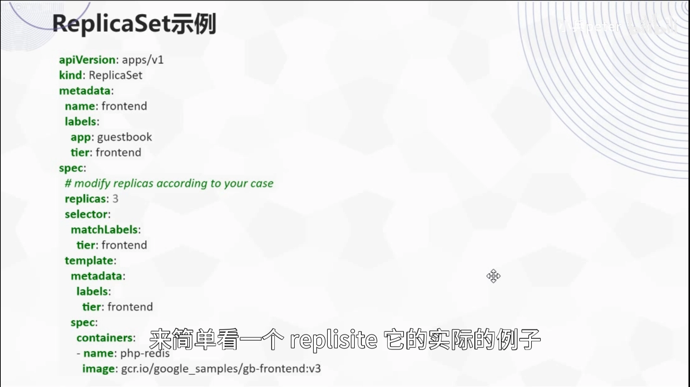
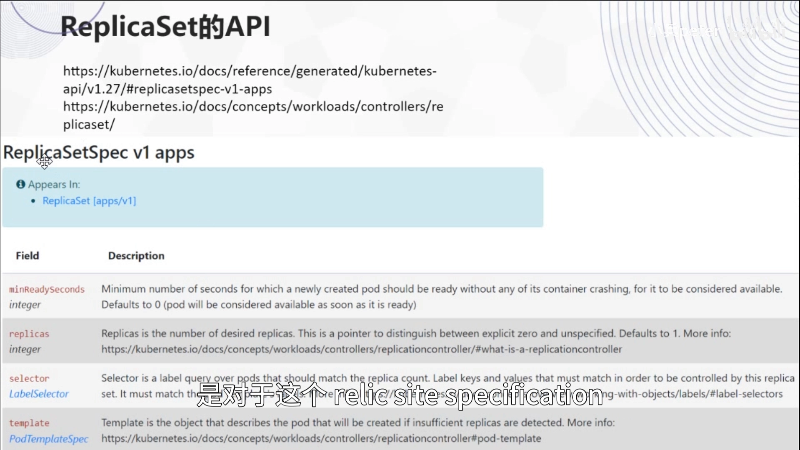
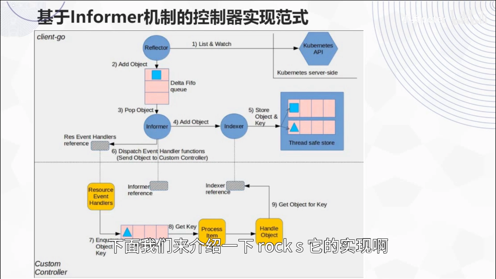
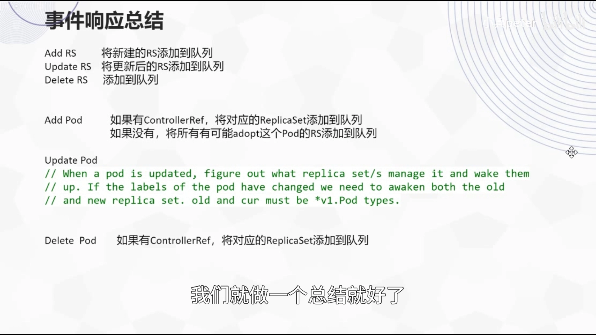
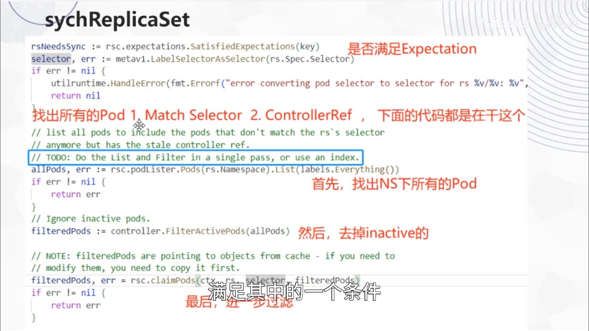
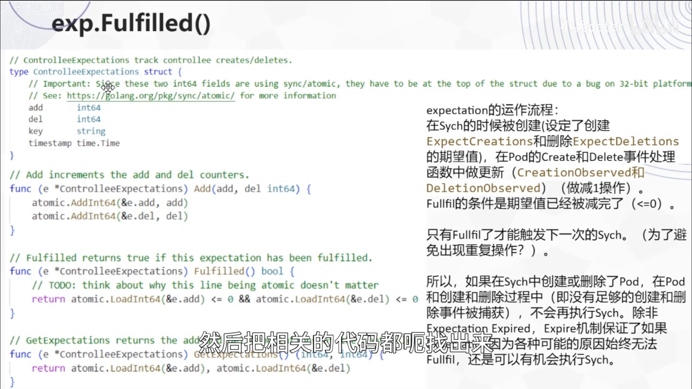
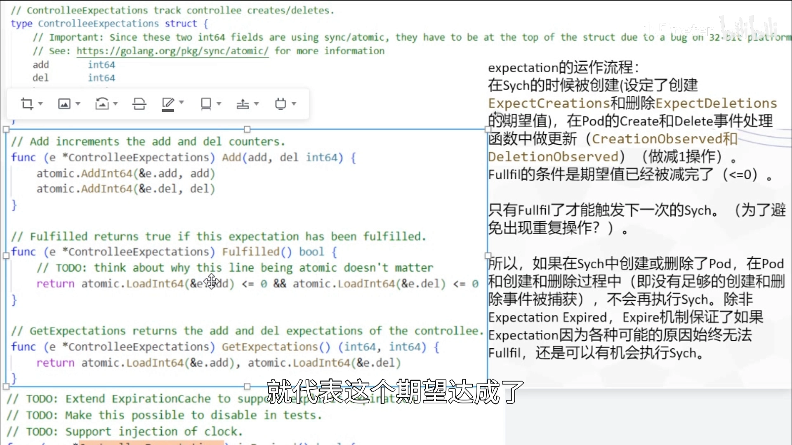
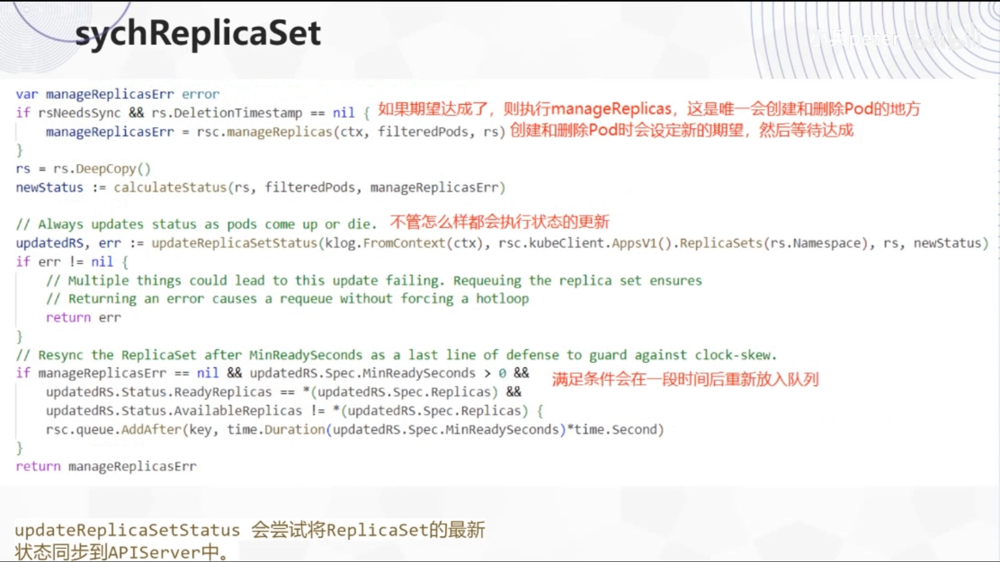

# K8S-ReplicaSet 实现详解：一段"绕了一下"的控制器源码

> 视频来源：[K8S-ReplicaSet实现详解](https://www.bilibili.com/video/BV11w411i7y7/)（Bilibili，up：laddermoon／小兵 peter）｜时长 33:40
>
> 这是 Deployment 源码剖析的姊妹篇：Deployment 把副本管理"外包"给了 ReplicaSet，那么 ReplicaSet 自己又是怎么实现的？本讲沿着 **API 与设计目标 → 孤儿与收养的场景 → 事件入队规则 → `syncReplicaSet` 全流程 → expectation 机制 → `manageReplicas`** 一路读源码，最后落在一个核心结论上：**ReplicaSet 实现里最值得琢磨的，是它的 expectation（期望计数）机制**。文稿左栏为 B 站 AI 字幕，本文已重写为中文并纠正错拼（`REPLISITE/REPTIS/relicset/recorset`→**ReplicaSet**、`DIPLYMENT`→**Deployment**、`raticsite`→**ReplicaSet**、`the pad`→**Pod**、`controlrise/controllerraft`→**controllerRef**、`MIRISECONDS`→**minReadySeconds**、`burstreplicas`→**burstReplicas**、`clientgo`→**client-go**、`clashloop`→**crash loop**）。

## 本讲要解决的核心问题（SCQA）

**背景**：如果你用过 Deployment，就已经间接用过 ReplicaSet——Deployment 管理 ReplicaSet，ReplicaSet 才管理 Pod。它要干的事听起来非常简单：**维持一组一定数量的相同 Pod**，多了删、少了补。[【跳转到 00:07】](https://www.bilibili.com/video/BV11w411i7y7/?t=7)

**冲突**：但"听着简单"和"实现简单"是两回事。真动起手来，麻烦在于这套逻辑跑在一个**事件驱动、多线程、异步观测**的系统里：控制器发出"创建 5 个 Pod"的指令，而"Pod 真的被创建出来"是**稍后**才通过 informer 事件被观测到的。如果在这个"指令已发、事件未回"的时间窗里，控制器又算了一遍"还差几个"，它就会**重复创建**——Pod 数量瞬间失控。这几乎是所有"期望状态"控制器都要踩的坑。此外还有一些看似奇怪的问题：为什么直接删掉一个 ReplicaSet，它的 Pod 却还活着？为什么新老 selector 一致时，新 ReplicaSet 会"收养"老 Pod，哪怕模板不同、也不去更新它们？[【跳转到 01:64】](https://www.bilibili.com/video/BV11w411i7y7/?t=104)

**疑问**：ReplicaSet 的 `spec` 里每个字段管什么？"只删除一个 ReplicaSet"到底发生了什么？它的控制器关注哪些事件、事件如何转成"要同步的 key"？从 key 到"真正创建/删除 Pod"之间走了哪些步骤？更关键的：**它究竟靠什么机制，避免了上面说的"重复创建"？**[【跳转到 08:84】](https://www.bilibili.com/video/BV11w411i7y7/?t=524)

**回答（中心思想）**：**ReplicaSet Controller 同样是基于 client-go 的 informer 框架实现的**：注册 ReplicaSet / Pod 的若干事件，把涉及的 ReplicaSet 的 key 丢进工作队列，再由 worker 取出 key 执行 `syncReplicaSet`——**判断是否满足期望 → 找出属于它的 Pod → `manageReplicas` 真正增删 → 更新 status → 处理 `minReadySeconds`**。而整套实现里最关键的设计，是 **expectation（期望计数）**：**每次真正创建/删除 Pod 之前，先按动作记下"我期望看到几个创建、几个删除"的计数；只有当这些创建/删除事件都被 informer 观测到、计数被减到 0 时，才允许下一次 sync。** 它用"有生命周期的缓存"把异步世界里的指令与观测对齐起来，从而**避免重复操作**；计数若在超时时间内没被减完（缓存 TTL 约 5 分钟过期），则允许再次同步——这样即使 Pod 根本没创建成功，也不会永久卡住。理解了 expectation，ReplicaSet 的实现就"其实很简单"了。[【跳转到 33:22】](https://www.bilibili.com/video/BV11w411i7y7/?t=2002)

---

## 一、ReplicaSet 是什么：一组合适相同的 Pod，和它的"上位替代"

**ReplicaSet 的设计目标是维持一组一定数量的相同 Pod。** 但作者一开始就强调：**一般不建议用户直接使用 ReplicaSet，而应该使用 Deployment**——Deployment 的实现里用到了 ReplicaSet。[【跳转到 00:07】](https://www.bilibili.com/video/BV11w411i7y7/?t=7)

两者的关系可以看作一张分层图：

- **用户应该直接使用 Deployment**；
- **Deployment 的实现里用到了 ReplicaSet**；
- **ReplicaSet 会相对直接地去操纵它下面的 Pod**。[【跳转到 00:27】](https://www.bilibili.com/video/BV11w411i7y7/?t=27)

也就是说，ReplicaSet 是"真正动手增删 Pod"的那一层，而 Deployment 站在它上面，负责滚动升级这类的部署场景逻辑。

### 1.1 先看一个官方例子

官方文档里的 ReplicaSet 例子很简单：

- 一段 **Pod 模板（`template`）**；
- 一个 **`replicas`** 字段，即副本数——"我们要几个 Pod"。[【跳转到 00:46】](https://www.bilibili.com/video/BV11w411i7y7/?t=46)

这里有一个**必须注意**的点：**`selector` 和 `labels` 一定要完全一致**——也就是说，**通过 `selector` 一定能匹配到这些 `labels`**。[【跳转到 01:11】](https://www.bilibili.com/video/BV11w411i7y7/?t=71)

### 1.2 `ReplicaSetSpec` 里有什么

ReplicaSet 的 API 也有两个官方文档：一个相对详细，一个偏概念，使用前最好都看一下。相对详细的文档里，核心是 **`ReplicaSetSpec`** 的介绍，主要有这几个字段：

- **`template`**：Pod 模板，跟示例文件里的一致；
- **`selector`**：选择器；
- **`replicas`**：**期望值**，也就是设定的副本数；
- **`minReadySeconds`**：一个 Pod 创建之后，**至少过多少秒才可以被认为是 `ready` 状态**。[【跳转到 01:49】](https://www.bilibili.com/video/BV11w411i7y7/?t=109)

`minReadySeconds` 存在的理由：**Pod 刚创建时可能不太稳定**——可能过不了几秒就发生 crash、陷入 **crash loop** 之类的，所以需要一个"观察窗"再把它计入可用。[【跳转到 02:08】](https://www.bilibili.com/video/BV11w411i7y7/?t=128)

## 二、孤儿与收养：删掉 ReplicaSet，Pod 为什么还活着？

偏概念的那篇文档里介绍了两个场景，正好解释了 ReplicaSet 与 Pod 归附关系的一个反直觉之处。

### 2.1 `cascade=orphan`：只删 ReplicaSet，Pod 变孤儿

第一个场景是"**只删除一个 ReplicaSet**"。这里的"只删除"指删除时用了 **`cascade=orphan`** 选项：这种情况下，**只把这个 ReplicaSet 删掉，属于它的 Pod 并不删除**，于是这些 Pod 就变成了**孤儿（orphan）**。[【跳转到 02:44】](https://www.bilibili.com/video/BV11w411i7y7/?t=164)

### 2.2 新 ReplicaSet 的收养：selector 一致，就接手老 Pod

第二个场景承接上一条：这些 Pod 还在，但最初的 ReplicaSet 已经被删了。这时你可以**创建一个新的 ReplicaSet 来替代它**，条件是**新的和老的 `selector` 一样**。

因为 `selector` 一样，就**一定能匹配到老 ReplicaSet 留下的那些 Pod**，于是**新的 ReplicaSet 就收养（adopt）了这些老 Pod**。这里有个关键细节：**即使新 ReplicaSet 的 Pod 模板（`template`）跟老的不一样**，它也只是做了一次收养——**不会去更新这些 Pod、把它们按新模板重新启动**。[【跳转到 03:09】](https://www.bilibili.com/video/BV11w411i7y7/?t=189)

结果就是：**ReplicaSet 的 `template` 跟附属于它的 Pod 实际可能是不匹配的**。这也解释了为什么"扩缩容"和"更新模板"是两件不同的事：ReplicaSet 的职责是**维持数量**，而不是"让所有 Pod 都符合模板"——后者是 Deployment（通过新建 ReplicaSet）来做的事。[【跳转到 03:39】](https://www.bilibili.com/video/BV11w411i7y7/?t=219)

## 三、整体结构：又是 informer 框架

ReplicaSet 的实现**整体还是基于 informer 机制的**。跟 Deployment Controller 一样：

- **ReplicaSet Controller 只需要实现图里黄色那三部分**（业务逻辑）；
- 其他都由 **client-go / informer 框架**提供。

这些作者在讲 Deployment Controller 的上一期里已经详细讲过，这里不再展开。所以本期只聚焦：**它关注哪些事件、事件怎么处理，以及处理流程长什么样**。[【跳转到 04:18】](https://www.bilibili.com/video/BV11w411i7y7/?t=258)

## 四、它关注哪些事件：六个事件的入队规则

代码里可以看到，ReplicaSet Controller 关注的事件一共**六个**——ReplicaSet 的 `add`/`update`/`delete`，以及 Pod 的 `add`/`update`/`delete`。对事件的响应比较简单，可以逐条总结：[【跳转到 05:15】](https://www.bilibili.com/video/BV11w411i7y7/?t=315)

**对 ReplicaSet 的三类事件：**

- **add ReplicaSet**：把新建的 ReplicaSet 的 key 加入队列；
- **update ReplicaSet**：把更新后的 ReplicaSet 加入队列；
- **delete ReplicaSet**：把被删除的 ReplicaSet 加入队列。[【跳转到 05:40】](https://www.bilibili.com/video/BV11w411i7y7/?t=340)

**对 Pod 的三类事件**（这里体现了"归属判定"的思路）：

- **add Pod**：看这个 Pod 有没有 **`controllerRef`**。
  - 有，且指向一个 ReplicaSet → 把那个 ReplicaSet 入队；
  - 没有 → 把**所有可能收养这个 Pod 的 ReplicaSet**入队，即 `selector` 与该 Pod 的 label 匹配的那些。[【跳转到 06:05】](https://www.bilibili.com/video/BV11w411i7y7/?t=365)
- **update Pod**：处理函数的注释大意是——**找到管理它的那个 ReplicaSet**，把它的 key 入队；**如果这个 Pod 的 label 变了**，就需要把它对应的**老的和新的 ReplicaSet 都**入队。[【跳转到 06:30】](https://www.bilibili.com/video/BV11w411i7y7/?t=390)
- **delete Pod**：如果有 `controllerRef` 且指向 ReplicaSet，就把对应的 ReplicaSet 入队。[【跳转到 06:55】](https://www.bilibili.com/video/BV11w411i7y7/?t=415)

无论哪个事件，**最终结果都汇到同一个函数**：`syncReplicaSet`。也就是说，**只要一个 ReplicaSet 的 key 被加入队列，后面就会间接调用到 `syncReplicaSet`**——可以理解为一次间接调用。[【跳转到 07:34】](https://www.bilibili.com/video/BV11w411i7y7/?t=454)

## 五、`syncReplicaSet`：全流程一步不落

这是整条链路里最核心的函数。作者只做了一件事：从头到尾把它走一遍。前面一小段是解析或打日志之类的，可以略过。

### 5.1 先取 ReplicaSet，再判断"是否需要同步"

函数一开始**从 list 里取到这个 ReplicaSet**，并做错误处理：**如果没取到**，说明这个 ReplicaSet 可能已经被删除了，那就**在控制器持有的 expectation 里把它删掉**。[【跳转到 09:19】](https://www.bilibili.com/video/BV11w411i7y7/?t=559)

接着**判断它是否满足期望**，结果命名为"**这个 ReplicaSet 是否需要 sync**"——两者是等价关系：**满足期望就需要 sync**。[【跳转到 09:44】](https://www.bilibili.com/video/BV11w411i7y7/?t=584)

### 5.2 找出"属于它"的 Pod：两个条件满足其一

然后它做了一件重要的事：**找出所有满足以下两个条件之一的 Pod**——

1. **Pod 的 label 与它的 `selector` 匹配**；
2. **`controllerRef` 指向这个 ReplicaSet**。[【跳转到 10:09】](https://www.bilibili.com/video/BV11w411i7y7/?t=609)

代码上的做法是：先列出这个 namespace 下**所有的 Pod**（`labels.Everything`，不带筛选条件），去掉 inactive 做一次筛选，**最后再用 `selector` 过滤一次**。作者在这里读到了一行注释：**这个过程效率有点太低**，看看能不能把 list 和 filter **一次性完成**、或者用索引，代码里也确实留了一个 TODO。[【跳转到 10:34】](https://www.bilibili.com/video/BV11w411i7y7/?t=634)

### 5.3 真正增删 Pod：`manageReplicas`

接着判断：如果**需要同步、且该 ReplicaSet 没有被删除**，就调用这个函数**管理它的副本**——**这是整段逻辑里唯一会创建和删除 Pod 的地方**。[【跳转到 10:59】](https://www.bilibili.com/video/BV11w411i7y7/?t=659)

在创建和删除 Pod 时会**设定新的期望（expectation）**并等待达成——这部分是重点，后面单独展开。

### 5.4 更新状态：无论走哪条分支都会做

不管前面走了哪个分支，**当一个 Pod 启动或停止之后，都会执行状态更新**：`updateReplicaSetStatus` 会尝试把 ReplicaSet 的**最新状态同步到 API Server**。[【跳转到 12:19】](https://www.bilibili.com/video/BV11w411i7y7/?t=739)

### 5.5 收尾：`minReadySeconds` 的处理

函数最后处理 `minReadySeconds`：

- 先判断这个 ReplicaSet **是否设置了该参数**，并且它**已经 `ready` 的副本数等于指定的 `replicas`**；
- 但**`available` 的副本数还不等于**指定的 `replicas`。[【跳转到 12:39】](https://www.bilibili.com/video/BV11w411i7y7/?t=759)

这里有个要点：ReplicaSet 里 **`ready` 和 `available` 是两个状态**——**过了 `minReadySeconds` 才从 `ready` 变成 `available`；只有 `available` 副本数等于指定值，整个 ReplicaSet 才算达到了它想要的状态**。[【跳转到 13:04】](https://www.bilibili.com/video/BV11w411i7y7/?t=784)

所以当"已经 `ready` 了、但还没 `available`"时，它会**再把这个 ReplicaSet 加入队列**，**隔一段时间（即 `minReadySeconds`）之后再来看一下**。[【跳转到 13:54】](https://www.bilibili.com/video/BV11w411i7y7/?t=834)

### 5.6 流程小结

`syncReplicaSet` 从头到尾就是这样一个过程：

> **判断是否满足期望 → 找出所有符合条件的 Pod → 做 `manageReplicas` 操作 → 更新 ReplicaSet 的 status → 处理一下 `minReadySeconds`。**[【跳转到 14:19】](https://www.bilibili.com/video/BV11w411i7y7/?t=859)

## 六、expectation 机制：ReplicaSet 实现里最巧的一块

代码里有一句"**如果这个 ReplicaSet 满足期望，它就需要去同步**"，很自然地会问：**为什么"满足期望"就需要同步？这个"期望"又是什么？** 答案是 ReplicaSet 的 **expectation** 机制——也是作者认为**整段实现里最需要理解的一块**。

### 6.1 `satisfiedExpectation`：一个 TTL 缓存上的判断

它来自 ReplicaSetController 的一个成员方法。这个成员在 struct 里有一行注释：**是一个有生命周期的缓存**，关于"每个 RC 希望看到的 Pod 的 `create` 和 `delete`"。[【跳转到 15:09】](https://www.bilibili.com/video/BV11w411i7y7/?t=909)

> 小注：注释里写的是 RC（ReplicationController），其实那是 ReplicaSet 的前身，作者笑说这里**写 RS 会更合适一点**。[【跳转到 15:34】](https://www.bilibili.com/video/BV11w411i7y7/?t=934)

`satisfiedExpectation` 的行为，看代码就清楚（`expectations` 本身是一个 map，存放**所有** ReplicaSet 的 expectation）：

- 先根据**当前 ReplicaSet 的 key**，取出它对应的 expectation；
- **如果存在**，判断这个期望是否满足：满足 → 返回 `true`；
- **如果它过期了**（expectation 是一个 TTL）→ 也返回 `true`；
- **如果存在、但不满足期待、并且没有过期** → 返回 `false`——**这是整个函数里唯一返回 `false` 的地方，只有这时不会触发 sync**；
- 如果不存在（出错）、或既不存在又没出错 → 分别记一条 V2 / V4 级日志，最后返回 `true`。[【跳转到 17:14】](https://www.bilibili.com/video/BV11w411i7y7/?t=1034)

### 6.2 expectation 的真身：两个计数器 + 一个时间戳

那么"满足期望"到底怎么算？去看 `expectation` 的定义就明白了。它其实非常朴素：

- 两个**计数变量**：一个 **`add`**、一个 **`del`**；
- 一个 **`k`**（ReplicaSet 的 key）；
- 一个 **`timestamp`**。[【跳转到 18:55】](https://www.bilibili.com/video/BV11w411i7y7/?t=1135)

> 细节：这两个计数字段必须放在 struct 的**前两位**——因为涉及 32 位平台的一个 bug（代码里附了 bug 链接）。[【跳转到 19:20】](https://www.bilibili.com/video/BV11w411i7y7/?t=1160)

它关联了几个方法：

- **`add`**：给定两个数，把它们**原子地**加到 `add` 和 `del` 上——**为了多线程考虑，不用加锁也不会出问题**；
- **判断是否满足**：`add` 和 `del` **都小于等于 0** 就算满足；
- **`getExpectations`**：返回 `add` 和 `del`；
- **`isExpired`**：`当前时刻 − timestamp > 一个 timeout`，这个 timeout 是代码里**写死的常量，应该是 5 分钟**。[【跳转到 20:06】](https://www.bilibili.com/video/BV11w411i7y7/?t=1206)

### 6.3 工作原理：先记"我要做几个"，再看"事件回没回来"

看这些代码就能推测出它的意思：**它就是一个计数器**。

- 因为最终判断"是否满足"是看 **`add` 和 `del` 都 ≤ 0**，那么最初一定把它们**设成一个大于 0 的值**；
- 然后在过程中**不断去减**；
- **减到 ≤ 0，就代表期望达成**。[【跳转到 20:48】](https://www.bilibili.com/video/BV11w411i7y7/?t=1248)

作者在代码里验证过这个推测，没问题。整体运作流程是：

1. **在 sync 时（即要创建或删除 Pod 时）被建立**：创建期望值通过一个方法设定、删除期望值通过另一个方法设定，最终都调用 `add` 给这两个计数赋值；[【跳转到 21:20】](https://www.bilibili.com/video/BV11w411i7y7/?t=1280)
2. **在 Pod 的 `create` / `delete` 事件处理函数中更新**：捕捉到相应事件，就代表这个 Pod 创建/删除完成了，于是把计数**减一**（实际上是调用 `add` 加一个负值）。对应方法是 `creationObserved` 和 `deletionObserved`；[【跳转到 22:46】](https://www.bilibili.com/video/BV11w411i7y7/?t=1366)
3. **当计数被减完（≤ 0），期望达成**，才允许触发下一次 sync。[【跳转到 24:09】](https://www.bilibili.com/video/BV11w411i7y7/?t=1449)

### 6.4 它到底在防什么：一个"重复创建"的具体例子

作者用一个例子说明为什么需要它。假设一个 ReplicaSet 还差几个 Pod 才满足数量：

- 它成功创建了一个 Pod；
- 而这个 Pod 的创建事件**又会触发前面 `syncReplicaSet` 的调用**；
- **如果没有这个判断**，控制器就会觉得"还差两个"，观察到"创建成功一个、还差两个"，**于是又去创建两个**；
- 但那两个其实**已经在后台创建了，只是还没被观测到创建成功**——结果整个就乱了，**创建的 Pod 就多了**。[【跳转到 24:29】](https://www.bilibili.com/video/BV11w411i7y7/?t=1469)

所以 expectation 的作用是：**只有前面这次创建/删除操作已经被观测到、完成了，才会进行下一次操作**。[【跳转到 25:02】](https://www.bilibili.com/video/BV11w411i7y7/?t=1502)

### 6.5 超时兜底：为什么要有 5 分钟的 TTL

再总结一遍：**如果在 sync 中创建或删除了 Pod，那么在"创建和删除的事件被足够捕获"之前，不会再执行 sync（不会再增删 Pod），除非这个 expectation 过期。** [【跳转到 25:27】](https://www.bilibili.com/video/BV11w411i7y7/?t=1527)

超时时间**约 5 分钟**（作者口误说过"15 分钟"，随即更正为 5 分钟），理由是：**5 分钟已经足够长**。这个机制保证了：

- 如果创建指令虽然发出去了，但**因为各种情况没有创建成功、或者没有被观测到**，那么**它的 sync 还是有机会再去执行**（因为计数最终会因过期而失效）；
- 这 5 分钟也是经过一定考虑的——**5 分钟如果 Pod 能创建成功，基本也就成功了；如果出了问题，估计也就没法再成功了**。[【跳转到 25:52】](https://www.bilibili.com/video/BV11w411i7y7/?t=1552)

## 七、`manageReplicas`：真正动手增删 Pod 的地方

最后看 `manageReplicas`。它的调用点在 `syncReplicaSet` 中**判断到需要 sync（即期望达成）之后**。[【跳转到 26:42】](https://www.bilibili.com/video/BV11w411i7y7/?t=1602)

**它是整段逻辑里唯一实际创建和删除 Pod 的地方**——也就是执行所谓 sync、真正让目标状态与实际状态一致相符的地方。注释里说它是"检查并更新指定 ReplicaSet 的副本数"；**如果出现问题，会把这个 ReplicaSet 重新放回队列**，后续会再执行一次 `syncReplicaSet`。[【跳转到 27:22】](https://www.bilibili.com/video/BV11w411i7y7/?t=1642)

作者只分享了它的**前半部分（创建 Pod）**——后半部分（删除）逻辑基本一样，就不重复了。

### 7.1 先算 `diff`，再用 `burstReplicas` 限流

首先算一个 **`diff`**：**当前实际的 Pod 数量减去期望数量**（即 `filter - replicas`）。

- **如果 `diff` 小于 0**（实际比期望少）→ 需要创建。代码这里把 `diff` 取反变成正数（作者笑说通常写成 `diff = -diff`，这里写法有点绕），得到"两者数量之差"；
- **如果这个数量之差大于 `burstReplicas`** → 有一个参数叫 **`burstReplicas`**，可以理解为**每次创建 Pod 的最大数量**。

举例：ReplicaSet 有 100 个 Pod、`diff` 是 100，那它**最多也只能同时创建这么多**——**因为一次创建太多 Pod 可能会导致问题**。[【跳转到 28:32】](https://www.bilibili.com/video/BV11w411i7y7/?t=1712)

所以接下来处理的，就不再是"两者之差"，而是**它实际想要（将要）创建的 Pod 数量**。

### 7.2 先设期望，再创建，再核对

在**真正创建 Pod 之前**，它先对 **expectation 做一个设定**：**"我将会创建这么多 Pod"**，把期望值设上去。然后打一行日志（"Pod 不够、要去创建"）。[【跳转到 29:22】](https://www.bilibili.com/video/BV11w411i7y7/?t=1762)

接着**实际执行创建**（`createPods`），**最终返回一个"成功创建的数量"**——这个数量**应该小于等于 `diff`**：做了 `diff` 次创建，成功了这么多次。[【跳转到 30:12】](https://www.bilibili.com/video/BV11w411i7y7/?t=1812)

### 7.3 一个补丁：把"直接失败"的创建从期望里扣掉

问题来了：**前面已经把 expectation 设成了 `diff`**，而 expectation 后续要"等待这么多 Pod 创建成功"才会 `satisfied`、才能返回 `true`。但**实际下发成功的 Pod 只有一部分**——有些在这里**直接就失败了**。

这些失败的 Pod **不会被 expectation / informer 观测到**，也就**没法去减那个计数**、让它小于等于 0。于是代码在这里**直接做了一个更新**：

- **`skipPods = diff − successfulCreations`**；
- 如果有 skip，就把它**从 expectation 里直接扣掉**——相当于**直接认为它们"已经创建了"**。

作者解释得很直白：**这其实是个"假的"操作**——因为 informer 没法观测到那些没有成功下发的 Pod，所以这里直接减掉，**以保证 expectation 的期望值是准确的**（否则计数永远减不完，会一直等到 TTL 过期）。[【跳转到 31:07】](https://www.bilibili.com/video/BV11w411i7y7/?t=1867)

以上就是函数里"创建"这一分支（`diff < 0`）的内容；`diff > 0`（删除）分支逻辑类似，不再重复。[【跳转到 32:42】](https://www.bilibili.com/video/BV11w411i7y7/?t=1962)

## 小结

- **ReplicaSet 的职责是"维持一组一定数量的相同 Pod"**；不建议用户直接用，用户应该用 Deployment（Deployment 管 ReplicaSet，ReplicaSet 管 Pod）。
- **`selector` 与 `labels` 必须一致**；`ReplicaSetSpec` 的关键字段有 `template`、`selector`、`replicas`（期望副本数）和 `minReadySeconds`（Pod 创建后最少多久才算 ready，避开 crash loop）。
- **孤儿与收养**：`cascade=orphan` 删除 ReplicaSet 会让 Pod 变成孤儿；新 ReplicaSet 只要 `selector` 一致就会**收养**这些老 Pod，**即使模板不同也不更新它们**（模板更新是 Deployment 的活）。
- **控制器实现同样基于 client-go informer 框架**：关注 ReplicaSet 与 Pod 的共**六个事件**，把它们转成要同步的 ReplicaSet 的 key，最终都汇入 `syncReplicaSet`。
- **`syncReplicaSet` 全流程**：判断是否满足期望 → 找出属于它的 Pod（selector 匹配 **或** controllerRef 指向它）→ `manageReplicas` 真正增删 → 更新 status → 处理 `minReadySeconds`（ready 与 available 是两个状态，过段时间要回队列再看）。
- **expectation 是最巧的机制**：用 `add`/`del` 两个计数器（+ key、timestamp）记录"期望看到几个创建/删除"；sync 时设定、Pod 事件观测时递减、减到 ≤ 0 才算达成；**只有达成才能进入下一次 sync**，以此**避免异步世界里的重复创建/删除**。
- **TTL 兜底**：计数是"有生命周期的缓存"，约 **5 分钟**过期；过期后即使没被观测完也允许再次同步，避免 Pod 根本没创建成功时永久卡死。
- **`manageReplicas` 是唯一真正增删 Pod 的地方**：先算 `diff`（实际 − 期望），用 **`burstReplicas`** 限制单次批量上限；创建前先设 expectation，创建后**把直接失败的创建从期望里扣掉**（`skipPods`），保证期望值准确。

## 关键术语速查

| 术语 | 一句话解释 |
| --- | --- |
| ReplicaSet | 维持一组一定数量相同 Pod 的控制器；通常由 Deployment 使用 |
| `replicas` | 期望的 Pod 副本数 |
| `selector` | 选择器，须与 Pod 的 labels 一致，用来挑出"属于自己"的 Pod |
| `template` | Pod 模板；收养来的老 Pod 即使与其不符也不会被更新 |
| `minReadySeconds` | Pod 创建后至少多少秒才从 ready 变 available |
| `controllerRef` | 记录"被哪个控制器创建"的引用；判定 Pod/RS 归属的依据 |
| orphan / adoption | `cascade=orphan` 删除后 Pod 成孤儿；selector 一致的新 RS 会收养它 |
| `syncReplicaSet` | 核心同步函数：判断期望 → 找 Pod → 增删 → 更新状态 → 处理 minReadySeconds |
| expectation | 有生命周期的缓存，用 add/del 计数记录"期望看到的创建/删除" |
| `creationObserved` / `deletionObserved` | Pod 事件处理里递减 expectation 计数的方法 |
| TTL（约 5 分钟） | expectation 过期时间；过期即视为达成，允许再次 sync 兜底 |
| `manageReplicas` | 唯一真正创建/删除 Pod 的函数 |
| `diff` | 当前实际 Pod 数 − 期望 Pod 数，决定要创建还是删除 |
| `burstReplicas` | 单次批量创建 Pod 的最大数量上限 |
| `skipPods` | 创建直接失败的数量，从 expectation 里扣除以保证期望值准确 |
