# Pod 控制器：StatefulSet 与它的无头服务

> 本文整理自 B 站视频《Pod 控制器-StatefulSet》，由陈老李讲解。

## 本讲要解决的核心问题（SCQA）

**背景**：Deployment 用来部署**无状态**的多副本应用——每个副本都一模一样，谁被删掉都无所谓。

**冲突**：但数据库、消息队列（RabbitMQ、Kafka）这类**有状态**应用，每个实例的角色和身份都不一样：比如 Redis 主从集群里，主节点和从节点配置完全不同，主节点的身份绝对不能变来变去，否则集群无法正常运行。

**疑问**：那怎样的控制器，才能给每个实例一个「不会变的身份」，并在集群内部被精确地找到？

**回答（中心思想）**：这就是 **StatefulSet**。它有两大特点：**① 每个 Pod 拥有持久的、稳定的唯一标识（名字带固定序号）；② 通过 headless Service（无头服务）进行通信，让每个 Pod 都能被单独寻址。** 本文从样本文件、稳定标识、无头服务访问、动态扩缩容、更新策略五个方面展开。

---

## 一、StatefulSet 的两大特点

StatefulSet 用来部署「有序启动、有状态」的应用，它和 Deployment 最大的不同集中在两点：

1. **持久标识符**：StatefulSet 创建的每个 Pod 都有一个持久的标识符；在重新调度这些 Pod 时，标识符会被保留。这个标识符存在的意义，正是为了**维持「状态」**。
2. **无头服务通信**：StatefulSet 的 Pod 通过一种叫做 **headless Service（无头服务）** 的服务来通信；它和普通 Service 最主要的区别是——**不会分配集群 IP**。

[【跳转到 00:00】](https://www.bilibili.com/video/BV1A2q6YsEZ7/?t=0)

---

## 二、从样本文件看 StatefulSet 的定义

视频里的样本文件分成两个部分，用三个短杠 `---`（YAML 资源分隔符）隔开：**上半部分是 Service，下半部分才是 StatefulSet。**

### 2.1 无头服务部分

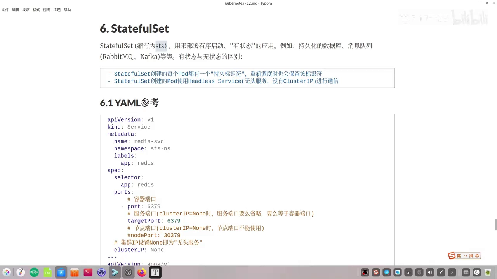

无头服务有几个关键点：

- **`clusterIP: None`**：把 Service 的集群 IP 设为 `None`，这就是「无头服务」最显著的标志。
- **端口**：这里只指定**容器端口**即可；对无头服务而言，**service port（服务端口）要么省略、要么等于容器端口**。演示时我们会把它省略不写。
- **`nodePort` 不能用**：所以文件里虽然列出了这一项，但前面特意加了注释符号把它注释掉。

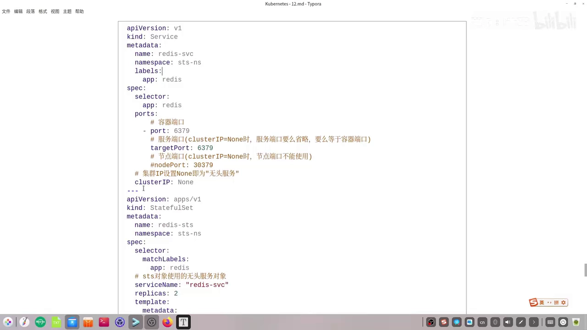

### 2.2 StatefulSet 部分

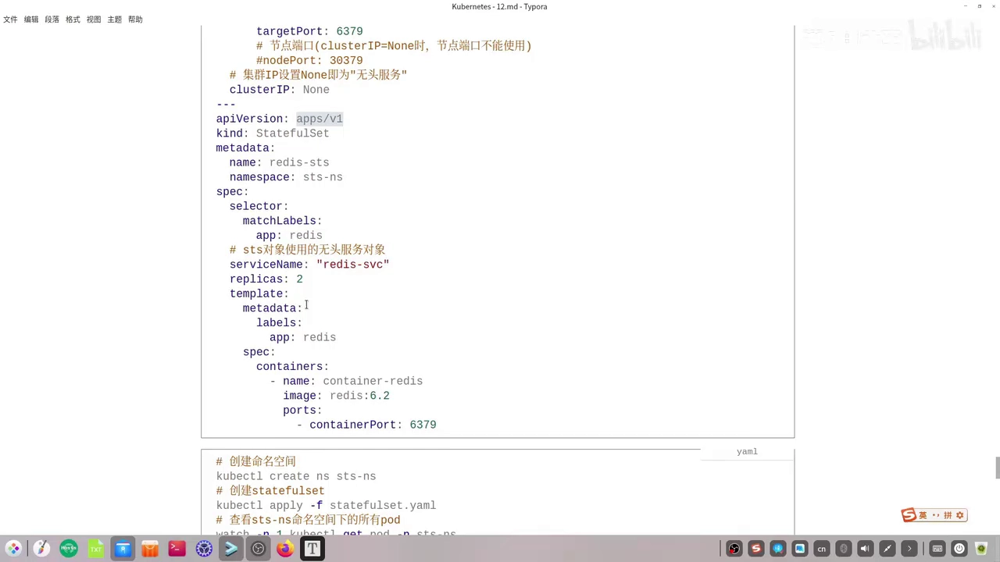

- `apiVersion` 是 **`apps/v1`**，和 Deployment 一样；
- 大部分配置项与 Deployment 类似；
- **最重要的区别是 `serviceName`**：它指明当前 StatefulSet 要使用哪个 Service。样本里填的是 `redis-svc`，也就是上半部分定义的那个无头服务。

⚠️ 由此引出一条硬性顺序：**创建 StatefulSet 之前，必须先创建好它 `serviceName` 引用的那个 Service**，因为 StatefulSet 的配置里引用了它。

[【跳转到 01:00】](https://www.bilibili.com/video/BV1A2q6YsEZ7/?t=100)

### 2.3 创建与命名规律

实际 `kubectl apply -f` 创建时，如果命名空间（`sts-ns`）还没建好会先报错，补一个命名空间即可。创建成功后查看 Pod，会发现命名规律非常整齐：

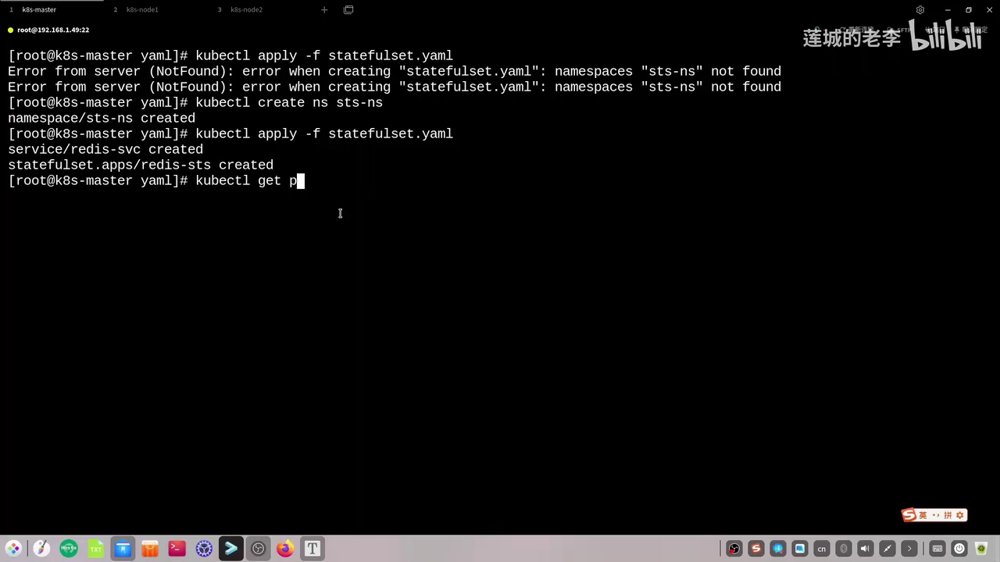

- Pod 名 = **StatefulSet 对象名 + 序号**，序号**从 0 开始**；
- 副本数是 2，就只有两个 Pod；把副本数调大，序号会依次递增：0、1、2、3……排下去。

[【跳转到 02:00】](https://www.bilibili.com/video/BV1A2q6YsEZ7/?t=200)

---

## 三、稳定的网络唯一标识：删除重建也不换名字

StatefulSet 创建的 Pod 拥有**保持不变的网络唯一标识**，格式就是「**StatefulSet 控制器名 + 序号**」，也就是刚才看到的那种命名。

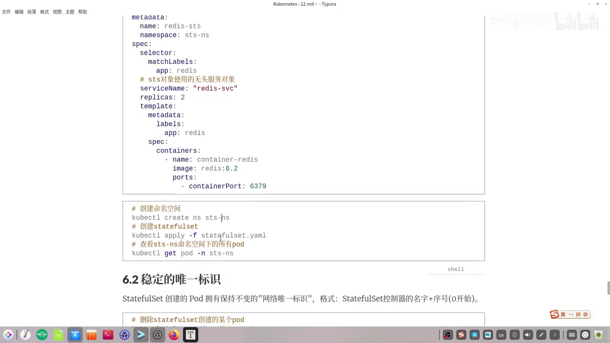

### 3.1 实验：删掉 Pod，看它如何「复活」

用 `kubectl delete pod` 删掉第一个 Pod，同时用 `watch -n1 kubectl get pod` 观察实时变化：

- 删除后，Pod 会被**重建**；
- 重建后的 Pod，**网络唯一标识没有改变**。

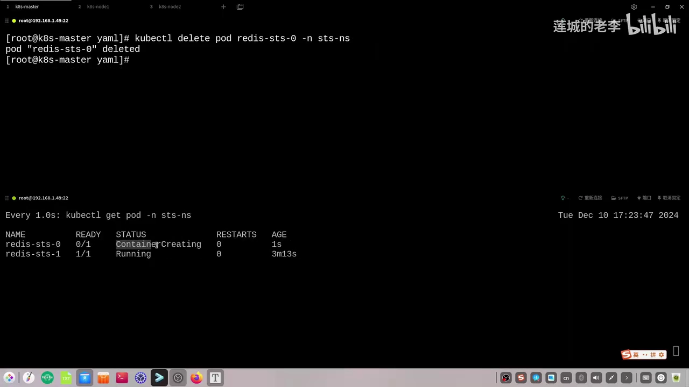

### 3.2 对比：Deployment 的 Pod 是「可随意替换」的

对 Deployment 做同样的删除，观察到的现象完全不同：

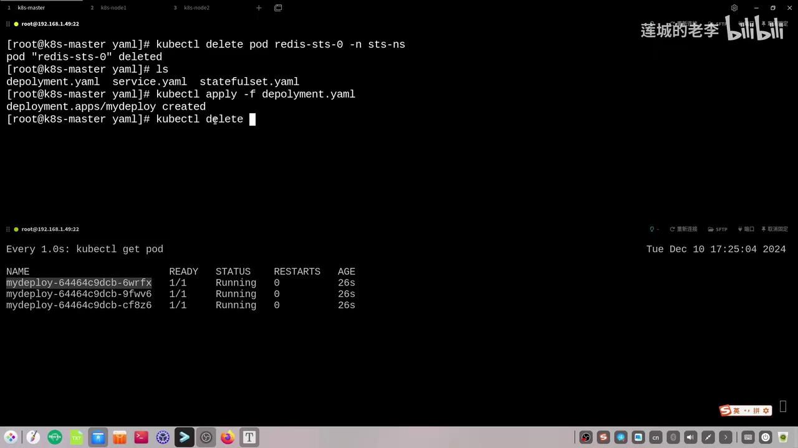

Deployment 的 Pod 名里带随机串（哈希），删掉一个后，会立刻新建一个**名字不同**的 Pod 来顶替。这说明：**Deployment 的 Pod 是可以被随意替换的**，一个消失、另一个顶替，毫无影响。

### 3.3 为什么有些场景必须「不可替换」

但在某些场景下，Pod 就是不能随便替换。典型例子是**搭建 Redis 主从集群**：主节点与各从节点在配置上截然不同，主节点 Pod 有着**无法被替换的地位**。如果主节点的标识变来变去，整个集群就没法正常工作。

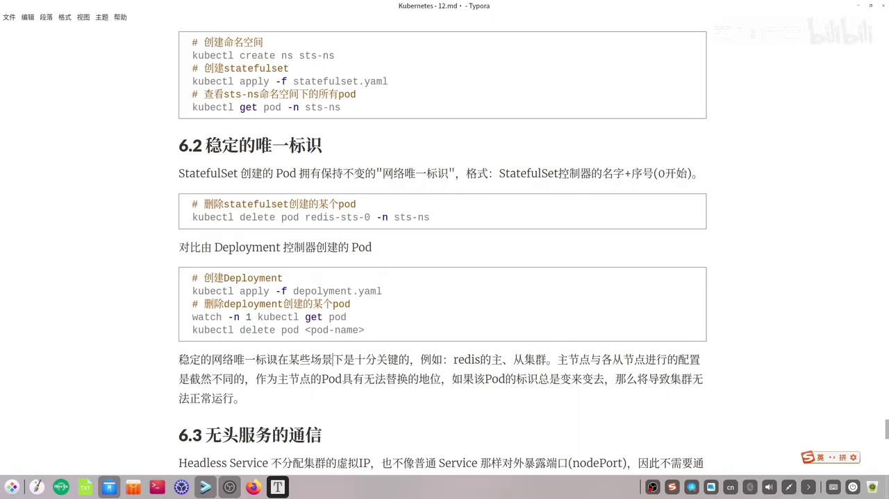

正因如此，StatefulSet 给 Pod 的**稳定网络标识**在分片、主从这类场景里非常关键。

[【跳转到 03:22】](https://www.bilibili.com/video/BV1A2q6YsEZ7/?t=322)

---

## 四、无头服务与 Pod 的访问

### 4.1 无头服务到底「无」在哪里

无头服务**不分配集群 IP**，也**不像普通 Service 那样对外暴露端口**。由此可推出一个结论：**它不需要通过负载均衡来分配流量**；默认情况下，**集群外部也无法直接访问它**。

可以用一个直观的比喻来记：「头」好比服务的入口，找不到这个入口，就成了「无头」。在**集群内部**，这个无头服务是可以被访问的。

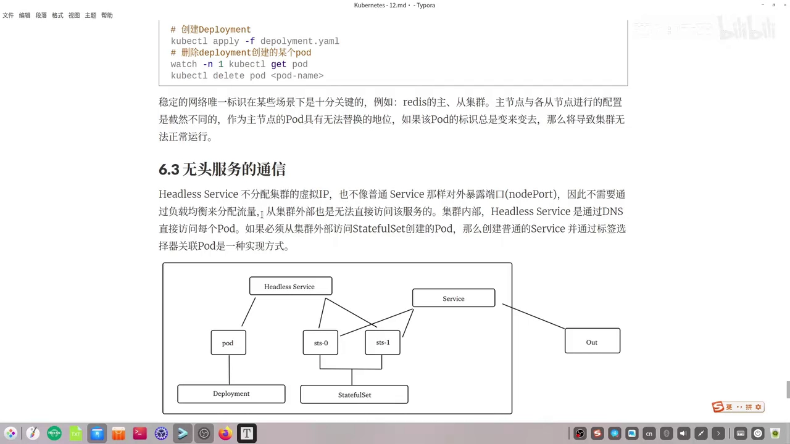

### 4.2 集群内部访问的格式

在集群内部访问无头服务，域名格式为：

```
<服务名>.<命名空间>.svc.cluster.local
```

其中 `svc.cluster.local` 这段后缀**实际使用中可以省略**。如果要访问**某个特定 Pod** 上的服务，就在前面再加上 Pod 名字：

```
<pod 名>.<服务名>.<命名空间>.svc.cluster.local
```

### 4.3 实验：用 nslookup 解析

视频进入一个容器，用 `nslookup`（做域名解析与故障排查的命令）来验证。

- 解析无头服务名（`redis-svc.sts-ns`）时：

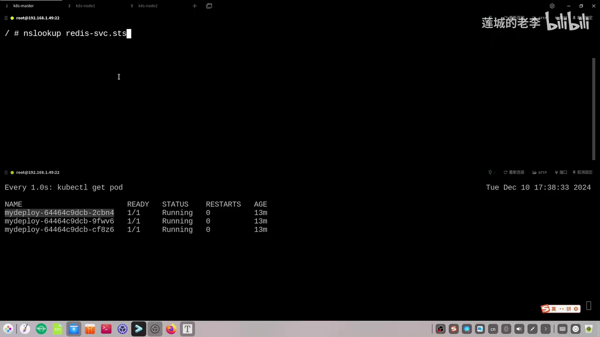

会返回**两个 Pod 的 IP 地址列表**——服务是存在的，且覆盖到每个 Pod。

- 解析某个具体 Pod 时（在前面加上 Pod 名，如 `redis-sts-0`），会返回**那个 Pod 自己的 IP**。

### 4.4 集群外部访问：还得靠普通 Service

如果一定要从**集群外部**访问 Redis，就**只能用普通的 Service**了。文件里的 Service 通过 **`labels`（标签选择器）**关联到前面那两个 Pod，从而为它们提供一个统一的访问入口。

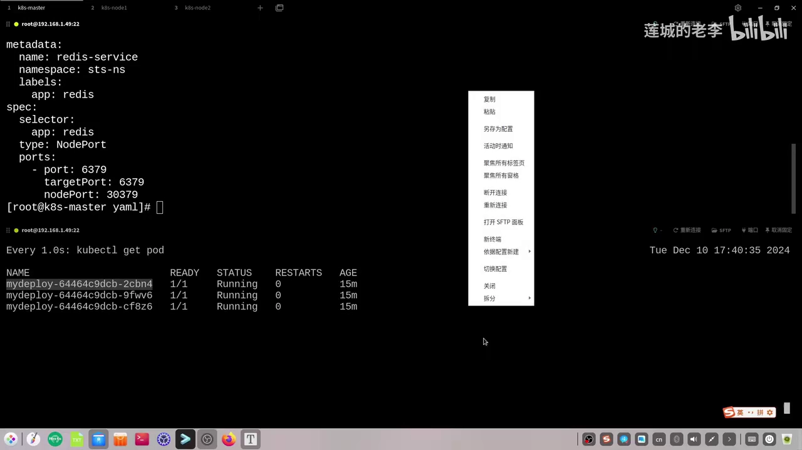

视频里创建这个 Service 时用的是 **NodePort**，节点端口是 `30379`。随后在**集群之外的物理机**上用 Redis 客户端连接「任意一个节点 IP + 30379」（注意：**不能再用 Redis 默认的 6379**），成功连上了集群内的 Redis。

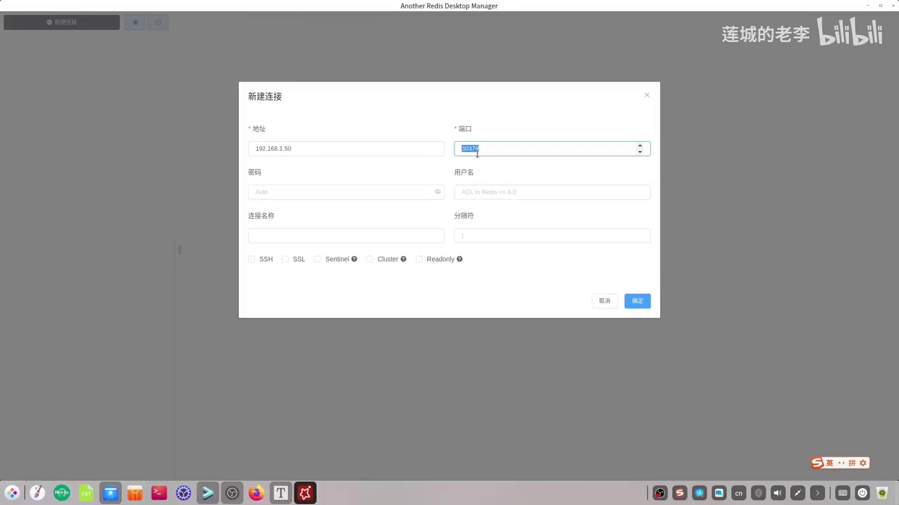

[【跳转到 04:09】](https://www.bilibili.com/video/BV1A2q6YsEZ7/?t=409)

---

## 五、动态扩缩容：用命令改副本数

StatefulSet 支持动态扩缩容，也支持用 HPA 自动扩缩容。不过要提醒一句：**StatefulSet 创建的通常是有状态服务，副本数一般不建议随意修改**，所以视频只用命令演示手工扩缩容，不再演示 HPA。

命令形如：

```
kubectl scale statefulset <名字> -n sts-ns --replicas=5
```

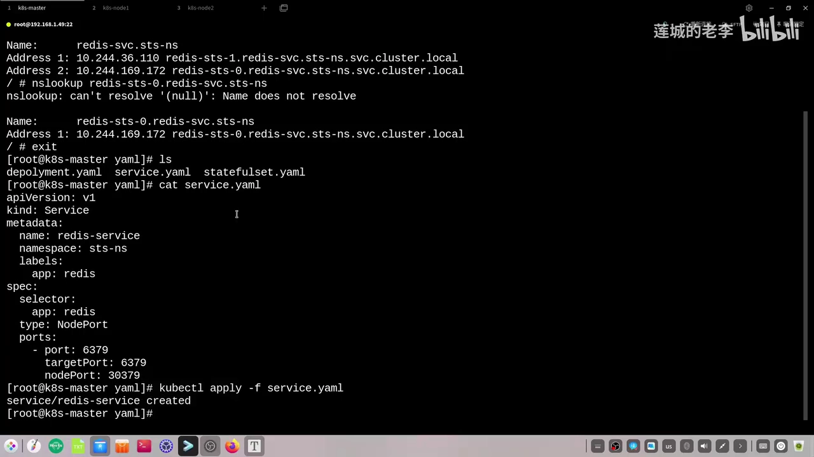

用 `watch` 观察会发现，副本数立刻就变成了 5；再把它缩回 3，也马上生效。

[【跳转到 06:48】](https://www.bilibili.com/video/BV1A2q6YsEZ7/?t=648)

---

## 六、更新策略：OnDelete 与 RollingUpdate

更新策略由 `spec.updateStrategy` 控制，它有两个子项：`type` 和 `rollingUpdate`。

> 注意一个易混点：**Deployment 里这个字段叫 `strategy`，StatefulSet 里叫 `updateStrategy`**，子项则大体相同。

`type` 支持两种取值：

- **`OnDelete`**：手动删除旧 Pod 来触发新 Pod 更新，属于**半自动**方式；
- **`RollingUpdate`**：滚动更新，**全自动**，也是**默认值**。

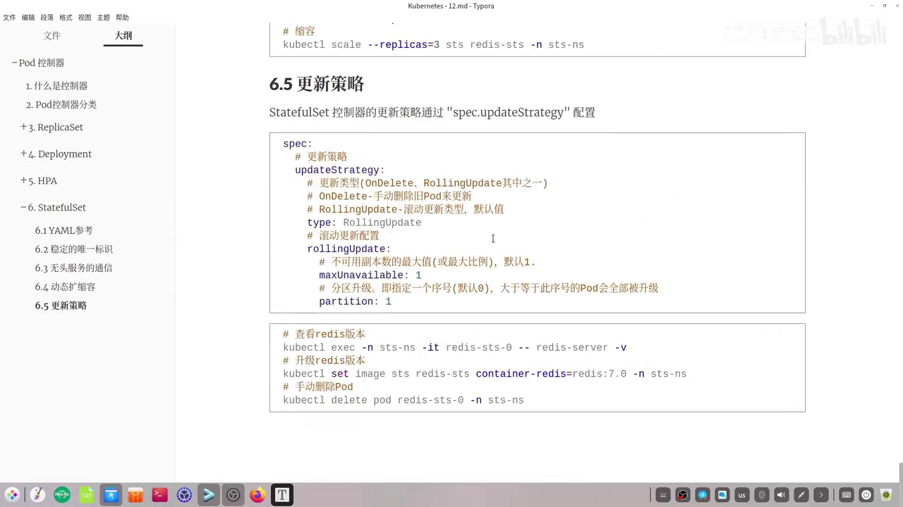

### 6.1 滚动更新的细节配置

在 `RollingUpdate` 之下，还可以设置 `rollingUpdate`（首字母小写）的详细配置：

- **`maxUnavailable`**：整个更新过程中只允许一个副本处于不可用状态，**默认值为 1**；
- **`partition`（分区更新）**：StatefulSet 特有。它指定一个序号，**大于等于该序号的 Pod 会被升级，小于它的 Pod 不升级**。

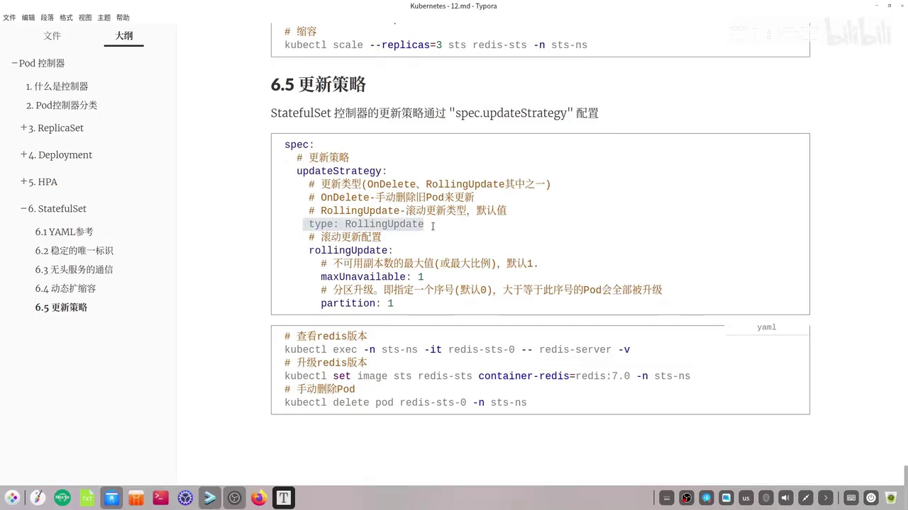

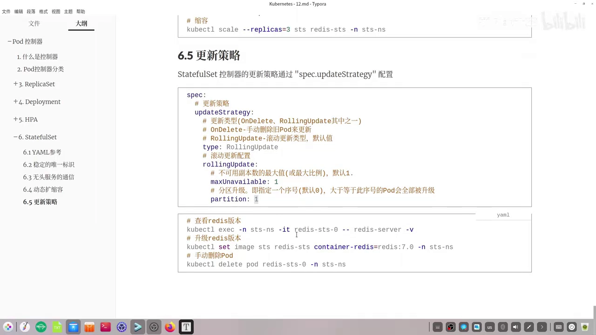

### 6.2 实验一：OnDelete

先看三个 Pod 的版本——进入 Pod 执行 `redis-server -v`，版本都是 **6.2**。然后发送升级指令，把 Redis 版本升到 **7.0**。

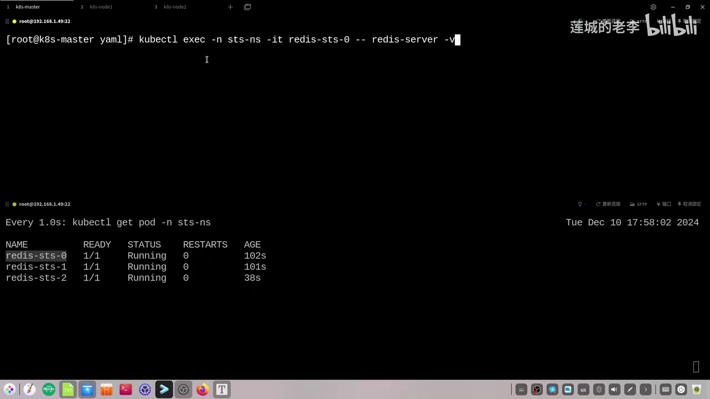

在 `OnDelete` 策略下，**Pod 不会自动更新**。必须手动删掉旧 Pod，重建时才会用新版本：

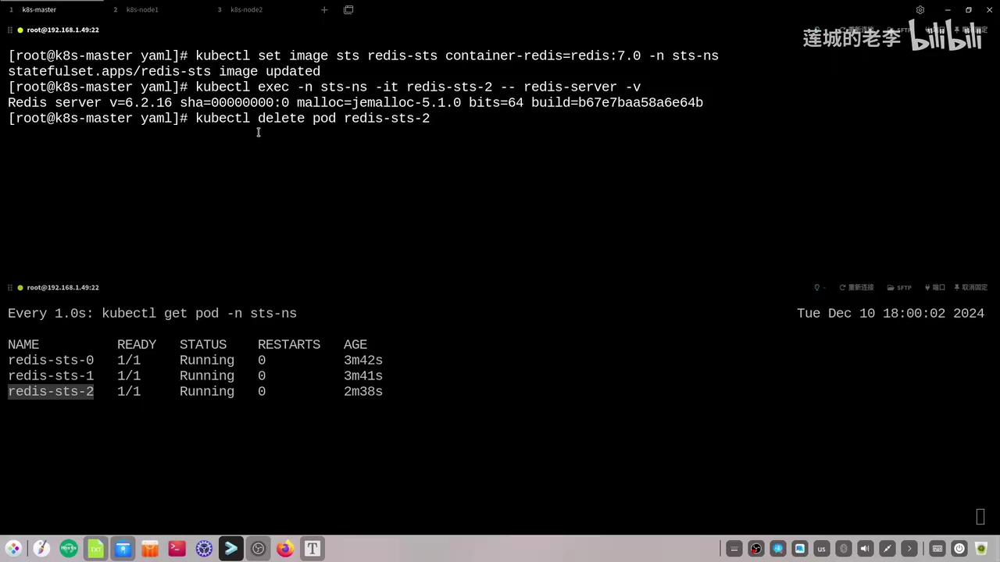

删掉序号为 2 的 Pod 后，它重建升级到了 7.0；而没删的序号 0 的 Pod，版本仍是 6.2。这就是 `OnDelete` 的效果——当然，因为它要手动删，用得并不多。

### 6.3 实验二：RollingUpdate + partition

把更新策略改为滚动更新，并设置 **`partition: 1`**，也就是「序号 ≥ 1 的 Pod 才会更新，序号 0 不动」。重新 `apply` 后再次发送升级指令：

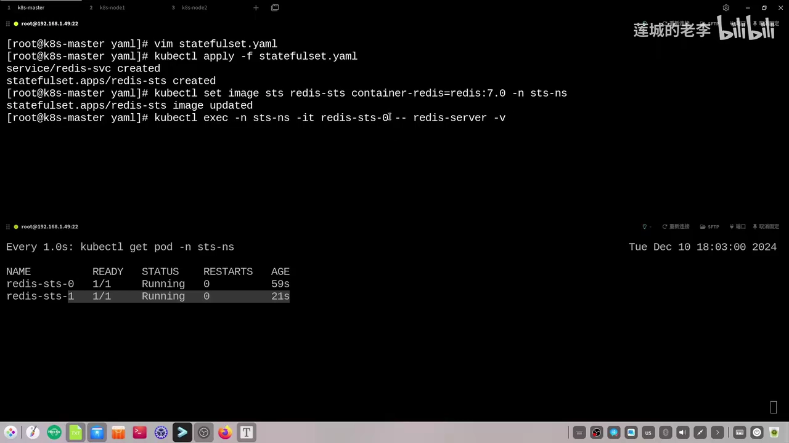

结果完全符合预期：序号 1 的 Pod 自动升级到了 7.0，序号 0 的 Pod 没有升级。**用 `partition` 就能做「金丝雀 / 分阶段」更新**——先放行高序号的 Pod，观察没问题（或不影响主节点）再逐步放开。

[【跳转到 07:44】](https://www.bilibili.com/video/BV1A2q6YsEZ7/?t=744)

---

## 小结

- **StatefulSet 两大特点**：Pod 有稳定持久的唯一标识；通过 headless Service 通信。
- **定义要点**：无头服务用 `clusterIP: None`；StatefulSet 用 `serviceName` 引用它，**必须先建 Service 再建 StatefulSet**。
- **命名规律**：Pod 名 = StatefulSet 名 + 从 0 开始的序号；删除重建后**名字和标识不变**，而 Deployment 的 Pod 名字带随机串、可随意替换。
- **访问方式**：集群内用 `<pod>.<service>.<ns>.svc.cluster.local`（前后缀可按需省略）；集群外必须借助普通 Service（如 NodePort）。
- **扩缩容**：`kubectl scale`；有状态服务副本数一般不建议随意改。
- **更新策略**：`updateStrategy.type` 取 `OnDelete`（手动，半自动）或 `RollingUpdate`（默认，全自动）；`rollingUpdate` 下有 `maxUnavailable`（默认 1）和 `partition`（分区，序号 ≥ partition 才更新）。

## 关键术语速查

| 术语 | 一句话解释 |
| --- | --- |
| StatefulSet | 部署有状态应用的控制器，给 Pod 稳定的名字序号与通信方式。 |
| headless Service | `clusterIP: None` 的 Service，不分配集群 IP、不走负载均衡，用于发现每个 Pod。 |
| `serviceName` | StatefulSet 中指定所用无头服务的字段，决定了 Pod 的 DNS 子域。 |
| 稳定唯一标识 | Pod 名 = 控制器名 + 序号，删除重建后保持不变。 |
| DNS 子域 | `<pod>.<service>.<ns>.svc.cluster.local`，用于在集群内精确定位某个 Pod。 |
| `updateStrategy` | StatefulSet 的更新策略字段（Deployment 里叫 `strategy`）。 |
| `OnDelete` | 手动删除旧 Pod 才更新的半自动策略。 |
| `RollingUpdate` | 自动滚动更新，StatefulSet 的默认策略。 |
| `partition` | 分区更新序号阈值：序号 ≥ partition 的 Pod 才更新。 |
| `maxUnavailable` | 滚动更新中允许不可用的副本数，默认 1。 |
| NodePort | 通过「节点 IP + 端口」把服务暴露到集群外的一种 Service 类型。 |
