# StatefulSet 运行机制详解：有状态应用如何在 Kubernetes 上稳定跑起来

> 本文整理自 B 站视频《【Kubernetes】第八章 使用 StatefulSet 部署有状态多副本应用——第二节 理解 StatefulSet 运行机制》。

## 本讲要解决的核心问题（SCQA）

**背景**：在 Kubernetes 里，我们习惯用 Deployment 部署无状态的多副本应用——副本之间完全等价，随便哪个被删掉都会被立刻补上一个新的。

**冲突**：可 MySQL、MongoDB、Redis 这类「有状态」应用不一样：它们要把数据持久化，重启后还得认回原来那份数据。如果照搬 Deployment 的多副本做法，多个副本会指向同一份存储、互相打架。

**疑问**：Kubernetes 到底靠什么机制，让每个副本都拥有「独立的身份」和「独立的存储」，并且在 Pod 被删除、重建之后，还能认回属于自己的那份数据？

**回答（中心思想）**：这就是 **StatefulSet** 要解决的问题。StatefulSet 给每个 Pod 分配稳定的**序号**、稳定的**网络标识（固定域名）**，并借助 `volumeClaimTemplates` 为每个 Pod 单独创建一份 **PVC**；哪怕 Pod 被删除重建，序号、域名和 PVC 都保持不变，于是有状态应用得以稳定运行。下面我们先用一个「翻车实验」说明为什么需要它，再逐层拆开它的运行机制。

---

## 一、为什么 Deployment 不适合部署有状态应用

### 1.1 一个会「翻车」的实验

先准备一个引用本地存储（`localPath`）的 PVC，再用 Deployment 部署一个需要数据的应用（视频里用的是 MongoDB），副本数先设为 1。等它跑起来后，PVC 会和底层 PV 绑定——注意这里有个小细节：PVC 一开始是 `Pending` 状态，因为 StorageClass 的 `volumeBindingMode` 是 `WaitForFirstConsumer`，**必须至少有一个 Pod 来消费，PVC 才会真正创建底层 PV**。

接着把副本数从 1 扩到 3（`kubectl scale deployment ... --replicas=3`）。结果新扩容出来的两个 Pod 直接进入 `CrashLoopBackOff`，不停重启，而且都落在同一个节点上。

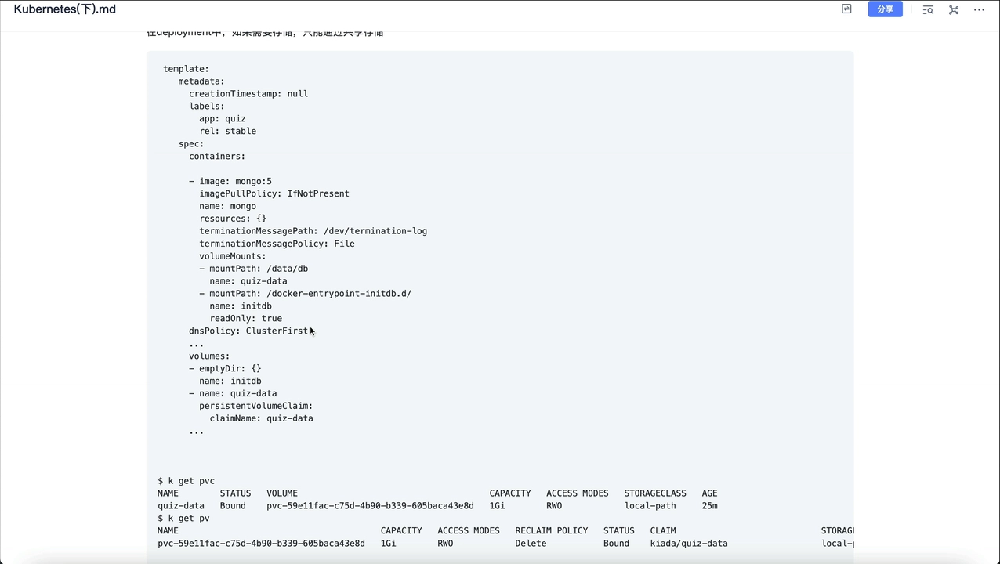

看日志（`kubectl logs <pod> -c mongo`）能看到关键报错：

```
DBException: another mongod instance is already running on the data db
```

翻译过来就是：**已经有另一个实例在使用这份数据了**，所以容器只能关停（shutting down）。

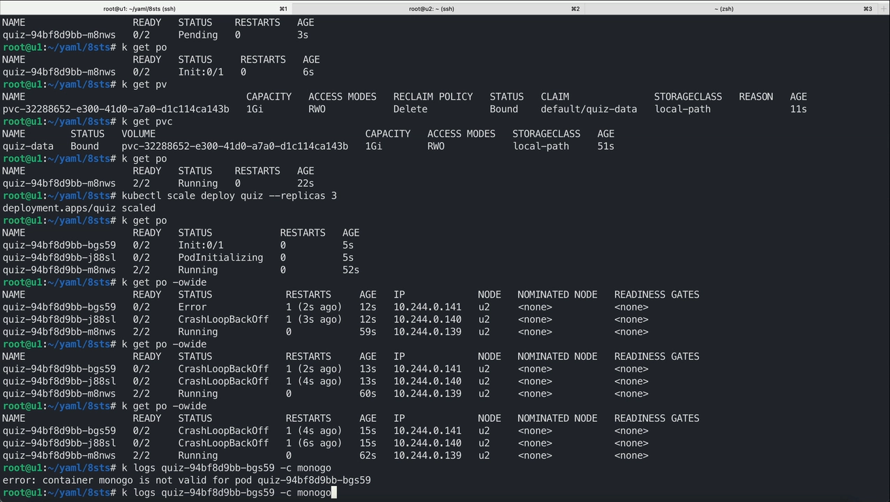

[【跳转到 04:29】](https://www.bilibili.com/video/BV1HV4y1z76c/?t=429)

### 1.2 根因：共享存储带来写冲突

为什么会这样？看下面这张图就清楚了：

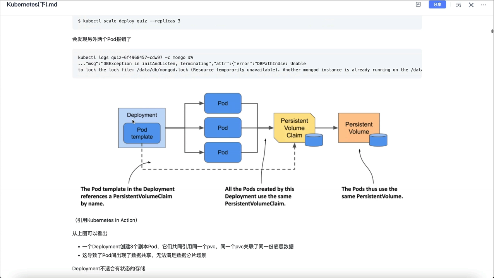

Deployment 的三个副本**共同引用了一个 PVC**，而这个 PVC 又指向同一份 PV。也就是说，三个 Pod 会同时去读写同一份数据。共享存储带来的问题正是：**多个 Pod 同时写同一份数据 → 数据冲突**，而 MongoDB 这类数据库恰恰不允许这种共享。

结论很明确：**Deployment 不适合做有状态存储。**

### 1.3 有状态 Pod 需要满足的三个条件

既然公开共享不行，那「各自独占」总行了吧？要给每个 Pod 各配一份 PV，需要满足这几个条件：

1. **每个 Pod 都要有自己的 PV（PersistentVolume）**；
2. **每个 Pod 都能通过自己唯一的地址，找到属于自己的那块卷**（这个唯一地址可以就是 Pod 的名字或某个标记）；
3. **当一个 Pod 被删除并替换时，新 Pod 会被分配到相同的地址和相同的卷**——名字不变，卷也不变。

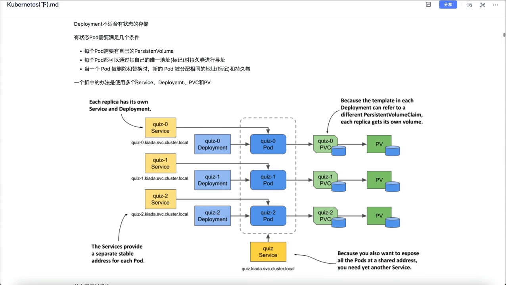

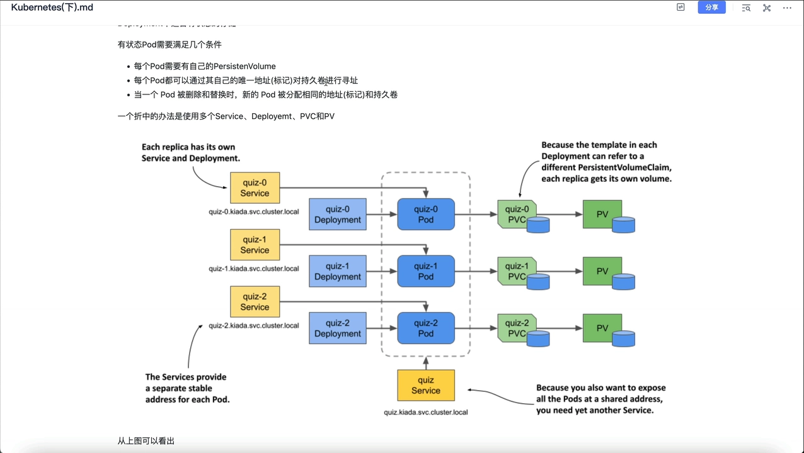

[【跳转到 04:39】](https://www.bilibili.com/video/BV1HV4y1z76c/?t=439)

### 1.4 如果硬用 Deployment 拼出这个效果，会有多麻烦

思路是这样的：给 cos0、cos1、cos2 各建一个单独的 Deployment（每个 1 副本），各建一个 Service，再各建一份 PVC……为了负载均衡，还得再建一个统一的 Service。

于是你得到了一个让人望而生畏的系统：**想扩容，都不知道该去改哪个 Deployment**；每增加一个副本，都要额外创建 Deployment、Service、PVC。整个过程极其繁琐、易错。

---

## 二、StatefulSet 与 Deployment 的四个关键差异

StatefulSet 看起来像 Deployment，但它专门为有状态工作负载量身定制。二者的核心差异有四条：

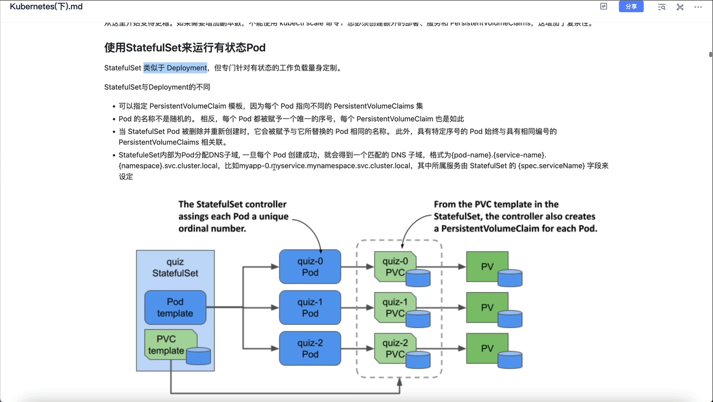

1. **有序命名**：StatefulSet 的 Pod 名字不是随机的，而是 `名字 + 序号`（`cos0`、`cos1`、`cos2`…），每个 PVC 也带上同样的序号。
2. **`volumeClaimTemplates`**：Deployment 也能挂存储，但只能共享；StatefulSet 可以指定 PVC 模板，控制器据此为**每个 Pod 自动创建一份独立的 PVC**。
3. **稳定身份**：Pod 被删除重建后，会被赋予与被替换 Pod 相同的名字，从而关联回原来的数据。
4. **每个 Pod 一个 DNS 子域**：见下一章。

对比命名规则能看出关键差别：

- Deployment 的 Pod 名 = `Deployment 名 + ReplicaSet 哈希 + Pod 随机哈希`；
- StatefulSet 的 Pod 名 = `StatefulSet 名 + 序号`。

正因为用的是**固定序号**，删除某个 Pod 后我们立刻知道缺的是哪一个，重建一个同名 Pod 就能接回原来的数据。

[【跳转到 06:45】](https://www.bilibili.com/video/BV1HV4y1z76c/?t=645)

---

## 三、用 headless Service 给每个 Pod 一个固定域名

### 3.1 什么是 headless Service

StatefulSet 通常用于数据分片场景，需要能「点名」找到每一个 Pod，所以要先创建一个 **headless Service（无头服务）**：它的 `clusterIP` 为 `None`，不分配虚拟 IP，也就不走负载均衡。

创建时，StatefulSet 通过 `spec.serviceName` 引用这个 headless Service；**必须先建好这个 Service，再建 StatefulSet**，因为 StatefulSet 的配置里引用了它。

### 3.2 DNS 子域的格式

一旦 StatefulSet 引用了 headless Service，控制器就会为每个 Pod 分配一个 DNS 子域，格式为：

```
<pod 名>.<服务名>.<命名空间>.svc.cluster.local
```

例如 `myapp-0.my-service.my-namespace.svc.cluster.local`。其中「服务名」正是由 `spec.serviceName` 指定的。

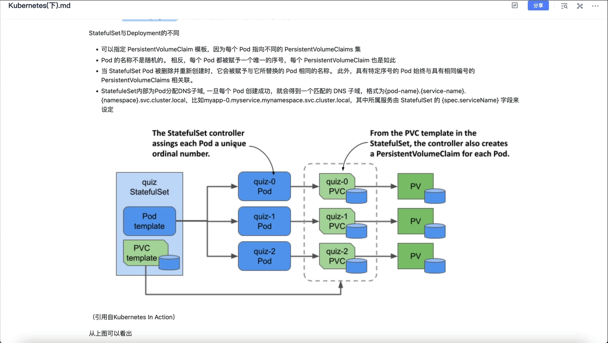

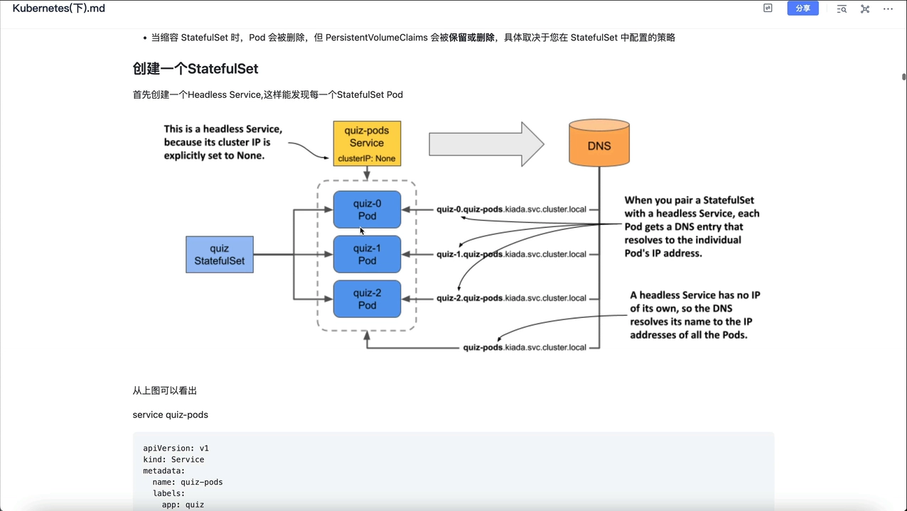

### 3.3 实验验证

进入任意一个 Pod，用 `nslookup` 解析 headless Service 的名字：

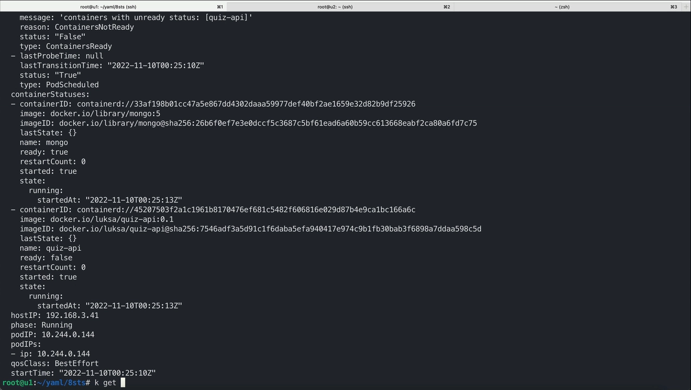

它会返回**三个 Pod 的 IP 列表**——这正好说明每个 Pod 都能被单独发现。

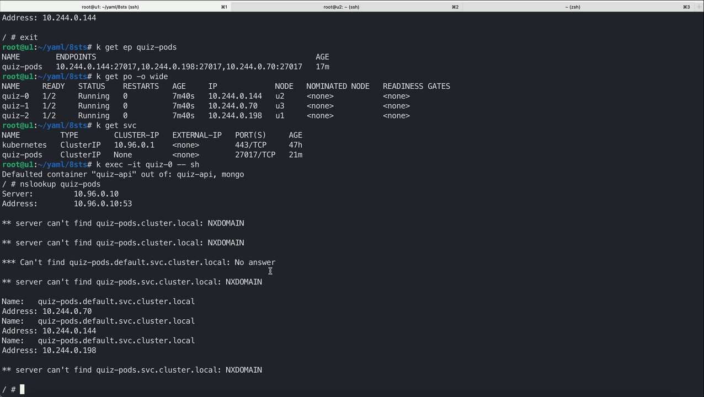

小结一句实用经验：**访问时要用完整域名**（`cos0.cspod-svc.default.svc.cluster.local`），直接写短名字 `cos0.cspod-svc` 是解析不到的。

[【跳转到 16:32】](https://www.bilibili.com/video/BV1HV4y1z76c/?t=1632)

---

## 四、运行机制：Pod 删除重建后，身份与数据如何保持不变

这部分是「运行机制」的核心：**如果一个 StatefulSet 的 Pod 被删除、并被控制器替换为一个新实例，那么这个副本会保持相同的身份，并与相同的 PVC 关联。**

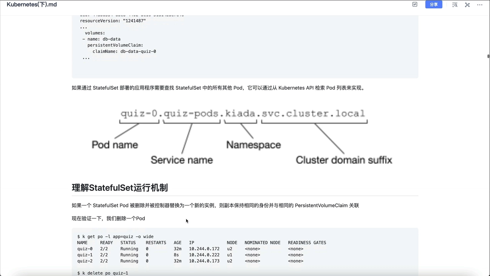

### 4.1 怎么「认出」一个 Pod 属于哪个版本、哪个控制器

看 Pod 的 label，能看到一个 **ControllerRevision 哈希**——它标明当前 Pod 属于哪个版本，供 StatefulSet 控制器识别；这是我们 StatefulSet 特有的版本控制机制，和 Deployment 的 PodTemplate 哈希类似。label 里还带着 `podname`（如 `cos0`）。

再看 Pod 的 `ownerReference`：所有者是这个 StatefulSet。**要区分一个 Pod 归属于 StatefulSet 还是 ReplicaSet，看 `ownerReference` 就够了。**

### 4.2 实验：删掉一个 Pod，它会「复活」成同一个身份

在 u3 节点上有一个 cos1 副本，把它删掉（`kubectl delete pod cos1`）。重建后对比观察：

- Pod 名字不变（还是 cos1）；
- PVC 名字不变，PV 也不变；
- 只有 **IP 变了**，其他都没变。

### 4.3 关键拼图：本地卷的节点亲和性

一个新问题：重建的 cos1 为什么还是落在 u3 节点上？因为**本地卷（localPath）的 PV 带有节点亲和性（nodeAffinity）**，PVC 关联到这个 PV，于是调度器会把新 Pod 调度回 u3，继续去挂载 `hostPath` 后面拼着 PV 名字的那个路径。

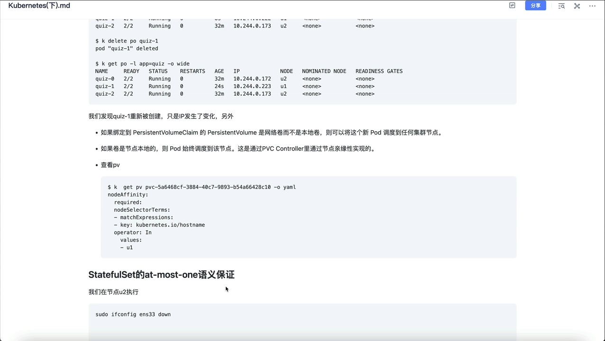

顺带一提：**如果这块 PV 是网络卷而不是本地卷**，那么新 Pod 就可以被调度到任意节点——PV 的类型决定了这份「亲和」是否存在。

[【跳转到 17:48】](https://www.bilibili.com/video/BV1HV4y1z76c/?t=1748)

---

## 五、at-most-one：节点故障时为什么「不着急」重建

StatefulSet 有一个重要保证：**at-most-one（最多一个）——最多只有一个 Pod 引用某个 PVC。**

视频用一个「拔网线」实验来演示：关掉跑着 cos1 的 u3 节点，观察这个 Pod 会怎样。

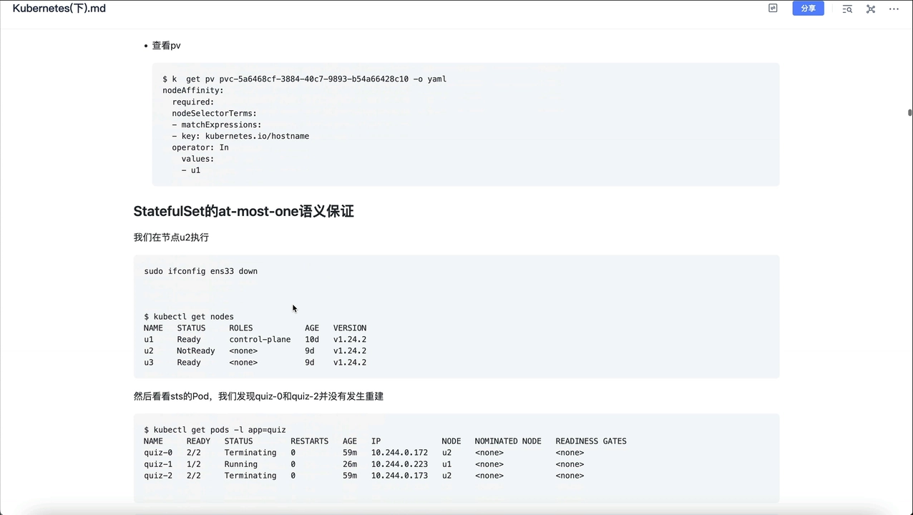

### 5.1 现象与原因

节点变成 `NotReady` 后，上面的 cos1 变成了 `Terminating` 状态，**并没有被重建到别的节点**。原因在于：StatefulSet 控制器在节点异常时不会立刻在别处重建 Pod——因为那样会出现「同一个身份的两个实例同时运行」，把数据写成两份。这正是 `at-most-one` 想防住的**数据冲突**。

### 5.2 手动删除后为什么会 Pending

如果我们手动把 `Terminating` 的 Pod 强制删掉，新 Pod 会进入 `Pending`。`describe` 一下就会发现：原节点被打上了污点，另外两个节点又不满足节点亲和性——**没有任何节点能调度它**。

要让它跑起来，可以把那份 PVC 删掉（`kubectl delete pvc`），或者**等节点恢复**。等节点恢复的话，Pod 会继续在 u3 上运行、数据仍在。

### 5.3 反例：删除 PVC 会永久丢失数据

视频特意演示了错误做法——不等节点恢复，直接**删 Pod + 删 PVC**：

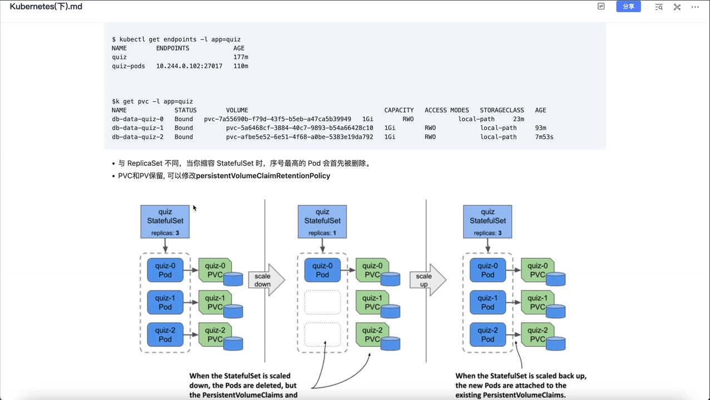

结果是：新的 Pod 虽然还叫 cos1，却被调度到了 u2 节点，用的是 u2 上新的一份空数据——**u3 上原来的数据永远丢失了**。原因很简单：**删除 PVC 时，它底层关联的 PV 也会被一并删除。**

> 一句话记住：**节点故障可以等，PVC 千万别乱删。**

[【跳转到 20:40】](https://www.bilibili.com/video/BV1HV4y1z76c/?t=1240)

---

## 六、扩缩容、PVC 保留策略与 podManagementPolicy

### 6.1 缩容：删掉序号最大的 Pod，数据默认保留

把副本从 3 缩到 1 时会发现：**序号最高的 Pod 先被删除**，最后留下 cos0；Service 的 Endpoint 从三个 IP 变成一个；而 **PVC 完全没变**。

默认情况下，缩容和删除 StatefulSet 时 **PV/PVC 都保留**。所以对这组 StatefulSet 再扩容时，同名的 Pod 会重新关联到已有的 PVC 上——比如扩到 4 个副本，会新增一个 cos3 对应的 PVC，而原有的 PVC 继续引用原有 PV，数据毫无变化。

### 6.2 PVC 保留策略：persistentVolumeClaimRetentionPolicy

如果想让它自动清理，可以在 StatefulSet 的 spec 里加 `persistentVolumeClaimRetentionPolicy`，它有两个字段：

- `whenScaled`：缩容时对 PVC 的处理（`Delete` 删除 / `Retain` 保留）；
- `whenDeleted`：删除 StatefulSet 时对 PVC 的处理（`Delete` / `Retain`）。

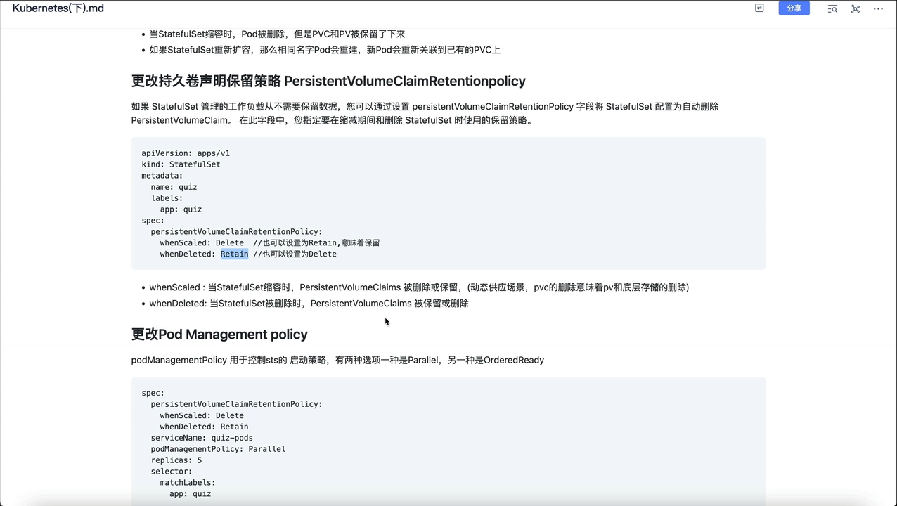

**默认两个都是 `Retain`（保留）**，这也是最安全的默认值。

### 6.3 podManagementPolicy：串行还是并行

StatefulSet 的 `podManagementPolicy` 有两个取值：

- **`OrderedReady`（默认）**：Pod **按序号升序一个一个创建**，创建好并「就绪」后才创建下一个；扩容、替换也遵循同样规则；**缩容时按相反顺序**依次删除，删完一个再删下一个。
- **`Parallel`**：**并行**创建/删除所有 Pod，不等待单个 Pod 就绪。

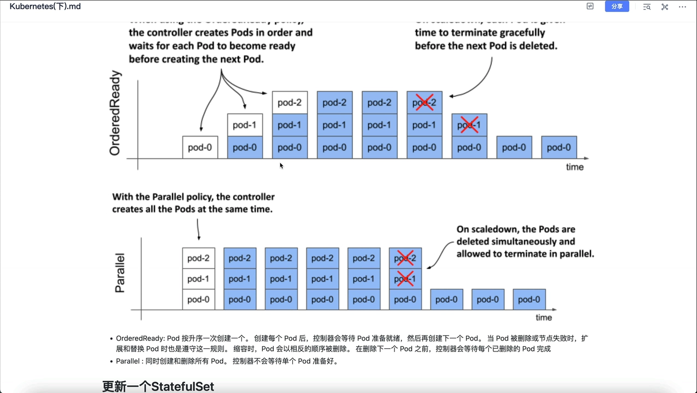

对依赖启动顺序的集群（比如主从数据库），`OrderedReady` 的串行保证非常关键。

[【跳转到 28:33】](https://www.bilibili.com/video/BV1HV4y1z76c/?t=1713)

---

## 小结

- **Deployment 不适合有状态应用**：多副本共享同一份存储 → 写冲突（MongoDB 会直接报 `another mongod instance is already running`）。
- **StatefulSet 的四大特征**：有序命名、`volumeClaimTemplates` 给每个 Pod 独立 PVC、删除重建保持同名同卷、每个 Pod 一个 DNS 子域。
- **稳定身份靠两件事**：Pod 名用固定序号 + PVC 名与 Pod 名绑定；`ownerReference` 表明归属，ControllerRevision 标明版本。
- **headless Service**（`clusterIP: None`）让每个 Pod 拥有 `pod.service.ns.svc.cluster.local` 形式的固定域名，访问要用完整域名。
- **at-most-one 保证**：节点故障时不急于重建，避免同身份实例并发写坏数据；等节点恢复即可。
- **删除 PVC 会连带删除 PV**，导致数据永久丢失——这是最常见的「手滑」事故。
- **缩容删最高序号**，默认保留 PV/PVC，重新扩容复用；用 `persistentVolumeClaimRetentionPolicy` 可改为自动删除。
- **`podManagementPolicy`**：`OrderedReady` 串行有序（默认），`Parallel` 并行。

## 关键术语速查

| 术语 | 一句话解释 |
| --- | --- |
| StatefulSet | 面向有状态应用的控制器，给每个 Pod 稳定的序号、网络标识与存储。 |
| 有状态应用 | 运行中会保存数据、重启后仍需接回原数据的应用（如 MySQL、MongoDB）。 |
| volumeClaimTemplates | StatefulSet 中的 PVC 模板，控制器据此为每个 Pod 创建独立 PVC。 |
| PVC / PV | PersistentVolumeClaim 是「存储申请单」，PV 是真正的一块存储。 |
| headless Service | `clusterIP: None` 的 Service，不分配虚拟 IP，用于发现每一个 Pod。 |
| DNS 子域 | 每个 Pod 的固定域名：`pod.service.ns.svc.cluster.local`。 |
| ownerReference | 记录 Pod 的「所有者」是哪个控制器，可据此区分 StatefulSet 与 ReplicaSet。 |
| ControllerRevision | StatefulSet 用来记录版本的机制，体现为 Pod label 上的哈希。 |
| nodeAffinity（节点亲和性） | 本地卷 PV 自带的约束，使 Pod 必须调度回数据所在的节点。 |
| at-most-one | StatefulSet 的保证：最多一个 Pod 引用某 PVC，避免同身份实例并发写。 |
| persistentVolumeClaimRetentionPolicy | 控制缩容/删除 StatefulSet 时 PVC 是删除还是保留（默认保留）。 |
| podManagementPolicy | Pod 的创建/删除顺序：`OrderedReady`（串行）或 `Parallel`（并行）。 |
