# DaemonSet 控制器详解：让守护进程在每个节点上恰好跑一份

> 本文整理自 B 站视频《K8s 原生技术之 DaemonSet 控制器详解》。文中时间戳均可点击跳转回原视频。

## 本讲要解决的核心问题（SCQA）

**背景**：在 Kubernetes 里，我们习惯用 Deployment 部署无状态应用——副本之间完全等价，Pod 会被调度器随机分到某个节点上，谁多谁少都无所谓。

**冲突**：可有一类进程不一样：日志收集、监控采集、网络插件这些「守护进程」，必须在**每一个**节点上都跑一份，而且**恰好一份**。用 Deployment 做不到「每个节点恰好一个」，节点增加、减少时也没法自动跟着变。

**疑问**：Kubernetes 到底靠什么机制，保证某类 Pod 在每个「符合条件的节点」上都运行、且仅运行一个，并随节点数量自动伸缩？

**回答（中心思想）**：这就是 **DaemonSet**。DaemonSet 的职责是让每个符合条件的节点都运行、且仅运行一个 Pod 副本——所以它的 Pod 数量**取决于可用节点数**。它常用于部署日志收集、监控代理、网络插件、存储供给和安全防护这五类「节点级守护进程」。下面我们从定义、原理、使用、进阶调度到排错，逐层拆开它。

---

## 一、什么是 DaemonSet？

一句话概括：**DaemonSet 是 Kubernetes 中的一种核心控制器，它确保自己管理的 Pod 在集群里每一个「符合条件的节点」上都运行、且仅运行一个实例**。说白了，就是在每个节点上都部署一个 Pod 副本。

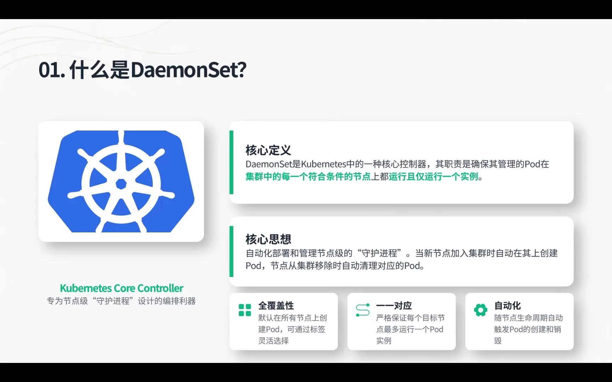

[【跳转到 00:50】](https://www.bilibili.com/video/BV1zGduBhEVg/?t=50)

### 1.1 它和 Deployment、StatefulSet 的区别

视频从三个角度做了对比，这也是理解 DaemonSet 的关键：

| 维度 | DaemonSet | Deployment | StatefulSet |
| --- | --- | --- | --- |
| **设计目标** | 每个符合条件的节点上精确运行 **1 个** Pod | 维持指定数量的等价副本 | 每个副本有稳定序号与身份 |
| **数量来源** | 取决于**可用节点数** | 由 `replicas` 指定 | 由 `replicas` 指定 |
| **调度方式** | 与节点强绑定（视频概括为「绕过 Scheduler」） | 交给调度器随意分配 | 交给调度器分配 |

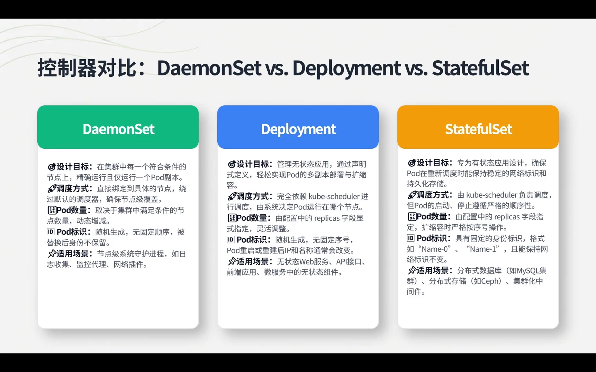

[【跳转到 01:15】](https://www.bilibili.com/video/BV1zGduBhEVg/?t=75)

- **设计目标**：DaemonSet 要在每个符合条件的节点上精确运行且仅运行一个 Pod，这是它和 Deployment、StatefulSet 最主要的区别。
- **调度方式**：视频把它概括为「DaemonSet 直接绑定到具体节点、完全绕过了 Scheduler 调度器」，从而确保每个节点都有 Pod 副本覆盖。
- **Pod 数量**：取决于集群中可用节点的数量——后期节点增加，Pod 也跟着增加；节点减少，Pod 相应减少。

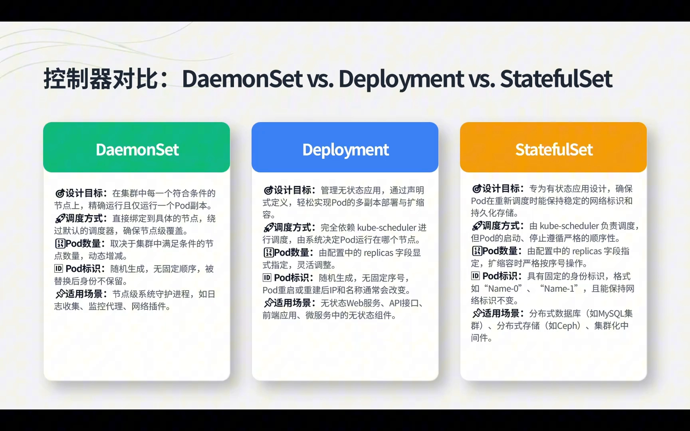

[【跳转到 01:40】](https://www.bilibili.com/video/BV1zGduBhEVg/?t=100)

> **补注（超出视频、供理解参考）**：视频把 DaemonSet 说成「完全绕过调度器」是一种简化说法。实际上，视频后面用「容忍（toleration）」把 Pod 调度到带污点的 master 节点的实验恰恰说明：现代 Kubernetes（约 1.12 起）中 DaemonSet 创建 Pod 时仍然经过默认调度器，只是控制器会通过 `nodeAffinity` 等方式把它们定向到目标节点。把「绕过调度器」理解为「不依赖常规的随机调度，而是与节点强绑定」即可。

### 1.2 通过 Pod 名字就能认出它由谁创建

视频还教了一个实用技巧——三种控制器的 Pod 命名规律不同，看名字就能猜出「出身」：

- **DaemonSet**：`DaemonSet 名字` + 一个五位随机数；
- **Deployment**：`Deployment 名字` + `ReplicaSet 名字`（含随机数）+ 哈希，至少三段式；
- **StatefulSet**：`StatefulSet 名字` + `0/1/2/3…` 这样的**序号**。

---

## 二、DaemonSet 的工作原理

DaemonSet 的核心工作流程可以概括为三步——**它本质是一个「盯着节点」的持续监控循环**：

1. **持续监控**：实时监听集群中 DaemonSet、Node 和 Pod 对象的变动事件；
2. **节点增加**：如果 Node 节点增加了，DaemonSet 会在新节点上再起一个 Pod 副本；
3. **节点减少**：如果节点减少了，DaemonSet 里也会相应减少一个 Pod 副本。

归根结底，它就是要**确保每个节点有且仅有一个**对应的 Pod。

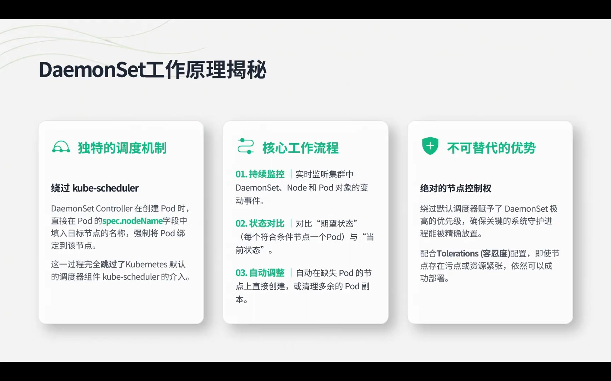

[【跳转到 03:27】](https://www.bilibili.com/video/BV1zGduBhEVg/?t=207)

---

## 三、为什么需要 DaemonSet：五大应用场景

视频总结了 DaemonSet 的五大核心应用场景，它们都是「必须在每个节点上跑一份」的典型：

1. **集群监控**：用 DaemonSet 部署一个采集器（如 Prometheus 的 Node Exporter），把 Pod 部署到每个节点上，采集各节点容器的 CPU、内存、磁盘、网络等性能指标；
2. **日志收集**：在每个节点上跑一个 Pod，收集该节点产生的日志；
3. **网络管理**：如 Calico 组件就是通过 DaemonSet 部署的——每个节点都有一个 Calico，才组成 K8s 强大的网络能力；某节点没有 Calico，就构不成完整的 K8s 网络；
4. **存储供给**：在 DaemonSet 起的 Pod 里挂载存储卷，为集群提供一些存储能力；
5. **安全防护**：在每个节点上跑一个安全防护应用，监控集群中的 Pod 或节点上应用的安全状态，例如有没有反弹 Shell、异常提权等。

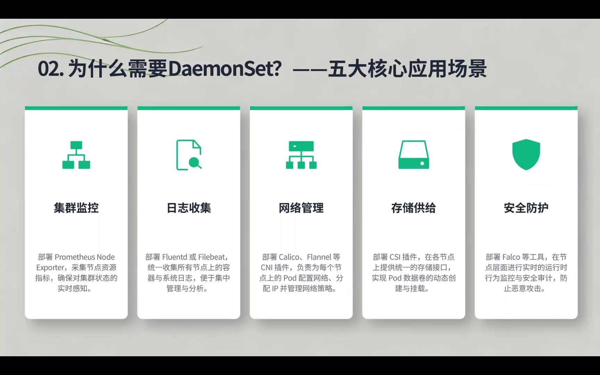

[【跳转到 04:23】](https://www.bilibili.com/video/BV1zGduBhEVg/?t=263)

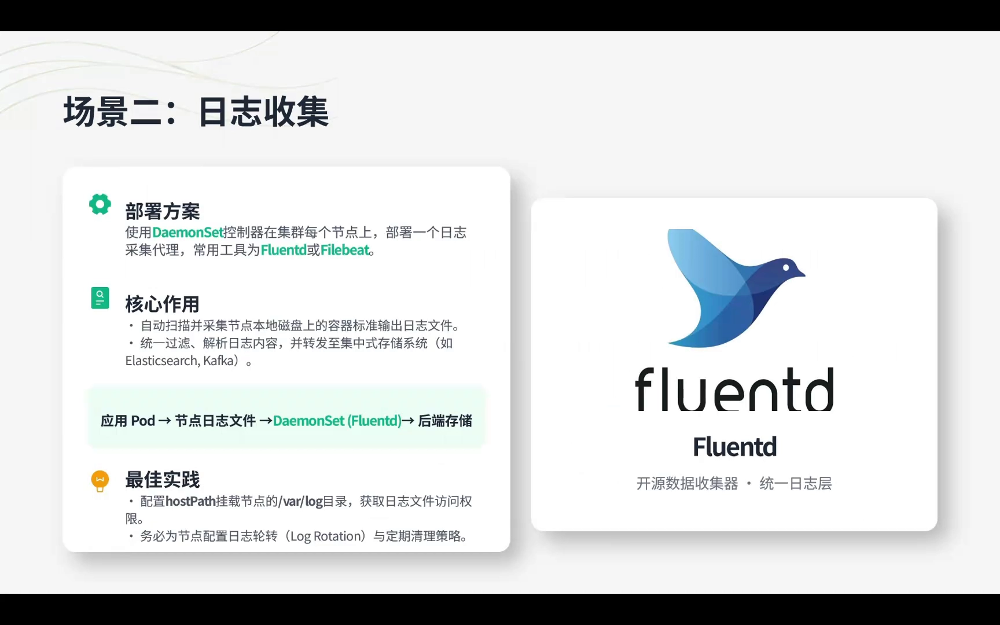

[【跳转到 05:06】](https://www.bilibili.com/video/BV1zGduBhEVg/?t=306)

---

## 四、怎么用 DaemonSet：YAML、滚动更新与回滚

### 4.1 一份 DaemonSet 的 YAML

DaemonSet 的 YAML 与 Deployment、StatefulSet 非常相似，重点字段如下：

```yaml
apiVersion: apps/v1          # 与 Deployment 一致
kind: DaemonSet
metadata:
  name: nginx-ds             # DaemonSet 名字
  namespace: default
  labels:
    app: nginx
spec:
  selector:
    matchLabels:
      app: nginx             # 选择器：匹配下面模板里的标签
  template:
    metadata:
      labels:
        app: nginx
    spec:
      containers:
        - name: nginx
          image: nginx
          imagePullPolicy: IfNotPresent   # 本地有就用本地，没有才拉取
          ports:
            - name: http
              containerPort: 80
              hostPort: 8090              # 通过「节点地址:8090」即可访问容器 80 端口
              protocol: TCP
          resources: { }                  # 资源限制，按需填写
```

和 Deployment、StatefulSet 最显眼的差别是：**DaemonSet 不需要指定副本数（`replicas`）**——因为它的副本数由工作节点数量决定。

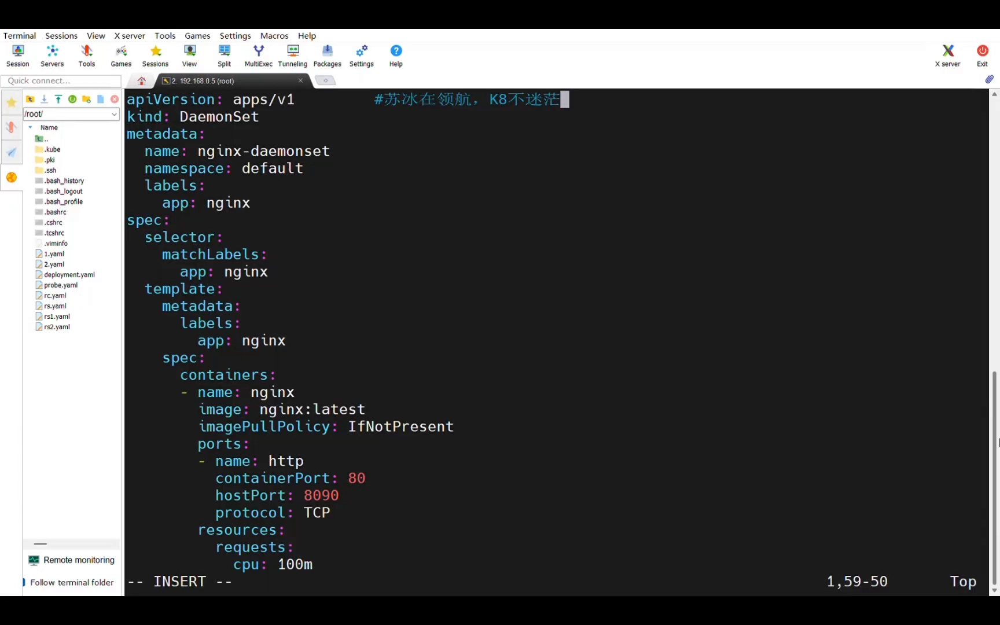

[【跳转到 12:59】](https://www.bilibili.com/video/BV1zGduBhEVg/?t=779)

### 4.2 滚动更新：为什么它是「先删旧、再建新」

这是 DaemonSet 与 Deployment 一个很有意思的差异：

- **Deployment** 是「先创建新的、再删除旧的」，以确保集群的高可用；
- **DaemonSet** 恰恰相反，是「**先删除旧的、再创建新的**」。

为什么？因为 DaemonSet 的特性是「在健康的节点上运行、且仅运行一个」。如果先建一个新的再删旧的，同一节点上就会短时出现两个 Pod，违反了这个约束，所以它只能先删后建。

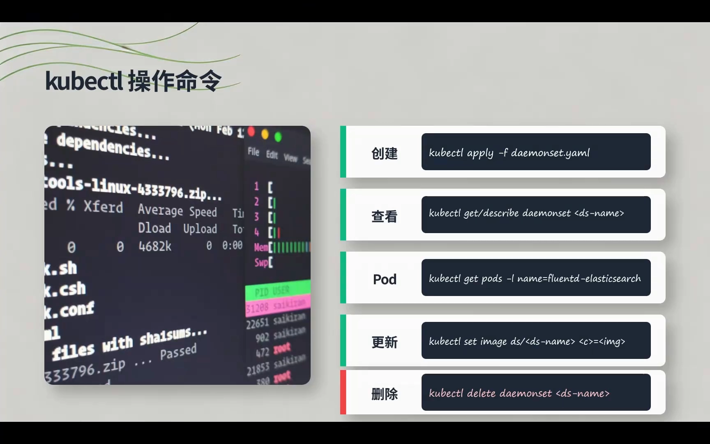

[【跳转到 07:09】](https://www.bilibili.com/video/BV1zGduBhEVg/?t=429)

### 4.3 版本回滚

版本回滚的命令与 Deployment 类似（如 `kubectl rollout history` / `kubectl rollout undo`），这里不再赘述。

---

## 五、进阶：用污点、容忍与亲和性控制调度

DaemonSet 默认会在每个节点上跑一份 Pod，但 **master 节点是例外**——它默认不被调度 Pod。要让 DaemonSet 也跑到 master 上，就要用到**容忍（toleration）**。

### 5.1 污点与容忍：把 Pod 调度到 master

master 节点自带一个污点，key 是 `node-role.kubernetes.io/master`，effect 是 `NoSchedule`（禁止调度）。要在它上面跑 Pod，就得给 Pod 配上对应的**容忍**——指定 key 与 effect 进行匹配，即可把 Pod 调度到该节点。

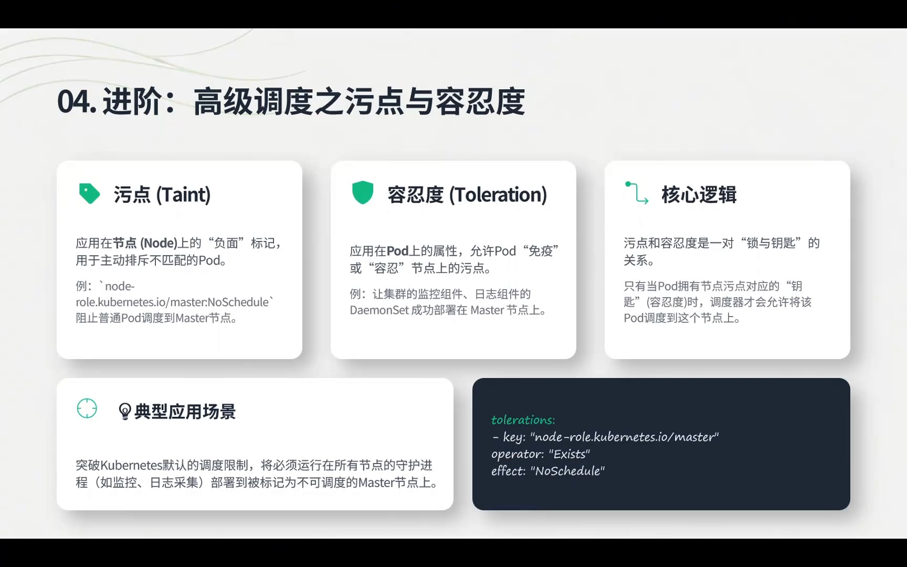

[【跳转到 08:04】](https://www.bilibili.com/video/BV1zGduBhEVg/?t=484)

### 5.2 亲和性：只想在「特定」节点上跑

反过来，如果你只希望 Pod 落在某些**特定**节点上（例如一批带 GPU 的、运行 AI 大模型的机器），可以通过**节点亲和性（affinity）**引导这些 Pod 调度到指定节点上。

> 污点、容忍与亲和性属于调度主题，视频表示会在后续课程里再详细展开，这里先建立「DaemonSet 可以这样用」的直觉即可。

---

## 六、生产环境排错指南

视频总结了几个部署 DaemonSet 时最常见的排错场景：

| 现象 | 常见原因 | 排查手段 |
| --- | --- | --- |
| Pod 处于 `Pending` | 节点资源不足，满足不了 Pod 的最低需求 | `kubectl describe node <node>` 查看节点资源使用情况 |
| Pod 无法调度到某节点 | 该节点设置了污点（如 master 默认有污点） | 检查节点污点，为 Pod 配置对应的容忍 |
| 镜像拉取失败 | 镜像名/tag 写错；或镜像仓库密钥鉴权不对、缺失 | `kubectl describe pod <pod> -n <ns>` 查看具体错误日志 |

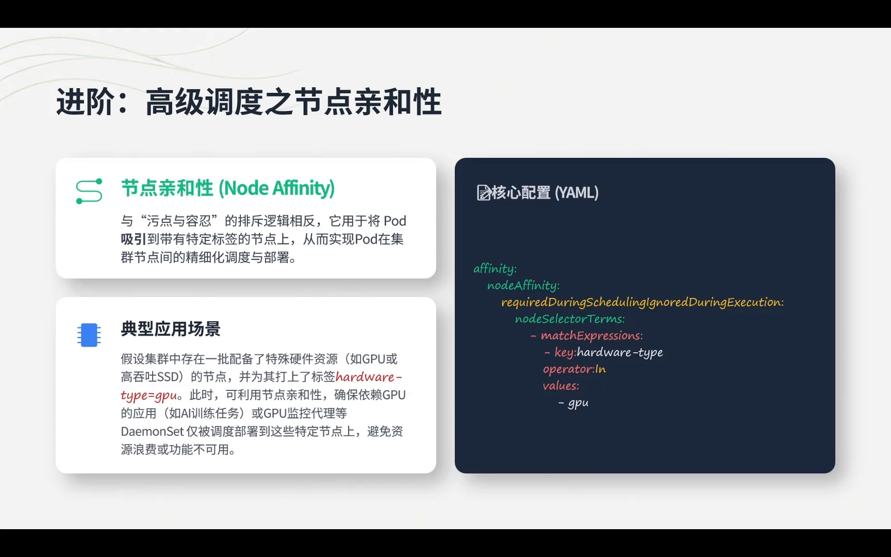

[【跳转到 09:49】](https://www.bilibili.com/video/BV1zGduBhEVg/?t=589)

---

## 七、动手实验：亲手跑一遍 DaemonSet

视频最后用一个三节点的集群（worker1、worker2、master）把前面的知识串了一遍。

### 7.1 创建 DaemonSet，观察「每节点一个」

`kubectl apply -f daemonset.yaml` 之后，用 `kubectl get pods -o wide` 可以看到：一个 Pod 落在 worker2，一个落在 worker1——每个工作节点上都恰好有一个。

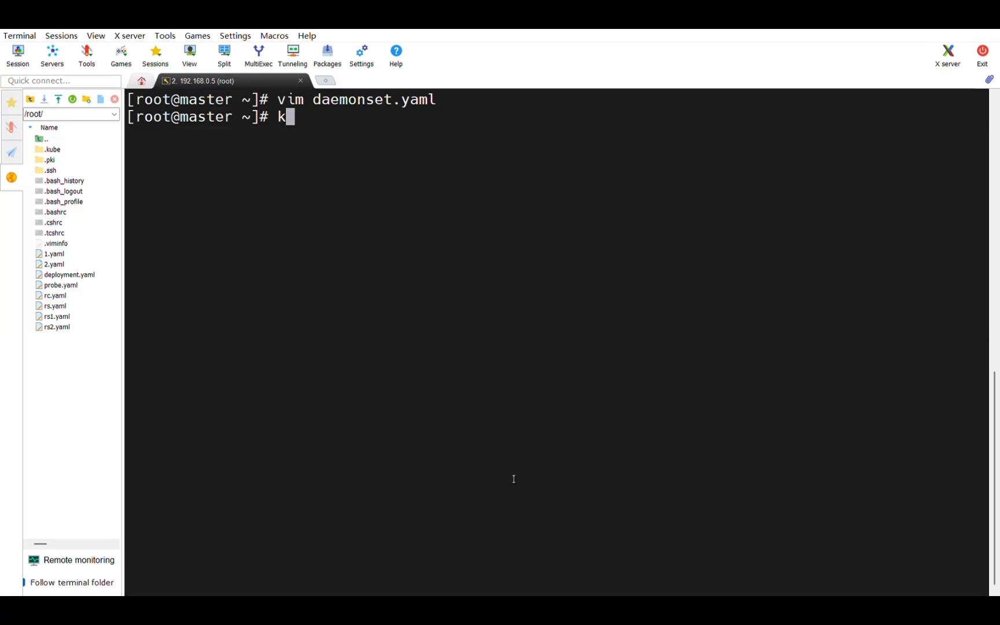

[【跳转到 15:10】](https://www.bilibili.com/video/BV1zGduBhEVg/?t=910)

### 7.2 用 nodeSelector 把 Pod 定向到指定节点

给 worker1 打上标签 `disk-type=SSD`，再在 DaemonSet 里配置 `nodeSelector: disk-type=SSD`，重新 apply 后，Pod 就只会落在打了这个标签的 worker1 上。这验证了 DaemonSet 与节点之间「直接绑定」的调度方式。

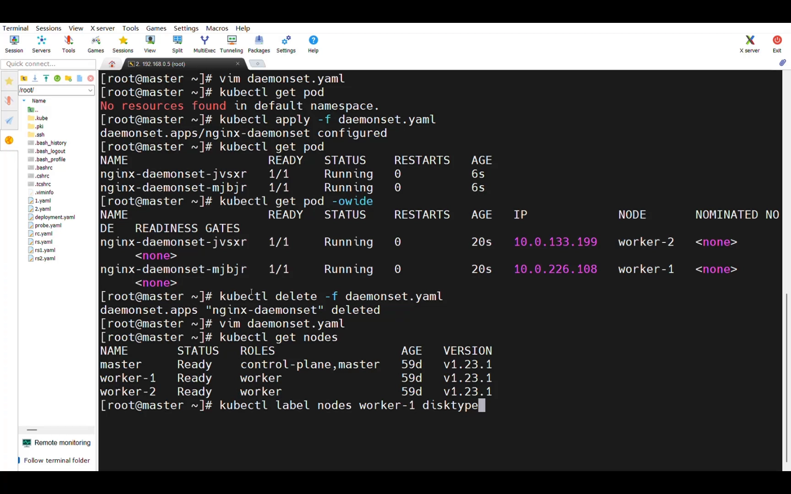

[【跳转到 17:15】](https://www.bilibili.com/video/BV1zGduBhEVg/?t=1035)

### 7.3 用容忍把 Pod 调度到 master

给 Pod 配置对 `node-role.kubernetes.io/master` 污点的容忍后重新 apply，`kubectl get pods -o wide` 就能看到 worker1、worker2、**master** 上都跑起了 Pod——容忍生效了。这正是 DaemonSet 的一个高级用法。

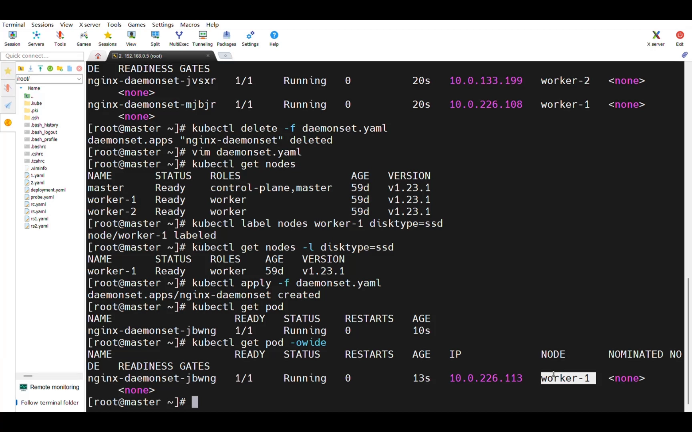

[【跳转到 18:30】](https://www.bilibili.com/video/BV1zGduBhEVg/?t=1110)

---

## 小结

- **是什么**：DaemonSet 确保每个「符合条件的节点」都运行、且仅运行**一个** Pod 副本；副本数由可用节点数决定。
- **和谁不同**：Deployment 管等价副本、StatefulSet 管稳定身份，而 DaemonSet 管「每节点一份」。
- **怎么工作**：持续监听 Node/Pod 变动，节点增加就补 Pod、节点减少就删 Pod。
- **用在哪**：监控、日志、网络（如 Calico）、存储、安全这五类节点级守护进程。
- **怎么写**：YAML 与 Deployment 类似，但不写 `replicas`；滚动更新是「先删旧、再建新」。
- **怎么控**：用污点/容忍把 Pod 送到被「禁止调度」的节点（如 master），用亲和性把 Pod 定向到特定节点。
- **怎么排错**：Pending 查节点资源，调度不上查污点，镜像拉取失败查镜像名/tag 与仓库密钥。

## 关键术语速查

| 术语 | 一句话解释 |
| --- | --- |
| DaemonSet | 确保每个符合条件的节点运行且仅运行一个 Pod 的控制器 |
| 守护进程 | 需要在每个节点上常驻的后台服务，如日志/监控/网络代理 |
| 污点（Taint） | 节点上的「排斥标记」，Pod 若不容忍就不能被调度上去 |
| 容忍（Toleration） | Pod 上声明的「我可以接受这个污点」，从而被调度到带污点的节点 |
| 亲和性（Affinity） | 引导 Pod 调度到满足条件的节点上（如带特定标签的节点） |
| nodeSelector | 最简单的节点选择方式：只调度到带指定标签的节点 |
| hostPort | 把容器端口映射到节点端口，可通过「节点地址:端口」访问容器 |
| 滚动更新 | 更新 Pod 的策略；DaemonSet 采用「先删旧、再建新」以避免同节点出现两份 |
