# 从零理解 DaemonSet：节点增减自动伸缩、滚动更新与用 Fluentd 收集节点日志

> 本文整理自 B 站视频《Pod 控制器-DaemonSet》。文中时间戳均可点击跳转回原视频。

## 本讲要解决的核心问题（SCQA）

**背景**：前面我们学过 Deployment 这类控制器，用来管理「等价副本」的应用——想跑几个就写几个 `replicas`。

**冲突**：但还有一类进程不一样：日志收集、监控代理、网络代理、安全代理这些「后台支撑型服务」，需要**每一个节点上都常驻一份**，而且节点增减时还要自动跟着变。用 Deployment 很难保证「每个节点恰好一个」。

**疑问**：Kubernetes 里有没有专门管这类「每节点一份」的控制器？它怎么随节点自动伸缩？真实项目里又怎么用？

**回答（中心思想）**：有，就是 **DaemonSet**。它保证每个节点上都运行一个 Pod，节点增加时自动补一个、节点移除时自动回收。本篇从它的特点出发，讲清创建、调度、更新回滚，最后用 **DaemonSet + Fluentd** 做一套完整的节点日志收集实战。

---

## 一、DaemonSet 是什么，有什么特点

DaemonSet 及「后台支撑型服务」，缩写是 **DS**。它主要用来部署一些**守护进程**——例如日志收集、监控代理、网络代理和安全代理等系统服务。

它有两个标志性特点：

1. **每当向集群中添加一个节点，DaemonSet 相应的 Pod 也会添加到该节点上**，而且 **只会添加一个**；
2. **当节点从集群中移除时，DaemonSet 所创建的 Pod 也会被垃圾回收（自动删除）**。

换句话说：**Pod 数量跟着节点走，每个节点有且仅有一个**。

---

## 二、先看系统自带的 DaemonSet：kube-proxy 与 calico-node

想知道 DaemonSet 长什么样，最快的办法是看 K8s 自己怎么用。用 `kubectl get ds -n kube-system` 查看 kube-system 命名空间里的 DaemonSet，能看到两个熟悉的组件：

- **kube-proxy**：给 Service 做代理的组件；
- **calico-node**：Calico 的网络插件。

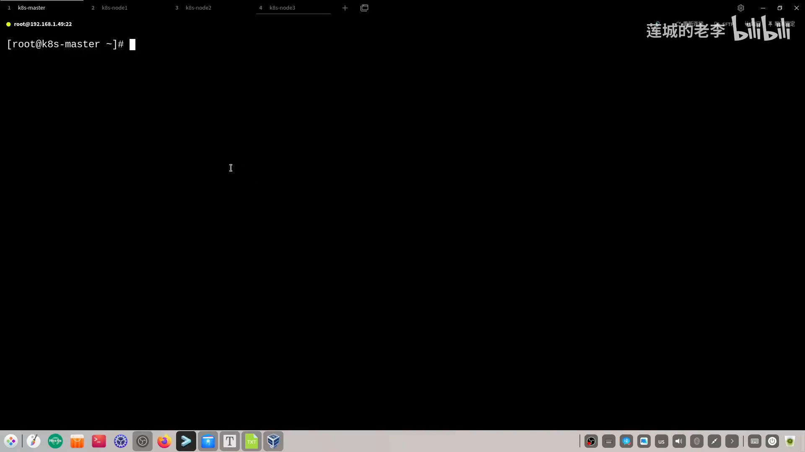

[【跳转到 00:48】](https://www.bilibili.com/video/BV1XUk7YHEm5/?t=48)

以 kube-proxy 为例，用 `kubectl get pod -n kube-system -o wide` 加上筛选可以看到：**node1、node2 和 master 上各运行了一个 kube-proxy 的 Pod，而且都只有一个**。这正是 DaemonSet 的作用。

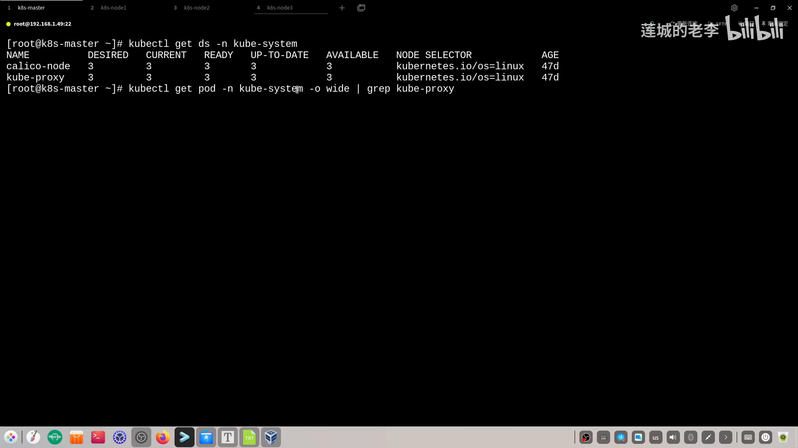

[【跳转到 01:10】](https://www.bilibili.com/video/BV1XUk7YHEm5/?t=70)

---

## 三、实验：节点增减时，Pod 自动增删

视频用一个「加节点、再删节点」的实验，直观验证了 DaemonSet 的两个特点。

### 3.1 加一个节点，Pod 自动出现

一开始集群里只有 node1、node2 和 master。把 node3 加入集群时需要注意一个细节：`kubeadm join` 命令在命令行直接回车会报错，提示没有指定 CRI socket，因此要补上 `--cri-socket` 参数。

node3 加入成功后，重新查看 kube-proxy——**node3 上自动多出了一个对应的 Pod**。不需要手动做任何事，DaemonSet 替我们补上了。

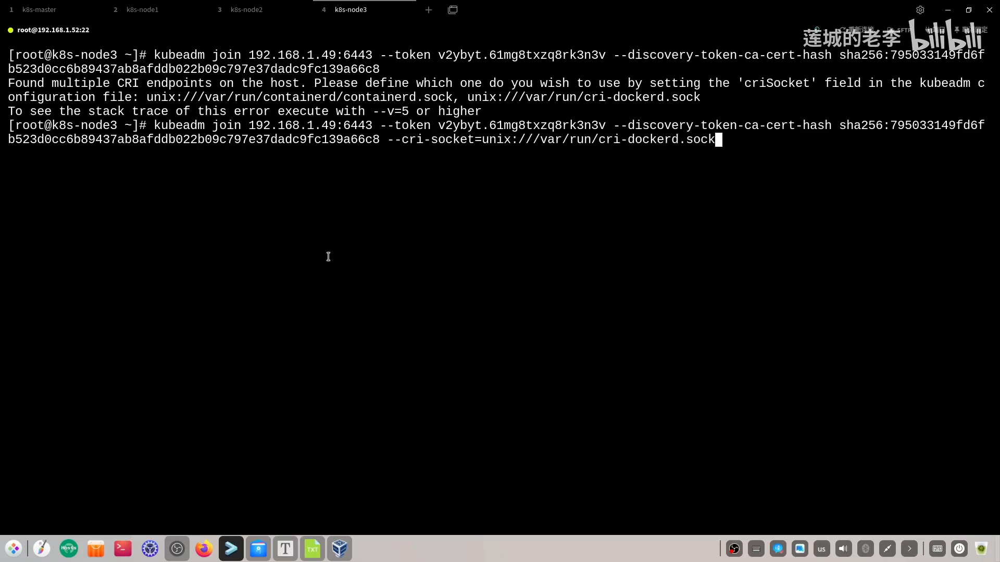

[【跳转到 02:09】](https://www.bilibili.com/video/BV1XUk7YHEm5/?t=129)

### 3.2 移除一个节点，Pod 自动回收

把 node3 从集群移除要做的事情相对多一点，通常分三步：

1. 把节点标记为不可用（cordon）；
2. 把节点上的 Pod 驱逐到其他可用节点（drain）；
3. 再用 delete 删掉这个节点。

三步执行完，`kubectl get node` 里只剩 node1 和 node2，稍等片刻后再查 kube-proxy，**node3 上的 Pod 就消失了**——这就是 DaemonSet「节点移除、Pod 被垃圾回收」的特点。

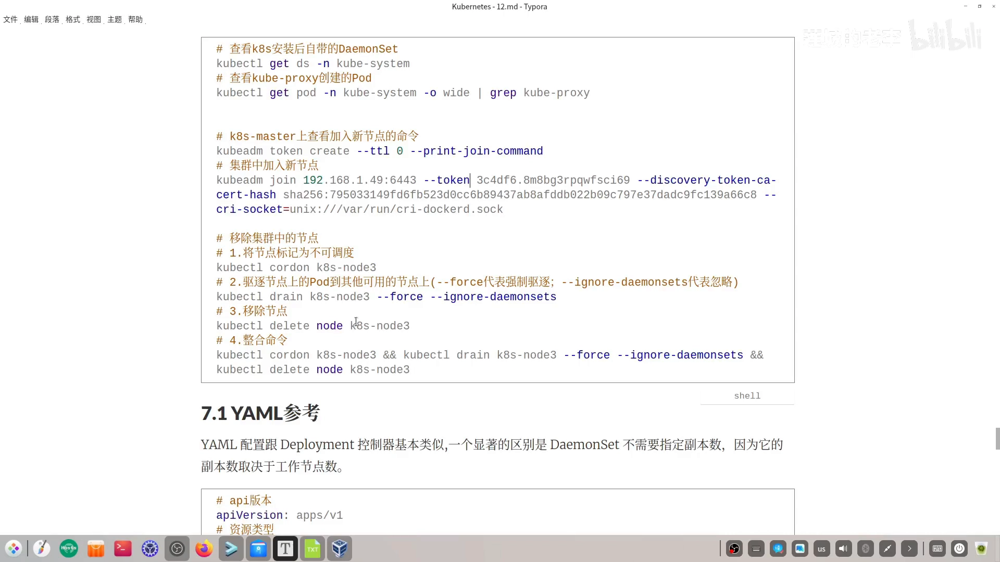

[【跳转到 02:49】](https://www.bilibili.com/video/BV1XUk7YHEm5/?t=169)

---

## 四、自己创建一个 DaemonSet

### 4.1 YAML 与 Deployment 很像，但不写副本数

自己创建 DaemonSet 主要靠 YAML 文件。它的配置与 Deployment 基本类似，和 StatefulSet 也非常类似，但有一个**显著区别：DaemonSet 不需要指定副本数（`replicas`）**——因为它的副本数取决于工作节点数，每个节点上只有唯一一个 Pod。

重点字段：

- `apiVersion` 使用 `apps/v1`（与 Deployment 一致）；
- `kind` 是 `DaemonSet`；
- 支持**标签选择器**，包括标签匹配（matchLabels）和表达式匹配（matchExpressions）；
- 支持定义 **Pod 模板**（`template`）。

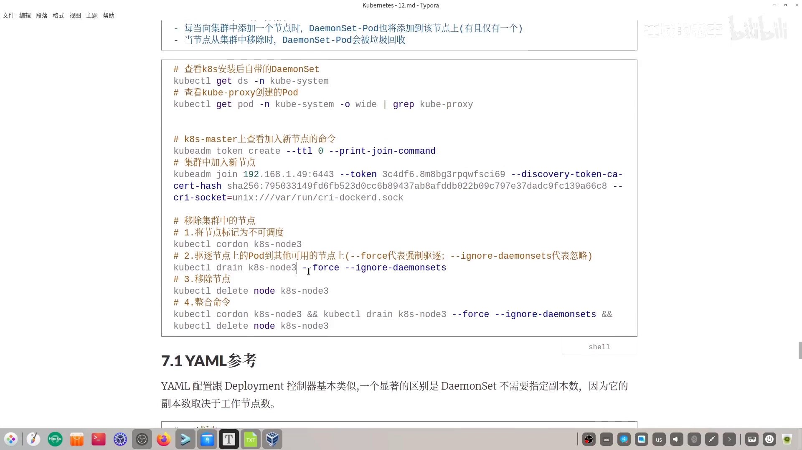

[【跳转到 03:42】](https://www.bilibili.com/video/BV1XUk7YHEm5/?t=222)

写一个 `my-daemonset.yaml` 并在集群里 `kubectl apply` 之后，用标签选择器筛选它创建的 Pod，就可以看到每个工作节点上各一个。

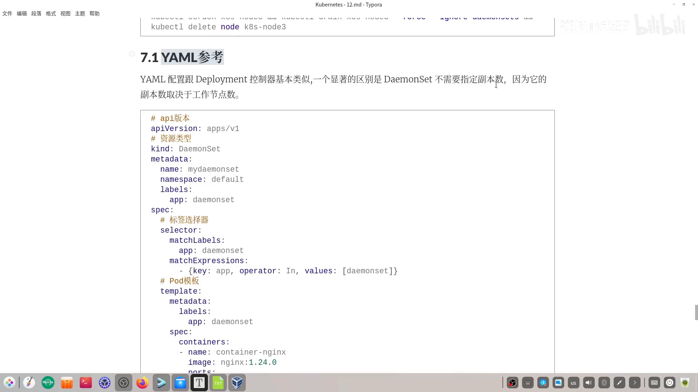

[【跳转到 04:07】](https://www.bilibili.com/video/BV1XUk7YHEm5/?t=247)

### 4.2 节点调度：nodeName / nodeSelector / affinity

默认情况下，DaemonSet 会给每个节点生成一个 Pod；但它也**支持节点调度**，Pod 可以通过 `nodeName`、`nodeSelector` 或 `affinity` 被调度到指定节点上。

视频以最直观的 `nodeSelector` 做了演示：在每个节点都带有 `hostname` 标签（值就是节点名字）的前提下，加入 `nodeSelector` 指定调度到 node2，重新 apply 后，Pod 就只运行在 **node2** 上了，node1 上那个随之消失。

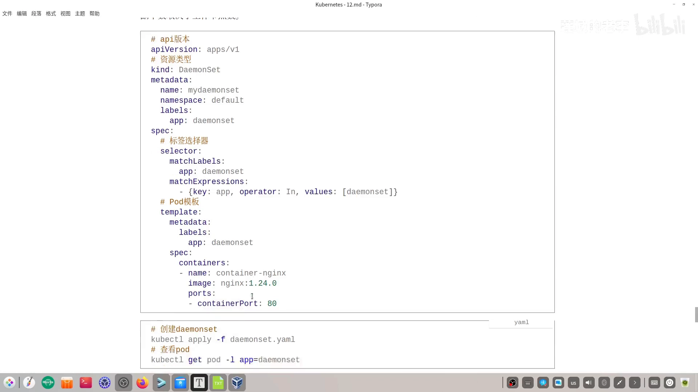

[【跳转到 05:54】](https://www.bilibili.com/video/BV1XUk7YHEm5/?t=354)

---

## 五、更新与回滚

像 Deployment 一样，DaemonSet 也支持**动态更新与回滚**，有几个配置项需要认识：

- **`revisionHistoryLimit`**：配置保留的历史版本个数，默认值是 **10**。其实 Deployment 和 StatefulSet 也有这个设置。
- **`updateStrategy`**：更新策略字段（注意 Deployment 里叫 `strategy`，没有前面的 `update`）。更新类型有：
  - **RollingUpdate**：滚动更新，可进一步配置 `maxUnavailable`（最多允许多少个 Pod 不可用）和 `maxSurge`（最多允许超出多少个 Pod）；
  - **OnDelete**：手动删除旧 Pod 时才创建新的。

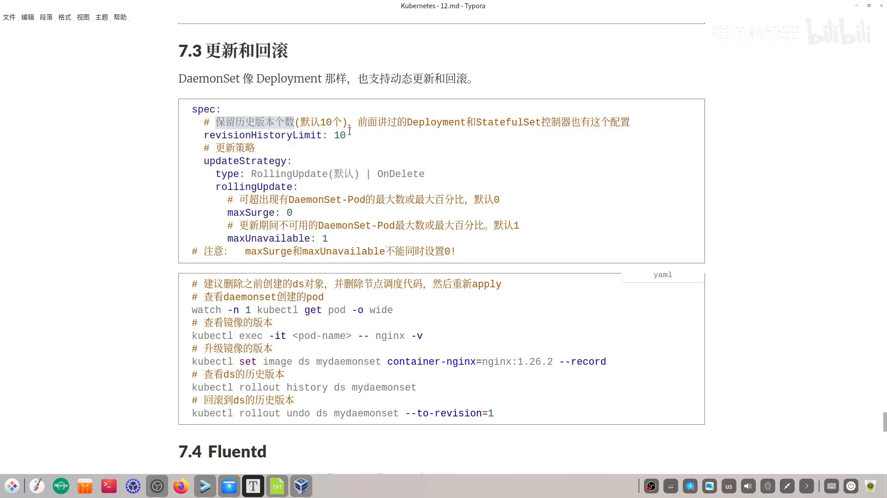

[【跳转到 07:31】](https://www.bilibili.com/video/BV1XUk7YHEm5/?t=451)

### 实战演示：升级、看历史、回滚

视频把镜像从 **nginx 1.24.0** 升级到 **1.26.2**：

1. 用 `kubectl set image`（把 `ds/my-daemonset` 里容器 `nginx` 的镜像升级到 1.26.2）并把升级动作记录下来；
2. 进入 Pod 执行 `nginx -v`，确认版本变成了 1.26.2；
3. 用 `kubectl rollout history ds/my-daemonset` 查看历史版本——第一次创建是一个版本，刚才更新又产生一个新版本；
4. 用 `kubectl rollout undo` 回滚到版本 1，再次确认 nginx 又回到了 1.24。

这印证了 DaemonSet 的更新与回滚体验与 Deployment 非常接近。

---

## 六、实战：用 DaemonSet + Fluentd 做节点日志收集

这是 DaemonSet 最经典的落地场景之一。视频用一整套 EFK 方案里的 Fluentd 做了演示。

### 6.1 先认识 EFK

**EFK** 是 K8s 上一个典型的日志收集技术方案。叫「方案」就说明它不是某一项技术，而是多个技术的组合：

- **Elasticsearch**：日志的**存储与分析**，一个分布式存储引擎；
- **Fluentd**（或 Fluent Bit）：日志的**收集**——本篇重点；
- **Kibana**：日志的**展示**。

它之前还有 **ELK** 方案（把 F 换成 L，即 Logstash）；由于 Logstash 用 Java 编写、占用资源较大，ELK 如今逐渐被 EFK 取代。如果日志数据非常巨量，还流行 **K1FK**——在 EFK 基础上再加一个 Kafka。

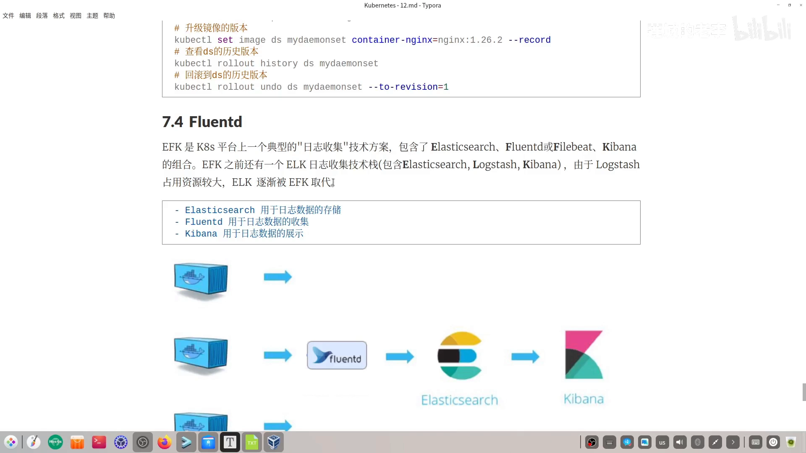

[【跳转到 11:54】](https://www.bilibili.com/video/BV1XUk7YHEm5/?t=714)

三者配合的流程是：运行在节点上的各容器产生的日志被 **Fluentd 收集**，发送到 **Elasticsearch 存储和分析**，最后通过 **Kibana** 做前端展示。本视频不搭建整套 EFK，只聚焦 Fluentd。

### 6.2 Fluentd 的配置文件：用 ConfigMap 管理

Fluentd 的配置文件通过 K8s 的 **ConfigMap** 对象来创建（这种资源类型前面没提到过，所以示例给得比较简单）：`apiVersion` 为 `v1`，`kind` 为 `ConfigMap`，取名为 `fluentd-config`（这个名字后面要被引用，所以要记牢）。它的 `data` 里放了一份名为 `fluent.conf` 的配置文件，其中最关键的是两项：**输入配置**与**输出配置**。

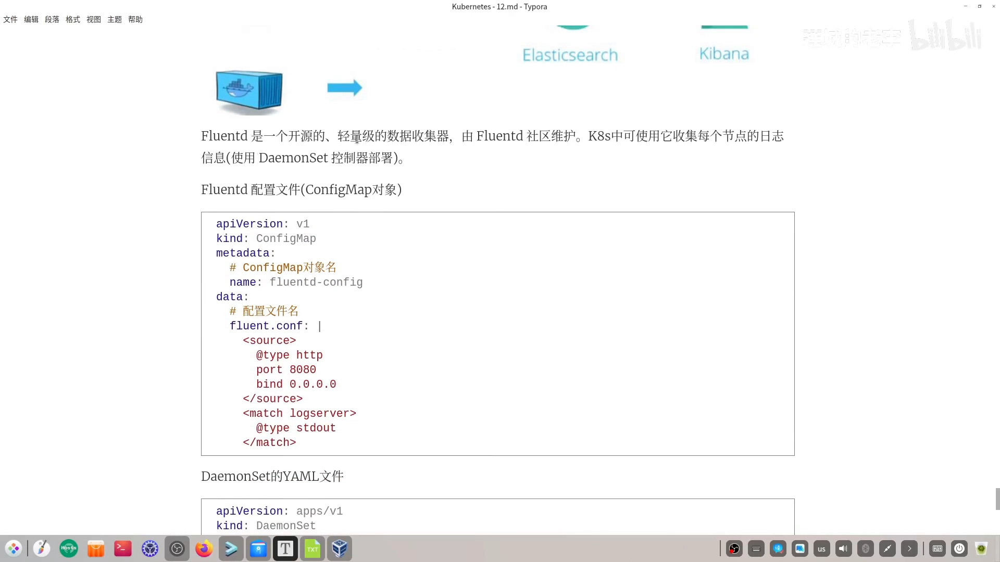

[【跳转到 13:09】](https://www.bilibili.com/video/BV1XUk7YHEm5/?t=789)

- **输入**：示例采用 HTTP 插件，接收来自所有 IP、对当前 Fluentd Pod 的 HTTP 访问，端口配的是 `8080`（可自行修改）。此时 Fluentd 的 Pod 扮演一个「日志服务器」的角色，其他应用可以把自己的日志发给它。
- **输出**：示例最简单——直接输出到**控制台**；未来可以配置 `match` 把日志发送到 Elasticsearch，让 ES 来做存储与分析。

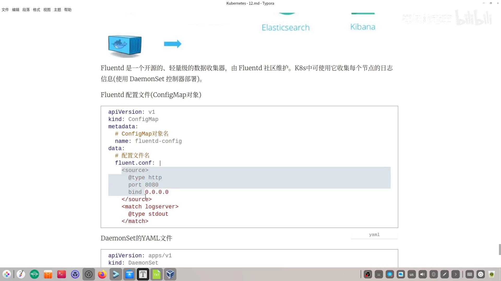

[【跳转到 13:59】](https://www.bilibili.com/video/BV1XUk7YHEm5/?t=839)

### 6.3 DaemonSet 的 YAML 要点

- **镜像**：使用 Fluentd 镜像（视频里因下载耗时，用的是本地导入的 tar 包）。
- **存储卷**：重点是那个 **configMap 类型的卷**——它引用的正是前面定义的 `fluentd-config`，作为 Fluentd 容器的配置文件启动容器；**名字必须与 ConfigMap 一致**，这也是前面强调记住这个名字的原因。
- 该卷在容器里被挂载，把 ConfigMap 中的 `fluent.conf` 映射到容器 Fluentd 的 `/etc` 目录下，实现配置文件挂载。
- 此外还做了一个存储卷设置，用来**让容器时区与节点同步**（否则时区不同步）。

### 6.4 部署与验证

把 ConfigMap 和 DaemonSet 都 apply 之后，用监控命令可以看到 **node1 和 node2 上都跑起了这个 Pod**。挑其中一个用 `kubectl logs` 查看，能在日志里看到与 ConfigMap 中配置文件一致的内容，还有一句 `is now running`——说明 Fluentd 已用我们自定义的配置文件成功启动。

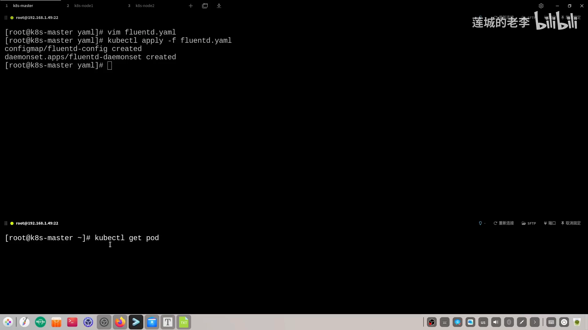

[【跳转到 17:04】](https://www.bilibili.com/video/BV1XUk7YHEm5/?t=1024)

接着模拟其他应用发日志：用 `curl` 以 JSON 格式向 Fluentd 的 Pod（IP + 8080 端口）发送一条日志。请求成功响应后，再回到 Fluentd 的 Pod 查看日志，就能在最后一行看到刚才发出去的测试日志——**这个 Pod 此时已经成了整个集群环境的日志收集服务器**。

---

## 小结

- **定位**：DaemonSet 是「后台支撑型服务（DS）」的控制器，保证每个节点运行且仅运行一个 Pod。
- **两大特点**：节点加入自动补一个 Pod；节点移除自动回收该 Pod。
- **实例**：kube-system 里的 kube-proxy、calico-node 本身就是 DaemonSet。
- **创建**：YAML 与 Deployment 类似，但**不写 `replicas`**；支持 `nodeName`/`nodeSelector`/`affinity` 调度。
- **更新回滚**：`revisionHistoryLimit`（默认 10）、`updateStrategy`（RollingUpdate/OnDelete）；滚动更新可配 `maxUnavailable`/`maxSurge`。
- **落地**：最常见的用途是日志收集——用 DaemonSet 部署 Fluentd，配置经 ConfigMap 注入，把每个节点的日志汇聚起来（并可与 EFK 方案衔接）。

## 关键术语速查

| 术语 | 一句话解释 |
| --- | --- |
| DaemonSet（DS） | 保证每个节点运行且仅运行一个 Pod 的控制器，即「后台支撑型服务」 |
| kube-proxy | K8s 自带组件，给 Service 做代理，以 DaemonSet 形式部署 |
| calico-node | Calico CNI 插件的节点组件，同样以 DaemonSet 形式部署 |
| nodeSelector | 让 Pod 只调度到带指定标签的节点上 |
| revisionHistoryLimit | 保留的历史版本个数，默认 10 |
| updateStrategy | DaemonSet 的更新策略：RollingUpdate 或 OnDelete |
| maxUnavailable / maxSurge | 滚动更新时允许「不可用」/「超出」的 Pod 数量 |
| EFK / ELK / K1FK | Elasticsearch + Fluentd + Kibana；旧方案用 Logstash；再加 Kafka 即 K1FK |
| Fluentd | 开源的轻量级日志收集器，常以 DaemonSet 部署到每个节点 |
| ConfigMap | K8s 中存放配置的对象；这里用来承载 Fluentd 的配置文件 |
