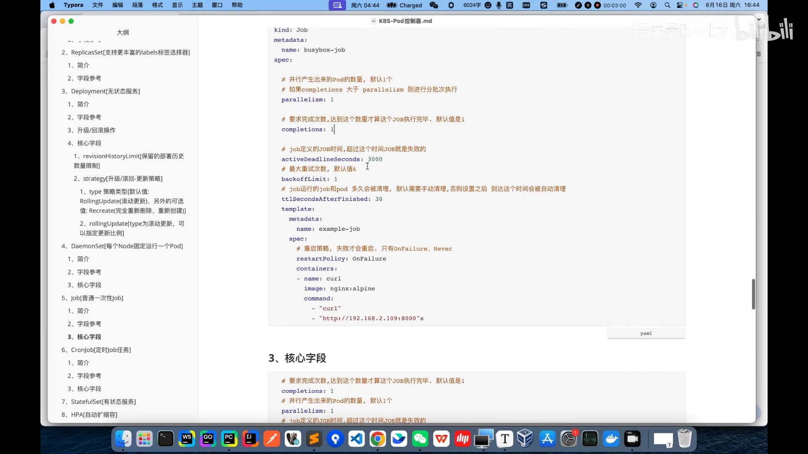
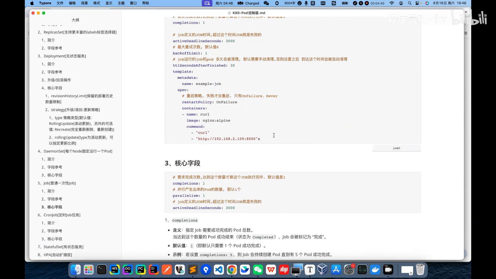

# Job 控制器详解：让一次性任务可靠跑完就停

> 本文整理自 B 站视频《B 站最清晰讲解，掌握 k8s（kubernetes）- Job 控制器》（UP：程序员 Rocky）。文中时间戳均可点击跳转回原视频。

## 本讲要解决的核心问题（SCQA）

**背景**：前面几讲我们认识的 Deployment、ReplicaSet、DaemonSet、StatefulSet，本质都是「让 Pod 一直跑着」的控制器——Pod 挂了就重启、就重建，保证服务持续在线。

**冲突**：可有一类任务偏偏不需要一直跑：数据库备份、批处理、一次性脚本。它们只要**跑一次、跑完就停**。若用 Deployment 去管它，反而会出问题——Deployment 会在 Pod 结束后立刻再把它拉起来，变成「跑完又跑」的死循环。

**疑问**：Kubernetes 靠什么机制，来可靠地运行这类一次性任务，还能判断它到底成没成功、失败了要不要重试？

**回答（中心思想）**：答案是 **Job 控制器**。Job 管理一次性任务：它创建 Pod 执行任务，凭 Pod 的**退出码**判断成败；失败就按**指数退避**重试，成功达到要求的次数后停手。它的行为由五个核心字段精确控制：`parallelism`、`completions`、`activeDeadlineSeconds`、`backoffLimit`、`ttlSecondsAfterFinished`。下面逐层拆开。

---

## 一、Job 是什么：管理一次性任务的控制器

一句话：**Job 用来管理一次性任务，确保任务成功完成后正常终止。**

它的工作方式有三个要点：

- **Pod 跑完任务会自动结束**：不像 Deployment 的 Pod 长期处于 Running，Job 的 Pod 一旦任务做完，就会自己停下来；
- **靠退出码判定成败**：Job 读取 Pod 里容器的**退出码**（exit code）——为 `0` 表示正常完成，非 `0` 表示出现异常；
- **并发与次数可配**：Job 支持配置 Pod 的并发数，以及这个任务要被「完成」的次数。

### 1.1 和 Deployment 的区别

| 维度 | Job | Deployment |
| --- | --- | --- |
| 管理对象 | 一次性任务（跑完即止） | 常驻服务（持续运行） |
| Pod 结束后 | 停止，不再拉起 | 立刻重建，维持副本数 |
| 成败判定 | 看 Pod 退出码 | 不关心「任务完成」，只关心「进程活着」 |

视频里一句话点破：**Deployment 这类控制器，是为了运行一个高可用、持续不间断提供服务的进程；而 Job 更多是用来处理一次性脚本——跑完就完事了。**（[00:06:05](https://www.bilibili.com/video/BV1FjYvzNEQ9/?t=365)）

### 1.2 用在哪里

- 数据备份；
- 批处理任务；
- 一次性脚本 / 一次性命令的执行。

### 1.3 一个必须记住的坑：脚本要幂等

视频特意提醒：**Kubernetes 的 Job 默认带有「重试」机制**——任务失败会被重新执行。所以写 Job 里的脚本时，必须自己保证**幂等性**：即使被重复执行多次，也不会产生额外的副作用。（[00:00:35](https://www.bilibili.com/video/BV1FjYvzNEQ9/?t=35)）

> 例如「往数据库插入一行记录」这种非幂等操作，一旦 Job 重试，就可能插入多行；幂等的写法是「先判断再写」「用唯一键去重」之类。

---

## 二、Job 的核心字段：读懂一份 YAML

Job 的资源清单样例（视频用 `busybox-job` 举例）：

```yaml
apiVersion: batch/v1
kind: Job
metadata:
  name: busybox-job
spec:
  parallelism: 1              # 并行产生出来的 Pod 数量，默认 1
  completions: 1              # 要求完成次数，达到才算 Job 执行完毕，默认 1
  activeDeadlineSeconds: 3000 # Job 的最大运行时间，超过即判失败
  backoffLimit: 1             # 最大重试次数，默认 6
  ttlSecondsAfterFinished: 30 # 完成后多久自动清理 Job（含 Pod）
  template:                   # 这里就是 Pod 模板
    ...
```

> 注意 Job 的 API 版本是 `batch/v1`，和我们前面讲的 `apps/v1`（Deployment 等）不同——Job 属于 `batch` 组。

下面逐个字段解释。



[【跳转到 01:35】](https://www.bilibili.com/video/BV1FjYvzNEQ9/?t=95)

### 2.1 parallelism：一次并发跑几个 Pod

`parallelism` 决定 Job **一次性并行拉起多少个 Pod**，默认值为 `1`。

### 2.2 completions：任务要被「完成」多少次

`completions` 是「要求完成的次数」，达到这个数量才算 Job 执行完毕，默认值也是 `1`。

这解释了 Job 的默认行为：默认只起 **1 个 Pod**，跑完之后看它是否正常完成；若完成次数设为 1 且它确实完成了，就立刻把 Job 标记为成功，不再重试、不再继续。

**两者组合很关键：** 若 `completions` **大于** `parallelism`，Job 会**分批次执行**——先起 `parallelism` 个，完成一批再起下一批，直到完成次数达标。

### 2.3 activeDeadlineSeconds：给任务一个硬超时

给 Job 里跑的任务设定一个**最长运行时间**。超过这个时间还没跑完，就认为它出了问题，直接把任务标记为**异常/失败**。

### 2.4 backoffLimit：失败最多重试几次

`backoffLimit` 是**最大重试次数**，默认值为 `6`。超过这个次数仍未成功，Job 进入**失败**状态，不再重试。

重试的**间隔是指数退避**的：一开始约 10 秒，之后 20 秒、40 秒、80 秒……逐次翻倍。视频指出，这个退避算法和我们前面讲过的「容器崩溃重启（CrashLoopBackOff）」是同一套思路——刻意拉长间隔，**降低节点与集群被频繁重启拖垮的压力**。（[00:08:48](https://www.bilibili.com/video/BV1FjYvzNEQ9/?t=528)）

### 2.5 ttlSecondsAfterFinished：完成后自动清理

Job 执行完（无论成败）后，默认它的记录**会一直留在 etcd 里**，需要人工清理；当集群里有大量 Job 时，手动清理很麻烦。`ttlSecondsAfterFinished` 就是设一个「过期时间」：Job 完成多久之后，自动帮我们把 Job（以及它对应的 Pod）清理掉。

### 2.6 template 与 restartPolicy：为什么 Job 里不能写 Always

`template` 就是 Job 要创建的 **Pod 模板**——Job 通过控制 Pod 来跑任务，最后看 Pod 的状态来判断任务成没成功。里面主要是两件事：**重启策略**和**容器定义**。

重点在重启策略（`restartPolicy`）。在 Job 场景下它**只有两种取值**：

- `OnFailure`：容器失败退出时重启；
- `Never`：容器无论怎样都不重启。

**为什么不能填 `Always`？** 视频的解释很直白：`Always` 的含义是「无论正常死亡还是非正常死亡，都重新拉起」。而 Job 处理的是**一次性任务**，如果脚本**正常结束**后还把它拉起来，就会陷入**无限循环**。所以 Job 里 `Always` 既没用、又多余。



[【跳转到 03:30】](https://www.bilibili.com/video/BV1FjYvzNEQ9/?t=210)

> **补注（超出视频、供理解参考）**：视频把「重试」统一成一套来讲，实际上 Job 的重试分两层——**容器级**由 `restartPolicy` 控制（`OnFailure` 时在同一 Pod 内重启容器），**Pod 级**由 `backoffLimit` 控制（Pod 整体失败后重建新 Pod，按指数退避）。两者配合，才构成 Job 完整的失败恢复能力。

---

## 三、动手实验：用一个 HTTP 服务验证每个字段

视频用一个小实验把上面的字段全跑了一遍。思路是：先在宿主机上起一个 HTTP 服务，再让 Job 里的容器去访问它——**访问得到 → 退出码 0 → 成功；访问不到 → 退出码非 0 → 失败并重试**。

### 3.1 基本跑法

- 在 `192.168.2.109` 上用 `python3 -m http.server 8000` 起一个 8000 端口的 HTTP 服务；
- Job 的任务逻辑：`curl` 访问这个接口，通了就退出码 0，Job 就是「成功运行」状态；没通则退出码非 0，进入异常并触发重试。

`kubectl apply -f job.yaml` 之后可以观察到：Job 立刻进入运行状态，底层其实创建了一个 Pod；Pod 访问服务成功、完成任务后进入 `Completed`（完成）状态；Job 的「实际完成数」也变成 1，整个 Job 标记为完成。用 `kubectl get pod`、`kubectl logs` 都能看到这一次性任务的执行记录。（[00:05:40](https://www.bilibili.com/video/BV1FjYvzNEQ9/?t=340)）

### 3.2 并发数 vs 完成次数

- **完成次数小于一批**：比如完成次数要 1 次、并发数却设成 3——既然只要求完成 1 次，起 3 个 Pod 没意义，**以完成为准**，只会起 1 个 Pod；
- **完成次数多于一批**：比如完成次数要 6、每次起 2 个——Job 会**按批执行**：先起 2 个，完成后**再**起 2 个，再起 2 个……直到完成 6 次，Job 才进入完成状态，期间不会多起 Pod。（[00:07:20](https://www.bilibili.com/video/BV1FjYvzNEQ9/?t=440)）

### 3.3 超时与重试

- `activeDeadlineSeconds`：超过设定时间任务还没跑完，直接把 Job 标记为失败；
- `backoffLimit`：视频把默认 6 改为 3，然后**关掉服务**制造失败。可以看到 Pod 一次又一次重试，**间隔从 10 秒逐步拉长**；超过 3 次仍失败后，这些 Pod 被删除，Job 进入**失败**状态（要求完成 1 个，实际完成 0 个）。（[00:09:48](https://www.bilibili.com/video/BV1FjYvzNEQ9/?t=588)）

### 3.4 自动清理

- **不设** `ttlSecondsAfterFinished`：Job 和它的 Pod 记录会**永久保留**在 etcd 中；
- **设为 30 秒**：Job 完成后 30 秒，Job 消失，它控制的 Pod 也随之消失。（[00:11:21](https://www.bilibili.com/video/BV1FjYvzNEQ9/?t=681)）

---

## 小结

- **是什么**：Job 是管理**一次性任务**的控制器，确保任务成功完成后正常终止。
- **怎么判断成败**：看 Pod 容器的**退出码**——0 为成功，非 0 为异常。
- **默认行为**：只起 1 个 Pod、完成 1 次即成功；API 为 `batch/v1`。
- **五个核心字段**：`parallelism`（并发数）、`completions`（完成次数）、`activeDeadlineSeconds`（超时）、`backoffLimit`（重试上限，默认 6）、`ttlSecondsAfterFinished`（自动清理）。
- **重启策略**：Job 的 `restartPolicy` 只能是 `OnFailure` 或 `Never`，不能是 `Always`（会无限循环）。
- **重试是退避的**：间隔按 10s→20s→40s… 指数增长，以减轻集群压力。
- **必须幂等**：因为有重试，Job 脚本要保证重复执行不产生副作用。

## 关键术语速查

| 术语 | 一句话解释 |
| --- | --- |
| Job | 管理一次性任务、跑完即止的控制器（`batch/v1`） |
| 退出码（Exit Code） | 容器进程结束时返回的数字，0 表示成功、非 0 表示失败 |
| parallelism | Job 一次并行拉起多少个 Pod |
| completions | 任务要被成功完成的次数，达到才算 Job 完成 |
| activeDeadlineSeconds | Job 的最长运行时间，超时即判失败 |
| backoffLimit | 失败后最多重试的次数（默认 6），间隔指数退避 |
| ttlSecondsAfterFinished | Job 完成后隔多久自动清理（含 Pod） |
| restartPolicy | 容器重启策略；Job 中只能取 `OnFailure` / `Never` |
| 幂等性 | 同一操作执行多次，效果与执行一次相同 |
| 指数退避 | 重试间隔逐次翻倍（10s→20s→40s…）的退避策略 |
