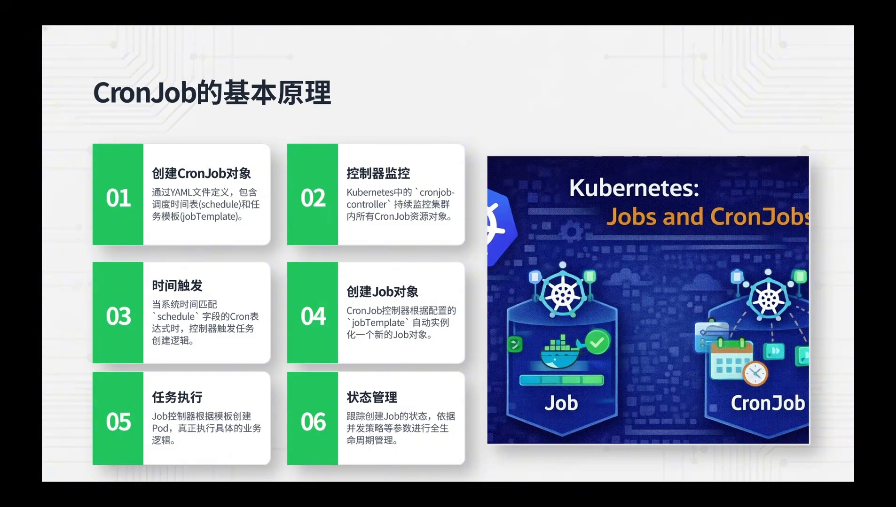
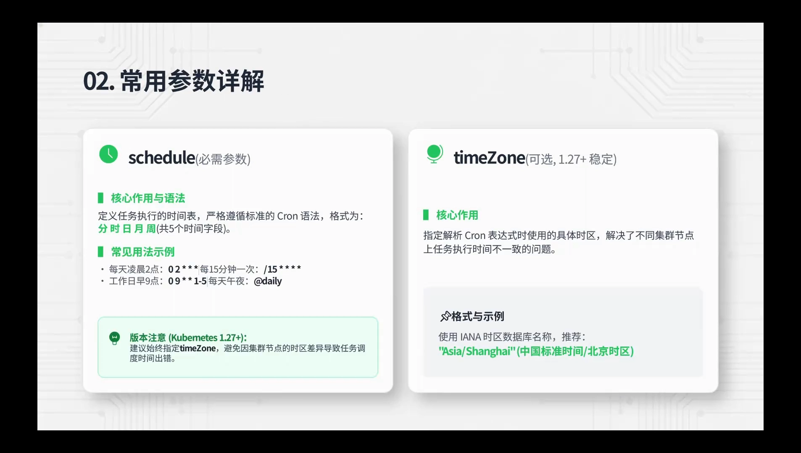
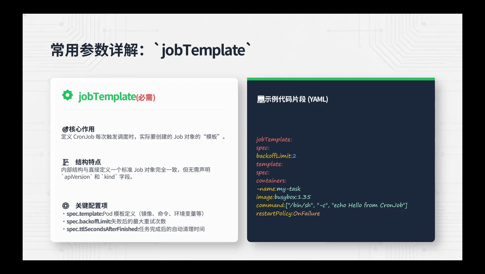
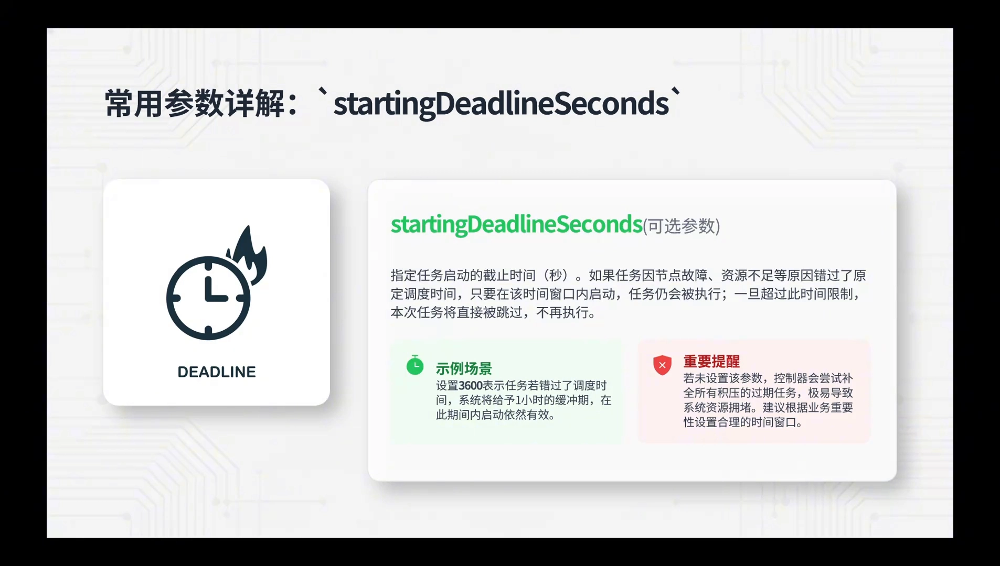
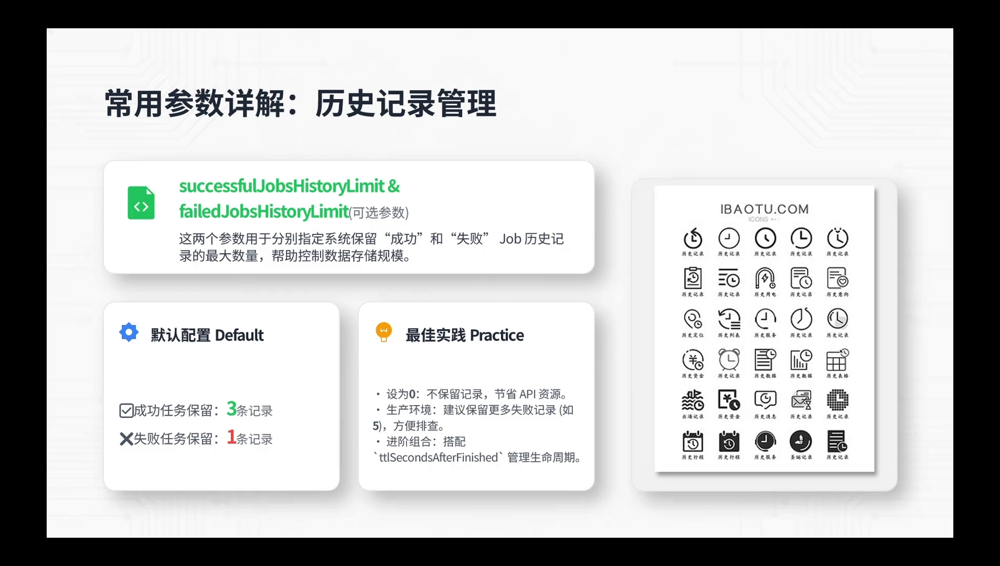
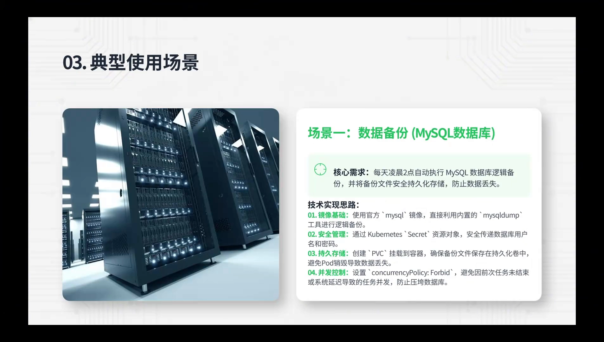
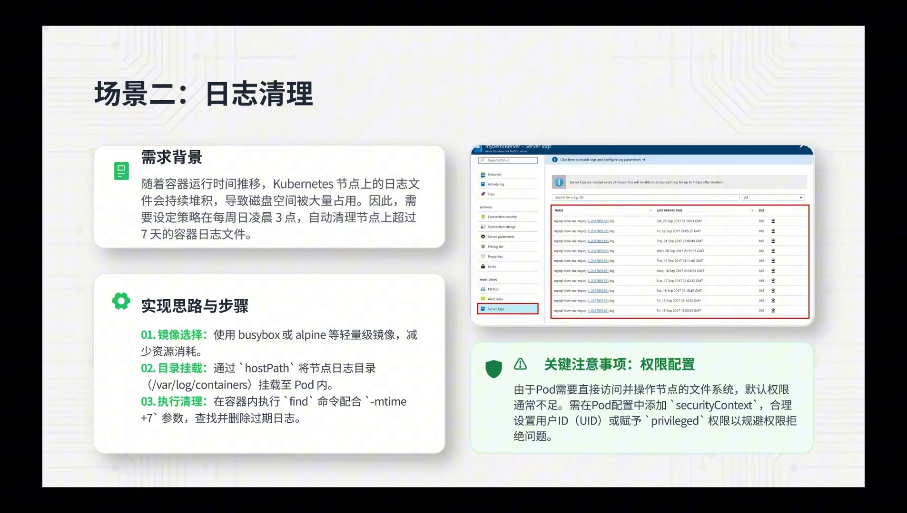
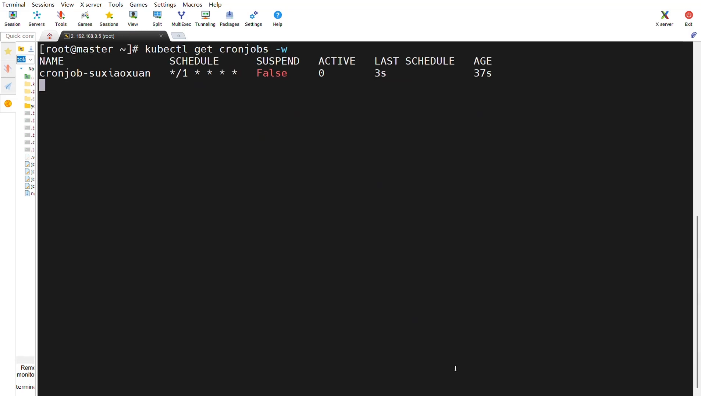

# CronJob 控制器详解：让周期性任务按计划自动执行

> 本文整理自 B 站视频《Kubernetes 原生技术之 CronJob 控制器详解》。文中时间戳均可点击跳转回原视频。

## 本讲要解决的核心问题（SCQA）

**背景**：上一讲我们认识了 Job——它能可靠地把一个一次性任务跑完、跑完就停。

**冲突**：但很多任务是**周期性**的：数据库每天凌晨备份一次、每周清理一次日志……如果每次都手写一个 Job，既麻烦又容易漏。

**疑问**：Kubernetes 有没有一种「按时间表自动创建 Job」的机制？

**回答（中心思想）**：这就是 **CronJob**。它本质上是「**Job 的控制器**」——按 cron 表达式定时创建 Job，Job 再创建 Pod 执行任务，所以有「CronJob → Job → Pod」的层层创建关系。通过 `schedule`、`concurrencyPolicy`、`startingDeadlineSeconds`、历史记录保留等参数，它能对周期性任务做全生命周期管理。本讲按「定义与原理 → 常用参数 → 典型场景」三步展开。

---

## 一、CronJob 是什么：站在 Job 之上的「定时器」

CronJob 本质上和 Linux 系统里的 **crontab** 一样，都是做周期性计划任务。区别在于：**它调度的不再是简单的命令，而是封装在 Pod 里的一个应用**。（[00:00:55](https://www.bilibili.com/video/BV1S5Ln67Ewj/?t=55)）

它和 Job 的关系可以这样理解：

- **Job**：对应**一个批处理任务**；
- **CronJob**：对应**系统级别的「定时 + 批处理」任务**，它自己不直接跑 Pod，而是**按规则创建 Job**，再由 Job 去创建 Pod。

一句话：**CronJob 是 Job 的控制器**——它通过 `schedule` 掌管「每一个 Job 什么时机执行」。

---

## 二、CronJob 的工作原理：六步控制循环

CronJob 的工作可以拆成清晰的六步：（[00:01:19](https://www.bilibili.com/video/BV1S5Ln67Ewj/?t=79)）

1. **创建 CronJob 对象**：通过 YAML 文件定义，包含调度时间表 `schedule` 和任务模板 `jobTemplate`；
2. **控制器监控**：`cronjob-controller` 持续监控集群中所有的 CronJob 资源对象；
3. **时间触发**：当系统时间匹配到 `schedule` 字段时，控制器触发任务创建逻辑；
4. **创建 Job 对象**：CronJob 控制器根据配置的 `jobTemplate`，自动实例化一个新的 Job 对象；
5. **任务执行**：Job 控制器再根据模板创建 Pod，真正执行业务逻辑；
6. **状态管理**：跟踪所创建 Job 的状态，依据并发策略等参数做全生命周期管理。

[【跳转到 01:44】](https://www.bilibili.com/video/BV1S5Ln67Ewj/?t=104)

---

## 三、CronJob 的常用参数

视频强调：**在生产环境里用好 CronJob，关键就在这几个参数。**

### 3.1 schedule：调度时间表（必填）

`schedule` 定义任务执行的时间表，**严格遵循标准的 cron 语法**，格式为「**分 时 日 月 周**」共 5 个时间字段（和 Linux crontab 一致）。

[【跳转到 02:14】](https://www.bilibili.com/video/BV1S5Ln67Ewj/?t=134)

### 3.2 timeZone：时区（1.27+）

`timeZone` 用于指定解析 cron 表达式时使用的**具体时区**。它在 Kubernetes **1.27 版本之后**引入并稳定，解决的是「不同集群节点时区不一致」的问题，方便**全球化部署**。

### 3.3 jobTemplate：任务模板（必填）

因为 CronJob 是靠「创建 Job」来完成周期性任务，所以必须定义一个 **Job 模板** `jobTemplate`：CronJob 每次触发时，就用它实例化出一个新的 Job。（[00:02:45](https://www.bilibili.com/video/BV1S5Ln67Ewj/?t=165)）

[【跳转到 02:45】](https://www.bilibili.com/video/BV1S5Ln67Ewj/?t=165)

### 3.4 concurrencyPolicy：并发策略

它定义**当上一个任务实例还没跑完、下一个调度时间又到了**时该怎么办。三种取值：（[00:03:03](https://www.bilibili.com/video/BV1S5Ln67Ewj/?t=183)）

| 取值 | 行为 | 说明 |
| --- | --- | --- |
| `Allow`（默认） | 允许并发 | 新旧任务**同时执行** |
| `Forbid` | 禁止并发 | **跳过**新任务（让正在跑的任务跑完） |
| `Replace` | 替换 | 先**终止**旧任务，再启动新任务 |

视频提示：**目前生产环境里用得最多的是 `Forbid`。**

[【跳转到 03:28】](https://www.bilibili.com/video/BV1S5Ln67Ewj/?t=208)

### 3.5 startingDeadlineSeconds：容错时间窗口

它设置一个**容错的时间段**：如果因为节点故障、资源不足等原因**错过了原定调度时间**，只要还在这个时间窗口内，任务**仍会被调度执行**；一旦超过这个窗口，**本次任务直接跳过、不再执行**。（[00:04:18](https://www.bilibili.com/video/BV1S5Ln67Ewj/?t=258)）

[【跳转到 04:43】](https://www.bilibili.com/video/BV1S5Ln67Ewj/?t=283)

### 3.6 历史记录管理

两个参数分别控制「保留多少个已创建的 Job 记录」，避免数据无限增长：

- `successfulJobsHistoryLimit`：保留**成功** Job 历史的最大数量；
- `failedJobsHistoryLimit`：保留**失败** Job 历史的最大数量。

视频给的经验值：**成功的保留 3 次，失败的保留 1 次**。为什么失败只留 1 次？因为排错时只需看**最近一次**的报错就够，看上上次没有任何帮助。（[00:05:08](https://www.bilibili.com/video/BV1S5Ln67Ewj/?t=308)）

[【跳转到 05:33】](https://www.bilibili.com/video/BV1S5Ln67Ewj/?t=333)

---

## 四、典型使用场景

视频总结了两类最典型、也是业界用得最多的场景：

### 4.1 数据备份

周期性做数据库备份——例如每天凌晨用 `mysqldump` 等工具把数据库逻辑备份出来并安全持久化，防止数据丢失。这一类在上一讲 Job 里已详细讲过，CronJob 只是给它加上了「定时」。（[00:06:04](https://www.bilibili.com/video/BV1S5Ln67Ewj/?t=364)）

[【跳转到 06:04】](https://www.bilibili.com/video/BV1S5Ln67Ewj/?t=364)

### 4.2 日志清理

这是目前行业方案里**用得最多**的场景。随着容器运行时间增长，节点上的日志文件会不断堆积、挤占磁盘。做法是定期清理：视频里既举例了**按磁盘占用阈值触发**（例如某路径占用超过 70%/80% 就执行清理，清到 60% 以下），也展示了**每周日凌晨定时清理超过 7 天的容器日志**这一类做法。（[00:06:20](https://www.bilibili.com/video/BV1S5Ln67Ewj/?t=380)）

[【跳转到 06:20】](https://www.bilibili.com/video/BV1S5Ln67Ewj/?t=380)

---

## 五、动手实验

视频最后用一个「参数比较全面」的 CronJob 演示了一遍。（[00:07:04](https://www.bilibili.com/video/BV1S5Ln67Ewj/?t=424)）

YAML 的主要设置：

- `schedule`：每分钟调度一次；
- 成功保留历史 3 份、失败保留 1 份；
- `startingDeadlineSeconds`：300 秒；
- `concurrencyPolicy: Forbid`（不允许并发）；
- `jobTemplate` 里 `parallelism: 3`——即每次触发**同时拉起 3 个 Pod** 完成任务；
- 容器里执行 `date` + `echo`，打印当前时间与一段文本；`restartPolicy: OnFailure`。

执行 `kubectl apply` 后，可以按下面的顺序观察：

- `kubectl get cronjobs`：看到 CronJob 创建出来了；
- `lastSchedule` 字段：能看到「上次调度成功到现在的时长」，刷新后显示几秒前刚调度过一次；
- `kubectl get jobs`：看到它创建出的 Job；
- `kubectl get pods`：看到同时拉起的 **3 个 Pod**；
- `kubectl logs`：查看这些 Pod，输出的正是我们指定的时间与文本。

[【跳转到 09:33】](https://www.bilibili.com/video/BV1S5Ln67Ewj/?t=573)

---

## 小结

- **是什么**：CronJob 是「Job 的控制器」，像 Linux crontab 一样做周期性计划任务，但调度的是 Pod 里的应用。
- **创建关系**：CronJob **按时间表创建 Job**，Job **再创建 Pod**，即 CronJob → Job → Pod。
- **六步循环**：定义对象 → 控制器监控 → 时间触发 → 创建 Job → 执行任务 → 状态管理。
- **必填两参数**：`schedule`（分 时 日 月 周）与 `jobTemplate`（Job 模板）。
- **并发控制**：`concurrencyPolicy` = `Allow` / `Forbid`（生产最常用）/ `Replace`。
- **容错与清理**：`startingDeadlineSeconds` 给出错过调度后的容错窗口；`successfulJobsHistoryLimit` / `failedJobsHistoryLimit` 控制历史 Job 保留数。
- **典型场景**：数据备份、日志清理。

## 关键术语速查

| 术语 | 一句话解释 |
| --- | --- |
| CronJob | 按 cron 时间表周期性创建 Job 的控制器（`batch/v1`） |
| schedule | cron 表达式，格式为「分 时 日 月 周」，定义执行时间表 |
| timeZone | 解析 cron 表达式所用的时区（1.27+） |
| jobTemplate | CronJob 每次触发时用来创建 Job 的模板 |
| concurrencyPolicy | 上一个任务未完、下一个时间又到时采用的并发策略 |
| Allow / Forbid / Replace | 允许并发 / 禁止并发（跳过新任务）/ 替换旧任务 |
| startingDeadlineSeconds | 错过调度后的容错时间窗口，超时则本次跳过 |
| successfulJobsHistoryLimit | 保留的成功 Job 历史最大数量 |
| failedJobsHistoryLimit | 保留的失败 Job 历史最大数量 |
| crontab | Linux 上的定时任务机制，CronJob 的灵感来源 |
