# Kubernetes CRD Design for the Long Haul

> 视频来源：[Kubernetes CRD Design for the Long Haul: Tips, Tricks, and Lessons Learned](https://www.youtube.com/watch?v=7IA-Vw1K7eg)（YouTube · KubeCon + CloudNativeCon Europe 2025，讲者 Christian Schlotter & Fabrizio Pandini @ Broadcom，二人均为 Cluster API 维护者）
>
> 这是一场关于「**如何把 CRD 设计得经得起长期演进**」的实战分享。它不讲 CRD 是什么，而是复盘 Cluster API 团队多年踩过的坑：反模式、OpenAPI spec、注释与 marker、字段命名。字幕为 YouTube 自动字幕，本文已逐窗口纠正错拼（如「cubeadm / cubernetes」→kubeadm/Kubernetes、「KL」→KAL、「Fitza」→Fabrizio）后重写。

## 本讲要解决的核心问题（SCQA）

**背景**：任何软件项目都在持续演进。用户一旦开始用你的项目，反馈和「想改进」的诉求就来了；**你的 API / CRD 也必须跟着演进**。

**冲突**：但 API / CRD 和普通二进制不一样——二进制可以随时发新版本，**API 却要对用户做出长期承诺**。Kubernetes 生态里最主流的演进策略由两个互补的部分组成：① 持续演进**当前**的 API 版本（Kubernetes 多年来一直是 v1 且在演进）；② 只有在**深思熟虑**之后才新建 API 版本（因为不能随便做破坏性变更）。问题在于：**开发时一个不经意的设计，就可能逼得你不得不「被迫」新建版本。**

**疑问**：在 Kubernetes 里开发一个 API / CRD，到底哪些环节最容易犯错？怎样做才能让 CRD 在长期演进中少留遗憾？

**回答（中心思想）**：**错误几乎都发生在「Go 类型」这一层——也就是开发者手上，而用户真正感知到的，却是从这些类型生成出来的 OpenAPI spec。** [【跳转到 02:43】](https://www.youtube.com/watch?v=7IA-Vw1K7eg&t=163) 因此本讲的方法论可以浓缩成一句话：**把 OpenAPI spec 当成你对用户的承诺**——用「copy, adapt and evolve」代替直接嵌入外部 API，用 KAL 等工具把 marker/校验的坑兜住，像写一句「I want a …」那样谨慎地挑选每一个字段名。做到这些，才能避免那些会逼迫你新建版本的错误。

## 一、先看「错误发生在哪里」：从 Go 类型到 OpenAPI spec

先快速回顾一下 K8s 里开发 API / CRD 的标准流程：[【跳转到 02:43】](https://www.youtube.com/watch?v=7IA-Vw1K7eg&t=163)

1. **写 Go 类型**（`type Cluster struct { ... }`）；
2. 运行 `controller-gen` 这个 generator，生成 **CRD**——其中最重要的部分是**反映这些类型的 OpenAPI spec**；
3. 把 CRD `apply` 到 API Server，用户就可以用 YAML 与你的 API 交互了。

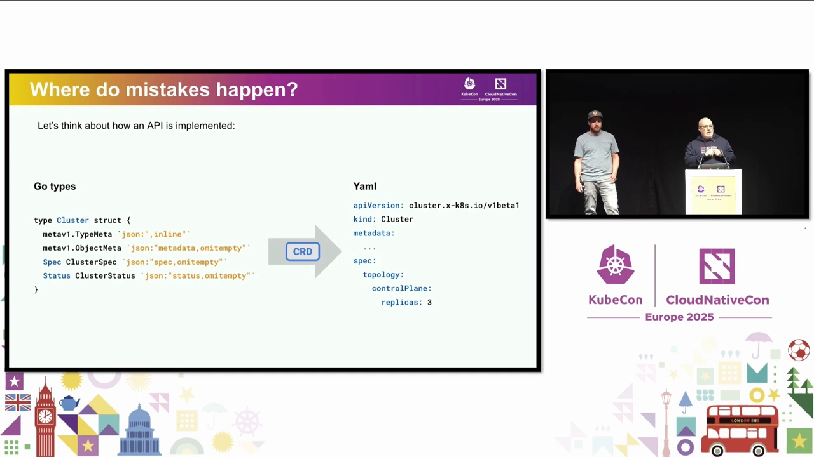

那么，**错误最可能出现在哪里？** 讲者把这条链路拆成三段来看：

- **用户**（右侧）：「用户永远是对的」，他们不会制造错误；
- **生成器**（中间）：`controller-gen` 正常工作，也不是问题来源；
- **只剩 Go 类型**：于是「你请一个好开发者来开发 Kubernetes API，能出什么错？」——**答案是什么错都可能出。**

这正是本讲后面所有反模式的总纲：**问题不在工具，在设计 Go 类型的人。** [【跳转到 04:25】](https://www.youtube.com/watch?v=7IA-Vw1K7eg&t=265)

## 二、反模式一：嵌入外部 API（Embedding external APIs）

### 2.1 kubeadm 的例子：被上游牵着走

Cluster API 需要创建集群，底层会用到 kubeadm。它希望用户也能配置 kubeadm 的选项，比如给 kube-apiserver 打开某个 flag。**但 kubeadm 自己的配置结构是会随版本变化的**：在 v1.29 之前它用的是 `v1beta3`，从 v1.30 起换成了新版本。[【跳转到 04:25】](https://www.youtube.com/watch?v=7IA-Vw1K7eg&t=265)

麻烦在于：Cluster API 的定位是**支持跨版本创建集群**（有的集群跑 1.29、有的跑 1.30）。如果你把自己的 CRD 直接**嵌入** kubeadm 某个版本的配置结构并暴露给用户，会出什么问题？——一旦 kubeadm 变了、你升级依赖用上新版本，你就**再也无法创建旧版本**的集群了；这是个破坏性变更。[【跳转到 05:45】](https://www.youtube.com/watch?v=7IA-Vw1K7eg&t=345)

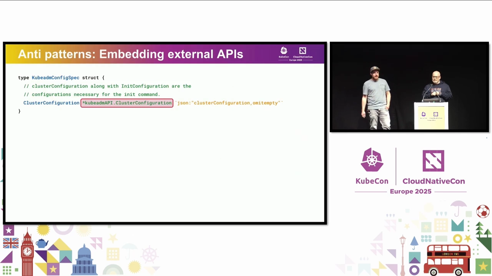

**正确做法：copy, adapt and evolve。** 你自己复制一份配置、定义自己的 struct 暴露给用户；在后端根据用户声明的版本（1.29 或 1.30）**转换**成对应的 kubeadm 版本。这样就能在后台仍用 kubeadm 的 `v1beta3/v1beta4` 的同时，支持从 v1.27 到 v1.33 的一大段版本区间。[【跳转到 06:30】](https://www.youtube.com/watch?v=7IA-Vw1K7eg&t=390)

### 2.2 core/v1 ObjectReference 的例子：多余字段埋下的雷

另一个「嵌入外部 API」的例子：Cluster 对象里要引用一个 control plane 对象，于是团队复用了 **`core/v1` 包**里的 `ObjectReference`。当时想的是「`core/v1` 很稳定、不会怎么变」。[【跳转到 06:55】](https://www.youtube.com/watch?v=7IA-Vw1K7eg&t=415)

但问题在于：`ObjectReference` 里有**三个你根本用不到的字段**。用户看到它们，会以为「设了就能生效」，而实际上它们**从未被使用**。更糟的是，光是「把它们删掉」都不容易——如果曾经有用户误用过，删除就成了破坏性变更，只能等到下一个 API 版本（v1beta2）再处理。[【跳转到 07:45】](https://www.youtube.com/watch?v=7IA-Vw1K7eg&t=465)

**正确做法**：自己复制一份、只保留你**真正需要**的字段。这样将来真的需要某个字段（比如 `UID`）时，再加上、再启用即可——**只在需要时才引入。** [【跳转到 08:35】](https://www.youtube.com/watch?v=7IA-Vw1K7eg&t=515)

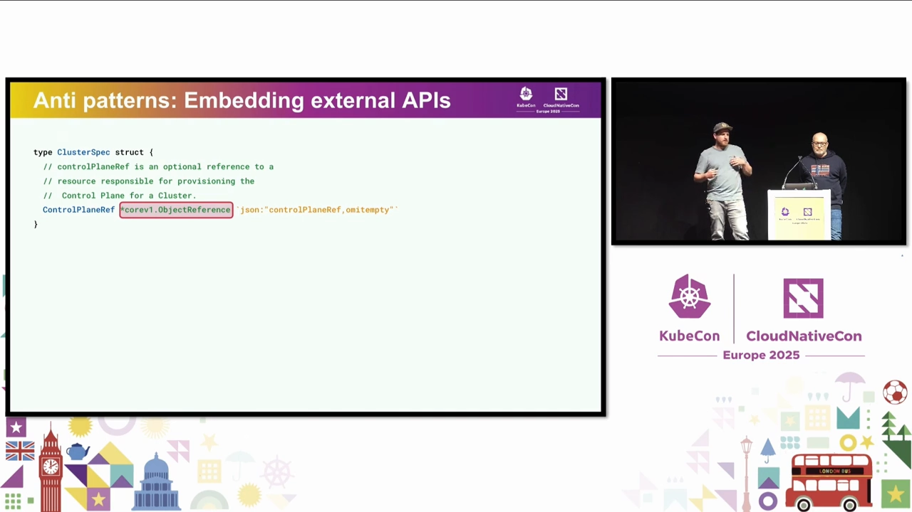

### 2.3 反模式二：跨类型共享同一个 struct（Sharing structs across types）

第三个例子不依赖外部 API，同样值得警惕：Cluster API 里有 `Machine`（一台机器，本应是唯一实体）和 `MachineTemplate`（机器模板，用来批量创建机器）。团队一开始觉得「两者轮廓一样，**共用同一个 spec** 挺好」。[【跳转到 09:00】](https://www.youtube.com/watch?v=7IA-Vw1K7eg&t=540)

但请考虑「加入一个 IP 地址字段」这件事——因为我们要做 IP 地址管理。问题立刻暴露：把 IP 加进 `Machine` 的 spec，它就**会顺着共用结构「泄漏」到 `MachineTemplate`**；而模板侧根本不讲道理，因为**每台机器最终都应该有各自不同的 IP**，不该是同一个。[【跳转到 09:25】](https://www.youtube.com/watch?v=7IA-Vw1K7eg&t=565)

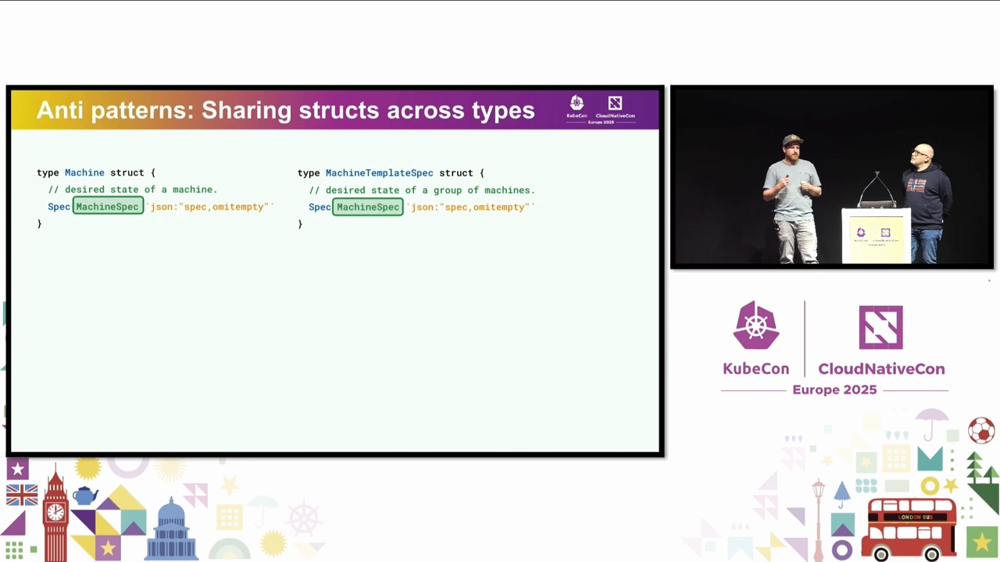

**正确做法**依然是 copy, adapt、各自独立演进：先想清楚「这两个对象是否需要**分开**演进」，并在需要时通过转换来衔接。要注意的是：**仅仅是「换掉 Go 类型」，也可能在不经意间产出完全不同的 OpenAPI spec。** [【跳转到 09:50】](https://www.youtube.com/watch?v=7IA-Vw1K7eg&t=590)

### 2.4 那么，复用已有的 Go 类型总是坏事吗？

**不是。** 有时复用**完全没问题**，甚至**必须**复用：[【跳转到 10:15】](https://www.youtube.com/watch?v=7IA-Vw1K7eg&t=615)

- 在你的 CRD 的 Go 类型里，你**必须**嵌入 `metav1.TypeMeta` 和 `metav1.ObjectMeta`，否则它就不是一个合规的 Kubernetes 对象；
- 有些类型是 K8s **专门为复用而设计**的，比如 `metav1.Condition`、`metav1.Time`（提供漂亮的时间戳序列化）。

**关键在于：复用之前，先想清楚它带来的影响**，才能避开前面 Christian 描述的那些坑。有时也可以复用自己的类型，但同样要掂量清楚后果。[【跳转到 11:05】](https://www.youtube.com/watch?v=7IA-Vw1K7eg&t=665)

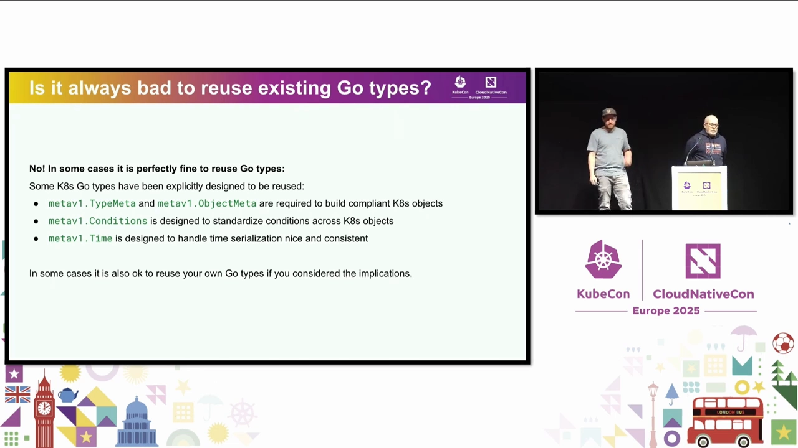

## 三、把 OpenAPI spec 当成对用户的承诺

### 3.1 改完 Go 类型，一定要去看 OpenAPI spec

回到流程本身。这个「Go 类型 → 生成器 → 用户」的过程，**容易误导维护者**：作为维护者，我们总把注意力放在写 Go 类型上，心想着「反正 controller-gen 会把一切都生成好」。但真正**影响用户的是 OpenAPI spec**。[【跳转到 11:30】](https://www.youtube.com/watch?v=7IA-Vw1K7eg&t=690)

于是有了全场最重要的 Pro Tip 之一：**每当你改动 Go 类型，就运行一次 generator、并亲自读一遍 OpenAPI spec。** 它并不难读，你完全可以借此判断这次改动会对用户产生什么影响。[【跳转到 12:00】](https://www.youtube.com/watch?v=7IA-Vw1K7eg&t=720)

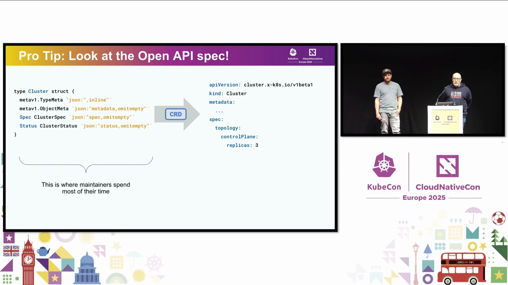

### 3.2 规则作用在 spec 上，而不在二进制上

另一个容易忽略的点：**API 保证、破坏性变更、弃用规则，统统作用在 OpenAPI spec 上**。[【跳转到 12:45】](https://www.youtube.com/watch?v=7IA-Vw1K7eg&t=765)

- 比如一个 `v1beta1` 的 API 要弃用，通常需要**一年或三个 release**；
- 而同一份产物里的 **Go 二进制**遵循的却是另一套规则——**semver（语义化版本）**；
- 当两套规则作用在同一个产物上时，就产生了一个空隙：**如果你处在「角落」里、又清楚自己的受众**，完全可能找到务实的解法。比如——你想重命名一个 Go 类型，如果你的 API 包**只被公司内部使用**，那虽然它仍是破坏性变更，但你是**管得住**的。[【跳转到 13:35】](https://www.youtube.com/watch?v=7IA-Vw1K7eg&t=815)

这条经验很重要：**知道你的受众是谁，往往能帮你用务实的方式化解一部分尴尬。**

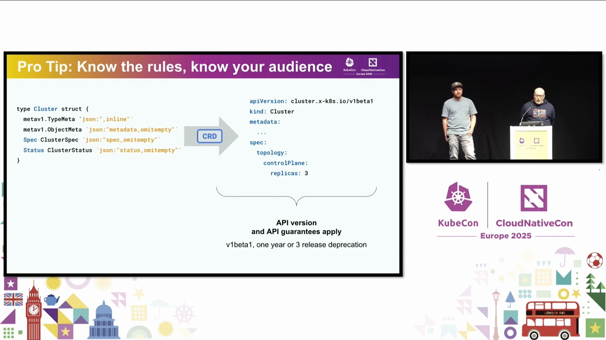

## 四、注释与 marker：别让「手滑」写坏 schema

Go 类型讲完了？还没。**注释与 marker 同样会影响 OpenAPI spec**，同样会出错。[【跳转到 14:07】](https://www.youtube.com/watch?v=7IA-Vw1K7eg&t=847)

K8s 里生成 CRD 时，常借助 **marker 注释**（controller-gen 会读取它们来影响 OpenAPI spec）。这里最容易犯的错是**漏写正确的 marker**：

- 比如 `maxLength` 这类**长度校验**非常重要；
- **CEL 校验、validating admission policy** 只有在加上正确的校验、并在 OpenAPI spec 里生成出对应字段时才有效；
- 再比如把「必填」的字段错标成了「可选」——同样会改变最终的 OpenAPI spec。

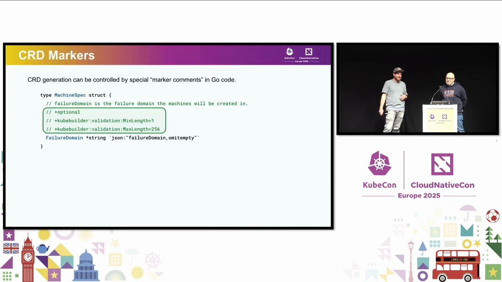

### 4.1 用 KAL（Kubernetes API Linter）把坑兜住

针对这类问题有个现成方案：**KAL，即 Kubernetes API Linter**。它会检查常见错误、强制执行最佳实践，是一个很好的 linter，和 **golangci-lint** 集成得很顺。[【跳转到 15:22】](https://www.youtube.com/watch?v=7IA-Vw1K7eg&t=922) 该项目计划迁入 `kubernetes-sigs` 组织下的仓库。

它的价值不只是「报错」：有时某条 lint 规则未必适用于你的场景，但**它也逼你去思考某些设计决策**——你可以为不适用的地方显式声明例外，并在 API 或 godoc 里注明。[【跳转到 15:45】](https://www.youtube.com/watch?v=7IA-Vw1K7eg&t=945)

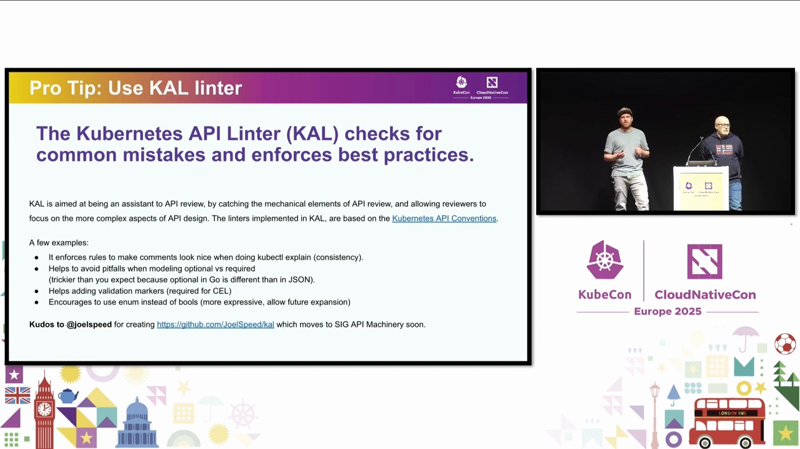

### 4.2 list 的反模式：让 controller 和 GitOps 工具打起来

KAL 未来还能帮你发现的一个经典问题，是**列表（list / array）字段的默认合并行为**。[【跳转到 16:12】](https://www.youtube.com/watch?v=7IA-Vw1K7eg&t=972)

设想 Cluster 对象里有一个 `variables` 列表，而**另有一个 controller 也想往这个列表里加字段**。默认情况下，**这类列表被当作 atomic（原子）处理**——于是当一个 GitOps 工具（kubectl / flux / argo）尝试把 source 同步到目标对象时，它只会「整体设置」，而那个想追加 `costCenter` 字段的 controller 也在改同一处，**双方就会互斗，最终陷入无限 reconcile**——既耗性能、又耗资源，非常糟糕。[【跳转到 16:37】](https://www.youtube.com/watch?v=7IA-Vw1K7eg&t=997)

**解法**：给字段设置 `listType` 与 `listMapKey` 这类 marker。这样 **OpenAPI 就不再把这个数组当成普通数组，而是当成 list-map**，从而支持列表内条目的**共同所有权（co-ownership）**，多个工具各管各的条目、不再打架。[【跳转到 17:02】](https://www.youtube.com/watch?v=7IA-Vw1K7eg&t=1022)

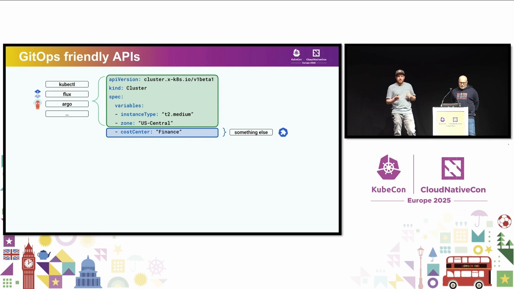

## 五、字段命名：API 设计里每一个词都重要

Go 类型知道了，注释和 marker 也知道了——但还不够。还有最后一类、也是**最常见、最难做对**的错误：**字段命名（field names）**。[【跳转到 17:58】](https://www.youtube.com/watch?v=7IA-Vw1K7eg&t=1078)

### 5.1 API 是「项目所解决问题」的一种表示

一个 API，本质上是**你的项目在做什么**的一种表示；每个项目都在解决一个独特的问题。以 Cluster API 为例：左边是一句完整的项目描述，右边是对应的 Cluster 对象——**两者是同一句话的不同表示**。[【跳转到 17:58】](https://www.youtube.com/watch?v=7IA-Vw1K7eg&t=1078)

最大的差别在于：左侧有上下文、有完整句子；**右侧只剩几个关键词——而在 API 设计里，每一个关键词都至关重要。** 选词不准、或用同义词/缩写指代同一概念、或随手用了过于泛化的词，都会让用户困惑。更严重的是：**一旦选错关键词，日后「重命名字段」就是一次破坏性变更。** [【跳转到 18:23】](https://www.youtube.com/watch?v=7IA-Vw1K7eg&t=1103)

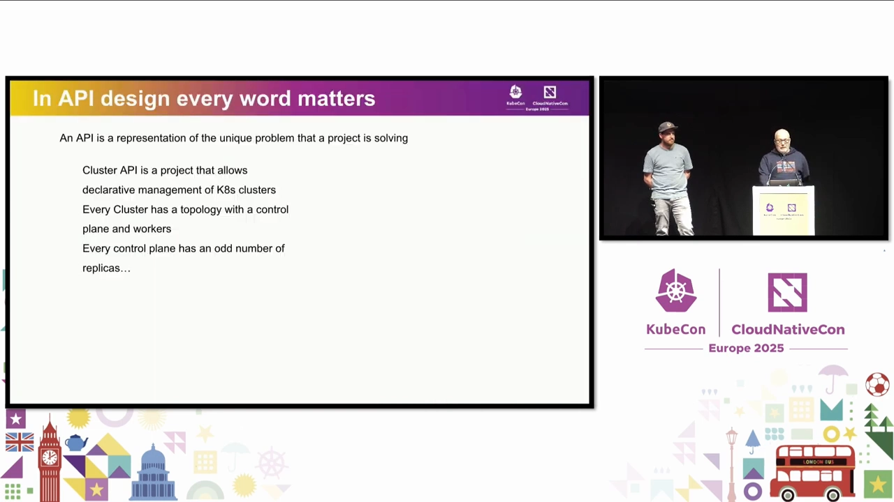

### 5.2 技巧一：把 API 当成一句话读出来

第一个技巧简单又有效：**试着把你的 API「读」出来**，拼成一句以 **「I want a …」** 开头的话——因为它本就是声明式 API。[【跳转到 20:28】](https://www.youtube.com/watch?v=7IA-Vw1K7eg&t=1228)

比如：「I want a cluster with a topology that has a control plane with three replicas.」——句子通顺、一眼能懂，用户也能理解。这就是一个**好信号**：说明你正在做一个好 API。反过来，如果这句话读起来别扭、不像正常英语、用词别扭——那就是第一个**红色警报**：你可能正走在一条将来会后悔的路上。[【跳转到 21:03】](https://www.youtube.com/watch?v=7IA-Vw1K7eg&t=1263)

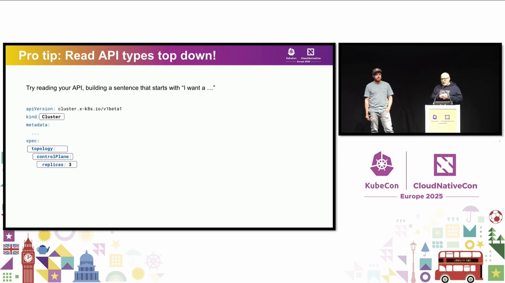

### 5.3 技巧二：维护一份术语表（glossary）

第二个技巧要多花点功夫，但长期收益很大：[【跳转到 21:43】](https://www.youtube.com/watch?v=7IA-Vw1K7eg&t=1303)

- **每个项目其实都有术语表，但不是每个项目会把它写下来**；
- 写下来有什么好处？对**用户**：读 API、看文档时有个好帮手；对**维护者（尤其是后来接手的维护者）**：它定义了术语、划定了上下文，让 API 里的关键词对所有人含义一致；
- 而且它**可以逐步积累**，不必一开始就大动干戈。

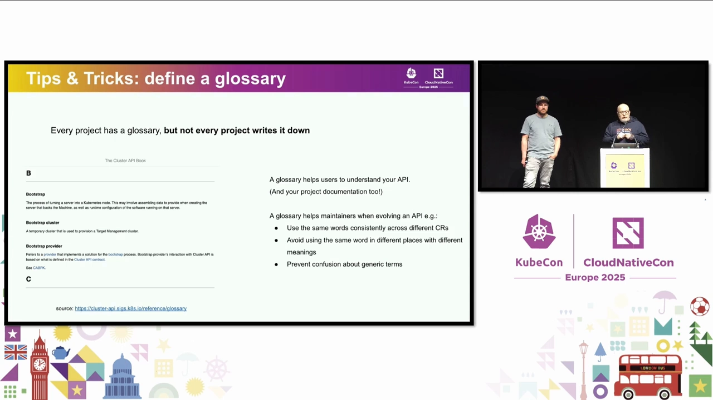

### 5.4 反模式：泛化词与 CamelCase 拼接

**反模式一：轻率地使用泛化词。** Cluster API 定义了一个「基础设施机」的概念：AWS 机器应在其 status 里用一个 `ready` 字段宣告就绪。可 **`ready` 到底是什么意思？** 是节点就绪？是启动完成？还是已 provisioned？如果当初有一份术语表/定义，本该写成：「每台基础设施机器必须在机器初始化完成、且基础设施**完全 provisioned** 时才上报。」——**这就是那个 `status.ready` 真正想表达的含义。** 轻率用词的结果，是一个含糊、不显式的 API，极易被误解。[【跳转到 23:23】](https://www.youtube.com/watch?v=7IA-Vw1K7eg&t=1403)

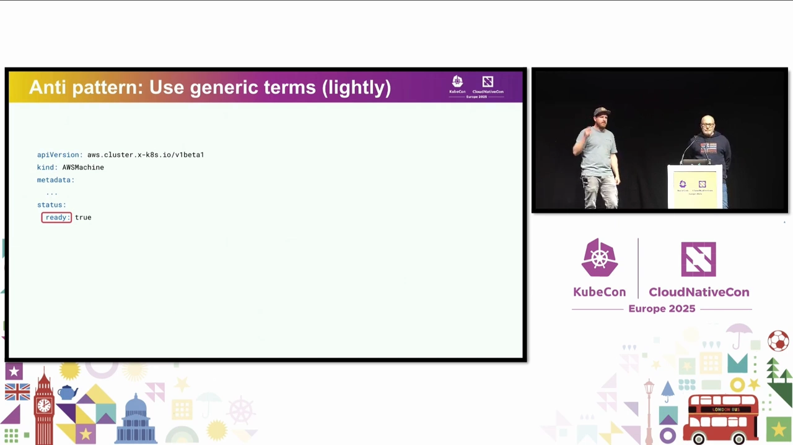

**反模式二：CamelCase 拼接。** 假设要做一个类似 `kubectl drain` 的能力。kubectl 有个 `grace period` 的 flag，于是我们先加字段 `nodeDrainGracePeriod`；下一版本觉得不够，又要加 `timeout` 的 flag，再加 `nodeDrainTimeout`。虽是「一致地」扩展，但读起来有点怪。[【跳转到 24:13】](https://www.youtube.com/watch?v=7IA-Vw1K7eg&t=1453)

**更好的做法**是考虑**嵌套与可扩展性**：如果当初就设成嵌套的 `nodeDrain` 字段，里面放 `gracePeriod`，那将来加 `timeout`（乃至更多）都顺理成章。[【跳转到 24:46】](https://www.youtube.com/watch?v=7IA-Vw1K7eg&t=1486)

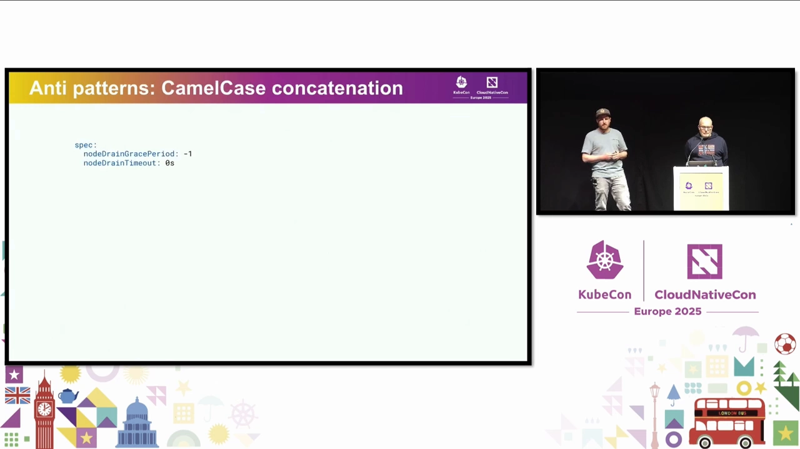

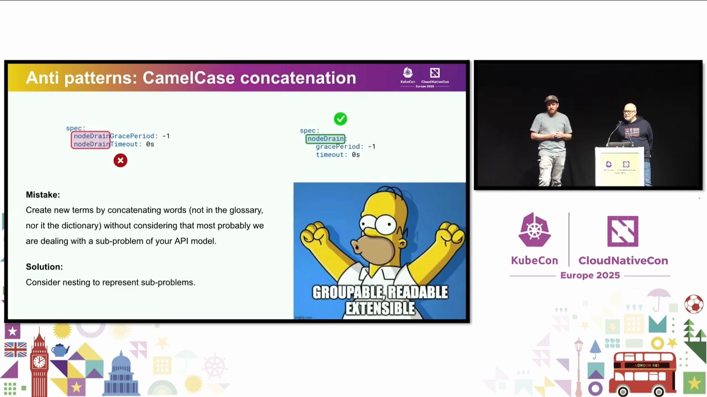

### 5.5 其他建议：用 enum 而非 boolean，多向高手取经

- 如果某个布尔值将来可能有多种含义，**考虑用 enum 而不是 boolean**；
- 最后一条 Pro Tip：**向最优秀的人/项目取经。** API 设计不是一个人的独角戏，尽可能多要反馈——做**同行评审**、**向用户征询**；也可以参考其他 K8s 项目或 K8s 自身的 API 类型。但要**批判性地判断**：别人这么做，是否也适用于你的 API？还是只该借鉴其中一部分？（笑）你甚至可以问问 AI，但记得**再想一遍**。[【跳转到 25:36】](https://www.youtube.com/watch?v=7IA-Vw1K7eg&t=1536)

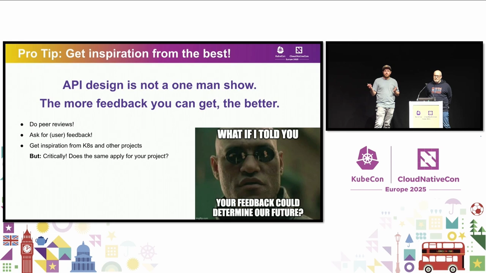

## 六、本讲没有覆盖的内容

讲者很诚实地列了「今天没讲」的部分，也正好是读者后续可以深入的方向：[【跳转到 25:57】](https://www.youtube.com/watch?v=7IA-Vw1K7eg&t=1557)

- **CRD marker 的深潜**：marker 很多，有些直观（如 max/min 等校验类），做法就是「加一个 marker → 重新生成 → 看 OpenAPI spec 里的变化 → 在 server 上测试」；
- **新建 API 版本、弃用并移除旧版本**：远比想象中复杂，要处理 **storage version migration（存储版本迁移）**，以及一些恼人的 API Server 问题（团队也在并行修）；
- **如何让 API 与备份/恢复工具（如 Velero）良好兼容**。

## 小结

- **错误的来源是 Go 类型，而不是用户或工具**：用户永远没错、生成器也正常，唯一可能出错的是设计类型的人。
- **看到 OpenAPI spec，才看到用户**：API 保证、破坏性变更、弃用规则都作用在 spec 上；改完 Go 类型务必生成并阅读 spec。
- **别直接嵌入外部 API**，用 **copy, adapt and evolve**；复用要分场合——`TypeMeta`/`ObjectMeta`/`metav1.Condition`/`metav1.Time` 该用就用，但要想清楚影响。
- **注释与 marker 会写坏 schema**：漏写校验、错标必填/可选都会出问题；用 **KAL** 兜底；**atomic 列表**要用 `listType/listMapKey` 化解 GitOps 与 controller 的冲突。
- **字段命名决定长期成本**：每个词都重要、重命名就是破坏性变更；把 API 读成「I want a …」、维护 glossary、避免泛化词与 CamelCase 拼接、优先 enum、多要反馈。
- **总目标**：尽量**不要被迫新建 API 版本**——新建版本只在「深思熟虑」之后才做。

## 关键术语速查

| 术语 | 一句话解释 |
| --- | --- |
| CRD | CustomResourceDefinition：用 Go 类型 + 注释生成、经 API Server 暴露给用户的自定义资源定义 |
| OpenAPI spec | 从 Go 类型生成的 schema，**才是用户真正感知到的 API 契约**，保证/破坏性变更都作用在它上面 |
| controller-gen | 读取 Go 类型与 marker 注释、生成 CRD（含 OpenAPI spec）的官方生成器 |
| marker 注释 | Go 代码里的特殊注释，用来控制 CRD 生成结果（校验、必填、listType 等） |
| KAL | Kubernetes API Linter：检查常见错误、强制最佳实践的 linter，与 golangci-lint 集成 |
| list-map（listType/listMapKey） | 让数组支持条目级共同所有权的 schema 设置，避免多工具争抢导致的无限 reconcile |
| copy, adapt and evolve | 面对外部 API 时的推荐做法：复制、改造、独立演进，而非直接嵌入 |
| storage version migration | 新建 API 版本时必须处理的存储版本迁移问题（本讲未深入） |
