# 深度解析 K8s API 扩展：从 CRD 到独立 API Server

> 视频来源：[【Meetup 分享】深度解析 K8s API 扩展：从 CRD 到独立 API Server 的最佳实践](https://www.bilibili.com/video/BV1FRzuYvE3R/)（Bilibili · KubeSphere 出品，讲者陈定昌 @ 青云科技）
>
> 这篇分享把「扩展 Kubernetes API」从最朴素的原理讲起：CRD、聚合 API、独立的 API Server，说到底都只是「给 API Server 动态注册一条资源路由」。想清楚这条主线，再看那些复杂的源码和设计模式，就不会被绕晕。文稿左栏为 B 站 AI 字幕，本文已逐窗口纠正错拼（如「a p s over」→API Server、「3RD / C2D / CD」→CRD、「克拉斯蒂达」→Clusterpedia、「commander」→Karmada）后重写。

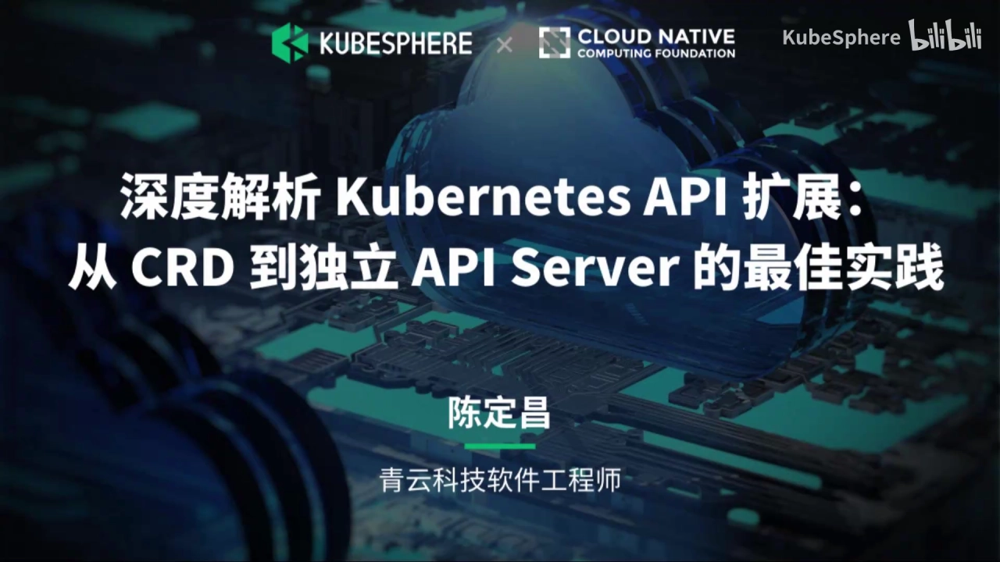

## 本讲要解决的核心问题（SCQA）

**背景**：只要做后端、尤其是做云原生，你大概率用过 Kubernetes 的 CRD——写一个 YAML、`kubectl apply`，集群里就凭空多出了一种新的资源类型，接着再写个 controller 去处理它。

**冲突**：可一旦要讲清楚「CRD 到底是怎么装进 API Server 的」，麻烦就来了。网上教程一提到 CRD 就扯出 operator、informer、OpenAPI、聚合 API、独立 API Server 一大堆名词；去读 K8s 源码，又是各种设计模式绕来绕去。结果是很多人「会用」，却说不清它背后的机制，更不知道什么时候该用聚合 API、什么时候干脆自己写一个 API Server。

**疑问**：CRD 的核心原理到底是什么？OpenAPI、informer、operator 这些名词各自扮演什么角色？CRD 有哪些做不到的事，聚合 API 和独立的 API Server 又是怎么补上的？这三种扩展方式该怎么选？

**回答（中心思想）**：**扩展 K8s API 的核心原理只有一句话——动态地给 API Server 注册一条资源路由。** [【跳转到 03:53】](https://www.bilibili.com/video/BV1FRzuYvE3R/?t=233) CRD、聚合 API、独立的 API Server 都只是「往路由表里加一条路由」的不同实现层次，你甚至可以亲手用几十行代码模拟出一个 CRD。理解了这条主线，OpenAPI（`kubectl apply` 的合并策略）、informer（事件推送）、operator（事件驱动的业务逻辑）就都只是这条主线上的配角；而 CRD 最大的局限——**查询（get）行为不可自定义**——正是聚合 API 与独立 API Server 存在的理由。

## 一、一句话讲透 CRD：动态给 API Server 加一条资源路由

### 1.1 用一个 Web 框架，先把原理讲透

先忘掉 K8s。假设我拿一个最轻量的 Web 框架（比如 Go 的 gin），写一个类似 Hello World 的程序，然后给它加一个路由，这个路由只干一件事：当你请求它时，动态地再注册一个路由进去——它就可以给你「变」出一个新路由来。[【跳转到 00:53】](https://www.bilibili.com/video/BV1FRzuYvE3R/?t=53)

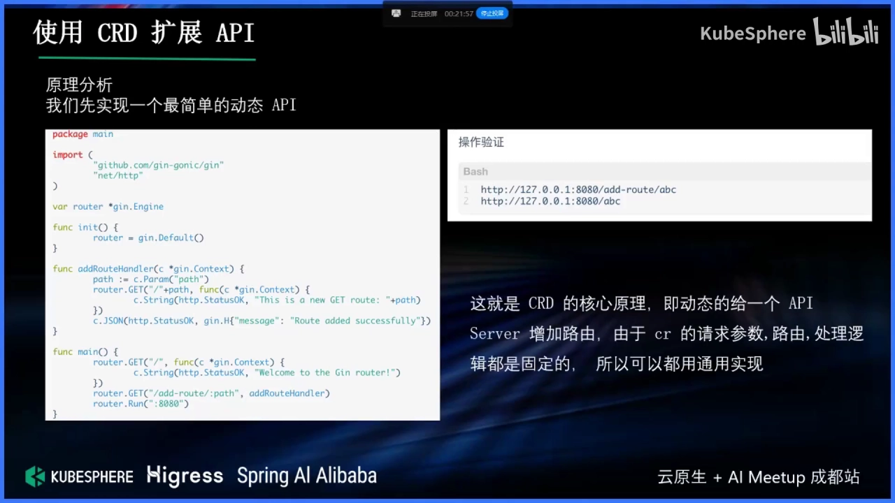

这看起来很「玩具」，但它已经触及了 CRD 的核心：**「提交一个东西，就让 API Server 多出一种可访问的资源」**。接下来只要把「玩具」一步步换成「正经实现」：

1. **改用配置文件驱动**：不是请求一个路由，而是把一个配置文件丢给程序；程序不断监听这个配置文件，一旦它变更了，就据此注册一条新路由。[【跳转到 01:43】](https://www.bilibili.com/video/BV1FRzuYvE3R/?t=103)
2. **改用数据库驱动**：把配置放到一个数据库里，比如 etcd；程序里起一个协程，不断查询 etcd，发现多了一条「资源」，就往路由注册的位置再加一条路由。[【跳转到 01:18】](https://www.bilibili.com/video/BV1FRzuYvE3R/?t=78)

到这一步，你会发现：**这就是 CRD 的核心原理了**。[【跳转到 02:08】](https://www.bilibili.com/video/BV1FRzuYvE3R/?t=128) 网上很多教程、源码分析觉得它「非常复杂」，是因为 K8s 在这条主线上叠加了大量工程细节（channel、协程、设计模式）；但剥掉这些，真正的骨架就一句：**动态地给一个 API Server 加资源路由**。[【跳转到 02:33】](https://www.bilibili.com/video/BV1FRzuYvE3R/?t=153)

### 1.2 看 K8s 源码：其实也是「把路由加进一个 map」

把上面的玩具换成 K8s 自己的实现，你会发现骨架一模一样。K8s 里有一个 `autoRegisterController`：当一条新的资源（APIService）上来时，它先把它丢进一个 channel，另外的协程再从 channel 里取出来，取出来之后就「注册进去」。[【跳转到 03:53】](https://www.bilibili.com/video/BV1FRzuYvE3R/?t=233)

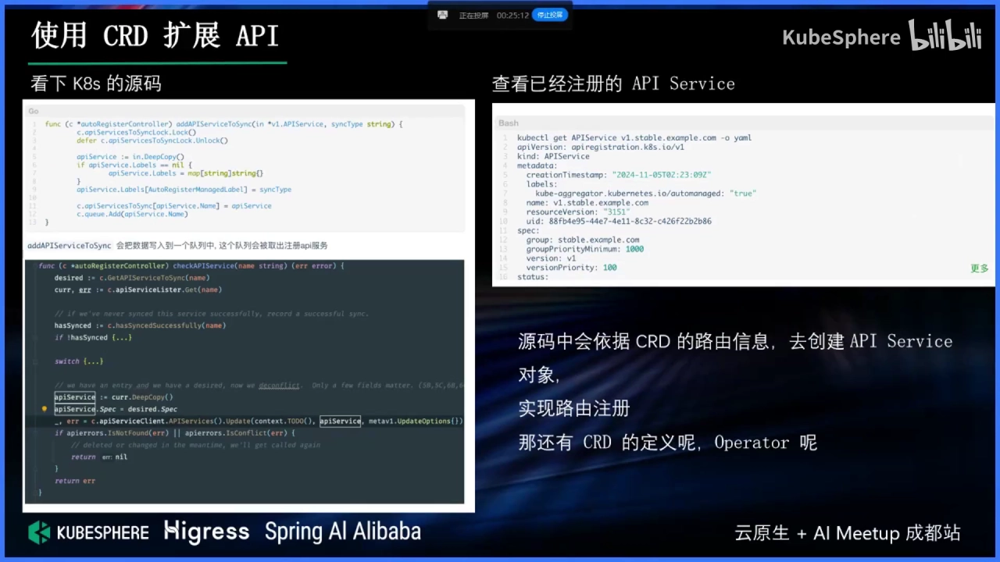

把这个「注册进去」的最终动作拆开看，无非就是**把一个路由加进一张 map**——跟我们前面那个玩具里「加一个路由」没有任何本质区别。所以讲者反复强调：复杂的是工程实现，简单的才是原理。

### 1.3 增删改查是「写死的」：为什么自定义查询不行

既然路由都加进去了、增删改查也都自动帮你注册好了，那是不是就全能自己定义？**恰恰相反：K8s 给这些资源配好的增删改查逻辑是固定（写死）的。** [【跳转到 02:58】](https://www.bilibili.com/video/BV1FRzuYvE3R/?t=178)

- 你查询它的时候，可以用 `label selector` 这种**预定义**的过滤方式；
- 但你**不能**写「我要 A 等于 B」「某个字段等于 true」这种自定义的查询条件。

这一点至关重要，因为它是后面一切「升级方案」的起点：**当你想在 get 时插入自己的逻辑（比如聚合多个数据源、拼装实时结果），CRD 就无能为力了。** 我们会在第三节详细展开。

## 二、CRD 身上那些「名词」到底是什么

前面用「最简单实现」跑通了原理，但你可能立刻会问：那 CRD 还要定义一个很复杂的 OpenAPI 配置，它是干嘛的？还有一提到 CRD 就冒出来的 operator、informer，又是什么？[【跳转到 03:23】](https://www.bilibili.com/video/BV1FRzuYvE3R/?t=203) 这一节把它们各自的对位关系讲清楚。

### 2.1 OpenAPI：`kubectl apply` 时的合并策略与默认值

如果你用 SDK、或者用 K8s 原生的路由去请求，其实**并不需要** OpenAPI 配置文件。它真正起作用的地方，是 **`kubectl apply`**——这时它会拿你的提交去和已有资源做对比。[【跳转到 04:18】](https://www.bilibili.com/video/BV1FRzuYvE3R/?t=258)

举个最典型的例子：某个字段是个数组。你刚开始写的是 `[123]`，后来改成 `[456]`，那么提交上去以后，它会变成 `[123, 456]` 还是直接被替换成 `[456]`？**答案取决于 OpenAPI 里为你配置的合并策略。** [【跳转到 04:43】](https://www.bilibili.com/video/BV1FRzuYvE3R/?t=283) 你可以在 schema 里规定：

- 字段的合并策略（合并、还是覆盖）；
- 可选的枚举值有哪些；
- 默认值是什么。

一句话：**OpenAPI 主要服务于 `kubectl apply` 的语义**——帮你算合并、填默认值、生成 patch。[【跳转到 05:08】](https://www.bilibili.com/video/BV1FRzuYvE3R/?t=308)

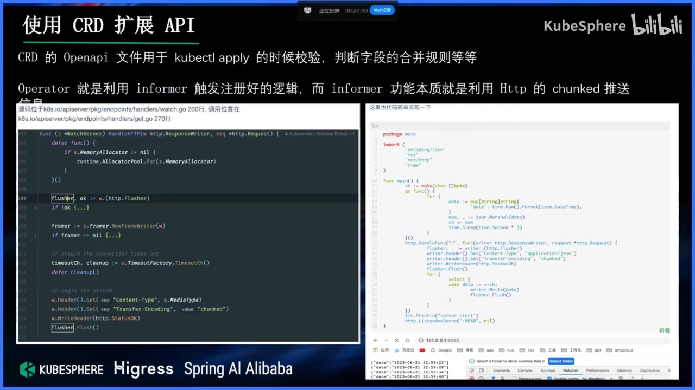

### 2.2 informer：本质就是「channel + 持续推送」

回到那条主线。我们给 API Server 注册了一条动态路由，但光「能查能改」还不够——我还希望在别人**查询或删除**这条资源时，能触发一些事。回到那个玩具框架，最朴素的做法就是：放一个 channel（或一个 map），事件进来就塞进 channel，另起一个协程不停地读，读到事件就向外推送。**这就是 informer 的核心原理。** [【跳转到 05:56】](https://www.bilibili.com/video/BV1FRzuYvE3R/?t=356)

网上讲 informer 的教程很多，会分析它的数据结构、先入先出队列等等，确实非常复杂；但核心链路很简单：**有请求上来，就把信息推出去。** [【跳转到 06:21】](https://www.bilibili.com/video/BV1FRzuYvE3R/?t=381) 至于「怎么推出去」，本质就是 **HTTP 长连接（stream）**：当请求头里有相应内容时，浏览器/客户端就知道这个包没有发完，会持续接收。我们自己起个协程每秒推一条数据，用浏览器一看，数据就每秒都过来——这就是一个最简版 informer。

### 2.3 operator：informer 触发 + 你的业务逻辑

再把「推出去」的内容从「一个时间戳」换成「一次 delete / post 请求」，你就可以在客户端收到「有一个 delete 请求、删的是哪条数据」时，注册自己的处理逻辑。**这些逻辑一旦有了，它就是 controller；controller 加上 CRD，就是 operator。** [【跳转到 07:36】](https://www.bilibili.com/video/BV1FRzuYvE3R/?t=456)

所以三者的关系可以这样对齐：

| 名词 | 在主线里的角色 |
| --- | --- |
| CRD | 往 API Server 注册一条新资源路由（+ 一份 schema） |
| informer | 把资源的变更事件「推」给监听者（channel + 长连接） |
| operator | 监听事件、执行你写的业务逻辑（controller + CRD） |

**到这里，「CRD 的核心原理」就讲完了。** 它并不神秘，只是被工程细节包装得很复杂。

## 三、CRD 解决不了的三件事

理解了原理，也就能看清 CRD 的边界。讲者用「做一个统一的数据库管理平台」这个场景，把 CRD 的三个典型痛点串了起来。

### 3.1 多 operator 的「套娃」式管理

假设我要做一个数据库管理平台，既要管 MySQL、又要管 PG、还要管 Redis。问题是，这些数据库各自的 CRD 往往是不同团队/第三方定义的，字段各不相同——你希望「副本数」这个字段统一叫 `replicas`，但别人定义的可能是别的名字，**人家未必愿意为了你改自己的 CRD。** [【跳转到 08:21】](https://www.bilibili.com/video/BV1FRzuYvE3R/?t=501)

一个常见妥协是：在自己的 CRD 里放一个字段（比如 `rawCRD`），**把对方真实的 CRD 以字符串形式塞进去**，实现一种「套娃」式的兼容管理。[【跳转到 08:21】](https://www.bilibili.com/video/BV1FRzuYvE3R/?t=501)

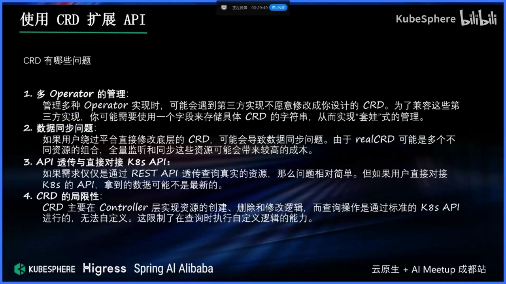

### 3.2 数据不同步与「透传查询」的两难

「套娃」带来一个更麻烦的问题：**数据同步**。假设平台里显示副本数是 3，但某个熟悉底层 MySQL 的同事嫌你的 UI 要学、直接绕过平台去改底层的 CRD，把副本数改成了 4——那么平台上的数据就和底层**对不上**了。[【跳转到 09:36】](https://www.bilibili.com/video/BV1FRzuYvE3R/?t=576)

你可能的补丁是：**监听底层数据**，一旦发现被绕过修改，就把数据同步回自己的 CRD。但同步又引入新的风险——它是**事件驱动**的：万一我错过了某条事件，下次就不一定能补上。[【跳转到 11:16】](https://www.bilibili.com/video/BV1FRzuYvE3R/?t=676)

于是有人想到另一种解法：**透传查询**。既然查询走的是自己写的 API（而不是原生 SDK），那就在查询时「先查我的通用 CR，再透传到底层去查真实数据」。[【跳转到 12:06】](https://www.bilibili.com/video/BV1FRzuYvE3R/?t=726)

但这又有代价：**透传只对「经过你这个 API Server 的请求」生效**。如果对方偏要用 K8s 原生 API、直接查底层那个 CRD，就没这个效果了。[【跳转到 12:31】](https://www.bilibili.com/video/BV1FRzuYvE3R/?t=751)

> 讲者在这里插了一句很有价值的话：**任何东西都有使用成本，别看到锤子就当钉子。** 不能看到什么就都想用 CRD 抽象一下——抽象之后的封装、同步、兼容成本，往往比你以为的高。[【跳转到 10:26】](https://www.bilibili.com/video/BV1FRzuYvE3R/?t=626)

### 3.3 根子上的限制：get 行为无法自定义

上面两个问题的本质，都指向同一个根因：我们自己模拟的那个 CRD 实现，**增删改查都是「另起一个程序、通过事件驱动去触发逻辑」；唯独查询不是**——查询就是直接去读原生 CRD 的 CR 数据。[【跳转到 13:21】](https://www.bilibili.com/video/BV1FRzuYvE3R/?t=801)

举个例子：我想封装一个 `SuperPod`，它可以来自 A 集群和 B 集群的合集（查询时把两个集群的 Pod 拉过来合并展示）。**这在 CRD 里做不到**，因为 get 只能读你这个 CR 自己的数据，没法在查询时去两个集群各拉一份再合并。[【跳转到 13:46】](https://www.bilibili.com/video/BV1FRzuYvE3R/?t=826)

**这就是 CRD 的缺点，也是接下来两种方案要解决的核心问题。** [【跳转到 13:46】](https://www.bilibili.com/video/BV1FRzuYvE3R/?t=826)

## 四、聚合 API：把 CRUD 的主动权交还给开发者

### 4.1 与 CRD 本质无异，区别只在「谁实现 CRUD」

解决 get 不可自定义的第一个方案，是 K8s 的**聚合 API（API Aggregation）**。[【跳转到 14:00】](https://www.bilibili.com/video/BV1FRzuYvE3R/?t=840) 有意思的是，讲者强调：**聚合 API 和 CRD 本质上没有区别**——它们都是创建一个叫 `APIService` 的资源。差别只在请求上来之后，谁来处理：

- **CRD**：「我帮你把请求转发给 CRD，增删改查逻辑我替你写好了」；你要为它附加别的逻辑，得自己写个 controller 去监听事件、注入行为。
- **聚合 API**：它「很暴力」——只帮你把路由注册好，**请求上来之后实际怎么处理，完全交给你自己搞一个服务来处理**。[【跳转到 14:50】](https://www.bilibili.com/video/BV1FRzuYvE3R/?t=890)

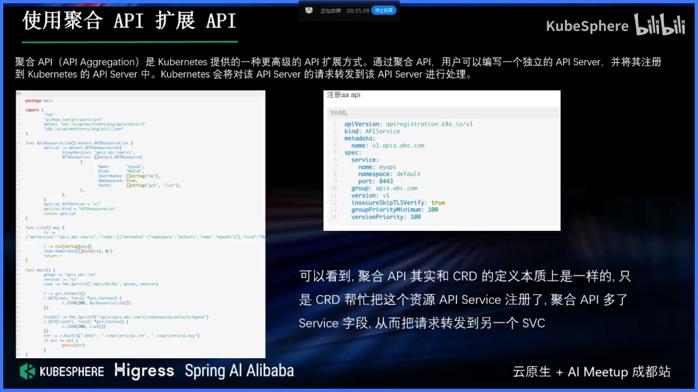

> 官方曾提供 `apiserver-builder` 之类的工具帮你自动生成这些接口，但多年未更新、用起来也复杂。理解原理之后你会发现，聚合 API 其实也可以做得很简单。

### 4.2 真的只要两个路由

讲者用同一个轻量框架演示：一个聚合 API 服务，**最少只要实现两个路由**就能跑起来。[【跳转到 15:15】](https://www.bilibili.com/video/BV1FRzuYvE3R/?t=915)

1. **服务发现路由（discovery）**：当 SDK 请求时，能告诉它「这个服务提供了哪些路由/资源」；
2. **业务路由**：真正的增删改查逻辑。

请求这个服务时，它和 K8s 风格是**一模一样**的。为什么？因为你只要去实现这样一个路由，你的行为就和 K8s 的逻辑对齐了——用 `kubectl get xxx -v=10` 看日志，它实际请求的就是那个地址。[【跳转到 17:12】](https://www.bilibili.com/video/BV1FRzuYvE3R/?t=1032)

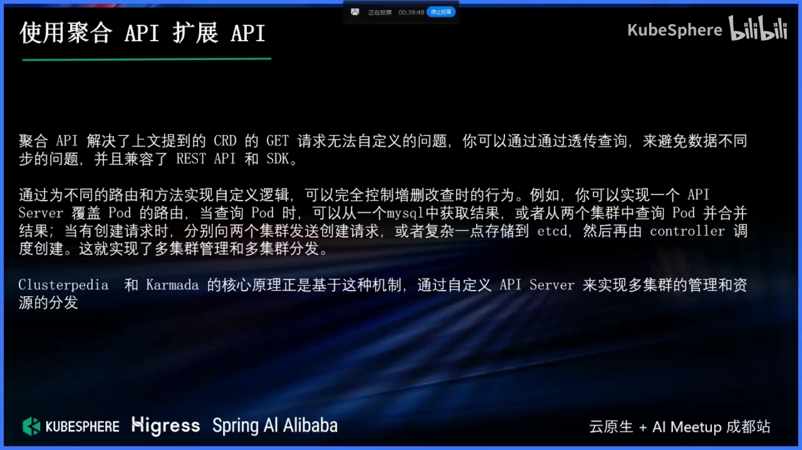

### 4.3 它解决了什么：get 自定义、数据同步、生态兼容

聚合 API 一举解决了前面几个痛点：[【跳转到 18:39】](https://www.bilibili.com/video/BV1FRzuYvE3R/?t=1119)

- **get 也能自定义**：既然增删改查逻辑都是你自己写的，查询时就能「透传」——先查我的通用 CR，再去底层查真实数据，**避免数据不同步**；
- **兼容 REST 和 SDK**：无论你走 HTTP 还是用 client-go，行为一致；
- **无需 CRD 声明**：注册一个 `APIService`，把某组资源转给这个服务即可。

由此可以「玩出花来」，讲者给了两个业界实例：

- **多集群查询——Clusterpedia**：把多个集群的 Pod 数据存进 MySQL，再用自定义 API Server 查。为什么自己「手动合并返回」不行？因为**分页**没法处理——你要 `label=123` 的前十条，到底 A 集群取几条、B 集群取几条？没有统一存储，分页筛选就是无解的；**先落库、再统一查询**才能实现自定义筛选与分页。[【跳转到 20:56】](https://www.bilibili.com/video/BV1FRzuYvE3R/?t=1256)
- **多集群分发——Karmada**：既然 get 能自定义，post 也能。提交一个创建请求时，你可以决定「A 集群创建一份、B 集群再创建一份」；再声明一种「调度策略」资源，规定「A 集群资源多就分发 3 副本、B 集群资源少就 2 副本」——这就实现了分发调度。[【跳转到 21:46】](https://www.bilibili.com/video/BV1FRzuYvE3R/?t=1306)

### 4.4 代价：仍然依赖一个现成的 K8s 集群

聚合 API 听上去近乎完美，但它有一个绕不开的前提：**你还是得先有一个 K8s 集群**，因为 `APIService` 这个资源得装进这个集群里。[【跳转到 24:26】](https://www.bilibili.com/video/BV1FRzuYvE3R/?t=1466)

结论：**聚合 API 能用 K8s 的机制，但前提是「K8s 必须在」。** 那能不能「用 K8s 的机制，却根本不要 K8s」？这就引出了第三种方式。

## 五、独立的 API Server：彻底不依赖 K8s

### 5.1 需求：想要 K8s 的机制，但不想要 K8s

设想一个很实际的诉求：做一个**虚拟机管理平台**。[【跳转到 22:36】](https://www.bilibili.com/video/BV1FRzuYvE3R/?t=1356)

- 逻辑不想跑在容器里、网络也不走 CNI 那一套；
- 数据想存到 MySQL 里（而不是 etcd）；
- **但又想用 K8s 的声明式 API、想用它的 informer 机制、想用 client-go 与 kubectl 这套顺手的工具**。

矛盾来了：要「用 K8s」，就得装 K8s、维护 Docker 环境，成本不低。能不能「不依赖 K8s，却享受 K8s 生态」？

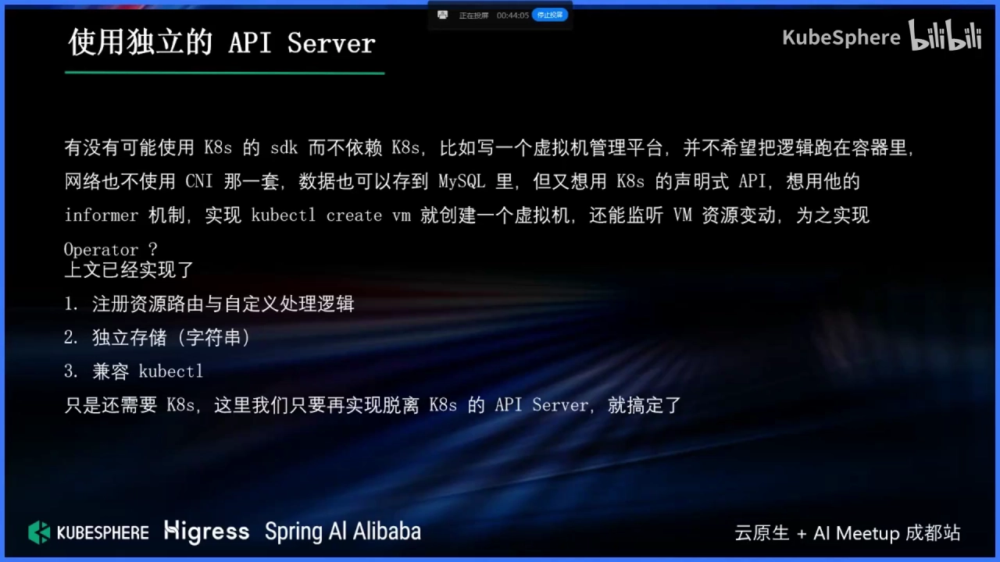

### 5.2 自建一个 API Server 的关键步骤

官方提供了一个 `sample-apiserver` 作为参考，但它逻辑复杂，**且仍然依赖一个主集群**。[【跳转到 24:47】](https://www.bilibili.com/video/BV1FRzuYvE3R/?t=1487) 讲者干脆从零拼了一个最小实现，核心分三步：

1. **API 注册**：把资源放进一个 `storage` map，它的 key 就是资源名——注意，**资源名不一定非得是「小写加 s」**（不像内置的 `pods`），自己实现时可以完全自定义。[【跳转到 26:27】](https://www.bilibili.com/video/BV1FRzuYvE3R/?t=1587)
2. **OpenAPI 生成**：提前用 generator 把 OpenAPI 生成好，注册时一并挂上，于是就有「资源发现」了。
3. **资源注册**：本质上就是调 `AddResource` 把资源加进 map——跟前文「加一个路由」没有任何区别；具体逻辑则在 **REST storage** 里。[【跳转到 27:17】](https://www.bilibili.com/video/BV1FRzuYvE3R/?t=1637)

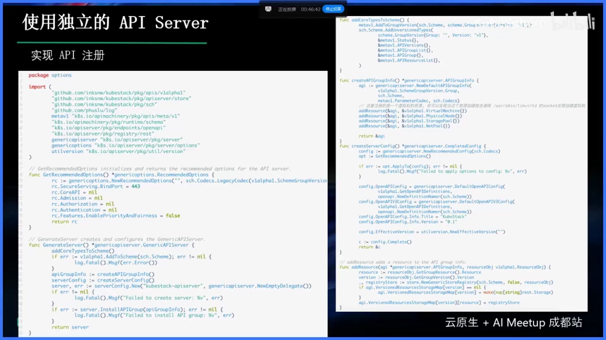

### 5.3 存储与 watch：把 etcd 换成 MySQL 也行

storage 里要实现 `rest.StandardStorage` 那套接口，也就是**增删改查各自怎么处理**——而这些你都可以自己定义。[【跳转到 27:47】](https://www.bilibili.com/video/BV1FRzuYvE3R/?t=1667)

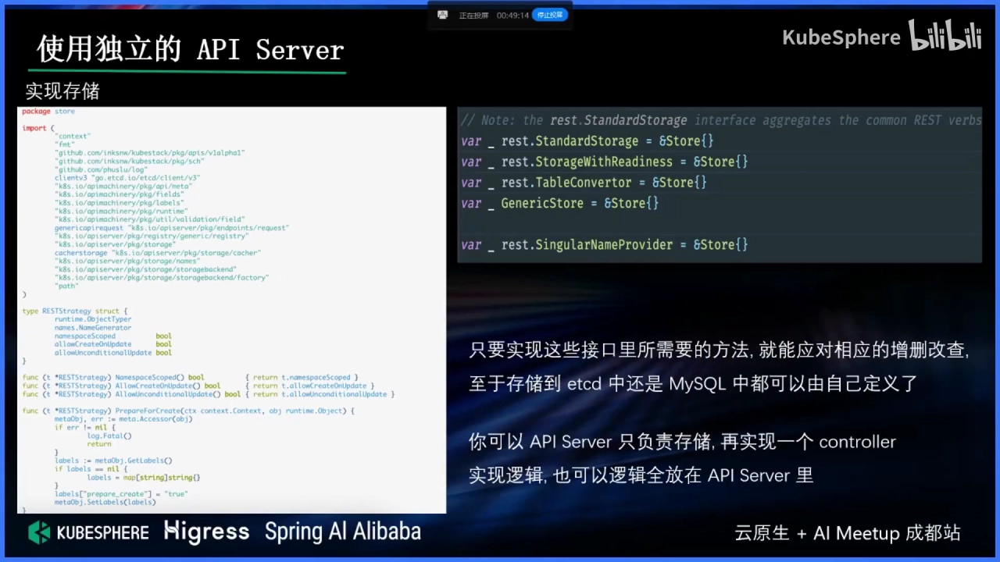

讲者的 Demo 用了 etcd，但强调**完全可以不放 etcd**：创建逻辑存到 MySQL 就行。[【跳转到 28:37】](https://www.bilibili.com/video/BV1FRzuYvE3R/?t=1717) 唯一的区别是——你要多实现一个 **watch** 接口。为什么？因为前面说过，controller 的机制依赖「监听事件」；只要你实现了 watch，即便数据存在别的数据库、甚至存在文件里，也能享受 controller 的机制。[【跳转到 29:02】](https://www.bilibili.com/video/BV1FRzuYvE3R/?t=1742)

### 5.4 client-go 依然可用：兼容整个声明式生态

到这里，一个独立 API Server 已经能：**① 自定义资源注册；② 自定义资源存储；③ 实现事件驱动的逻辑触发。** [【跳转到 29:34】](https://www.bilibili.com/video/BV1FRzuYvE3R/?t=1774)

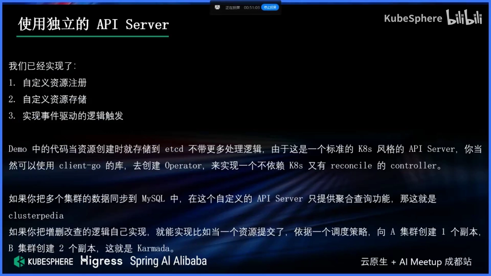

更关键的是，因为它是**标准的、K8s 风格的 API Server**，你可以直接拿 **client-go** 连上去，自己实现 reconcile 逻辑——也就是说，**不需要装 K8s，也能用 K8s 生态这套工具**。[【跳转到 29:59】](https://www.bilibili.com/video/BV1FRzuYvE3R/?t=1799)

于是又能「玩出花」：用 informer 把多个集群的数据都同步进 MySQL，查询时直接查 MySQL——这不就是 Clusterpedia 的思路吗？创建时也可以自己实现分发：要么请求一到就往多个集群挨个提交一遍；要么把请求落库、再起一个「调度器」监听事件、按调度策略给资源打标签，最后真正创建——这就是 Karmada 的多集群分发思路。[【跳转到 30:24】](https://www.bilibili.com/video/BV1FRzuYvE3R/?t=1824)

### 5.5 残留问题：子资源与 kubectl 兼容

这种方式已经很自由了，剩下的问题就比较小：

- **REST 语义不总合适**：比如「把虚拟机暂停」这种动作，其实不太适合用 REST 的资源语义表达，更适合做成**子资源**，如 `/vm/pause`。[【跳转到 31:55】](https://www.bilibili.com/video/BV1FRzuYvE3R/?t=1915)
- **CRD 的子资源是「硬编码」的**：K8s 的 CRD 目前只支持 `status` 和 `scale` 两种子资源，是在源码里硬编码的，并不是什么都能加。[【跳转到 32:20】](https://www.bilibili.com/video/BV1FRzuYvE3R/?t=1940)
- **自建可以加更多子资源，但要权衡兼容性**：你当然可以在路由后面再拼一段、把它变成子资源，但这样**和 controller 的兼容性就差了一点**。[【跳转到 32:45】](https://www.bilibili.com/video/BV1FRzuYvE3R/?t=1965) 好在大部分功能仍可兼容 K8s，少部分改一改、封装一下，就能支持更多命令——**根据你的需求取舍**。[【跳转到 33:10】](https://www.bilibili.com/video/BV1FRzuYvE3R/?t=1990)

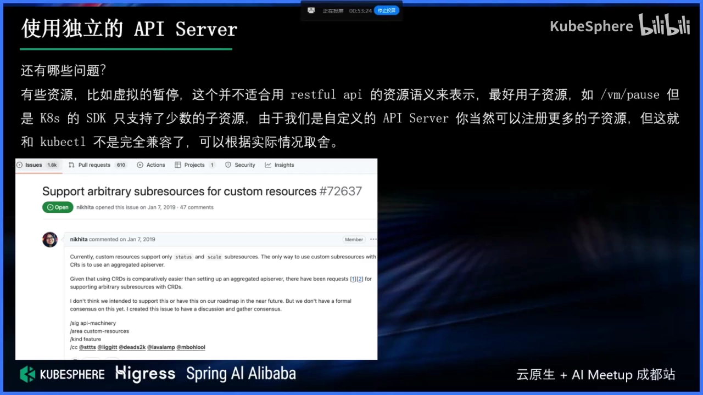

## 六、三种扩展方式怎么选

讲完三种方式，规律其实已经很清楚——**它们只是「往 API Server 加路由」的三档实现，越往后自由度越高、成本也越高**：[【跳转到 33:30】](https://www.bilibili.com/video/BV1FRzuYvE3R/?t=2010)

| 方式 | 核心 | 适用场景 | 主要局限 |
| --- | --- | --- | --- |
| **CRD** | 你只定义资源与 schema，增删改查由 K8s 代劳 | 简单的资源管理 | get 行为不可自定义；多实现难统一；数据易不同步 |
| **聚合 API** | 注册 `APIService`，把请求转给你自己的服务实现 | 复杂的 API 扩展（要做自定义查询/分发） | 仍需一个现成的 K8s 集群 |
| **独立 API Server** | 自己实现 API Server，复用 K8s 的库与协议 | 完全自定义（如虚拟机管理，不想依赖 K8s） | 实现成本最高；子资源等细节需自行权衡 |

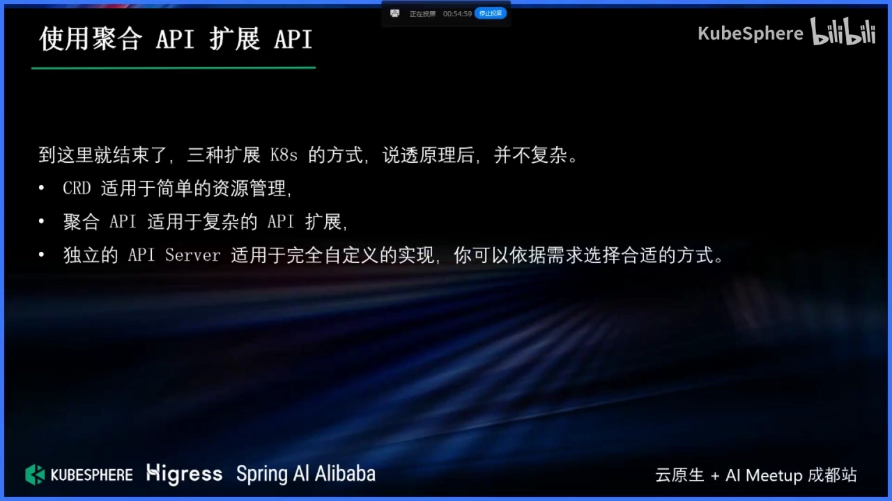

讲者的收尾很朴素：**三种扩展 K8s 的方式，说透原理后，并不复杂。** [【跳转到 34:20】](https://www.bilibili.com/video/BV1FRzuYvE3R/?t=2060)

## 小结

- **一条主线**：扩展 K8s API 的本质，是**动态地给 API Server 注册一条资源路由**；CRD 只是这条主线上最省事的一档。
- **配角各就各位**：OpenAPI 服务于 `kubectl apply` 的合并/默认值；informer 是「channel + 长连接」的事件推送；operator 是「informer 触发 + 业务逻辑」。
- **CRD 的硬伤**：增删改查逻辑写死，**get 不可自定义**——导致「聚合多数据源」「透传查询」这类需求做不了。
- **聚合 API**：把 CRUD 实现权交还开发者，解决了 get 自定义与数据同步，但**仍依赖一个已存在的 K8s 集群**。
- **独立 API Server**：复用 K8s 的库与协议，**连 K8s 都可以不要**，还能继续用 client-go/kubectl；代价是实现成本与细节权衡。
- **选型原则**：CRD → 简单资源管理；聚合 API → 复杂 API 扩展；独立 API Server → 完全自定义。**先量清楚自己的需求和成本，再选那一档。**
- **一句话忠告**：别看到锤子就把什么都当钉子——抽象是有成本的，`rawCRD` 套娃与数据同步的坑，都是滥用换来的。

## 关键术语速查

| 术语 | 一句话解释 |
| --- | --- |
| CRD（CustomResourceDefinition） | 一种「用 API 对象定义新 API 对象」的扩展手段：注册一种新资源与其 schema，增删改查由 K8s 代劳 |
| APIService | 聚合 API 的注册对象：把某个 API 组/版本的请求转发给你自己的服务 |
| 聚合 API（API Aggregation） | 注册一个独立 APIServer 到 K8s，请求转发过去、由你自定义处理 CRUD |
| 独立 API Server | 自己实现一个 K8s 风格的 API Server，复用 K8s 库/协议但不必依赖 K8s 集群 |
| OpenAPI 文件 | CRD 的 schema，主要服务于 `kubectl apply` 的字段合并策略、默认值与校验 |
| informer | 监听资源变更并推送事件的机制，本质是 channel + HTTP 长连接（stream/watch） |
| operator | CRD + 自定义 controller：监听事件、执行你写的业务逻辑 |
| REST storage | 自建 API Server 中真正实现增删改查逻辑的存储层接口 |
| 透传查询 | 聚合 API 的做法：先查自己的通用 CR，再转发到底层查真实数据 |
| Clusterpedia / Karmada | 两个业界实例：多集群统一查询 / 多集群分发调度，都建立在「可自定义 get/post」之上 |
