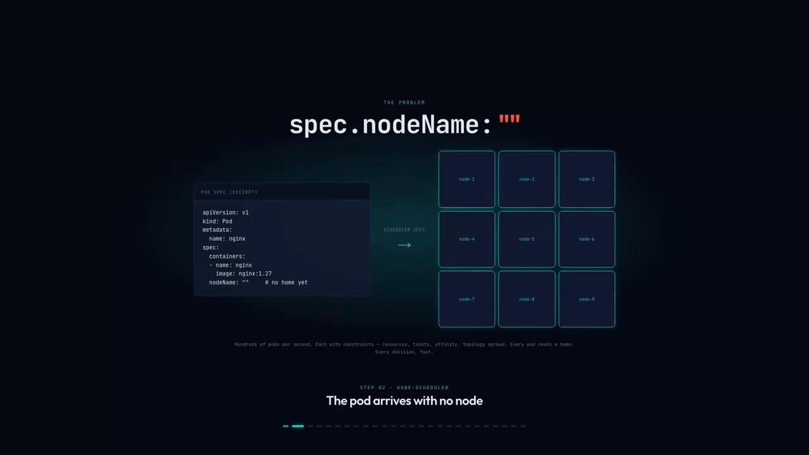
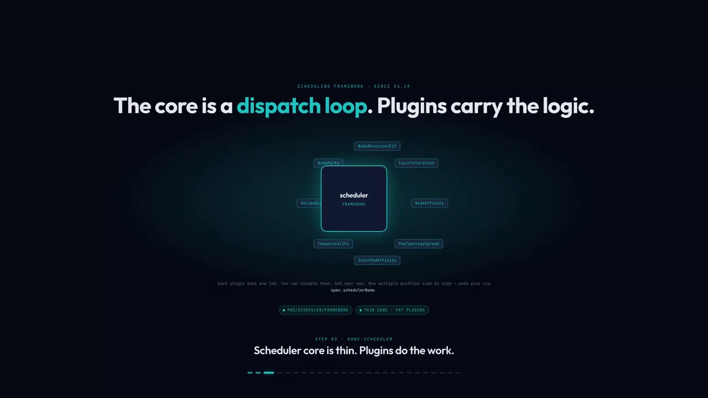
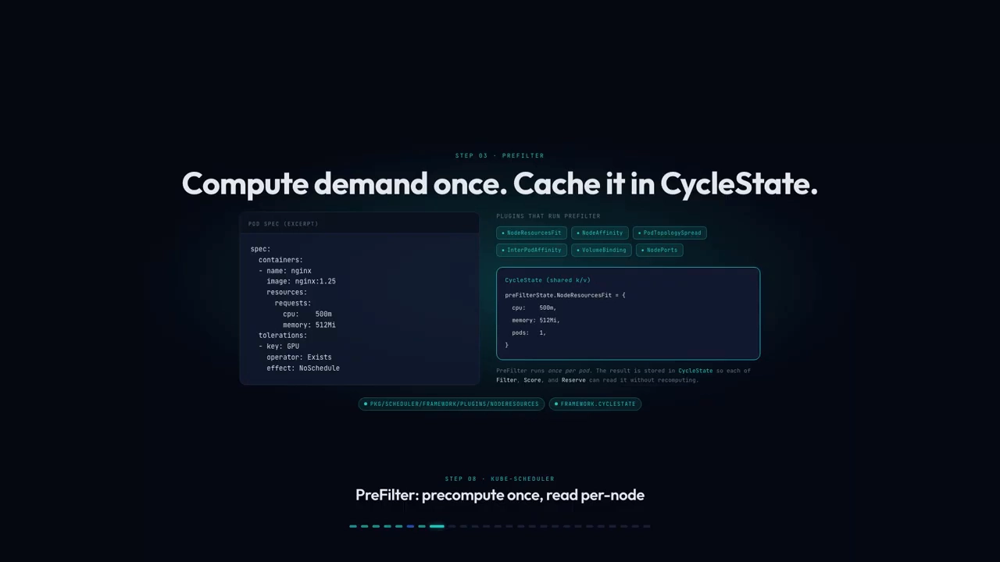
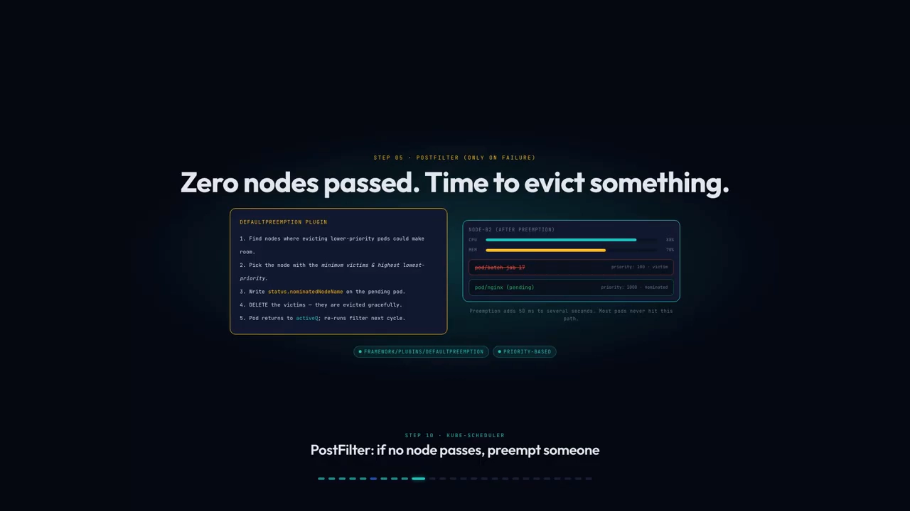
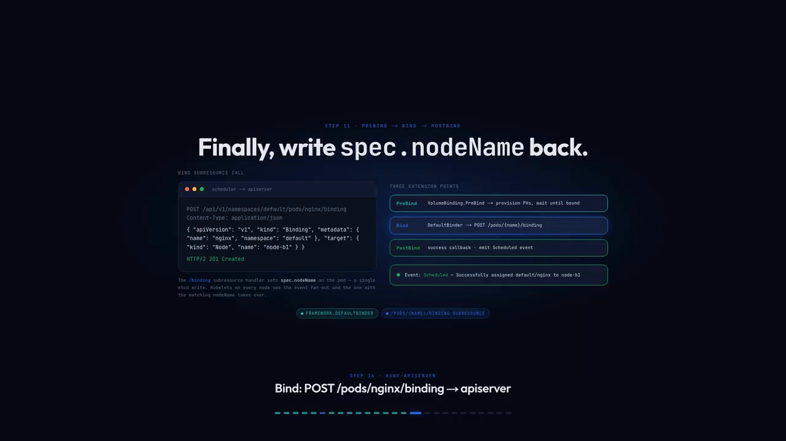
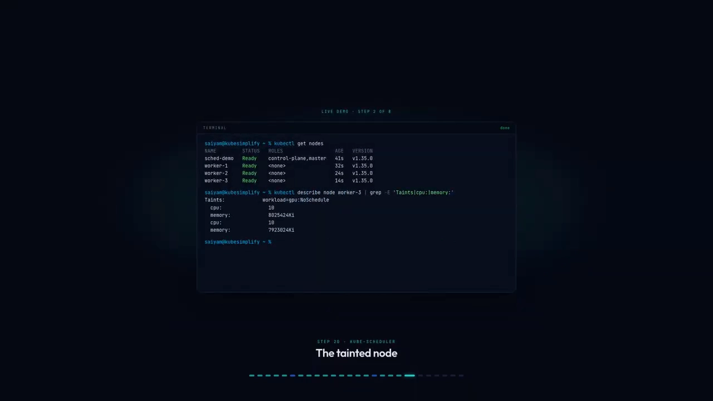
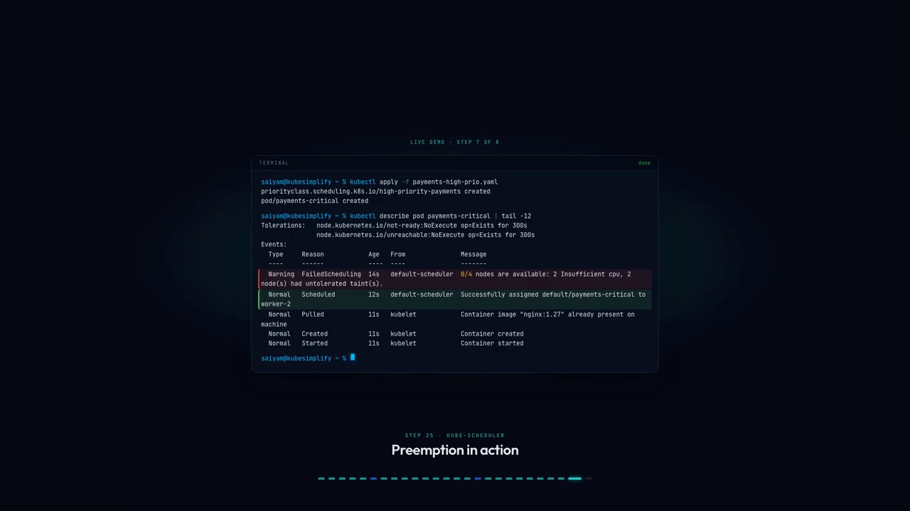

# 调度器如何为 Pod 挑出那个节点：过滤与打分全流程

> 视频来源：[How Does the Kubernetes Scheduler Pick a Node?](https://www.youtube.com/watch?v=N-dDSCVWdqU)（YouTube，Kubesimplify）｜时长 12:53
>
> 一支把一个 Pod 从"进入队列"到"绑定到某台机器"完整走一遍的机制解剖课。它没有停在"调度器负责选节点"这种口号上，而是沿着 **PreFilter → Filter → PostFilter → PreScore → Score → NormalizeScore → Reserve → Bind** 这条流水线，讲清楚**过滤（Filter）用硬约束一票否决整台机器，打分（Score）用插件加权求和排出冠军**。文稿左栏为英文自动字幕，本文已翻译并重写为中文，并纠正了自动字幕里的错拼（`C-P-U`→**CPU**、`G-P-U`→**GPU**、`spec dot node name`→**`spec.nodeName`**、`HTTP two`→**HTTP/2**、`O of one`→**O(1)**、`QB control`→**kubectl**、`eight forty-seven`→**847**）。

## 本讲要解决的核心问题（SCQA）

**背景**：在 Kubernetes 里你只写一个 Pod 的 YAML，从不指定它跑在哪台机器上。真正做决定的那个组件是 **kube-scheduler（调度器）**：它盯着"还没有节点的 Pod"，给每个 Pod 挑一台机器。[【跳转到 00:00】](https://www.youtube.com/watch?v=N-dDSCVWdqU&t=0)

**冲突**：这件事听起来简单——挑一台机器、完事。但它一点都不简单。集群里每秒钟可能有**几百个 Pod** 要落位，而每个 Pod 都带着一堆约束：资源、污点、亲和性、拓扑分布……调度器必须又快又对：在 500 个节点的集群上，一轮调度大约只要 **8 毫秒**，单个调度器进程能跑到**每秒 300 个 Pod**。[【跳转到 00:19】](https://www.youtube.com/watch?v=N-dDSCVWdqU&t=19)

**疑问**：既然约束这么多，调度器到底**按什么顺序、用什么方法**在这几百个候选节点里挑出一个？为什么会"过滤"？为什么会"打分"？如果一台都挑不出来又会怎样？

**回答（中心思想）**：调度器把"挑节点"拆成一条由**插件（plugin）**组成的流水线，核心认知只有两句：**Filter 用硬约束把整台机器直接一票否决（留下"能跑的"），Score 用带权重的打分把所有幸存的机器排个名（选出"最好的"）**。中间用 PreFilter/PreScore 把重活只算一次，最后用 Reserve/Bind 把决定写回 API Server。[【跳转到 04:29】](https://www.youtube.com/watch?v=N-dDSCVWdqU&t=269)

---

## 一、调度器是什么：只写一个字段的"选址专家"

调度器本质上还是一个**控制器**：它 watch（监听）API Server 里那些 `spec.nodeName` 为空的 Pod，给它挑一台节点，然后把这个字段填上。除此之外它什么都不做——**它既不创建 Pod，也不启动容器**，只负责"指派"。[【跳转到 00:19】](https://www.youtube.com/watch?v=N-dDSCVWdqU&t=19)

- 你在终端 `kubectl apply` 一个 Pod，请求发给 API Server；
- API Server 把它写进 etcd，此刻 Pod 的 `spec.nodeName` **是空的**，谁也没接；
- 谁来接？调度器。它必须快，而且非常快。



## 二、调度框架：逻辑拆成插件，流水线上有 13 个扩展点

从 **Kubernetes 1.19** 开始，调度器围绕**调度框架（Scheduling Framework）**构建：**调度器内核非常薄**，真正的逻辑全都在**插件**里。[【跳转到 00:44】](https://www.youtube.com/watch?v=N-dDSCVWdqU&t=44)

常见的默认插件各自只干一件事：

| 插件 | 负责的事 |
| --- | --- |
| `NodeResourcesFit` | 节点剩余资源够不够放下 Pod 的 requests |
| `TaintToleration` | 节点的污点 Pod 忍不忍得了 |
| `ImageLocality` | 节点上有没有缓存了镜像层 |
| `PodTopologySpread` | 拓扑分布是否均衡 |

插件可以**禁用**、可以**自己加**，甚至能同时跑多套**配置档（profile）**，Pod 通过 `spec.schedulerName` 选用哪一套。[【跳转到 01:09】](https://www.youtube.com/watch?v=N-dDSCVWdqU&t=69)

框架把这些插件的运行时机定义为一系列**扩展点（extension point）**，可以理解为"钩子"——Pod 旅程中插件可以插手的站点。一共有**十三个**，按顺序走：[【跳转到 01:34】](https://www.youtube.com/watch?v=N-dDSCVWdqU&t=94)

```text
PreEnqueue → QueueSort → PreFilter → Filter → PostFilter
→ PreScore → Score → NormalizeScore → Reserve → Permit
→ PreBind → Bind → PostBind
```

每一个 Pod 都要一步一步走完这些站点，直到落到某台节点上。



## 三、Pod 先在调度队列里排队

调度器**不轮询**（轮询太浪费）。它用一个 **SharedIndexInformer**，向 API Server 开一条常驻的 HTTP/2 长连接。Pod 一落进 etcd，API Server 就把事件推给所有订阅者，调度器的 `AddFunc` 处理器随即触发——**完全事件驱动，没有轮询，没有延迟**。[【跳转到 01:44】](https://www.youtube.com/watch?v=N-dDSCVWdqU&t=144)

进来的 Pod 不是马上就调度，而是先进**三个队列之一**：[【跳转到 03:14】](https://www.youtube.com/watch?v=N-dDSCVWdqU&t=194)

- **activeQ**：优先队列（priority heap），优先级最高的在最上面；
- **backoffQ**：按时间排序，最近失败过的 Pod 在这里做**指数退避**；
- **unschedulableQ**：实在放不下的 Pod 待在这儿。

当集群状态变化（新节点加入、有人删了 Pod），这些"放不下"的 Pod 会被搬回 activeQ 重试。


## 四、PreFilter 与 PreScore：重活只干一遍

流水线里有两个"预计算"站点——**PreFilter** 和 **PreScore**——它们的设计意图完全一样：**只算一次，缓存起来**。

**PreFilter**：被弹出队列的 Pod 先到这里。`NodeResourcesFit`、`NodeAffinity`、`PodTopologySpread`、`InterPodAffinity`、`VolumeBinding` 这些插件会先把"这个 Pod 到底想要什么"算清楚——资源 requests、亲和性条件、拓扑分布——然后把结果塞进 **CycleState**。[【跳转到 03:39】](https://www.youtube.com/watch?v=N-dDSCVWdqU&t=219)

之后 Filter 和 Score 是**逐节点**运行的，它们不再重新计算，只从 CycleState 里读缓存。这就是那句 **compute once, read many times（算一次、读多次）**。

**PreScore**：在打分前做同样的把戏。像 `InterPodAffinity`、`PodTopologySpread` 这种在打分时要做重活的插件，PreScore 里先聚合拓扑计数、构建亲和性映射，缓存进 CycleState。这样后面每个节点被打分时，调用基本就是 **O(1)**——查一次表而已，非常快。[【跳转到 05:44】](https://www.youtube.com/watch?v=N-dDSCVWdqU&t=344)

## 五、Filter（过滤）：硬约束一票否决

**这是"过滤与打分"里的第一半。** 假设现在有 6 个候选节点摆在桌上，Filter 阶段**并行**检查它们——每个节点一个 goroutine：[【跳转到 04:29】](https://www.youtube.com/watch?v=N-dDSCVWdqU&t=269)

- `NodeResourcesFit` 说 node-a2 满了、没地方了 → **淘汰，出局**；
- `TaintToleration` 碰到 node-a3 有个 **GPU 污点** → **出局**。

**关键规则：只要有一个插件给出 Unschedulable（不可调度）的判定，哪怕只有一个，这个节点就出局——二元的，不给第二次机会。**

在大集群上（成千上万个节点），**`percentageOfNodesToScore`** 会限制扫描的节点比例——你不需要把每一个节点都检查一遍，否则太慢了。



## 六、PostFilter 与抢占：所有节点都失败时

如果**所有**节点都没通过过滤，一个幸存者都没有，怎么办？这时 **PostFilter** 登场，默认挂载的是 **DefaultPreemption** 插件。它问一个问题：[【跳转到 04:54】](https://www.youtube.com/watch?v=N-dDSCVWdqU&t=294)

> 如果我驱逐（evict）一些**低优先级**的 Pod，这个 Pod 能不能塞进去？

如果能，它就挑出"受害者"，设置 `nominatedNodeName`，优雅地删掉这些受害者，让这个 Pod 回到 activeQ，下一轮再试。

这一招很贵——**几十毫秒，有时甚至几秒**。但好消息是：**99% 的 Pod 根本走不到这条路**，绝大多数 Pod 在 Filter 阶段就能顺利通过。[【跳转到 05:19】](https://www.youtube.com/watch?v=N-dDSCVWdqU&t=319)



## 七、Score（打分）：插件加权求和，选出冠军

**这是"过滤与打分"里的第二半。** 过滤之后，比如还剩 4 个节点。现在每个插件给**每个节点**打分，范围 **0～100**，同样并行走。[【跳转到 06:09】](https://www.youtube.com/watch?v=N-dDSCVWdqU&t=369)

有趣之处在于：**每个插件都有一个权重（weight）**。大多数插件权重是 1，但：

- `TaintToleration` 的权重是 **3**——相当有分量；
- `InterPodAffinity`、`PodTopologySpread`、`NodeAffinity` 的权重都是 **2**。

**权重越高，对最终结果的话语权越大**——这就是默认配置在表达"什么更重要"。

单看一个插件 **ImageLocality**：它问的问题极简单——"节点，你缓存了这些镜像层吗？"

- node-b1 缓存了 nginx → 打 **100 分**（满分）；
- node-b2 什么都没有 → **0 分**。

为什么这很重要？因为在"冷"节点上 kubelet 得**从网络拉镜像**，那可能是几秒、甚至几十秒；而在缓存过的节点上，Pod **几毫秒**就能启动。差别巨大。[【跳转到 06:34】](https://www.youtube.com/watch?v=N-dDSCVWdqU&t=394)


## 八、NormalizeScore 与胜出：加权求和，平局随机

所有插件都打完分后，`NormalizeScore` 会把各插件的输出重新归一化到 **0～100** 的标准区间。然后对每个节点：**把每个插件的分数乘以它的权重，再加总**。[【跳转到 07:24】](https://www.youtube.com/watch?v=N-dDSCVWdqU&t=444)

在本例里 node-b1 以 **847** 的总分胜出。

**如果出现平局呢？随机。** 真的随机——用的是 Go 的 `rand.Int`。为什么要随机？因为如果平局总是固定地倒向同一个节点，所有 Pod 就会**反复拥挤到同一台机器上**（hot-spot），这显然不好。[【跳转到 07:49】](https://www.youtube.com/watch?v=N-dDSCVWdqU&t=469)


## 九、Reserve / Permit / Bind：把决定写进 API Server

选出冠军后，还没结束——API Server 此刻并不知道结果。

**Reserve（预留）**：调度器在内存快照里，从 node-b1 身上**扣掉这个 Pod 申请的 requests**。如果你申请了 500 毫核（millicores）和 512 兆字节（mebibytes），就扣这么多。[【跳转到 08:14】](https://www.youtube.com/watch?v=N-dDSCVWdqU&t=494)

- **Pod 完全没写 requests 呢？** 调度器**不会自己编一个默认值**——那是 LimitRanger 在准入阶段该干的事。这里它只是预留 **0**。
- **只按 requests，从不看 limits。**
- 这样，同一调度周期里**下一个** Pod 看到的 node-b1 就"已经装了东西"了。
- 如果之后任何环节失败，**Unreserve** 会把这一切回滚。

**Permit**：一个钩子，插件可以在这里 **Approve / Wait / Reject**。原生集群里是空操作。但**组调度（gang scheduling）**——Kueue、Volcano、Coscheduling——会在这里等，直到整组 Pod 都就绪。

**Bind（绑定）**：最后的提交，**只有一次 API 调用**——一个 HTTP/2 `POST` 请求，打到 `/api/v1/namespaces/default/pods/nginx/binding`。[【跳转到 09:04】](https://www.youtube.com/watch?v=N-dDSCVWdqU&t=544)

那个 `/binding` 是 Pod 的一个**子资源（subresource）**，一个特殊端点。API Server 收到后，把 `spec.nodeName` 设为 node-b1——**一次 etcd 写入**——返回 `201 Created`。Pod 绑定完成。

整轮下来：从收到 watch 事件到绑定完成，在 500 节点集群上大约 **8 毫秒**；之后调度器**头也不回地扑向下一个 Pod**。与此同时，node-b1 上的 kubelet 有自己的 informer，它看到绑定事件，接走这个 Pod，然后 CNI、拉镜像那一整套才真正开始。[【跳转到 09:29】](https://www.youtube.com/watch?v=N-dDSCVWdqU&t=569)



## 十、现场演示：污点、优先级与抢占

光讲理论不够，视频在真实集群上把这个流程演示了一遍。[【跳转到 09:54】](https://www.youtube.com/watch?v=N-dDSCVWdqU&t=594)

**环境**：一个控制面 + 三个工作节点，全部 Ready。注意 **worker-three** 上挂了一个污点 `workload=GPU:NoSchedule`——意思是除非 Pod 显式"容忍"它，否则调度器不会往那儿放东西。对于一个普通的 nginx Pod，**worker-three 直接"隐身"、出局**。

**第一次部署**：nginx，2 个副本，每个要 8 CPU，几乎占满一个节点。结果——

- 一个落在 **worker-one**，一个落在 **worker-two**；
- worker-three 被污点排除，worker-one/worker-two 是仅剩的选项。**落位完美**。



**第二次部署（关键）**：一个**高优先级**的关键 Pod——PriorityClass `high-priority-payments`，值设为 **100 万**；资源请求同样是 8 CPU，但优先级高得多。这就是"有意思的地方"。worker-one/worker-two 已经满了，worker-three 又被污点挡住——**到处都没地方**。[【跳转到 11:09】](https://www.youtube.com/watch?v=N-dDSCVWdqU&t=669)

看 `kubectl describe` 的事件序列：

1. **FailedScheduling**：`0/4 nodes available`——两个节点 `Insufficient CPU`，两个有未容忍的污点（zero of four nodes available）[【跳转到 11:34】](https://www.youtube.com/watch?v=N-dDSCVWdqU&t=694)
2. **Scheduled**：最终落在 **worker-two**——可它一秒前还是满的？怎么做到的？

**答案是抢占（preemption）**：调度器**驱逐了**其中一个 nginx Pod 来腾地方，PostFilter 干了它该干的事。

**最终状态**：

- `payments-critical` 在 worker-two 上 Running——那个位置现在归它了；
- 还有一个 nginx Pod 仍在 worker-one 上 Running，**没被动**；
- 被驱逐的那个呢？**Pending**——整个集群里再没有它的地方了。[【跳转到 11:59】](https://www.youtube.com/watch?v=N-dDSCVWdqU&t=719)

**这就是调度器做的取舍：优先级高的赢，优先级低的让路。规则简单，后果巨大。**



## 小结

- 调度器是个**控制器**：watch 那些 `spec.nodeName` 为空的 Pod，给它选节点，只填这一个字段，只做这一件事。
- 自 **K8s 1.19** 起，调度逻辑拆进**插件**，由**调度框架**的 **13 个扩展点**编排成流水线。
- **过滤（Filter）= 硬约束一票否决**：任一插件判定不可调度，整台机器出局；大集群用 `percentageOfNodesToScore` 限制扫描量。
- **打分（Score）= 软约束排名**：每插件给每个节点打 0～100，乘上**插件权重**再求和，冠军胜出；`NormalizeScore` 负责归一化。
- **PreFilter / PreScore** 把重活**只算一次**（存进 CycleState），让逐节点的 Filter/Score 变成快速查表。
- **一票都过不去时**，**PostFilter（抢占）** 驱逐低优先级 Pod 来腾位置——很贵，但 99% 的 Pod 用不到。
- 决定之后：**Reserve**（按 requests 扣减，**只看 requests，不看 limits**）→ **Permit**（组调度的等待点）→ **Bind**（一次 `/binding` 请求，写 `spec.nodeName`）。
- **平局随机打破**，避免所有 Pod 挤到同一台机器。

## 关键术语速查

| 术语 | 一句话解释 |
| --- | --- |
| kube-scheduler | 控制面里负责给 Pod 选节点的组件，只负责填写 `spec.nodeName` |
| 调度框架（Scheduling Framework） | 1.19 起把调度逻辑拆成插件 + 扩展点的框架 |
| 扩展点（extension point） | 调度流水线上插件可插手的"站点"，共 13 个 |
| PreFilter / PreScore | 逐节点处理前"只算一次"的预计算站点 |
| CycleState | 存放预计算结果、供 Filter/Score 复用的缓存 |
| Filter（过滤） | 用硬约束筛掉整台机器，任一插件否决即出局 |
| Score（打分） | 每个插件给每个幸存节点打 0～100 分 |
| 插件权重（weight） | 打分插件在最终加权求和中的分量，如 TaintToleration=3 |
| NormalizeScore | 把各插件的打分数值归一化到 0～100 |
| percentageOfNodesToScore | 大集群下限制 Filter 扫描节点比例的参数 |
| PostFilter / 抢占（preemption） | 没有节点可用时，驱逐低优先级 Pod 腾出位置 |
| Reserve | 按 Pod 的 requests 在内存快照里预留资源（只看 requests） |
| Permit | 插件可 Approve/Wait/Reject 的钩子，组调度在此等待 |
| Bind | 通过 `/binding` 子资源写入 `spec.nodeName` 的最后一步 |
| ImageLocality | 依据节点是否缓存镜像层来打分的插件 |
