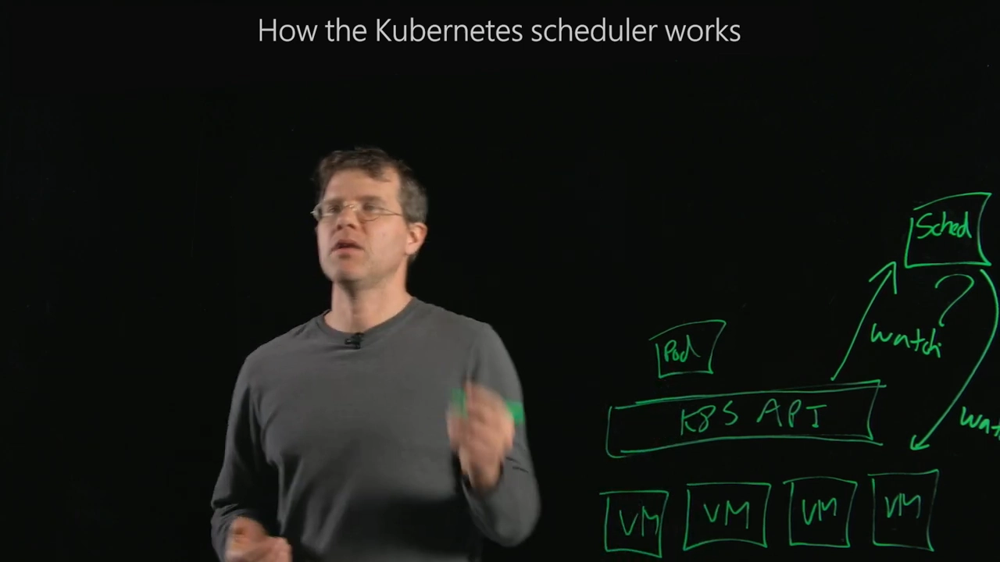
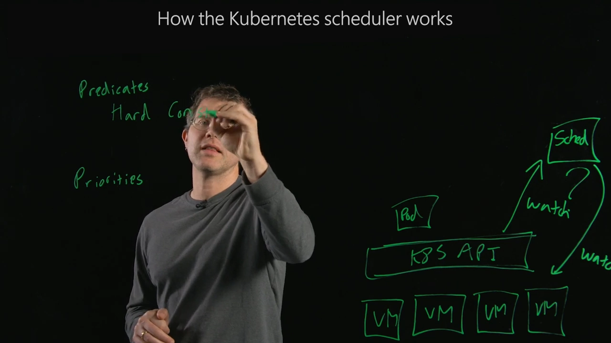
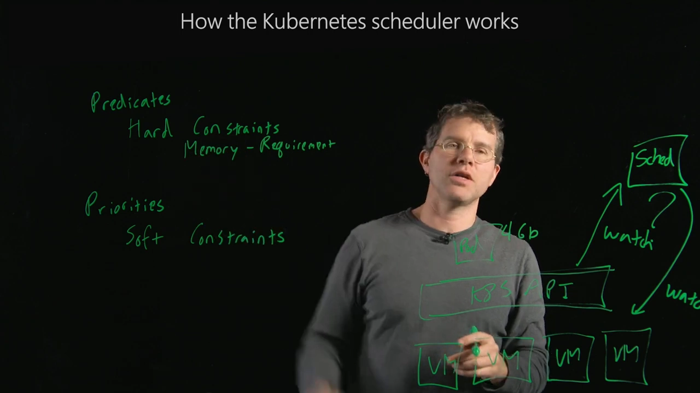
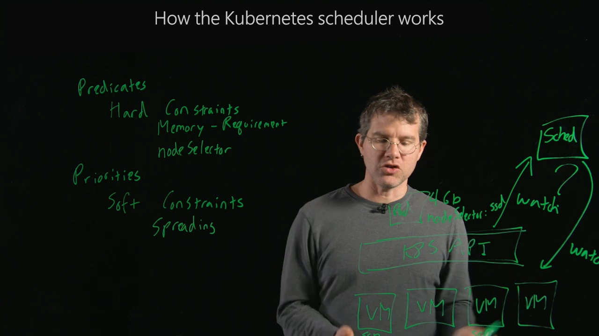
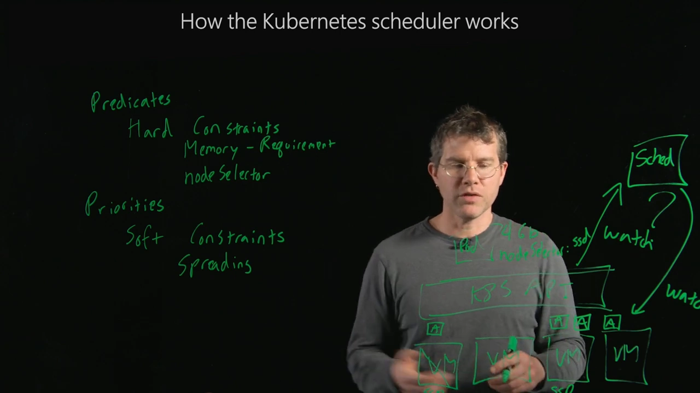
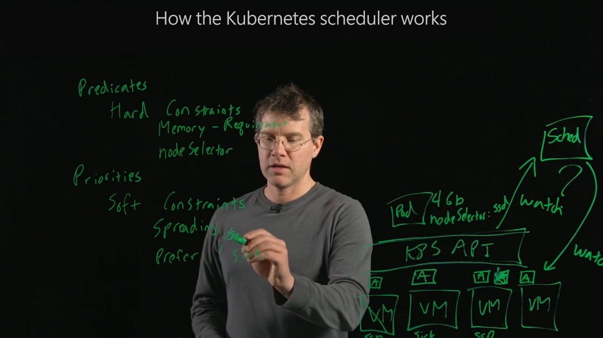
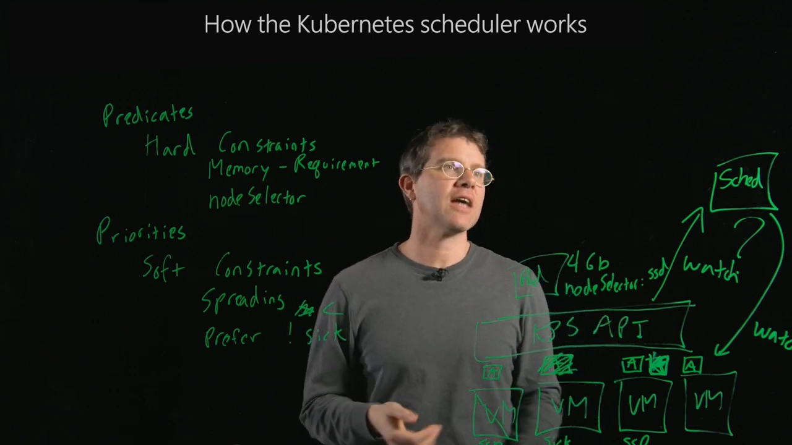
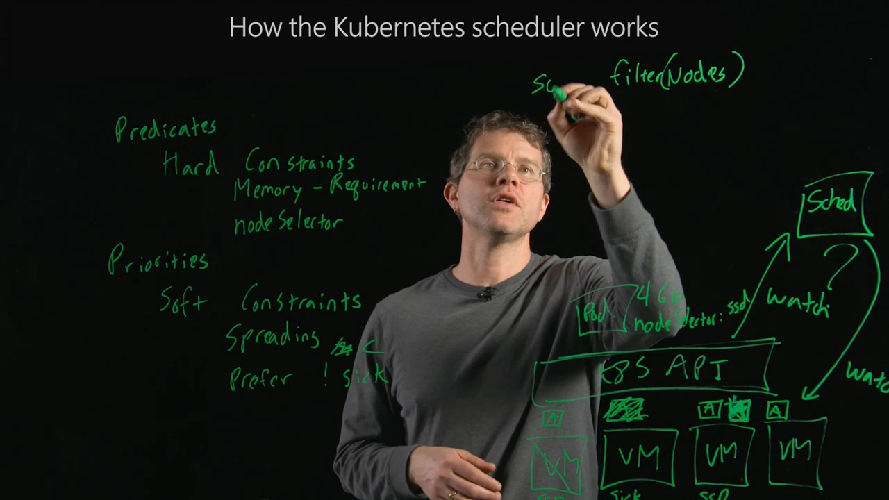

# 调度器怎么选节点：先按"谓词"过滤，再按"优先级"打分

> 视频来源：[How the Kubernetes scheduler works](https://www.youtube.com/watch?v=rDCWxkvPlAw)（YouTube，Microsoft Azure，讲者 Brendan）｜时长 7:35
>
> 一支用最朴素的类比把"过滤与打分"讲透的短片。它没有堆术语，而是从操作系统的进程调度讲起，把调度决策拆成两样东西：**谓词（predicates）——硬约束，直接淘汰整台机器**；**优先级（priorities）——软约束，给幸存机器排出高低**。最终流程一句话：**先用谓词过滤节点，再按优先级排序，排在第一的节点就是落点**。文稿左栏为英文自动字幕，本文已翻译并重写为中文。

## 本讲要解决的核心问题（SCQA）

**背景**：在 Kubernetes 里有一堆机器，你请求 API 跑一个 Pod，里面的容器要落在**其中某一台**上。挑选这台机器的正是**调度器**。[【跳转到 00:10】](https://www.youtube.com/watch?v=rDCWxkvPlAw&t=10)

**冲突**：决定"放哪台"是 Kubernetes 里最重要的职责之一——没有它，容器根本不知道去哪儿跑。但候选机器那么多、每台状态又不同，调度器凭什么说"就这台"？它到底在想什么？[【跳转到 00:45】](https://www.youtube.com/watch?v=rDCWxkvPlAw&t=45)

**疑问**：调度器做决定时，脑子里同时装着哪些因素？这些因素之间会冲突吗（比如"分散部署"和"避开一台有点毛病的机器"）？冲突时又听谁的？

**回答（中心思想）**：调度决策是**两类约束的混合**——**谓词（硬约束）先淘汰整台机器，优先级（软约束）再给剩下的机器打分排序**。软约束之间可以互相打架，谁的分高就听谁的；排在第一的那台，就是容器的落点。[【跳转到 02:04】](https://www.youtube.com/watch?v=rDCWxkvPlAw&t=124)

---

## 一、调度器是干什么的：给容器找一台机器

Kubernetes 里有一堆机器，而用户只是请求 API "跑一个 Pod"。Pod 是最小运行单元，里面装着容器。调度器的工作就是：**判断这个容器具体该在哪一台机器上执行**。[【跳转到 00:18】](https://www.youtube.com/watch?v=rDCWxkvPlAw&t=18)

这有点像操作系统里的进程调度：现代的 PC、笔记本或手机有好几个 CPU 核心，一个程序可以在任意一个核心上跑，是**操作系统调度器**决定它何时、在哪执行。Kubernetes 的调度器扮演的正是类似角色——只不过它调度的是容器、候选目标是**集群里的机器**。[【跳转到 00:45】](https://www.youtube.com/watch?v=rDCWxkvPlAw&t=45)

## 二、Pod 还没有节点时，调度器一直盯着

当你创建一个 Pod，这个对象就存在于 Kubernetes API 里了，但**它没有关联任何节点**——Pod 的 API 对象里，那个"已调度到的机器"字段是空的。[【跳转到 01:10】](https://www.youtube.com/watch?v=rDCWxkvPlAw&t=70)

调度器在**持续地监听**处于这种状态的 Pod：**已经被创建、但还没成功调度的 Pod**。同时，它也在**持续监听所有机器的状态**——因为"该往哪儿放"和"这台机器现在什么状况"关系极大。[【跳转到 01:46】](https://www.youtube.com/watch?v=rDCWxkvPlAw&t=106)

## 三、调度决策 = 谓词（硬约束）+ 优先级（软约束）

调度器做决定时，想的是**两类东西的混合**：**谓词**和**优先级**。[【跳转到 02:04】](https://www.youtube.com/watch?v=rDCWxkvPlAw&t=124)

- **谓词（predicates）= 硬约束。** 是不能被违反的东西，比如"我必须跑在一台至少有 4 GB 内存的机器上"。如果某台机器没有 4 GB 内存，这个容器**绝无可能**被调度到那儿。**谓词会把整台机器从考虑范围里直接剔除。**
- **优先级（priorities）= 软约束。** 更"软"一些，比如"如果我的应用能散布在很多故障域上就好了""如果每台机器的负载大致相当就好了"。

## 四、硬约束：既有系统给的，也有用户给的

硬约束是**系统提供**和**用户提供**的混合物。

**系统给的一例**：资源请求。当你创建 Pod 说"我需要 4 GB 内存"，这本身就隐含了一个**硬性要求**。[【跳转到 03:26】](https://www.youtube.com/watch?v=rDCWxkvPlAw&t=206)

**用户给的一例**：`nodeSelector`。你也可以说"我想要一个 `SSD` 的节点选择器"，表示**只调度到带 `SSD` 标签的、有闪存盘的机器上**。这时，"只让带该标签的机器通过谓词"就成了一个**由终端用户指定**的硬约束。[【跳转到 03:39】](https://www.youtube.com/watch?v=rDCWxkvPlAw&t=219)

## 五、软约束：散布与"生病"的机器

软约束**可以**被违反，但它的分值是"满足/不满足"的好坏的度量。[【跳转到 02:55】](https://www.youtube.com/watch?v=rDCWxkvPlAw&t=175)

**散布（spreading）**：一种"希望应用分散在多台机器上"的意愿，这样**一台机器挂了，整个应用不会全挂**。但它**不是硬性要求**：如果实在没地方，必须把三个副本里的两个放在同一台机器上，你宁可调度器别跑某个副本吗？不会——你更希望它把两个副本放到同一台机器上。**正因为可以违反，它才是软约束。**[【跳转到 04:52】](https://www.youtube.com/watch?v=rDCWxkvPlAw&t=292)

**污点（taint）**：另一个软约束的例子。一台机器可以带一个"**有点生病**"的污点——也许软件探测到它**可能要坏了**：还没到必须下线的程度，但发现它访问内存的错误率在上升，或者某块盘上出现了坏道。软约束会说："我一般**倾向于**不要那台生病的机器。"——但话说回来，如果那是你唯一能跑的地方，"我也可以接受"。[【跳转到 05:15】](https://www.youtube.com/watch?v=rDCWxkvPlAw&t=315)

## 六、软约束会打架：用打分来权衡

真正有意思的是：**软约束之间会互相冲突**。这时，**与优先级关联的"打分"就决定了调度器的行为**——它给你一个衡量好坏的量。[【跳转到 05:53】](https://www.youtube.com/watch?v=rDCWxkvPlAw&t=353)

假设两台机器：一台有利于"散布"，另一台避开"生病"。到底选谁？取决于你**更看重哪一边**：

- 如果**散布比避开生病更重要**，就把应用放在"能更好散布"的那台——**接受它有点小病**；[【跳转到 06:03】](https://www.youtube.com/watch?v=rDCWxkvPlAw&t=363)
- 如果**避开生病机器比散布更重要**，就不放在被标记"生病"的机器上，改放到另一台——**宁可违反散布**，也要满足"避开生病"。[【跳转到 06:25】](https://www.youtube.com/watch?v=rDCWxkvPlAw&t=385)

## 七、流程收束：先按谓词过滤，再按优先级排序

把上面合起来，就是调度器的完整决策方式：**谓词淘汰整台机器，优先级给剩下机器的相对价值排序。**

具体流程是：[【跳转到 06:42】](https://www.youtube.com/watch?v=rDCWxkvPlAw&t=402)

1. 从**完整的节点列表**开始；[【跳转到 06:54】](https://www.youtube.com/watch?v=rDCWxkvPlAw&t=414)
2. 用**谓词过滤（filter）**这些节点，去掉硬约束不满足的；
3. 再按**优先级对过滤后的节点排序（sort）**；[【跳转到 06:59】](https://www.youtube.com/watch?v=rDCWxkvPlAw&t=419)
4. 排出来的**第一名节点**，就是容器最终被调度到的地方。

这正是"过滤与打分"两条腿在工程上的落地：**先 Filter 过滤，再 Score 排序取第一。**

## 小结

- 调度器负责给 Pod 里的容器**选一台机器**，作用类似操作系统的进程调度；它**持续监听**"已创建但未调度"的 Pod 和所有机器的状态。
- 调度决策 = **谓词（硬约束）** + **优先级（软约束）**。
- **谓词**不可违反，会**淘汰整台机器**；来源既有系统（如资源 requests），也有用户（如 `nodeSelector`）。
- **优先级**可被违反，是对"满足/不满足"好坏的度量，如**散布**、**污点（avoid sick machine）**。
- 软约束之间**会冲突**，靠**打分**给出的相对价值来决定违反哪一个。
- 最终流程一句话：**先按谓词过滤节点，再按优先级排序，取第一名**。

## 关键术语速查

| 术语 | 一句话解释 |
| --- | --- |
| 调度器（scheduler） | 给 Pod 的容器选择在哪台机器上运行的组件 |
| 谓词（predicate） | 硬约束，不可违反，会直接淘汰整台机器 |
| 优先级（priority） | 软约束，可被违反，用打分表达好坏程度 |
| 资源请求（requests） | Pod 声明的资源需求，构成系统侧的硬约束 |
| nodeSelector | 用户侧硬约束：只调度到带指定标签的节点 |
| 散布（spreading） | 软约束：希望副本分散在多台机器以容忍单机故障 |
| 污点（taint） | 打在节点上的"倾向避开"标记，如"有点生病" |
| 过滤（filter） | 用谓词筛掉不满足硬约束的节点 |
| 排序（sort） | 按优先级给过滤后的节点排名，取第一名 |
