# Kubernetes 资源请求与限制：CPU 限流、OOMKilled 与 QoS 类

> 本文整理自 prepare.sh 教程视频 *Kubernetes resource requests and limits: CPU throttling, OOMKilled and QoS classes*（[原视频](https://www.youtube.com/watch?v=8NSzUFIkgkg)）。全篇在真实节点上用 `kubectl` 演示，回答一个初学者最容易踩坑的问题：容器里的 `resources.requests` 和 `resources.limits` 这两个数字，到底在哪里生效、超了会怎样。

## 本讲要解决的核心问题（SCQA）

**背景**：一个节点就是一台固定 CPU、固定内存的机器，上面跑着的所有 Pod 共享这些资源。

**冲突**：只要有一个应用突然想用很多 CPU 或内存，它就从别人那里"抢"，邻居应用跟着变慢、甚至崩掉——这就是所谓的"吵闹的邻居"（Noisy Neighbor）。

**疑问**：Kubernetes 用什么办法既保证每个容器"够用"，又保证它"不越界"？这两个数字究竟在哪一步起作用、超了会发生什么？

**回答（中心思想）**：Kubernetes 让每个容器声明两个数字——**请求（request）** 和 **限制（limit）**。**request 决定 Pod 被调度到哪个节点、并为它预留多少资源；limit 是它使用量的硬上限。** 对 CPU 超限只是被"限流"变慢，对内存超限则会被直接杀掉（OOMKilled）。而 request 与 limit 的组合还会决定 Pod 的 **QoS 等级**，从而决定内存不足时谁先被驱逐。

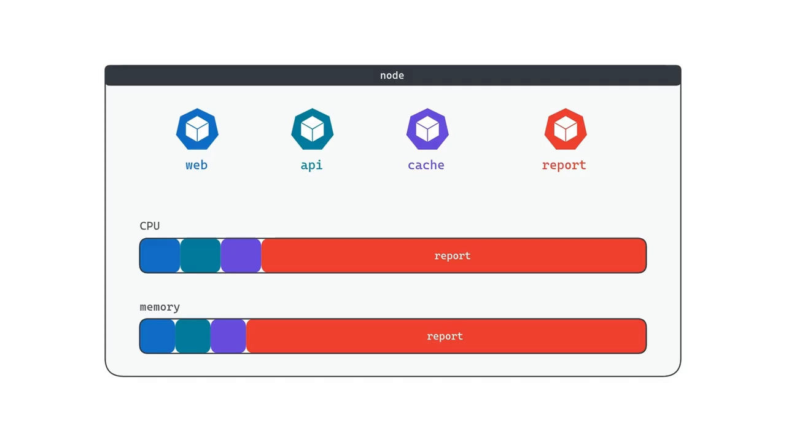

## 一、request 与 limit 是每个容器的两个"预算数字"

**request 是容器正常运行所需的资源量，也是 Kubernetes 为它预留的量**；Pod 一启动，这份资源就在节点上划走，别的 Pod 拿不走。**limit 则是容器允许使用的最大值。** [【跳转到 00:43】](https://www.youtube.com/watch?v=8NSzUFIkgkg&t=43)

- request 回答"至少要给我多少"——像软件的最低配置要求；
- limit 回答"最多能占到多少"——防止某个容器失控拖垮整台机器。

两者对 CPU 和内存要**分别设置**。视频随后把这两句话落到一台真机上：先看节点有多少资源，再用 request 把它"填满"，然后分别跑一个超 CPU 的容器和一个超内存的容器，最后看这些数字如何给 Pod 分等级。

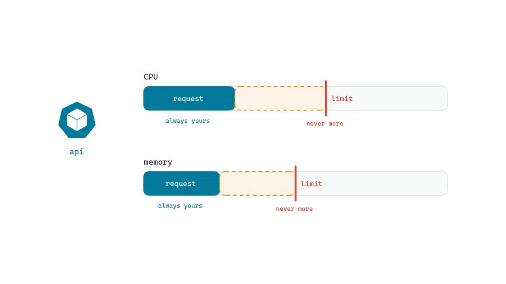

## 二、request 决定调度，而且"占坑不用也算占用"

### 2.1 先用 `describe node` 看清节点上有多少可分配资源

`kubectl describe node` 输出很长，视频只挑两段看 [【跳转到 02:03】](https://www.youtube.com/watch?v=8NSzUFIkgkg&t=123)：

- **Allocatable（可分配）**：这台节点上所有 Pod 能共享的总量。示例里 CPU 是 2 核、内存略小于 5 GB。注意这里是 *allocatable* 而不是 *capacity*——系统组件（kubelet、容器运行时等）先占掉了一部分，剩下的才给 Pod 用。
- **Allocated resources（已分配）**：一张 requests / limits 表，显示节点上已经"承诺"给 Pod 的量。此刻 CPU request 已经有 200m（约 10%），那是集群自己的系统 Pod 占的。


### 2.2 单位：CPU 用核 / 毫核，内存用字节

- **CPU**：以"核"为单位，**1000 毫核（millicore，写作 m）= 1 核**，200m 就是五分之一核 [【跳转到 02:45】](https://www.youtube.com/watch?v=8NSzUFIkgkg&t=165)。
- **内存**：以字节为单位。你会经常看到 **Mi**（mebibyte）/ **Gi**（gibibyte），它们是 1024 进制；而只写 **M / G**（megabyte / gigabyte）是 1000 进制。所以 100Mi 比 100M 略大一点。Kubernetes 两者都接受，但文档和它自己的输出几乎都用 Mi、Gi，建议你也统一用 Mi/Gi [【跳转到 02:51】](https://www.youtube.com/watch?v=8NSzUFIkgkg&t=171)。

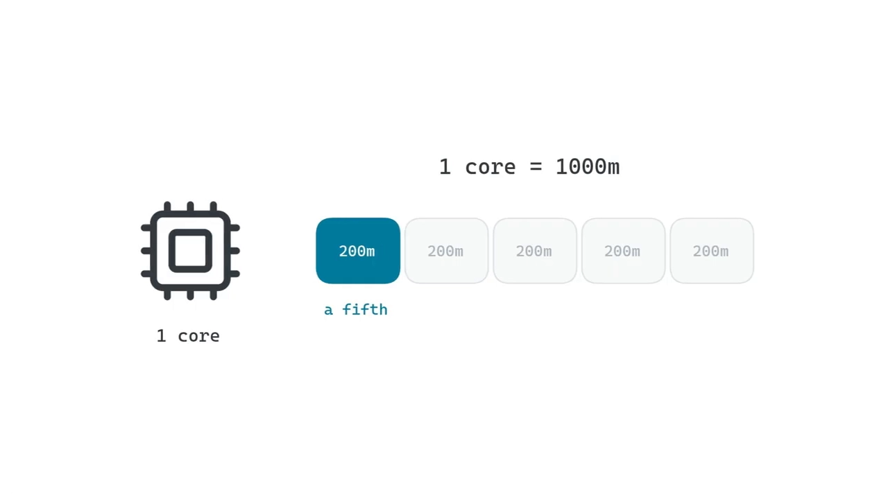

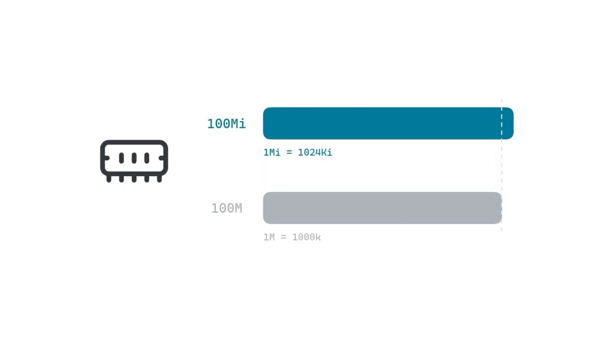

### 2.3 实验：只写 request 也会把节点"填满"

视频创建了一份 `reserve.yaml`：一个 3 副本的 Deployment，每个 Pod 只 `sleep infinity`（几乎不用 CPU），但 **requests 写成 700m CPU、64Mi 内存，且不设 limit** [【跳转到 03:16】](https://www.youtube.com/watch?v=8NSzUFIkgkg&t=196)。

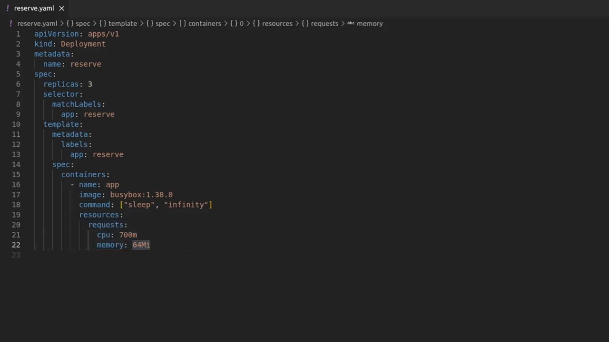

算一笔账：3 × 700m = 2100m，而节点总共只有 2000m，且已有 200m 被系统占用。`kubectl apply` 之后，**两个 Pod Running，第三个一直 Pending**。`kubectl describe pod` 底部的事件写着：

```text
0/1 nodes are available: Insufficient CPU.
```

但用 `kubectl top node` 一看，节点 CPU 实际只用了约 10%，几乎是空闲的——**第三个 Pod 依然放不下** [【跳转到 04:29】](https://www.youtube.com/watch?v=8NSzUFIkgkg&t=269)。

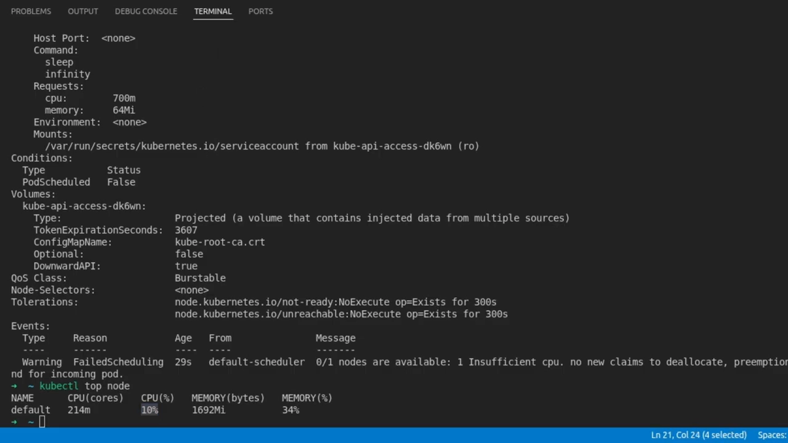

这就是 request 的关键性质：**调度器只看 Pod 声明了要多少，不看它实际用了多少。** request 是一份"预订单"，CPU 一旦被预留，用不用都算被占着。所以：

- request 要得太大 → 白白浪费节点，别人调度不进来；
- request 要得太小 → 同一台机器被塞进太多 Pod，真到忙时一起抢，互相拖慢。

**一个好的 request 应该贴近应用真实需要的量。**

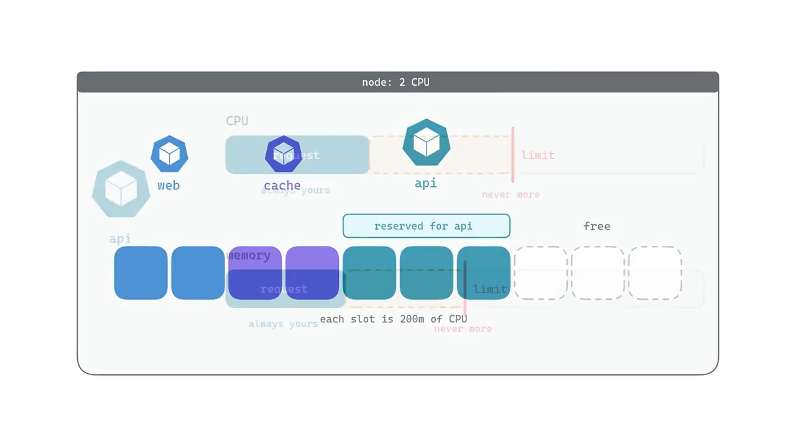

## 三、超过 limit：CPU 被限流，内存被杀

### 3.1 CPU 超限 → 限流（throttling）

`cpu-hog.yaml` 是一个死循环、拼命占 CPU 的 Pod，**request 250m、limit 500m**，limit 高于 request 是为了给忙时留余量 [【跳转到 05:19】](https://www.youtube.com/watch?v=8NSzUFIkgkg&t=319)。跑起来用 `kubectl top pod` 看，它稳定停在 **500m，正好卡在 limit**——这个循环本想吃满一整核，却只能拿到半核。

为什么会这样？先理解 Linux 怎么分配 CPU：一个核同一时刻只能跑一个东西，所以 Linux 给每个进程一小片时间，然后切到下一个、再切回来，快到你感觉是"同时"在跑。**CPU limit 就是接到这套机制上的**：Kubernetes 告诉 Linux 这个容器最多用半核，Linux 每 **100 毫秒**检查一次（这是 Linux 的默认周期，Kubernetes 沿用）。半核意味着每 100 毫秒里只能跑 50 毫秒——跑满 50 毫秒后就被停住，剩下 50 毫秒只能等，下一个 100 毫秒再给 50 毫秒……[【跳转到 06:42】](https://www.youtube.com/watch?v=8NSzUFIkgkg&t=402)

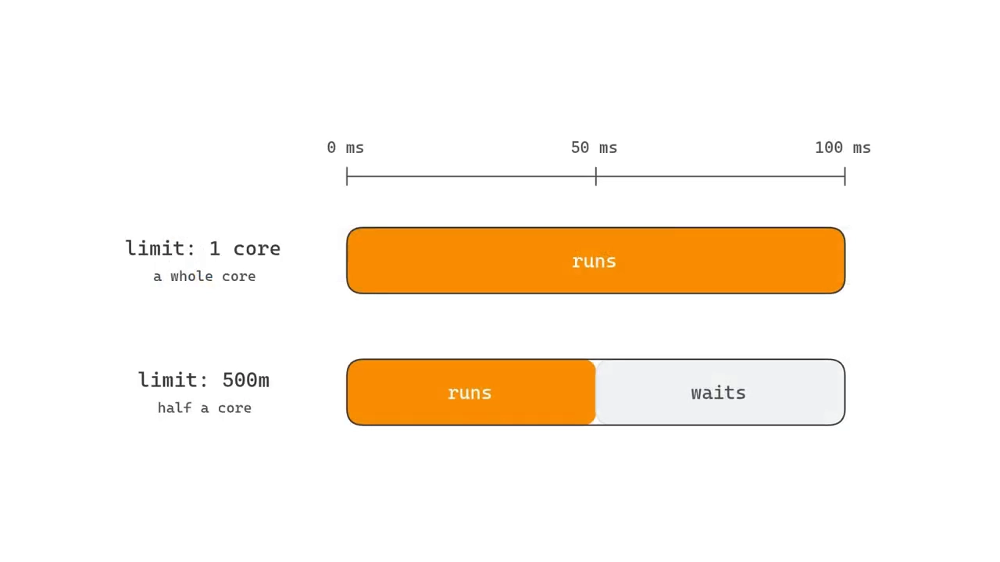

这就是 **CPU 限流（CPU throttling）**：**超过 CPU limit 的容器不会被杀，只是变慢。** 对 Web 应用来说，它表现为"响应变慢"，而不是报错，因此常常很难排查。

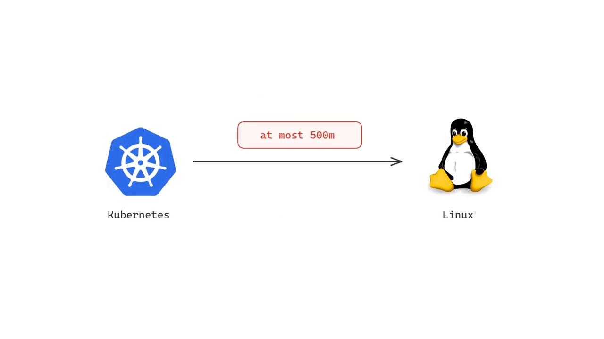

### 3.2 内存超限 → 被杀（OOMKilled）

内存的工作方式完全不同。`memory-hog.yaml` 的容器执行 `tail /dev/zero`——`/dev/zero` 是无穷无尽的零字节流，`tail` 在内存里一直等一个永远不会出现的换行，内存于是不断增长。它的 **memory request 和 limit 都设成 100Mi** [【跳转到 07:37】](https://www.youtube.com/watch?v=8NSzUFIkgkg&t=457)。

内存通常建议 **request = limit**，原因很直白：**CPU 可以一点点地收回，但内存一旦被应用占住，不把进程停掉就收不回来**，所以最安全的做法是"允许多少、就预留多少"。

100Mi 很快就被撑爆。`kubectl get pods` 里 `memory-hog` 的 RESTARTS 已经不止 1，状态多为 **OOMKilled**，偶尔能抓到 Running 或 CrashLoopBackOff。`kubectl describe pod` 在"上次状态"里写着：

```text
Reason:      OOMKilled
Exit Code:   137
```

OOM 是 out of memory 的缩写：**容器一超过 100Mi，Linux 内核就把它杀了**，Kubernetes 再把它重启；重启后又被撑爆、又被杀，几轮之后重启间隔越来越长，这就是 CrashLoopBackOff [【跳转到 08:52】](https://www.youtube.com/watch?v=8NSzUFIkgkg&t=532)。

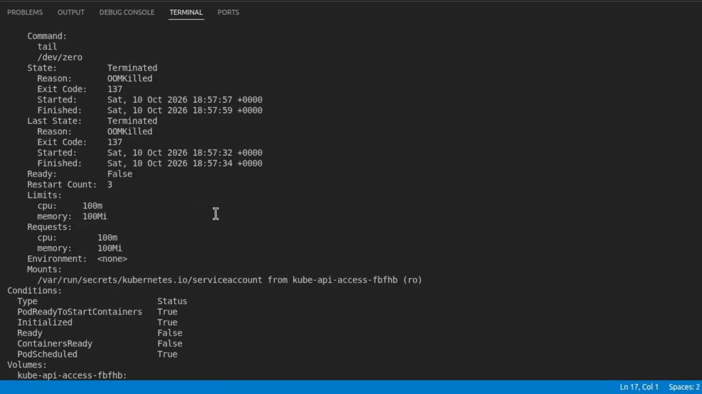

一句话记住区别：**CPU 超限被"限流"（变慢），内存超限被"杀掉"（重启）。**

## 四、QoS 等级：内存不足时决定"谁先走"

当节点内存告急时，Kubernetes 必须挑一些 Pod 删掉以保护其余的。它怎么挑？比较**每个 Pod 的实际使用量和它的 request**：守着 request 用的 Pod"守了规矩"，更安全；用得比 request 多的 Pod 最先出局 [【跳转到 09:42】](https://www.youtube.com/watch?v=8NSzUFIkgkg&t=582)。

为了让这件事一目了然，Kubernetes 按 requests 与 limits 把每个 Pod 归入一个 **QoS（服务质量）等级**。**注意：YAML 里没有这个字段，等级完全由你写的数字推出来。** 一共三种：

| QoS 等级 | 判定条件 | 含义 |
| --- | --- | --- |
| **Guaranteed（保证型）** | 每个容器对 CPU 和内存都同时设了 request 和 limit，且 **request = limit** | 资源被完全保证 |
| **Burstable（突发型）** | 至少设了一个 request 或 limit，但不满足 Guaranteed | 保证 request，最多可突发到 limit |
| **BestEffort（尽力而为）** | 完全没设 request 和 limit | 什么都不保证 |

对照视频里的两个例子：`memory-hog` 的 request 与 limit 相等，属于 **Guaranteed**；`cpu-hog` 的 CPU limit 高于 request，属于 **Burstable**；完全裸奔没写 `resources` 的 Pod 则是 **BestEffort** [【跳转到 10:07】](https://www.youtube.com/watch?v=8NSzUFIkgkg&t=607)。

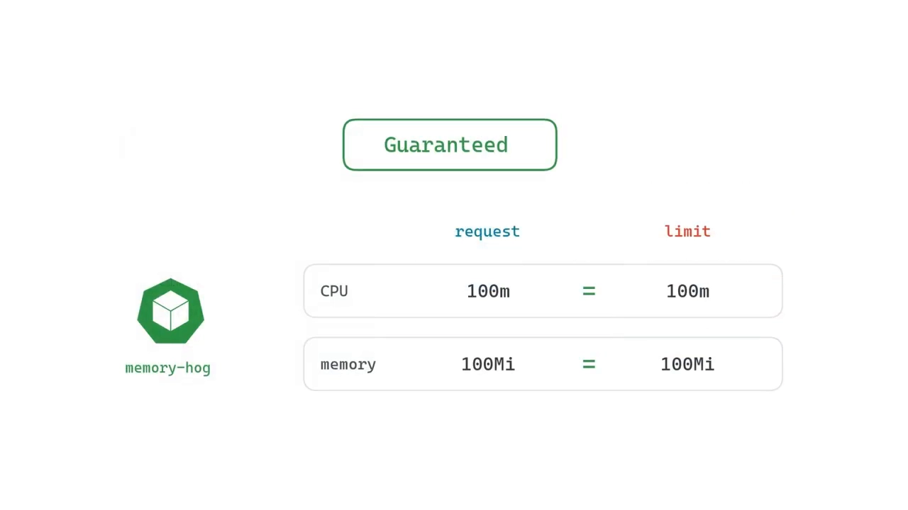

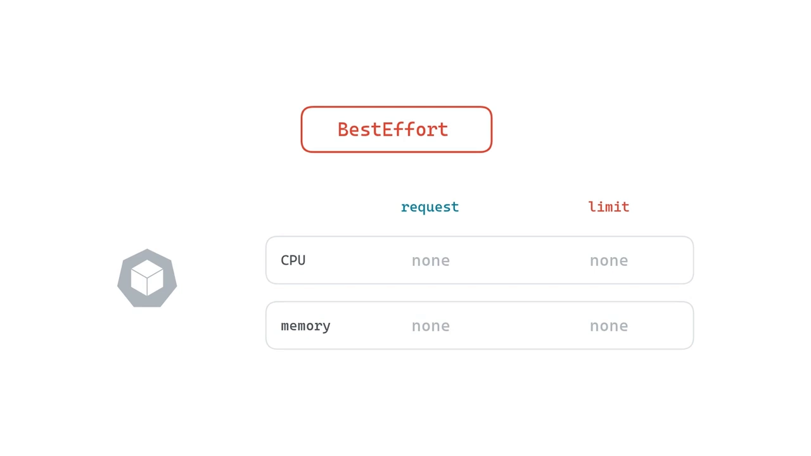

**内存不足时的驱逐顺序是**：先删 **BestEffort**，再删 **超出自己 request 的 Burstable**，**Guaranteed 最后才动**。所以对数据库这类关键服务，把 requests 与 limits 设成相同值，让它成为 Guaranteed，是稳妥的选择。

## 五、给初学者的实践结论

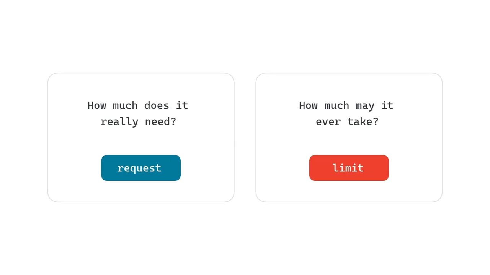

1. **每次写 Pod 先问两句**：这个应用真正需要多少？——那是 request；最多允许它用到多少？——那是 limit。
2. **CPU request 贴近真实用量，CPU limit 可留一点余量**（视频里 250m request / 500m limit 就是典型写法）。
3. **内存尽量 request = limit**，因为内存收不回来，超了就是 OOMKilled。
4. **关键服务设 Guaranteed**（requests = limits），worst case 下最不容易被驱逐。
5. 别把 request 设得虚高：它不看实际用量就"占坑"，会把节点白白耗掉。

## 小结

- **request** 是容器需要、并由 Kubernetes 预留的资源量；**limit** 是它允许使用的最大值，两者对 CPU、内存分别设置。
- **调度只看 request，不看实际使用**：request 一旦预留，用不用都算占用。request 要贴近真实需求。
- **CPU 超 limit → 限流**：Linux 以 100ms 为周期检查，超过的部分被"停钟"，容器只是变慢，不会被杀。
- **内存超 limit → OOMKilled（退出码 137）→ 重启 → CrashLoopBackOff**：内存收不回来，只能杀。
- **QoS 等级由 requests/limits 推出**：Guaranteed（request=limit）、Burstable（部分设置）、BestEffort（全无）。
- **驱逐顺序**：BestEffort 最先，其次超 request 的 Burstable，Guaranteed 最后。

## 关键术语速查

| 术语 | 一句话解释 |
| --- | --- |
| request（请求） | 容器运行所需、并被节点预留的资源量；调度的依据 |
| limit（限制） | 容器允许使用的资源上限 |
| millicore（m） | CPU 单位，1000m = 1 核 |
| Mi / Gi | 内存单位，1024 进制（1Mi = 1024Ki）；M / G 是 1000 进制 |
| allocatable | 节点上真正留给 Pod 使用的资源总量（capacity 减去系统预留） |
| throttling（限流） | CPU 超 limit 后被限制时间片、变慢的过程 |
| OOMKilled | 内存超 limit 后被内核杀死，退出码 137 |
| CrashLoopBackOff | 容器反复被杀/退出，重启间隔被拉长的状态 |
| QoS 等级 | 由 requests/limits 推出的服务质量等级，决定驱逐顺序 |
