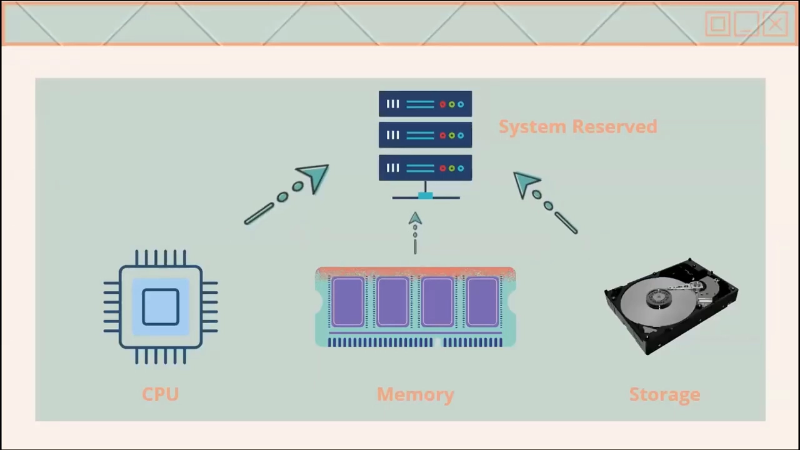
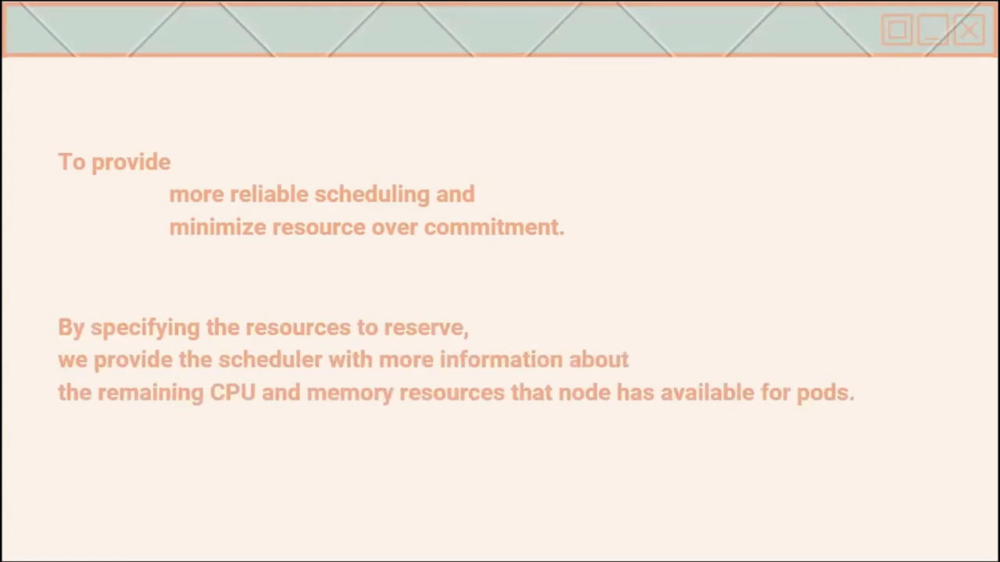
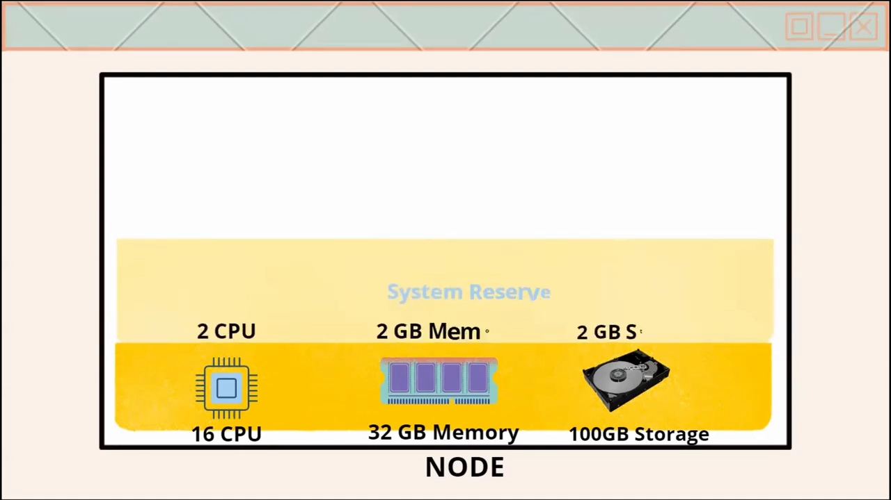
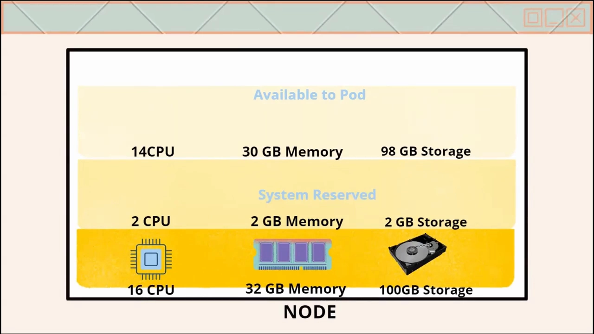
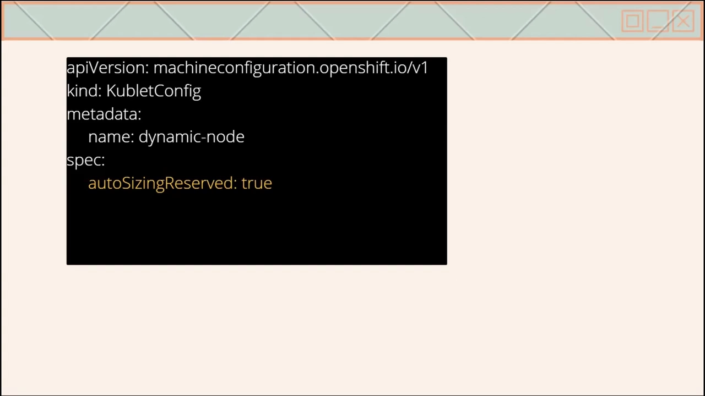
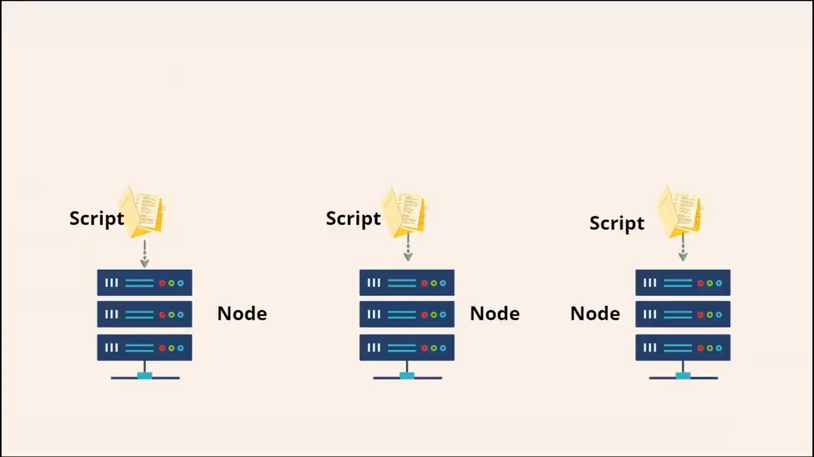
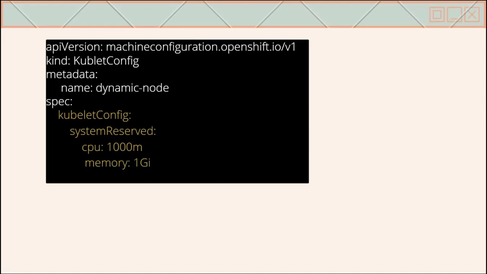
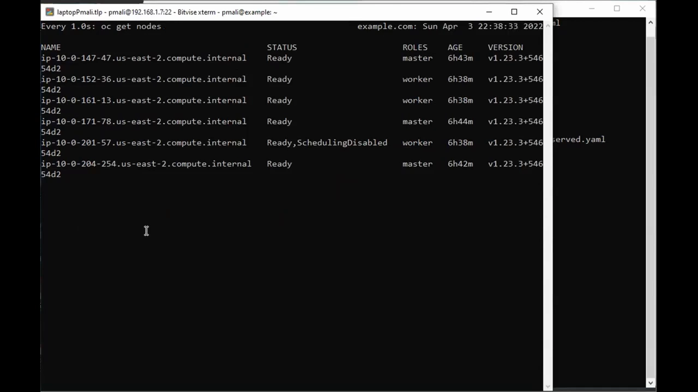
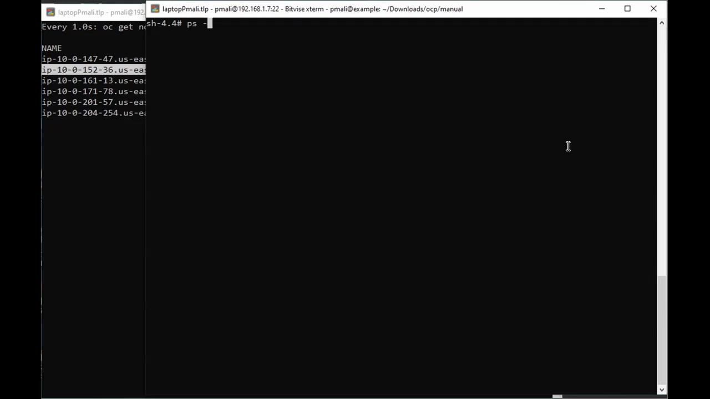

# Kubernetes 节点预留资源 system-reserved 详解

> 本文整理自 Geek Surf（Pravin Mali）的视频 *Openshift / kubernetes system-reserved on nodes*（[原视频](https://www.youtube.com/watch?v=4tRIgDMJ2Tc)）。它回答一个常被忽略的问题：**节点的 CPU、内存并不是"全部"给 Pod 用**——有一部分必须留给操作系统和系统组件。演示用的是 OpenShift 的 `KubeletConfig` 对象，但 system-reserved 这个概念本身属于所有 Kubernetes 节点。

## 本讲要解决的核心问题（SCQA）

**背景**：一个节点的 CPU、内存、临时存储，除了跑 Pod，还要供操作系统守护进程（sshd、udev 等）、内核、以及 kubelet / 容器运行时自己使用。而**内核占用的内存目前根本不计入任何 Pod**。

**冲突**：如果调度器把这些"系统开销"也当成可以分给 Pod 的容量，就会把节点排得满满当当。真到运行时，系统组件被 Pod 挤得没有资源可用，节点可能直接故障。

**疑问**：节点上"留给系统自己"的那部分资源，Kubernetes 是怎么表达、怎么配置的？

**回答（中心思想）**：用 **system-reserved**（系统预留）把操作系统所需的 CPU、内存、临时存储从节点容量里"切出来"，**只有切剩下的部分（allocatable / 可分配）才交给 Pod**，调度器也只按这个可分配量来决定 Pod 能放到哪里。这样既能让调度更可靠，又能避免系统组件被饿死。 [【跳转到 00:40】](https://www.youtube.com/watch?v=4tRIgDMJ2Tc&t=40)

## 一、system-reserved 是什么

**system-reserved 用来为操作系统守护进程预留资源**，例如 `sshd`、`udev` 这类常驻进程；它**也应该为内核预留内存**，因为内核内存在当前并不计入 Pod 的账。 [【跳转到 00:40】](https://www.youtube.com/watch?v=4tRIgDMJ2Tc&t=40)

它涵盖三类资源：

- **CPU**
- **memory（内存）**
- **ephemeral-storage（临时存储）**



## 二、为什么节点上需要预留

视频给出两条理由 [【跳转到 01:10】](https://www.youtube.com/watch?v=4tRIgDMJ2Tc&t=70)：

1. **提供更可靠的调度，并尽量减少资源的过度承诺（over-commitment）。** 明确"哪些是系统的"，就能避免把 Pod 排得超出节点真实承载能力。
2. **把"预留量"告诉调度器，让它知道这台节点真正还能给 Pod 多少 CPU 和内存。**



## 三、一个例子看清"容量 → 可分配"

假设有一台节点：**32 GB 内存、16 个 CPU、100 GB 存储**。我们把 system-reserved 设为：

```text
memory = 2GB
cpu = 2core
ephemeral-storage = 2GB
```

那么调度器会保证 [【跳转到 01:45】](https://www.youtube.com/watch?v=4tRIgDMJ2Tc&t=105)：

- 该节点上所有 Pod 的**内存请求总和不超过 30 GB**（32 − 2）；
- **CPU 不超过 14 核**（16 − 2）；
- **存储不超过 98 GB**（100 − 2）。



也就是说，**真正的"可分配给 Pod"的量 = 节点容量 − 系统预留**。这正是节点上 `Allocatable` 数值的来源（在前一篇关于 requests/limits 的博客里，我们看到的 allocatable 就比 capacity 小一些，差距正是这一类预留）。



## 四、如何配置：自动 vs 手动

配置 system-reserved 有两种方式 [【跳转到 02:15】](https://www.youtube.com/watch?v=4tRIgDMJ2Tc&t=135)。

### 4.1 自动分配（按节点容量自动计算）

方式是创建一个 **KubeletConfig 自定义资源（CR）**，把参数设为：

```yaml
spec:
  autoSizingReserved: true
```

开启后，**每个节点上的脚本会根据该节点实际安装的 CPU 与内存容量，自动算出合适的预留值**。自动计算的好处是：不用你手动估算和更新，就能保证集群高效运行，并避免系统组件（如 **CRI-O、kubelet**）因资源被饿死而导致节点故障。**该特性默认是关闭的**，需要用 KubeletConfig 文件显式打开。 [【跳转到 02:40】](https://www.youtube.com/watch?v=4tRIgDMJ2Tc&t=160)





### 4.2 手动分配

若想自己掌控数值，就在 kubelet 配置里显式写 **`systemReserved`** 参数（在 OpenShift 的 KubeletConfig CR 中，它位于 `spec.kubeletConfig.systemReserved` 下） [【跳转到 03:18】](https://www.youtube.com/watch?v=4tRIgDMJ2Tc&t=198)。

```yaml
apiVersion: machineconfiguration.openshift.io/v1
kind: KubeletConfig
metadata:
  name: dynamic-node
spec:
  kubeletConfig:
    systemReserved:
      cpu: ...
      memory: ...
```



### 4.3 演示：自动分配全过程（OpenShift）

以自动分配为例，视频做了完整演示 [【跳转到 03:30】](https://www.youtube.com/watch?v=4tRIgDMJ2Tc&t=210)：

1. 写好 `kubeletconfig` 文件后执行 `oc create -f kubelet-autoSizingReserved.yaml`，再用 `oc get kubeletconfig` 确认创建成功；
2. **OpenShift 会先 drain（腾空）节点，应用 kubelet 配置，再重启节点**——过程需要等待，直到所有节点重新回到 **READY**；
3. 登录工作节点核对生效情况：`oc debug node/<nodename>` 进入节点、`chroot /host` 切到宿主环境，再执行：

```bash
ps -ef | grep kubelet
```

从 kubelet 进程的启动参数可以看到，工作节点被预留了约 **0.07 CPU 与 1.6 GB 内存** [【跳转到 05:20】](https://www.youtube.com/watch?v=4tRIgDMJ2Tc&t=320)。





手动分配则是把 `systemReserved` 参数写进 kubelet 配置，创建新的 `kubeletconfig` 后同样由 OCP 应用并重启节点生效；视频留了一道练习：「你怎么确认 `systemReserved` 配置已经作用到节点上？」——答案仍然是从 kubelet 进程参数或节点可分配资源里核对。

## 五、预留之后：节点负载高时会怎样

节点配置了预留资源之后，如果负载升高会怎么表现？这属于 **驱逐（eviction）** 的话题——当内存/磁盘等资源紧张时，kubelet 会按 `eviction-soft` / `eviction-hard` 阈值驱逐 Pod。视频作者在结尾把观众引向了他的另一支视频 *OpenShift 4 container garbage collection with eviction-soft and eviction-hard* 来展开 [【跳转到 06:35】](https://www.youtube.com/watch?v=4tRIgDMJ2Tc&t=395)。（预留与驱逐是配套的：预留保证了系统自己的"保命资源"，驱逐则是在资源见底时保护节点整体。）

## 小结

- **节点容量 ≠ 可给 Pod 的量**：操作系统、内核、kubelet、CRI-O 都要吃资源，内核内存目前还不计入 Pod。
- **system-reserved 用来给系统守护进程和内核预留 CPU / 内存 / 临时存储**，它与 kube-reserved 一起，把节点容量切成"系统用的"和"Pod 可用的"。
- 预留的意义：**更可靠地调度、减少超卖，并让调度器知道节点真正剩多少**。可分配量 = 容量 − 预留。
- **两种配置方式**：自动（`KubeletConfig` 里 `autoSizingReserved: true`，按节点容量自动算，默认关闭）与手动（显式写 `systemReserved`）。
- 配置生效通常需要**腾空并重启节点**；可用 `ps -ef | grep kubelet`、节点可分配资源等核对实际预留值。
- 预留解决"系统保命"，资源紧张时的 Pod 驱逐交给 **eviction-soft / eviction-hard**。

## 关键术语速查

| 术语 | 一句话解释 |
| --- | --- |
| system-reserved | 为操作系统守护进程与内核预留的 CPU/内存/临时存储 |
| kube-reserved | 为 kubelet、容器运行时等 Kubernetes 自身组件预留的资源 |
| allocatable（可分配） | 节点容量减去系统预留后，真正能给 Pod 使用的量 |
| over-commitment（超卖） | 承诺给 Pod 的资源超过节点真实容量，容易引发故障 |
| ephemeral-storage | 节点的临时存储（本地磁盘），同样需要预留 |
| KubeletConfig（CR） | 用于下发 kubelet 配置的自定义资源，可开 `autoSizingReserved` 或写 `systemReserved` |
| autoSizingReserved | 让每个节点按自身 CPU/内存容量自动计算预留值的开关，默认关闭 |
| eviction-soft / hard | 资源紧张时 kubelet 驱逐 Pod 的软/硬阈值 |
