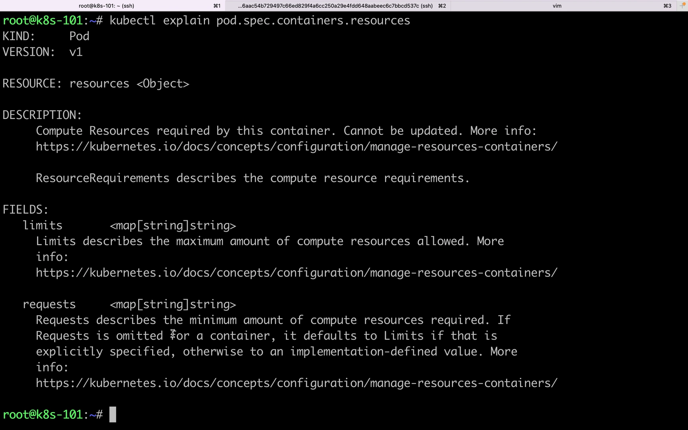
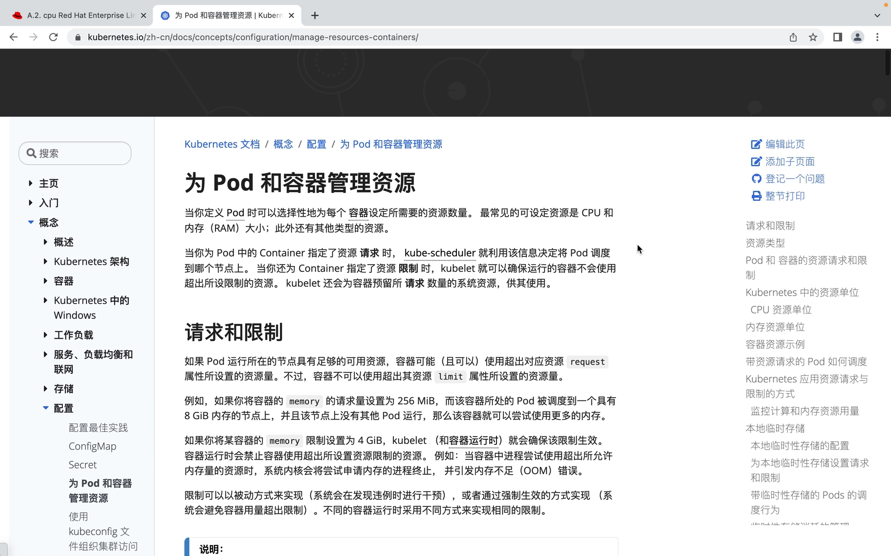
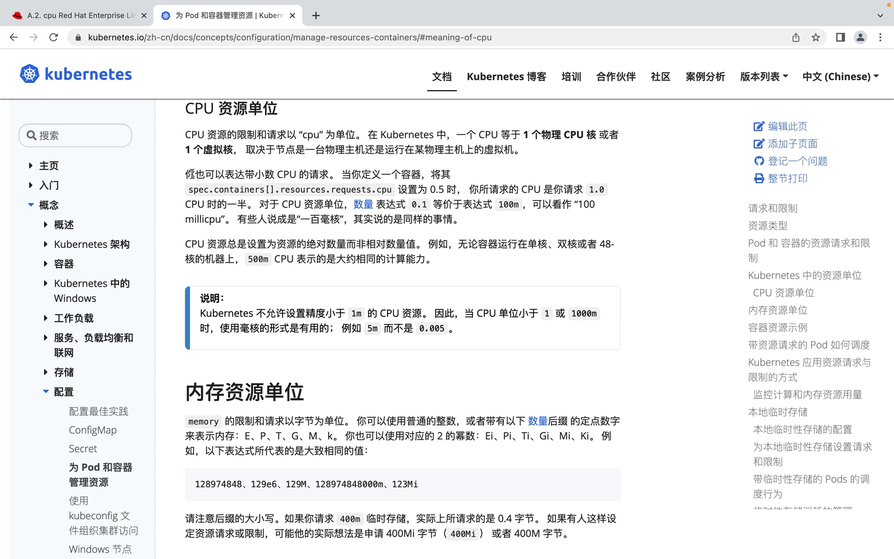
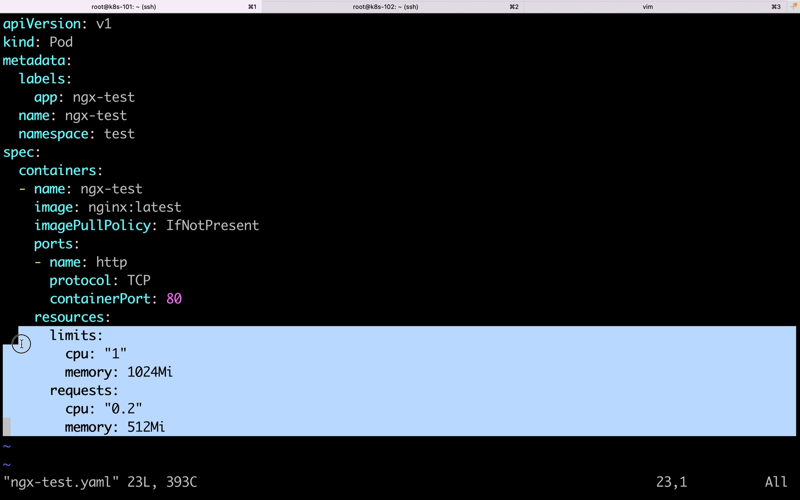
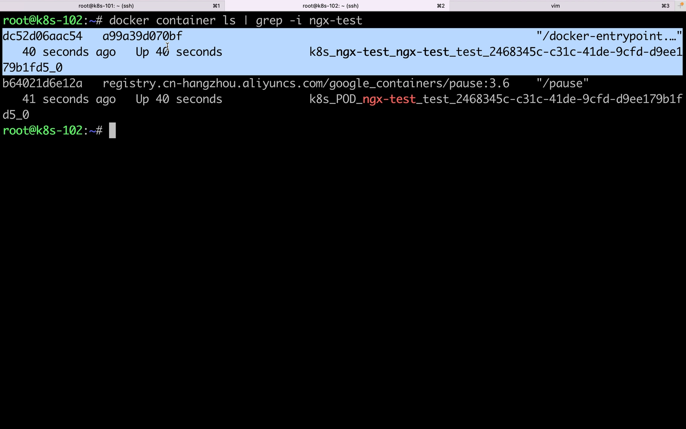
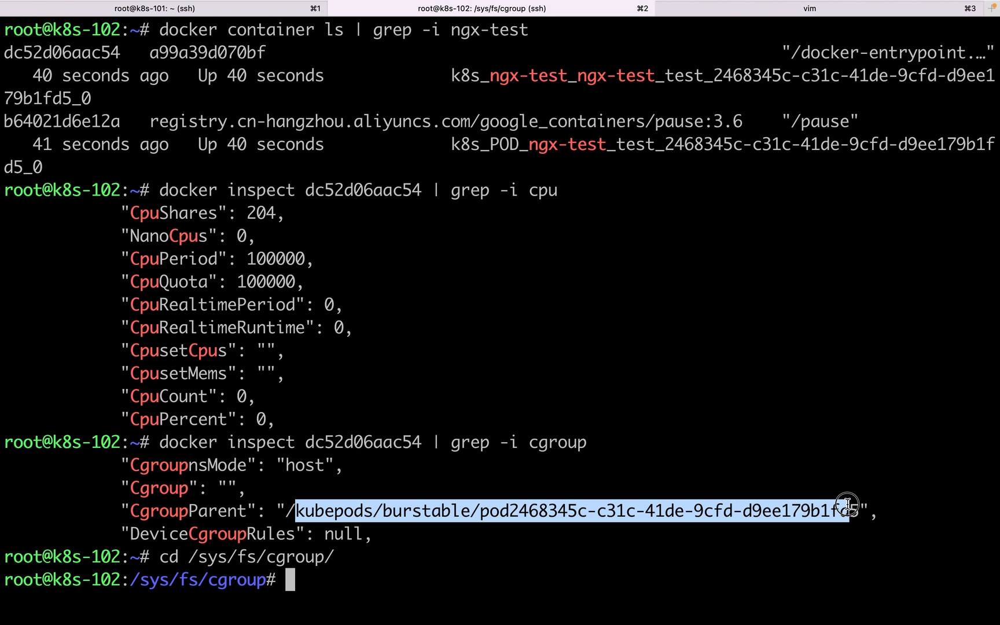
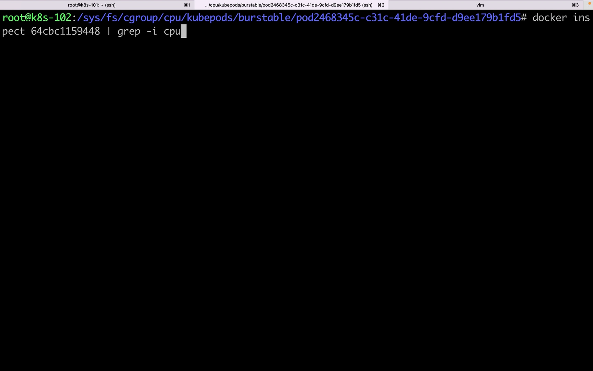
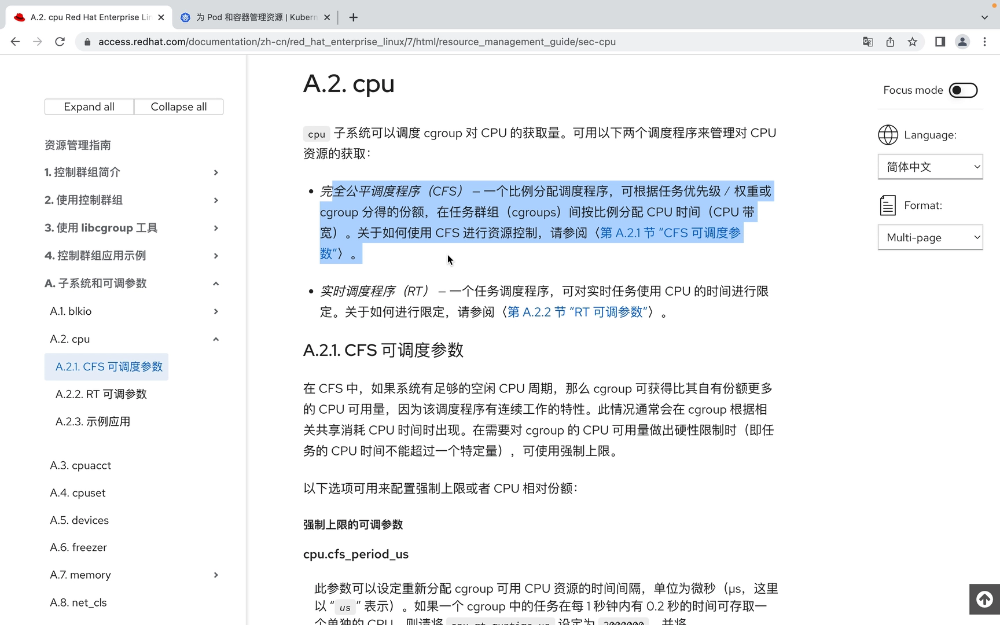

# 深入 cgroup：requests 与 limits 在 Linux 内核里如何落地

> 本文整理自 B 站视频《k8s resources requests 和 limits，及其在 cgroup 中的配置》（[原视频](https://www.bilibili.com/video/BV1VR4y1h7n8/)）。它顺着一个技术群里的疑问展开：**K8s 把容器资源限制在 `resources.requests` 和 `resources.limits` 之间，这到底是怎么实现的？** 作者从 K8s 一路下钻到 Linux cgroup，把这两个数字对应的内核参数逐个对上。

## 本讲要解决的核心问题（SCQA）

**背景**：在 K8s 里，我们通过 Pod 的 `resources.requests` 和 `resources.limits` 来约束容器的资源。

**冲突**：这两个字段只是 YAML 里的"声明"，真正动手"执行"限制的并不是 K8s 本身。那么，底层究竟是谁在做这件事？如果直接操作最底层的 cgroup，能不能实现同样的弹性限制？

**疑问**：`requests` 和 `limits` 分别对应到 cgroup 的哪些具体参数？它们又是怎么保证"用的时候能超过 request、但绝不超过 limit"的？

**回答（中心思想）**：**K8s 只是"传话者"**——它把容器的 requests/limits 交给容器运行时，由运行时在 Linux 上配置 cgroup 来真正落地。**requests 映射为 CPU 的相对权重 `cpu.shares`（= request × 1024），limits 映射为 CPU 的硬上限 `cpu.cfs_quota_us / cpu.cfs_period_us`（配对比值 = 可用的 CPU 数）。** 理解这几个 cgroup 文件，就理解了 K8s 资源限制的本质。 [【跳转到 14:50】](https://www.bilibili.com/video/BV1VR4y1h7n8/?t=890)

## 一、容器 = namespace + cgroup，K8s 只是"传话者"

先厘清一件基础的事：**K8s 是用来编排容器的，而容器封装的主要就是 namespace 和 cgroup** [【跳转到 00:25】](https://www.bilibili.com/video/BV1VR4y1h7n8/?t=25)。

- **namespace（命名空间）** 负责隔离 PID（进程 id）、用户、网络等**系统资源**；
- **cgroup（control group，控制组）** 负责**资源隔离**，它支持对 **CPU 和内存**等计算资源做限制。

所以可以断定：**cgroup 本身就能实现这种比较弹性的资源分配**。K8s 并不自己"管"资源，它把容器的 CPU 和内存的请求与限制信息（requests/limits）**传递给容器运行时**，在 Linux 上就是由运行时去配置内核 cgroup、应用并实施这些请求 [【跳转到 14:50】](https://www.bilibili.com/video/BV1VR4y1h7n8/?t=890)。这就是本次论证要回答的问题。

## 二、requests 与 limits 的语义：一个弹性区间

### 2.1 字段含义

按照官方文档 [【跳转到 07:11】](https://www.bilibili.com/video/BV1VR4y1h7n8/?t=431)：

- **limits** 描述的是允许使用的计算资源的最大总量；
- **requests** 描述的是请求的计算资源量。CPU 和内存都属于"计算资源"。

一个容易忽略的默认规则：**如果忽略 requests、但对容器显式指定了 limit，那么 request 的默认值就是 limit；否则它的默认值是一个"实现定义"的值**，也就是由底层隔离机制决定的 [【跳转到 07:36】](https://www.bilibili.com/video/BV1VR4y1h7n8/?t=456)。



### 2.2 资源使用是"弹性"的：request ≤ 实际 ≤ limit

文档里反复强调的一点 [【跳转到 08:35】](https://www.bilibili.com/video/BV1VR4y1h7n8/?t=515)：**如果 Pod 所在节点有足够的资源，容器可能、也被允许使用超出它 request 的资源量；但容器绝对不可以超出其 limit。**

- 例：把一个容器的内存请求设为 256Mi，且它被调度到一台有 8GB 内存、没有其他 Pod 的节点上，那么它就可以尝试使用更多的内存；
- 但若把内存 **limit** 设为 4GB，Kubernetes 和容器运行时就会确保这个上限生效：**当容器中的进程尝试申请超过允许量的内存时，系统内核会把这个申请内存的进程终止，并引发 OOM 错误**——这正是容器异常退出最常见的原因之一。限制可以被动实现，也可以强制生效，不同的容器运行时用不同方式实现同一限制 [【跳转到 09:25】](https://www.bilibili.com/video/BV1VR4y1h7n8/?t=565)。



### 2.3 调度基于 requests："占坑不用也算占用"

`resources.requests` 还影响 Pod 如何被调度 [【跳转到 10:40】](https://www.bilibili.com/video/BV1VR4y1h7n8/?t=640)：当你创建 Pod 时，调度程序会为它选一个节点，而**每个节点的每种资源都有一个容量上限**；调度程序确保"**该节点上所调度容器的资源请求（requests）总和 < 节点容量**"。

也就是说，**K8s 调度 Pod 时基于的是 requests，而不是 limits**。请注意：**尽管节点上的实际使用可能非常低，一旦容量检查失败，调度程序仍然会拒绝把 Pod 放到该节点上**。原因是——如果稍后资源用量涨到请求的峰值，节点也不会出现资源不足 [【跳转到 11:30】](https://www.bilibili.com/video/BV1VR4y1h7n8/?t=690)。换句话说，**request 相当于"占了一个坑"，即使自己暂时不用，也不能被其他 Pod 拿去调度**；当然，自己没用到的那部分，实际还是可能被同一节点上的其他 Pod 使用。

## 三、CPU 资源单位

在动手看 cgroup 之前，先把 CPU 的计量单位说清楚 [【跳转到 12:45】](https://www.bilibili.com/video/BV1VR4y1h7n8/?t=765)：

- **在 K8s 中，一个 CPU 等于一个物理 CPU 核或一个虚拟核**，取决于节点是物理机还是虚拟机；
- 可以表达带小数的请求：request 写 **0.5**，就是请求 1.0 个 CPU 时的一半；
- 表达式 **0.1 等价于 100m**，即 **1 个 CPU = 1024 个 mCPU**（毫核）；
- **CPU 资源总是绝对数量，而非相对比例**：无论容器跑在单核、双核还是 48 核的机器上，500m CPU 都表示大约相同的计算能力；
- CPU 不允许设置精度小于 **1m** 的资源，因此当 CPU 小于 1（或 1000m）时，用毫核形式更方便，例如写 `5m` 而不是 `0.005`。



## 四、亲眼看：request / limit 落到 cgroup 的哪些文件

### 4.1 实验环境与测试 Pod

作者的测试环境：宿主是 macOS 12.6，两台 Ubuntu 20.10 虚拟机（各 4C3G），**101 是 master、102 是 node，集群版本 1.23.1** [【跳转到 01:32】](https://www.bilibili.com/video/BV1VR4y1h7n8/?t=132)。

测试用的 yaml 创建一个 **kind 为 Pod** 的资源，命名空间 `test`、镜像 `nginx:latest`，并设置了 **`resources.request.cpu = 0.2`、`resources.limits.cpu = 1`** [【跳转到 03:01】](https://www.bilibili.com/video/BV1VR4y1h7n8/?t=181)。



Pod 启动后，在 node（102）上用 docker 查看容器 [【跳转到 04:28】](https://www.bilibili.com/video/BV1VR4y1h7n8/?t=268)：一个 Pod 里能看到**两个容器**——一个是它自动嵌入的 **pause 容器**，一个是我们的 nginx 容器。这也印证了"**一个 Pod 里可以有多个容器**"。



### 4.2 从 docker inspect 看 CPU 参数

用 `docker inspect` 查看我们那个 nginx 容器，能看到 [【跳转到 04:38】](https://www.bilibili.com/video/BV1VR4y1h7n8/?t=278)：

- **CPU shares = 204**。这个 204 的来历是 **`request.cpu × 1024 = 0.2 × 1024 = 204.8`，取整为 204**。它是一个**相对比例值（权重）**。
- **CPU period 和 CPU quota 都是 100000**，两者相除 `quota / period = 1`，正好等于 **`limits.cpu = 1`**。

### 4.3 到 cgroup 目录里核对

接着到 cgroup 目录核对。容器的 CPU 限制位于：

```text
/sys/fs/cgroup/cpu/kubepods/burstable/pod<...>/<容器 id>/
```

[【跳转到 06:21】](https://www.bilibili.com/video/BV1VR4y1h7n8/?t=381) 在该目录里读到：

| cgroup 文件 | 值 | 对应关系 |
| --- | --- | --- |
| `cpu.shares` | 204 | = request.cpu × 1024（0.2 × 1024） |
| `cfs_period_us` | 100000 | 调度周期 |
| `cfs_quota_us` | 100000 | 配额，quota / period = 1 = limit.cpu |





**至此结论清晰**：K8s 的 `request` 落到 **`cpu.shares`（权重）**，`limit` 落到 **`cfs_quota_us` / `cfs_period_us`（硬上限）**，而这一切都是由容器运行时替 K8s 配置的。

## 五、cgroup CPU 子系统：CFS 调度器是怎么分配的

看文档时作者参考了 Red Hat 官方的 cgroup 章节 [【跳转到 17:22】](https://www.bilibili.com/video/BV1VR4y1h7n8/?t=1042)。CPU 子系统的可调参数里，涉及两种调度程序：**CFS（completely fair scheduler，完全公平调度器）** 与 **RT（实时调度程序）**。因为 **Linux 用的是 CFS**，Ubuntu 里没有 RT 相关配置，所以只看 CFS。



CFS 是一个**基于时间片、支持优先级**的调度器，也是一个**比例分配**调度程序：它根据任务的优先级（权重）或 cgroup 分得的份额，在任务群组中按比例分配 CPU 时间 [【跳转到 17:47】](https://www.bilibili.com/video/BV1VR4y1h7n8/?t=1067)。

### 5.1 两个关键参数：period 与 quota

既然 CFS 按比例分配，就带来一个重要特性：**如果系统有足够的空闲 CPU 周期，cgroup 可以获得比它自身份额更多的 CPU**——比如份额是 10%，当系统空闲周期多时，用量可能超过 10%。**只有当你需要对 cgroup 的 CPU 用量做"硬性限制"时，才用强制上限**，而强制上限相关的两个参数正是 **`cfs_period_us`** 和 **`cfs_quota_us`**——它们在 K8s 里就用来实现 **limits** [【跳转到 19:10】](https://www.bilibili.com/video/BV1VR4y1h7n8/?t=1150)。

- **`cfs_period_us`**：一个时间段，单位是**微秒**；
- **`cfs_quota_us`**：一个配额，表示在 period 这段时间内、某个 cgroup 中所有任务**可运行的时间总量**；
- 因此 **"能使用多长时间的 CPU" = quota ÷ period** [【跳转到 21:02】](https://www.bilibili.com/video/BV1VR4y1h7n8/?t=1262)。

举例 [【跳转到 20:12】](https://www.bilibili.com/video/BV1VR4y1h7n8/?t=1212)：

- 若 cgroup 中任务每 1 秒内有 0.2 秒可用某个单独 CPU → **quota = 200000、period = 1000000**；
- 若每 1 秒内可同时对两个 CPU 进行访问（即想用满 2 个 CPU）→ **quota = 200000、period = 100000**。

### 5.2 相对比例参数：cpu.shares

**`cpu.shares`** 用一个整数设定 group 中任务 CPU 可用的**相对比例** [【跳转到 21:27】](https://www.bilibili.com/video/BV1VR4y1h7n8/?t=1287)：

- 两个任务的 `cpu.shares` 都是 100（无论是否在同一 cgroup），它们会得到相等的 CPU 时间；
- 一个 `cpu.shares = 200` 的任务与一个 `100` 的任务相比，**前者使用的 CPU 时间是后者的两倍**——它是一个纯粹的比例值。

这个比例是在**所有 CPU 核**上分配的。比如一台 4 核机器，CPU 使用率最高是 400%（每核 100%）；即便某个 cgroup 受限制、不能用满整个 CPU 总量，它仍然可以百分之百地用满**某一个单独的核** [【跳转到 22:17】](https://www.bilibili.com/video/BV1VR4y1h7n8/?t=1337)。文档给的例子是：若 group A 能用 CPU 的 25%、group B 能用 75%，启动四个吃 CPU 的进程（1 个在 A、3 个在 B），A 里 PID 为 100 的那个进程会使用 **CPU0 的百分之百**。

### 5.3 CFS 的"借用"机制：比例会随 cgroup 数量变化

用相对比例管理资源时，有两点需要注意 [【跳转到 23:32】](https://www.bilibili.com/video/BV1VR4y1h7n8/?t=1412)：

1. 因为 **CFS 不要求相同的 CPU 使用量，很难预测 cgroup 的 CPU 可用时间**；
2. 当一个 cgroup 中的任务闲置、不使用它那份 CPU 时间时，**这部分可用时间会被收集到一个全局池中**，其他 cgroup 可以从全局池里借用时间片——这会提高系统运行效率，但也意味着 **cgroup 可用的 CPU 时间会随系统中 cgroup 的数量而变化**。

文档的例子：一个 cgroup 份额是 1000、另两个是 500，在所有进程都抢满 CPU 时，第一个 cgroup 能得到 **50%**；**若再新增一个份额为 1000 的 cgroup**，系统里就有四个 cgroup（份额 1000、500、500、1000，总计 3000），此时第一个只剩 **33%**，其余三个分别是 **16.5%、16.5%、33%** [【跳转到 24:47】](https://www.bilibili.com/video/BV1VR4y1h7n8/?t=1487)。

## 六、最后一步验证

为验证前面的规律，作者改动 Pod：把 **request 设为 0.5、limit 设为 2**，再用同样的方式查看 cgroup [【跳转到 26:29】](https://www.bilibili.com/video/BV1VR4y1h7n8/?t=1589)：

- **`cpu.shares = 0.5 × 1024 = 512`**；
- **`cfs_quota_us ÷ cfs_period_us = 2`**，即一个是 **20 万**、一个是 **10 万**。

这与前面的推导完全吻合：**request 决定权重（×1024 → cpu.shares），limit 决定配额比值（quota / period → 可用 CPU 数）**。

## 小结

- **容器 = namespace + cgroup**：namespace 隔离 PID/用户/网络，**cgroup 负责 CPU/内存的资源隔离**。K8s 只是把 requests/limits **交给容器运行时**，由运行时在 Linux 上配置 cgroup。
- **语义**：limits 是最大总量，requests 是请求量；**用量可在 request 与 limit 之间弹性浮动**，可超 request，绝不超 limit；内存超 limit 会触发 **OOM**。
- **调度基于 requests**：节点上所有容器的 requests 总和不能超过节点容量，**request 是"占坑"**，不用也不让给别人调度。
- **CPU 单位**：1 CPU = 1 核（物理/虚拟），0.1 = 100m，**1 CPU = 1024m**；CPU 是绝对数量，精度不小于 1m。
- **request → `cpu.shares`**（= request × 1024，相对权重，仅在竞争时按比例分配）。
- **limit → `cfs_quota_us` / `cfs_period_us`**（硬上限，quota ÷ period = 可用 CPU 数）。
- **CFS 特性**：空闲份额会汇入全局池供借用，因此实际可用量随 cgroup 数量变化；`cfs_period_us/cfs_quota_us` 才是强制上限。

## 关键术语速查

| 术语 | 一句话解释 |
| --- | --- |
| cgroup（control group） | Linux 的控制组，负责 CPU、内存等资源的隔离与限制 |
| namespace | 负责隔离 PID、用户、网络等系统资源，与 cgroup 分工 |
| cpu.shares | CPU 相对权重（比例）；K8s 中 = request.cpu × 1024 |
| cfs_period_us | CFS 的调度周期，单位微秒 |
| cfs_quota_us | 一个周期内 cgroup 中所有任务可运行的时间总量（配额） |
| quota ÷ period | 该 cgroup 可用的 CPU 数（如 200000/100000 = 2 核） |
| CFS | 完全公平调度器，按权重/份额比例分配 CPU，Linux 默认使用 |
| RT 调度器 | 实时调度程序，与 CFS 并列，普通 Linux 发行版通常不用 |
| mCPU（m） | CPU 单位，1000m = 1 核；K8s 内部按 1 核 = 1024m 换算 |
| pause 容器 | 每个 Pod 自动嵌入的"沙箱"容器，用于持有网络等命名空间 |
