# 把 Pod 调度到该去的地方：节点选择器、节点亲和与 Pod 亲和/反亲和

> 视频来源：[Kubernetes Node Selector vs Node Affinity vs Pod Affinity vs Taints & Tolerations](https://www.youtube.com/watch?v=rX4v_L0k4Hc)（YouTube，Anton Putra）｜时长 11:17
>
> 一支"把常用调度手段一次讲清并逐条对比"的视频：沿着 **nodeSelector → nodeAffinity → podAffinity/podAntiAffinity → taints/tolerations** 这条主线，每个手段先讲"它解决什么问题"，再在 Minikube 里跑一遍看行为。文稿左栏为英文自动字幕，本文已翻译并重写为中文（`—show-labels`→**`--show-labels`** 等自动字幕瑕疵已修正）。文中关口词为了便于对照，保留了原文的英文术语。

## 本讲要解决的核心问题（SCQA）

**背景**：Kubernetes 最大的好处之一，是帮你**把单台服务器的细节抽象掉**——它把每台节点的内存、CPU 等资源收上来，交给内置的 **kube-scheduler（调度器）** 决定工作负载放哪。绝大多数时候你什么都不用做，调度器自己就干得很漂亮。

**冲突**：但真实集群里的节点并不千篇一律：有 Windows 节点，有跑 CPU 密集型任务的高 CPU 节点，有内存优化型节点；云上还有随时可能被回收的**抢占式（spot）节点**，有 amd64 和 ARM（如 Graviton）两种架构，有跑机器学习的 GPU 节点，有挂了本地 SSD 的节点……面对这些**各司其职**的机器，默认调度器**未必知道**你的 Pod 该去哪——比如你想让 Kafka 跑在本地 SSD 上它并不知情。[【跳转到 01:07】](https://www.youtube.com/watch?v=rX4v_L0k4Hc&t=67)

**疑问**：那要怎么给调度器"补课"，让它把 Pod 放到对的地方去？有这么多种写法（nodeSelector、nodeAffinity、podAffinity…），它们各管什么、什么时候用哪个？

**回答（中心思想）**：所有推荐的做法都以**给节点打标签**为前提，区别只在"表达力"和"被调度对象"两点上：**`nodeSelector` 最简单但最死板；`nodeAffinity` 用同一套标签目标换来更灵活的条件与软硬档；`podAffinity`/`podAntiAffinity` 则换了参照物——不再看节点标签，而是看"别的 Pod 的标签"，用来把 Pod 拉到一起或拆开**。[【跳转到 00:27】](https://www.youtube.com/watch?v=rX4v_L0k4Hc&t=27)

---

## 一、调度器怎么挑节点：先过滤，再打分，最后绑定

在讲各种"补充指令"之前，先看调度器本身的工作方式。假设你有一个 Pod 需要 2 个 CPU、4 Gi 内存：[【跳转到 00:27】](https://www.youtube.com/watch?v=rX4v_L0k4Hc&t=27)

1. **Filter（过滤）**：把所有不满足条件的节点先踢掉——比如资源不够的。剩下的叫**可行节点（feasible nodes）**。
2. **Score（打分）**：对可行节点逐个跑一组打分函数，打一个 0～10 的分数。
3. **Bind（绑定）**：选出**分最高**的那个节点，把决定写回（也就是把这个节点的名字填到 Pod 上）。

如果多个可行节点分数相同，调度器会**随机**选一个。这个"过滤 → 打分 → 绑定"的流程，就是接下来所有调度手段都作用其上的基础舞台。

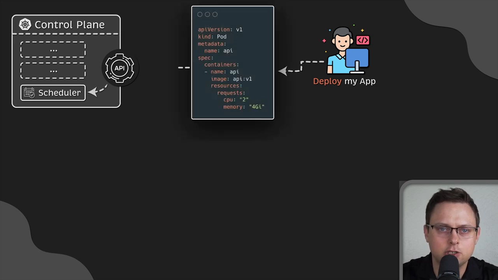

## 二、为什么要"教育"调度器：节点是分门别类的

默认调度器做不到"十全十美"的原因，在于集群里的节点往往带着明确分工：

- **系统/架构**：Windows 节点、amd64 与 ARM（Graviton）等；
- **规格**：高 CPU 型、内存优化型；
- **成本**：更便宜、但可能随时被回收的 spot 节点（这就要求应用能快速恢复）；
- **硬件**：GPU 节点、带本地 SSD 的节点（比如跑 Kafka 就特别想要本地 SSD 来提速）。

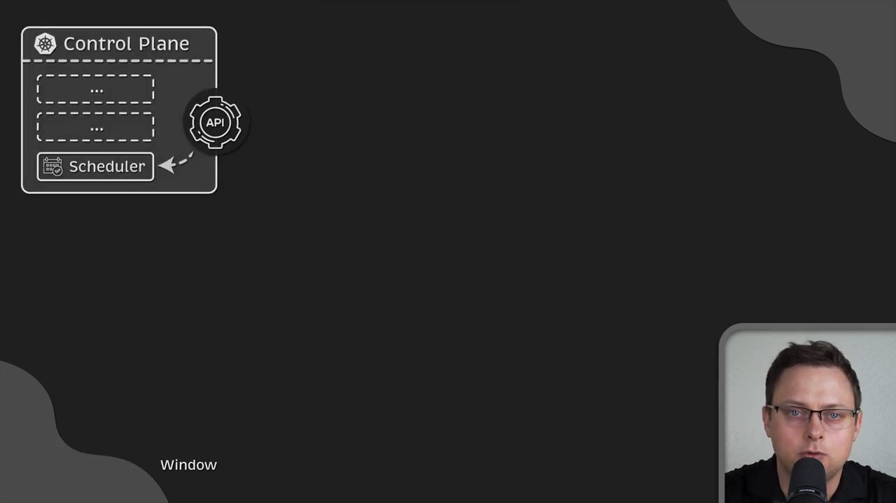

正因为如此，你需要给调度器一些**额外指令**，帮它做出更好的决定。

## 三、一切从给节点打标签开始

视频强调了一条前置的共同点：**无论你选哪种手段，第一步都是给节点贴上特定标签**。用 `kubectl get nodes --show-labels` 能看到每个节点上一串**默认标签**（比如架构、操作系统、主机名）。

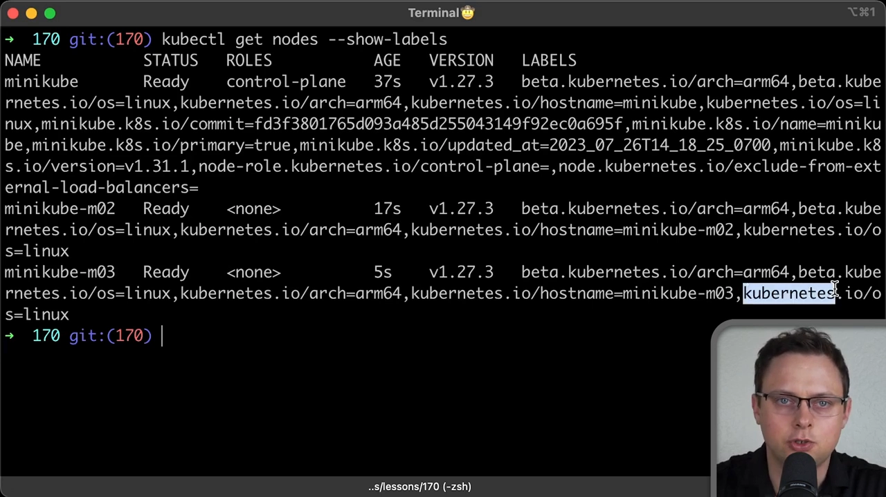

你可以手工给节点加标签，但**实践中更常见的是用 Terraform 等自动化工具给"节点组"整体打标签**，而不是一台台单独加——因为云上的机器本来就是按组管理的。

## 四、nodeSelector：最简单，也最死板

最古老、最简单的做法是 **`nodeSelector`**：在 Pod（或 Deployment 等）里写一对"标签键 = 值"，调度器就只会把 Pod 放到**带这个标签的节点**上。

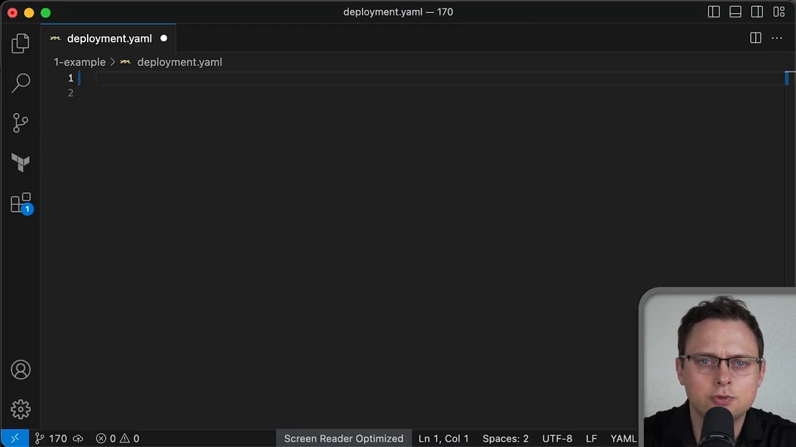

它"很有威力"，但**不够灵活**：只能做简单的键值相等匹配，也没有"软约束""多条件"等玩法。所以视频把它定位为**入门级**手段，接下来才引出更强的 `nodeAffinity`。

## 五、nodeAffinity：同样的目标，灵活得多

**`nodeAffinity` 做的是和 `nodeSelector` 一样的事——按节点标签约束 Pod 去哪**，但它灵活得多，而且适用于所有对象（Deployment、StatefulSet 等）。它有两个要点：

**要点 1：两大类型 + 一个容易被忽略的后缀。** 写 `nodeAffinity` 时先声明类型：`requiredDuringScheduling…`（硬）或 `preferred…`（软）。名字里还有个后缀 **`IgnoredDuringExecution`**，意思是：**这些约束只在"调度那一刻"起作用**。如果 Pod 已经在某节点上跑起来之后，你才去改动或删掉那个节点标签，调度器**不会**把已经运行的 Pod 赶走——它照跑不误。[【跳转到 04:30】](https://www.youtube.com/watch?v=rX4v_L0k4Hc&t=270)

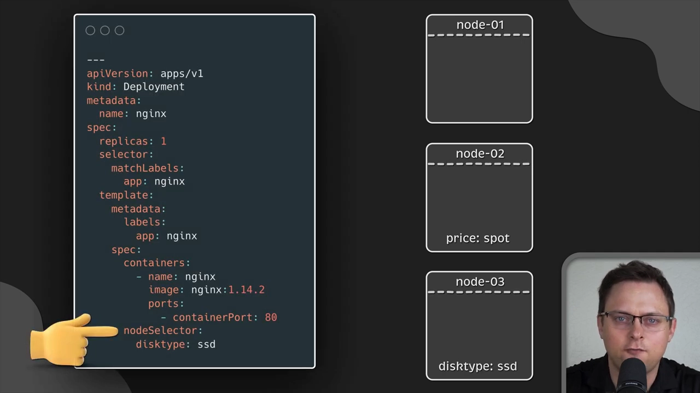

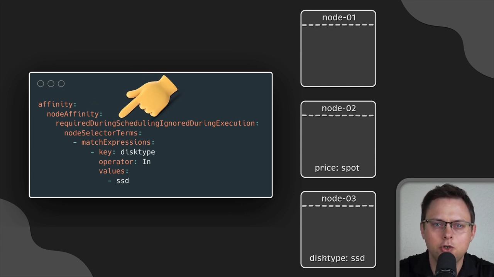

**要点 2：字段里到处是"数组"。** 你看 `nodeSelectorTerms`、`matchExpressions` 这些都是列表，它们的含义不一样：

- **同一个标签给多个值**：是 **OR（或）** 关系——只要节点**至少命中一个**值就通过；
- **`matchExpressions` 下的多个条件**：是 **AND（与）** 关系——**全部**都要满足。

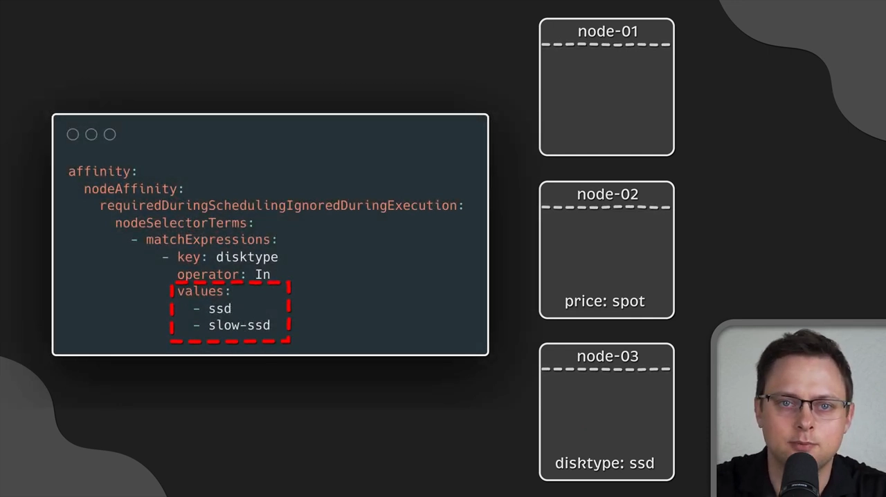

**一个 AND 的例子**：如果写成"`price=on-demand` **且** `disktype=ssd`"，而节点 3 只满足其中一个，那这个 Pod 就会**一直卡在 Pending**——因为两个条件必须同时成立，集群里却没有这样的节点。

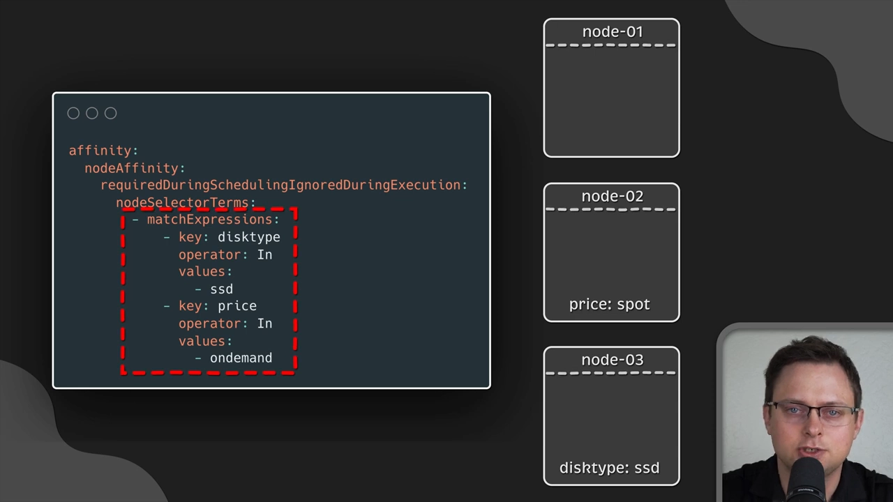

**还有一个可用的能力面：算子（operators）。** `nodeAffinity` 支持一批算子（有些**只对 `nodeAffinity` 有效**），让你表达比"等于"更丰富的条件，比如"存在某标签""某标签在某集合内"等。

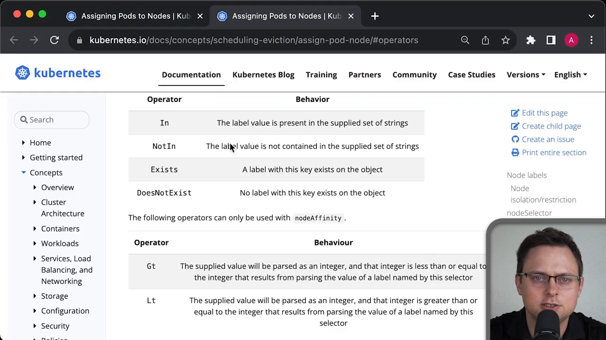

**软约束 `preferredDuringScheduling`：** 换成软约束后，调度器会**尽量**把你往目标节点放，但如果因为某些原因（比如资源不够）放不下，它会**退回**到其他节点，**不会**让 Pod 卡在 Pending。

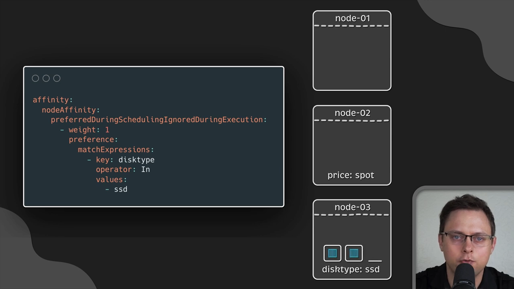

作者还提到视频里用到的属性 **`weight`（权重）**：当软约束命中标签时，调度器在给可行节点**打分**时会把这个权重加上去——权重越高，越可能被选中。作者说这基本是他约束 Pod 时的**默认首选**做法。

## 六、Pod 亲和与反亲和：不再看节点，而是看"别的 Pod"

前面所有手段的参照物都是**节点标签**。而 `podAffinity` / `podAntiAffinity` 换了个参照物：**依据"其他 Pod 的标签"来做决定**。它有两种典型的用法：

- **聚到一起（colocate）**：把需要互相通信的 Pod 放到同一台节点，以**降低延迟**（例如开源 Helm chart 里常把 Kafka 和 Zookeeper 放一起）；[【跳转到 08:54】](https://www.youtube.com/watch?v=rX4v_L0k4Hc&t=534)
- **拆散开来（spread）**：把同一应用的多个副本分到不同节点，**提高可用性**——一台机器挂了或升级，影响面最小。

**先记住一条硬性前提：`topologyKey` 必须在所有节点上是一致的。** 它是一个**标签名**（不是值），比如 `kubernetes.io/hostname`；这个 key 在所有节点上必须相同，否则 Pod 亲和的行为会变得不可预测。[【跳转到 07:28】](https://www.youtube.com/watch?v=rX4v_L0k4Hc&t=448)

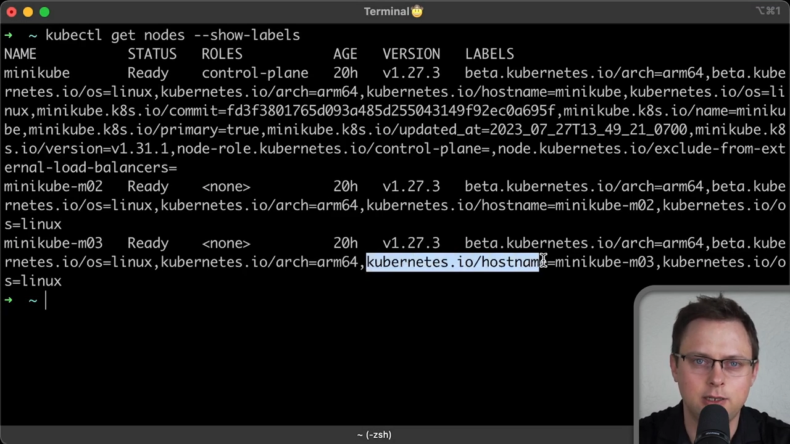

**反亲和最典型的场景是"打散"**：把 Pod 部署到不同节点上。作者特别提到，**Nginx、各类 Ingress 控制器**就经常用 podAntiAffinity，因为它们要尽量多地同时运行、分摊负载。[【跳转到 08:04】](https://www.youtube.com/watch?v=rX4v_L0k4Hc&t=484)

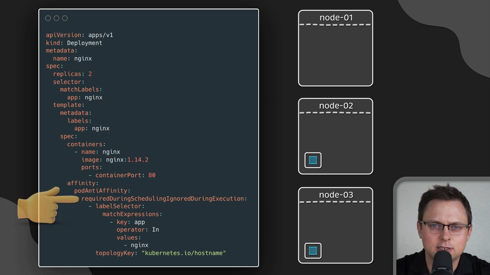

和 `nodeAffinity` 一样，Pod 反亲和也分 **`required`（硬）** 和 **`preferred`（软）**，写法也非常相似（用 Pod 标签做约束、并指定 `topologyKey`）。**用硬约束时要小心**：如果节点数量不够，多出来的 Pod 会一直卡在 **Pending**。视频里接着演示了软约束：部署 3 个 Pod 会被均匀分到各个节点；即使 Pod 比节点还多，它们也照样能被调度出去。

**再说聚到一起的用法**：`podAffinity` 把 Pod 拉到同一节点，动机就是**减少互相通信的延迟**（Kafka 与 Zookeeper 是经典例子）。[【跳转到 08:54】](https://www.youtube.com/watch?v=rX4v_L0k4Hc&t=534)

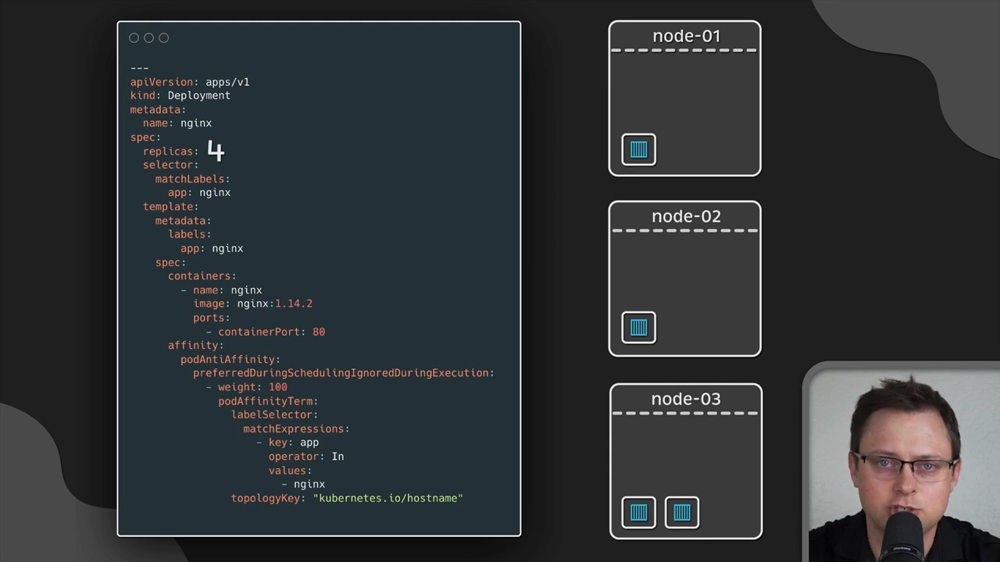

**两个重要提醒：**

- **默认只在"同一个命名空间"内生效。** 如果你想让亲和/反亲和**跨命名空间**（不只是单个 Deployment、单个 namespace）去找 Pod，需要加 `namespaceSelector`——一个**空对象**就会让它把**所有命名空间**都纳入查找范围。[【跳转到 09:19】](https://www.youtube.com/watch?v=rX4v_L0k4Hc&t=559)
- **大集群慎用。** 作者提醒：不建议在**几百个节点以上**的大集群里使用 Pod 亲和/反亲和，因为对调度器来说这是**计算密集**的任务。不过他自己在**关键业务**上还是会用——毕竟它们不能停。

## 七、taint / toleration：另一种"反向"的调度控制（此系列将单独展开）

视频最后顺带讲了**污点（taint）与容忍（toleration）**。它和亲和的方向正好相反：**污点是节点用来"拒绝"Pod 的**（比如 spot 节点、GPU 节点，你不希望不相干的 Pod 被无意中放上去），想让 Pod 落上去，就得在 Pod 里加 `toleration` "忍受"这个污点。

最典型的例子是**控制平面（master）节点**：Kubernetes 默认给它打上污点，防止普通 Pod 被调度上去（Minikube 不适用这条）。有些场景则相反，比如你希望 **Fluent Bit** 这类日志/监控 Agent 跑在**所有节点**上（包括带各种污点的），这时就用能"容忍一切污点"的写法。**亲和与容忍可以一起用，也可以只用其一。**

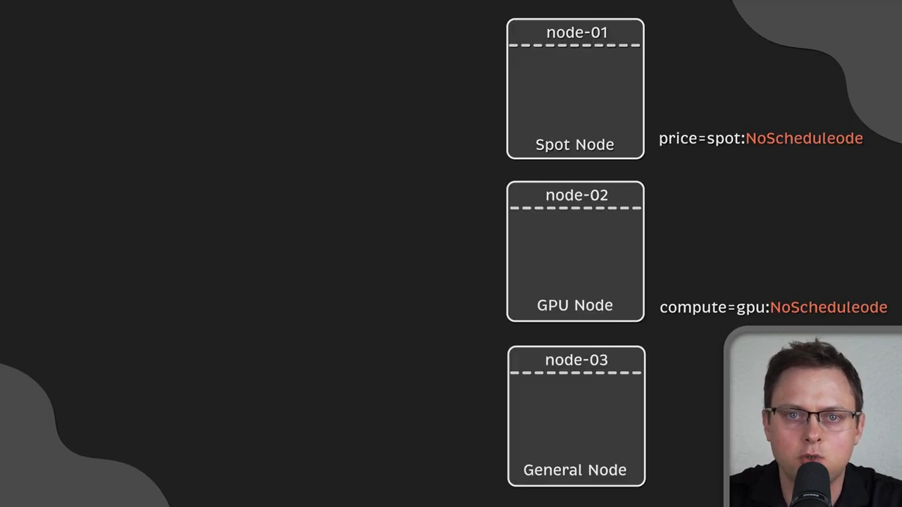

> 污点与容忍是本系列的另一个独立条目（**3.1.5 污点与容忍**），这里只作为"和亲和相对的一类手段"点到为止，细节留到那一讲展开。

## 小结

- **调度三步**：Filter（过滤出可行节点）→ Score（打分）→ Bind（选最高分并绑定）。
- **共同前提**：这些手段都建立在**给节点/ Pod 打标签**之上。
- **`nodeSelector`**：最简单、最死板，只做标签等值匹配。
- **`nodeAffinity`**：目标与 nodeSelector 相同，但支持 `required`/`preferred`、多值 OR、多条件 AND、算子与 `weight`；`IgnoredDuringExecution` 表示约束**只在调度时**生效。
- **`podAffinity`/`podAntiAffinity`**：参照物换成**别的 Pod 的标签**——一为"聚到一起降延迟"，一为"打散开来保可用"；必须有一致的 `topologyKey`，默认只在同命名空间生效，跨命名空间要加 `namespaceSelector`；大集群慎用。
- **`taint`/`toleration`**：方向相反——节点主动"拒绝"Pod，Pod 需要"容忍"才能落上去。

## 关键术语速查

| 术语 | 一句话解释 |
| --- | --- |
| Feasible nodes（可行节点） | 通过了 Filter 过滤、还留在候选池里的节点。 |
| Binding（绑定） | 把选中的节点名写回 Pod 的过程。 |
| `nodeSelector` | 按"节点标签键=值"把 Pod 钉到某类节点，最简单但不灵活。 |
| `nodeAffinity` | 按节点标签调度，支持软硬约束、多值与多条件、算子、权重。 |
| `IgnoredDuringExecution` | 约束只在调度那一刻起作用；节点标签事后变化不影响已在运行的 Pod。 |
| `preferredDuringScheduling` | 软约束：尽量满足，满足不了就回退，不会让 Pod 卡 Pending。 |
| `weight` | 软约束命中的权重，在打分阶段累加，越高越容易被选中。 |
| `podAffinity` / `podAntiAffinity` | 依据"其他 Pod 的标签"把 Pod 拉近 / 拆开。 |
| `topologyKey` | 定义"在一起"的拓扑单位的**标签键**，如 `kubernetes.io/hostname`，所有节点必须一致。 |
| `namespaceSelector` | 让 Pod 亲和/反亲和作用于所有命名空间（默认只在同命名空间内）。 |
| taint / toleration | 污点让节点拒绝 Pod，容忍让 Pod 得以落上去；方向与亲和相反。 |
