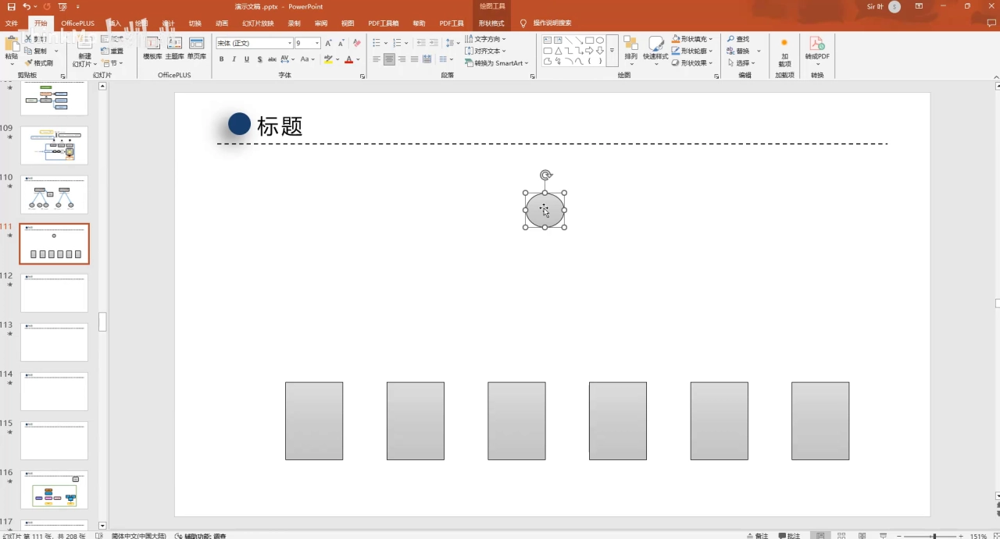
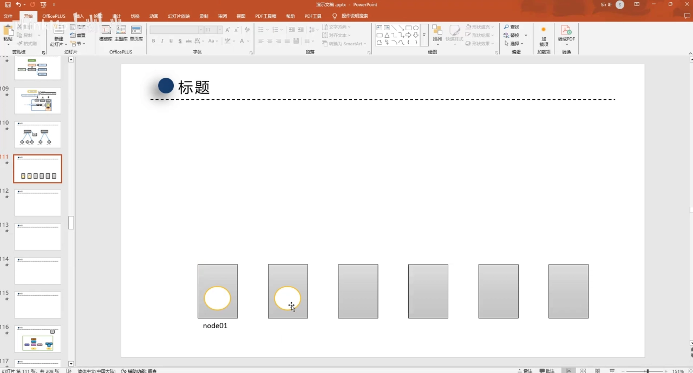
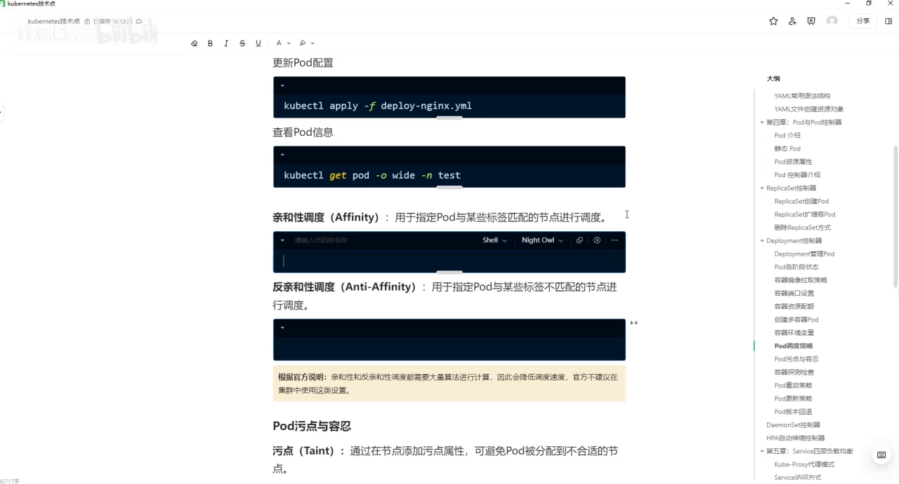
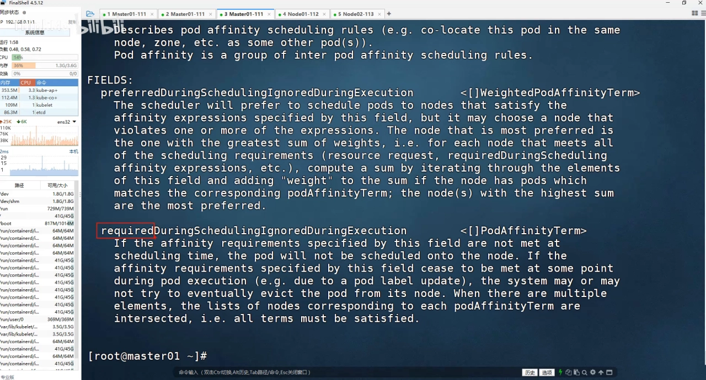
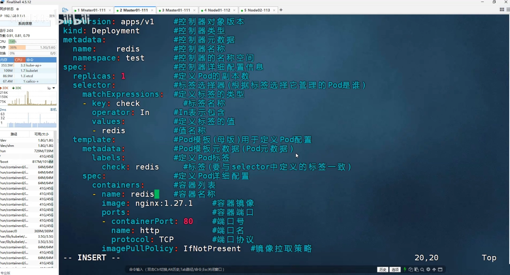
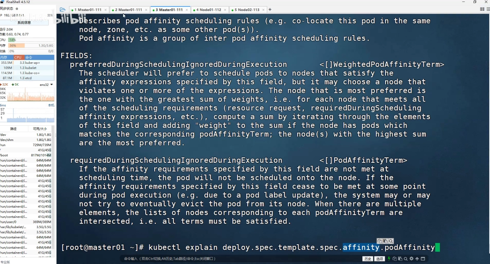
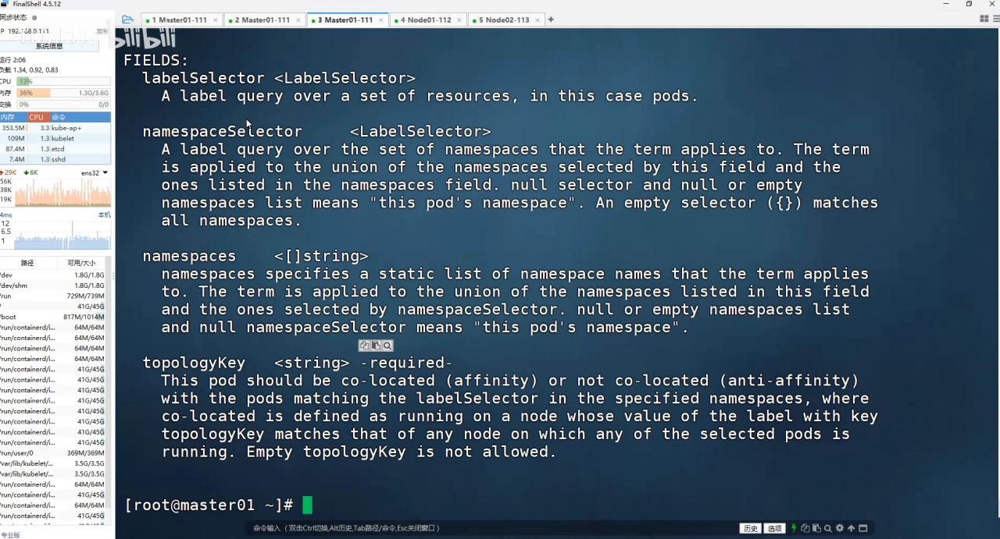
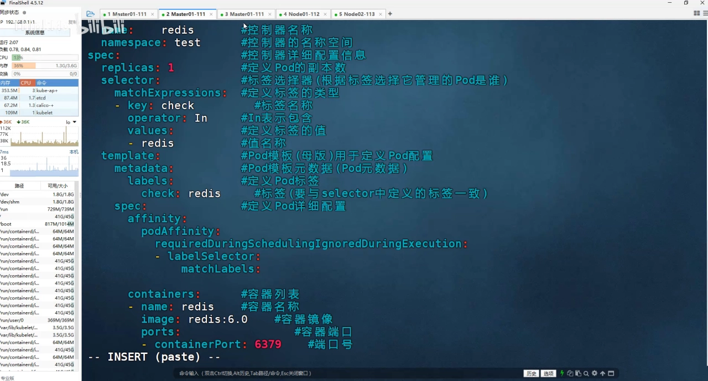
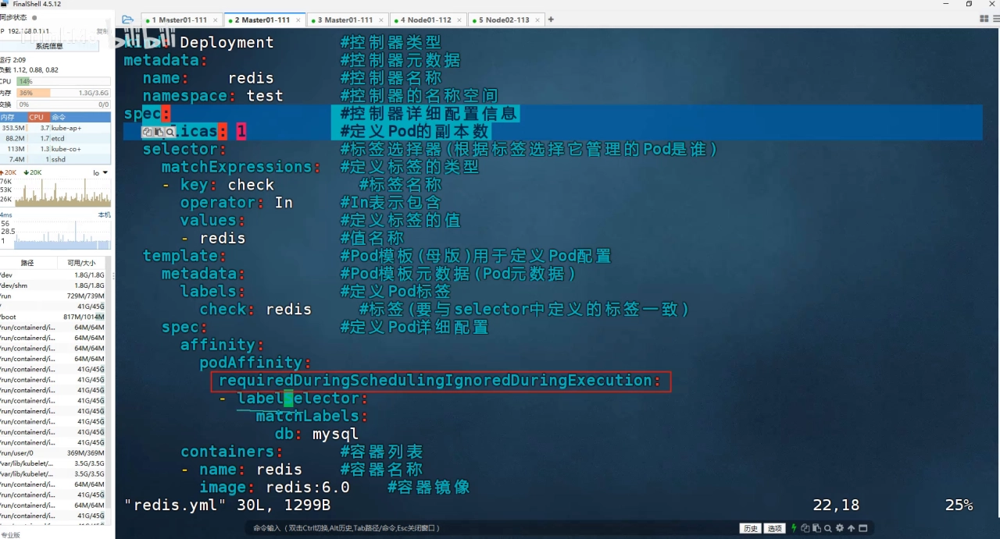
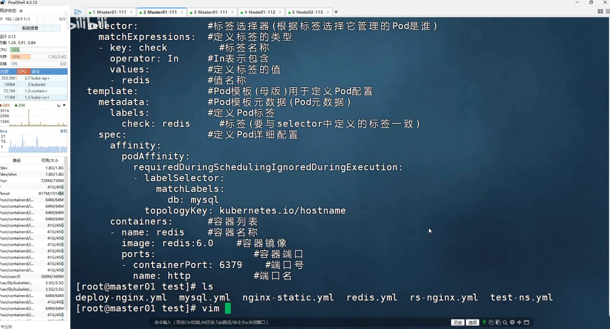

# Pod 亲和与反亲和：让 Pod 按标签找到（或避开）邻居

> 视频来源：[Kubernetes Pod 亲和性与反亲和性调度实战详解](https://www.bilibili.com/video/BV1gDsGzPEFt/)（B 站，ThinkMo）｜时长 21:08
>
> 一支边讲边演示的视频：先在概念上把"亲和/反亲和就是让 Pod 之间关系好或不好"讲清楚，再在真实集群里把 Redis 这个 Pod 分别用 `podAffinity` 和 `podAntiAffinity` 调出去，看它到底落到哪台机器上。本文按视频内容重写为中文，并纠正了自动字幕里的错拼（`炮的/pd/破的`→**Pod**、`a finite/AFFICIENT`→**affinity**、`MATLABELS/march labels`→**matchLabels**、`topic key`→**topologyKey**、`KERBERNICE I o host name`→**`kubernetes.io/hostname`**）。

## 本讲要解决的核心问题（SCQA）

**背景**：前面讲过的定向调度（`nodeName`、`nodeSelector`）是把 Pod "指哪儿打哪儿"地钉在**某一台节点**上——要么按节点名字，要么按节点上贴的标签。这解决了一大批问题，比如"这个 Pod 我只让它跑在有大内存的机器上"。

**冲突**：但有一类需求它做不到：**我不在乎具体是哪台机器，我在乎这个 Pod 跟"别人"的关系**。比如后端的 Redis 缓存跟业务程序如果不在同一台机器，中间就多绕一层网络、延迟更大；反过来，同一个应用的两份副本如果都挤在一台机器上，这台机器一挂就全挂。这两种需求都不是"钉机器"，而是"**挑邻居**"。[【跳转到 00:14】](https://www.bilibili.com/video/BV1gDsGzPEFt/?t=14)

**疑问**：既然定向调度只看节点，那"跟着某个 Pod 走"或者"躲开某个 Pod"该怎么表达？

**回答（中心思想）**：Kubernetes 用 **affinity（亲和性）** 这套机制来回答这个问题。它和定向调度的最大区别在于：**定向调度是"我对节点提要求"，而亲和/反亲和是"我对别的 Pod 提要求"**——"我想跟你待在一块儿"就是**亲和**，"我要离你远点"就是**反亲和**。而且每种亲和都分**硬（required，必须满足，否则 Pending）**和**软（preferred，尽量满足，满足不了就换台机器）**两档。[【跳转到 02:19】](https://www.bilibili.com/video/BV1gDsGzPEFt/?t=139)

---

## 一、先分清：亲和/反亲和是"对 Pod"，不是"对节点"

视频一上来先纠一个容易混淆的点。前面讲的 `nodeSelector` 之类的**定向调度，是针对节点的**：要么按节点名，要么按节点标签。而今天要讲的亲和与反亲和，**是针对 Pod 的**——它描述的是"我这个 Pod 和另一个 Pod 之间的亲疏关系"。

- **亲和（affinity）**：大白话就是"关系好"。比如我的 Pod 现在跑在 node1 上，我要再创建一个新 Pod，希望它尽量也落在同一个节点上，这就是"我希望跟它关系好、尽量往一块凑"。
- **反亲和（anti-affinity）**：大白话就是"关系不好"。我不希望新 Pod 和某个 Pod 在同一台机器上，调度时就尽量别往它那儿放，放到别的节点都行，反正它所在的节点我不去。

这套"挑邻居"的需求在真实业务里很常见：Redis 和业务服务在同一个机柜、同一台机器上，链路最短、延迟最小；而同一应用的多个副本则要拆开，避免"一荣俱荣、一损俱损"。

## 二、affinity 长什么样：一张属性表里的四件套

亲和与反亲和是写在 Pod 的 **`spec.affinity`** 下面的。展开 `affinity`，你会看到它主要包含两块：

- **节点亲和**（`nodeAffinity`）：让 Pod 对**节点标签**提要求；
- **Pod 亲和与反亲和**（`podAffinity` / `podAntiAffinity`）：让 Pod 对**别的 Pod 的标签**提要求。

有一点值得注意：**节点维度只有"亲和"没有"反亲和"**——想让 Pod 躲开某类节点，Kubernetes 用的是另一个机制（污点与容忍），而不是 `nodeAntiAffinity`。

不过作者也提醒：日常工作中**大家用得最多的还是 Pod 的亲和与反亲和**，节点亲和用得相对少一些——所以本讲的重点放在 `podAffinity` / `podAntiAffinity` 上。

## 三、硬亲和与软亲和：required 与 preferred

`podAffinity` 这一层下面有两个属性，名字都很长，但其实只记开头就够了：

- **以 `required…` 开头的叫硬亲和（硬策略）**：条件**必须**满足才能调度过去。
- **以 `preferred…` 开头的叫软亲和（软策略）**：条件**尽量**满足，满足不了也没关系。

它们的区别用一句话概括：

- **硬的（required）**：如果满足不了，Pod 就一直卡在 **Pending**，宁可等也不将就。比如"我必须跟那个 Pod 待在同一台机器，就算别的机器空着我也不去"。
- **软的（preferred）**：能满足最好，实在满足不了（比如那台机器不让我调度），我换一台机器也能跑起来——它只是"倾向"，不是"强制"。

**为什么要有软硬两档？** 因为这两档正好对应两种心态：一种是"宁可调度不上去，也不能破了规矩"（硬），另一种是"规矩尽量守，但别耽误我上线"（软）。生产里选哪档，取决于你到底多在乎这条约束。

## 四、动手：让 Redis 跟着 MySQL 走

概念讲完，视频在集群里实操。它先在 `spec` 下找到写亲和的位置：

然后按照 `affinity → podAffinity → required... → labelSelector` 一层层往下写。这里面最关键的一句是：**"我跟哪个 Pod 亲和"是靠标签描述的**——你告诉调度器一个标签，它就去找带有这个标签的 Pod，然后让新 Pod 往那些 Pod 所在的节点上靠。

具体怎么填标签？在这个例子里，作者先去 `describe` 了一下那个 MySQL Pod，看到它的标签是 `db=mysql`，于是在 `matchLabels` 里写上这一对键值。这里要分清两种写法：

- **`matchLabels`**：直接写"键: 值"的 KV 对，最常用、最直观；
- **`matchExpressions`**：需要单独指定 `key`、`operator` 和一组 `values`，表达能力更强（比如支持 `In`/`NotIn`/`Exists` 等）。

另外注意，**`labelSelector` 本身是个列表**，也就是说你可以一次写多条选择条件。

下面就是一个"硬亲和"的完整形态——只要集群里存在一个标签为 `db=mysql` 的 Pod，新 Pod 就跟它去同一台节点：

## 五、topologyKey：决定了"同一个节点"这句话的含义

配置写到一半，`kubectl apply` 报错了：**`topologyKey` 是必填项，不能为空**。这是一个非常容易踩的坑——只要用 Pod 亲和/反亲和，就必须告诉调度器"**以什么为拓扑单位来判断'在一起'**"。

在这个例子里填的是 **`kubernetes.io/hostname`**。这是 K8s 给每个节点**自动打上**的标签，它的值就是节点的主机名：

- 当 `topologyKey` 取 `kubernetes.io/hostname` 时，"同一个拓扑域"就是"同一个节点"，也就是我们常说的"待在同一台机器上"；
- 如果换成别的标签（比如机架 `rack`、可用区 `zone`），那"在一起"的含义就变成了"在同一个机架/可用区"。

这个设计很聪明：**"相邻"不是一个固定概念**，而是由你指定的拓扑标签来定义——这台机器、这个机架、还是这个可用区，全看你填什么 key。

配置补全后，Pod 成功创建，并且**确实和 MySQL 落在了同一个节点（node2）**——这就是 Pod 亲和调度的效果。

## 六、反亲和：把 podAffinity 换成 podAntiAffinity

讲完亲和，反亲和几乎是顺手的事。作者的总结很到位：**你会了亲和的用法，反亲和自然就会了**——因为两者语法完全一样，只要：

1. 把 `podAffinity` 改成 **`podAntiAffinity`**；
2. 下面的 `labelSelector`、`topologyKey`、`required`/`preferred` **原样不动**。

效果立刻就出来了：同样是 Redis 这个 Pod，这次它**没有跟 MySQL 待在一起，而是跑到了另一台节点（node1）**。也就是说：

- 亲和 = 找带这个标签的 Pod → 往它那儿靠；
- 反亲和 = 找带这个标签的 Pod → 离它远点。

## 七、什么时候别用：大规模集群里的调度开销

视频最后引用了官方文档里的一条重要提醒：**Pod 亲和与反亲和需要大量计算，在大规模集群下会拖慢调度速度，因此官方不建议在几百个节点以上的大集群中随意使用这类设置**。

原因也不难理解：调度器要为每个待调度的 Pod，去比对集群里已有 Pod 的标签和它们所在的拓扑域，节点越多、Pod 越多，这个比对的计算量就越大。所以在小集群里它是把好用的"精细调度尺"，到了大集群就得权衡一下它的代价。

## 小结

- **对象不同**：定向调度（`nodeName`/`nodeSelector`）针对**节点**；亲和/反亲和针对**另一个 Pod 的标签**。
- **两种关系**：**亲和**是"跟你在同一拓扑域"，**反亲和**是"离你远一点"。
- **两档力度**：`required`（硬，必须满足，否则 Pending）与 `preferred`（软，尽量满足，满足不了就换机器）。
- **必填的 topologyKey**：它定义了"在一起"的拓扑单位，最常用的 `kubernetes.io/hostname` 表示"同一节点"。
- **标签怎么选**：`matchLabels` 写 KV 对最常用，`matchExpressions` 支持 `In`/`NotIn` 等更复杂的表达；`labelSelector` 是列表。
- **换一个词就是反亲和**：`podAffinity` ↔ `podAntiAffinity`，其余配置不变。
- **大集群慎用**：官方提示这类调度计算量较大，节点很多时会拖慢调度。

## 关键术语速查

| 术语 | 一句话解释 |
| --- | --- |
| 亲和性（Affinity） | 让 Pod 倾向于调到"某个目标（节点或 Pod 标签）所在的地方"。 |
| 反亲和性（Anti-Affinity） | 让 Pod 倾向于**避开**某个目标所在的地方。 |
| `podAffinity` / `podAntiAffinity` | 以"别的 Pod 的标签"为参照的亲和 / 反亲和。 |
| `nodeAffinity` | 以"节点标签"为参照的亲和（节点维度没有反亲和）。 |
| `requiredDuringScheduling…` | 硬亲和：必须满足，否则 Pod 卡在 Pending。 |
| `preferredDuringScheduling…` | 软亲和：尽量满足，满足不了就调度到别处。 |
| `topologyKey` | 必填，定义"在一起"的拓扑单位，如 `kubernetes.io/hostname`（=同一节点）。 |
| `matchLabels` / `matchExpressions` | 两种标签选择写法：前者写 KV 对，后者支持 `In`/`NotIn`/`Exists` 等。 |
