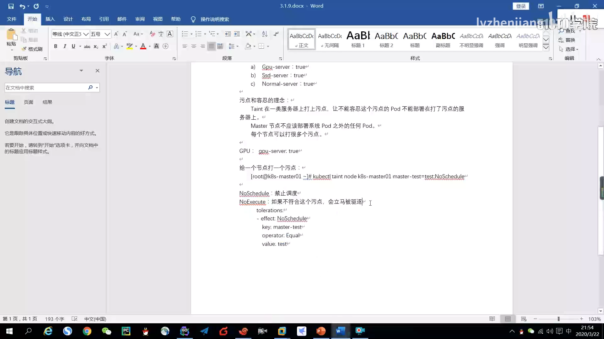
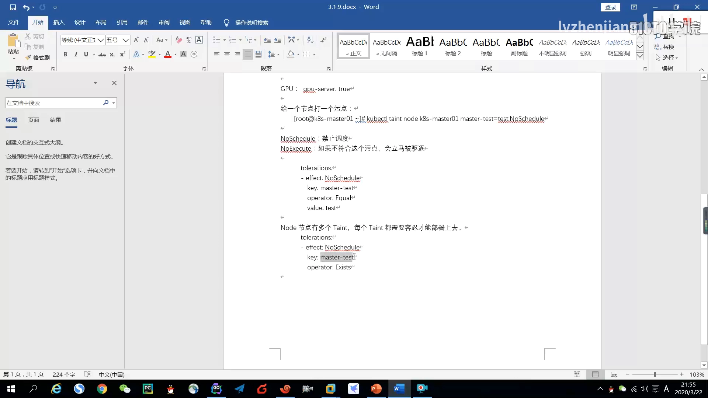
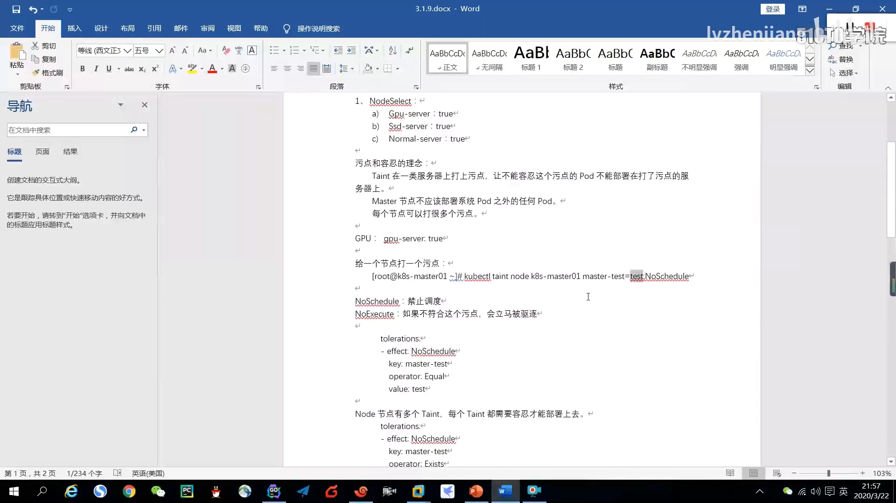
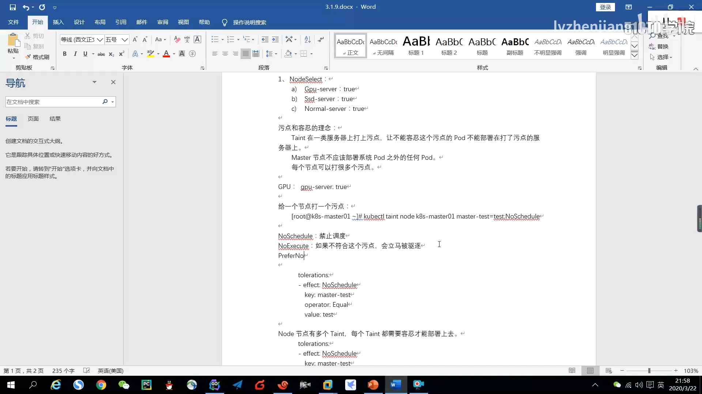
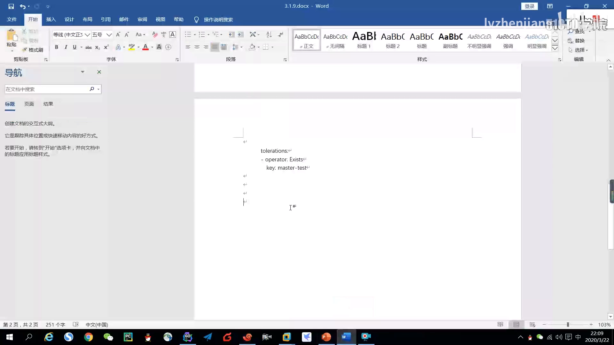
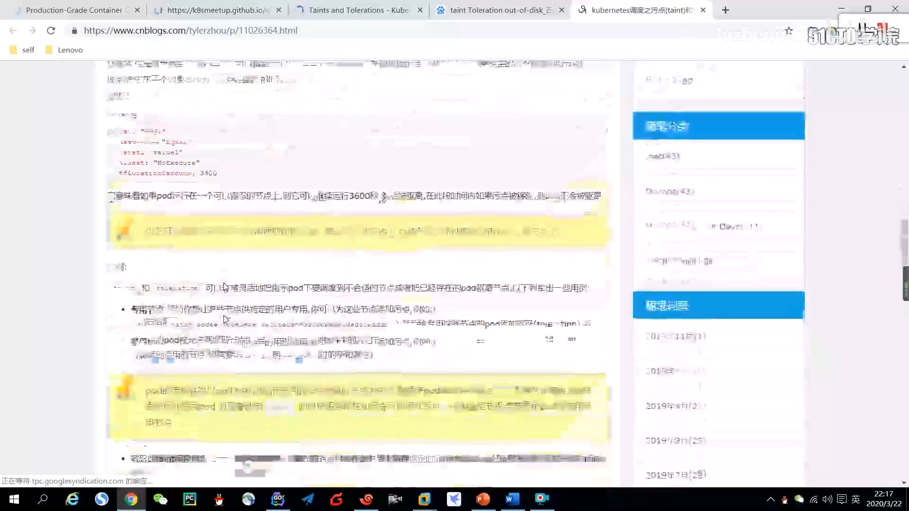

# 容忍怎么写、NoExecute 何时驱逐：toleration 写法与 tolerationSeconds 实测

> 视频来源：[10-3 Taint&Toleration补充](https://www.bilibili.com/video/BV1DQAVexE9E/)（Bilibili，UP 主 lvzhenjiang）｜时长 25:40
>
> 这是一节"补充"课：在讲完污点（taint）与容忍（toleration）的基本用法之后，把 **toleration 的几种写法**、**一个节点有多个污点时怎么容忍**、以及 **NoExecute 的宽限时间 tolerationSeconds** 讲透；最后还揭示了 K8s 自己的一套用法——**节点故障时，系统给每个 Pod 自动加的两条容忍**。文稿左栏为 B 站 AI 字幕，本文已重写为通顺中文。

## 本讲要解决的核心问题（SCQA）

**背景**：上一节我们知道，节点用**污点**排斥 Pod，Pod 用**容忍**获得豁免。Pod 的 YAML 里 `spec.tolerations` 就是写容忍的地方。

**冲突**：可真写起来问题就来了——容忍有好几种写法，写"精确"还是写"宽松"？如果一个节点上有好几个污点，只容忍一个行不行？更让人困惑的是：明明给节点打了 NoExecute 污点，**为什么有些 Pod 没有立刻被赶走**？还有，集群里从没给 Pod 写过容忍，为什么节点出故障时 Pod 还能稳定待一会儿？

**疑问**：toleration 到底该怎么写才既省事又准确？`tolerationSeconds` 是干什么的？节点变成 NotReady 时，Pod 为什么没有被立即驱逐？

**回答（中心思想）**：toleration 用一个 `operator` 控制匹配的严格程度——`Equal` 精确匹配、`Exists` 只要存在就匹配，写法可以写得很"宽"；**一个 Pod 要落到某个节点，必须容忍该节点的全部污点**；对 NoExecute 的容忍可以再加一个 `tolerationSeconds` 设"宽限时间"，到点才驱逐；而 K8s 的**准入控制**会给每个 Pod 自动追加两条容忍（`not-ready`、`unreachable`，各 300 秒），让节点故障——尤其是网络抖动——有 5 分钟恢复窗口，避免误杀容器。[【跳转到 15:30】](https://www.bilibili.com/video/BV1DQAVexE9E/?t=930)

---

## 一、一个节点多个污点：Pod 必须"逐个容忍"

先从上一节的匹配规则说起。如果**一个 node 节点上有多个 taint**，那么 Pod 要部署上去，就**必须把每一个 taint 都容忍到**——少容忍一个都不行。[【跳转到 00:28】](https://www.bilibili.com/video/BV1DQAVexE9E/?t=28)

这跟"一把钥匙开一把锁"的直觉不同：容忍不是"容忍了某个污点就能上"，而是"节点的所有污点都得被覆盖"。

## 二、toleration 的几种写法

视频用一个 `default-nginx.yaml` 的匹配规则为例，演示了从"精确"到"宽松"的几种写法。[【跳转到 00:53】](https://www.bilibili.com/video/BV1DQAVexE9E/?t=53)

### 2.1 精确匹配：operator: Equal

`operator` 写 `Equal`，同时写全 `key`、`value`、`effect`——三者必须完全对得上才算匹配。这是最严格、也最不容易误伤其他污点的写法。

### 2.2 只匹配 key + effect：operator: Exists

把 `operator` 改成 `Exists`，`value` 就可以不写（省略）。含义是："我能容忍这个 key，effect 也是这个值，**不管它的 value 是什么**。" 这样写更省事——只要 key 和 effect 匹配上就能容忍，不看 value。[【跳转到 01:43】](https://www.bilibili.com/video/BV1DQAVexE9E/?t=103)

### 2.3 容忍一切：只写 operator: Exists，其余全删

更"粗暴"的写法是连 `key`、`value`、`effect` 都删掉，只留 `operator: Exists`。这表示**能容忍所有污点**——无论节点上是什么污点都照单全收。作者提醒：**这种写法一般用不到**，只在确实要"任何节点都能上"时才考虑。[【跳转到 02:08】](https://www.bilibili.com/video/BV1DQAVexE9E/?t=128)

### 2.4 只写 key：一条容忍覆盖多个 effect

还有一种巧妙的写法：**只写一个 `key` 和 `operator`**，不带 effect。含义是"只要节点上的污点存在这个 key，我都能容忍"。

视频里先创建了两个同 key 的污点（`master-test`）：一个 effect 是 NoSchedule、另一个是 NoExecute。用"只写 key"的写法，就能**一条容忍同时覆盖这两个 effect**，非常简洁。[【跳转到 03:23】](https://www.bilibili.com/video/BV1DQAVexE9E/?t=203)

四种写法的取舍：**越精确越安全、越宽松越省事**。作者的建议是——key 和 value 按实际需求写，**最好别乱写**，乱写自己以后也记不住各自是干什么的。[【跳转到 05:03】](https://www.bilibili.com/video/BV1DQAVexE9E/?t=303)

## 三、三种效果再回顾

在进入宽限时间之前，先把三种污点效果再对齐一遍：[【跳转到 03:48】](https://www.bilibili.com/video/BV1DQAVexE9E/?t=228)

- **NoSchedule**：禁止调度（硬）——新 Pod 不接受；
- **NoExecute**：不符合的**立马被驱逐**（硬）；
- **PreferNoSchedule**：非强制——"你最好把别的容器不要部署在我这个节点上"，但如果**其他节点的资源不够了，仍然可以部署过来**，属于"软污点"。

这里的"软 / 硬"，跟亲和性那一章的 `prefer`（软）与 `required`（硬）是一个道理：**软的都是 prefer，硬的则是 required**。

## 四、tolerationSeconds：给 NoExecute 的驱逐设一个宽限期

前面说"NoExecute 会立马驱逐"，这是**默认行为**。但我们可以在容忍里加一个参数 **`tolerationSeconds`** 来**手动延后驱逐**。[【跳转到 05:48】](https://www.bilibili.com/video/BV1DQAVexE9E/?t=348)

做法是：在容忍 NoExecute 的那条规则下再加一行 `tolerationSeconds: 60`，含义是——"我容忍这个 NoExecute 污点，但**只允许自己在上面多停留 60 秒**，60 秒之后还是要被驱逐"。[【跳转到 06:53】](https://www.bilibili.com/video/BV1DQAVexE9E/?t=413)

**实测现象**：给 `node02` 打上 NoExecute 污点（key 为 `test`、value 为 `test`）后：

- **没有**写 `tolerationSeconds` 时，Pod 立刻被驱逐；
- **写了** `tolerationSeconds: 60` 时，Pod 先停留约 60 秒，随后才被删除；被删掉之后，因为它还带着 `nodeSelector`，很快又会被重新调度回到同一台节点上——于是看起来像"停一下 → 被删 → 又回来"。

一个细节值得记住：**驱逐是 K8s master 节点（控制面）执行的，跟 node 节点本身没关系**。这是后面理解"节点故障不立刻驱逐"的关键。[【跳转到 18:06】](https://www.bilibili.com/video/BV1DQAVexE9E/?t=1086)

## 五、K8s 自己也在用容忍：节点故障为什么不立刻驱逐

讲到这里，作者用 `kubectl describe pod` 带出一个反直觉的现象：**每个 Pod 部署完之后，K8s 都会自动给它加上两条 toleration**。[【跳转到 15:30】](https://www.bilibili.com/video/BV1DQAVexE9E/?t=930)

这两条容忍来自 **准入控制（Admission Control）**——视频提到"准入控制我们还没讲，到下一章讲"，但这里先用到了它的行为：它会自动为 Pod 追加容忍，让 Pod 能容忍节点故障相关的两种污点，各带 **300 秒**的 `tolerationSeconds`。

为什么需要这 300 秒？看看节点状态异常时会发生什么：

- 当节点变成 **NotReady / 异常** 后，K8s master 会给这个节点**打上污点 `Unreachable`**，其 effect 同时有 **NoExecute 和 NoSchedule**（NoSchedule 是"不让调度"，NoExecute 是"驱逐"）。[【跳转到 16:15】](https://www.bilibili.com/video/BV1DQAVexE9E/?t=975)
- 因为 Pod 自动带了 300 秒的容忍，所以**节点异常之后，Pod 不会立刻被驱逐，而是可以在上面停留 300 秒**。

设计动机很实在：节点被标记为 NotReady，很多时候**不是真挂了，而是网络抖动**——节点本身正常、服务访问也正常，只是没能及时把状态上报给 master。如果一打上 NoExecute 就立刻把容器驱逐，就会**误杀**一个其实健康的服务。留出 300 秒，就是给节点一个"恢复窗口"——**5 分钟内你的状态回来了，我就不赶你走**。[【跳转到 17:06】](https://www.bilibili.com/video/BV1DQAVexE9E/?t=1026)

当然这个值**可以按业务需求调小**：如果业务可用率要求很高，可以只允许 30 秒甚至 10 秒的网络抖动，超时就立刻飘移走。作者的实践经验是：**一般设成 10~60 秒之间，不会设成 300 秒这么长**——因为服务器通常都在同一区域、不跨城市，出现 5 分钟的网络波动不现实。设置原则是**不能太高也不能太低**：太低容易误判，太高则可能出现"节点其实已经挂了 5 分钟、Pod 还赖在上面"的情况。[【跳转到 18:26】](https://www.bilibili.com/video/BV1DQAVexE9E/?t=1106)

## 六、节点控制器注入的内置污点

除了 `Unreachable`，节点控制器还会根据节点状态自动注入一批**内置污点**。视频现场翻官方文档列出（用国内可访问的镜像站）：[【跳转到 20:10】](https://www.bilibili.com/video/BV1DQAVexE9E/?t=1210)

| 内置污点 | 触发条件（节点状态） |
| :--- | :--- |
| `node.kubernetes.io/not-ready` | 节点还没准备好，`Ready` 值为 false（新加入/新装集群时常见） |
| `node.kubernetes.io/unreachable` | 节点状态异常、网络不可达 |
| 磁盘空间不足相关污点 | 节点磁盘空间不够用 |
| 内存压力相关污点 | 节点内存有压力 |
| 磁盘压力相关污点 | 节点磁盘有压力（可能是读写性能到达瓶颈） |
| 网络不可达相关污点 | 节点的网络不可用 |
| 不可调度相关污点 | 节点被标记为不可调度 |
| cloud provider 相关污点 | 由外部云厂商注入（视频作者表示未用过） |

一句话总结规律：**这些污点都是"节点控制器根据 node 节点的状态"自动添加的**——节点的状态一变，控制器就替它贴上对应的污点。

最后是业务层面的用法建议：**可以给自己的节点按用途打污点**，比如 GPU 服务器打一个 GPU 污点、SSD 服务器打一个 SSD 污点——**只有容忍了对应污点的 Pod 才允许部署上去**，其他普通 Pod 就不会被浪费地调度到这些昂贵机器上。[【跳转到 24:14】](https://www.bilibili.com/video/BV1DQAVexE9E/?t=1454)

## 小结

- **一个节点有多个污点时，Pod 必须容忍全部污点才能落上去**，少一个都不行。
- toleration 的 `operator` 决定匹配严格度：`Equal` 需 key/value/effect 全匹配；`Exists` 只要存在即匹配；只写 `operator: Exists` 可容忍一切；**只写 key** 则一条容忍覆盖多个 effect。越宽松越省事，但越容易误伤，按需求写、别乱写。
- 三种效果：NoSchedule（硬、挡新 Pod）、NoExecute（硬、驱逐不符的）、PreferNoSchedule（软，资源不够时仍可上）。
- **`tolerationSeconds`** 给 NoExecute 的驱逐设宽限期：不写就立即驱逐，写了就等够时间再驱逐（实测 60 秒）。
- **K8s 的准入控制会给每个 Pod 自动加两条容忍（not-ready / unreachable，各 300 秒）**，节点故障时留出恢复窗口，避免把网络抖动误判成宕机而误杀容器；驱逐由控制面（master）执行，与 node 节点无关。
- 节点控制器会按节点状态注入一批**内置污点**（not-ready、unreachable、内存/磁盘压力、网络不可达等）；也可以按业务自建 GPU/SSD 等污点，把昂贵节点留给真正需要的 Pod。

## 关键术语速查

| 术语 | 一句话解释 |
| :--- | :--- |
| tolerations | Pod 上声明的容忍列表，用来"忍下"节点的污点 |
| operator | 容忍的匹配方式：Equal（key/value/effect 全匹配）或 Exists（存在即匹配） |
| operator: Exists（无 key） | 容忍一切污点，一般用不到 |
| 只写 key 的容忍 | 一条容忍即可覆盖该 key 下的多个 effect |
| tolerationSeconds | 容忍 NoExecute 时的宽限秒数，到点才驱逐；不写则立即驱逐 |
| 准入控制（Admission Control） | 在对象写入前对请求做自动加工/校验；此处会给每个 Pod 自动追加两条容忍 |
| node.kubernetes.io/not-ready | 节点未就绪（Ready=false）时由节点控制器注入的污点 |
| node.kubernetes.io/unreachable | 节点不可达/状态异常时注入的污点，effect 含 NoExecute 与 NoSchedule |
| 节点控制器（Node Controller） | 根据节点状态自动为节点添加内置污点的控制面组件 |
