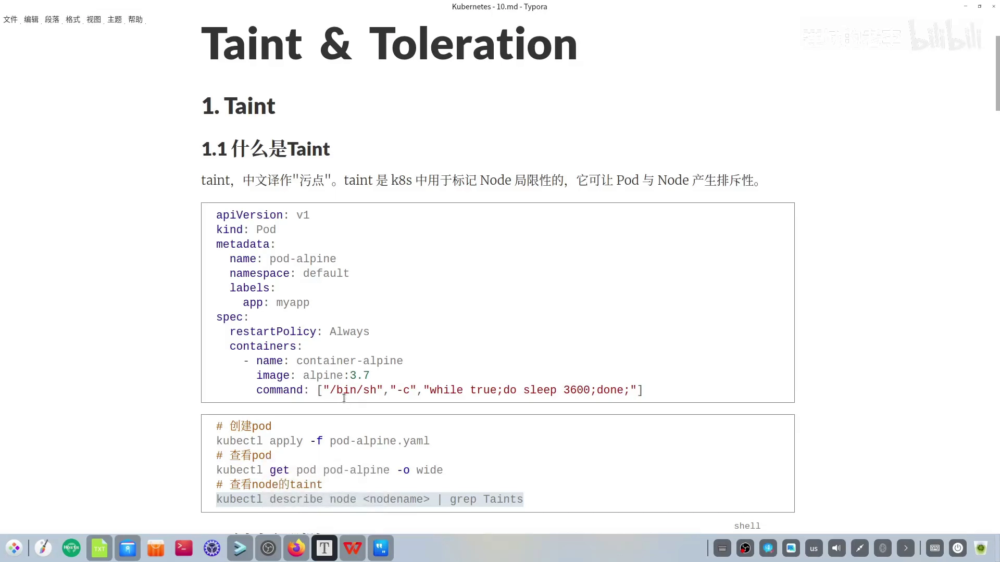
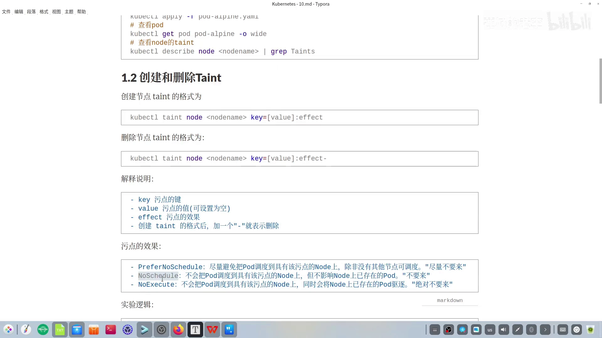
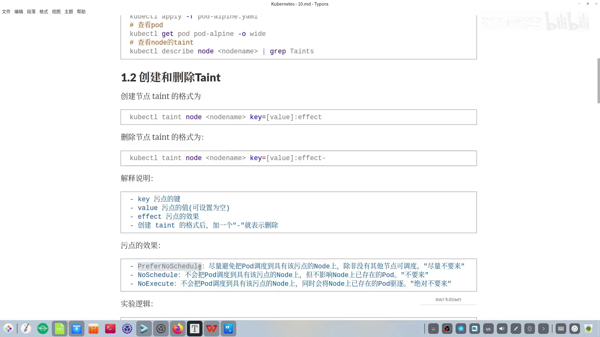
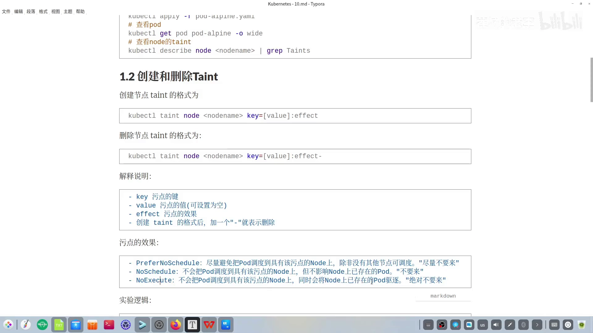
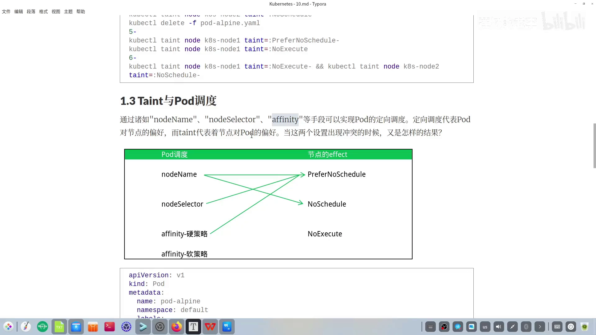
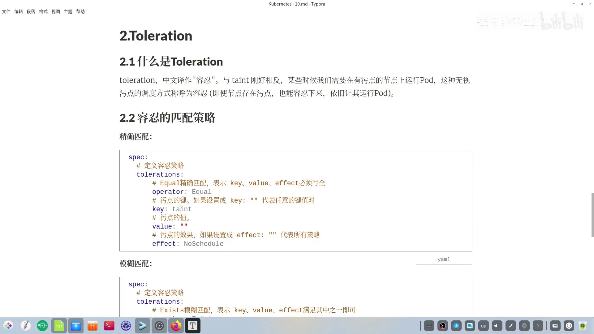
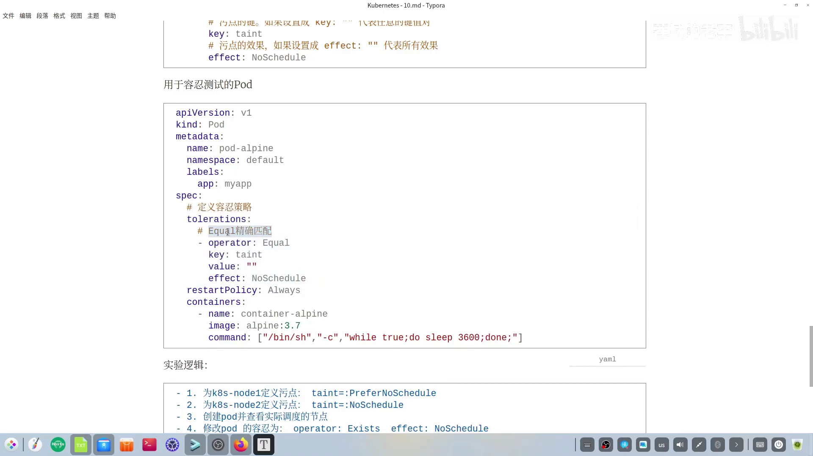

# K8s 的污点与容忍：节点怎样"拒绝"Pod，Pod 又怎样获得"例外"

> 视频来源：[K8s的污点和容忍](https://www.bilibili.com/video/BV1RdzqYqEi8/)（Bilibili，UP 主"莲城老李"）｜时长 20:05
>
> 一支把"污点（taint）"和"容忍（toleration）"讲得很清楚的入门视频。它先用 5 个实验把三种污点效果的差别演示出来，再补上"Pod 定向调度与污点冲突时听谁的"这张结论表，最后讲了容忍（toleration）的两种匹配写法。文稿左栏为 B 站 AI 字幕，本文已重写为通顺中文。

## 本讲要解决的核心问题（SCQA）

**背景**：我们之前已经知道，Pod 最终要落到集群里的某一台节点上运行。要让 Pod 去指定的节点，可以用 `nodeName`、`nodeSelector`、`affinity` 等手段——这些都是 **Pod 对节点的偏好**（我想去哪儿）。[【跳转到 09:11】](https://www.bilibili.com/video/BV1RdzqYqEi8/?t=551)

**冲突**：但现实里还有反过来的需求。master 节点负责集群管理，不该跑业务 Pod；某台机器磁盘快满、要停机维护，也不该再往上塞新 Pod。这属于 **节点对 Pod 的偏好**——节点想"拒绝"某些 Pod。可节点并不会说话，它靠什么表达这种拒绝？

**疑问**：节点用什么机制"拒绝"Pod？被拒绝的 Pod 有没有办法获得"特事特办"？当 Pod 执意要去某个节点、而节点又贴着拒绝标签时，最终听谁的？

**回答（中心思想）**：节点用 **污点（taint）** 来排斥 Pod，污点有三种效果，强度依次是 **PreferNoSchedule（尽量不要来）＜ NoSchedule（不要来）＜ NoExecute（绝对不要来，还会驱逐已有 Pod）**；Pod 则用 **容忍（toleration）** 获得豁免，容忍有"精确匹配 Equal"和"模糊匹配 Exists"两种写法。当 Pod 的定向调度与节点污点冲突时，**只有 NoExecute 强到连 `nodeName` 也突破不了**。[【跳转到 13:42】](https://www.bilibili.com/video/BV1RdzqYqEi8/?t=822)

---

## 一、污点是什么：节点身上用来"排斥 Pod"的标记

taint 的中文叫 **污点**，它是 K8s 中用来标记"节点局限性"的一种指标，作用是让 Pod 与节点之间产生**排斥性**——只要节点身上带着某个污点，默认情况下 Pod 就不会被调度到这台节点上，除非这个 Pod 明确"容忍"了这个污点。[【跳转到 00:00】](https://www.bilibili.com/video/BV1RdzqYqEi8/?t=0)

怎么理解？视频先做了一个演示：准备一段创建 Pod 的 YAML，运行之后观察它落在了哪个节点。结果它被部署到了 `k8s-node1`——**无论怎样运行 Pod，默认它总是落在工作节点上，几乎不会落到 master 节点**。原因大家也清楚：master 节点负责集群管理，一般不执行 Pod。[【跳转到 00:58】](https://www.bilibili.com/video/BV1RdzqYqEi8/?t=58)

可 master 节点是怎么做到"每次新建的 Pod 自动避开我"的？答案就是它自带了一个污点。

## 二、查看与增删污点

### 2.1 查看节点上的污点

用 `kubectl describe node` 看节点详情，再过滤关键词 `taint`：

```bash
kubectl describe node k8s-master | grep -i taint
```

结果能看到 master 节点上确实带着一个污点，正是这个污点让普通 Pod 与 master 产生了排斥；而 `node1`、`node2` 的污点设置为空——这就解释了"为什么 Pod 从不落到 master 上"。[【跳转到 01:38】](https://www.bilibili.com/video/BV1RdzqYqEi8/?t=98)

### 2.2 新增与删除污点

给节点加污点的格式是 `kubectl taint` + `node` 关键字 + 节点名 + `key[=value]:effect`：

```bash
kubectl taint node <节点名> <key>[=<value>]:<effect>
```

删除某个污点，只需在原有写法基础上加一个**短横线**：

```bash
kubectl taint node <节点名> <key>[=<value>]:<effect>-
```

污点的操作跟 label 标签非常类似，**同样遵循键值对**：`key` 是污点的键，`value` 写在冒号前面（方括号表示可以省略），**最重要的是冒号后面的 `effect`（效果）**。[【跳转到 02:27】](https://www.bilibili.com/video/BV1RdzqYqEi8/?t=147)



## 三、三种污点效果：不要来 / 尽量不要来 / 绝对不要来

`effect` 决定了节点对 Pod 的"态度"，一共有三种，语气从软到硬：

### 3.1 NoSchedule：不要来（不接受新调度，但不赶走旧 Pod）

NoSchedule 表示**不会把新的 Pod 调度到具有该污点的节点上**；但如果这个节点上已经有一些 Pod 在跑，那些**已存在的 Pod 不受影响**、会继续运行。[【跳转到 03:17】](https://www.bilibili.com/video/BV1RdzqYqEi8/?t=197)

为方便记忆，可以把 NoSchedule 简述成 **"不要来"**——节点对 Pod 的态度是"新的别过来"。



### 3.2 PreferNoSchedule：尽量不要来（软约束，没得选还是会收）

PreferNoSchedule 表示**尽量避免**把 Pod 调度到具有该污点的节点上，**除非没有其他节点可调度**。也就是说，只要还有别的节点可选，就优先去别处；实在没地方去了，还是可以调度过来。可简述成 **"尽量不要来"**。[【跳转到 03:52】](https://www.bilibili.com/video/BV1RdzqYqEi8/?t=232)



### 3.3 NoExecute：绝对不要来（不但不接收，还要驱逐已有 Pod）

NoExecute 语气最强：它**不会把 Pod 调度到具有该污点的节点上**，而且如果节点上**之前已经有 Pod**，那些已存在的 Pod 也会被该节点**驱逐**。[【跳转到 04:17】](https://www.bilibili.com/video/BV1RdzqYqEi8/?t=257)

所谓"驱逐"，就是把这个 Pod **删除**掉。可简述成 **"绝对不要来"**。三种效果对比一句话：NoSchedule 只挡新 Pod、PreferNoSchedule 是软拒绝、NoExecute 连老 Pod 都要赶走。



## 四、用五个实验把三种效果串起来

视频设计了一串实验，逻辑是：给 `node1` 打一个 `taint`（key 为 `taint`，value 省略）的污点，效果先用 PreferNoSchedule；然后创建 Pod 看它落在哪。[【跳转到 04:42】](https://www.bilibili.com/video/BV1RdzqYqEi8/?t=282)

| 实验 | 操作 | 观察到的现象 | 结论 |
| :--- | :--- | :--- | :--- |
| 1 | 给 node1 打 `taint:PreferNoSchedule` | 新 Pod 没有落在 node1，而是跑到了 node2 | 软污点生效：有别的节点可选就不去 node1 |
| 2 | 给已在运行 Pod 的 node2 打 `NoSchedule` | 那个已经在 node2 上的 Pod 不受影响 | NoSchedule 只挡新调度，不动已有 Pod |
| 3 | 删除 Pod 后重新创建（此时 node1=PreferNoSchedule、node2=NoSchedule） | 新 Pod 反而回到了 **node1** | node2 是硬拒绝、node1 只是软拒绝，于是选择 node1 |
| 4 | 把 node1 的污点改成 `NoExecute` | 原本在 node1 上的 Pod 被删除 | NoExecute 会驱逐已有 Pod |
| 5 | 清空两个节点的污点 | 后续实验的基础环境 | — |

关键的第 3 步：node1 是"尽量不要来"、node2 是"不要来"，硬约束优先，所以 Pod 只能回到 node1——**"没得选时，软拒绝会让步"**。[【跳转到 07:42】](https://www.bilibili.com/video/BV1RdzqYqEi8/?t=462)

关键的第 4 步：把 node1 的污点清除后改成 NoExecute，Pod **立刻被删除**，过一会儿就看不到这项资源了，大约 30 秒后它被彻底从 node1 驱逐——这就是"驱逐效果"的直观演示。[【跳转到 08:37】](https://www.bilibili.com/video/BV1RdzqYqEi8/?t=517)

## 五、Pod 定向调度与污点冲突时，听谁的？

前面讲的定向调度（`nodeName`、`nodeSelector`、`affinity`）代表 **Pod 对节点的偏好**，而污点代表 **节点对 Pod 的偏好**。两者冲突时怎么办？视频给出一张结论表：**画出箭头的表示"这个 Pod 可以被调度过去"，没有箭头表示"不可以"**。[【跳转到 09:11】](https://www.bilibili.com/video/BV1RdzqYqEi8/?t=551)

以 `nodeName` 为例，把 Pod 指定到 `node1`，再看 node1 的三种污点效果：

- node1 是 **PreferNoSchedule** → 仍能调度过去（软污点挡不住 nodeName）；
- node1 是 **NoSchedule** → **也仍能调度过去**！视频实测：Pod 依旧成功调度到 node1 并处于 Running；
- node1 是 **NoExecute** → **无法调度**，Pod 创建了但拿不到运行状态，即被拒绝。

所以可以认为 **NoExecute 是节点上最严苛的一种污点效果**——连 `nodeName` 这种最强的定向调度也突破不了它。[【跳转到 12:31】](https://www.bilibili.com/video/BV1RdzqYqEi8/?t=751) [【跳转到 13:42】](https://www.bilibili.com/video/BV1RdzqYqEi8/?t=822)



> 小提示：`nodeSelector`、`affinity` 的硬/软策略与三种污点效果组合，结论同样画在这张表里。视频因时间关系没有逐个演示，作者建议有兴趣的读者自己动手验证。

## 六、容忍（toleration）：给被拒绝的 Pod 开一扇门

### 6.1 容忍是什么

toleration 的中文叫 **容忍**，跟污点刚好相反。有时候我们**就是需要在有污点的节点上跑 Pod**（比如要让某些系统组件能落在带污点的节点上），这种"无视污点存在、依旧允许运行"的调度方式就叫**容忍调度**。[【跳转到 14:07】](https://www.bilibili.com/video/BV1RdzqYqEi8/?t=847)

一句话理解：**节点有污点，Pod 选择"忍下来"，于是就能落上去。**

### 6.2 容忍的配置项与两种匹配策略

容忍写在 Pod 的 `spec.tolerations` 里，里面有四个子项，最容易混的是 `operator`——它决定匹配的严格程度，可填两个词：`Equal` 和 `Exists`。[【跳转到 14:32】](https://www.bilibili.com/video/BV1RdzqYqEi8/?t=872)


- **精确匹配 `Equal`**：要求对应的污点 **key、value、effect 三者写全且完全匹配**。例如 key 为 `taint`、value 不写就写成双引号 `""`、effect 写 `NoSchedule`；effect 写成双引号则表示"任意效果"。
- **模糊匹配 `Exists`**：把 `operator` 的值写成 `Exists`，表示"存在即可"——key、value、effect 三方面**不需要写全**，只要满足所列条件中的任意一个就匹配。



### 6.3 实验：容忍 NoSchedule 的 Pod，会落到哪？

视频又做了一组实验：先给 node1 打 `PreferNoSchedule`、给 node2 打 `NoSchedule`，再在 Pod 里写一条**只容忍 NoSchedule** 的策略（`operator: Equal`，key 为 `taint`，value 无所谓，effect 为 `NoSchedule`）。[【跳转到 15:47】](https://www.bilibili.com/video/BV1RdzqYqEi8/?t=947)

结果：新 Pod **被调度到了 node2**——正因为它容忍了 node2 的 NoSchedule 污点。这与预期完全一致。[【跳转到 17:20】](https://www.bilibili.com/video/BV1RdzqYqEi8/?t=1040)

接着把容忍策略从 `Equal` 改成 `Exists`（只保留 effect 条件），并把 node2 的污点换成 `NoExecute`。这时整个集群里就只剩 **master 节点**还带着 NoSchedule 污点（那是系统创建集群时赋予的）。重新 apply 后，Pod 最终被调度到了 **master 节点**——因为它是唯一符合"容忍规则能匹配上的 NoSchedule 节点"。[【跳转到 18:17】](https://www.bilibili.com/video/BV1RdzqYqEi8/?t=1097)



## 小结

- **污点（taint）** 是打在**节点**上的键值对标记，用来让节点排斥 Pod；格式 `key[=value]:effect`，删除时在末尾加 `-`。
- 三种效果强度递增：**PreferNoSchedule（尽量不要来）＜ NoSchedule（不要来，只挡新 Pod）＜ NoExecute（绝对不要来，连已有 Pod 也驱逐）**。
- 与 Pod 定向调度冲突时的规律：`nodeName` 能突破 PreferNoSchedule 和 NoSchedule，**但突破不了 NoExecute**——NoExecute 是节点侧最"硬"的效果。
- **容忍（toleration）** 写在 Pod 侧，是"无视污点、照常落到该节点"的豁免；`operator: Equal` 精确匹配、`operator: Exists` 模糊匹配。
- 记住方向：**定向调度是"Pod 想选节点"，污点是"节点想选 Pod"**；冲突时按上面的强度规律裁决。

## 关键术语速查

| 术语 | 一句话解释 |
| :--- | :--- |
| 污点（taint） | 打在节点上的键值对标记，让节点排斥不"容忍"它的 Pod |
| 容忍（toleration） | 写在 Pod 上的豁免规则，允许 Pod 落到带对应污点的节点 |
| effect | 污点的效果，决定排斥的强弱：PreferNoSchedule / NoSchedule / NoExecute |
| PreferNoSchedule | 软拒绝：尽量别来，没别的节点时仍可调度 |
| NoSchedule | 硬拒绝：不接受新 Pod，但不驱逐已运行的 Pod |
| NoExecute | 最强：不接受新 Pod，且驱逐节点上已存在的 Pod |
| operator | 容忍的匹配方式：Equal（精确匹配 key/value/effect）或 Exists（存在即匹配） |
| nodeName | 把 Pod 直接指定到某节点的定向调度；可突破 NoSchedule，但突破不了 NoExecute |
