# 拓扑分布约束字段详解：从 maxSkew 到集群默认约束

> 视频来源：[Kubernetes Scheduling | Topology Spread Constraints](https://www.youtube.com/watch?v=joRrWJ6bwvE)（YouTube，JMMTechnology）｜时长 14:58
>
> 这是该频道「Kubernetes 调度」系列的一集，专门讲拓扑分布约束：先澄清它是**2020 年底才发布、较新**的功能（部分字段当时还在 beta），再**逐字段**过一遍 YAML——既有必填的 `maxSkew`/`topologyKey`/`whenUnsatisfiable`/`labelSelector`，也有可选的 `matchLabelKeys`/`nodeAffinityPolicy`/`nodeTaintsPolicy`，然后用一个「4 节点 2 个 zone」的例子把调度过程**一步步推演**出来，最后交代**推荐的内置标签**、几条**容易踩坑的规则**，以及**集群级默认约束**。文稿左栏为英文自动字幕，本文已翻译并重写为中文（`cubelet`→**kubelet**、`SKU`→**skew**、`anthropology spread constraint`→**topology spread constraint** 等自动字幕瑕疵已修正）。

## 本讲要解决的核心问题（SCQA）

**背景**：到这个系列的这一集，我们已经把 Kubernetes 里常见的几种"把 Pod 放到该去的地方"的手段过了一遍。现在要讲一个**更复杂、也更近代**的概念——拓扑分布约束。它是 **2020 年底**才加入 Kubernetes 的，所以**有些字段当时仍处于 beta**。[【跳转到 00:00】](https://www.youtube.com/watch?v=joRrWJ6bwvE&t=0)

**冲突**：但如果你要搭**生产环境**、要保证应用**高可用**，它就是"非常非常有用"的：你需要把 Pod **铺开到多个故障域**——包括**节点、可用区（zone）、区域（region）**。问题是，它的 YAML **字段不少**，必填的和可选的混在一起，光看名字很容易记混、也说不清每个字段到底在调度时管什么。[【跳转到 00:25】](https://www.youtube.com/watch?v=joRrWJ6bwvE&t=25)

**疑问**：`topologySpreadConstraints` 到底有哪些字段？每个字段分别管什么？它在实践中**如何一步步决定 Pod 的落点**？集群层面又有哪些**默认行为**？

**回答（中心思想）**：它做的事其实很明确——**控制 Pod 在你的集群里"怎么被铺开"**：把 Pod 跨区域、跨 zone、跨节点分散，并且**由你精确指定"希望怎么铺"**。[【跳转到 00:50】](https://www.youtube.com/watch?v=joRrWJ6bwvE&t=50) 下面按"**必填字段 → 可选字段 → 例子推演 → 内置标签 → 踩坑规则 → 集群默认**"这条主线，把每个字段讲清楚。

---

## 一、它到底管什么：控制 Pod"怎么铺开"

视频一开始就给了定义：**Pod 拓扑分布约束控制 Pod 在你的集群里如何被铺开**。具体来说：

- 它让我们可以把 Pod 铺到**不同的故障域**：**region（区域）、zone（可用区）、node（节点）**；
- 并且**由我们来精确指定这个铺开要怎样进行**。

下面直接看 YAML——**字段本身和它的所有子字段**。

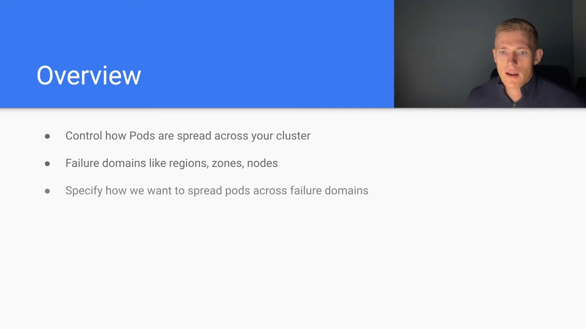

## 二、必填字段：四个名字，四件事

### 2.1 maxSkew：允许"最多差多少"

`maxSkew` 是**一个正整数值**，用来**决定 Pod 在各个故障域之间可以"不均匀到什么程度"**——可以是"跨多个域"，也可以是"就针对某一个指定的域"。它和前面讲的 `maxSkew` 含义一致：**各域副本数的差值上限**。

### 2.2 topologyKey：按什么"划分域"

`topologyKey` 是**那些属于该拓扑的节点都必须带有的标签**。视频举的例子很直观：你可能会有 `region=region-a`、`region=region-b`、`region=region-c` 这样的标签，它们会被应用到集群里**不同区域的所有节点**上——于是集群就"横跨三个不同的 region"，而每个 region 里可能有多台节点。[【跳转到 01:00】](https://www.youtube.com/watch?v=joRrWJ6bwvE&t=100)

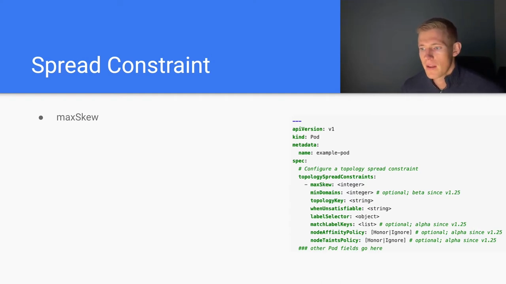

**这个 `topologyKey` 就把"属于同一拓扑的那批节点"筛选了出来。**

### 2.3 whenUnsatisfiable：满足不了时怎么办

`whenUnsatisfiable` 决定**在无法真正满足拓扑分布约束时，我们该如何行动**。有两个选项：[【跳转到 01:50】](https://www.youtube.com/watch?v=joRrWJ6bwvE&t=150)

- **不调度（DoNotSchedule）**这个 Pod；
- 或者**照常调度（ScheduleAnyway）**这个 Pod。

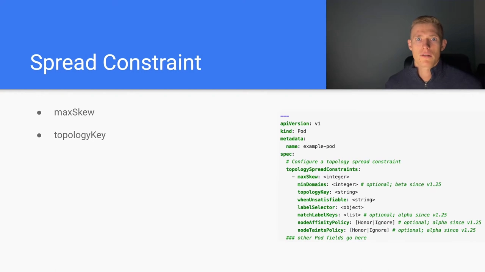

### 2.4 labelSelector：谁是需要一起均摊的"其它 Pod"

`labelSelector` **挑选出"我们在铺开时要一并纳入考量的那些其它 Pod"**。视频强调了两层考量：[【跳转到 01:75】](https://www.youtube.com/watch?v=joRrWJ6bwvE&t=175)

- 一方面，我们要用 `topologyKey` **把节点本身纳入考量**；
- 另一方面，要做到**均匀分布**，还必须**跟踪"其它 Pod"的分布**——这正是 `labelSelector` 的职责。

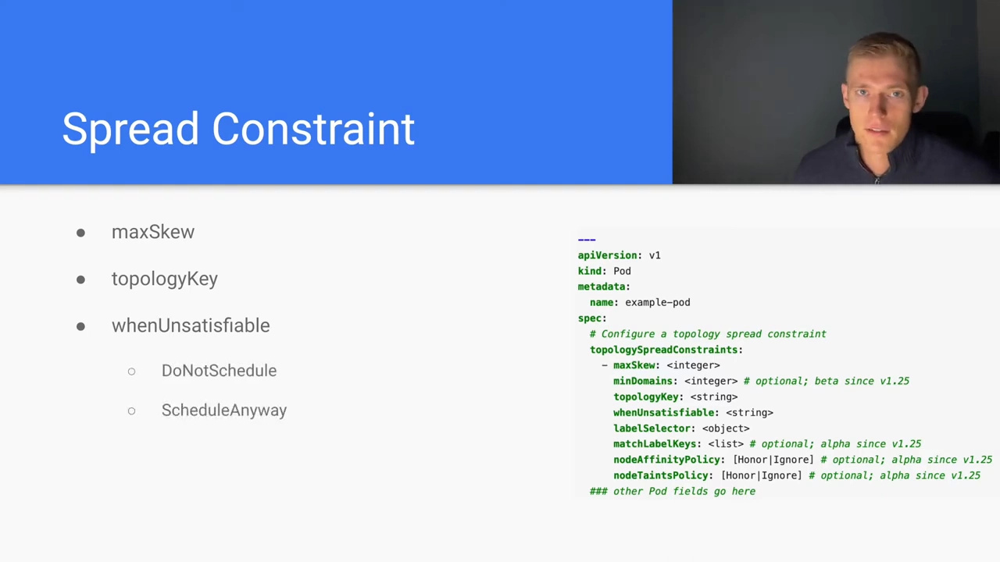

## 三、可选字段：三个进阶开关

除了必填项，视频还介绍了几项**可配置的可选字段**。

### 3.1 matchLabelKeys：在 labelSelector 之上匹配更多标签

`matchLabelKeys` **允许我们去匹配"其它 Pod"上的额外标签**。它其实要**和 `labelSelector` 联合使用**：一旦我们同时指定了 `labelSelector`，它就在此基础上**再去选额外的标签**——而单独的 `labelSelector` 只能算"一个标签"。[【跳转到 02:00】](https://www.youtube.com/watch?v=joRrWJ6bwvE&t=200)

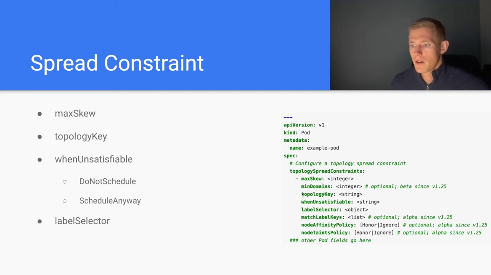

### 3.2 nodeAffinityPolicy / nodeTaintsPolicy：节点亲和与污点，认还是不认

**`nodeAffinityPolicy`** 用来指挥调度器：对 Pod 上**另外定义的节点亲和（node affinity）**，是**遵守（honor）** 还是 **忽略（ignore）**。[【跳转到 02:25】](https://www.youtube.com/watch?v=joRrWJ6bwvE&t=225)

**`nodeTaintsPolicy`** 则针对**污点（taints）**：如果某些节点被打了污点，我们要告诉调度器——**是把这些污点纳入考量，还是忽略它们**，从而**只靠拓扑分布约束这一个参数**来调度这个 Pod。同样是 **honor / ignore 二选一**。[【跳转到 02:50】](https://www.youtube.com/watch?v=joRrWJ6bwvE&t=250)

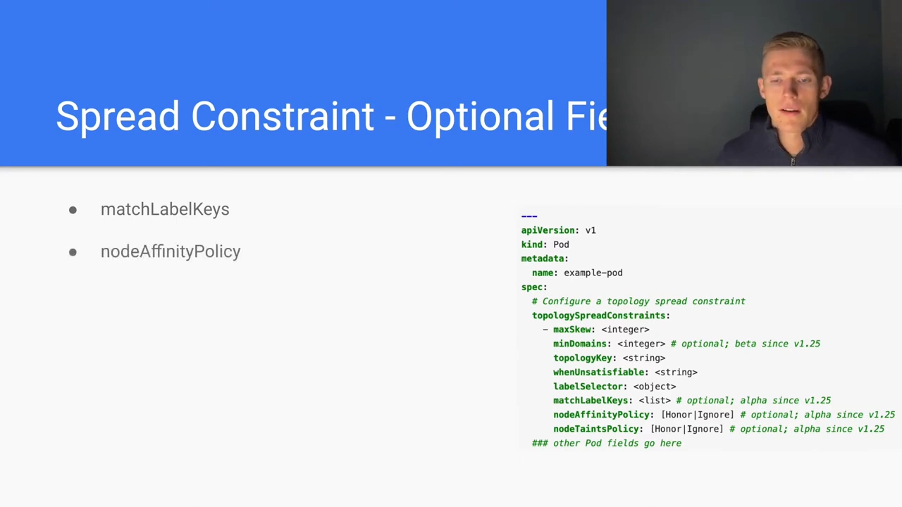

## 四、一个例子：4 个节点、2 个 zone，看调度器怎么想

字段讲完，视频用一个**具体例子**把"约束如何影响落点"推演了一遍。

### 4.1 约束与场景设定

约定如下：[【跳转到 03:05】](https://www.youtube.com/watch?v=joRrWJ6bwvE&t=305)

- 待定义的 Pod：**`maxSkew = 1`**；
- **`topologyKey = zone`**——意思是 **node1~node4 每台节点都带一个"键为 `zone`"的标签**；
- 其中 **node1、node2 的值为 `zone-1`**，**node3、node4 的值为 `zone-2`**；
- **`whenUnsatisfiable` = 不调度**（满足不了就不放）；
- **`labelSelector` 匹配 `foo: bar`**，而且**Pod 自身也带着 `foo: bar` 这个标签**。

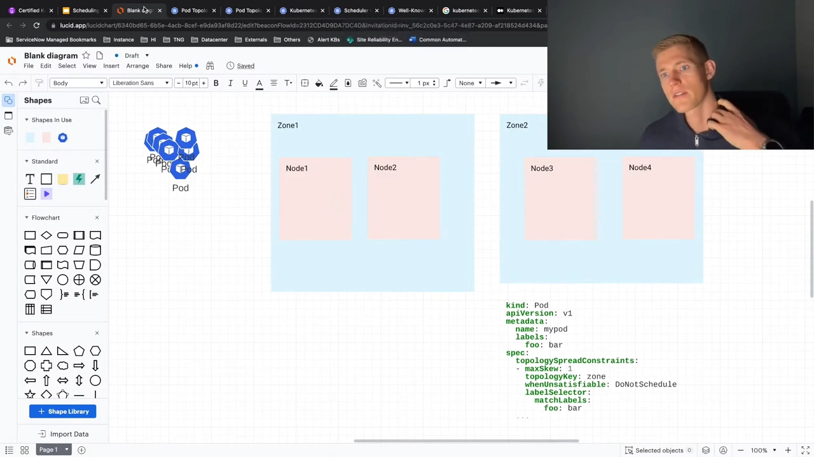

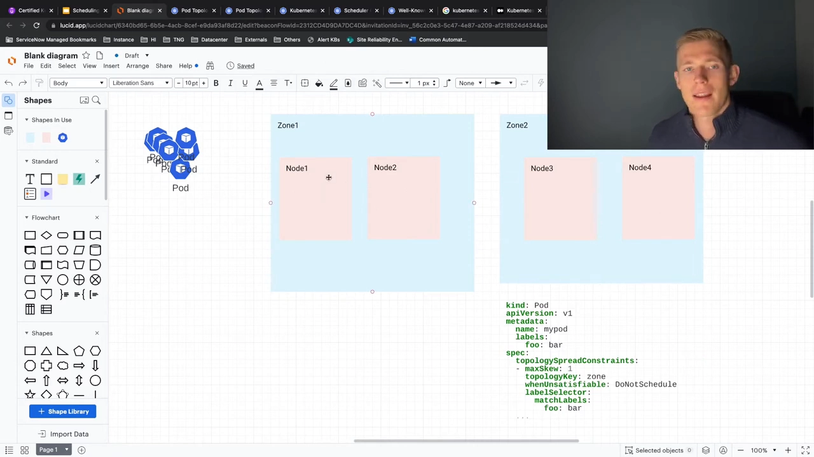

### 4.2 逐 Pod 推演

**第 1 个 Pod**：可以放到 node1，没问题。此时**整体 skew = 1**——因为 `zone-1` 有 1 个 Pod、`zone-2` 有 0 个，**1 − 0 = 1**。[【跳转到 03:55】](https://www.youtube.com/watch?v=joRrWJ6bwvE&t=355)

**第 2 个 Pod**：我们试着把它也放到 node2，但拓扑分布约束说"**不行**"——因为那会造成 `zone-1` 有 2 个、`zone-2` 有 0 个，**突破了 `maxSkew=1`**。于是它**必须挪到 `zone-2`**，也就是 **node3 或 node4** 之一。[【跳转到 06:20】](https://www.youtube.com/watch?v=joRrWJ6bwvE&t=380)

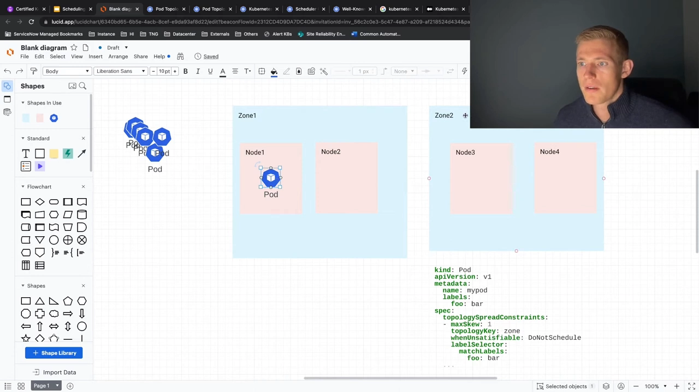

**第 3 个 Pod**：这时**当前 skew 是 0**（`1 − 1 = 0`），所以**去 `zone-1` 或 `zone-2` 都行**。假设我们让它去了 `zone-2`，那么**skew 又回到 1**。[【跳转到 06:45】](https://www.youtube.com/watch?v=joRrWJ6bwvE&t=405)

**第 4 个 Pod**：既然 skew 又是 1，下一个 Pod **就可以放回 `zone-1`**（node1 或 node2）。

这就是它在**最基础层面**的工作原理。视频还补了一句：**约束可以更复杂**——你完全可以**同时组合多条**拓扑分布约束，比如"既按 zone、又按 node 铺"。

## 五、用 Kubernetes 内置标签，省掉手工打标签

回到理论，视频介绍了几个**well-known labels（众所周知的标签）**——它们是 **Kubernetes 自己定义、被 Kubernetes 理解**的标签，**不是用户自定义的**：[【跳转到 08:00】](https://www.youtube.com/watch?v=joRrWJ6bwvE&t=480)

- **`topology.kubernetes.io/region`**（区域）
- **`topology.kubernetes.io/zone`**（可用区）
- **`kubernetes.io/hostname`**（主机名）

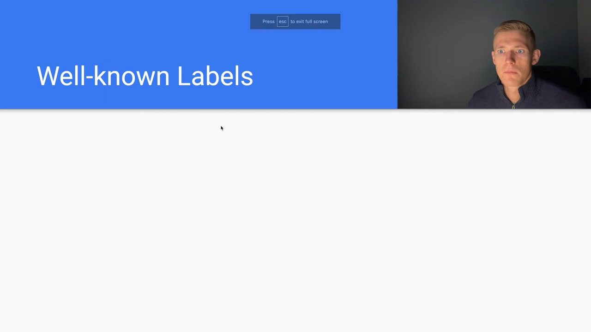

**为什么推荐用它们？** 因为这些标签是**自动**填上的：

- 前两个由 **cloud controller manager（云控制器管理器）** 注入；
- 最后一个 `kubernetes.io/hostname` 由 **kubelet** 注入。[【跳转到 08:50】](https://www.youtube.com/watch?v=joRrWJ6bwvE&t=530)

好处是**免去每加一台节点就得手工打标签的重复劳动**——你总能确定节点上会带着这些标签（前提是你确实把集群部署在**云厂商**上）。

**如果你的集群不在云上**，那就只有 `kubernetes.io/hostname` 是现成的，region / zone 这两个 `topologyKey` 就得**自己想策略**了。更极端的情况是：**你只有一个数据中心**——那 region / zone 对你就没意义，因为**根本没有 zone 和 region 可分**；这时你可以退而把拓扑分布约束**按 host（主机）来铺**。[【跳转到 09:15】](https://www.youtube.com/watch?v=joRrWJ6bwvE&t=555)

## 六、几条容易踩坑的规则

视频随后列了几条**额外的注意事项**：

**① 必须同一个命名空间**。我们盯的是"**一组 Pod** 在集群拓扑上如何分布"，而这组 Pod **必须在同一个 namespace 里**，否则就无法像前面那样算出 skew——因为**标签本身是 namespaced（按命名空间隔离的）资源**。[【跳转到 10:05】](https://www.youtube.com/watch?v=joRrWJ6bwvE&t=605)

**② 没有 topologyKey 标签的节点会被"跳过"**。如果我们希望某台节点被纳入"用于拓扑分布约束的那套拓扑"，就必须**给它打上对应的 `topologyKey` 标签**——也就是那个用来给节点"编排逻辑结构"的标签。[【跳转到 10:30】](https://www.youtube.com/watch?v=joRrWJ6bwvE&t=630)

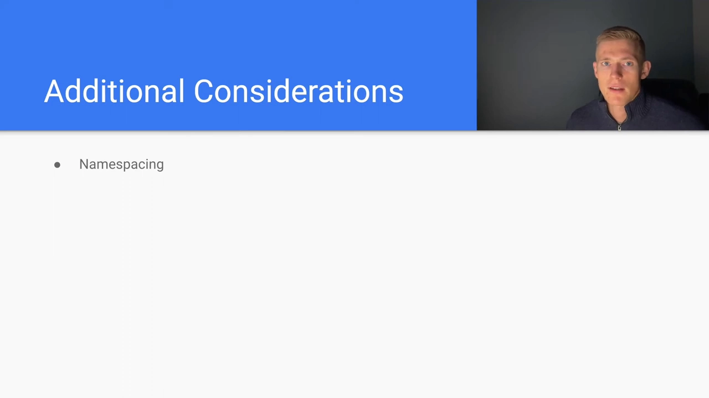

**③ labelSelector 必须能匹配到"正在部署的这个 Pod 自身"**。视频回到前面的例子做反证：如果**把 Pod 自己身上的 `foo: bar` 标签拿掉**会怎样？

- 第 1 个 Pod 照样能部署、也看似"按规则铺开"，**看起来没问题**；
- 但到部署**下一个** Pod 时就麻烦了：**skew 是按 `labelSelector` 选中的标签来算的**，而这台节点"没有那个被选中的标签"，于是系统算出来的 **skew 仍是 1**——可**实际落点却可能出现"两个 Pod 在同一节点上"**的情形。[【跳转到 11:46】](https://www.youtube.com/watch?v=joRrWJ6bwvE&t=706)

**结论**：**一定要把 `labelSelector` 匹配的那个标签，也写进 Pod 自己的定义里**。

## 七、集群级默认约束与内置默认

最后是"**在 Pod 之外**"的两个层次。

### 7.1 集群级默认约束（default constraints）

除了给单个 Pod 指定约束，**也可以在集群层面统一指定**，它们会**作为默认值施加到集群上的 Pod**。但有两条不适用规则：[【跳转到 12:39】](https://www.youtube.com/watch?v=joRrWJ6bwvE&t=759)

- 如果该 Pod **不属于 service / ReplicaSet / StatefulSet**，默认约束**不生效**；
- 如果该 Pod **自己定义了拓扑分布约束**，那么**集群默认约束会被直接忽略、被覆盖**。

这些默认约束是**作为 scheduling profile（调度配置档）的一部分**创建的——可以把 scheduling profile 理解为"**让调度器以略微不同于默认设置的方式工作**"的一种配置方式（视频没有深入展开）。[【跳转到 13:29】](https://www.youtube.com/watch?v=joRrWJ6bwvE&t=809)

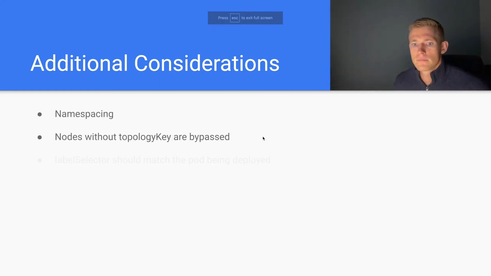

### 7.2 调度器的内置默认

视频最后指出：调度器本身还带着**一些内置的默认约束**，也就是它**开箱即用的默认行为**：

- 针对**节点（particular nodes）**这一域：内置 **`maxSkew = 3`**；**满足不了就照常调度（schedule anyway）**；
- 针对**可用区（zones）**这一域：skew **略大一些**，给更多容错空间；同样**满足不了就照常调度**。

其背后的理由是：**默认情况下，一个 Kubernetes 用户首先想的是"能把 Pod 调度出去"**，并不太在意它在各主机上分布得多匀——所以默认是**软约束（a soft consideration），而不是硬约束**，**除非用户显式指定**。[【跳转到 13:54】](https://www.youtube.com/watch?v=joRrWJ6bwvE&t=834)

## 小结

- **定位**：拓扑分布约束控制 Pod 如何跨故障域（region / zone / node）铺开，并让你**精确指定"怎么铺"**。
- **必填四字段**：`maxSkew`（允许多大不均衡）、`topologyKey`（按什么划分域）、`whenUnsatisfiable`（不调度 / 照常调度）、`labelSelector`（谁算同一组）。
- **可选三字段**：`matchLabelKeys`（在 labelSelector 之上匹配更多标签）、`nodeAffinityPolicy` / `nodeTaintsPolicy`（节点亲和与污点：honor 还是 ignore）。
- **例子结论**：maxSkew=1 时，调度器像"天平"一样——不会让某个 zone 比另一个多出超过 1 个，Pod 会在域之间来回"找平"。
- **推荐标签**：优先用 `topology.kubernetes.io/region`、`topology.kubernetes.io/zone`（云控制器管理器注入）、`kubernetes.io/hostname`（kubelet 注入），省去手工打标签；单机房就只能按 host 铺。
- **踩坑三连**：**同组 Pod 必须同 namespace**；**没有 topologyKey 标签的节点会被跳过**；**labelSelector 必须匹配到 Pod 自身**。
- **默认层次**：集群级默认约束（对非 service/RS/SS 的 Pod 不生效，Pod 自带约束即覆盖）；调度器内置默认 **node 域 maxSkew=3、zone 域 maxSkew=5，且都"照常调度"**——**软约束，除非你改**。

## 关键术语速查

| 术语 | 一句话解释 |
| --- | --- |
| topologySpreadConstraints | Pod 里声明"如何跨拓扑域铺开副本"的字段。 |
| maxSkew | 正整数值，允许各域之间副本数的最大差值。 |
| topologyKey | 划分"域"的节点标签键（如 `zone`）；无该标签的节点会被跳过。 |
| whenUnsatisfiable | 约束无法满足时的行为：`DoNotSchedule`（不调度）或 `ScheduleAnyway`（照常调度）。 |
| labelSelector | 选出要一起均摊的那组 Pod；必须能匹配到 Pod 自身。 |
| matchLabelKeys | 可选；与 labelSelector 组合，去匹配更多标签。 |
| nodeAffinityPolicy | 可选；对节点亲和是 honor（遵守）还是 ignore（忽略）。 |
| nodeTaintsPolicy | 可选；对节点污点是 honor 还是 ignore。 |
| well-known labels | `topology.kubernetes.io/region`、`.../zone`（云控制器管理器注入）、`kubernetes.io/hostname`（kubelet 注入）。 |
| scheduling profile | 调度配置档：让调度器以不同于默认设置的方式工作，集群级默认约束即由它承载。 |
| 内置默认 | 调度器默认行为：node 域 maxSkew=3、zone 域 maxSkew=5，且都"照常调度"（软约束）。 |
