# 让副本均匀铺开：Pod 拓扑分布约束（Topology Spread Constraints）

> 视频来源：[Pod Topology Spread Constraints in Kubernetes](https://www.youtube.com/watch?v=hv8lHqRZFJA)（YouTube，Lukonde Mwila）｜时长 09:42
>
> 一支「先讲清机制、再动手演示」的视频：先用 **为什么多副本还不够** 引出拓扑分布约束（topologySpreadConstraints），把它和 **podAntiAffinity** 逐点对比，然后逐个拆解 `maxSkew` / `topologyKey` / `whenUnsatisfiable` / `labelSelector` 四个字段，最后在 AWS 上用 **Karpenter** 现场扩容出 3 个可用区的节点、跑一个 10 副本的 Deployment，看副本是否真的被均匀铺开到 3-3-4。文稿左栏为英文自动字幕，本文已翻译并重写为中文（把自动字幕里的 `apology spread constraint`、`Carpenter` 等错拼纠正为 **topology spread constraint**、**Karpenter**）。

## 本讲要解决的核心问题（SCQA）

**背景**：给工作负载跑**多个实例（副本）**是 Kubernetes 的一条最佳实践——这样当某个实例、或者它所在的基础设施出问题时，其它副本能接管它的负载，业务不至于中断。这几乎是所有人都已经接受的常识。[【跳转到 00:00】](https://www.youtube.com/watch?v=hv8lHqRZFJA&t=0)

**冲突**：但**光有多副本并不够**。如果这些副本全都挤在**同一个故障域**（同一台节点、同一个可用区）里，那么一次故障照样能让它们一起下线。真正要做的，是把副本**铺开到不同的故障域**去（节点、可用区、乃至区域）。有人会说，用 **podAntiAffinity**（Pod 反亲和）不就能把副本拆开了吗？能，但它带来一个大问题：**它给不了"均匀"的保证**——用 `preferred` 模式时调度器不会严格执行，副本虽分散但**分布不均**；用 `required`（严格）模式时又可能**每个域只放一个副本**，等于把"多副本"这个前提给丢了。[【跳转到 00:37】](https://www.youtube.com/watch?v=hv8lHqRZFJA&t=37)

**疑问**：有没有一种办法，既能**跨故障域放多个副本**，又能**控制"不均匀到什么程度"**，让调度器尽量把副本铺匀？

**回答（中心思想）**：这就是 **拓扑分布约束（Topology Spread Constraints）**。它允许你在多个拓扑域里各放多个实例，同时又**让你对"分布的均匀程度"有更多控制**：你用一个叫 `maxSkew` 的数字声明"各域之间副本数最多差多少"，调度器在每次放置 Pod 时就照这个约束去挑节点。结果是**更高的可用性 + 更好的资源利用率**。它要盯住的，其实只有四件事——**允许多不均（maxSkew）、按什么划分域（topologyKey）、满足不了怎么办（whenUnsatisfiable）、谁算"同一组"（labelSelector）**。[【跳转到 01:52】](https://www.youtube.com/watch?v=hv8lHqRZFJA&t=112)

---

## 一、为什么要"铺开"：多副本本身并不等于高可用

视频开门见山地确立了一条前提：**凡是要保证高可用的工作负载，都应该跑多个副本**。原因是**容错（fault tolerance）**：

- 如果某个应用实例出问题，或者它所在的基础设施出了某种故障，**其余的副本可以顶上**，分担负载与工作，让业务继续运行。

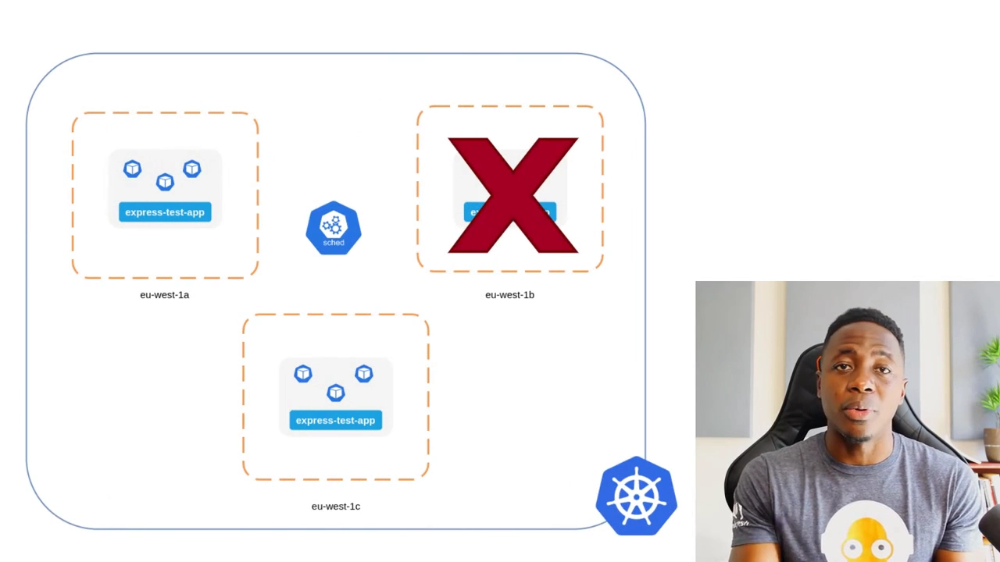

但作者紧接着补了半句关键的"但是"：**仅仅多副本是不够的**。[【跳转到 00:24】](https://www.youtube.com/watch?v=hv8lHqRZFJA&t=24)

- 你必须把它们**铺开到一个故障域之外（beyond a single failure domain）**；
- 而"域"可以有不同的粒度，也就是 **topology domain（拓扑域）**：可以是**节点（node）**、**可用区（zone）**、甚至是**区域（region）**。

一句话：**多副本决定"能容错"，铺开决定"容多大范围的错"**。

## 二、先看"老办法"：podAntiAffinity 为什么还不够

在正式介绍新工具前，视频先拿一个**很相似的概念**做对比——**Pod 亲和/反亲和规则（pod affinity / anti-affinity）**。

**Pod 反亲和（pod anti-affinity）是什么**：它是一条告诉调度器"把某些 Pod **互相调度得离远一点**"的约束，依据的是某种拓扑（比如 host 主机，或者 zone 可用区）。用它来防止**同一个应用的副本跑在同一个故障域**里，是最直观的一种办法。

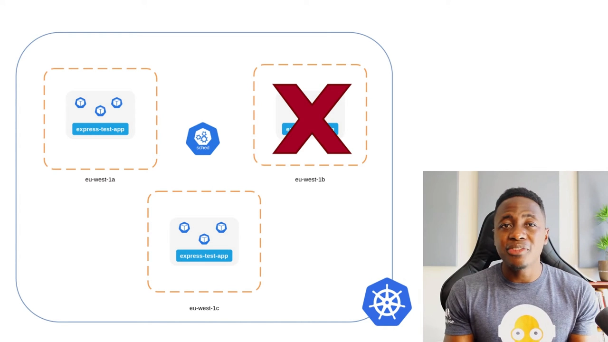

它能用，但**有一个很大的短板：没有任何"均匀"的保证**。视频把它拆成两种模式来对比：[【跳转到 01:02】](https://www.youtube.com/watch?v=hv8lHqRZFJA&t=62)

- **preferred 模式（软约束）**：调度器**不会严格执行**这条规则。结果是——你确实"多半"能在不同拓扑域里看到多个副本，但**分布并不理想、并不均匀**；[【跳转到 01:27】](https://www.youtube.com/watch?v=hv8lHqRZFJA&t=87)
- **required / strict 模式（硬约束）**：这会**严格**执行，但代价是**每个拓扑域里可能只允许一个副本**——于是又绕回到刚才那个"高可用需要多副本"的问题上去了。

也就是说，podAntiAffinity 卡在一个两难里：**要么不够均匀，要么太严格到只剩单副本**。

## 三、拓扑分布约束的核心：盯住四个字段

拓扑分布约束正好补上这个缺口：**它允许一个应用在不同拓扑域里有多个实例，同时又让调度器对"铺得多匀"有更多控制**。视频随后逐个讲解了你要打交道的几个字段。

### 3.1 maxSkew：允许"最多差多少"

`maxSkew` 用来**控制分布的不均衡程度**，也就是**"最多能斜到什么程度"**。视频给了一个非常好懂的算例：

- 假设一个应用有 **10 个副本**，集群横跨 **3 个 zone**，10 个副本**没法**被 3 个 zone 整除；
- 那"**究竟允许斜到什么程度**"，就由 `maxSkew` 的值来回答。
- 调度器在往节点上放 Pod 时，会**参考这个值**，并结合**"已经调度上去的、匹配的 Pod"**来算。

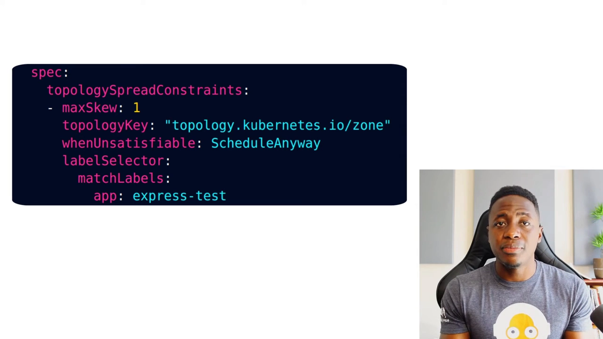

具体到数字：

- `maxSkew` 的取值范围是 **1 到 10**，它定义的是**允许的差值**；
- `maxSkew = 1` 时，10 个副本可以铺成 **3-3-4、4-3-3 或 3-4-3**——三个 zone 之间的差值不超过 1；[【跳转到 02:22】](https://www.youtube.com/watch?v=hv8lHqRZFJA&t=142)
- 如果 `maxSkew = 10`，那理论上就可能出现 **10-0-0** 这种"全堆在一个 zone、其它两个为 0"的结果。

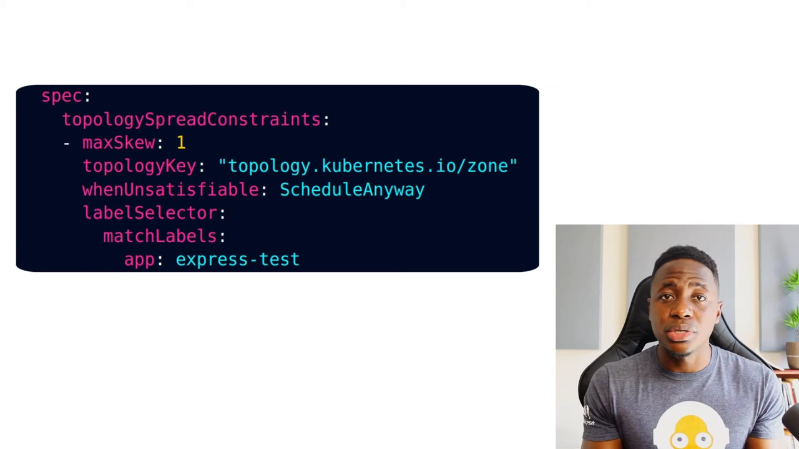

**一句话：`maxSkew` 就是你给调度器画的"均匀底线"——差得再离谱也不能超过它。**

### 3.2 topologyKey：按什么"划分域"

`topologyKey` 用来**表示拓扑域的类型**。视频特意提醒：**标签（label）是键值对**，所以 `topologyKey` 其实是**某个节点标签的"键"**，它和该键对应的**具体"值"**配对使用：

- 键可以写成 `zone`，值则比如 `af-south-1a`——这是 **AWS 南非区域里的一个可用区**。[【跳转到 03:12】](https://www.youtube.com/watch?v=hv8lHqRZFJA&t=192)

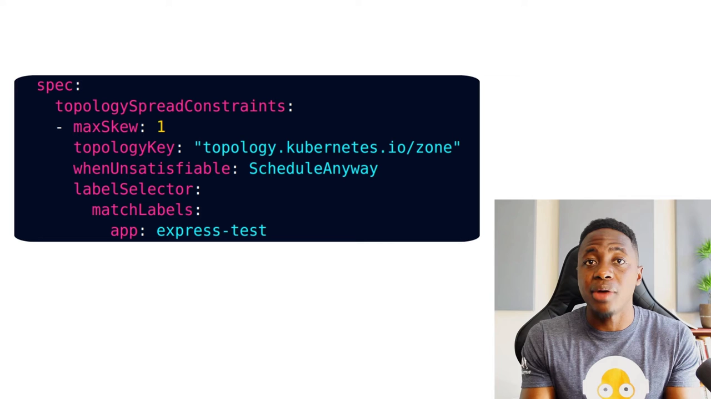

换言之：**同一 `topologyKey` 下取值相同的节点，属于同一个拓扑域**；调度器就在这些域之间去均摊副本。

### 3.3 whenUnsatisfiable：满足不了约束时怎么办

`whenUnsatisfiable` 回答的是一个很直白的问题：**当期望的约束满足不了时，调度器该怎么应对**？视频给出两个选项：[【跳转到 03:37】](https://www.youtube.com/watch?v=hv8lHqRZFJA&t=217)

- **照常调度**——但**优先选择那些能把 skew 压到最小的节点**；
- **干脆不调度**这个 Pod。

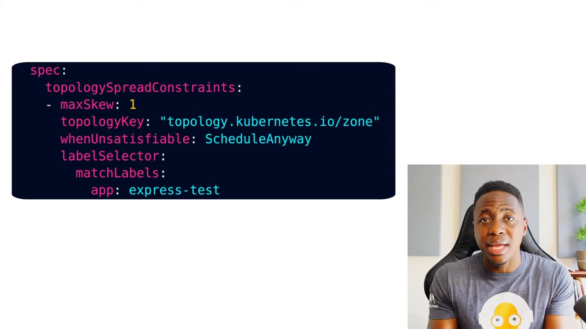

### 3.4 labelSelector：谁算"同一组"

最后一个字段是 `labelSelector`。它的作用是**找出那些匹配的 Pod**，好让调度器在决定"往哪儿放"时**把这些 Pod 纳入考量**——因为要算 skew，就必须知道"同一组副本已经分布在哪"。[【跳转到 04:02】](https://www.youtube.com/watch?v=hv8lHqRZFJA&t=242)

作者补充说：**还有一些别的字段，但当时尚未 GA（并非普遍可用）**，他只把官方文档链接放在简介里，让大家按需自行查阅。

## 四、动手看：把 10 个副本铺到 3 个可用区

讲完理论，视频进入演示环节。

### 4.1 准备：一个横跨 3 个 AZ 的集群

先交代前置条件——如果你要跟着做：

- 你需要一个 Kubernetes 集群；
- 想让应用跨 zone 铺开，就要**确保集群本身横跨这些 AZ**。

作者选的是欧洲的 **eu-west-1**（AWS 在**爱尔兰**的区域）。当时他**手上只有两个节点**，分别位于 `eu-west-1a` 和 `eu-west-1c`。[【跳转到 04:27】](https://www.youtube.com/watch?v=hv8lHqRZFJA&t=267)

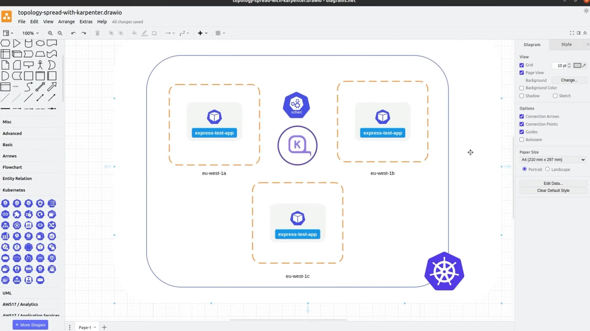

为了让**这个工作负载**拿到"专门"的节点，他用 **Karpenter** 作为集群自动扩缩器：把带调度约束的应用一部署，Karpenter 就会**读取这些约束信息去补算力**，让调度器能尽量满足要求——于是它很可能**按需创建三个节点，每个 AZ 一个**（`eu-west-1a`、`eu-west-1b`、`eu-west-1c`）。[【跳转到 05:17】](https://www.youtube.com/watch?v=hv8lHqRZFJA&t=317)

作者特别澄清：**拓扑分布约束并不需要 Karpenter**，他用 Karpenter 只是为了"拿到刚好匹配这个工作负载要求的节点"。他也提醒，跟着做**至少要有两个节点**才看得出调度器对约束的反应；而且**不一定非得按 zone 铺**——你也可以用 **host（节点）** 作为拓扑域，并自行决定"约束满足不了时希望调度器怎么办"。

### 4.2 manifest：10 副本 + maxSkew=1 + 按 zone 铺

接着他逐行过 manifest：

- 这个 Deployment 会创建 **10 个副本**；
- `topologySpreadConstraints` 里 **`maxSkew: 1`**，意思是我们期望的分布是——**两个分处不同 AZ 的节点各放 3 个，第三个 AZ 的节点放 4 个**，也就是 **3-3-4**；
- **`topologyKey`** 基于 **zone**；
- **`whenUnsatisfiable`** 设为"**即使满足不了也照常调度**"；
- **`labelSelector`** 匹配这个工作负载的键值对：**`app=express-test`**（Pod 模板里也带同样的标签，好让调度器能匹配到"同一组" Pod、据此决定其余副本的落点）。[【跳转到 06:13】](https://www.youtube.com/watch?v=hv8lHqRZFJA&t=373)

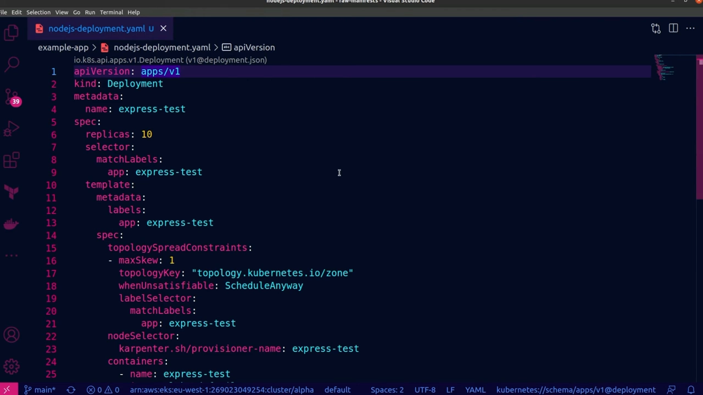

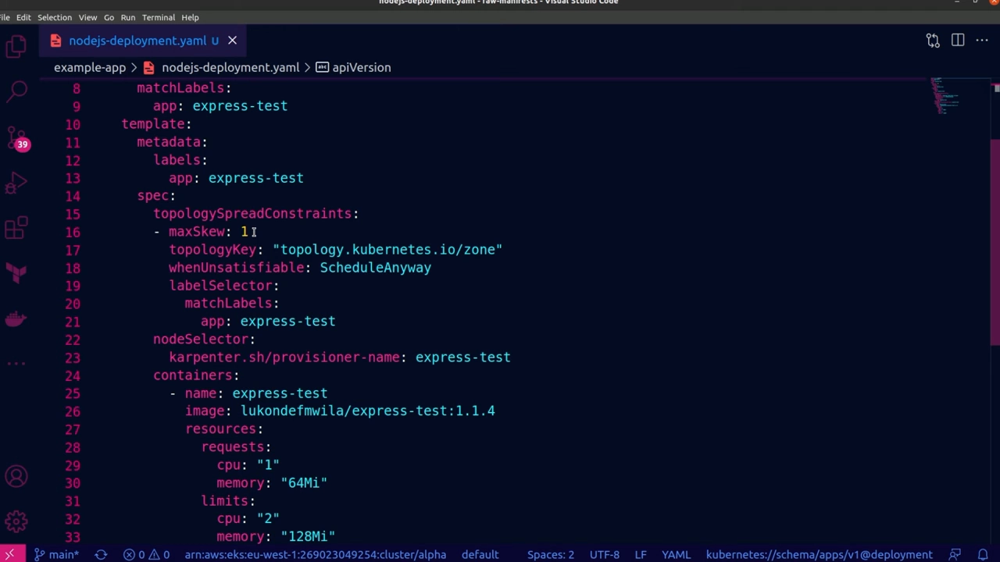

### 4.3 结果：节点落齐 3 个 AZ，副本铺成 3-3-4

部署之后：集群里**新起了三个节点**，全部就绪，**10 个 Pod 也全都被调度**到了这个 Deployment 上。想辨认哪些是新节点，看一眼最右侧的 **AGE** 就行——那些"只存活了几秒"的就是。[【跳转到 07:39】](https://www.youtube.com/watch?v=hv8lHqRZFJA&t=459)

再看这些节点被创建到了哪些 **zone**：

- 一个在 **`eu-west-1a`**（也就是它的故障域）；
- 一个在 **`eu-west-1b`**；
- 最后一个在 **`eu-west-1c`**。

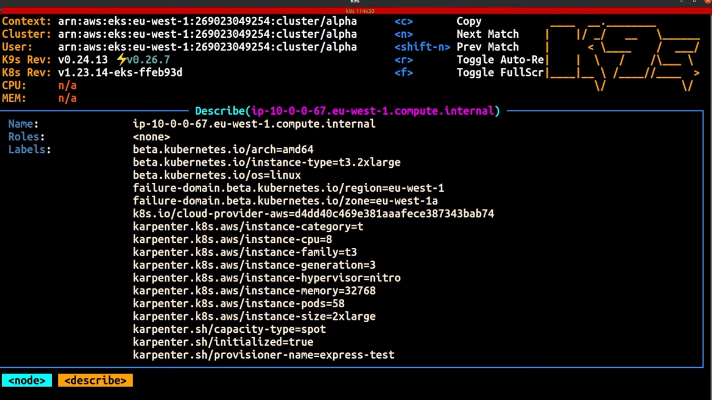

也就是说，**Karpenter 确实遵守了这些调度约束**。最后验证**副本到底有没有被铺匀**：

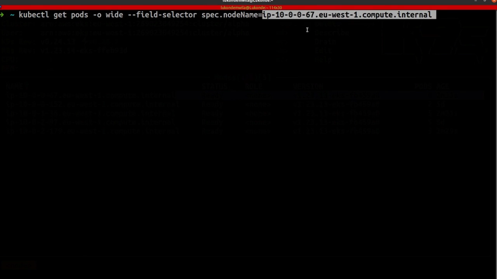

- 跑在 **`eu-west-1a`** 的那个节点上，有 **1、2、3、4 个副本**；
- **`eu-west-1b`** 的节点上有 **3 个副本**；
- 作者预期第三个节点（`eu-west-1c`）上应是 **3 个**——结果正如所料。

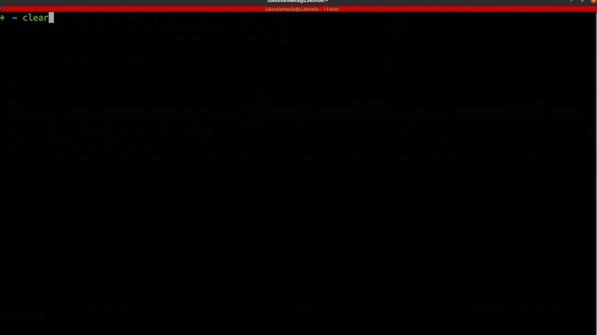

最终分布 **4-3-3**，差值不超过 `maxSkew=1`。这就**实证了拓扑分布约束确实生效**：既做到了跨可用区铺开，又做到了接近均匀的分布。

## 小结

- **多副本只解决"能不能容错"，跨故障域铺开才决定"容多大范围的错"**；副本全挤在一个域里，一次故障就能一起下线。
- **podAntiAffinity 是"老办法"却不够用**：`preferred` 不够均匀，`required` 又可能每域只剩一个副本，两头为难。
- **拓扑分布约束的定位**：既允许一个应用在多个拓扑域里各放多个实例，又能**控制铺开的不均匀程度**。
- 记住四个字段：**`maxSkew`（允许多大不均衡）、`topologyKey`（按什么划分域）、`whenUnsatisfiable`（满足不了时照常调度/不调度）、`labelSelector`（谁算同一组）**。
- 算例：10 副本跨 3 个 zone，`maxSkew=1` → 3-3-4（或 4-3-3 等）；`maxSkew=10` → 可能 10-0-0。
- 演示选型可以直接借鉴：**Karpenter 按约束扩容、节点按 zone 落位、10 副本最终铺成 4-3-3**。

## 关键术语速查

| 术语 | 一句话解释 |
| --- | --- |
| Replica（副本） | 同一工作负载的多个实例，用来提供容错与分担负载。 |
| Failure domain（故障域） | 一个"会一起出故障"的范围，如一台节点、一个可用区、一个区域。 |
| Topology domain（拓扑域） | 由 `topologyKey` 界定的"域"，同键同值的节点属于同一个域。 |
| topologySpreadConstraints | Pod/Deployment 里声明"副本如何跨拓扑域均摊"的字段。 |
| maxSkew | 允许的最大不均衡差值：各域副本数相差不能超过它。 |
| topologyKey | 用作"域划分依据"的节点标签**键**（如 `zone`），值相同即同域。 |
| whenUnsatisfiable | 约束满足不了时的行为：`ScheduleAnyway`（照样调度、优先压小 skew）或 `DoNotSchedule`（不调度）。 |
| labelSelector | 选出"要一起均摊的同一组 Pod"，调度器据此计算 skew。 |
| podAntiAffinity | Pod 反亲和：把 Pod 彼此"推开"的老办法，但不保证均匀。 |
| Karpenter | 集群自动扩缩器（本演示用它按调度约束补足节点），拓扑分布约束本身并不依赖它。 |
