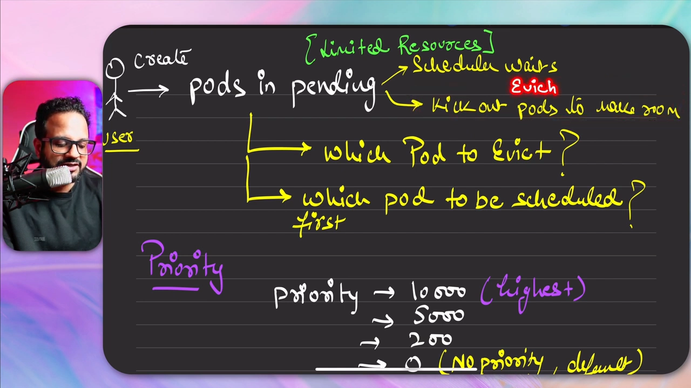
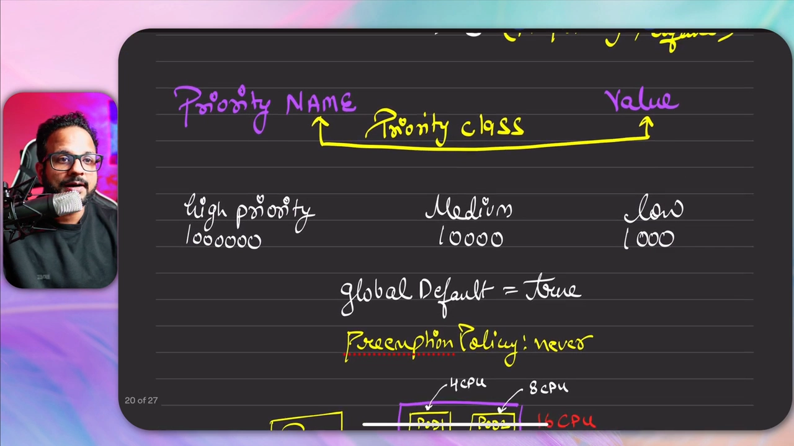
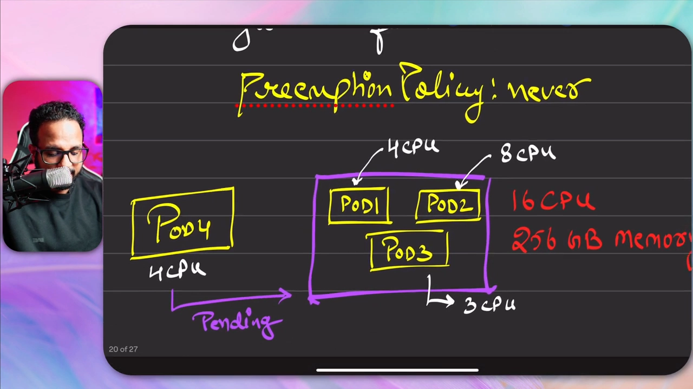
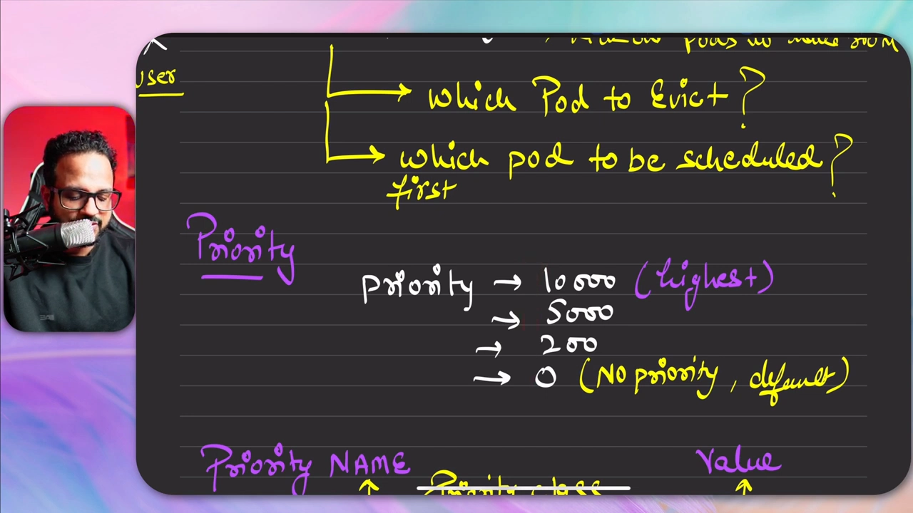
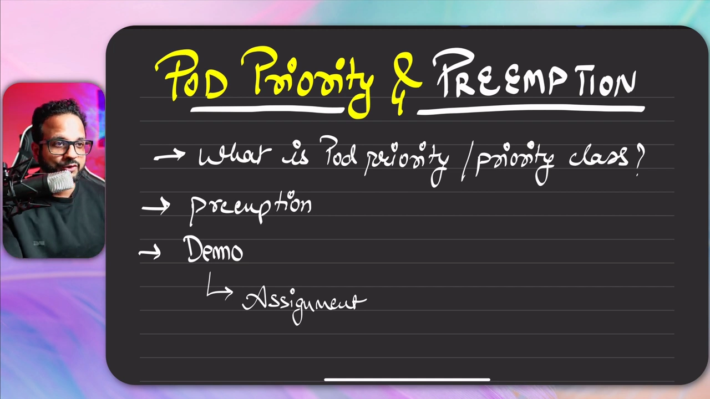

# 从 pending 到被驱逐：Pod 优先级与抢占（Priority & Preemption）实操

> 视频来源：[Day 46 - Pod Priority And Preemption In Kubernetes](https://www.youtube.com/watch?v=IICe8Z0lTa4)（YouTube，Tech Tutorials with Piyush）｜时长 24:57
>
> 一支「先讲透概念、再全程实操」的视频：先用「VIP/VVIP 让座」的类比讲清 **Pod 优先级**与**抢占（preemption）**这两个概念，推演一遍「单节点资源被占满、新 Pod 只能 pending、直到有低优先级 Pod 被驱逐」的过程；然后完整演示一遍——`kubectl explain priorityclass` 看 YAML 结构、创建 high/medium/low 三个 PriorityClass（并把 low 设为 `globalDefault`）、给 Pod 挂上 `priorityClassName`、造一个 5 副本的「资源吞噬者」 Deployment 把节点占满，最后创建一个高优先级 Pod 触发**抢占**，并用 `kubectl get events` 观察 `Preempted` 事件。文稿左栏为 YouTube 英文自动字幕，本文已翻译并重写为中文（把自动字幕里的 `engine X`、`preemption` 错拼等顺带纠正为 **nginx**、**preemption**）。

## 本讲要解决的核心问题（SCQA）

**背景**：我们已经知道，在资源有限的集群里，新创建的 Pod 如果没有足够资源，就会一直停在 **pending（待定）** 状态。[【跳转到 00:57】](https://www.youtube.com/watch?v=IICe8Z0lTa4&t=57)

**冲突**：集群资源被占满后，调度器有两条路——**要么一直等资源、要么把已有 Pod「挤出去」腾位置**。但集群上跑着各种不同重要程度的负载，究竟**该挤走谁、又该先安排谁**？如果不会区分轻重缓急，一个「一天只跑一次、什么时候跑都行」的后台任务，就可能把关键应用挤得没法运行。[【跳转到 01:32】](https://www.youtube.com/watch?v=IICe8Z0lTa4&t=132)

**疑问**：Kubernetes 怎样表达「谁更重要」，又怎样在资源不够时让重要的 Pod「插队」进来？

**回答（中心思想）**：引入**优先级（priority）**与**优先级类（PriorityClass）**。调度器**总是优先安排优先级更高**的 Pod；而当资源被低优先级 Pod 占满、高优先级 Pod 挤不进来时，就会发生**抢占（preemption）**——**驱逐（evict）**一部分低优先级 Pod 给它腾位置。这就是本讲的中心思想，接下来用一个能亲手复现的实验把它验证到底。[【跳转到 02:12】](https://www.youtube.com/watch?v=IICe8Z0lTa4&t=132)

---

## 一、先建立直觉：pending 的 Pod 与「VIP 让座」

视频用一个非常生活化的类比来打底。[【跳转到 01:22】](https://www.youtube.com/watch?v=IICe8Z0lTa4&t=82)

想象一个**资源受限**的环境：资源有限，或大部分资源已被占用。用户新建的应用 Pod 一开始会是 **pending** 状态，得等到有资源可用。调度器此时有两种做法：

- **等**：保持 Pod 处于 pending，直到资源空出来；
- **挤**：把现有的一些 Pod **踢出去（kick out）**腾位置——这就叫 **Pod 驱逐（eviction）**，也叫**抢占（preemption）**。

这就像你站在人群里，来了个 **VIP / VVIP**，为了给他腾地方，你可能被请出会议室。**高优先级 Pod 就是那些 VIP / VVIP。**



由此，调度器要替我们做的决策其实有两类：

1. **该驱逐谁**——即上面说的**抢占**；
2. **谁先被调度、谁排在后面**——这完全取决于**优先级**。

用类比重述一遍：VVIP 最优先，其次 VIP，再是一般人。优先级也是这样运作的：**先高优先级、再中优先级、最后低优先级**（有多少个优先级类都行）。[【跳转到 02:37】](https://www.youtube.com/watch?v=IICe8Z0lTa4&t=157)

## 二、优先级数字与 PriorityClass：为什么不把数字硬编码进 Pod

**优先级就是数字**：它从 `0` 开始、最大到大约 **20 亿**（2 billion），范围很宽。[【跳转到 03:02】](https://www.youtube.com/watch?v=IICe8Z0lTa4&t=182)

- `0` 表示**没有优先级**（这也是默认值）；
- 往上可以取 `200`、`5,000`、`10,000`、`20,000`……
- **数字越大，优先级越高**——顾名思义。

**为什么需要 PriorityClass**：既然优先级是数字，为什么不直接把数字写进每个 Pod？因为**把优先级数字硬编码进每个 Pod / 工作负载并不是好做法**（改起来要动所有 Pod）。于是我们创建 **优先级类（PriorityClass）**，在里面登记「名字 + 数值」，Pod 只引用名字。[【跳转到 04:17】](https://www.youtube.com/watch?v=IICe8Z0lTa4&t=257)

举三个优先级为例：`1,000`、`10,000`、`1,000,000`。它们分别代表最低、中间、最高。我们把它们做成三个优先级类，并各自带上几个字段：

| 字段 | 作用 |
| --- | --- |
| `value` | 优先级数值（本例 low=1000、medium=10000、high=1000000） |
| `name` | 优先级类的名字（如 `low` / `medium` / `high`） |
| `globalDefault` | 是否为「未指定优先级类的 Pod」的默认。本例把 **最低的那类设为 `true`**，其余为 `false` |
| `preemptionPolicy` | 抢占策略。**只有在多个优先级类同时运行时才有意义**；不想抢占他人时设为 `Never` |



其中 `globalDefault` 的含义是：**是否是每个未指定优先级类的 Pod 的默认优先级**。本例中「最低优先级类 = 默认」，所以**不带优先级类创建的 Pod，会自动落到最低的那一类**。[【跳转到 05:07】](https://www.youtube.com/watch?v=IICe8Z0lTa4&t=307)

## 三、推演一遍：16 CPU 的节点上，谁会被驱逐

在动手之前，视频先在白板上推演了一个**单节点**场景，把抢占的逻辑讲透。[【跳转到 05:32】](https://www.youtube.com/watch?v=IICe8Z0lTa4&t=332)

设这个节点有 **16 CPU** 和 **256 GB 内存**，上面已跑着三个 Pod：

- Pod 1 用 **4 CPU**
- Pod 2 用 **8 CPU**
- Pod 3 用 **3 CPU**

三者合计 `4 + 8 + 3 = 15` CPU，而节点总共 16 CPU——**只剩不到 1 个 CPU**（何况系统组件还要用掉一些）。也就是说，**基本没有余量**给新 Pod。

此时创建一个需要 **4 CPU** 的 **Pod 4**，它会**卡在 pending 状态**。要等到什么时候？**等到某个更低优先级的 Pod 被驱逐**（可能是 Pod 1、2、3 中的某一个），它才能被调度。

这里有一条**关键约束**：**新 Pod 的优先级必须高于运行中的某些 Pod，才能驱逐它们**。[【跳转到 06:47】](https://www.youtube.com/watch?v=IICe8Z0lTa4&t=407)

- 如果新 Pod 是**低优先级**，它只能**等**；
- 如果新 Pod 是**高 / 中优先级**，则**低优先级的 Pod 无法驱逐高 / 中优先级的 Pod**。



至于优先级类怎么分，完全由你决定：可以是 low / medium / high，也可以设成 priority 1 / 2 / 3，甚至像「经济舱、商务舱、头等舱」那样细分——**想设几个都行**。[【跳转到 07:12】](https://www.youtube.com/watch?v=IICe8Z0lTa4&t=432)



---

## 四、动手实验（一）：看清默认优先级类与 YAML 结构

视频的实操练习来自课程的 GitHub 仓库（用 KodeKloud 免费实验环境、任意 playground 或本地 minikube 都可以），任务清单是：[【跳转到 08:16】](https://www.youtube.com/watch?v=IICe8Z0lTa4&t=496)

1. 创建**三个**不同数值的优先级类；
2. 部署带不同优先级类的 Pod；
3. 创建一个**资源受限**、带 `resources.requests`、**5 副本**的 Deployment；
4. 查看节点资源；
5. 再创建一个**请求更高 CPU / 内存**的新 Pod，**观察抢占**，并记录你的观察结果。



**先看默认有什么**：`kubectl get priorityclass`（可简写 `kubectl get pc`）列出集群里已有的优先级类。此时只有两个：

- `system-cluster-critical`
- `system-node-critical`

它们的 `GLOBAL-DEFAULT` 都是 `false`，`PREEMPTIONPOLICY` 都是 `PreemptLowerPriority`——**这就是默认行为：更低优先级的 Pod 会被抢占**。[【跳转到 10:20】](https://www.youtube.com/watch?v=IICe8Z0lTa4&t=620)

**再看 YAML 长什么样**：`kubectl explain priorityclass`（或 `pc`）会显示它的字段结构。[【跳转到 10:45】](https://www.youtube.com/watch?v=IICe8Z0lTa4&t=645)

- **group** = `scheduling.k8s.io`，**version** = `v1` → 所以 `apiVersion: scheduling.k8s.io/v1`
- **kind** = `PriorityClass`
- 它**没有 `spec`**，而是直接平铺若干字段：
  - `description`
  - `globalDefault`（true / false）
  - `metadata`（name 在其中）
  - `preemptionPolicy`（`Never` 或 `PreemptLowerPriority`，**默认 `PreemptLowerPriority`**）
  - `value`（**必填**，整数）

## 五、动手实验（二）：创建三个优先级类并挂到 Pod 上

按照上面的结构写 YAML。先写 **`p1.yaml`**（high-priority）：[【跳转到 12:25】](https://www.youtube.com/watch?v=IICe8Z0lTa4&t=745)

```yaml
apiVersion: scheduling.k8s.io/v1
kind: PriorityClass
metadata:
  name: high-priority
value: 1000000          # 必填字段，优先级数值
globalDefault: false    # 不要把它当默认
description: "This priority should be used for high-priority pods"
# preemptionPolicy 是可选项，默认即 PreemptLowerPriority，故省略不写
```

然后复制出两份，改成其余两类：[【跳转到 13:40】](https://www.youtube.com/watch?v=IICe8Z0lTa4&t=820)

```yaml
# p2.yaml —— medium
metadata:
  name: medium-priority
value: 10000
globalDefault: false
```

```yaml
# p3.yaml —— low，并设为默认
metadata:
  name: low-priority
value: 1000
globalDefault: true     # 未指定优先级类的 Pod 将默认落到这一类
```

用 `kubectl apply -f .` 一次应用当前目录下所有 YAML，再 `kubectl get pc` 检查——会看到 `high`、`low`、`medium` 三个类都建好了，其中 **`low` 是默认**。[【跳转到 14:30】](https://www.youtube.com/watch?v=IICe8Z0lTa4&t=870)

**给 Pod 挂上优先级**：`pod1.yaml` 是一个 nginx Pod，内存 `128Mi`、CPU `500m`（即 0.5 CPU），只在 `spec` 里多写了一行 `priorityClassName: high-priority`。[【跳转到 15:20】](https://www.youtube.com/watch?v=IICe8Z0lTa4&t=920)

```yaml
# pod1.yaml（节选）
spec:
  containers:
  - name: nginx
    image: nginx
    resources:
      requests:
        memory: "128Mi"
        cpu: "500m"
  priorityClassName: high-priority
```

`kubectl apply -f pod1.yaml` 创建后，`kubectl describe pod` 会在输出里看到 **priority 已被设为 `1000000`**——我们**并没有在 Pod 里直接写这个数字**，只是指向了优先级类名字，**映射是内部自动完成的**。[【跳转到 16:10】](https://www.youtube.com/watch?v=IICe8Z0lTa4&t=970)

## 六、动手实验（三）：造一个「资源受限」场景把节点占满

接着创建一个「资源吞噬者」Deployment（`deploy.yaml`），用来把节点资源占满：[【跳转到 17:00】](https://www.youtube.com/watch?v=IICe8Z0lTa4&t=1020)

- **5 个副本**；
- 每个 Pod 请求 **256Mi 内存 / 0.5 CPU**；
- 全部是**低优先级**（low-priority）。

```yaml
# deploy.yaml（节选）
spec:
  replicas: 5
  template:
    spec:
      containers:
      - name: resource-hog
        image: nginx
        resources:
          requests:
            memory: "256Mi"
            cpu: "500m"
      priorityClassName: low-priority
```

5 个 Pod × 0.5 CPU ≈ **2.5 CPU**，5 × 256Mi ≈ **1.25 GB 内存**。`kubectl apply -f deploy.yaml` 之后，再看节点：`kubectl describe node control-plane`。[【跳转到 17:50】](https://www.youtube.com/watch?v=IICe8Z0lTa4&t=1070)

- 节点显示 **16 allocatable CPU**（16 是可用的上限，其中一部分还会被系统 / 控制面 Pod 占用）；
- 5 个低优先级 Pod 都已 Running，合计已用掉约 2.5 CPU。

此时节点剩余 CPU 大约在 12 CPU 上下（还需扣掉系统占用）。


> 顺带一提：`kubectl top node` 在本环境里不可用（**metrics-server 没运行**），所以视频改用 `kubectl describe node` 的 requests/utilization 视图来估算余量。[【跳转到 19:05】](https://www.youtube.com/watch?v=IICe8Z0lTa4&t=1145)

## 七、动手实验（四）：让高优先级 Pod 抢占，用 events 观察

现在做最关键的一步：创建一个**高优先级**的「临界 Pod」（`cr.yaml`），请求 **`15000m` = 15 CPU**——大到足以把现有的低优先级 Pod 挤出去。[【跳转到 19:30】](https://www.youtube.com/watch?v=IICe8Z0lTa4&t=1170)

```yaml
# cr.yaml（节选）
spec:
  containers:
  - name: critical-nginx
    image: nginx
    resources:
      requests:
        cpu: "15000m"    # 15 CPU，远超节点余量
  priorityClassName: high-priority
```

`kubectl apply -f cr.yaml` 后观察：

- `kubectl get pods`：原来的 Pod 先是 `ContainerCreating`（**说明它已经把一些人“踢出去”了**），随后这个临界 Pod 起来；
- `kubectl get events`：能看到类似 **`Preempted`** 的记录——**`pod/resource-hog-...` was preempted by pod ... on node controlplane`**，也就是「这个低优先级 Pod 被那个高优先级 Pod 抢占了」。[【跳转到 19:55】](https://www.youtube.com/watch?v=IICe8Z0lTa4&t=1195)


**可逆验证**：把那个临界 Pod 删掉（`kubectl delete pod`）后，被挤走的低优先级 Pod **立刻恢复 Running**——说明它们只是**暂停/被驱逐**，并非永久消失（由控制器重建）。再**重新 apply** 一次 `cr.yaml`，又能看到那批低优先级 Pod 重新进入 pending、临界 Pod 再次被调度起来——因为**高优先级 Pod 有优先权，低优先级 Pod 必须让位**。[【跳转到 22:00】](https://www.youtube.com/watch?v=IICe8Z0lTa4&t=1320)

**把时间线排序看清楚**：用 `kubectl get events --sort-by=.metadata.creationTimestamp` 可以按创建时间排序事件，于是能读到完整脉络：先是 **fail scheduling（调度失败，因为没资源）** → 抢占释放资源后 **scheduled** → **Pulled** 镜像 → **Created** 容器。[【跳转到 23:15】](https://www.youtube.com/watch?v=IICe8Z0lTa4&t=1395)

至此，**Pod 优先级与抢占**的完整链路就验证完了。实验结束后记得清理资源（本地环境 `kubectl delete`，沙箱环境直接关闭即可）。[【跳转到 24:14】](https://www.youtube.com/watch?v=IICe8Z0lTa4&t=1454)

---

## 小结

- **两个概念的区别**：**优先级**决定「谁先被调度」，**抢占**决定「资源不够时驱逐谁」。
- **优先级是数字**，越大越优先；`0` 是默认值，范围可到约 20 亿。
- **PriorityClass** 把「名字 ↔ 数值」绑定，避免把数字硬编码进每个 Pod；字段为 `value`（必填）、`globalDefault`、`preemptionPolicy`、`description`，`apiVersion` 为 `scheduling.k8s.io/v1`。
- **Pod 侧**只需写 `spec.priorityClassName`；数值由优先级类内部映射。
- **`globalDefault: true`** 的优先级类成为「未指定时」的默认（本例是 low）。
- **`preemptionPolicy` 默认 `PreemptLowerPriority`**：允许高优先级 Pod 驱逐低优先级 Pod；设为 `Never` 则不驱逐。
- **抢占的前提**：新 Pod 的优先级必须**高于**被驱逐的对象；低优先级 Pod **无法**驱逐高 / 中优先级 Pod。
- **可观测性**：`kubectl describe pod` 看 priority；`kubectl get events`（可 `--sort-by=.metadata.creationTimestamp`）看 `Preempted` 事件与完整调度时间线。

## 关键术语速查

| 术语 | 一句话解释 |
| --- | --- |
| Pod 优先级（priority） | 表达 Pod 重要程度的整数，越大越优先，默认 0。 |
| PriorityClass | 集群级对象，登记「优先级名字 + 数值 + globalDefault + preemptionPolicy」。 |
| `priorityClassName` | Pod `spec` 中引用 PriorityClass 的字段。 |
| `value` | PriorityClass 的必填整数，即优先级数值。 |
| `globalDefault` | 为 `true` 时，未指定优先级类的 Pod 默认使用它。 |
| `preemptionPolicy` | `PreemptLowerPriority`（默认，可抢占）/ `Never`（不抢占）。 |
| 抢占（preemption） | 高优先级 Pod 因资源不足，驱逐低优先级 Pod 以腾出资源。 |
| 驱逐（eviction） | 把已有 Pod 从其所在节点上移除，为其它 Pod 让出资源。 |
| pending | Pod 已创建但尚未被调度到节点上的状态（常见于资源不足）。 |
| `kubectl get pc` / `explain pc` | 查看 / 查看字段结构（`priorityclass` 的简写）。 |
