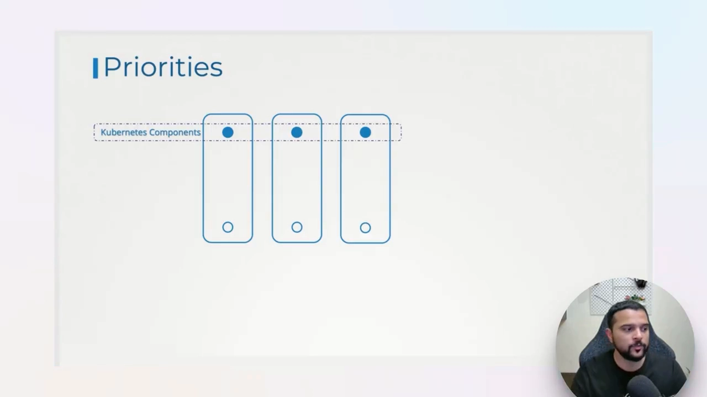
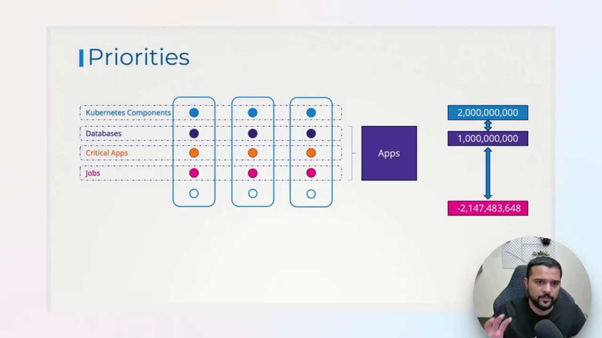
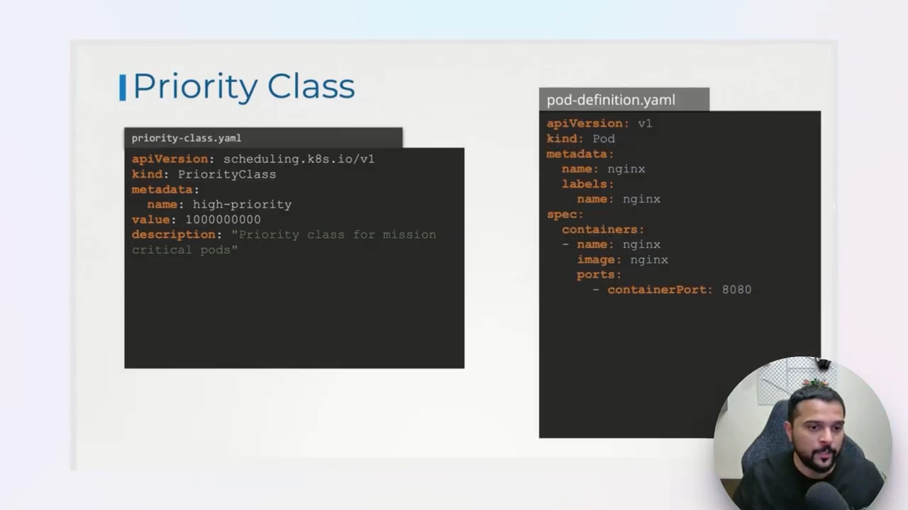
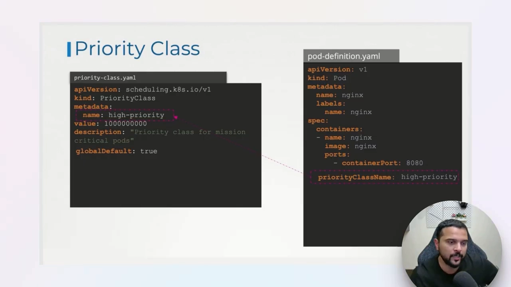
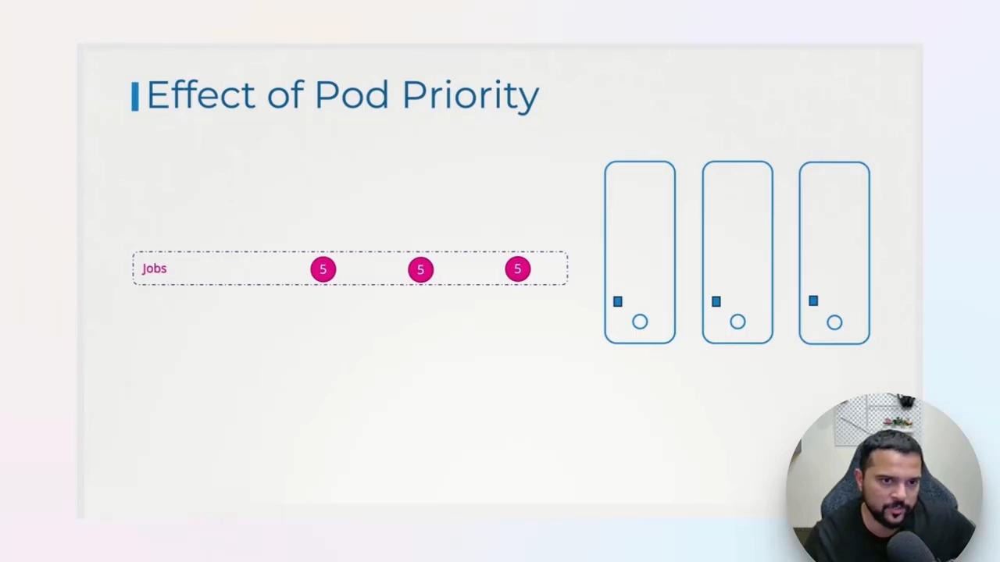
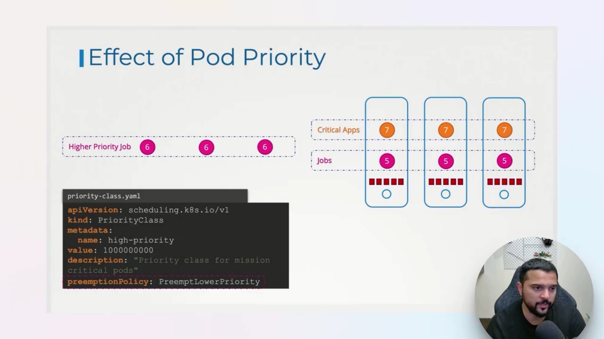
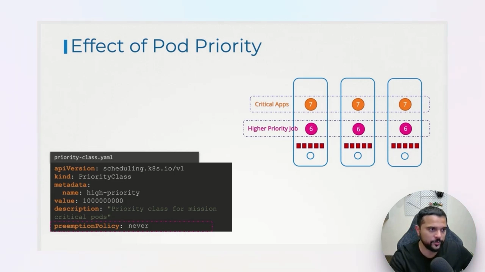

# 让关键负载永远先上车：Kubernetes 优先级与 PriorityClass

> 视频来源：[Kubernetes Priority Classes - The Secret to Efficient Resource Management](https://www.youtube.com/watch?v=PNRy_zodrXQ)（YouTube，KodeKloud）｜时长 12:06
>
> 一支「先建立直觉、再看代码」的短视频：先从集群里形形色色的负载讲起（Kubernetes 自身组件、数据库、关键应用、后台任务），说明为什么它们天生就有「三六九等」；再引入用**整数**表示优先级的做法，讲清两段特殊的取值范围；然后拆解 **PriorityClass** 对象（`value` / `globalDefault` / `preemptionPolicy` / `description`），以及 Pod 里如何用 `priorityClassName` 引用它；最后用一个「资源被占满」的小场景，把**调度排序**与**抢占（preemption）**一次讲透。文稿左栏为 YouTube 英文自动字幕，本文已翻译并重写为中文。

## 本讲要解决的核心问题（SCQA）

**背景**：一个 Kubernetes 集群上同时跑着各种各样的负载。除了我们自己部署的应用，**Kubernetes 自身的组件**（`kube-apiserver`、各种 controller 等）其实也是以 Pod / 容器的形式跑在同一个集群里的。[【跳转到 00:41】](https://www.youtube.com/watch?v=PNRy_zodrXQ&t=41)

**冲突**：这些负载的**重要程度并不一样**。数据库、关键应用不能随便被影响；而后台任务、定时任务往往一天只跑一次、什么时候跑都行。可集群的资源是有限的——一旦资源紧张，**谁该优先被满足、谁该给谁让路**？尤其重要的是：如果 `kube-apiserver` 或 `controller-manager` 因为资源被挤占而出问题，**整个集群上跑的应用都会受连带影响**。[【跳转到 01:36】](https://www.youtube.com/watch?v=PNRy_zodrXQ&t=96)

**疑问**：Kubernetes 用什么机制来表达「这个负载比那个更重要」，并且在资源不够时保证重要负载仍能挤进去运行？

**回答（中心思想）**：Kubernetes 用**一个整数（priority，优先级数字）**来表达重要程度——**数字越大越优先**。这个数字不是硬编码在每个 Pod 里的，而是通过一个叫 **PriorityClass（优先级类）**的对象声明，Pod 再用 `priorityClassName` 引用它。有了优先级之后：**调度器在排队时会让高优先级 Pod 先上车**；而当资源已经占满、高优先级 Pod 挤不进来时，它还可以按 `preemptionPolicy` **抢占（preempt，即驱逐）**更低优先级的 Pod 来腾位置。[【跳转到 02:26】](https://www.youtube.com/watch?v=PNRy_zodrXQ&t=146)

---

## 一、为什么负载天生就分等级：先看清集群里跑着谁

视频开门见山地指出，集群里同时存在**两类**东西，而它们的「重要性」从设计上就不同：

- **Kubernetes 组件本身**：`kube-apiserver`、各种 controller 等，最终都以容器的形式跑在集群里。它们是整个集群的地基——**地基不稳，地基上面所有应用都会跟着遭殃**。[【跳转到 00:46】](https://www.youtube.com/watch?v=PNRy_zodrXQ&t=46)
- **形形色色的工作负载**：
  - **有状态负载**，比如数据库（databases）；
  - **关键应用**（critical applications），始终在跑、不能中断；
  - **优先级较低的任务**，比如后台任务或定时任务（background / scheduled jobs），可能一天只跑一次，**什么时候跑并不重要**，只要在集群没压力的时候跑掉就行。



由此得到本讲最重要的一条前提，可以概括成一句话：

> **集群承载应用的能力，上限由 Kubernetes 组件自身的健康状况决定。** 所以系统组件必须始终拥有最高优先级——绝不能被集群上任何工作负载的资源争抢所影响。[【跳转到 01:11】](https://www.youtube.com/watch?v=PNRy_zodrXQ&t=71)

接着是数据库（永远不希望它被资源约束波及），再到关键应用。这就是 Kubernetes 里负载「分等级」的现实动机。

## 二、优先级就是一个整数：两段关键区间

表达上述「等级」的方式很朴素：**给负载一个数字**。[【跳转到 02:26】](https://www.youtube.com/watch?v=PNRy_zodrXQ&t=146)

- 你可以说某个东西的优先级是**十亿**，那它优先级就很高；
- 数字可以一路降到 **0**，再降到**负数**，最低大约到 **-20 亿**（minus 2 billion）。

这些数字大致被分成两段区间，各管各的：

| 区间 | 范围（约） | 给谁用 |
| --- | --- | --- |
| **应用区间（app space）** | `-2,000,000,000` ~ `+1,000,000,000` | 终端用户在集群上跑的普通应用 |
| **系统区间** | `+1,000,000,000` ~ `2,147,483,647`（另十亿左右） | **Kubernetes 自己的系统组件** |

也就是说，**系统区间被刻意留给了 Kubernetes 自身组件**，比应用区间整体更高，从而保证系统组件永远排在应用前面。[【跳转到 03:16】](https://www.youtube.com/watch?v=PNRy_zodrXQ&t=196)



## 三、PriorityClass：把「数字」与「名字」绑定

**PriorityClass 是什么**：它是一个集群级对象，作用是把一个**优先级数值**和一个**有意义的名字**绑定在一起，好让你用名字（而不是难记的大数字）来给负载分门别类。[【跳转到 04:38】](https://www.youtube.com/watch?v=PNRy_zodrXQ&t=278)

**先看默认有哪些**：执行 `kubectl get priorityclass`（简写 `get pc`），任何集群里默认已经有**两个** PriorityClass：

- `system-cluster-critical`
- `system-node-critical`

它们各自带一个很大的数值（落在系统区间里）。[【跳转到 04:11】](https://www.youtube.com/watch?v=PNRy_zodrXQ&t=251)


**自己造一个**：PriorityClass 的 YAML 由 `apiVersion`、`kind`、`metadata` 和 `value` 组成：[【跳转到 04:43】](https://www.youtube.com/watch?v=PNRy_zodrXQ&t=283)

- `apiVersion`：`scheduling.k8s.io/v1`
- `kind`：`PriorityClass`
- `metadata.name`：优先级类的名字，本例叫 `high-priority`
- `value`：优先级数值，本例给了 **10 亿**

```yaml
apiVersion: scheduling.k8s.io/v1
kind: PriorityClass
metadata:
  name: high-priority
value: 1000000000
description: "This priority class for mission critical pods"
```


**怎么用起来**：创建好 PriorityClass 后，在** Pod 的定义里**加一个 `priorityClassName` 字段，把它指向刚创建的优先级类名字即可——就这么简单。[【跳转到 05:28】](https://www.youtube.com/watch?v=PNRy_zodrXQ&t=328)

```yaml
# pod-definition.yaml（节选）
spec:
  containers:
  - name: nginx
    image: nginx
    ports:
    - containerPort: 8080
  priorityClassName: high-priority
```

`priorityClassName` 只写在 Pod 的 `spec` 里，不用去 Pod 里填那串大数字——**名字到数值的映射由 PriorityClass 内部完成**。所以你 `kubectl describe pod` 时，会看到 Pod 的 priority 已经被自动填成了 `1000000000`。[【跳转到 05:28】](https://www.youtube.com/watch?v=PNRy_zodrXQ&t=328)



## 四、没写 `priorityClassName` 会怎样：默认值与 `globalDefault`

前面说 Pod 要用 `priorityClassName` 引用优先级类。那如果一个 Pod **压根没写** `priorityClassName` 呢？[【跳转到 05:53】](https://www.youtube.com/watch?v=PNRy_zodrXQ&t=353)

**默认是 0**：所有没指定优先级类的 Pod，**默认优先级数值就是 `0`**。注意 0 是个「中间位置」——既可能有比它低（负数）的优先级类，也可能有成千上万、甚至十亿级的高优先级类。[【跳转到 06:18】](https://www.youtube.com/watch?v=PNRy_zodrXQ&t=378)

**想改默认值，用 `globalDefault`**：如果你希望「没写优先级类的 Pod」自动获得某个非零优先级（比如 1000 或 100 万），就创建一个优先级类（可以叫 `default` 之类），并把它的 **`globalDefault` 设为 `true`**。这样任何没有指定优先级类的 Pod，都会自动拿到这个类的数值。[【跳转到 07:08】](https://www.youtube.com/watch?v=PNRy_zodrXQ&t=428)

**全局只能有一个默认**：`globalDefault: true` 的优先级类**全集群只能有一个**——不能有多个类同时把 `globalDefault` 设为 `true`。[【跳转到 07:33】](https://www.youtube.com/watch?v=PNRy_zodrXQ&t=453)



## 五、有优先级之后，调度器怎么用：先高后低

接下来视频用一个具体场景说明优先级在**调度排序**上的效果。[【跳转到 07:58】](https://www.youtube.com/watch?v=PNRy_zodrXQ&t=478)

假设集群一开始**空空如也**：

1. 先来一个 `jobs` 负载，优先级 `5`。因为没有任何竞争，它直接被放下。
2. 接着来一个 `critical-apps` 负载，优先级 `7`。

现在集群上有了两个优先级不同的负载：`critical-apps` 是 7，`jobs` 更低、是 5。

**如果这两个负载同时创建**、需要调度器决定放置顺序，调度器会**永远先安排优先级更高的那个**——也就是 `critical-apps` 先上，随后才是低优先级的 `jobs`。假设这两个放下之后，**集群资源已经被占满**。[【跳转到 08:29】](https://www.youtube.com/watch?v=PNRy_zodrXQ&t=509)



## 六、资源被占满后：抢占（preemption）

现在关键场景来了：资源已满，此时**又来了一个负载**——它也是一个 job，但**优先级比现有的 job 更高**（数值 `6`，比现有的 `5` 高）。会发生什么？[【跳转到 08:54】](https://www.youtube.com/watch?v=PNRy_zodrXQ&t=534)

这就由优先级类上的**另一个属性 `preemptionPolicy`（抢占策略）**决定。它定义了「一个负载为了挤进来，可以对别的负载做什么」：[【跳转到 09:44】](https://www.youtube.com/watch?v=PNRy_zodrXQ&t=584)

- **默认值 `PreemptLowerPriority`**：允许**杀掉（驱逐）集群上更低的优先级负载**。本例中，这个更高优先级的 job 一进来，就会**抢占并杀掉**那个低优先级的 job，然后**占用它腾出来的资源**。
- **`Never`**：不希望一个负载抢占另一个负载时设置它。若本例中的抢占策略是 `Never`，这个高优先级 job 就**留在原地等待**，直到那个低优先级 job **自己自然结束**、资源被释放后再调度。





---

## 小结

- **优先级 = 一个整数**，越大越优先；它存在的意义是：在资源有限的集群里，让重要的负载（首先是 Kubernetes 自身组件）能够优先、甚至优先抢占。
- **两段区间**：应用负载用 `-2,000,000,000 ~ +1,000,000,000`；系统组件用更高的一段（`+1,000,000,000 ~ 2,147,483,647`）。这是为了让系统组件永远排在应用前面。
- **PriorityClass 是「名字 ↔ 数值」的绑定**：`apiVersion: scheduling.k8s.io/v1`、`kind: PriorityClass`、`metadata.name`、必填的 `value`，外加可选的 `globalDefault` / `preemptionPolicy` / `description`。
- **引用方式**：Pod 在 `spec.priorityClassName` 里写优先级类名字；数值由类内部映射，`describe pod` 可看到映射后的 priority。
- **没写就是 0**；想改默认，用一个 `globalDefault: true` 的类，**全集群只允许一个**。
- **调度排序**：多个负载争抢时，调度器先放高优先级、再放低优先级。
- **抢占**：资源满时，`preemptionPolicy: PreemptLowerPriority`（默认）允许高优先级负载驱逐低优先级负载；`Never` 则只等待、不驱逐。

## 关键术语速查

| 术语 | 一句话解释 |
| --- | --- |
| Priority（优先级） | 赋予负载的一个整数，越大越优先，默认 0。 |
| PriorityClass | 集群级对象，把一个优先级**数值**和**名字**绑定，供 Pod 按名引用。 |
| `priorityClassName` | Pod `spec` 里的字段，指向所使用的 PriorityClass 名字。 |
| `value` | PriorityClass 的必填字段，即优先级数值（整数）。 |
| `globalDefault` | 设为 `true` 时成为「未指定优先级类的 Pod」的默认；全集群只能有一个。 |
| `preemptionPolicy` | 抢占策略：`PreemptLowerPriority`（默认，可驱逐低优先级）/ `Never`（不驱逐、只等待）。 |
| 抢占（preemption） | 高优先级 Pod 挤不进来时，驱逐更低优先级的 Pod 以腾出资源。 |
| app space / 系统区间 | 优先级的两个取值段：应用段与（更高的）系统组件段。 |
| `system-cluster-critical` / `system-node-critical` | 集群默认自带的两个系统级 PriorityClass。 |
