# Kubernetes 调度框架与调度器源码剖析：一个 Pod 是怎么被挑到"最优节点"的

## 本讲要解决的核心问题（SCQA）

**背景**：你已经知道 Kubernetes 里"创建一个 Pod"就是写一份 YAML 交给 `kubectl`，然后 Pod 会跑到某个节点上运行。平时你关心的是镜像、资源、探针，很少去管"它为什么落在这台机器上"。

**冲突**：但当你需要排查"Pod 一直 Pending""为什么没调度到那台大内存机器""怎么加一条自己的调度规则"时，光会写 YAML 就不够了。调度器内部的逻辑几乎全被抽象成了 **插件**，而插件又挂在一套叫做 **调度框架（Scheduling Framework）** 的骨架上——不把这套骨架看清楚，你连"插件是什么时候被调用的"都找不到入口。

**疑问**：一个新建的 Pod，从被 `kubectl` 创建，到最终确定落在哪台节点上，中间到底发生了什么？调度器的源码是怎么组织的？那套"调度框架"又到底长什么样？

**回答（中心思想）**：调度器本质上只做一件事——**为尚未分配节点的 Pod，从当前集群的可选节点里挑出一个最优节点，然后把"Pod ↔ 节点"的绑定关系写回 etcd**。为了把这件事做好，它把流程拆成 **调度周期（选节点，可扩展）** 与 **绑定周期（写回 etcd，不可改）** 两段，并在"选节点"这一段上开出一排 **扩展点**（QueueSort、PreFilter、Filter、PreScore、Score、Bind 等），每个扩展点下面挂的都是一批 **插件**。整个调度器就是"一个队列 + 一个循环 + 一堆插件"的组合。下面我们沿着"数据从哪来 → 代码长什么样 → 框架怎么分工 → 插件怎么干活 → 怎么调试 → watch 怎么实现"的顺序，把这台机器一层层拆开。

> 本讲基于 B 站视频《kubernetes 源码剖析专题 - scheduler》（BV1V24y1G7Ak，约 117 分钟，源码版本 1.25）整理。视频以源码走读为主，本文保留了其中的图解与关键结论。

---

## 一、调度器只做一件事：选一个最优节点，把绑定写回 etcd

调度器在 Kubernetes 里的官方定义只有一句话：**把新创建的 Pod 放置到合适的节点上**（[【跳转到 03:12】](https://www.bilibili.com/video/BV1V24y1G7Ak/?t=192)）。比如一个集群有十个节点，你创建一个 Pod，它应该放到哪个节点上运行——就是这句话。

整个数据流围绕下面这张图展开（[【跳转到 03:37】](https://www.bilibili.com/video/BV1V24y1G7Ak/?t=217)）：

1. 用户通过 `kubectl` 创建 Pod，请求先到 **kube-apiserver**（集群的"网关"）；
2. apiserver 把这份数据写入 **etcd**，这一步叫 **save**；
3. 写入之后，apiserver 通过通知机制 **通知调度器**；
4. 调度器 **过滤** 出那些还没有分配节点的 Pod（它们的 `nodeName` 是空的）；
5. 调度器借助框架，算出当前集群里哪些节点适合这个 Pod，通过"**预选 + 优选**"选出一个节点；
6. 调度器把这个 Pod 和选中的 node 做 **绑定（bind）**，再 **update 回 etcd**。

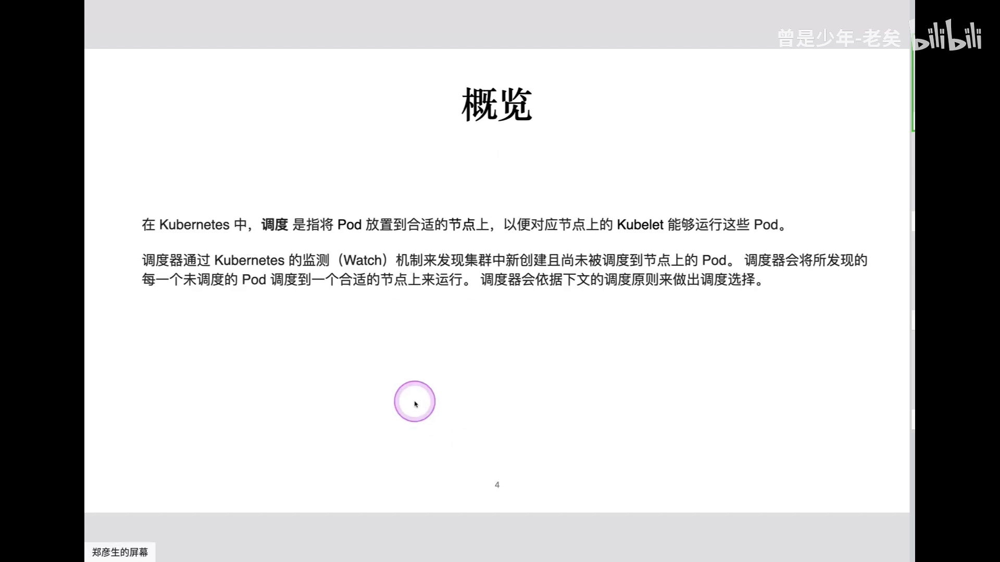

**关键结论：调度器只做两件事——"选节点"和"写回绑定关系"。** 它不负责给 Pod 分配 IP、不负责改 Pod 的状态字段、不负责拉起容器（[【跳转到 05:52】](https://www.bilibili.com/video/BV1V24y1G7Ak/?t=352)）。用一句话概括很简单，但实现起来是上万行代码。

那么，为什么你在一个终端里 `watch` 一个 Pod，会看到 **一大串** 变化事件，而不仅仅是"创建 + 调度"两条？因为 `save`（用户 → apiserver → etcd）和 `update`（调度器写回绑定）只是最开始的两条；后面第三、四、五条通常是 **kubelet 上报的信息**，比如给 Pod 分配了 IP、Pod 进入 Pending 还是 Success。每有一个组件动作，就会 `update` 一次 etcd，所以一个小 Pod 也可能产生五六个事件（[【跳转到 10:56】](https://www.bilibili.com/video/BV1V24y1G7Ak/?t=1056)、[【跳转到 11:43】](https://www.bilibili.com/video/BV1V24y1G7Ak/?t=1143)）。视频里用一个终端 `get pod -w`、另一个终端创建 Pod 做了演示：watch 端会依次吐出好几条轻量级变更事件。

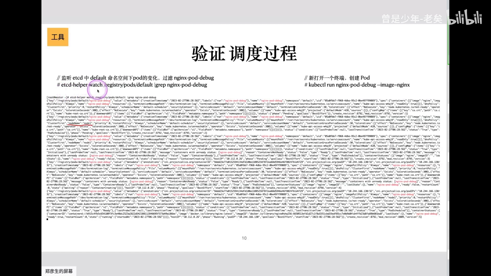

细看这些事件里的 JSON，会发现两个字段每次都在变（[【跳转到 09:54】](https://www.bilibili.com/video/BV1V24y1G7Ak/?t=994)）：

- 一个是 `resourceVersion`：每变更一次就加一，相当于一个全局唯一、单调递增的 id（作用类似 MySQL 的自增 id，只为标识"这是第几版"）；
- 另一个是第二条事件里多出来的 `nodeName`：这正是调度器"选定节点"这一动作在数据上的体现。

---

## 二、数据在 etcd 里长什么样：KV 路径 + protobuf

很多初学者都好奇：K8s 的数据都存在 etcd 里，那它到底长什么样？是不是像 MySQL 的一张表？

用 `etcdctl`（etcd 的官方客户端工具）去看就能明白。注意两点前提（[【跳转到 04:27】](https://www.bilibili.com/video/BV1V24y1G7Ak/?t=427)）：K8s 依赖 etcd 的 **v3** 版本，所以环境变量里必须指定 v3；etcd 和 apiserver 之间是双向认证，客户端必须带证书才能访问。

用 `etcdctl get` 加前缀过滤（比如 `--prefix=/registry/pods`）就能看到所有 Pod 的 key。它的 key 是一个类似 OS 路径的字符串（[【跳转到 05:41】](https://www.bilibili.com/video/BV1V24y1G7Ak/?t=581)）：

```
/registry/pods/<namespace>/<pod-name>
```

前缀 `/registry/pods` 是固定的（自建集群时固定；云厂商托管的集群前缀会带机器/集群标识，后面部分都一样）；真正唯一的 key 是 `<namespace>/<pod-name>`。**etcd 是 KV 存储：key 是这个路径，value 才是整个 Pod 的内容。**

但直接看 value 是**一堆乱码**。原因不是加密，而是 etcd 里存的是 **protobuf**（一种紧凑的二进制序列化格式），不是 JSON、也不是 YAML（[【跳转到 10:31】](https://www.bilibili.com/video/BV1V24y1G7Ak/?t=631)）。protobuf 比文本格式更小、传输和序列化都更快，所以研发里常用它。要把它变成人能读的 JSON，必须经过 **K8s 的 schema 反序列化**。

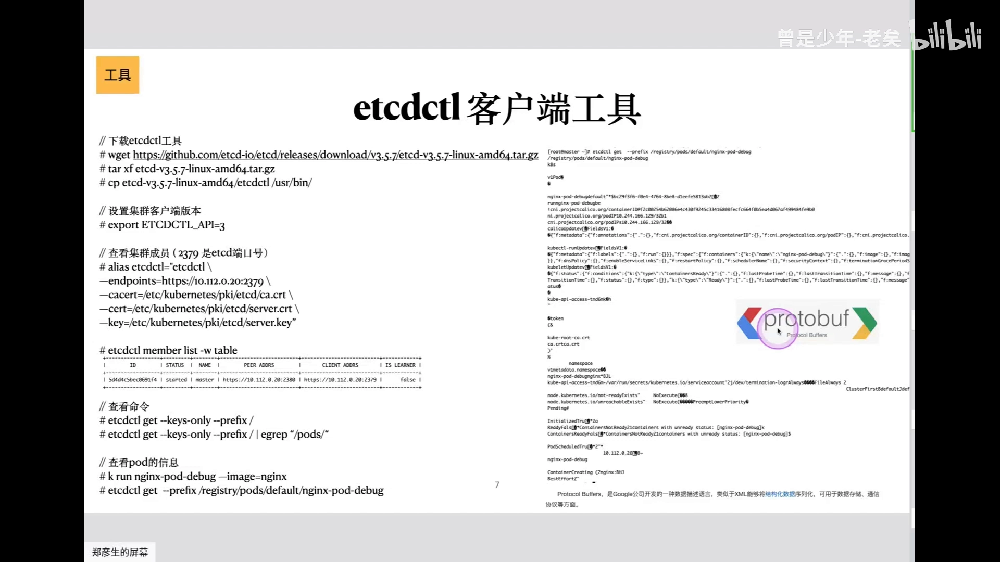

有一个常见的开源小工具，就是在 etcd 客户端之上封了一层：它连上 etcd，`get` 到 key 对应的 value（那段乱码），再用 K8s 的 schema 反序列化、打印成 JSON（[【跳转到 12:31】](https://www.bilibili.com/video/BV1V24y1G7Ak/?t=751)）。它核心的 `get` 源码很简单——建立连接、查询 key、拿回 value、反序列化。这也是理解"数据如何落盘"最直观的方式。

---

## 三、源码地图：cmd 是入口，pkg/scheduler 是核心，插件定义调度逻辑

打开调度器源码，目录结构其实很清晰（[【跳转到 20:29】](https://www.bilibili.com/video/BV1V24y1G7Ak/?t=1229)）：

- **`cmd/`**：每个组件的入口。`cmd/kube-apiserver`、`cmd/kube-proxy`、`cmd/kube-controller-manager`、`cmd/kube-scheduler` 都在这里。它相当于 Go 编译二进制时的"主函数入口"，命令行参数都在这里定义，但**几乎不写逻辑**。
- **`pkg/scheduler/`**：核心逻辑。看调度器代码，看这个目录就够了。
- **插件目录**：真正"怎么选节点、怎么过滤、怎么打分"的逻辑，全都在插件里定义。

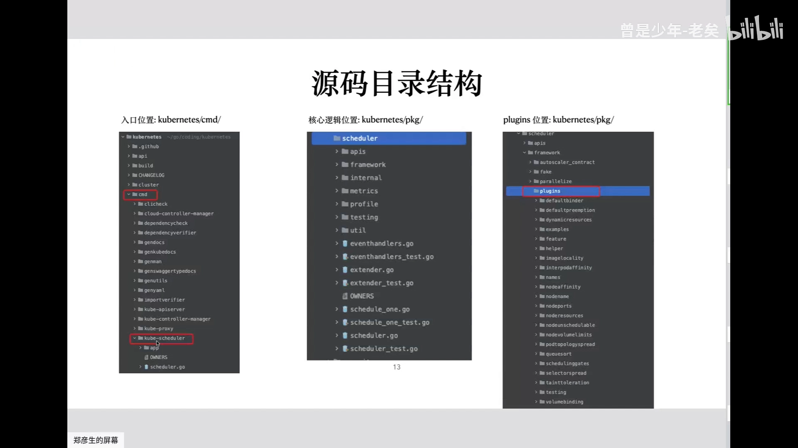

一句话记忆：**`cmd` 是门面，`pkg` 是大脑，插件是决策规则。**

---

## 四、骨架是"生产者—消费者"：一个队列 + 单次调度循环

调度器整个进程可以想成一个二进制命令。它一执行，会启动 **两个线程**（[【跳转到 22:14】](https://www.bilibili.com/video/BV1V24y1G7Ak/?t=1334)）：

- 第一个线程：启动并管理 **调度队列**；
- 第二个线程：反复执行 **单次调度 `scheduleOne`**，从队列里消费 Pod。

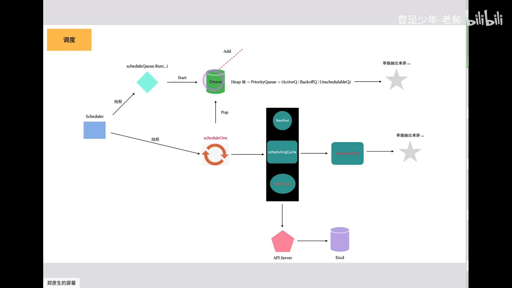

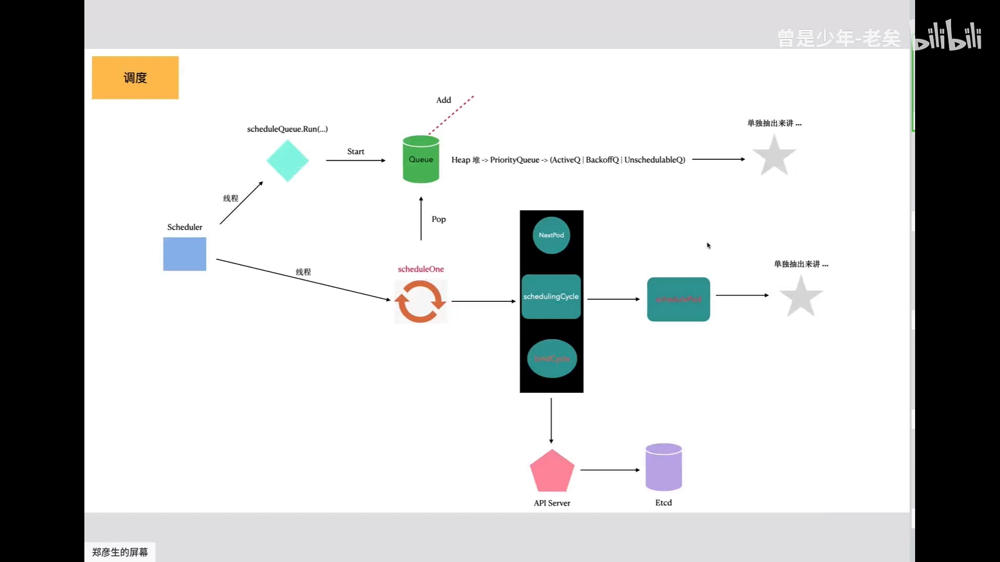

它遵循 K8s 里非常普遍的 **生产者—消费者模型**：每当你 `kubectl apply` 一个 Pod，这个 Pod **不会立刻被调度**，而是先被塞进一个队列；消费线程每次从队列里 **弹出一个** Pod，走一遍完整的"调度生命周期"（[【跳转到 23:34】](https://www.bilibili.com/video/BV1V24y1G7Ak/?t=1414)）。据视频作者说，K8s 里类似的"自己实现的生产者—消费者队列"至少还有六七个（apiserver、controller-manager 等都用）。

一次 `scheduleOne` 只做三件事（[【跳转到 36:15】](https://www.bilibili.com/video/BV1V24y1G7Ak/?t=2215)）：

1. **从队列取一个 Pod**（`nextPod`）；
2. **为它选出最合适的节点**（最复杂、最核心的那一步）；
3. **bind：把 Pod 和节点绑定**（回写 etcd）。

**为什么弹出是串行的（每次只弹一个），而计算是并行的？** 这是调度器一个容易被忽略的设计（[【跳转到 34:40】](https://www.bilibili.com/video/BV1V24y1G7Ak/?t=2080)、[【跳转到 35:38】](https://www.bilibili.com/video/BV1V24y1G7Ak/?t=2138)）：

- 如果同时弹出多个 Pod 并行计算，它们可能都会往同一个节点上落，等其中一个被调度上去后，另一个其实已经"不合适"了，必须整体重算；所以**取数只能一次一个**；
- 但在为**当前这一个** Pod 评估**所有节点**时，是**并行**的（视频里提到默认会开 **16 个线程**一起算），因为这是"对一个 Pod × N 个节点"的批量打分，互不影响。

### 4.1 队列里其实有三个子队列

`q` 是一个大类，里面包含 **三个队列**（[【跳转到 31:30】](https://www.bilibili.com/video/BV1V24y1G7Ak/?t=1890)）：

- **activeQ**（活跃队列）：只有它里面的 Pod 才会被消费、被调度。它用 **堆（heap）** 实现，因此带优先级；
- **backOffQ**（退避队列）：调度失败、处于 back off 状态的 Pod 放这里；
- **unschedulableQ**（不可调度队列）：被判定为当前不可调度的 Pod 放这里。

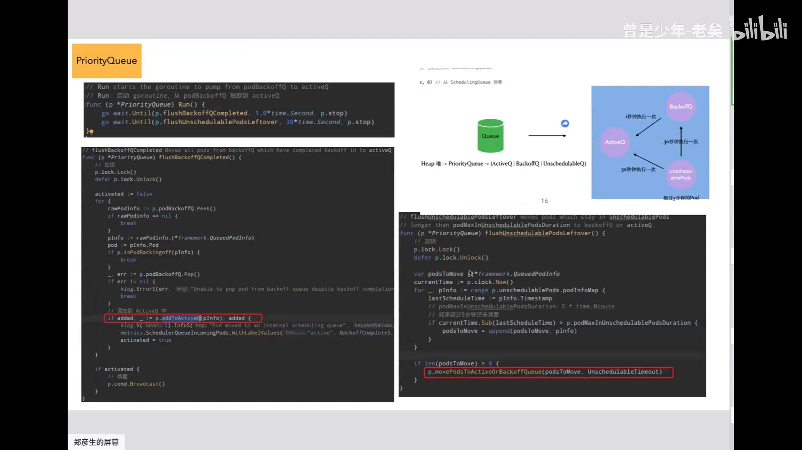

队列弹出时的排序同时看两个因素：**谁先进**，以及 **Pod 的优先级**（`spec.priority`）。优先级高者优先被取出；若优先级相同，就近似"先进先出"（[【跳转到 26:34】](https://www.bilibili.com/video/BV1V24y1G7Ak/?t=1594)）。默认示例里 Pod 的优先级都是 0，所以看不出差别——只有系统级 Pod 的优先级才会更高。

另外两个队列需要有机制"把 Pod 送回来"，否则一旦失败就永远出不来了（[【跳转到 31:55】](https://www.bilibili.com/video/BV1V24y1G7Ak/?t=1915)）：

- 一个**定时刷新**机制，每 **30 秒**轮询一次，把 backOffQ 和 unschedulableQ 里的 Pod 刷回 activeQ；
- 对 **unschedulableQ** 还有额外限制：只有当一个 Pod 的"最后一次调度时间"距离现在 **超过 5 分钟**，才允许被重新调度（这个 5 分钟在代码里写死）。

这就是为什么"改了个标签后 Pod 不会立刻被重新调度"——它至少要等满 5 分钟（[【跳转到 52:24】](https://www.bilibili.com/video/BV1V24y1G7Ak/?t=5224)）。

---

## 五、调度框架：把"选节点"拆成两阶段 + 一排扩展点

调度器历史上经过两次改版，**当前版本是依赖下面这套"调度框架"来实现的**：整个调度器依托于几十个插件工作（[【跳转到 01:57】](https://www.bilibili.com/video/BV1V24y1G7Ak/?t=117)、[【跳转到 51:15】](https://www.bilibili.com/video/BV1V24y1G7Ak/?t=3075)）。所有 Pod 的 **过滤、打分、绑定，乃至抢占，都是通过这套框架完成的**。

框架把一次调度的上下文分成 **两个阶段**：

| 阶段 | 做什么 | 能否改动 |
| :--- | :--- | :--- |
| **调度周期（Scheduling Cycle）** | 选出一个节点 | 可以增加、减少、屏蔽、删除插件 |
| **绑定周期（Binding Cycle）** | 把绑定关系写回 etcd | 默认不可改（绑定逻辑固定） |

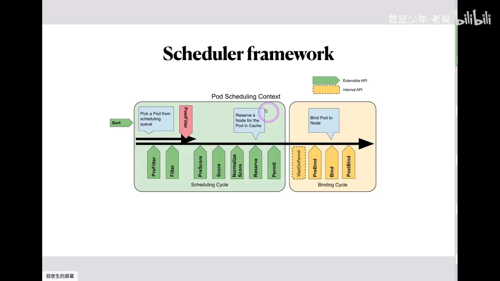

一个 Pod 进入框架后的主流程是：先经过 **排序（QueueSort）**，然后从队列里取出 Pod，沿着扩展点 **从第一个走到最后一个**，最终选出一个节点，再写回 etcd（[【跳转到 51:40】](https://www.bilibili.com/video/BV1V24y1G7Ak/?t=3100)）。最复杂、最关键的就是"选节点"这一段——如果只记两个词，就是 **filter（过滤）** 和 **score（打分）**。

框架里一排 **扩展点（extension point）**，每个扩展点下面挂一批 **插件**（[【跳转到 52:25】](https://www.bilibili.com/video/BV1V24y1G7Ak/?t=3145)、[【跳转到 53:15】](https://www.bilibili.com/video/BV1V24y1G7Ak/?t=3175)）：

- **QueueSort**：Pod 进入队列时排序——按"谁先进""优先级高低"决定出队顺序；
- **PreFilter**：过滤之前的预处理（类似 `preStop` 这种钩子，做过滤前的准备）；
- **Filter**：过滤掉不合适的节点，剩下的视为合适；
- **PreScore / Score**：对剩下的节点打分，选分值最高者；
- **Bind**：把 Pod 与节点绑定并写回 etcd（旁白还提到过滤后、打分后也有对应的钩子）。

这套设计的最大好处是 **解耦**：所有过滤、打分逻辑都以插件形式实现，**不和主流程代码耦合**，因此"随时加插件、随时扩展点"都非常方便（[【跳转到 54:20】](https://www.bilibili.com/video/BV1V24y1G7Ak/?t=3260)）。框架核心就两个目录：承载插件的 `pkg`，与承载运行时的 `runtime`。

一个直观感受：**光"过滤"这一个扩展点下面就有约 15 个插件**，一个 Pod 进来后要把这 15 个插件全部跑一遍；比如第一个插件会判断节点有没有被打上"不可调度"标签（打了就直接过滤），第二个是 `nodeName` 插件，第四个是 `nodePort` 插件（如果 Pod 要用 8080、而该节点上 8080 已被占用，就被过滤掉）。后面还有节点亲和性、污点等插件（[【跳转到 54:45】](https://www.bilibili.com/video/BV1V24y1G7Ak/?t=3285)）。

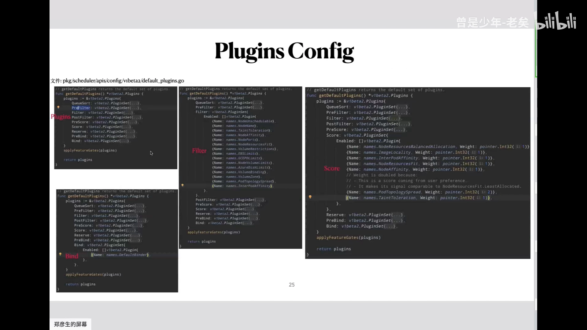

**打分插件还带"权重"**：最终分 = 插件打分 × 权重（[【跳转到 56:25】](https://www.bilibili.com/video/BV1V24y1G7Ak/?t=3385)）。在示例里，绝大多数打分插件权重为 1，**只有一个插件权重是 2**——就是"拓扑分布（Pod Topology Spread）"，因此它的影响最大，倾向于让 Pod 均匀分散到不同拓扑域。

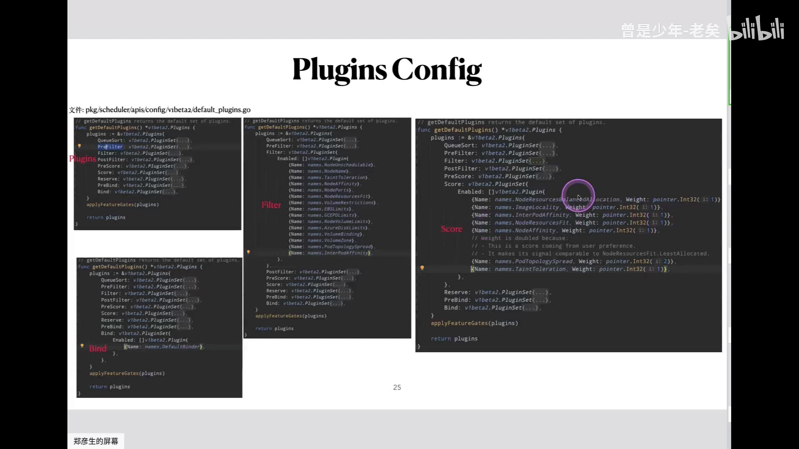

---

## 六、过滤与打分怎么落地：两个插件的例子

官方把"选节点"概括成 **两个阶段：预选（过滤）+ 优选（打分）**（[【跳转到 38:44】](https://www.bilibili.com/video/BV1V24y1G7Ak/?t=2324)）：先从集群里过滤掉不合适的节点，剩下都是合适的；再给剩下的节点打分，选分值最高者。**如果两个节点分值相同，就随机选一个**。

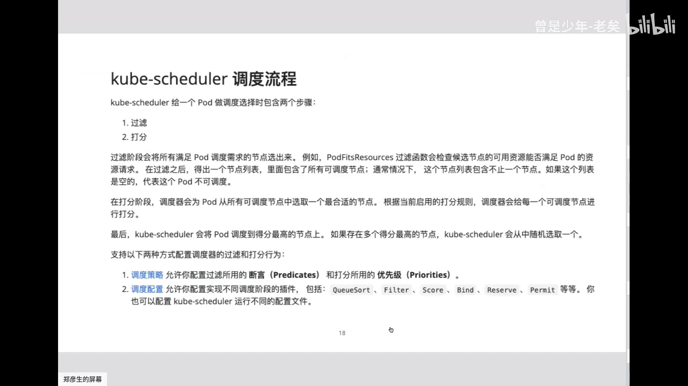

### 6.1 过滤插件示例：nodeName

拿第二个过滤插件 `nodeName` 看就很清楚（[【跳转到 57:10】](https://www.bilibili.com/video/BV1V24y1G7Ak/?t=3430)）：它接收一个 Pod 和一批节点，判断逻辑是——**如果 Pod 没有指定 `nodeName`（`nodeName` 为空），或 Pod 的 `nodeName` 正好等于这个节点的名字，就算合适；否则过滤掉**。

这对应了两种使用方式：一种是不指定 `nodeName`（交给调度器挑）；另一种是在 YAML 里直接写死 `nodeName`（"我就要调度到这个节点上"）。过滤插件代码普遍很简单，打分插件才复杂。

### 6.2 打分插件示例：镜像打分（NodeImage）

打分的逻辑复杂得多，视频里以 **镜像打分插件** 为例（[【跳转到 61:36】](https://www.bilibili.com/video/BV1V24y1G7Ak/?t=3696)）：创建一个 Pod 时它可能依赖一两个镜像，调度器会判断"当前节点上有没有这个镜像"。

- **节点上已有该镜像 → 分数高**：因为镜像是**分层**的，本地已有的层不用重复拉取，镜像越大往往代表缓存的层越多，需要拉取的越少；
- 它**不区分版本，只区分镜像**（比如都算 nginx 这个镜像，而不是它缓存的全部镜像）；
- 一个 Pod 里有多个容器时，会按各容器镜像大小的**和**来计算（因为一个 Pod 只能落到一个节点上，不能分开）；
- 它参考 Docker Hub 的分布把 **小于 23MB 视为最小值、100MB 为上限**：所以如果你的镜像很小（比如示例里的小 nginx），这个插件给的分就是 **0 分**。

### 6.3 一个常被误解的点：并不是拿全部节点来算

很多人（包括视频作者）一开始以为调度器是拿整个集群的节点去过滤打分，其实不是（[【跳转到 44:19】](https://www.bilibili.com/video/BV1V24y1G7Ak/?t=2659)）：节点很多时，全量过滤打分性能太低，所以框架有 **`percentageOfNodesToScore`（参与打分的节点百分比）** 的机制。视频作者从代码里反推的规则是：

- 节点数 **小于 100**：直接用全部节点（量小，无所谓）；
- 节点数在 **100 ~ 5750** 之间：取节点总数的 **5%**；
- 节点数 **大于 5750**：用一个公式（他反推为与节点数相关的衰减式），结果也落在 5% 左右。

也就是说，一个 Pod 一次调度往往只评估集群的 **一小部分节点**。这也解释了"为什么社区常说单集群节点数最好别超过 5000"——和这个机制相关。

---

## 七、Pod 是怎么进队列的：Informer 注册监听 + 事件过滤

前面讲了"Pod 从队列弹出"，那 **Pod 又是怎么进队列的**？答案是调度器启动时做的一套 **注册监听**（[【跳转到 71:00】](https://www.bilibili.com/video/BV1V24y1G7Ak/?t=4260)）。

调度器启动时会把自己的监听注册到一组 **informer** 上，监听的对象包括 **Pod、node、PV、PVC、CSI** 等资源。可以把它理解成 `watch`：只要这些资源有变化，调度器就会收到通知。

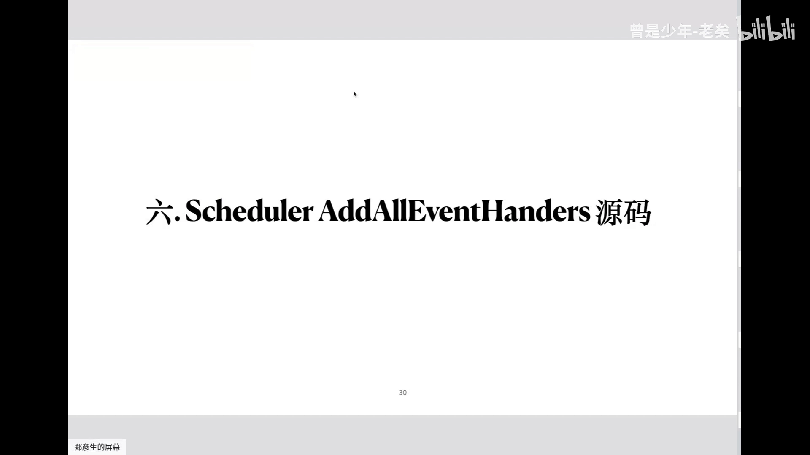

以"创建一个 Pod"为例，事件到来后会分两种情况（[【跳转到 72:35】](https://www.bilibili.com/video/BV1V24y1G7Ak/?t=4355)）：

- 如果这个 Pod **已经指定了 `nodeName`** → 直接进 **cache（本地缓存）**，不需要调度；
- 如果 **没有指定 `nodeName`** → 进入 **调度队列**，等待被 `scheduleOne` 消费。

进入队列前还有两道 **过滤条件**（[【跳转到 80:34】](https://www.bilibili.com/video/BV1V24y1G7Ak/?t=4834)）：① 该 Pod 的 `nodeName` 必须为空（没被指定）；② 该 Pod 的 `schedulerName` 必须是当前调度器（默认是 `default-scheduler`）。两条都满足，才会把它加进队列。

对于 **node / PV / PVC / CSI 变更** 这类事件（走的是另一条路径），作用是：当某个 Pod 之前因为"依赖的资源没就绪"而卡在 backOffQ / unschedulableQ 时，**资源变更会触发把这些 Pod 刷回 activeQ**，让它们重新获得被调度的机会（[【跳转到 74:10】](https://www.bilibili.com/video/BV1V24y1G7Ak/?t=4460)）。

> 一个历史细节：早期版本里所有组件都直接 `watch` etcd，后来改为统一 `watch` **kube-apiserver**（由 apiserver 去 watch etcd）。原因是——如果每个组件、每个资源都直接 watch etcd，etcd 会不堪重负、性能显著下降；让 apiserver 做"中间层"能大幅缓解（[【跳转到 74:45】](https://www.bilibili.com/video/BV1V24y1G7Ak/?t=4485)）。

---

## 八、怎么调试调度器：从静态 Pod 到加日志倒推

### 8.1 先要能看到 master

在云厂商托管集群里，master 是托管的，你看不到、也调不了（[【跳转到 88:00】](https://www.bilibili.com/video/BV1V24y1G7Ak/?t=5280)）。所以调试的第一步，是用 kubeadm 搭一套 **非托管** 的集群，能登录到 master 节点。

控制面组件（etcd、kube-apiserver、kube-controller-manager、kube-scheduler）**由 kubelet 以"静态 Pod"的方式启动**（[【跳转到 90:26】](https://www.bilibili.com/video/BV1V24y1G7Ak/?t=5426)）：kubelet 监听一个清单目录（如 `/etc/kubernetes/manifests`），把里面的 YAML 全部拉起；删掉其中一个文件，对应服务就会立刻消失。

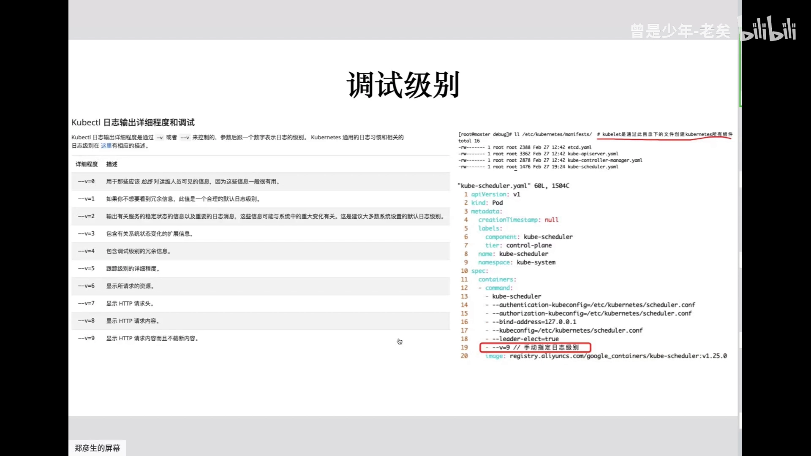

### 8.2 调日志级别：-v 4 与 -v 9

`kubectl` 的 `-v` 能看到不同等级的日志，最常用的是 **`-v 4`（看四级日志）** 和 **`-v 9`（看所有 API 请求）**（[【跳转到 89:16】](https://www.bilibili.com/video/BV1V24y1G7Ak/?t=5356)）：

- 调试调度器：在它的静态 Pod YAML 里把日志级别改成 `-v 4`（最合适）或 `-v 9`（信息太多，需加过滤）；
- 追踪调度过程：启动调度器时指定 `-v`，再去创建 Pod，就能把"入队 → 过滤 → 打分 → 绑定"这一串日志和前面讲的流程一一对应起来（比如日志里能看到 event handle、`defaultBinder`、cache、`scheduleOne` 等），把它们"串起来"（[【跳转到 92:00】](https://www.bilibili.com/video/BV1V24y1G7Ak/?t=5520)）。

### 8.3 怎么"加日志倒推"插件注册

视频作者遇到一个经典困惑：**插件到底是在什么时候注册进去的？** 只看调用看不到注册，于是他"反推"：自己编一个二进制，在 **PreFilter / Filter / Score** 这些位置 **打印当前插件的名字**（[【跳转到 94:48】](https://www.bilibili.com/video/BV1V24y1G7Ak/?t=5648)）。

结果果然符合预期：**每个扩展点下面都是一个 for 循环，遍历执行该扩展点下的所有插件**。以样本日志为例（[【跳转到 97:20】](https://www.bilibili.com/video/BV1V24y1G7Ak/?t=5860)）：

- 过滤时 10 多个插件全部执行一遍，且是 **并发（16 个线程）** 跑的；
- 打分时能看到各节点得分：示例里一个节点 74 分、另一个 0 分（小镜像触发 0 分），总分分别是 **663 和 678**，最终选了 **678 分的那个节点**。

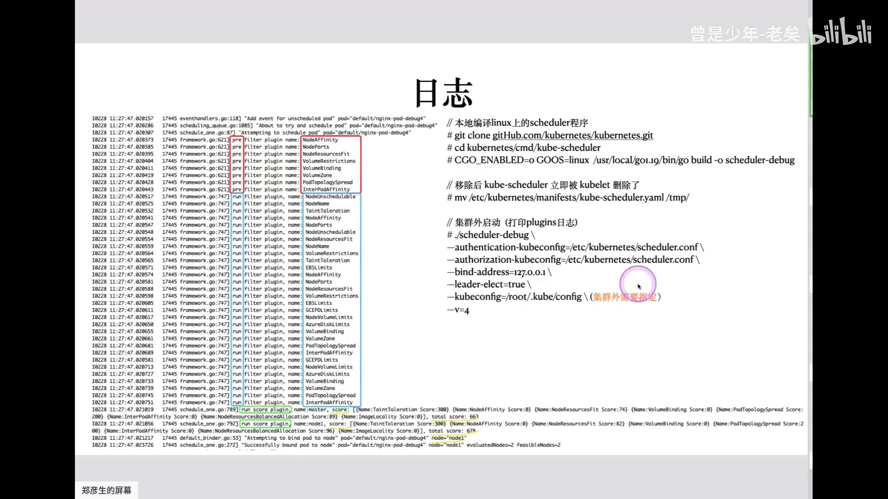

### 8.4 编译并在本地运行

流程是（[【跳转到 95:35】](https://www.bilibili.com/video/BV1V24y1G7Ak/?t=5735)）：

1. 拉下 K8s 源码，进入 `cmd/kube-scheduler`，用 `GOOS=linux` 编译成二进制；
2. **先把对应的静态 Pod YAML 删掉/移走**（否则端口冲突，起不来）；
3. 直接用编译出的二进制启动，加上 `-v 4` 等参数；
4. 有一个坑：容器里运行时能直接拿到机器的 `kubeconfig`，而**本地运行时必须额外用参数指定 kubeconfig 文件**，否则连不上 apiserver、启动报错。

视频作者还提示：不一定每次都要重新编译，`go run` 直接跑也可以，速度很快（几十秒）。

---

## 九、watch 的底层：短链接 vs 长连接、HTTP/1.1 分段传输 vs WebSocket

最后回到大家天天用的 `kubectl get pod -w`——它的底层是怎么实现的？（[【跳转到 100:09】](https://www.bilibili.com/video/BV1V24y1G7Ak/?t=6009)）

### 9.1 一次 `-w` 其实是"先 get，再 watch"

执行 `kubectl get pod <name> -w`，会产生 **两套请求**（[【跳转到 100:34】](https://www.bilibili.com/video/BV1V24y1G7Ak/?t=6034)）：

1. 先做一次普通的 **get**：把 Pod 当前信息拿回来（所以 watch 一开始会先打印一次当前状态）；
2. 再做一次 **watch**：带 `watch=true` 参数，建立一个 **长连接**，之后有变化就持续推送。

两种请求的 **URL 也不同**：普通 get 的 key 直接是具体资源；watch 的 key 通常指向"目录"（资源集合），并加上 `watch=true`。

### 9.2 长连接的实现：不是 WebSocket，而是 HTTP/1.1 分段传输

直觉上"持续推送"会想到 **WebSocket**，但 `kubectl` 的 watch **不是** WebSocket，而是基于 **HTTP/1.1 的分段传输（chunked transfer）**（[【跳转到 101:42】](https://www.bilibili.com/video/BV1V24y1G7Ak/?t=6142)）：

- 服务端在响应里加上 `Transfer-Encoding: chunked` 响应头；
- 客户端看到这个头就明白：**这个连接不要断**，你有消息就推给我、没消息我就阻塞等待，直到一方主动断开；
- 所以它本质是"客户端只接收、不需要双向交付"的单向推送，比 WebSocket 更轻量——WebSocket 更多用于 `kubectl exec` 这种需要双向交互的场景。

> 一个小技巧：想用 `curl` 手动 watch（绕过证书），可以先在本地起一个 `kube-proxy` 把它监听出来，再把 `curl` 指向它，就不用带一堆证书了。

### 9.3 etcd 的 watch 又是靠什么

最底层是 etcd（[【跳转到 113:28】](https://www.bilibili.com/video/BV1V24y1G7Ak/?t=6808)）：

- **apiserver 在 watch etcd 时，依赖的是 etcd 自身的 watch 能力**（它本身带 watch，也提供类似 get 的流式读取）；
- **client-go 之类的组件在 watch apiserver 时，用的是 Go 里的实现——类似 channel**：用一个循环/线程不断接收事件，就像生产者—消费者（有消息就推、没消息就阻塞）；
- 换句话说，自上而下是 **组件 → watch apiserver（Go channel 实现）→ apiserver → watch etcd（etcd 原生 watch）** 这样一条链。

---

## 十、把整条链路串起来

把前面所有内容拼起来，调度器内部所有的函数调用可以用一张总图表示（[【跳转到 88:01】](https://www.bilibili.com/video/BV1V24y1G7Ak/?t=5281)）：红色的三个队列（activeQ、backOffQ、unschedulableQ）是一切的起点；informer 把 Pod 写入队列；队列弹出 Pod；依次经过 **过滤 → 打分 → 选出最高分节点**；最后 **绑定**，并通过 apiserver 把绑定关系写入 etcd。前后各组件（apiserver、kubelet、controller-manager）也都基于同一套"生产者—消费者"队列思想运作。

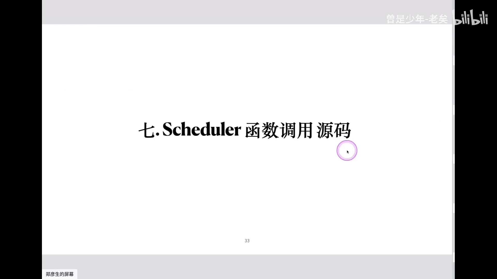

---

## 小结

- **调度器只做一件事**：为还没分配节点的 Pod 选一个最优节点，并把"Pod ↔ 节点"的绑定写回 etcd。它不做 IP 分配、不起容器、不改状态。
- **数据在 etcd 里是 KV + protobuf**：key 是 `/registry/pods/<ns>/<name>` 这样的路径，value 是二进制，必须经 K8s schema 反序列化才可读。
- **源码是"门面 + 大脑 + 规则"**：`cmd/` 是入口，`pkg/scheduler/` 是核心，插件定义调度逻辑。
- **骨架是生产者—消费者**：一个队列 + 反复执行 `scheduleOne`；**弹出串行（一次一个），计算并行（约 16 线程）**。
- **队列有三个**：activeQ（唯一可被消费，堆结构带优先级）、backOffQ、unschedulableQ；定时刷回 activeQ，其中不可调度的 Pod 至少要等 **5 分钟** 才能重试。
- **调度框架分两阶段**：调度周期（选节点，可扩展）与绑定周期（写 etcd，不可改）；选节点这段由一排扩展点（QueueSort、PreFilter、Filter、PreScore、Score、Bind…）组成，每个扩展点挂一批**插件**。
- **过滤 + 打分是核心**：过滤有约 15 个插件，打分有 7 个插件且带权重（示例里只有拓扑分布权重为 2）；同分随机选。
- **并非全量节点参与**：通过 `percentageOfNodesToScore` 只取一部分节点（常见 5%）参与打分。
- **Pod 进队列靠 informer**：注册监听 Pod/node/PV/PVC/CSI；指定了 `nodeName` 进缓存，否则满足过滤条件后进队列。
- **调试要点**：master 别托管；`-v 4`/`-v 9` 调日志；编译源码本地运行时记得指定 kubeconfig；找不到入口就用"加日志倒推"。
- **watch 的底层**：先 get 再 watch；长连接靠 HTTP/1.1 的 chunked 分段传输（而非 WebSocket）；最底层是 etcd 原生 watch + Go channel。

## 关键术语速查

| 术语 | 一句话解释 |
| :--- | :--- |
| kube-scheduler | Kubernetes 调度器，负责把未分配节点的 Pod 放到合适节点上 |
| 绑定（Bind） | 把 Pod 与选中的节点关联并写回 etcd 的动作 |
| 调度周期 | 框架第一阶段：选出一个节点，插件可增删改 |
| 绑定周期 | 框架第二阶段：写回绑定关系，默认不可改 |
| 扩展点（Extension Point） | 框架里可挂插件的接口位置，如 Filter、Score、Bind |
| Filter（过滤） | 扩展点之一，过滤掉不合适的节点（约 15 个插件） |
| Score（打分） | 扩展点之一，给候选节点打分并选最高（约 7 个插件，带权重） |
| QueueSort | 扩展点，决定 Pod 在队列中的出队顺序 |
| PreFilter / PreScore | 过滤前 / 打分前的预处理扩展点 |
| 三个队列 | activeQ（可消费）、backOffQ（退避）、unschedulableQ（不可调度） |
| scheduleOne | 单次调度循环：取一个 Pod → 选节点 → 绑定 |
| percentageOfNodesToScore | 参与打分的节点比例，节点多时只取一部分（常见 5%） |
| 镜像打分插件 | 节点上已缓存镜像越大得分越高的打分插件 |
| Pod Topology Spread | 拓扑分布，示例中权重最高的打分插件（权重为 2） |
| Informer | 调度器用来 watch 资源、把变化转成入队/刷新事件的机制 |
| 静态 Pod | 由 kubelet 从清单目录直接拉起控制面组件的方式 |
| chunked 分段传输 | HTTP/1.1 实现长连接（watch）的方式，非 WebSocket |

> 本文基于 B 站视频《kubernetes 源码剖析专题 - scheduler》（BV1V24y1G7Ak，1.25 源码）整理，内容以视频讲解为准；字幕由 B 站 AI 生成并经人工逐窗口校对，仍可能有偏差。
