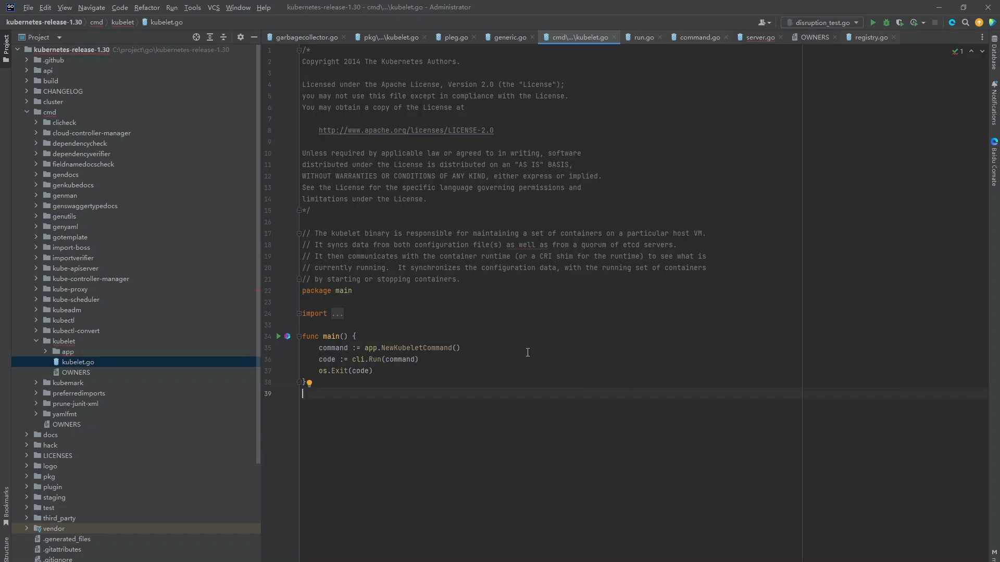
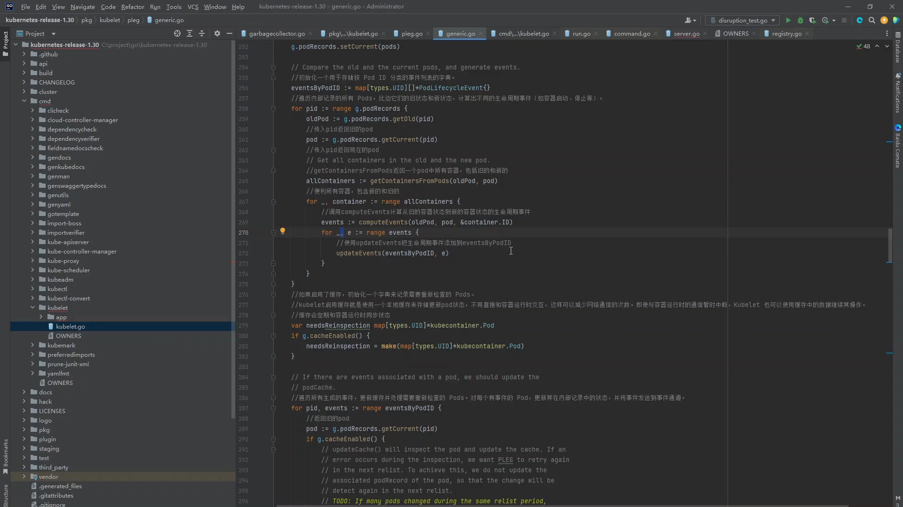
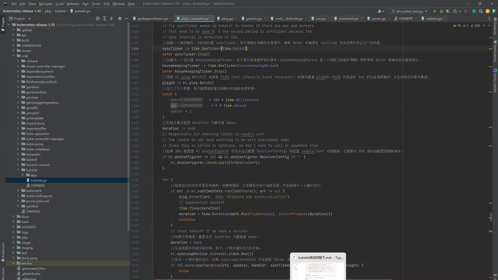
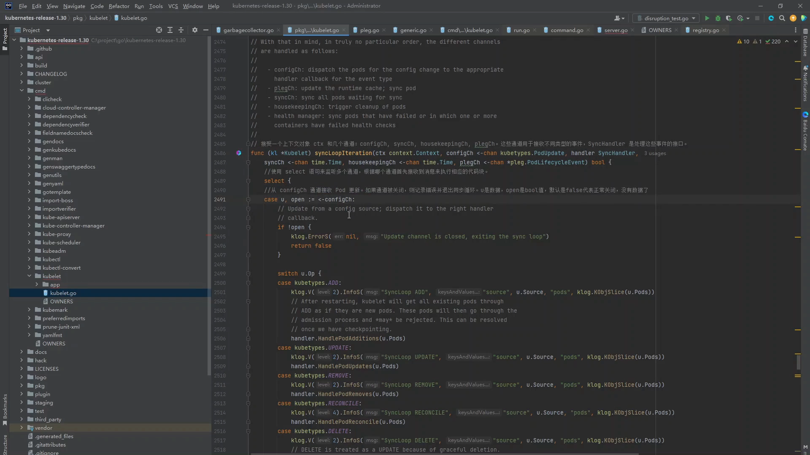

# kubelet 源码启动分析：从 main 到 SyncLoop 主循环

> 本文整理自视频 [kubelet源码启动分析](https://www.bilibili.com/video/BV1XmsLepEYW)（B 站 BV1XmsLepEYW，UP 主「go酱油哥」）。视频基于 **Kubernetes 1.30** 源码（`pkg/kubelet`）逐行走读，本文只保留主干脉络，略去大量逐行细节。

## 本讲要解决的核心问题（SCQA）

**背景**：上一篇 [Kubelet 的职责](深度解析Kubernetes集群的核心组件Kubelet.md) 从「做什么」的角度把 kubelet 拆成了六块：同步循环、Pod 生命周期、CRI/CNI/CSI、资源与驱逐、健康与状态、调优。

**冲突**：职责好懂，但**代码是从哪儿开始跑的**？一个守护进程启动之后，靠什么**持续**跟踪节点上成百上千个 Pod 的增删改、容器的生死？如果它每次都去问容器运行时和 API Server，会不会把自己和 API Server 都压垮？

**疑问**：kubelet 的启动入口是什么？启动之后它的**主循环**长什么样？它怎么知道某个 Pod 的状态变了？

**回答（中心思想）**：kubelet 的启动入口是一条标准的 K8s 组件链路——`main()` → `NewKubeletCommand()` → `Run()`；在 `Run()` 里有两个核心对象：**Kubelet 本体**和 **PLEG**。**PLEG** 异步地「重新列举」容器运行时，把变化翻译成**容器生命周期事件**；**SyncLoop** 则用 `select` 监听**五个 channel**（配置、PLEG、定时同步、清理、健康管理）并分发处理。这套「**事件 + 循环**」结构，就是 kubelet 履行上篇那六大职责的发动机。

## 一、源码里的定义：kubelet 到底负责什么

打开 `cmd/kubelet/kubelet.go`，`main()` 上方有一段英文注释，几乎是官方对 kubelet 职责的「一句话定义」（[【跳转到 00:00】](https://www.bilibili.com/video/BV1XmsLepEYW/?t=0)）：

```go
// The kubelet binary is responsible for maintaining a set of containers on a particular host VM.
// It syncs data from both configuration file(s) as well as from a quorum of etcd servers.
// It then communicates with the container runtime (or a CRI shim for the runtime) to see what is
// currently running. It synchronizes the configuration data, with the running set of containers
// by starting or stopping containers.
```

翻成中文就是：**kubelet 的职责，是在某台主机（VM）上维护一组容器**——它把数据从**配置文件**和 **etcd（API Server）** 同步过来，再**与容器运行时（或 CRI shim）通信**看看现在实际在跑什么，最后通过**启动或停止容器**，让「配置里写的」和「实际在跑的」保持一致。这正是上一篇讲的那条 SyncLoop 控制循环。



## 二、启动入口：main → NewKubeletCommand → Run

视频先交代了一条 **K8s 各组件通用的启动模式**（[【跳转到 00:25】](https://www.bilibili.com/video/BV1XmsLepEYW/?t=25)）：

1. 每个组件（apiserver、scheduler、kubelet……）都有一个 `main` 函数；
2. `main` 里先用 `NewXxxCommand()` 构造一个命令行命令（初始化各种命令行参数）；
3. 用类似 cobra 的框架定义一个启动函数（一个匿名函数，通常是 `RunE` 或 `Run`）：里面做配置检查、生成 flags、解析命令行参数；
4. 这个函数最终**返回一个 `Run` 函数**——它才是真正干活的地方；
5. 最后由 `cli.Run(command)` 启动。

落到 kubelet 上，就是：

```go
func main() {
    command := app.NewKubeletCommand()
    code := cli.Run(command)
    os.Exit(code)
}
```

`Run()` 里会创建并启动大量的子组件，但视频强调：**其中最重要的两个东西是 Kubelet 本体（`k`）和 PLEG**。前者自然是「管这个节点上的 Pod」的主角；后者则是它的「耳目」。

## 三、两个核心对象：Kubelet 与 PLEG

在 `Run()` 的启动流程里，kubelet 会把两个关键对象传给后续的循环（[【跳转到 01:36】](https://www.bilibili.com/video/BV1XmsLepEYW/?t=96)）：

- **Kubelet**：真正负责管理节点上 Pod 的组件；
- **PLEG（Pod Lifecycle Event Generator，Pod 生命周期事件生成器）**：一个**异步运行**的组件，专门负责**跟踪 Pod 的生命周期**。

PLEG 的设计动机很朴素（[【跳转到 02:01】](https://www.bilibili.com/video/BV1XmsLepEYW/?t=121)）：**不能让 kubelet 每次都跑去问 API Server 或容器运行时**。PLEG 相当于给 kubelet 配了一份**本地缓存**，平时就让 kubelet 跟这份缓存打交道，PLEG 在后台**异步地**和容器运行时同步状态，两边对不上的时候再通知 kubelet。

## 四、PLEG：异步的「生命周期事件」生成器

PLEG 的核心是一个叫 **relist（重新列举）** 的循环。视频走读了 `pkg/kubelet/pleg/generic.go` 里的 `relist()`（[【跳转到 03:16】](https://www.bilibili.com/video/BV1XmsLepEYW/?t=196)），主干大致是：

1. **先加互斥锁**，避免并发竞争，并记录本次 relist 的时间（用于暴露监控指标）；
2. **通过 CRI 向容器运行时要一份「当前所有的 Pod」**——注意**包括那些已经终止、但还没被清理的 Pod**；
3. **遍历每个 Pod 里的所有容器**，把「运行 / 停止」的容器数量统计出来、更新到监控指标；
4. **遍历 Pod 里的 sandbox 容器**（也就是 pause 容器）；
5. **计算生命周期事件**——把「上一轮记录的状态」和「这一轮拿到的状态」做差分；
6. 把生成的事件**打包进 `eventsByPodID`，发送到事件 channel**；
7. 若启用了**本地缓存**，就用这些事件**更新缓存**。



**关于 sandbox 容器**（[【跳转到 06:10】](https://www.bilibili.com/video/BV1XmsLepEYW/?t=370)）：它就是一个用汇编写的、**只有几 KB 的 pause 容器**。它的作用是负责容器的**初始化**——网络、存储，以及「你要加入这个 Pod」时的各种准备工作，都由它来完成。一个 Pod 里多个容器能共享网络命名空间，靠的就是它。

**生成哪几种事件？**（[【跳转到 20:54】](https://www.bilibili.com/video/BV1XmsLepEYW/?t=1254)）是几种「容器生命周期事件」：

| 观察到的变化 | 生成的事件 |
| --- | --- |
| 容器在运行 | `ContainerStarted` |
| 容器退出 | `ContainerDied` |
| 容器状态未知 | `ContainerChanged` |
| 容器不存在了 | `ContainerRemoved` |

relist 不是死板地每 N 秒跑一次：它会**计算两次 relist 之间的间隔**，并带**指数回退**——如果容器运行时查询出错，就把间隔拉长重试，避免把运行时打爆（[【跳转到 27:38】](https://www.bilibili.com/video/BV1XmsLepEYW/?t=1658)）。

> 顺带提一句：视频里提到的「本地缓存」（`cacheEnabled`）正是让 PLEG「不用频繁和 API Server 通信」的关键——有了它，kubelet/relist 平时只读缓存，只在必要时才回写 API Server。

## 五、SyncLoop：kubelet 的心脏

PLEG 负责「发现变化」，那**谁来处理变化**？答案是 **SyncLoop**——kubelet 处理整个 Pod 生命周期的主循环（[【跳转到 24:03】](https://www.bilibili.com/video/BV1XmsLepEYW/?t=1443)）。

`pkg/kubelet/kubelet.go` 的 `syncLoop()` 一开始就准备了几样东西（[【跳转到 24:40】](https://www.bilibili.com/video/BV1XmsLepEYW/?t=1480)）：

```go
syncTicker := time.NewTicker(time.Second)                 // 每 1 秒触发一次定时同步
defer syncTicker.Stop()
housekeepingTicker := time.NewTicker(housekeepingPeriod)  // 周期性「家务」清理
defer housekeepingTicker.Stop()
plegCh := kl.pleg.Watch()                                 // PLEG 的事件通道
```

接着定义一组**指数回退**的参数（`base = 100ms`、`max = 5s`、`factor = 2`），然后进入一个 `for` 主循环：

- 先检查容器运行时有没有报错，有就 `time.Sleep(duration)` 并让间隔**按倍数增长**（指数回退），然后 `continue`；
- 没报错就把间隔**重置回 base**，记录一次「同步循环迭代开始」的时间；
- 调用 `syncLoopIteration(...)` 做一次真正的迭代；如果它返回 `false`，就跳出循环。



## 六、五个 channel 与 syncLoopIteration

SyncLoop 的循环体 `syncLoopIteration` 用 `select` **同时监听多个 channel**——用 `select` 而不是逐个阻塞等待，是为了**避免卡在某一个通道上**。源码里那段注释把这五个 channel 说得很清楚（[【跳转到 29:59】](https://www.bilibili.com/video/BV1XmsLepEYW/?t=1799)）：

```go
// With that in mind, in truly no particular order, the different channels
// are handled as follows:
//
//   - configCh: dispatch the pods for the config change to the appropriate
//     handler callback for the event type
//   - plegCh: update the runtime cache; sync pod
//   - syncCh: sync all pods waiting for sync
//   - housekeepingCh: trigger cleanup of pods
//   - health manager: sync pods that have failed or in which one or more
//     containers have failed health checks
```

对应到中文，就是 kubelet 的五个「输入源」：

| channel | 作用 |
| --- | --- |
| **`configCh`** | 来自 API Server 的 **Pod 配置变更**（增 / 删 / 改），按事件类型分发给对应的 handler 回调 |
| **`plegCh`** | PLEG 报来的**容器生命周期事件**（更新运行时缓存、触发 syncPod） |
| **`syncCh`** | **定时同步**：把所有「等待同步」的 Pod 都 sync 一遍（每秒一次） |
| **`housekeepingCh`** | **清理**：触发 Pod 的家务清理 |
| **health manager** | **健康管理**：把失败、或「有一个/多个容器健康检查失败」的 Pod 拿去做 sync |

其中 `configCh` 是最热闹的：它承载来自 API Server 的 Pod 事件，`select` 到之后再用 `switch u.Op` 细分（[【跳转到 30:24】](https://www.bilibili.com/video/BV1XmsLepEYW/?t=1824)）：

```go
switch u.Op {
case kubetypes.ADD:      kl.HandlePodAdditions(u.Pods)   // 新增
case kubetypes.UPDATE:   kl.HandlePodUpdates(u.Pods)     // 更新
case kubetypes.REMOVE:   kl.HandlePodRemoves(u.Pods)     // 移除
case kubetypes.RECONCILE: kl.HandlePodReconcile(u.Pods)  // 重新协调
case kubetypes.DELETE:   // DELETE 被当作 UPDATE 处理（因为要优雅删除）
}
```



视频在这里收尾：**这一节讲完了 kubelet 的启动主循环，下一节会接着讲 Pod 的创建、删除等具体流程**（[【跳转到 34:31】](https://www.bilibili.com/video/BV1XmsLepEYW/?t=2071)）。

## 小结：kubelet 的启动画像

把这一讲串起来，kubelet 的启动与运转就是一张很清晰的图：

```
main() → NewKubeletCommand() → cli.Run() → Run()
                                   │
              ┌────────────────────┴────────────────────┐
              │                                          │
           Kubelet                                    PLEG
              │                                          │
   syncLoop() 主循环                       relist 循环（异步）
   select 五个 channel                    通过 CRI 列举容器 → 生成事件
   ├ configCh      ← API Server 的 Pod 变更          │
   ├ plegCh        ← PLEG 的容器生命周期事件 ─────────┘
   ├ syncCh        ← 每秒定时同步
   ├ housekeepingCh← 周期性清理
   └ health manager← 探针失败处理
```

一句话概括：**PLEG 负责「发现变化」，SyncLoop 负责「处理变化」**；两者一「异步观察」、一「循环协调」，共同把 kubelet 在节点上的六大职责真正跑起来。
