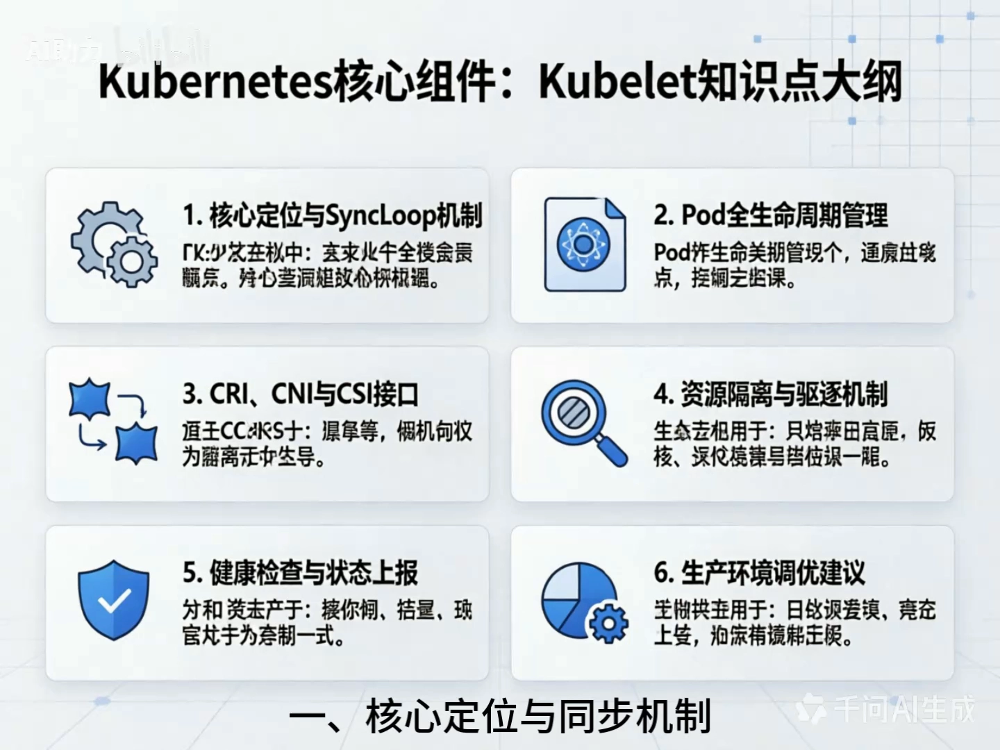

# 深度解析 Kubernetes 集群的核心组件 Kubelet

> 本文整理自视频 [【运维-k8s-Kubelet】深度解析 Kubernetes 集群的核心组件 Kubelet](https://www.bilibili.com/video/BV1PmTi6aEVS)（B 站 BV1PmTi6aEVS）。视频用一张「知识点大纲」把 kubelet 的职责拆成六块，本文按这个顺序逐块展开。

## 本讲要解决的核心问题（SCQA）

**背景**：如果把 Kubernetes 集群比作一家工厂，那 `kube-apiserver`、`kube-scheduler` 这些**控制面组件**就是厂房里的「大脑」——它们决定要生产什么、把这活儿派给谁。但大脑再聪明，手不干活也没用。

**冲突**：真正把「要跑这些容器」这件事**落到一台台机器上**的，是每个工作节点上的一个守护进程——**kubelet**。它几乎是节点上最忙的角色：要盯着 API Server 的指令，要管容器的生死，要管网络和存储，还要在资源紧张时「赶人」。一个进程凭什么能包揽这么多事？它到底负责哪些职责、职责边界又在哪里？

**疑问**：kubelet 在节点上到底扮演什么角色？它用一套什么机制把「期望」变成「现实」？哪些事它亲自做，哪些事它交给插件？

**回答（中心思想）**：**kubelet 是运行在每个节点上的节点代理（node agent），它用一条持续的控制循环（SyncLoop）不断把「期望状态」对齐到「实际状态」。** 它的职责可以概括为六大块：① 核心定位与 SyncLoop；② Pod 全生命周期管理；③ 通过 CRI/CNI/CSI 三大接口调用插件；④ 资源隔离与节点压力驱逐；⑤ 健康检查与状态上报；⑥ 垃圾回收与生产调优。理解了这六块，就理解了「声明式 API 如何变成真正在跑的进程」。



---

## 一、核心定位与 SyncLoop 机制

先看定位（[【跳转到 00:05】](https://www.bilibili.com/video/BV1PmTi6aEVS/?t=5)）：控制平面（API Server、Scheduler 等）是集群的「大脑」，而运行在每个工作节点上的 **kubelet 就是不知疲倦的「现场总工」或「保姆」**，它是**连接控制平面与底层容器运行时的关键纽带**，直接决定了节点上的应用能否稳定、健康地运行。

它的核心工作逻辑，是一条**持续的「同步循环」（SyncLoop）**（[【跳转到 00:30】](https://www.bilibili.com/video/BV1PmTi6aEVS/?t=30)）：

- kubelet 是一个运行在每个节点上的**守护进程（agent）**；
- 它默认约**每 20 秒**通过 **watch 机制**监听 API Server，拿到**当前节点上 Pod 的期望状态**；
- 再把这个期望状态与**节点上容器的实际状态**做比对；
- 一旦发现偏差——比如**容器崩溃、缺少容器、Pod 被删除**——就**采取纠正措施**，让容器重新符合规范。

这就是「声明式」能落地的关键：你只负责声明「我要什么」，kubelet 负责不停地把现实往声明上靠。

## 二、Pod 全生命周期管理

kubelet **接管了 Pod 从生到死的所有细节操作**（[【跳转到 00:55】](https://www.bilibili.com/video/BV1PmTi6aEVS/?t=55)）。可以分成三段：

**1）启动流程**：当收到「启动新 Pod」的指令时，kubelet 依次执行——

1. **拉取镜像**；
2. 创建 **sandbox 容器**（通常是 pause 容器，用于**接管网络和命名空间**）；
3. **顺序执行**初始化容器（init containers）；
4. **并行启动**业务容器。

**2）自我修复（Self-healing）**：如果容器崩溃或健康检查失败，kubelet 会根据 Pod 定义里的**重启策略**（如 `Always`、`OnFailure`）**自动重启容器**。这正是 Kubernetes 具备高可用与韧性的核心原因。

**3）优雅终止（Graceful termination）**：当 Pod 被删除时，kubelet **不会直接强杀容器**，而是先发 `SIGTERM` 信号，并等待 `terminationGracePeriodSeconds` 设定的时间，让应用完成清理和连接断开，**最后才发 `SIGKILL`**，从而避免数据丢失。

> 这一段对应本系列另外几条：Pod 的各个阶段与 init/sidecar 容器详见 [Pod 的阶段、Init 容器与 Sidecar 容器](../3.2.2_Pod生命周期/Pod 的阶段、Init 容器与 Sidecar 容器.md)，探针的细节详见 [Kubernetes 三种探针实战](../Kubernetes 三种探针实战：启动、就绪与存活的联动验证.md)。

## 三、核心接口抽象：CRI、CNI 与 CSI

kubelet **本身并不直接管理底层的容器、网络和存储**，而是通过**三大标准化接口**与插件交互——这赋予了 Kubernetes 极高的可扩展性（[【跳转到 01:45】](https://www.bilibili.com/video/BV1PmTi6aEVS/?t=105)）。

| 接口 | 全称 | kubelet 通过它做什么 |
| --- | --- | --- |
| **CRI** | Container Runtime Interface | 与容器运行时（containerd、CRI-O）通信，执行**拉取镜像、创建/销毁容器**等操作 |
| **CNI** | Container Network Interface | Pod 创建时调用 CNI 插件（如 Calico、Flannel），为 Pod **分配独立 IP 并配置网络策略** |
| **CSI** | Container Storage Interface | 发现 CSI Driver 后，调用 `NodeStageVolume`、`NodePublishVolume`，把**持久化存储卷挂载**到容器目录 |

视频特别提到：生产环境**目前强烈推荐使用 containerd**，因为它**冷启动快、内存占用低**，且专为 Kubernetes 优化（[【跳转到 02:10】](https://www.bilibili.com/video/BV1PmTi6aEVS/?t=130)）。

> 这条调用链的细节（kubelet 何时、按什么顺序调用 CRI/CNI/CSI）属于本系列 3.2.4《CRI、CNI、CSI 的调用关系》的主题，这里只讲它在「职责」层面的位置。

## 四、资源隔离与节点压力驱逐

kubelet 还要替节点「看好资源」（[【跳转到 02:35】](https://www.bilibili.com/video/BV1PmTi6aEVS/?t=155)）。

- **资源约束**：kubelet 会根据 Pod 声明的 `requests` 和 `limits`，利用 **Linux 底层的 cgroups** 机制，严格限制容器对 **CPU、内存、临时存储（ephemeral storage）** 的使用，防止「吵闹的邻居」（noisy neighbor）拖垮别人。
- **驱逐机制（eviction）**：当节点资源紧张——比如**内存或磁盘即将耗尽**——kubelet 会触发驱逐，**按 QoS 优先级**主动杀死 Pod，以保护节点操作系统不崩溃。优先级从低到高是：

```
BestEffort  <  Burstable  <  Guaranteed
（最先被驱逐）              （最后被动）
```

也就是说，**没有声明 requests/limits 的 BestEffort Pod 最先被赶走，声明齐全的 Guaranteed Pod 最后才被动**（[【跳转到 03:00】](https://www.bilibili.com/video/BV1PmTi6aEVS/?t=180)）。

## 五、健康检查与状态上报

kubelet 还负责**探针管理**和**节点状态上报**（[【跳转到 03:25】](https://www.bilibili.com/video/BV1PmTi6aEVS/?t=205)）：

- **探针管理**：kubelet 内部的 probe manager 会定期执行**存活探针（liveness probe）、就绪探针（readiness probe）、启动探针（startup probe）**；根据结果决定是**重启容器**，还是把该 Pod **从 Service 的 Endpoints 中摘除**。
- **节点状态上报**：kubelet 定期向 API Server 汇报**节点的健康状况**，如 `Ready`、`MemoryPressure`、`DiskPressure`，以及 **CPU、内存的使用率**。这些信息是 **scheduler 做调度决策的关键依据**。
- **垃圾回收（GC）**：kubelet 会在后台定期清理**未使用的镜像**和**已终止的容器**，防止节点磁盘被耗尽。

> 节点状态与心跳（Lease、`NotReady` 判定）详见 [3.2.6 节点状态与心跳](../3.2.6_节点状态与心跳/)。

## 六、生产环境调优与避坑

视频最后给了一组「资深专家」视角的实战建议（[【跳转到 03:50】](https://www.bilibili.com/video/BV1PmTi6aEVS/?t=230)）：

- **cgroup driver 一致性**：必须确保 kubelet 的 cgroup driver 与容器运行时的配置**完全一致**（推荐都用 `systemd`），否则会导致**节点无法启动**或 **Pod 频繁异常**。
- **健康检查防误杀**：liveness probe 必须设置合理的 `initialDelaySeconds`，避免应用还在启动阶段就被 kubelet 判死，陷入无限重启（`CrashLoopBackOff`）。
- **内存 limit 的陷阱**：给容器设 `limits.memory` 要极其谨慎——设得太低极易触发 Linux 内核的 **OOM Killer** 把容器强杀（`OOMKilled`）；设得远大于 `requests` 又可能导致**节点内存超卖**，引发**节点级别的 OOM**。
- **并发与镜像拉取**：对高负载节点，可调整 `maxParallelPodSyncs`（并发同步数）并把 `serializedImagePulls` 设为 `false`（开启并行拉取镜像），提升 Pod 的启动效率。

## 小结：声明式 API 的「终极执行者」

回到开头的问题：kubelet 凭什么能包揽这么多事？答案是它把一切都收敛到**同一条控制循环**上——watch 期望状态、比对实际状态、纠正偏差，周而复始。至于「怎么改」，则通过**标准接口**委派给 CRI/CNI/CSI 插件。

用视频的总结收尾（[【跳转到 05:05】](https://www.bilibili.com/video/BV1PmTi6aEVS/?t=305)）：**kubelet 是把声明式 API 转化为物理机器上真实运行的进程的「终极执行者」**。深入理解 kubelet，是排查节点级故障、进行性能调优，以及迈向云原生高阶架构师的必经之路。
