# Pod 生命周期：从创建到流量接入的 12 个阶段

> 本文整理自视频 [Kubernetes Pod Lifecycle Explained — 12 Stages From kubectl apply to Live Traffic](https://www.youtube.com/watch?v=PLCt3lSoXOw)。

## 本讲要解决的核心问题（SCQA）

**背景**：在 Kubernetes 里创建一个 Pod 极其简单——写几行 YAML，`kubectl apply` 一下，几秒钟后 `kubectl get pod` 就显示 `Running`。

**冲突**：可就在这几秒里，`kubectl` 只是把一个文件"递交"了出去，它并没有真的去启动任何进程。集群是自己把这个 Pod"变"出来的：先记录、再调度、由某个节点的代理接手、分配网络、拉取镜像……直到最后一刻才对外服务。也就是说，**"提交成功"和"真正能接流量"之间，隔着一条很长的流水线**。

**疑问**：一个 Pod 从 `kubectl apply` 到开始接收流量，究竟经历了哪些阶段？跨过了哪些组件？为什么明明 `Running` 了，还不能马上被访问？

**回答（中心思想）**：一次 Pod 的创建横跨 **12 个阶段、8 个组件**，穿越**控制面与数据面**的分界——Pod 先变成 etcd 里的"期望状态"，被控制器与调度器补全并绑定节点；再由节点代理（kubelet）经 CRI 落地为 Linux 沙箱与容器；装上 CNI 网络、通过就绪探针后，`kube-proxy` 才把流量转进来。**Pod 不是从一个容器开始的，而是从一条"声明"开始的。**

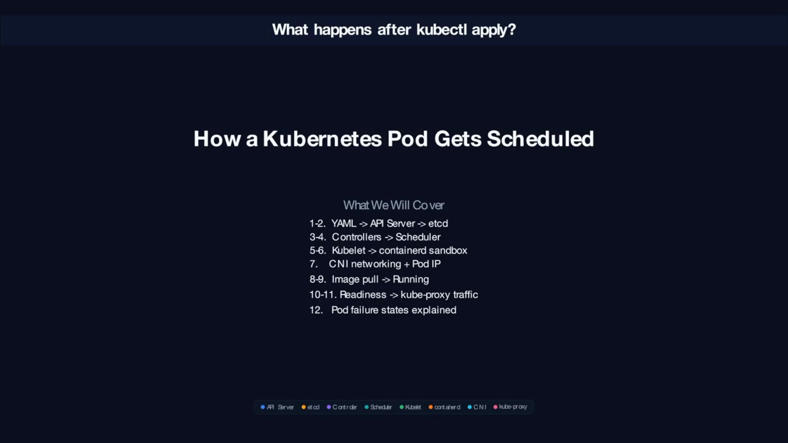

## 一、先看全局：Pod 生命周期横跨三条"泳道"

整条流水线可以画成上、中、下三条泳道，12 个编号阶段从左到右依次交接：

- **控制面泳道**：`kube-apiserver`、`etcd`、`controller-manager`、`scheduler`。
- **节点泳道**：`kubelet`、`containerd`（CRI 运行时）、CNI 插件、`kube-proxy`。
- **Pod 泳道**：sandbox（沙箱）、pause 容器、应用容器，以及最终的 serving（对外服务）状态。

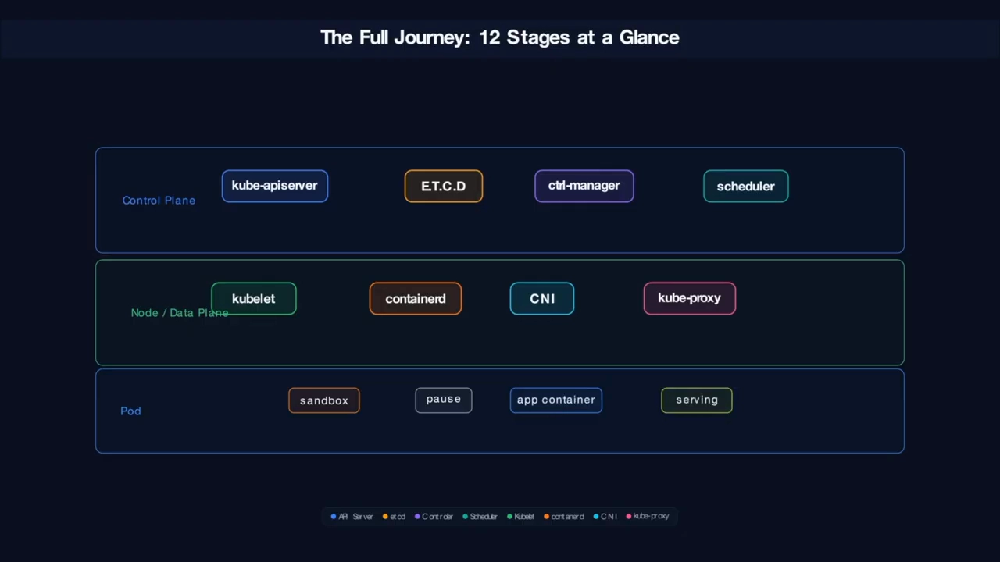

### 12 个阶段速览

| 阶段 | 发生了什么 | 所在泳道 |
| --- | --- | --- |
| 1 | YAML 提交给 API Server | 控制面 |
| 2 | 期望状态写入 etcd | 控制面 |
| 3 | 控制器对账（reconcile） | 控制面 |
| 4 | 调度器过滤、打分、绑定节点 | 控制面 |
| 5 | kubelet 认领 Pod | 节点 |
| 6 | containerd 创建 Pod 沙箱 + pause 容器 | 节点 |
| 7 | CNI 挂网络、分配 IP | 节点 |
| 8 | 拉取容器镜像 | 节点 |
| 9 | 起容器、进入 Running | 节点 |
| 10 | 就绪探针通过 | 节点 |
| 11 | kube-proxy 更新转发规则 | 节点 |
| 12 | Linux 命名空间与 cgroup 托底 | Pod / 节点 |

## 二、从提交到被调度：控制面里的前四步

控制面负责把"你想要的"变成"一条可执行的记录"。前四步全在这里发生。

### 2.1 第一步：`kubectl apply` 把 YAML 交给 API Server

你写一份 YAML 描述想要什么。它更像一张**蓝图**——是对"结果"的声明，而不是对"怎么造"的指令。执行 `kubectl apply` 后，`kubectl` 通过 TLS 把一条 HTTP POST 请求发给 `kube-apiserver`。

API Server 是整个集群的"大门"。它先让**准入控制器**（admission controllers）像保安查证件一样把你的请求验一遍，再补上各种默认值（mutating），最后才真正创建出 Pod 对象。[【跳转到 01:25】](https://www.youtube.com/watch?v=PLCt3lSoXOw&t=85)

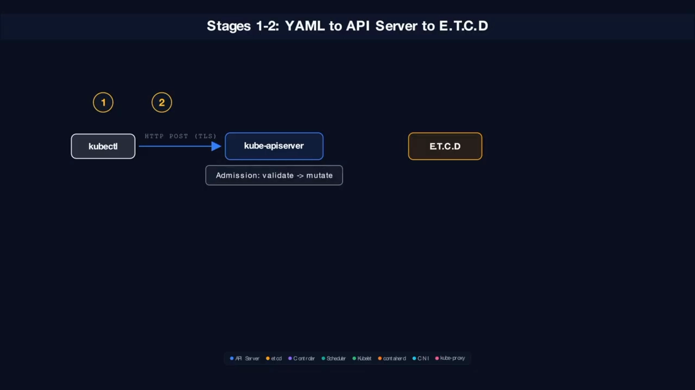

### 2.2 第二步：写入 etcd，生成"期望状态"

API Server 把 Pod 写进 **etcd**——集群唯一的"事实来源"。etcd 可以想象成一个银行保险库，底层用 **Raft 共识协议**把这份 Pod 规格复制到多个成员上。

这里有一个关键认知：**此刻 Pod 只是数据库里的一条记录**。它是"期望状态"（desired state），不是"实际状态"（actual state）——**还没有任何一个节点在跑它**。

### 2.3 第三步：控制器开始"对账"

`controller-manager` 是一堆**对账循环**（reconciliation loop）的集合，像酒店客房服务：各自盯着"期望状态"和"实际状态"之间的偏差并把它抹平。

例如：Deployment 控制器发现需要 ReplicaSet，于是创建它；ReplicaSet 控制器发现"期望副本数是 1，实际是 0"，于是**创建 Pod 对象**并写回 API Server。这就是对账循环——不断比较"应该有什么"与"实际有什么"，把缺口补上。这时新 Pod 仍然还没有节点。[【跳转到 02:15】](https://www.youtube.com/watch?v=PLCt3lSoXOw&t=135)

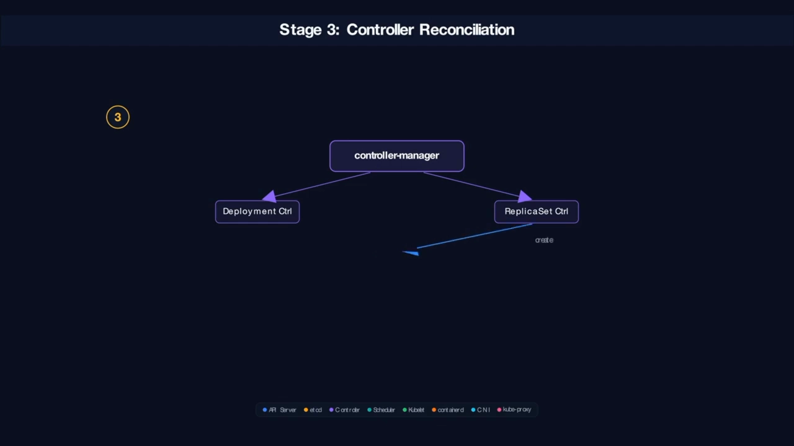

### 2.4 第四步：调度器过滤、打分、绑定节点

`kube-scheduler` 盯着那些"还没有节点"的 Pod，调度分两个阶段：

1. **过滤（Filtering）**：对每个节点跑一轮谓词判断——有足够 CPU/内存吗？能容忍这个 Pod 的污点吗？通不过的节点被淘汰。像漏斗一样筛。
2. **打分（Scoring）**：对活下来的节点逐个评分，比如资源占用最少、分配最均衡者得分高，最高分获胜。

随后调度器把 `pod.spec.nodeName` 补成获胜节点。**但请记住这个关键区分**：Pod 只是被"调度"了，还**完全没有运行**，状态仍是 `Pending`。[【跳转到 03:55】](https://www.youtube.com/watch?v=PLCt3lSoXOw&t=235)

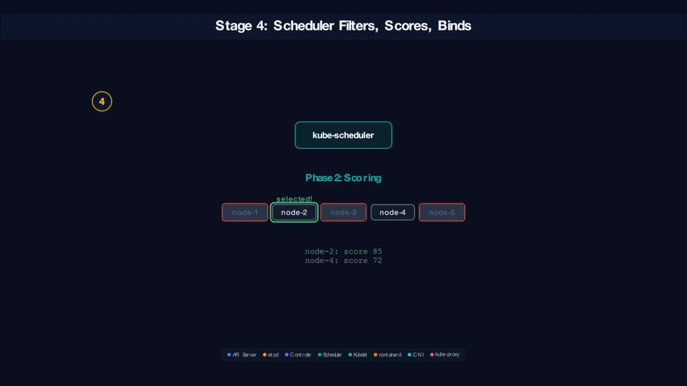

## 三、从控制面到数据面：节点把"期望状态"变成现实（第 5–9 步）

从这里开始，控制权从控制面交到数据面——真正在节点上"动手"的是 kubelet 及其伙伴。

### 3.1 第五步：kubelet 认领 Pod

被选中的工作节点上，`kubelet` 一直在对 API Server 做 **watch（长轮询监听）**。当发现某个 Pod 的 `nodeName` 与自己匹配，就把它"接管"过来，像工地上的工头接手施工。[【跳转到 04:20】](https://www.youtube.com/watch?v=PLCt3lSoXOw&t=260)

### 3.2 第六步：containerd 创建 Pod 沙箱与 pause 容器

kubelet 调用 **CRI 运行时**（视频里是 containerd）。containerd 先创建一个 **Pod 沙箱**：为 Pod 拉起一组 Linux 命名空间（network、PID、IPC、UTS）做隔离，并配置 **cgroup**（`cpu.max`、`memory.max`，相当于给资源围上栅栏）。

**很多人会忽略的一点**：这时会先起一个 **pause 容器**。它只有约 1 MB、不耗 CPU，作用是"占住"这些命名空间、并在 Pod 内作为 PID 1 回收僵尸进程——它是整个 Pod 的"锚点"。此时状态变为 `ContainerCreating`。[【跳转到 04:45】](https://www.youtube.com/watch?v=PLCt3lSoXOw&t=285)

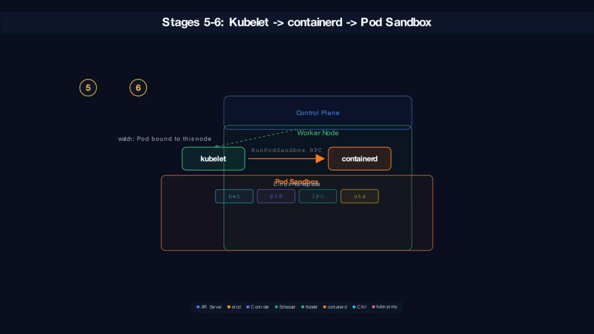

### 3.3 第七步：CNI 给 Pod 装上网络、分配 IP

接下来 containerd 调用 **CNI 插件**（容器网络接口）。这里有个容易被混淆的分工：**CRI 建的沙箱只负责"房子"，CNI 只负责"布线"**——好比电信施工队来拉线。

内核层面会创建一对 **veth**：一端成为 Pod 网络命名空间里的 `eth0`，另一端接到宿主机上的网桥。**IPAM 插件**再从 Pod CIDR 里分一个 IP（例如 `10.244.1.15`）。至此，Pod 在全集群范围内可达。[【跳转到 05:35】](https://www.youtube.com/watch?v=PLCt3lSoXOw&t=335)

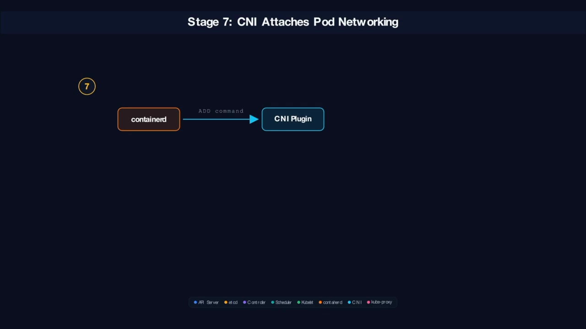

### 3.4 第八、九步：拉镜像、起容器、进入 Running

containerd 先查本地快照存储：镜像层已缓存则瞬间完成，否则从镜像仓库逐层拉取（每个层一个 GET 请求）。随后在**已有的沙箱里**创建容器，让它加入同一套命名空间。

底层上，containerd 调 `runc`，用带命名空间标志的 `clone` 派生出进程：进程树里 **PID 1 是 pause，你的应用进程排在其后**。所有容器启动后，kubelet 的状态管理器把 phase 设为 `Running`。[【跳转到 06:35】](https://www.youtube.com/watch?v=PLCt3lSoXOw&t=395)

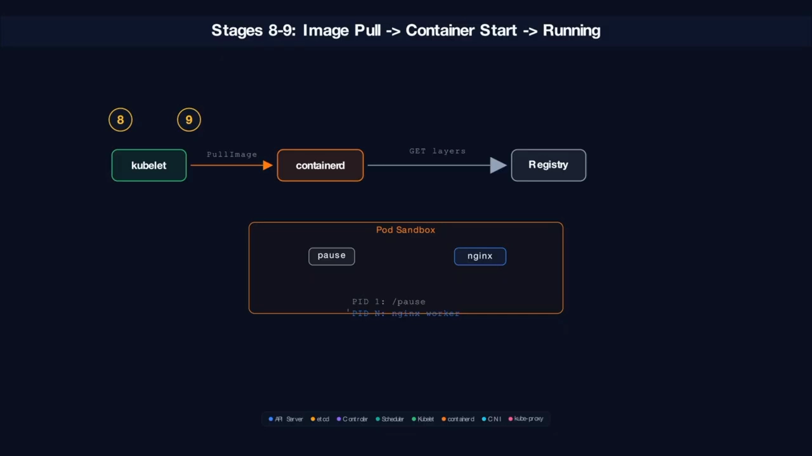

## 四、"Running 不等于 Ready"：最后三步让 Pod 真正接流量（第 10–12 步）

这是最容易出错的一段：容器跑起来了，不代表它能接收请求。

### 4.1 第十步：就绪探针通过

**Running 只说明进程活着；Ready 说明应用真的能接收流量。** kubelet 的探测器（prober）会周期性地发**就绪探针**（例如向 `/healthz` 发一次 HTTP GET）：第一次失败（应用还在初始化），第二次返回 200 OK，kubelet 才把 `ready` 置为 true。[【跳转到 06:50】](https://www.youtube.com/watch?v=PLCt3lSoXOw&t=410)

### 4.2 第十一步：kube-proxy 更新转发规则

就绪后，**EndpointSlice 控制器**把这个 Pod 的 IP 加进 Service 的端点列表。每个节点上的 `kube-proxy` 监听到 EndpointSlice 变化后，更新 **iptables 规则**：客户端访问 Service 的 ClusterIP 时，内核用 DNAT 把它翻译成"就绪"的 Pod IP。

**没就绪的 Pod 永远不会被路由到**——它的 IP 压根不在 iptables 规则里。只有 Pod 同时 `Running` 且 `Ready`，才会收到流量。[【跳转到 07:40】](https://www.youtube.com/watch?v=PLCt3lSoXOw&t=460)

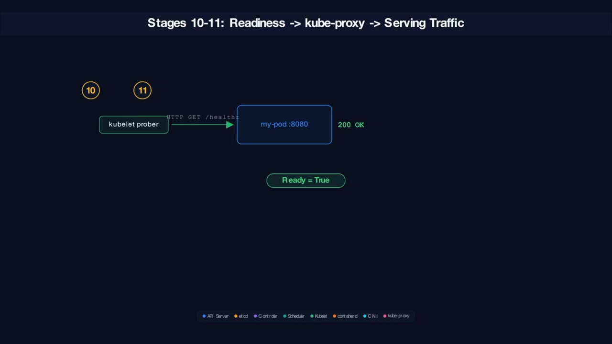

### 4.3 第十二步：命名空间与 cgroup 是这一切的地基

把镜头拉进节点，最外层是 kubelet（节点代理），往里是 containerd（CRI 运行时），再往里是沙箱里的 **5 个 Linux 命名空间**：

- **network**：给 Pod 独立的 IP 栈；
- **PID**：pause 在 Pod 内是 PID 1，在宿主机上可能是第 45000 号进程；
- **IPC**：隔离共享内存；
- **UTS**：给 Pod 独立主机名；
- **mount**：隔离文件系统。

外面再包一层 **cgroup**：`cpu.max` 限制 CPU 时间，`memory.max` 一旦超出，就由 OOM killer 终结进程。pause 容器居中，1 MB、零 CPU，既吊住命名空间，又回收僵尸进程。[【跳转到 10:10】](https://www.youtube.com/watch?v=PLCt3lSoXOw&t=610)

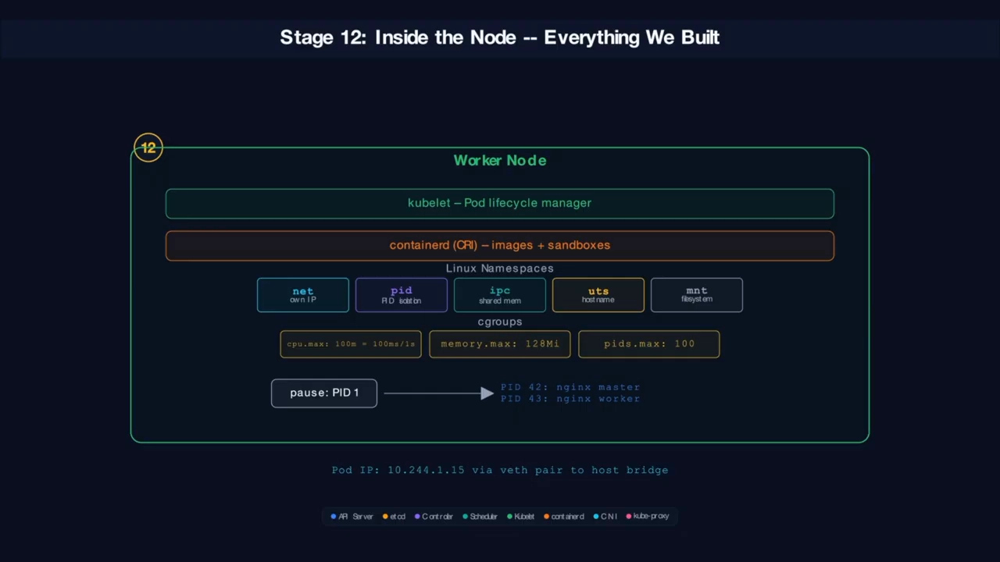

## 五、出问题时你会看到什么：三种最常见的失败状态

理解了正常流水线，反过来就能读懂异常。三种最常见的失败：

| 状态 | 含义 | 排查方向 |
| --- | --- | --- |
| **CrashLoopBackOff** | 容器启动即崩溃，kubelet 反复重启，每次等待更久（10s → 20s → 40s，指数退避） | `kubectl logs` 看日志；多为配置错误、缺环境变量、入口命令不对 |
| **ImagePullBackOff** | 镜像名写错，或私有仓库缺少拉取凭据 | 核对镜像名、补 `imagePullSecrets` |
| **OOMKilled（退出码 137）** | 容器内存超过 limit，被内核 OOM killer 杀掉 | 提高内存 limit，或修内存泄漏 |

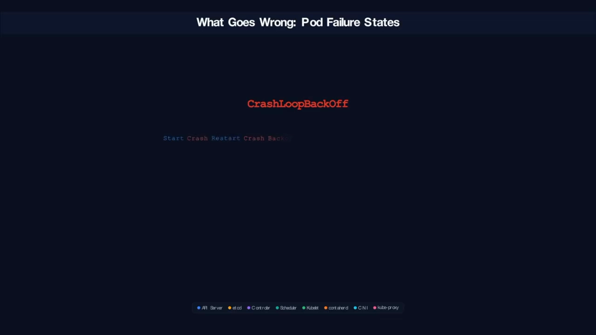

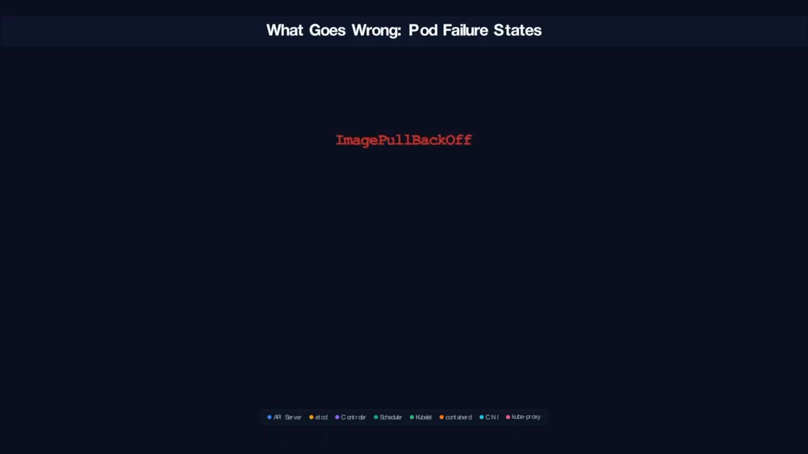

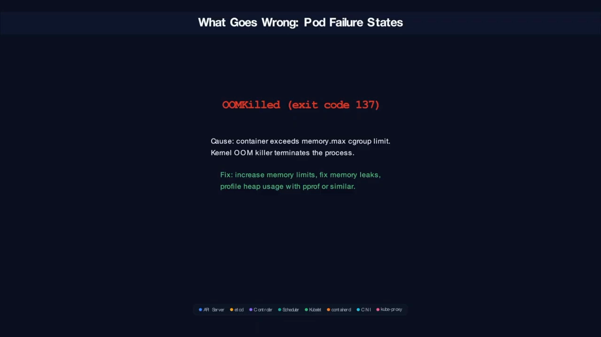

## 六、七组最容易混淆的区别

回顾整条流水线，记住这七组"一正一反"，Pod 生命周期就清晰了：

1. **期望状态 vs 实际状态**
2. **存于 etcd vs 在节点上执行**
3. **已调度（Scheduled） vs 已运行（Running）**
4. **已运行（Running） vs 已就绪（Ready）**
5. **CRI（containerd） vs CNI**
6. **Service 存在 vs Endpoint 可用**
7. **Pod 被创建 vs Pod 在服务流量**

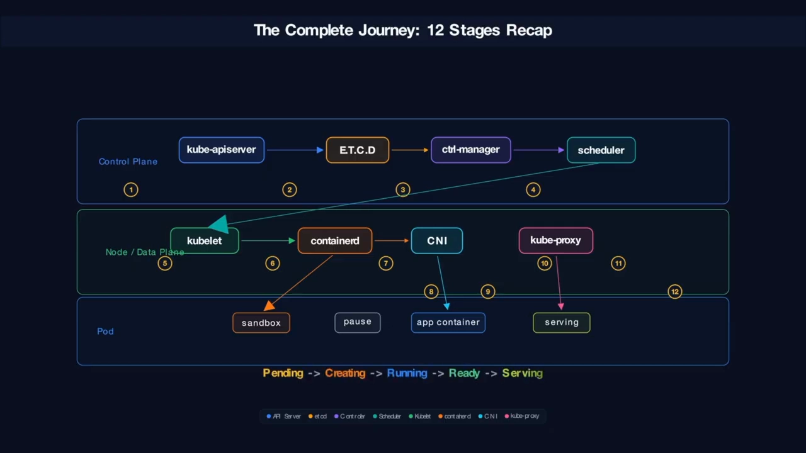

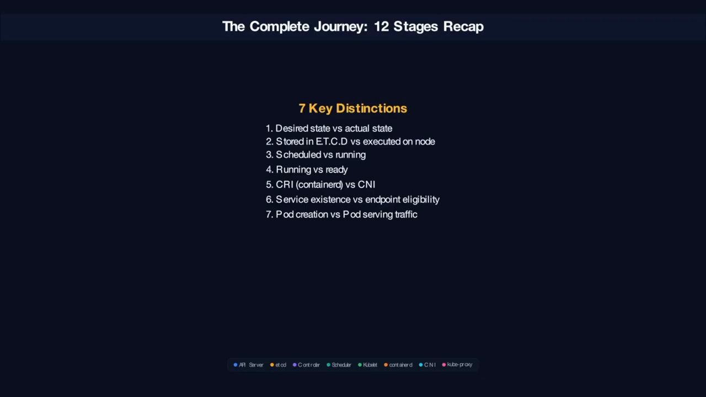

## 小结

- Pod 的生命周期是一条 **12 阶段流水线**：提交 → 记录 → 对账 → 调度（控制面），认领 → 沙箱 → 联网 → 起容器 → 就绪 → 转发（数据面）。
- **`kubectl apply` 只是"声明"**：真正把 Pod 造出来的是控制器、调度器、kubelet、CRI、CNI 与 kube-proxy。
- **调度 ≠ 运行，运行 ≠ 就绪**：只有通过就绪探针、被写进 EndpointSlice 并落到 iptables 规则里的 Pod，才会收到流量。
- **pause 容器 + 命名空间 + cgroup** 是 Pod 的地基：它让多个容器共享网络，也界定了资源的边界。
- 三种高频失败状态——`CrashLoopBackOff`、`ImagePullBackOff`、`OOMKilled(137)`——都能用这条流水线反推原因。

## 关键术语速查

| 术语 | 一句话解释 |
| --- | --- |
| Pod 沙箱（sandbox） | CRI 为 Pod 拉起的共享命名空间与资源的载体 |
| pause 容器 | 约 1 MB 的"占位"容器，吊住 Pod 的命名空间并回收僵尸进程 |
| CRI | 容器运行时接口；kubelet 通过它调用 containerd 等运行时 |
| CNI | 容器网络接口；负责给 Pod 分配 IP、接线到集群网络 |
| IPAM | 从 Pod CIDR 里为 Pod 分配 IP 地址的组件 |
| veth | 内核中的虚拟网卡对；一端是 Pod 内的 eth0，一端接宿主机网桥 |
| cgroup | 资源隔离机制；`cpu.max`/`memory.max` 给容器围上资源栅栏 |
| 就绪探针（Readiness） | 判断应用是否能接收流量；未就绪的 Pod 不进 Endpoint 列表 |
| EndpointSlice | 记录某个 Service 下"可用 Pod IP"的对象，供 kube-proxy 消费 |
| kube-proxy | 每个节点上维护转发规则（iptables 等）的组件 |
