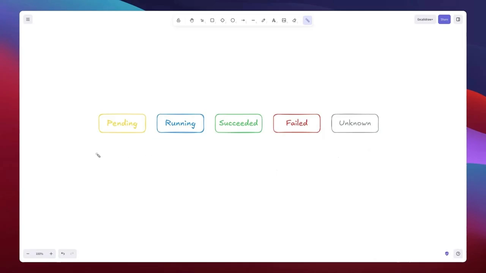
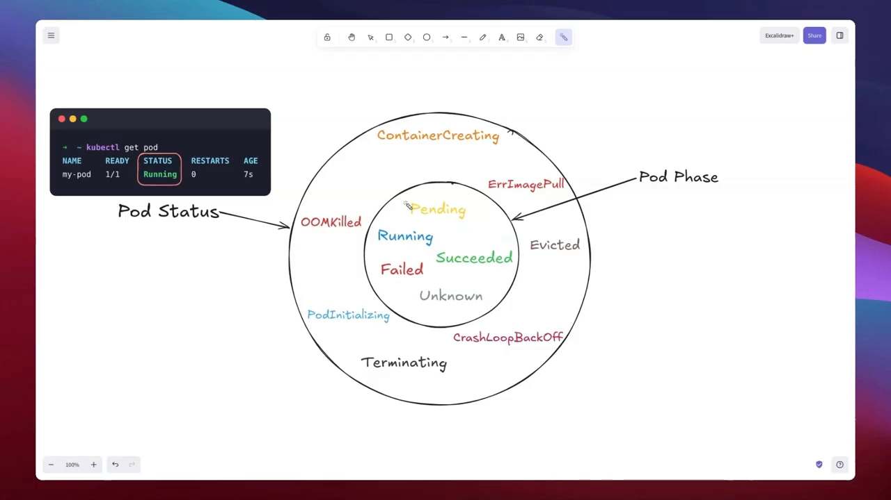
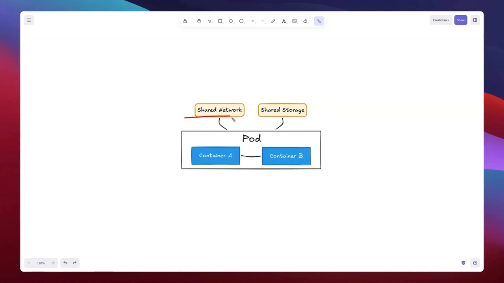
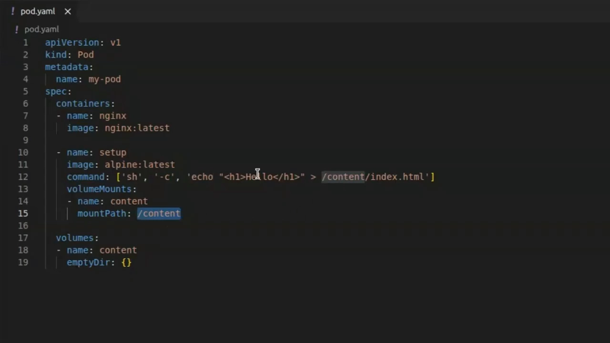
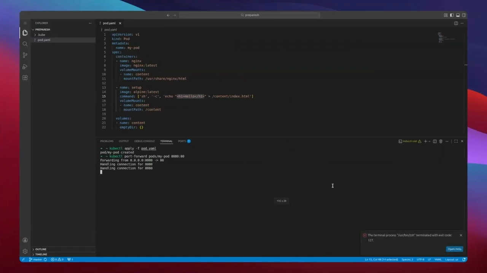
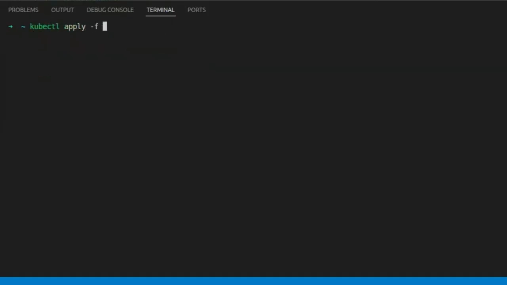
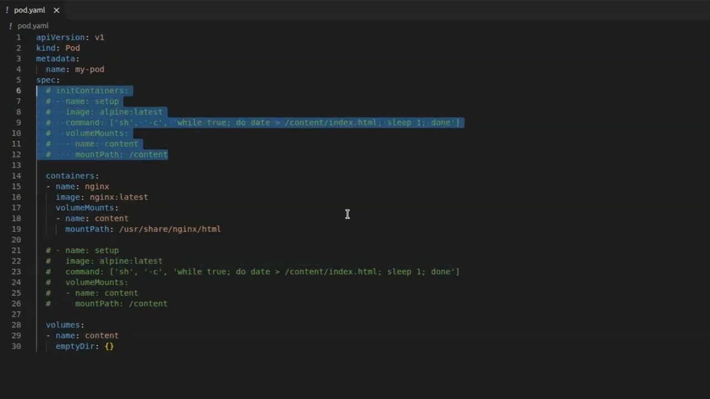
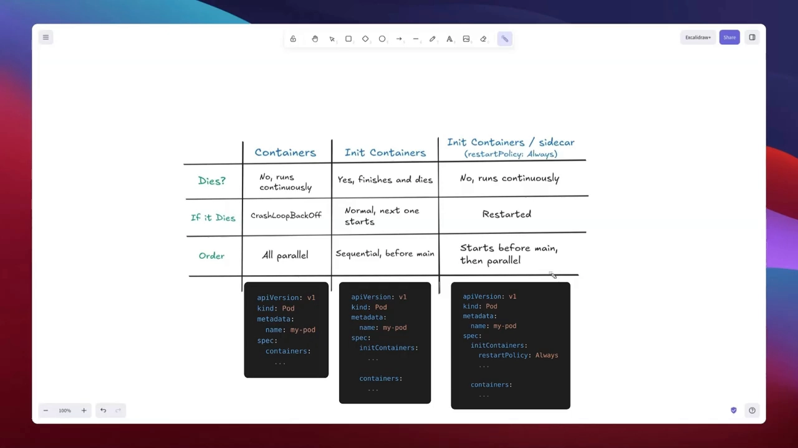

# Pod 的阶段、Init 容器与 Sidecar 容器

> 本文整理自视频 [Kubernetes pod lifecycle, init containers and sidecars: multi-container pods explained](https://www.youtube.com/watch?v=5SeKZsYukx8)。

## 本讲要解决的核心问题（SCQA）

**背景**：Pod 是 Kubernetes 里最小的可部署单元，我们平时就是写个 YAML，`kubectl apply`，然后 `kubectl get pod` 看它是 `Running`。

**冲突**：但 Pod 并不是"一启动就在跑"。它会沿着固定的**阶段**走；`kubectl` 里那一列状态，值又远比"阶段"要多。更麻烦的是：一个 Pod 里可以放多个容器，它们**共享网络与存储**，可怎么让它们**按正确顺序**配合，却很容易踩坑——有的容器一跑完就退出、被反复重启，有的场景又必须常驻。

**疑问**：Pod 到底有哪些阶段？`kubectl` 显示的"状态"和"阶段"是一回事吗？一个 Pod 放多个容器时，怎么保证"A 先把活干完、B 再启动"？

**回答（中心思想）**：Pod 只有 **5 个阶段**，而 `kubectl` 的状态是它的**超集**；多容器 Pod 共享网络与存储，而按启动顺序有三种搭配方式——**普通容器**（并行、常驻）、**Init 容器**（先跑完再放行主容器）、**Sidecar 容器**（先跑、然后又常驻）。选哪种，只看一句话：**"什么必须运行，以及什么时候运行"**。

## 一、Pod 的一生只有五个阶段

Pod 不会"启动就完事"，它会依次经过五个阶段（phase）：**Pending、Running、Succeeded、Failed、Unknown**。[【跳转到 00:30】](https://www.youtube.com/watch?v=5SeKZsYukx8&t=30)



- **Pending（等待中）**：Pod 对象已存在，但还没真正跑起来。通常是两种情况——还在**拉取容器镜像**，或者**调度器还没找到合适的节点**（比如所有节点资源都不够）。
- **Running（运行中）**：只要 Pod 里**至少有一个容器已经启动**，就算 Running。
- **Succeeded（成功）**：Pod 里**每一个容器都以退出码 0 结束**，干净完成、不打算再重启——批处理任务就走这个阶段。
- **Failed（失败）**：**至少有一个容器以非零退出码终止**（崩溃或报错退出）。
- **Unknown（未知）**：比较罕见。通常不是 Pod 自己的问题，而是**集群无法判断**它的状态——比如联系不上它所在的节点。

## 二、`status` ≠ `phase`：`kubectl` 里那些"细节"从哪来

很多人会混淆：`kubectl get pod` 的状态列能显示的值，远不止上面五个。**阶段（phase）只是一个"粗略抽象"**，只有五个取值；而 **status 是一个"超集"**，它包含 phase，还带上一堆更精确的信息。[【跳转到 03:05】](https://www.youtube.com/watch?v=5SeKZsYukx8&t=185)



status 里常见的"额外"值，恰恰是真正有用的细节：

| status 值 | 含义 |
| --- | --- |
| `ContainerCreating` | 容器正在创建，Pod 在上线途中，正常现象 |
| `ErrImagePull` / `ImagePullBackOff` | 拉取镜像出错：镜像名不对，或仓库不可达 |
| `CrashLoopBackOff` | 容器反复崩溃、被反复重启 |
| `OOMKilled` | 容器内存超过 limit，被 Kubernetes 杀掉 |
| `Terminating` | Pod 正在关闭 |

**怎么看 phase？** 两种命令：

```bash
# 看整份 manifest，再翻到 status.phase
kubectl get pod mypod -o yaml

# 只要 phase 这一个字段
kubectl get pod mypod -o jsonpath='{.status.phase}'
```

## 三、多容器 Pod：它们共享网络，也共享存储

一个 Pod 里可以放多个容器。当两个容器同处一个 Pod 时，它们**共享两样东西**：**网络**和**存储**。[【跳转到 07:25】](https://www.youtube.com/watch?v=5SeKZsYukx8&t=445)

- **共享网络**：容器 A 可以通过 `localhost` 访问容器 B，反过来也一样——它们就像坐在同一台机器上。
- **共享存储**：两个容器可以挂载**同一个 volume**，从而互相传文件。



**一个具体例子**：让 Alpine 容器写一个 `index.html`，再让 Nginx 把它当主页提供服务。做法是在 Pod 级别定义一个 `emptyDir` volume（Pod 删除时它随之消失），Alpine 把它挂到 `/content`、Nginx 把它挂到默认站点目录。于是 Alpine 写进 volume 的 `index.html`，正好落在 Nginx 要读的位置。[【跳转到 10:05】](https://www.youtube.com/watch?v=5SeKZsYukx8&t=605)



应用之后用端口转发验证：

```bash
kubectl apply -f pod.yaml
kubectl port-forward mypod 8080:80
curl localhost:8080   # 返回我们自己写的 "Hello"
```



## 四、为什么要 Init 容器：把"先跑完再启动"变成保证

上面的例子里藏着一个坑：Alpine 写完文件就**退出了**。可在 Kubernetes 看来，**容器退出 = 需要重启**。于是它重启 Alpine，Alpine 又写完又退出，周而复始——Alpine 被卡在了**不断重启**的状态里。[【跳转到 14:54】](https://www.youtube.com/watch?v=5SeKZsYukx8&t=894)

这其实"委屈"了 Alpine：它没坏，只是完成了任务。问题在于 **Kubernetes 不知道"干完就停"本来就是它的计划**。这正是 **Init 容器**要解决的问题：

> **Init 容器只把活干一次、然后退出，Kubernetes 不会重启它**——因为 Kubernetes 知道它本就不该一直运行。

把 Alpine 从 `containers` 挪到 `initContainers` 下即可，内容几乎不用改（同样的镜像、命令、挂载）。重启后 Kubernetes 的 `Pod` 计数显示 `1/1`——因为那个计数只统计 `containers` 段里的 Nginx。[【跳转到 15:44】](https://www.youtube.com/watch?v=5SeKZsYukx8&t=944)



**关键行为**：Init 容器**先于所有主容器运行**。它跑完并以退出码 0 结束，Kubernetes 才去启动 Nginx——所以 Nginx 一起来，文件就已经躺在共享卷里了。

## 五、Sidecar：既要"先跑"，又要"常驻"

把场景换一下：如果我们要的不是静态页，而是**每秒刷新**的动态页呢？那就得让 Alpine **一直运行**地改写 `index.html`——可它一旦"永不退出"，就**不能**做 Init 容器了（Init 容器必须先结束、把控制权交出去）。[【跳转到 18:14】](https://www.youtube.com/watch?v=5SeKZsYukx8&t=1094)

退回到"普通多容器"能跑通，但有个隐患：**普通容器是并行启动的**，Alpine 和 Nginx 同时起来。万一 Nginx 抢先启动、而此时 Alpine 还没写出文件，请求进来就会拿到空页面。[【跳转到 20:44】](https://www.youtube.com/watch?v=5SeKZsYukx8&t=1244)

我们被卡在两难之间：

- 想要 Init 容器的**顺序保证**（先有文件，再放行 Nginx）；
- 又想要普通容器的**常驻行为**（一直刷新文件）。

Kubernetes **1.28** 引入了 **Sidecar 容器**正好填上这个缺口：把 Alpine 放回 `initContainers`，但给它加一个字段——`restartPolicy: Always`。[【跳转到 21:59】](https://www.youtube.com/watch?v=5SeKZsYukx8&t=1319)



它带来的变化很微妙：

- Kubernetes **仍然先运行这个（sidecar）init 容器**——所以"文件先就位"的顺序保证照旧；
- 但 Kubernetes **不再等它退出**，只等它进入 **Running**；一旦它起来了，立刻放行主容器 Nginx。

结果就是：**顺序有保证，且它继续和 Nginx 并行常驻**。[【跳转到 22:24】](https://www.youtube.com/watch?v=5SeKZsYukx8&t=1344)

## 六、三类容器对比：一句话决定用哪种

把三种方式并排比较，也是本讲最实用的一张表：[【跳转到 24:29】](https://www.youtube.com/watch?v=5SeKZsYukx8&t=1469)

|  | Containers（普通） | Init Containers | Init Containers / sidecar |
| --- | --- | --- | --- |
| **会结束吗？** | 不，一直运行 | 会，跑完即终止 | 不，一直运行 |
| **如果它挂了？** | CrashLoopBackOff，反复重启 | 不算问题，本就该退出 | 重启它，并等它重新进入 Running |
| **启动顺序** | 全部并行 | 顺序执行，先于主容器 | 先于主容器启动，之后并行 |



选择原则其实只有一句：**什么必须运行，以及什么时候运行。**

- 需要**并排运行**的 → 普通容器；
- 有东西**必须先跑完**的 → Init 容器；
- **两者都要**（先跑、又常驻）的 → Sidecar 容器。

## 小结

- Pod 只有 **5 个阶段**：Pending、Running、Succeeded、Failed、Unknown；而 `kubectl` 的 **status 是超集**，`ContainerCreating`、`CrashLoopBackOff`、`ImagePullBackOff`、`OOMKilled`、`Terminating` 等都是它额外的细节。
- 看 phase 用 `kubectl get pod <name> -o yaml` 或 `-o jsonpath='{.status.phase}'`。
- 同一 Pod 内多个容器**共享网络（localhost 互通）与存储（同一个 volume）**。
- **Init 容器**跑完一次即退出、不会被重启，并**先于所有主容器**执行——用来做"必须先完成"的初始化。
- **Sidecar 容器**（Kubernetes 1.28+）= Init 容器 + `restartPolicy: Always`：既保证"先跑"，又保持常驻。
- 选择依据只有一句：**什么必须运行，什么时候运行。**

## 关键术语速查

| 术语 | 一句话解释 |
| --- | --- |
| Pod 阶段（phase） | Pod 的高层状态，只有 5 个取值 |
| Pod 状态（status） | `kubectl` 展示的详细信息，是 phase 的超集 |
| `emptyDir` | 临时卷，生命周期跟随 Pod，Pod 删除即消失 |
| Init 容器 | 在主容器之前运行、跑完即退出的初始化容器 |
| Sidecar 容器 | 带 `restartPolicy: Always` 的 Init 容器，先跑且常驻 |
| `CrashLoopBackOff` | 容器反复崩溃、被反复重启的状态 |
| volumeMount | 把卷挂载进容器某个路径的声明 |
| `port-forward` | 把本机端口转发到 Pod 内端口的调试手段 |
