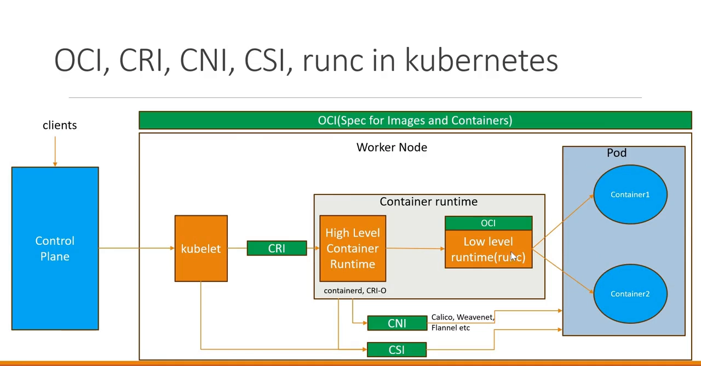

# OCI、CRI、CNI、CSI 与 runc 是什么

> 本文整理自视频 [OCI, CRI, CNI, CSI, runc in kubernetes](https://www.youtube.com/watch?v=dJtAT-pBncE)。

## 本讲要解决的核心问题（SCQA）

**背景**：把一个应用部署到 Kubernetes 集群，你只是向 API Server 发了一个请求，过一会儿 Pod 就在某个节点上跑起来了。

**冲突**：可这中间其实夹着一长串缩写——**OCI、CRI、CNI、CSI、runc**。它们读音相近、职责各异，初学者很容易糊成一团：到底谁负责什么？kubelet 又是通过谁去调用它们？

**疑问**：当 kubelet 要在一个节点上落地一个 Pod 时，它分别借助哪些接口去完成"跑容器、接网络、挂存储"这三件事？这些缩写各自站在链路的哪一环？

**回答（中心思想）**：可以用一句话记住——**CRI 管"把容器跑起来"，CNI 管"给 Pod 通网络"，CSI 管"给 Pod 接存储"，OCI 是大家都遵守的"标准"，runc 是最底层真正动手的"执行者"。** kubelet 就是那个站在中间、指挥三个接口加一个执行者的调度员。

## 一、先回顾：一次部署请求的链路

视频先用熟悉的一幕把上下文串起来：

1. 你向控制面的 **API Server** 发一个请求；API Server 完成**认证与授权**后，把数据**持久化到 etcd**。
2. 控制面的 **scheduler**（调度器）根据资源需求与调度参数，挑出一个合适的 worker 节点。
3. 选中节点后，该节点上的 **kubelet** 负责把应用**以 Pod 的形式部署起来**——它就是每个 worker 节点上常驻的代理。
4. 部署完成后，kubelet 再把容器状态**回报**给控制面。

**关键就在第 3 步**：kubelet 本身并不"亲手"容器、网络和存储，它靠三张接口去指挥别人。接下来的内容就是逐一拆开这三张接口。

## 二、CRI：kubelet 与容器运行时之间的接口

节点上除了 kubelet，还有一个重要角色——**容器运行时（container runtime）**。kubelet 通过一个名叫 **CRI（Container Runtime Interface，容器运行时接口）** 的接口与它对话。

- CRI 定义了**规范**和**必须实现的方法**；
- 具体的运行时去实现这份规范，例如 **containerd、CRI-O** 等；
- 于是 kubelet 通过 CRI 调用运行时，完成 Pod 内**容器的创建与生命周期管理**。

**运行时还分高层与低层**：

- **高层运行时**（如 containerd）负责**拉取镜像**；
- 拉完后它再去调用**低层运行时**（如 **runc**）用镜像**创建容器**；
- 低层运行时在创建容器时，会与内核特性打交道——**namespace（命名空间）与 cgroup（控制组）**。

所以"跑一个容器"其实是 **高层运行时 + 低层运行时**协作的结果，这也是 CRI 背后真正的动作分解。

## 三、OCI 与 runc：标准与最底层的执行者

我们用的容器镜像，必须遵守 **OCI（Open Container Initiative，开放容器倡议）** 的规范：

- OCI 提供**镜像规范**：你构建镜像、把镜像推送到 registry（如 Google Container Registry）时都要守它的规则；
- OCI 还提供**容器规范**：一个容器应当怎么被创建、生命周期怎么管理等等。

而**低层运行时**（如 runc）正是这份 OCI 规范的具体实现——它**照着 OCI 规范去创建容器**，并把容器在 Pod 里管理起来。

一句话记忆：**OCI 定标准，runc 照标准干活。**

## 四、CNI：Pod 网络的"接线员"

Pod 被创建出来之后还需要通信——既要与**同节点的其它 Pod** 通信，也要与**其它节点上的 Pod** 通信。要做到这点，Pod 需要网络接口。

这时，**容器运行时**会去跟 **CNI（Container Network Interface，容器网络接口）** 打交道：CNI 用来与**网络插件**交互，而 Kubernetes 生态里有各种网络插件——**Calico、Flannel** 等，它们提供集群 Pod 网络的**实际实现**。

于是链路是：运行时通过 CNI 调用网络插件，为节点上的 Pod **创建所需的网络接口、分配 IP 并接上网络**，从而让 Pod 之间能互相通信。

## 五、CSI：存储的"接线员"

除了网络，应用往往还需要**持久化存储**。为此我们有一堆**存储驱动**，比如 AWS EBS、NFS 的驱动。

这些驱动会**注册到节点上的 kubelet**，让 kubelet 能通过 **CSI（Container Storage Interface，容器存储接口）** 与它们对话。

kubelet 通过 CSI，去**创建所需的持久卷（Persistent Volume）并把卷挂到 Pod 内的容器上**，满足应用对存储的需求——不同格式、不同厂商的存储，都通过 CSI 这个统一接口接入。

## 六、五个缩写一张表记住

视频最后把这一串串起来：kubelet 是中心，三张接口向外发，最底层由一个执行者收尾。

| 缩写 | 全称 | 一句话职责 | 谁在调用它 |
| --- | --- | --- | --- |
| **CRI** | Container Runtime Interface | 把（Pod 里的）容器跑起来、管生命周期与镜像 | kubelet → 容器运行时（containerd / CRI-O） |
| **CNI** | Container Network Interface | 给 Pod 创建网络接口、分配 IP、接入集群网络 | 容器运行时 → 网络插件（Calico / Flannel） |
| **CSI** | Container Storage Interface | 创建并挂载持久卷到容器 | kubelet → 存储驱动（EBS / NFS …） |
| **OCI** | Open Container Initiative | 定义镜像与容器的**标准** | 运行时据此实现 |
| **runc** | —（低层运行时） | 照 OCI 规范，用 namespace/cgroup **真正创建容器** | 由（高层）容器运行时调用 |

> 视频也提醒：这里讲的是各组件之间**最基本的通信方式**，真实的通信要复杂得多——那是后续逐个深入各组件时会展开的内容。

## 小结

- **kubelet 不是独行侠**：它通过三张接口 + 一个执行者来完成 Pod 的落地。
- **CRI**：容器运行时接口，负责"跑容器"；运行时又分**高层（拉镜像）**与**低层（runc 创建容器）**。
- **CNI**：容器网络接口，负责"Pod 联网"，实现者是 Calico、Flannel 等插件。
- **CSI**：容器存储接口，负责"挂存储"，驱动注册到 kubelet。
- **OCI** 是标准，**runc** 是最底层的执行者。

## 关键术语速查

| 术语 | 一句话解释 |
| --- | --- |
| kubelet | 每个 worker 节点上的代理，负责把 Pod 部署到本节点 |
| CRI | kubelet 与容器运行时之间的接口 |
| containerd / CRI-O | 实现 CRI 的容器运行时 |
| 高层运行时 | 负责拉取镜像（如 containerd） |
| 低层运行时 | 负责用镜像创建容器、对接 namespace/cgroup（如 runc） |
| OCI | 开放容器倡议，定义镜像与容器规范 |
| CNI | 容器网络接口，用于与网络插件交互 |
| Calico / Flannel | 常见的 CNI 网络插件 |
| CSI | 容器存储接口，用于与存储驱动交互 |
| Persistent Volume | 通过 CSI 创建并挂载到容器的持久卷 |
