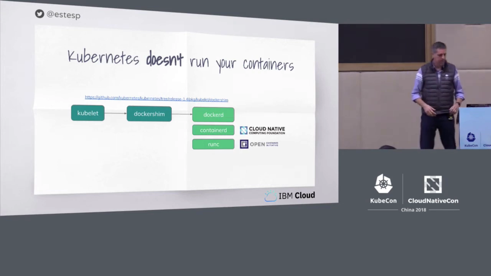
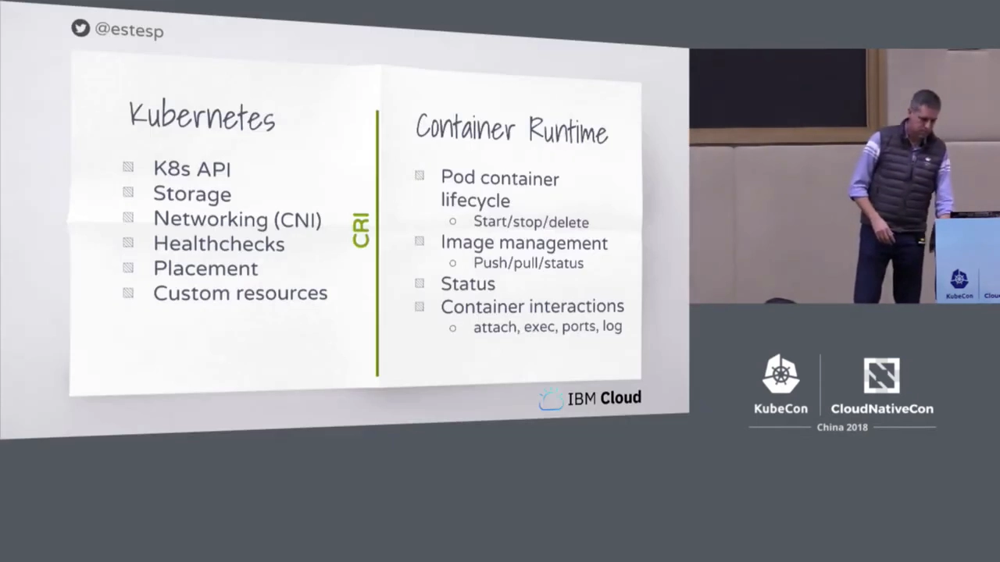
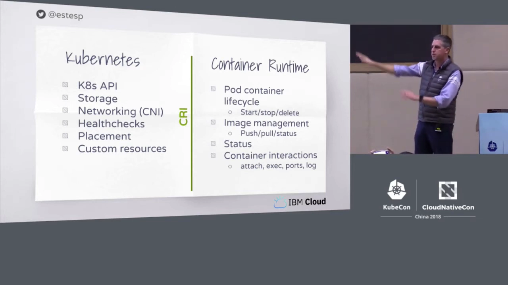
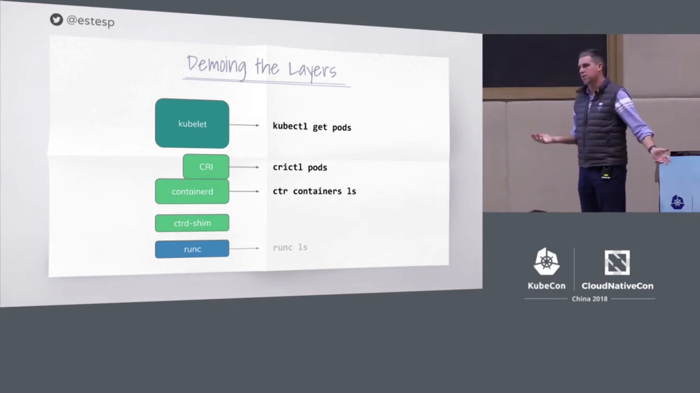
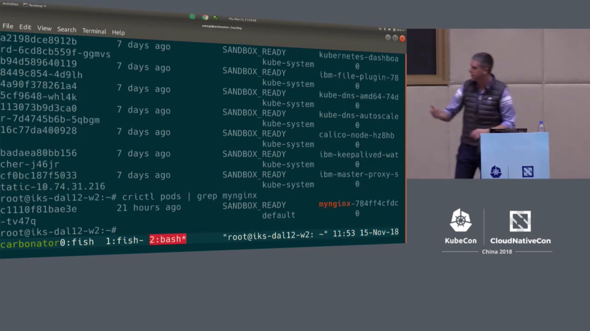
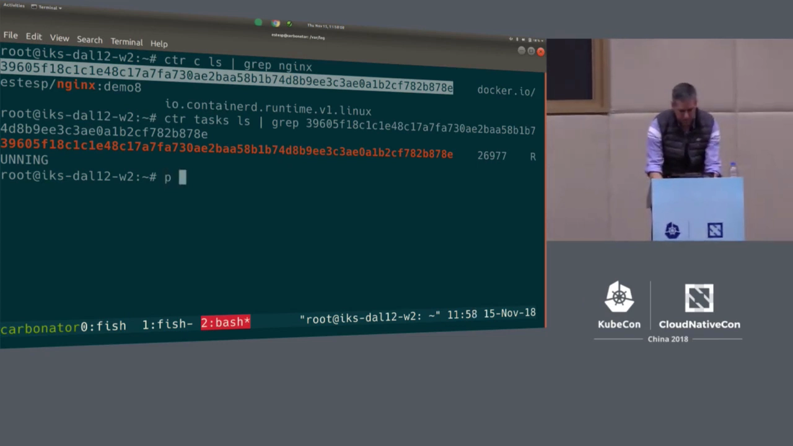
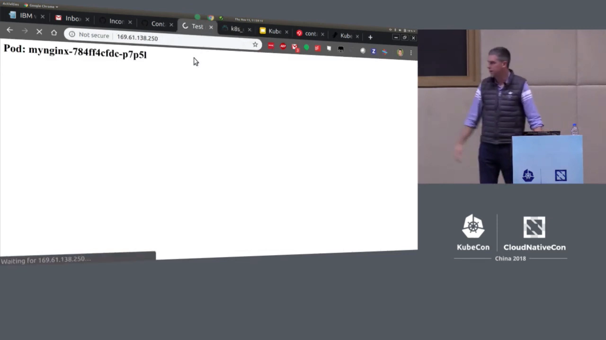

# Who's Running My Pods：CRI 深潜与 containerd 实战

> 本文整理自 KubeCon + CloudNativeCon 上海站演讲 [Who's Running My Pods: A Deep Dive into the K8s Container Runtime Interface — Phil Estes（IBM 杰出工程师，containerd maintainer）](https://www.youtube.com/watch?v=f4x8Yk5rhUg)。

## 本讲要解决的核心问题（SCQA）

**背景**：我们习惯说 Kubernetes 是"容器编排平台"——写一个 Deployment，`kubectl apply`，Pod 就跑起来了。看上去 Kubernetes 既"调度"容器，也"运行"容器。

**冲突**：可 Phil Estes 一开场就抛出一个反直觉的事实：**Kubernetes 根本不运行你的容器**。如果你把整个 Kubernetes 仓库翻一遍，找不到任何一行代码知道怎么在 Linux/Windows 上真正启动一个容器，也不知道怎么去 `create`/`start`/`stop` 它。真正干这活的，一直是另一个角色——**容器运行时（container runtime）**。那 Kubernetes 究竟怎么"指挥"它？

**疑问**：kubelet 和容器运行时之间靠什么对话？为什么换掉底层运行时，应用几乎无感？当我怀疑"某个 Pod 到底跑在这台机器的哪个进程上"时，应该从哪一层往下查？

**回答（中心思想）**：答案是 **CRI（Container Runtime Interface）**。它把"**编排**"和"**运行**"一刀切开：Kubernetes 负责 API、调度、存储、健康检查这些"编排"的事；运行时（containerd、CRI-O、dockershim……）负责把容器真正跑起来。于是排查 Pod 就有了**三层视角**——`kubectl`（编排层）→ `crictl`（CRI 层）→ `ctr`（运行时层），一路能追到宿主机上一个真实的进程。**你看到的 Pod，最终一定要落到某个 PID 上。**

## 一、Kubernetes 不运行容器：CRI 是怎么来的

演讲者 Phil Estes 是 containerd 的 maintainer，他先讲了一段历史。早年 kubelet 想启动容器时，靠的是一个叫 **dockershim** 的组件：它知道怎么跟 Docker engine 对话，替 Kubernetes 去执行 `docker run`、`docker start` 之类的命令。

但问题很快出现了：随着 Kubernetes 代码库里越来越多的地方都需要"知道运行时是谁"，代码变得非常混乱。当时除了 Docker，rkt 也是一家 CNCF 项目，社区甚至维护过一个叫 **rktnetes** 的分支，让 rkt 当运行时。可如果再来第三个、第四个运行时呢？

于是 2016 年 Kubernetes 博客提出了 **CRI**：

> 我们引入一个容器运行时接口（Container Runtime Interface），把 Kubernetes 代码库与 Docker 之类的运行时**解耦**。

CRI 的目标很明确：**把"运行时"这件事收敛到一个接口后面，任何实现了这个 CRI API 的东西，都能成为 Kubernetes 底下的运行时。** Kubernetes 从此不必认识 Docker，只认识"C实现了 CRI 的人"。

## 二、CRI 到底切开了什么：谁负责什么

CRI 这条线左右两侧的分工，可以用一张示意图来记。左半边是 **Kubernetes 仍然负责**的事，右半边是 **容器运行时必须实现**的事。

**分界线左边（Kubernetes / kubelet 负责）**：

- Kubernetes API 本身、以及围绕它的各种对象与控制器；
- 存储相关的编排（选择、绑定卷）；
- 网络：由你选定的 **CNI 插件**去实现，Kubernetes 只负责调用；
- 一切"编排性质"的 API 机制：健康检查、放置（placement）、把容器落到某个节点上。

**分界线右边（运行时 / CRI 负责）**：

- **生命周期命令**：`start`、`stop`、`delete` 这些你最熟悉的操作；
- **镜像管理**：跟 registry 打交道、拉取镜像（注意——**只有拉取，没有推送**，Pod 不需要 push 镜像）、查询镜像状态与分层（layers）；
- **状态**：Pod 的状态、Pod 内各容器的状态，以及相关的一堆信息；
- **交互操作**：`exec` 进容器、`attach`、端口转发、取日志（logs）……凡是 K8s API 里"要进到容器里干点事"的调用，背后都得由运行时通过 CRI 实现。

一句话：**CRI 的左边是"决定要什么"，右边是"把容器真正做出来并管起来"。** 演讲者自己也在幻灯片上标注，这张图并不完美——有些职责两侧都会碰一点——但它给了一个很好的心智模型。

## 三、谁实现了 CRI：一张运行时版图

既然 CRI 是一个接口，那"谁实现了它"就成了一道选择题。演讲中提到了当时几个主要玩家：

| 运行时 | 关系与特点 |
| --- | --- |
| **dockershim** | 被改造为"实现 CRI 的 Docker 适配层"，当年大量生产集群仍以 Docker 为运行时 |
| **containerd** | containerd 项目自带一个 **CRI plugin**，实现 CRI 后再调进 containerd 完成运行时的活 |
| **CRI-O** | Red Hat 的项目，**直接驱动 runc**——可以理解为"包在 runc 外面、又实现了 CRI 的壳" |
| **frakti** | 一个 shim 实现，早期对接 hyper.sh / Intel Clear Containers 的轻量虚拟化，或回调 Docker engine；后来并入 **Kata Containers** |

注意一个容易混淆的点：**runc 同时位于 Docker 和 containerd 之下**，而 CRI-O 也是包在 runc 外面的另一条路径。也就是说，"谁实现 CRI"和"谁最终调用 runc"是两件事。

**作为一个普通用户，为什么要在意底层是哪个运行时？** 演讲者的回答很坦诚：**大多数好处是运维层面的，而不是终端用户层面的。** 你的 `kubectl` 命令不会因为运行时不同而改变，应用开发者通常也不关心。但运维上可能在意：

- **性能**；
- **安全与隔离**：要跑不可信负载时，Kata 的虚拟机级隔离、gVisor 之类的方案很有吸引力；
- **多架构支持**：比如 IBM 的 Power / Z 系统，或者 IoT 场景的 ARM 设备。

## 四、containerd 是谁：Docker 拆栈与 CNCF

演讲用不少篇幅介绍了 containerd。大意是：这几年 Docker 把原本塞在单体 Docker 代码库里的能力，分别捐给了不同的开源基金会：

- **runc**：最底层、只负责"执行容器"的那个基本单元。它盯着 Linux 内核接口——**namespace、cgroup** 怎么建立、怎么配置，都是 runc 的活。
- **containerd**：捐给 **CNCF**，**坐在 runc 之上**，替你管理那些 runc 进程。近几个版本还内建了**镜像管理**（从 registry 拉取/推送）、**完整支持 OCI**，并提供一个很好用的 client API，适合被嵌进其它系统。

同一条技术栈被很多软件复用：Docker CE / Docker for Mac / Docker Enterprise 都跑在 containerd + runc 上，Kubernetes 通过 CRI 也能用同一套，Docker Swarm 亦如此。所以 containerd 被定位为"云上的核心容器运行时"。

为了证明稳定性，maintainer Michael Crosby 提到他们跑着一个 **7×24 的压测系统**，对 containerd 不停地启动、停止、exec，**每周运行数百万个容器**，确保每次代码合入都不会破坏稳定性与性能。再加上**稳定的 API、明确的 release 与支持策略**（bugfix 与 back-port 到老版本），这一切是为了让别人敢在你的产品上做二次开发。

时间线上还有个里程碑：**containerd 与 Kubernetes 的集成在 2018 年 5 月（KubeCon 哥本哈根前后）宣布 GA**，说明"用 CRI 接 containerd"已经可以用于生产。

**当时正在用 containerd 的有谁？** Kelsey Hightower 的《Kubernetes the Hard Way》里，containerd 就是默认运行时；IBM Cloud 的 Kubernetes 服务（选 1.11 / 1.12）会自带 containerd；GKE 当时在 beta 中可选 containerd；此外 Docker、LinuxKit、Rancher、Kata、阿里 PouchContainer、IoT 项目 balena、Cloud Foundry 等也都在用。

## 五、三层视角：kubectl → crictl → ctr

接下来是整场演讲最有价值的实操部分。演讲者给出一张"三层视角"的图，认为可以从三个层面观察节点上的工作负载：

| 层级 | 工具 | 你在跟谁说话 |
| --- | --- | --- |
| 编排层 | `kubectl` | Kubernetes API（例如 `kubectl get pods`） |
| CRI 层 | `crictl` | 直接对话 **CRI API**（"这个节点上有哪些 Pod？"） |
| 运行时层 | `ctr` | containerd 的简易客户端（"containerd 里有哪些容器？"） |

> 顺带一提：再往下 runc 也有自己的客户端，可以列出宿主机上的 runc 进程——但演讲者为省时间跳过了。

他的演示集群是 IBM Cloud（Dallas 12 区域）上的 **Kubernetes 1.11**，3 个 worker 节点，master 由托管服务负责。他 SSH 进 worker2 后：

1. 先看有没有 Docker 进程——**没有**（因为这台节点用的是 containerd）；
2. `ctr version` → 显示 **containerd 1.1.4**，并且成功连上了同版本的 server；
3. `crictl pods | grep nginx` → 找到了跑在本节点上的那个 nginx Pod。

### 5.1 containerd 的"命名空间"：k8s.io 与 moby

继续往下之前，演讲者讲了一个很容易踩的坑：**containerd 支持 namespace，用来隔离不同的上层使用者。** 在他自己的笔记本上（Docker 18.09 刚发布，Docker 已改用系统级 containerd），执行 `ctr namespaces ls` 会看到 **`k8s.io`** 和 **`moby`** 两个命名空间——Docker 把容器建在 `moby` 里，而 Kubernetes 用 `k8s.io`。

回到 worker 节点，`ctr namespaces ls` 只有 **`k8s.io`**（因为这台机器上没有 Docker、没有别的 containerd 使用者）。所以如果你不指定 namespace，直接 `ctr c ls` 会**什么都看不到**；必须用 `--namespace k8s.io`（他干脆 `export namespace=k8s.io` 省事），才能列出那些"kubelet 通过 CRI 拉起来的 Pod 里的容器"。

### 5.2 找到 nginx 容器，再找到它的 PID

设好命名空间后，`ctr c ls` 列出了 containerd 知道的所有容器；`grep nginx` 能看到一个长长的容器 ID（以 `39605…` 开头），镜像正是他准备好的 nginx demo，运行时是"containerd v1 Linux"。

但容器还不是终点。接着他用 `ctr tasks ls` 列出真正映射到系统进程的 task，找到了一个 **PID 26977**——它正对应那个容器，也就对应那个 Pod。最后，在宿主机上 `ps` 一把、grep 这个 PID，看到的正是**跑着 FastCGI 与 nginx 的进程**。

> 到这里，完整链路被彻底打通：**kubectl 列 Pod → crictl 看节点上的 Pod → containerd 里的容器 → task → 一个真实的 PID。**

## 六、一条端到端的追踪链

把上面这条链总结成一张表，它就是日后排查"Pod 到底跑在哪"的标准动作：

| 步骤 | 命令 | 看到的东西 |
| --- | --- | --- |
| 1 | `kubectl get pods` | 集群里的 Pod 列表 |
| 2 | `crictl pods`（在节点上） | **本节点**上的 Pod（找到属于你的那个） |
| 3 | `ctr -n k8s.io c ls` | containerd 里的**容器**及其镜像、运行时 |
| 4 | `ctr -n k8s.io tasks ls` | 映射到系统进程的 **task** 与 **PID** |
| 5 | `ps -ef`（grep 该 PID） | 宿主机上**真正的应用进程** |

**这就是 CRI 存在的意义在排查时的体现：** 你不再只能问 Kubernetes"它说 Pod 在跑"，而是能亲自下沉到运行时、再下沉到内核进程去验证。

## 七、动手演示：杀容器 vs. 杀 Pod

演示的最后，演讲者用一个小实验展示 Kubernetes 的**自愈**，也就是"编排层与运行层"的分工：

- 他的 nginx 通过 **Istio ingress** 暴露，访问 `index.html` 会返回**当前响应的 Pod 名字**；反复刷新，请求会在多个 Pod 之间轮换——这就是 Kubernetes 的负载均衡 + Istio 的路由在"变魔术"。
- 他用 `ctr` **杀掉**这个节点上的 nginx 容器（**只杀容器，不杀 Pod**）。结果：**Pod 名不变**（还是 `TV-47Q`），容器却重新起了一个。因为容器是可重启的，Pod 这个"壳"还在，kubelet / containerd 只需把容器拉起来。
- 换成从 CRI 层动手：`crictl stop pod` + `crictl remove pod`，这次**连 sandbox 一起停掉、删掉**——这才是"删 Pod"。

> 演讲者在此处也坦承，现场由于时间与手速原因没能把"删 Pod → 看到失败 → 重建"的过程演示得完美，这也提醒我们：**demo 会翻车，但机制是清楚的。** 他还提到 `crictl` 有很完整的用户手册——它甚至能创建 Pod、支持 no-CNI 的 spec，以及直接在 kubelet 底下**替换运行时**（比如 Docker 换成 containerd 再换回来，观察 Pod 重启后继续运行）。

## 八、这对你意味着什么

Phil Estes 借 Kelsey Hightower 的一句名言做了改编：

> "把容器当成黑盒，最终会让你身处黑暗。" → **"把容器运行时当成黑盒，最终也会让你身处黑暗。"**

即使你是应用开发者或更高层的使用者，**知道底下是哪个运行时、它有什么能力、怎么和它交互**，都会在关键时刻帮上忙；对运维团队而言，运行时选择更是一个实实在在的"运维杠杆"（性能、隔离、多架构）。

## 小结

- **Kubernetes 不运行容器**，它只做运行时之上的编排；真正跑容器的是运行时。
- **CRI 是"编排"与"运行"之间的分界线**：左边是 kubelet 的活（API、调度、存储、CNI 调用、健康检查），右边是运行时的活（生命周期、镜像、状态、exec/attach/logs）。
- **运行时版图**：dockershim、containerd（CRI plugin）、CRI-O、frakti→Kata；`runc` 在 Docker 与 containerd 之下当"最底层执行者"。
- 排查 Pod 用**三层视角**：`kubectl` → `crictl` → `ctr`（注意 containerd 的 `k8s.io` 命名空间），最终落到宿主机的 **PID**。
- **杀容器 ≠ 杀 Pod**：容器可被 kubelet 重启，Pod 名不变；只有删掉 Pod（sandbox）才会真正消失。

## 关键术语速查

| 术语 | 一句话解释 |
| --- | --- |
| CRI | 容器运行时接口；kubelet 通过它指挥容器运行时 |
| dockershim | 早年让 kubelet 与 Docker engine 对话的适配层，后被改造为实现 CRI |
| containerd | CNCF 项目，坐在 runc 之上，管进程 + 镜像管理，自带 CRI plugin |
| CRI-O | Red Hat 运行时，直接驱动 runc，同时实现 CRI |
| runc | 最低层执行者，负责 namespace / cgroup 与容器进程的创建 |
| Kata Containers | 提供虚拟机级隔离的运行时，由 frakti 等演化而来 |
| OCI | 开放容器倡议，定义镜像与容器规范，运行时据此实现 |
| crictl | 直接对话 CRI API 的命令行工具，用于在节点上排查 Pod |
| ctr | containerd 的简易客户端；需指定命名空间（如 `k8s.io`） |
| task | containerd 中映射到真实系统进程的对象，对应一个 PID |
