# 静态Pod深潜：控制面的"侧门"与 DaemonSet 之争

> 本文整理自视频 [Kubernetes Static Pods Explained: The Side Door to Bootstrapping vs DaemonSets](https://www.youtube.com/watch?v=X3s3Fqat_lc)。

## 本讲要解决的核心问题（SCQA）

**背景**：在 Kubernetes 里，一切普通工作负载都在等控制面——等 API Server、等 scheduler（调度器），等那个"决定哪个容器跑在哪个节点上"的大脑。没有大脑，什么也不该启动。

**冲突**：可这个大脑本身也是由容器组成的。于是就有了那个最安静的悖论——**一座城市要等到市长选出来才能开城门，可选举本身又只能发生在城里**。总得有什么东西，在"中央指挥"缺失、损坏、甚至还没出生的时候，先在一台机器上活过来。

**疑问**：当整个集群还是一片漆黑时，**是谁还醒着？** 一份本地文件，凭什么能替代整个控制面，把关键的 Pod 拉起来？它和 DaemonSet 又有什么本质区别？

**回答（中心思想）**：答案藏在每个节点上的 **kubelet** 里——它除了"听控制面的",还有一份更古老、更倔强的差事：**盯着一个本地目录**。目录里每出现一份清单文件，它就在本节点直接创建 Pod，不等 scheduler。这就是**静态 Pod**：**它把"真相源头"从集群中心搬到了本地磁盘**。代价是失去集群的调度与弹性，换来的是——**在 API 不可用、甚至还没诞生时，某些东西一定在本机运行**。

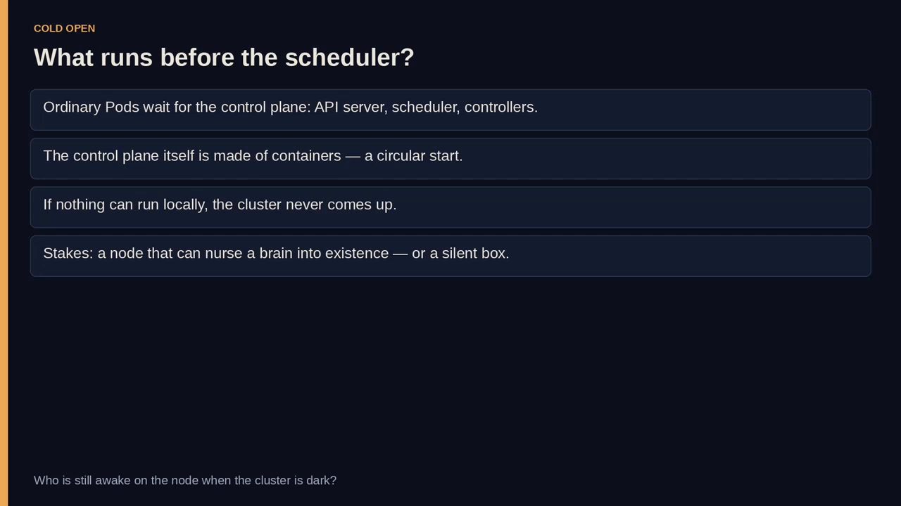

## 一、先认识那位"从不离岗的守夜人"：kubelet

每个 Kubernetes 节点上都有一个本地代理，叫 **kubelet**。可以把它想成**一个从不离开大楼的守夜人**：

- API Server 可以失声，scheduler 可以被卸载，各种控制器可以消失；
- **kubelet 依然在**——它仍然在跟这台机器上的容器运行时对话。

在"通常的故事"里，kubelet 是个**跟随着**：它从控制面接收 Pod 规格，然后把它变成现实（拉镜像、起容器、上报状态）。这个模型灵活、可扩展，但它在"你想先把控制面建起来"这件事上，是**循环的**——所以，kubelet 还有第二份工作。

## 二、kubelet 的第二份工作：盯着一个目录

这份工作就是：**让它去盯着磁盘上的一个文件夹**——不是 API 对象，而是一个**装着文件的目录**。

当一份 Pod 描述出现在那里时，**kubelet 不会去等 scheduler**，而是**立即在这台节点上把 Pod 创建出来**，仿佛那份文件本身就是一道命令。这就是静态 Pod 的开端——**一个"真相源头在本地、不在中心"的工作负载**。

> 守夜人不需要市长，他只需要桌上的一张纸。

于是静态 Pod 的定义可以精确到每个词：

- **由 kubelet 直接管理**——不是 Deployment、不是 ReplicaSet、不是 scheduler；
- **在一个特定的节点上**——你是**把文件放到那台机器上**来选定它的，集群不会替你选；
- kubelet 监听一个**配置好的本地目录**里的清单（通常是 YAML 或 JSON），一旦发现就自动创建并运行 Pod。

**文件就是契约**：只要文件存在且合法，kubelet 就会努力让这个 Pod 在这台节点上活着。[【跳转到 01:25】](https://www.youtube.com/watch?v=X3s3Fqat_lc&t=85)

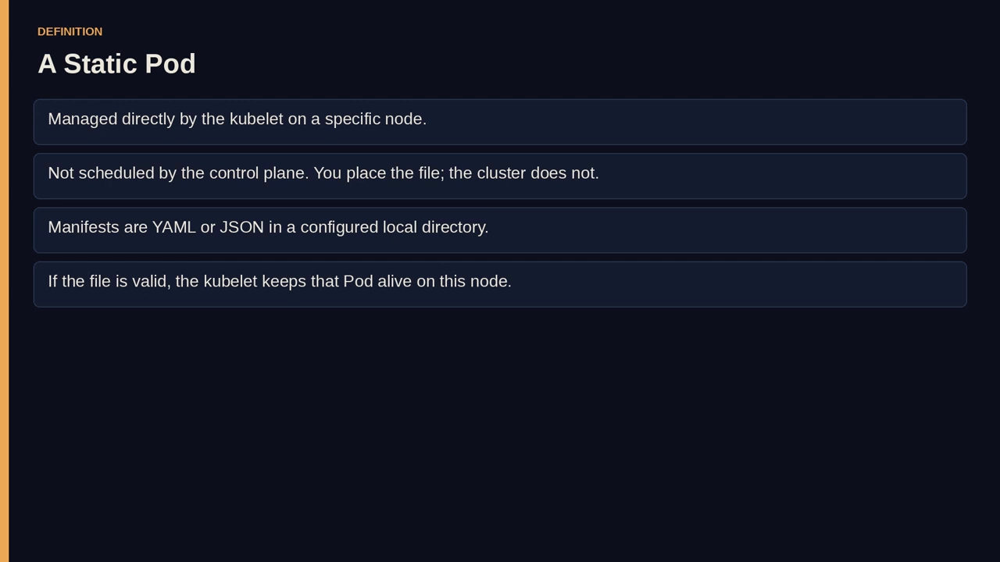

这里没有"与 scheduler 的准入之舞"，没有在节点之间来回腾挪，也没有控制面会去修复的副本数。它听起来很原始——**而且它是故意原始的**：当精密机械还没开始运转时，当某段软件必须存在、"哪怕 API 是错的、被分区了、甚至没了"时，你要的正是这种原始。

## 三、为什么非要留在本机：三个反复出现的理由

为什么要选这个"分布式系统里的本地例外"？有三种场景反复出现：

1. **引导控制面（bootstrapping the control plane）**：API Server、scheduler、controller-manager 常常以静态 Pod 的形式先在 master 节点上起来——**因为你没法让 scheduler 去调度 scheduler 自己**。
2. **节点级代理（node-level agents）**：日志采集、网络插件、安全探针——它们必须活在这台主机上，绑定**这个内核、这块磁盘、这个网络命名空间**。
3. **必须在本地运行的负载**：哪怕集群大脑不可用，也要在本机继续跑——比如分区时维持节点可用的"最后一道工序"。

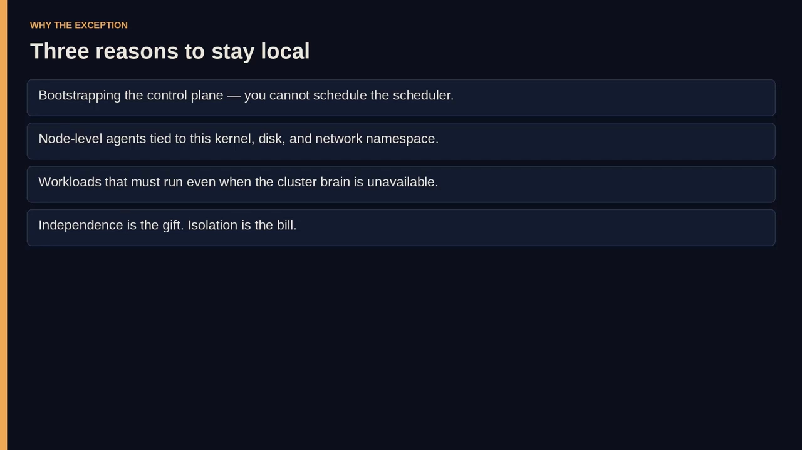

注意这三者的共同点：**它们都无关"弹性伸缩"，而关乎"在不在场"（presence）**。静态 Pod 是一句承诺——**"只要这份文件在这儿，这儿就一定有个东西在跑"**。

代价也随之而来：你**放弃了集群"把活儿挪走"的本领**。你得接受——**如果这台节点挂了，那个静态 Pod 也跟着挂**，除非你**手动**把同一份文件复制到别处。**独立性是礼物，孤立是账单。**

## 四、机制拆解：一份文件如何变成容器

机制小得让人意外。kubelet 被配置了一个 **static pod 路径**，在视频演示里是 `/etc/kubernetes/manifests/`——它就是一个普通目录：

- **放进**一份 YAML，等于**下达**了一道命令；
- **删除**这份文件，等于**撤销**了这道命令；
- **修改**这份文件，等于**改写**了这道命令。

关键在于：**这个循环里没有 `kubectl apply`**——至少它**不是真相源头**。kubelet 像人瞄一眼剪贴板那样轮询（或监听）这个文件夹：合法的 Pod 规格变成这台节点上运行着的 Pod，**非法的规格则变成 kubelet 日志里的错误**，而不是"调度器会去别的机器重试的对象"。

这种**本地性（locality）就是全部意义**：你**没法**把这个负载不小心调度到另一个机架的 worker 上，你也**没法**在节点没了之后让控制面把它重建。

把静态 Pod 和普通 Pod 对比一下就很清楚：

- **普通 Pod**：先作为 API **对象**存在，然后才成为**进程**；
- **静态 Pod**：**反过来**——先在这台节点上成为**进程**，之后（如果有的话）才在 API 里留下一个**倒影**。

> 一个文件夹，就是一个"作用半径只有一台机器"的原始控制面。

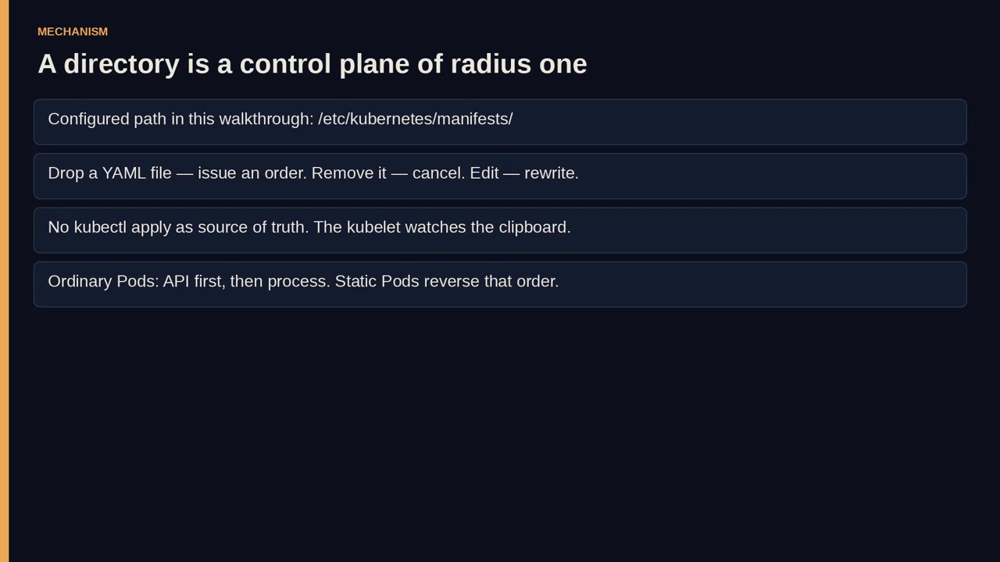

### 那份清单长什么样

清单本身**极其普通**——就是一个标准的 Pod 定义：`apiVersion: v1`、`kind: Pod`，`metadata` 下写名字 `nginx-static-pod`，`spec` 下写一个容器 `nginx`、镜像 `nginx:latest`。

关键洞察是：**静态 Pod 并不需要什么特殊的 kind 字段**。Kubernetes **没有**发明一种叫"StaticPod"的新资源——它**复用了 Pod**，只是**改变了投递路径**。同样的 YAML，你 `kubectl apply` 就是一个普通 Pod；放进 kubelet 目录，它就成了静态 Pod。**语法没变，变的是"文件放在哪、由谁来读"。**[【跳转到 09:50】](https://www.youtube.com/watch?v=X3s3Fqat_lc&t=590)

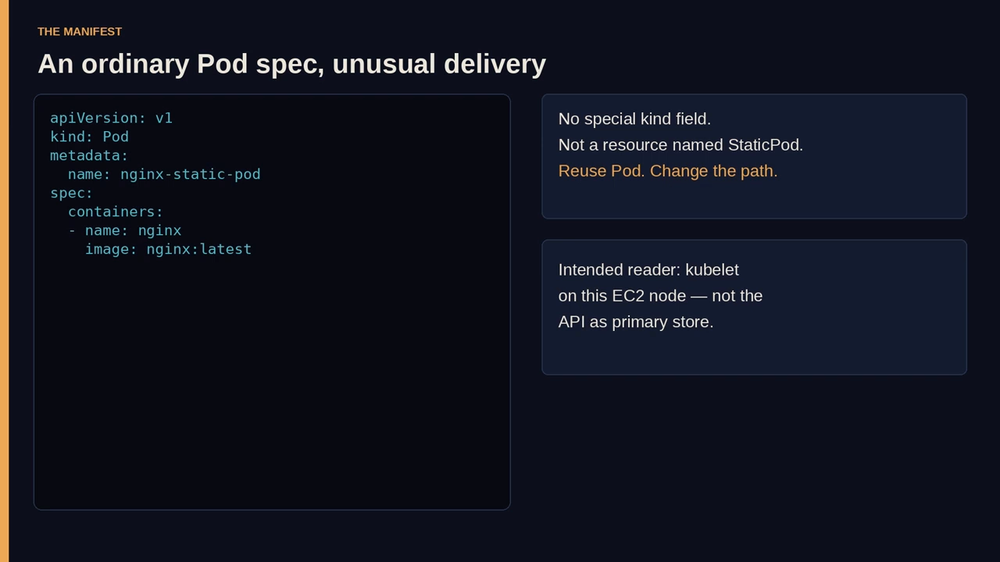

## 五、镜像 Pod：看得见，但指挥不动

如果静态 Pod 只存在于本地文件里，运维岂不是要"瞎"了？聪明的点在后面：kubelet 除了启动本地 Pod，还会在 **API Server 里创建一个对应的"镜像 Pod"（mirror pod）**，让这个工作负载**对整个集群可见**。你可以 `list` 它、`describe` 它、`watch` 它的状态，就像它是个普通 Pod。

**但可见不等于可指挥（visibility is not authority）**：

- 镜像 Pod **只是一个墙上的影子**；
- 如果你试图去编辑或 `kubectl delete pod` 这个 API 对象，你**是在跟一个倒影争论**；
- kubelet 仍然盯着磁盘上的文件，真正的 Pod 依旧按**清单**继续运行或被重建，**不理会**你的 API 请求。

这个"分裂"第一次遇到时很容易踩坑，也是某种"恐慌"的来源：你删了 Pod，kubectl 说它没了，**可它又回来了——或者根本没走。**

> 想想博物馆里雕塑旁的标签：**你能读标签，却不能靠改标签来挪动雕塑**。`/etc/kubernetes/manifests/` 里的文件是雕塑，API 里的对象只是标签。

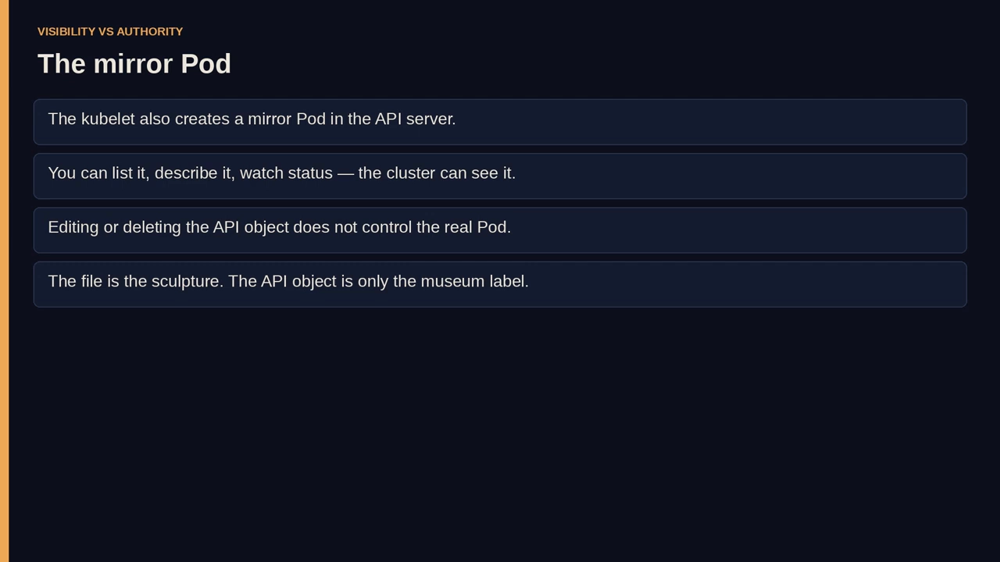

## 六、动手实做：在一台 EC2 上放一个 nginx 静态 Pod

视频随后离开示意图，走进真实机器：打开云控制台、起一台 EC2 实例（扮演一个 Kubernetes 节点）、SSH 登录。**为什么非要用 EC2？** 因为静态 Pod 永远是**"节点本地的故事"**——你没法只从 API 讲清楚它，你必须**站到那台机器上、写一个文件、看着 kubelet 注意到它**。

顺序很重要：**先装工具，再写清单，最后处理目录。**

- 在实例上安装 Kubernetes 工具（含 `kubelet` 与 `kubectl`）；
- 记住分工：**kubelet 拥有静态 Pod，kubectl 只负责"看"**——混淆角色，你就会花一下午去删那些"死不掉的"对象；
- 把 `/etc/kubernetes/manifests` 当成 kubelet 的 static manifest 路径（很多集群里它本来就是控制面的默认目录）——**把它当作"神圣的文件夹"**，因为**你往里丢的每一份合法 Pod 规格，都会变成一个进程**。

写好的清单就是前面那份 nginx Pod YAML。**把它挪进去才是关键的一步**：

```bash
sudo mv static-pod.yaml /etc/kubernetes/manifests/
```

文件一离开工作目录、进入 kubelet 监听的路径，**"文档"就变成了"工作负载"**——没有 `apply`、没有 `create`，kubelet 发现新清单后自动创建 Pod。**文件进目录，进程上机器。**

随后用 **`kubectl get pods`** 看结果：列表里出现一个 `Running` 的 Pod——**你并没有"调度"它，你只是"放置"了它**。

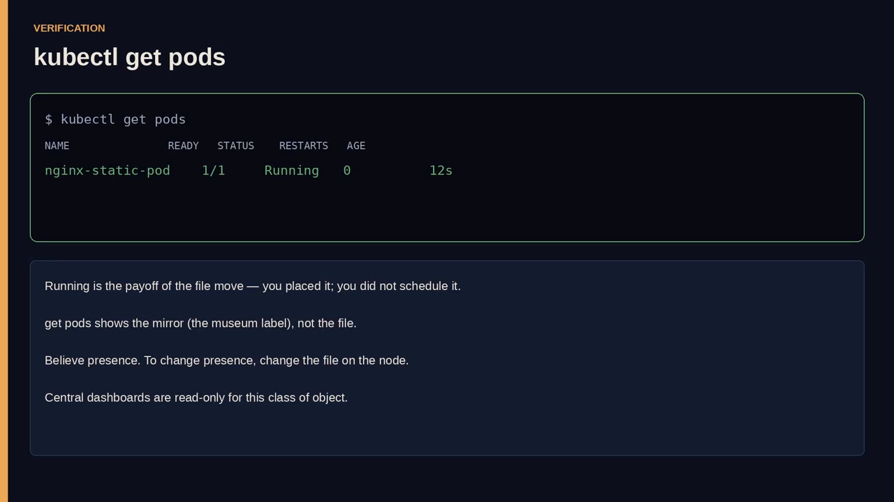

但要记住：`get pods` 给你看的是**镜像（博物馆标签）**，不是文件本身。它能读、能查、能用 `describe`/`logs`——**唯一要克制的是别顺手加上 `delete`**。

## 七、两个控制循环：为什么 kubectl delete 删不掉它

假设有人执行 `kubectl delete pod`，点名要删这个静态 Pod：

- 在**普通世界**里，这就是终点——API 对象被移除，kubelet 被通知停止，容器死去；
- 在**这个世界**里，这条命令**是在跟一个倒影争论**：kubelet 依然在 `/etc/kubernetes/manifests/` 里看到那份文件，而它的职责是**让节点去匹配目录，而不是让目录去匹配 API**。所以 Pod **会回来**（或从不真正让位）。

这不是 bug，而是**能让控制面组件在引导期扛住 API 事故的特性**;同时，如果你以为"Kubernetes 只有一个控制循环"，它也会让你抓狂。**现在有两个循环**：

1. 你熟悉的**集群循环**；
2. kubelet 的**文件循环**——对静态 Pod 而言，**它说了算**。

**真相源头在本地，其余都是注释。** 这也是静态 Pod **既强大又危险**的地方：

- **强大**：关键进程不会被一个糊涂的控制器、或一段乱打 API 的脚本删掉；
- **危险**：关键进程也不会被你"本想运行的那段脚本"删掉。

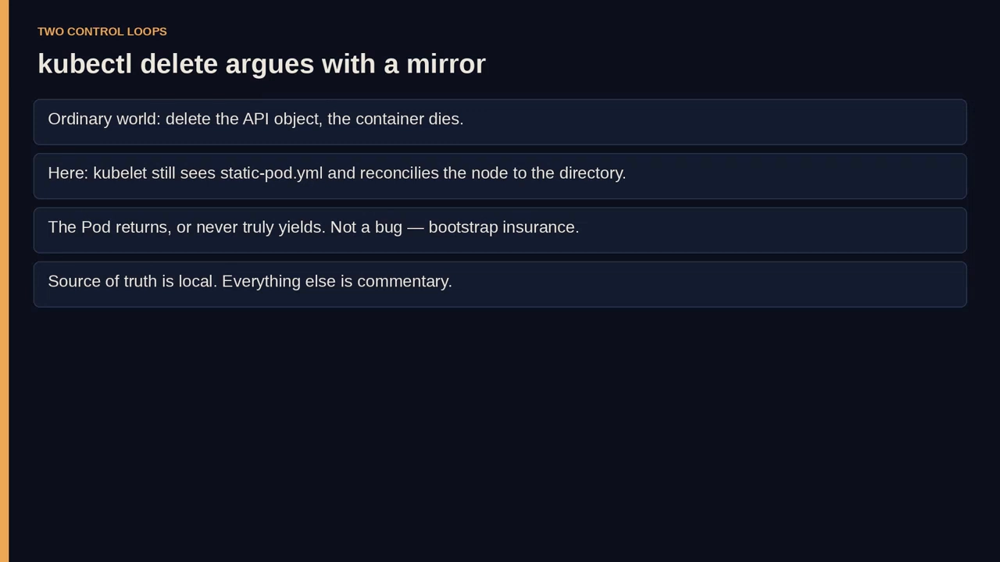

## 八、增删改，全部由文件完成

要改变现实，就改文件。视频演示了完整的三部曲：

- **改内容**：把清单里的名字改成 `httpd-static-pod`、容器改成 `httpd`、镜像改成 `httpd:latest`——**kubelet 检测到文件变化**（注意：**不是 API watch，也不是什么滚动更新对象**），于是把 nginx 换成 httpd，`kubectl get pods` 也随之反映新身份（同样是经由镜像）。这是**一种 reconcile（协调）**，只不过**期望状态是一份 POSIX 文件，而不是一个 etcd 对象**。它没有 `maxUnavailable`、没有滚动更新策略——只有**你在节点上改 YAML、相信 kubelet 会注意到**。[【跳转到 15:30】](https://www.youtube.com/watch?v=X3s3Fqat_lc&t=930)

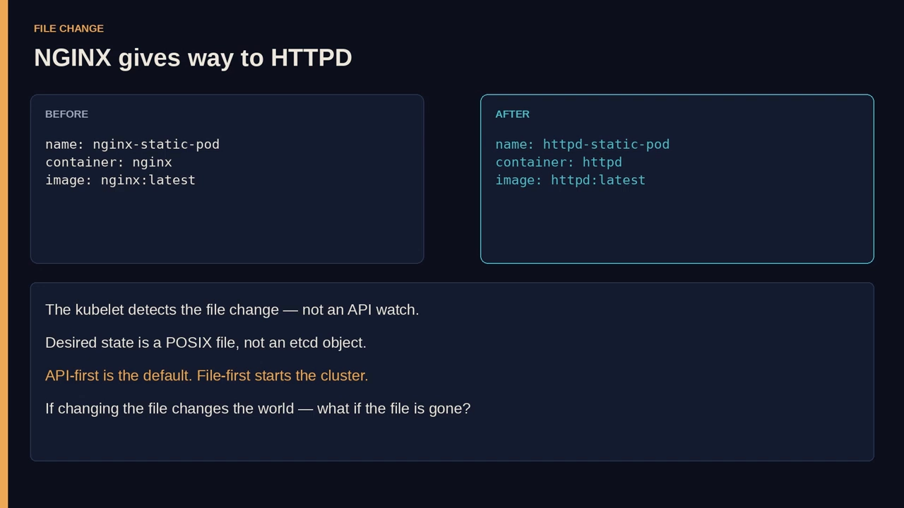

- **删除**：`sudo rm` 掉清单文件——**移除文件就移除了静态 Pod**（是 `rm`，不是 `kubectl delete`）。kubelet 一看剪贴板上的纸条没了，就停掉对应的 Pod，API 里的镜像也随之消失。

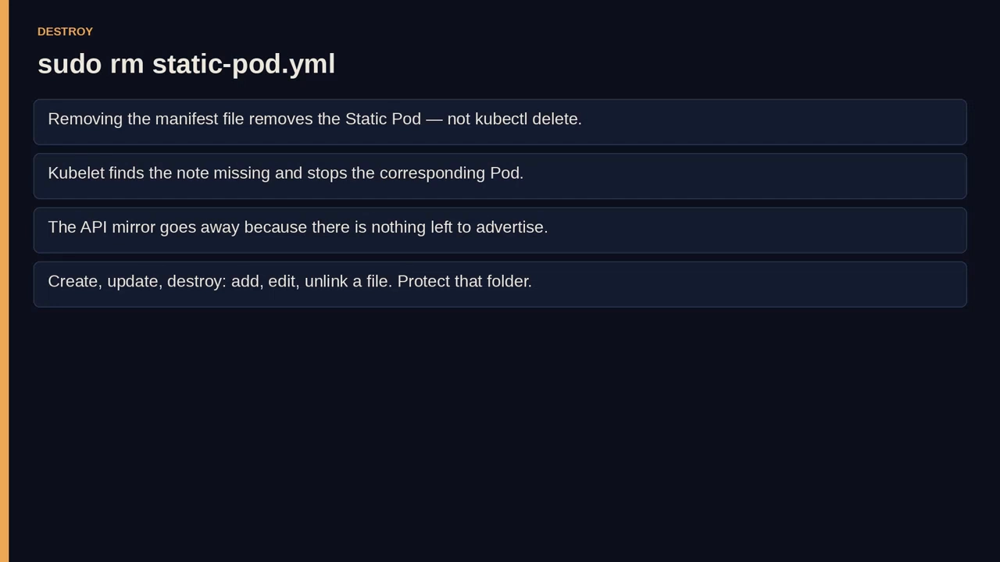

至此，"合同"走完一整个循环：**加文件创建、改文件更新、删文件销毁**。**kubelet 就是一个"期望状态存储是目录"的控制器。**

这也直接点出了**运维风险**：**任何能在该节点上拿到 root、或能写那个目录的人，实际上就是这个节点的"调度器"**。所以要像对待生产配置一样，**保护好这个文件夹**。

## 九、静态 Pod vs DaemonSet：它们回答的是不同的问题

引言里的悖论解决了——**你可以在"调度器无法启动"的状态下先启动调度器。**那剩下的问题是品味：Kubernetes 早就有一种"在每个节点跑东西"的一等公民，叫 **DaemonSet**。为什么还要选静态 Pod？什么时候选它是错的？

把两者当作**各有强项和盲区的对手**摆上桌：

| 维度 | 静态 Pod | DaemonSet |
| --- | --- | --- |
| **定义方式** | 手动定义 Pod 规格、手动放置 | Kubernetes 管理的对象：声明一个控制器，控制面保证 Pod 落在选定节点上 |
| **放置（Placement）** | 最字面意义上的"节点专属"：这份文件、这台机器 | 通过和其他负载一样的调度与选择机制，跑在选定节点或全部节点上 |
| **管理接口** | kubelet + 一个目录 | Kubernetes API |
| **用例** | 引导控制面；必须在本地运行、连 API 都不能完全信任的场景 | 集群级代理：日志、监控、网络——**前提是控制面已存在** |
| **扩展性** | 难——没有副本字段让控制器去追；要在更多节点运行，只能手动复制清单或自建 K8s 之外的自动化 | 按 K8s 的方式可扩：加一台匹配 selector 的节点，Pod 就出现；移除节点，账目随之变化 |
| **维护** | 手动：改文件、靠改文件重启、活在 SSH 里 | 自动：通过 API 滚动更新，拥有一整套控制器词汇（状态、滚动更新等） |
| **控制** | 在节点上，由 kubelet 依据磁盘控制 | 通过 Kubernetes master 与 API 控制 |

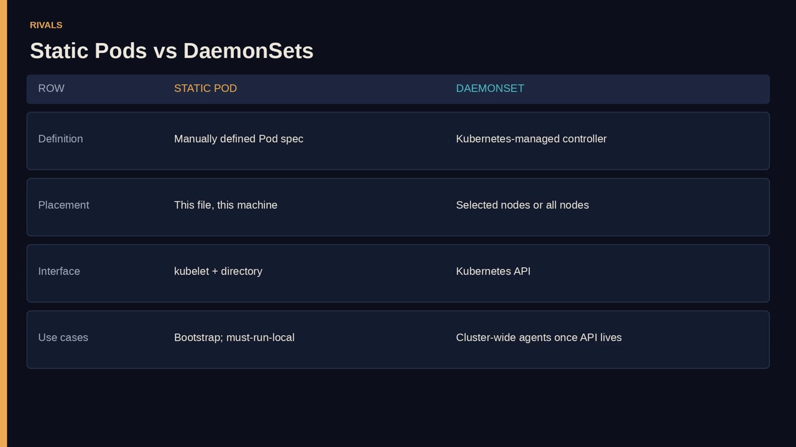

把这几行读成一句话：**静态 Pod 用"集群的协调"换来"本地的独立"；DaemonSet 用"一点引导期的独立"换来"协调"。**

- 如果你的**控制面挂了，DaemonSet 帮不了你**把它启动起来；
- 如果你的**控制面是好的，静态 Pod 往往就是一个多余的"第二真相源"**——一份你迟早会在第 7 号节点上忘记的文件。

它们**不是道德上的胜负**，而**在回答不同的问题**：

> 一个问："**大脑还没活过来之前，什么必须存在？**"
>
> 另一个问："**大脑活过来之后，每个节点上必须存在什么？**"

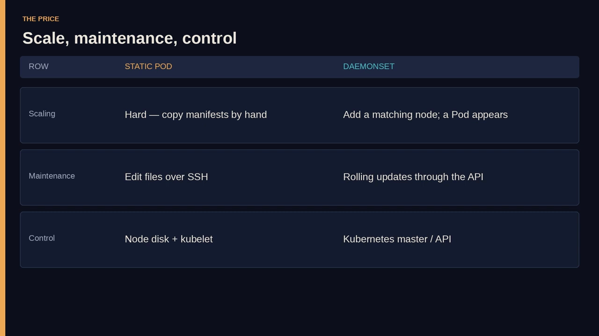

**混淆这两个问题**，你**要么根本引导不起来，要么因为害怕 API 而在 100 个节点上手动照看文件**。

## 十、怎么选：把经验落成判断

在真实的运维时刻，可以这样判断：

- **在 master 上拉起 etcd、kube-apiserver、kube-scheduler、kube-controller-manager** → 静态 Pod 是经典答案：该 master 的 kubelet 读取 `/etc/kubernetes/manifests`，把这些二进制以 Pod 形式启动；这些二进制随后组成了**那个将来去运行 DaemonSet 的控制面**。
- **把日志采集器铺到每个 worker** → DaemonSet 是答案：你想要 node selector、toleration、滚动更新，以及"换供应商时删一个对象"的便利。

还有一片**灰色地带**：某个节点级代理，你**不想让 API 有能力把它关掉**。有团队仍在在这里用静态 Pod，把运维上的痛当作一种安全/可靠性立场；也有人坚持——**如果 API 都被攻破了，你的问题远不止一个日志代理**——于是继续用 DaemonSet。视频不替这场争论当裁判，**它只把机制交给你，让你自己能判**。

无论哪一种，**别忘了镜像 Pod**：即便是静态 Pod 也不是"隐形的"——**可观测性还在，权限没有了**。当值班工程师看到一个**删不掉的 Pod**时，第一个该问的问题是：**"这台节点上是不是有个文件？"** 问得早，省下几个小时;问得晚，它看起来就像一个闹鬼的集群——**而"闹鬼的集群"通常只是一个目录。**

## 小结

- **静态 Pod 的定义**：由 **kubelet 在特定节点上直接管理**、而非由控制面调度控制的 Pod，**真相源头是本地文件**。
- **kubelet 的双重角色**：平时是"跟随者"（接收控制面的 Pod 规格）；对静态 Pod 则是"守夜人"（盯着本地目录，文件到位就创建）。
- **机制**：配置一个 static pod 路径（如 `/etc/kubernetes/manifests/`），**放 / 改 / 删文件 = 创建 / 更新 / 销毁** Pod，全程没有 `kubectl apply` 参与。
- **镜像 Pod**：kubelet 会在 API 里建一个对应的镜像 Pod 供查看，但**可见 ≠ 可指挥**——`kubectl delete` 删不掉它。
- **为什么需要它**：打破"先有鸡还是先有蛋"的引导悖论，让关键组件在 API 缺失时也能先跑起来。
- **代价**：难以扩展、没有滚动更新、多出一个"文件形状"的真相源与第二个控制循环。
- **与 DaemonSet 的分工**：静态 Pod 用在"**大脑还没活之前**"；DaemonSet 用在"**大脑活过来之后、每个节点都要有**"。
- **运维提醒**：能写那个目录的人就等于该节点的调度器，**请像保护生产配置一样保护它**；遇到"删不掉的 Pod"，先问"节点上有没有文件"。

## 关键术语速查

| 术语 | 一句话解释 |
| --- | --- |
| 静态 Pod（Static Pod） | 由 kubelet 直接管理、真相源头是节点本地文件的 Pod。 |
| kubelet | 节点上的本地代理，既接收控制面指令，也负责静态 Pod 的创建与维护。 |
| 引导悖论（bootstrap paradox） | 控制面本身是 Pod、而 Pod 又依赖控制面，因而需要一个"本地例外"来起步。 |
| 镜像 Pod（mirror pod） | kubelet 在 API 中创建的只读"倒影"，让静态 Pod 可被集群看见，但不接受指挥。 |
| static pod 路径 | kubelet 监听的本地目录（常见 `/etc/kubernetes/manifests/`）。 |
| 两个控制循环 | 集群控制循环（API 驱动）与 kubelet 的文件循环（磁盘驱动），后者对静态 Pod 说了算。 |
| DaemonSet | Kubernetes 原生"每个节点跑一个 Pod"的控制器对象，由控制面管理、支持选择器与滚动更新。 |
| 本地性（locality） | 静态 Pod 只能存在于放置了文件的那台节点上，无法被调度到别处。 |
