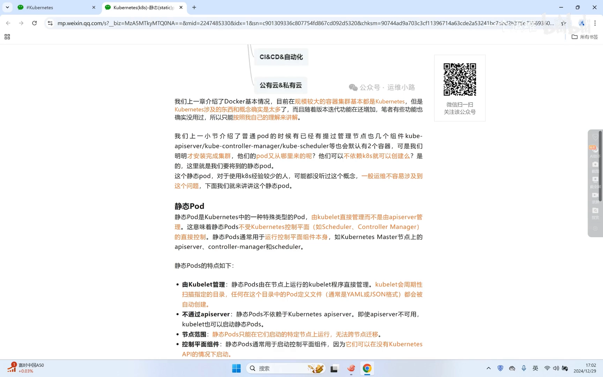
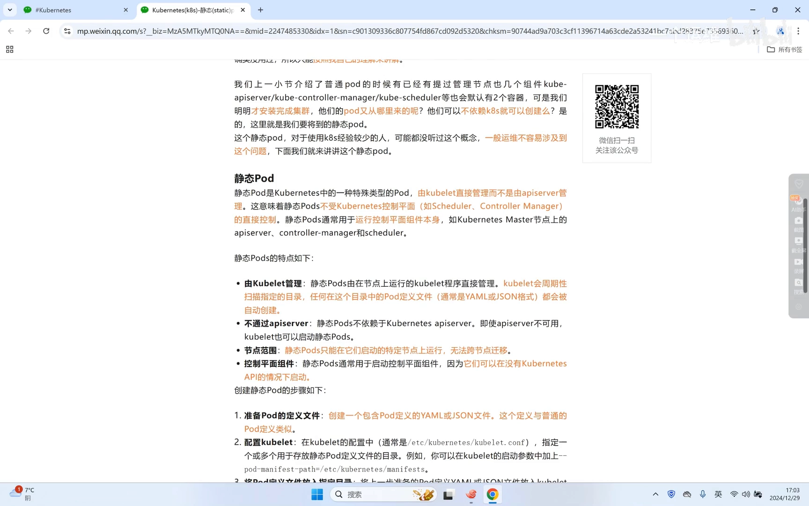
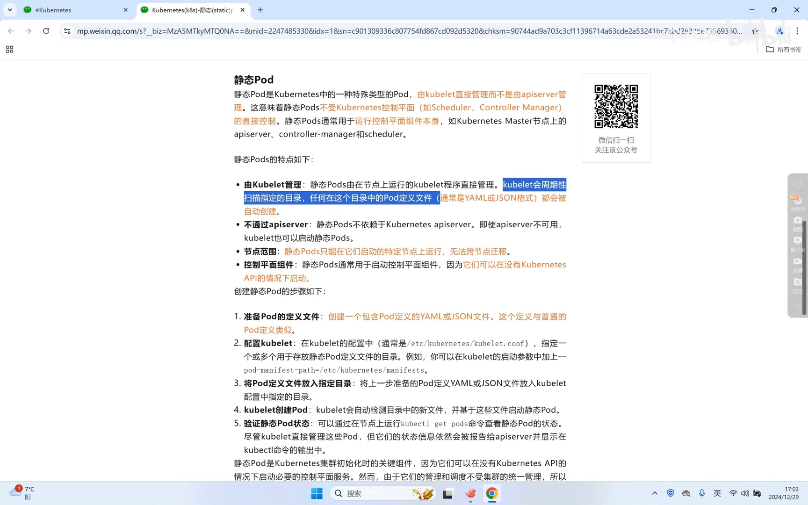
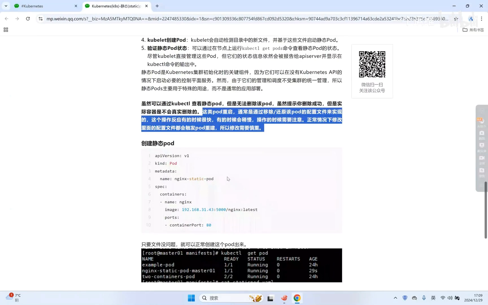
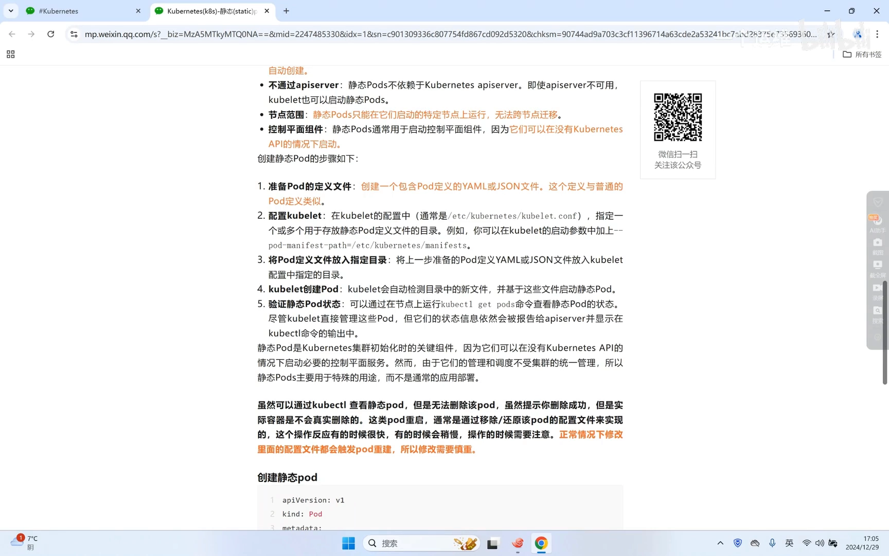
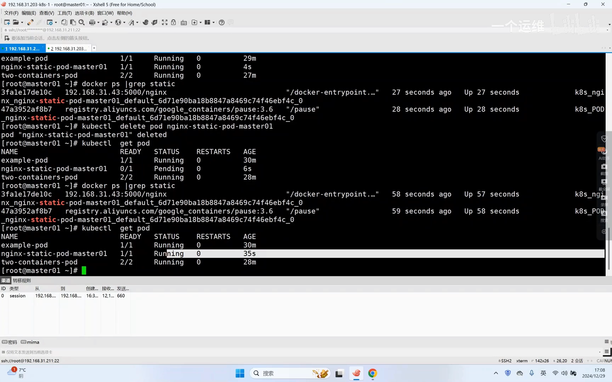
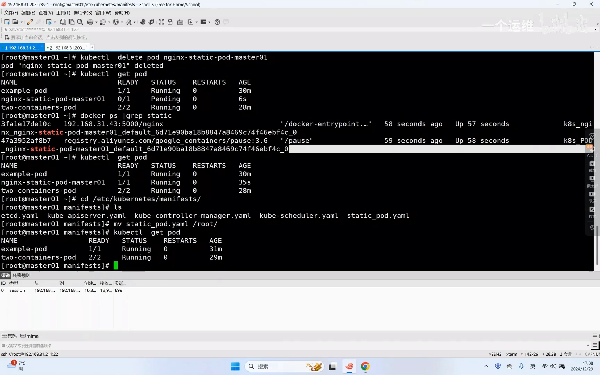
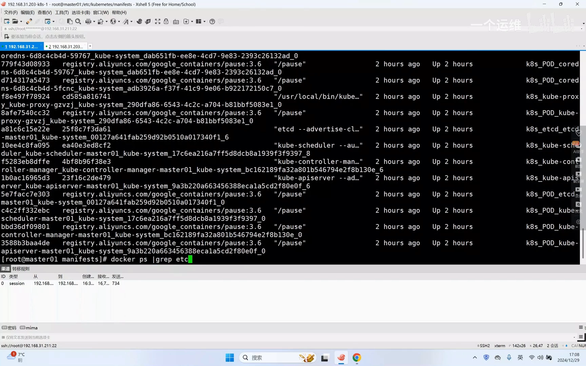
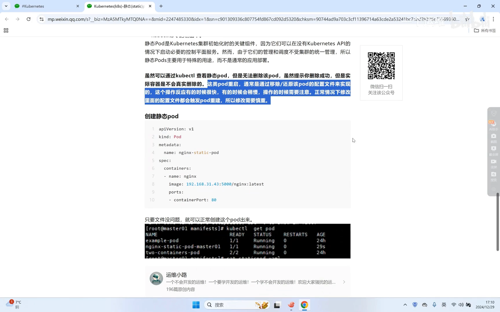

# 静态Pod：kubelet 直接管理的特殊 Pod

> 本文整理自视频 [Kubernetes(k8s)-静态(static)pod介绍](https://www.bilibili.com/video/BV13WwVeQEHV/)。

## 本讲要解决的核心问题（SCQA）

**背景**：一个正常跑起来的 Kubernetes 集群里，控制面的几个核心组件——kube-apiserver、kube-controller-manager、kube-scheduler——本身就是以 Pod 的形式跑在 master 节点上的，而且每个 Pod 里还都带着一个 pause 容器。

**冲突**：可 Pod 的创建本该由 Kubernetes 负责：先有控制面，调度器才有得调度。但控制面自己又是 Pod——"先有鸡还是先有蛋"？既然安装集群之前 Kubernetes 还不存在，那这些控制面 Pod 到底是从哪儿冒出来的？

**疑问**：在 Kubernetes 尚未启动、API Server 还不存在的时候，究竟是谁把一个 Pod 拉到节点上、让它先跑起来？

**回答（中心思想）**：答案是**静态 Pod（Static Pod）**——一种由节点上的 **kubelet 直接管理**、**不经过 API Server**、只存在于**指定节点**的特殊 Pod。它正是控制面组件能在"集群还没诞生"时先跑起来的关键，用来打破"Pod 依赖 Kubernetes、Kubernetes 又由 Pod 组成"这个循环嵌套。



## 一、先搞清楚：静态 Pod 是什么

静态 Pod 是 Kubernetes 中一种**特殊类型的 Pod**：它由 **kubelet 直接管理**，而不是由 kube-apiserver 管理。理解这一点的关键，是回忆一下安装集群的顺序——我们其实是**先安装了 kubelet**（以及 kubectl 命令、kubelet 守护进程），装好 kubelet 之后，**kubelet 就已经可以控制 Pod 了**，并不需要等整个 Kubernetes 部署完成。

所以静态 Pod 有一套和普通 Pod 完全不同的"权力结构"，它的特点可以归纳为三条：

1. **由 kubelet 直接管理**：kubelet 会**周期性地读取指定目录**，只要目录里出现符合规范的 Pod 清单文件，它就把文件里的内容**创建成 Pod**。
2. **不通过 kube-apiserver**：静态 Pod 不依赖 apiserver；哪怕 apiserver 不可用，kubelet 依然能把它拉起来。
3. **只在指定节点上存在，无法跨节点运行**：因为清单文件只放在某一个节点的目录里，而**只有当前节点的 kubelet** 才能读到这个文件、才能把它运行起来。[【跳转到 01:18】](https://www.bilibili.com/video/BV13WwVeQEHV/?t=118)



### 它到底用来干什么

静态 Pod 的典型用途，就是**运行控制面组件本身**：kube-scheduler、kube-controller-manager 这几个 Pod 本身就是静态 Pod，kube-apiserver 那几个 Pod 也是。正因如此，静态 Pod 是 **Kubernetes 集群初始化的关键组件**——它可以在 **API 还不存在**的时候先把这些服务启动起来，进而把它们组成一个集群。

## 二、怎么创建一个静态 Pod

创建静态 Pod 没有什么特别的写法，反而"朴素"得出奇：

1. **准备一份普通清单文件**：就是一个普通的 Pod 定义文件（YAML），指定名字、镜像等，和写普通 Pod 没有区别。
2. **把它丢进 kubelet 监听的目录**：默认情况下，这个目录是 kubelet 安装后定好的（常见为 `/etc/kubernetes/manifests/`）。
3. **等 kubelet 轮询到它**：kubelet 会自动轮询这个目录，读到文件就创建 Pod。

需要注意的是，**轮询有一定的延迟**：有可能文件一放进去就立刻创建出来，也有可能放进去后要等一小会儿才创建出来，这是它固有的轮询规则。[【跳转到 01:58】](https://www.bilibili.com/video/BV13WwVeQEHV/?t=118)



清单文件本身也很普通：

```yaml
apiVersion: v1
kind: Pod
metadata:
  name: nginx-static-pod
spec:
  containers:
    - name: nginx
      image: 192.168.31.43:5000/nginx:latest
      ports:
        - containerPort: 80
```



文件放进去之后，用 `kubectl get pod` 就能看到它——**名字后面会自动带上当前节点的名字**作为后缀，一眼就能认出这是个静态 Pod。

## 三、为什么 kubectl 删不掉静态 Pod

这是静态 Pod 最"反直觉"、也最容易让人踩坑的地方：

- 你可以通过 `kubectl get pod` **查看**静态 Pod 的状态；
- 但你**无法用 kubectl 直接管理它**——执行删除时，命令会提示"删除成功"，**可实际上容器并不会真的被删除**。[【跳转到 02:43】](https://www.bilibili.com/video/BV13WwVeQEHV/?t=243)



原因还是那句话：**权威不在 API，而在节点上的那个目录**。kubelet 的职责是"让节点的实际状态去匹配目录里的文件"，而不是"让目录去匹配 API"。所以你在 API 侧删除，只是在跟一个"镜像"较劲。

真正的操作方式只有一种——**回到节点上动那个文件**：

- 想**重启 / 删除**这个静态 Pod：把清单文件**移走或删除**，kubelet 感知到文件没了，Pod 就消失了；
- 想**修改**它：直接改文件，kubelet 感知到修改后也会重建；
- 用 `kubectl delete` 删除后，Pod 会显示为 **Pending**，但 `docker ps` 一看，容器其实还好好跑着。[【跳转到 03:58】](https://www.bilibili.com/video/BV13WwVeQEHV/?t=118)



## 四、看一眼真实的控制面：manifests 目录里的四个文件

回到那个 kubelet 监听的目录，**默认情况下它就有四个文件**——这四个文件其实就是控制面的那几个组件：

- `etcd.yaml`
- `kube-apiserver.yaml`
- `kube-controller-manager.yaml`
- `kube-scheduler.yaml`

也就是说，你的整个控制面，其实就是由这四份"撒在节点目录里"的清单文件拉起来的。[【跳转到 07:01】](https://www.bilibili.com/video/BV13WwVeQEHV/?t=421)



用 `docker ps` 可以看到这些组件对应的容器（每个还带着 pause 容器）正在运行：



这里还藏着一个有意思的细节：**kubelet 自己为什么没有被容器化？** 因为静态 Pod 需要**依赖 kubelet** 才能创建——如果 kubelet 也变成一个需要别人（控制面）来调度的 Pod，那就又绕回了"先有鸡还是先有蛋"。所以到目前为止，控制面组件里**只有 kubelet 没有做成容器化**，其他组件都已经容器化了。[【跳转到 08:12】](https://www.bilibili.com/video/BV13WwVeQEHV/?t=118)



## 小结

- **静态 Pod 的定义**：一种由 **kubelet 直接管理**（而非 apiserver）的特殊 Pod，它不依赖 Kubernetes 即可存在。
- **三条特点**：kubelet 周期性读取指定目录并创建；不经过 apiserver；只存在于**指定节点**，无法跨节点运行。
- **用途**：主要用来运行**控制面组件本身**（etcd、apiserver、controller-manager、scheduler），是集群能在"没有 API"时先启动起来的关键。
- **创建方式**：写一个普通 Pod 的 YAML → 放进 kubelet 监听的目录（默认 `/etc/kubernetes/manifests/`）→ kubelet 轮询到后自动创建。
- **不能删也不能改**：`kubectl delete` 只会提示成功，实际容器不会删除；要**移除 / 修改文件**才能真正生效。
- **本质**：静态 Pod 的"真实状态源"是**节点目录里的文件**，API 里的对象只是一个"镜像"。

## 关键术语速查

| 术语 | 一句话解释 |
| --- | --- |
| 静态 Pod（Static Pod） | 由 kubelet 直接管理、不经过 apiserver、只存在于指定节点的特殊 Pod。 |
| kubelet | 每个节点上的代理程序，负责把 Pod 在本节点上真正跑起来。 |
| 清单文件（manifest） | 描述 Pod 的 YAML/JSON 文件；放进 kubelet 目录就会被创建成静态 Pod。 |
| `/etc/kubernetes/manifests/` | kubelet 默认监听的静态 Pod 目录，控制面组件就来自这里。 |
| 控制面组件 | etcd、kube-apiserver、kube-controller-manager、kube-scheduler，多以静态 Pod 形式运行。 |
| pause 容器 | 每个 Pod 里承载网络命名空间的"占位"容器。 |
