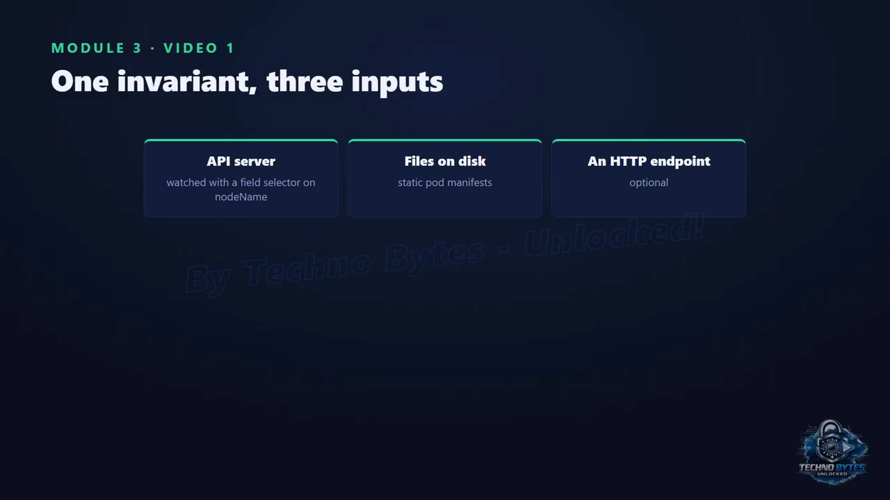
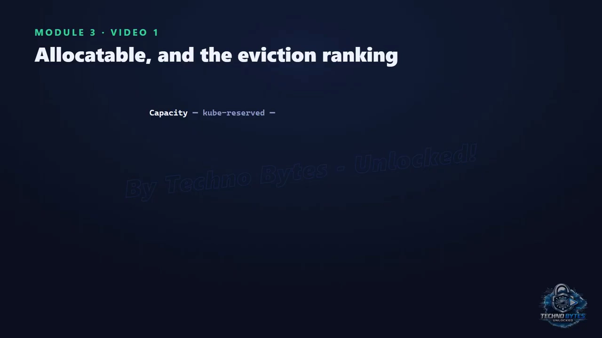
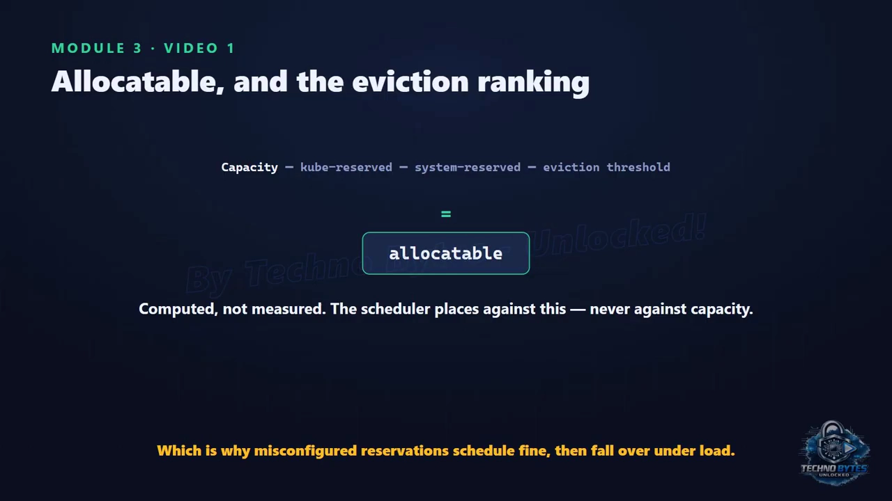
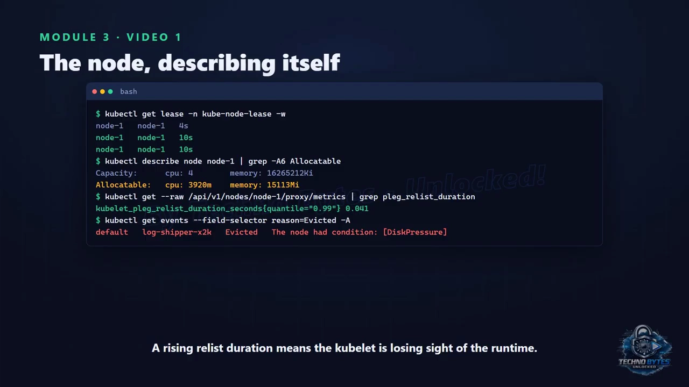

# 节点心跳被拆成两套：kubelet 为什么用「廉价 Lease」而不是频繁写 NodeStatus

## 本讲要解决的核心问题（SCQA）

**背景**：你已经知道，`kubectl get nodes` 看到的那一行 `Ready`，是节点把自己的情况汇报给控制面之后的结果。节点上跑着 kubelet、容器运行时、kube-proxy 等组件，kubelet 负责把「这台机器上该跑哪些容器」落地。

**冲突**：但一个集群可能有几千个节点。如果每个节点都频繁地把「自己还活着」和「自己的完整状态」两件事一起上报，控制面（尤其是 etcd）很快就会被这些写入压垮——而在这种海量写入里，真正要抢救的信息（节点是不是还活着）反而会被淹没。

**疑问**：节点存活和节点状态，这两件事在实现上到底是怎么上报的？一台机器突然失联，控制面要过多久才知道？知道之后，上面的 Pod 又还要过多久才会被挪走？

**回答（中心思想）**：kubelet 把「心跳」**故意拆成两套**：一套是**廉价、高频**的 **Lease 续租**（约每 10 秒一次，只写一个极小对象），用来回答「节点还活着吗」；另一套是**昂贵、低频**的 **NodeStatus 全量上报**（写容量、可分配资源、conditions、镜像、地址等大对象），用来回答「节点现在长什么样」。控制面的节点控制器盯着 Lease，续租停了就标 `NotReady` 并打污点；Pod 不会立刻被驱逐——它们带着 300 秒的默认容忍，所以**默认从节点失联到 Pod 被驱逐，大约要 5 分半**。这不是 bug，而是对「短暂网络分区」的刻意让步。

> 本讲基于视频《Five Minutes to Evict — Inside the kubelet #18》整理，视频以机制讲解为主，本文保留了其中的关键结论与图解。

---

## 一、kubelet 只维护一条不变式：本节点的容器 = 分配给本节点的 Pod

kubelet 是整条协调链里**最后一个协调循环（reconciliation loop）**，它和前面那些循环有一个关键区别：它的「现实」不再是另一个 API，而是一台**真实的 Linux 机器**——内存有限、磁盘会被写满（[【跳转到 00:00】](https://www.youtube.com/watch?v=ZtI5payqG60&t=0)）。

它只维护一条不变式：**这台节点上实际运行的容器，应该和分配给这台节点的 Pod 一致。**

为了得到「该跑哪些 Pod」的输入，kubelet 把三个来源**合并成一个通道**（[【跳转到 00:25】](https://www.youtube.com/watch?v=ZtI5payqG60&t=25)）：



1. **从 API Server watch**——但带着一个按节点名过滤的字段选择器（field selector），所以 kubelet **只看得到分配给自己节点的 Pod**，看不到整个集群；
2. **磁盘上的静态 Pod 清单**（static pod manifest）；
3. **一个可选的 HTTP 端点**。

关键点在于：三个来源**合并**之后，同步循环**根本分不出一个 Pod 是从哪来的**——这恰恰是静态 Pod 能用来引导（bootstrap）控制面的原因：kubelet 对它们没做任何特殊处理，它**真的分辨不出来**（[【跳转到 00:50】](https://www.youtube.com/watch?v=ZtI5payqG60&t=50)）。

同步循环本身是**按 Pod** 进行的：每个 Pod 一个 worker，执行同步函数——计算期望状态、确保 sandbox 存在、确保每个容器处于正确状态、执行探针、上报状态。**同一个 Pod 的工作串行，不同 Pod 之间并行**，所以一个卡住的容器不会拖垮整台节点。

## 二、kubelet 怎么知道「现实变了」：PLEG 每秒重新盘点一次

那么 kubelet 怎么发现现实发生了变化？靠 **PLEG（Pod Lifecycle Event Generator，Pod 生命周期事件生成器）**：它大约**每秒**向运行时**重新列出（relist）**所有容器，与自己的缓存做差分，合成出生命周期事件，去唤醒对应的 Pod worker（[【跳转到 00:75/01:15】](https://www.youtube.com/watch?v=ZtI5payqG60&t=75)）。

这又是**电平触发（level-triggered）**的设计：kubelet **不订阅**容器事件，而是**在定时器上重新观察**现实。代价是：**relist 的耗时**会随容器数量和运行时的响应速度增长。如果某次 relist 太慢，kubelet 会报告自己**不健康**，抛出一条你迟早会见到的消息：**`PLEG is not healthy`**。这条消息的含义是**节点「瞎了」**，而不是某个容器失败了——所以它通常和磁盘或运行时问题一起出现，而不是和应用程序问题一起出现（[【跳转到 01:00】](https://www.youtube.com/watch?v=ZtI5payqG60&t=100)）。

## 三、心跳为什么分成两套：大对象频繁写 etcd 太贵

**心跳被刻意拆成两套**，拆分的理由是一个关于「规模」的好教训（[【跳转到 01:25】](https://www.youtube.com/watch?v=ZtI5payqG60&t=125)）：


- **NodeStatus 全量更新是一个大对象**：它携带容量（capacity）、可分配量（allocatable）、conditions、镜像、地址等一大堆内容。让每个节点都**频繁**写这么一大坨，本身就是一个 etcd 扩展性问题——**「存活上报」的写放大正在压垮系统**（视频里说这是视频 13 讲过的那套 etcd 故事）。
- 于是**存活检测被搬到 Lease 对象**上：它位于**自己的命名空间**里，**极小**，大约**每 10 秒续租一次**。
- **全量状态写入依然存在**，但**相对稀少**。

**节点控制器（node controller）盯着这些 Lease**：当续租在**宽限期（grace period）**内都停了，它就把节点标记为 `NotReady` 并**打上一个污点（taint）**。

## 四、从心跳停止到 Pod 被驱逐：默认约 5 分半

这里有个**值得掐表算一遍**的细节，因为事故中大家常被它惊到（[【跳转到 01:50】](https://www.youtube.com/watch?v=ZtI5payqG60&t=150)）：**节点上的 Pod 并不会立刻被驱逐**。它们身上带着针对那个污点的**默认容忍（toleration）**，容忍时限是 **300 秒 = 5 分钟**。


于是整条时序是：

1. **续租停止**；
2. 大约 **40 秒**后，节点被标记 `NotReady`；
3. 再经过 **5 分钟**（300 秒），Pod 才被驱逐、才能在别处重新调度。

**默认从节点失联到 Pod 被驱逐，大约 5 分半**。这既不是 bug，也不是「慢」——它是针对**短暂网络分区**的刻意缓冲：把一个只是短暂失联的节点上的所有 Pod 都驱逐掉，破坏性远大于多等一会儿。但它也意味着：**如果你盯着一台正在挂掉的节点，指望负载几秒钟内搬走，你会花 5 分钟怀疑人生**。这个数字值得在你需要它之前就先记住。

## 五、Allocatable 是算出来的，不是量出来的

接下来是两个决定「一个节点实际能干什么」的数字（[【跳转到 02:00】](https://www.youtube.com/watch?v=ZtI5payqG60&t=200)）：



**可分配量（allocatable）是计算出来的，不是测量出来的**，公式是：

```
Allocatable = Capacity
            − 为 kubelet 与其它 Kubernetes 组件预留的部分
            − 为操作系统预留的部分
            − 驱逐阈值（eviction threshold）
```

**调度器是按 allocatable 放置负载的，从不按 capacity**。这就解释了为什么一台标称 16 GiB 内存的节点**永远不会把 16 GiB 全部提供给 Pod**；也解释了为什么**预留（reservation）配置错误**会产生这样一种节点：调度时看起来完美运转，一旦上量就崩掉。

## 六、压力驱逐：kubelet 作为本地资源仲裁者

然后是**驱逐（eviction）**——这里 kubelet 扮演的是**本地资源仲裁者**（[【跳转到 02:25】](https://www.youtube.com/watch?v=ZtI5payqG60&t=225)）。它盯着一组信号：**可用内存、节点文件系统上的可用磁盘、镜像文件系统上的可用磁盘、可用进程 ID（PID）**。每个信号都有：**软阈值**（带一个宽限期）和**硬阈值**（没有宽限期）。

在压力下，它**先尝试不驱逐任何东西就回收资源**：垃圾回收掉已死的容器和不再使用的镜像。如果还不够，才开始驱逐 Pod。而**驱逐的顺序，就是这支视频最实用的干货**（[【跳转到 02:50】](https://www.youtube.com/watch?v=ZtI5payqG60&t=250)）：



- 首先按 **Pod 是否超出它自己的 requests** 排名；
- 然后按 **QoS 等级**：**BestEffort 最先，Burstable 中间，Guaranteed 最后**。

这意味着 **QoS 等级不是一个为了文档而贴的标签**——它是**从你的 requests 与 limits 自动推导出来的「生存排序」**，取决于它们是否相等。这也正是「**对自己在意的东西，把 requests 设成等于 limits**」这条建议的全部实用论据：不是为了性能，也不是为了公平，而是为了**驱逐顺序**。

## 七、七个命令看穿全部机制

视频最后给了**七个命令**，用它们可以把上面每一段机制都对到证据上（[【跳转到 02:75】](https://www.youtube.com/watch?v=ZtI5payqG60&t=275)）：

1. **看 node-lease 命名空间里的 Lease**：你会看到 `renewTime` 大约每 10 秒跳动一次——这正是从全量状态写入中拆出来的「快速心跳」，目的就是不让存活上报压垮 etcd；
2. **`describe` 一个节点**，把 `conditions`、`capacity`、`allocatable` 一起读：那个算出来的值（allocatable）与 capacity 之间的差，就是你的预留加驱逐阈值；
3. 同时可以看到 kubelet 在驱逐信号越线时设置的**压力 conditions**；
4. 通过 API Server 的 **node proxy** 拉 kubelet 的 **PLEG relist 指标**：这个数字反映的是「kubelet 对现实的认知」的健康度，它比任何其它东西都更早变化；
5. 通过 config 端点读 kubelet 自身配置，过滤出**驱逐阈值与预留**：这些才是 allocatable 计算与驱逐决策背后的真实数字，而它们**经常不是人们以为的那样**；
6. **列出全集群的 evicted 事件**：这就是本地仲裁者按我们刚讲的顺序行动的结果；
7. 读 Pod 的 **QoS 等级**（你没设过这个字段，它由 requests/limits 推导而来，代表你在驱逐队列里的位置），以及 Pod 的 **Ready condition**——它由 kubelet 的 **status manager** 写入，一路决定到 Service 的成员资格。


## 小结



- kubelet **只做一件事**：把「分配给本节点的 Pod」和「本节点上的容器」对齐；它把静态 Pod 文件、HTTP 来源和 API watch 合并进**同一个同步循环**——这正是静态 Pod 能工作的原因。
- **PLEG 靠 relist 而非订阅**（又是电平触发），它的耗时就是「kubelet 对现实认知」的健康度。
- **心跳被拆成两块**：**廉价高频的 Lease** 与**昂贵低频的状态写入**——因为存活上报本身就是个规模问题。
- **默认从节点故障到 Pod 被驱逐约 5 分半**（40 秒判 NotReady + 5 分钟容忍），是**刻意**的。
- **Allocatable = capacity − 预留 − 阈值**，调度器永远看不到被扣掉的那部分。
- **驱逐按「超出 requests / 存活时长」再按 QoS 等级排名**，这让「Guaranteed」成为一种**生存属性**，而不只是一个标签。

## 关键术语速查

| 术语 | 一句话解释 |
| --- | --- |
| kubelet | 节点上的代理，唯一目标是让「本节点容器」与「分配来的 Pod」一致 |
| PLEG | Pod 生命周期事件生成器；约每秒 relist 运行时容器并与缓存差分，合成事件唤醒 Pod worker |
| 电平触发（level-triggered） | 不订阅事件，而是在定时器上重新观察现状；实现更简单、更抗丢事件 |
| NodeStatus | 节点的全量状态对象（capacity、allocatable、conditions、images、addresses），大而写得不频繁 |
| Lease | 极小对象，约每 10 秒续租一次，专门承载「节点是否存活」的快速心跳 |
| node controller | 控制面里监视 Lease 的组件；续租超宽限期就把节点标 NotReady 并打污点 |
| NotReady 污点与容忍 | 节点被判失联后被打上污点，Pod 默认带 300 秒容忍，所以不会立刻被驱逐 |
| Allocatable | `capacity − 预留（kubelet/系统）− 驱逐阈值`；调度器按它而非 capacity 放置负载 |
| 驱逐（eviction） | kubelet 本地资源仲裁：先 GC 死容器/无用镜像，再按「超 requests→QoS 等级」顺序驱逐 Pod |
| QoS 等级 | 由 requests/limits 自动推导（BestEffort/Burstable/Guaranteed），决定 Pod 在驱逐队列里的位置 |
