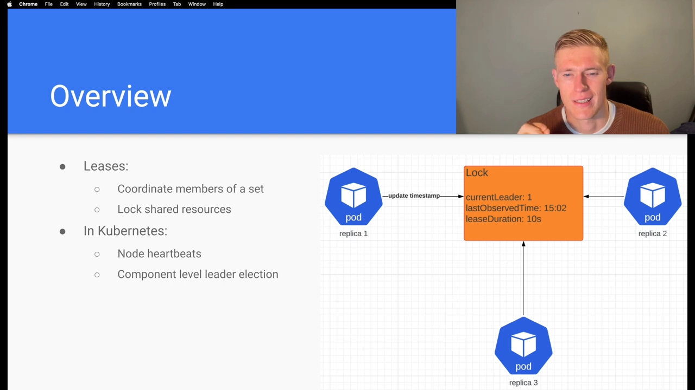
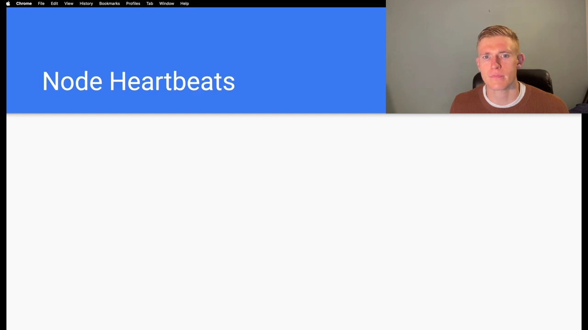
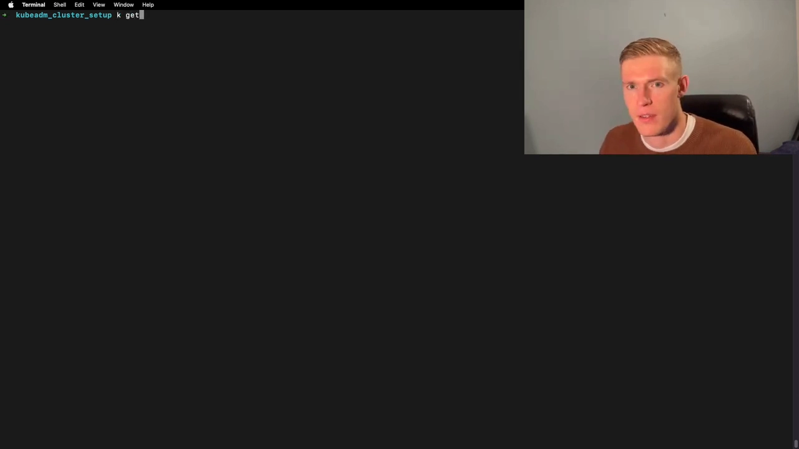
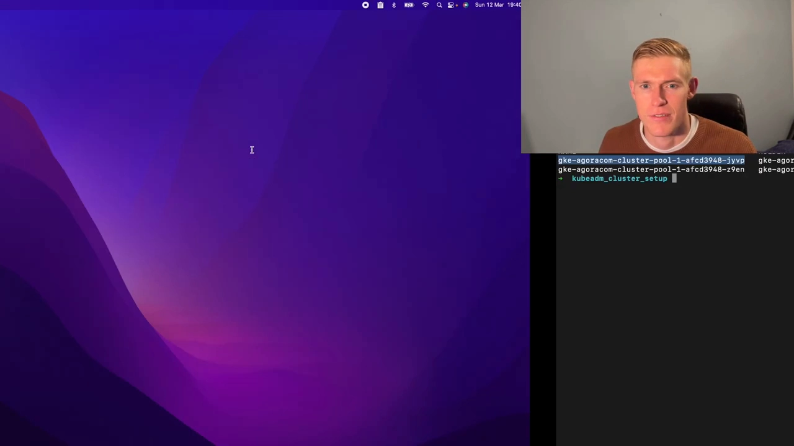
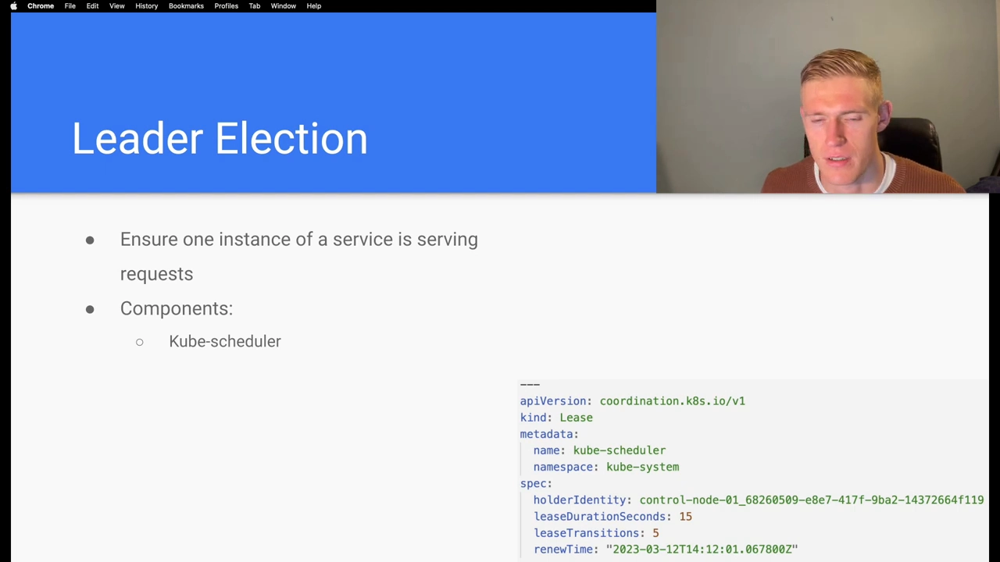
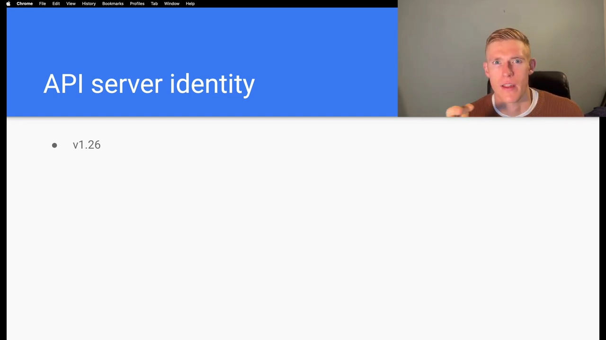

# Lease 对象与节点心跳：kube-node-lease 里的「续租」是怎么判断节点存活的

## 本讲要解决的核心问题（SCQA）

**背景**：Kubernetes 里有很多「希望同一时刻只有一个实例在工作」的场景，也有「几千个节点各自汇报自己还活着」的需求。这两件事看起来毫不相干，却都靠一种叫做 **租约（Lease）** 的机制来落地——Lease 是分布式系统里用来**协调一组成员、给共享资源加锁**的通用原语。

**冲突**：节点心跳明明只是「我还活着」这一句话，为什么要在 API 里专门放一种对象来承载它？这个对象长什么样、存在哪里、多久更新一次？除了节点心跳，还有谁在用 Lease？

**疑问**：既然节点存活是靠 Lease，那么「节点掉线」在数据上到底是怎么被发现的？我们怎么用 `kubectl` 亲眼看到这个过程？

**回答（中心思想）**：Kubernetes 在 `coordination.k8s.io` API 组里实现了 Lease 对象，并把它**同时用于两件事**：**节点心跳**（每个节点在 `kube-node-lease` 命名空间里有一个 Lease，kubelet 每隔约 10 秒把它的 `renewTime` 刷新一次，节点租约时长是 **40 秒**）与**组件级领导者选举**（`kube-scheduler`、`kube-controller-manager`、`cloud-controller-manager` 等）。控制面**只看 Lease 上的时间戳**就能判断节点是否可用；一旦续租超过时长没发生，就说明这个成员「出局」。此外从 1.26 起，每个 apiserver 实例也拥有自己的 Lease，用来标识实例、支撑实例间的协调。

> 本讲基于视频《Lease API | Kubernetes》整理，视频里有大量 `kubectl` 实测，本文保留了其中的关键截图。

---

## 一、Lease 是分布式系统的通用原语，在 K8s 里有两种用法

先说什么是 Lease（[【跳转到 00:34】](https://www.youtube.com/watch?v=ttPYCQ922mo&t=34)）：**在分布式系统里，Lease 用来协调一个集合里的成员、给共享资源加锁。** 它是「一段时间内的独占权」，持有者必须在期限内不断续租，否则权限自动失效。



在 Kubernetes 里，它被用于**两件事**：

1. **节点心跳（Node heartbeats）**——监控集群里节点的健康；
2. **组件级领导者选举（component-level leader election）**——例如让一个高可用部署里**同一时刻只有一个成员**对外服务。

## 二、Lease 的模型：一个「锁 + 最后观察时间 + 时长」

用一个领导者选举的例子来理解 Lease 的字段（[【跳转到 00:59】](https://www.youtube.com/watch?v=ttPYCQ922mo&t=59)）：假设我们有一组三副本的高可用集合：

- 某个时刻，**replica-1 持有这把锁**；
- 锁里记录了**当前领导者是 replica-1**，以及一个**「最后观察时间」（last observed time）**，由 replica-1 **定期刷新**；
- 还有一个**租约时长（lease duration）**，比如 **10 秒**——意思是 replica-1 **至少每 10 秒**就得把「最后观察时间」更新一次。

一旦**租约到期、最后观察时间超过了这个时长**，集合里**其它成员就能抢到锁**、开始对外服务（[【跳转到 01:09】](https://www.youtube.com/watch?v=ttPYCQ922mo&t=109)）。这就是「希望只有一个成员服务」时维持高可用的方式——**靠续租是否及时来判断持有者是否还健康**。

## 三、节点心跳：每个节点在 kube-node-lease 里有一个 Lease

Kubernetes 也用这套 Lease API 来做**节点心跳**，从而监控节点健康（[【跳转到 01:34】](https://www.youtube.com/watch?v=ttPYCQ922mo&t=134)）：



- **每个节点**都会在 **`kube-node-lease`** 命名空间里被创建**一个 Lease 对象**；
- **kubelet**（我们的节点代理）**向这个 Lease 对象发送更新请求**；
- Kubernetes API 就是**通过 Lease 上的时间戳**得知节点健康、判断节点可用性的。

## 四、用 kubectl 实测：在终端里看节点心跳

视频里直接拉了终端来演示（[【跳转到 03:00】](https://www.youtube.com/watch?v=ttPYCQ922mo&t=180)）。执行：

```bash
kubectl get leases -n kube-node-lease
```

就能看到 `kube-node-lease` 命名空间，以及**每个节点对应一个 Lease**（[【跳转到 03:05】](https://www.youtube.com/watch?v=ttPYCQ922mo&t=185)）：



再 `describe` 某个 Lease 看细节（[【跳转到 03:27】](https://www.youtube.com/watch?v=ttPYCQ922mo&t=207)）：



可以观察到三个关键点（[【跳转到 03:57】](https://www.youtube.com/watch?v=ttPYCQ922mo&t=237)）：

- 这个 Lease 的 **owner 是一个 Node**，并且**节点名与 Lease 名相同**；
- 用于监控节点健康的这类 Lease，其**租约时长是 40 秒**；
- 这里的 **`renewTime` 基本就是当前时间**——因为 **kubelet 每 10 秒**就发一次更新请求，所以它会**被定期刷新**（对比两次查看，`renewTime` 会往前走）。

**对照前文**：节点心跳的场景里，**「至少每 10 秒续租一次、40 秒内没续上就算掉线」**——这正是控制面判定节点存活的依据。

## 五、同一套 Lease 的另一半用途：组件级领导者选举

回到领导者选举（[【跳转到 04:29】](https://www.youtube.com/watch?v=ttPYCQ922mo&t=269)）：它用来保证同一时刻**只有一个服务实例**在对外服务。使用 Lease 做选举的组件包括（[【跳转到 04:54】](https://www.youtube.com/watch?v=ttPYCQ922mo&t=294)）：



- **kube-scheduler**
- **kube-controller-manager**
- **cloud-controller-manager**（云控制器管理器）
- 视集群配置而定，可能还有其它组件

再跑一次 `kubectl get leases -n kube-system`，就能在 **`kube-system`** 命名空间里看到 kube-scheduler、kube-controller-manager（以及云厂商的 controller-manager，例如 GKE 集群里的 gcp-controller-manager）各自的 Lease（[【跳转到 05:04】](https://www.youtube.com/watch?v=ttPYCQ922mo&t=304)）。此时看 kube-scheduler 的 Lease，其**租约时长只要 15 秒**——不同用途的 Lease 时长并不一样。

## 六、1.26 起：apiserver 实例身份也用上了 Lease

最后，从 **Kubernetes 1.26** 开始，**API Server 也开始拥有 Lease**（[【跳转到 05:20】](https://www.youtube.com/watch?v=ttPYCQ922mo&t=320)）：



- **每一个 API Server 实例**（对应一个 apiserver Pod）都会**关联一个 Lease**；
- 它用来**标识 apiserver 实例**，让 apiserver 实例之间可以**协调**，也让**客户端能判断正在运行的实例数量**；
- 这本身实用价值有限，但它是**为后续功能打的地基**——如果你的应用需要知道「当前有哪些 apiserver 实例在跑」，现在就可以通过 Lease API 拿到。

## 小结

- **Lease 是分布式系统的通用原语**：协调成员、给共享资源加锁；在 K8s 里同时服务**节点心跳**与**组件领导者选举**。
- **节点心跳**：每个节点在 **`kube-node-lease`** 命名空间里有一个 Lease，**kubelet 约每 10 秒续租一次**，**节点租约时长 40 秒**；控制面靠 Lease 的**时间戳**判断节点可用性。
- Lease 的**所有者是 Node**，且**Lease 名 = 节点名**。
- **领导者选举**：`kube-scheduler`、`kube-controller-manager`、`cloud-controller-manager` 等用 Lease 选举，时长视组件而定（如 kube-scheduler 为 15 秒）。
- **从 1.26 起**，每个 **apiserver 实例**也拥有 Lease，用于标识实例、支撑协调与实例数发现。

## 关键术语速查

| 术语 | 一句话解释 |
| --- | --- |
| Lease（租约） | 分布式系统里「一段时间内的独占权」，持有者需在期限内续租，否则失效 |
| coordination.k8s.io | Lease 对象所在的 API 组 |
| kube-node-lease | 存放「每节点一个 Lease」的命名空间，专门承载节点心跳 |
| renewTime | Lease 上的续租时间戳，由持有者刷新；控制面据此判断成员/节点是否存活 |
| leaseDurationSeconds | 租约时长；超出这个时间没续租，就认为持有者出局 |
| 节点心跳 | kubelet 约每 10 秒刷新节点 Lease，节点租约时长 40 秒 |
| 领导者选举 | 用 Lease 保证同一时刻只有一个成员服务；用于 kube-scheduler 等控制面组件 |
| API server identity | 1.26+ 每个 apiserver 实例一个 Lease，用于标识与协调实例 |
